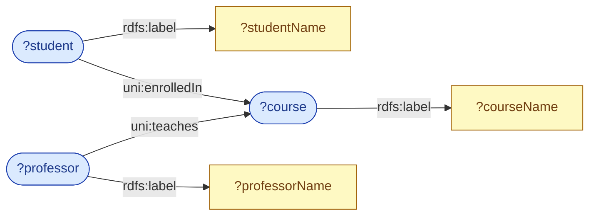
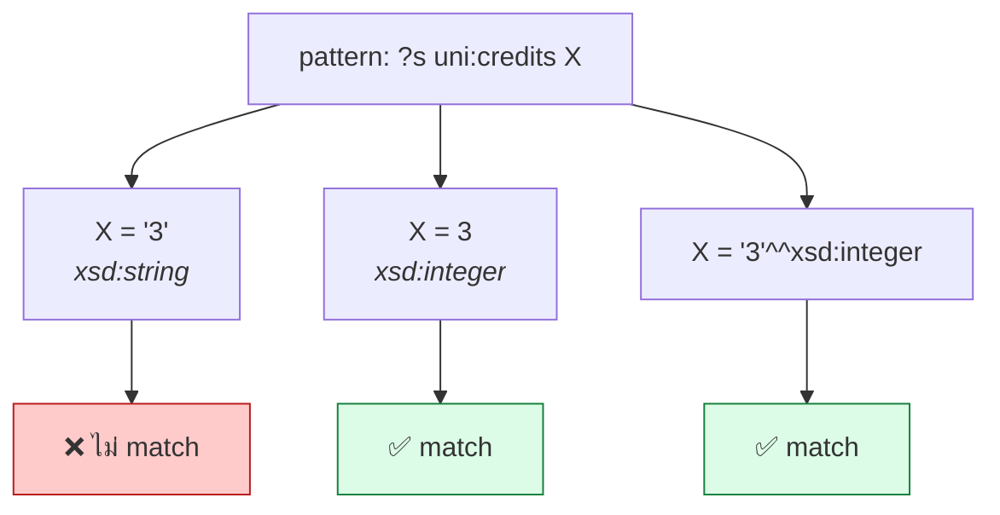

# 06.02 SELECT พื้นฐาน

`SELECT` เป็น query form ที่ใช้บ่อยที่สุด — คืนผลลัพธ์เป็นตารางของ **variable binding**
บทนี้สอน `SELECT`, `WHERE`, `PREFIX` และการเขียน triple pattern ให้ถูกต้อง
พร้อมตัวอย่างที่รันได้จริงบน [`data/university.ttl`](../data/university.ttl)

---

## รูปแบบพื้นฐาน

```sparql
PREFIX uni: <http://example.org/university#>

SELECT ?student
WHERE {
  ?student a uni:Student .
}
```

| ส่วน | ความหมาย |
| --- | --- |
| `PREFIX` | ประกาศตัวย่อ namespace (เหมือน `@prefix` ใน Turtle แต่**ไม่มีจุด**) |
| `SELECT ?student` | ตัวแปรที่ต้องการในผลลัพธ์ |
| `WHERE { ... }` | graph pattern ที่ต้อง match |
| `?student` | ตัวแปร ขึ้นต้นด้วย `?` |
| `a` | ตัวย่อของ `rdf:type` (เหมือน Turtle) |

Expected output:

| ?student |
| --- |
| `uni:alice` |
| `uni:bob` |
| `uni:carol` |
| `uni:dave` |

---

## เลือกหลายตัวแปร

```sparql
PREFIX uni:  <http://example.org/university#>
PREFIX rdfs: <http://www.w3.org/2000/01/rdf-schema#>

SELECT ?student ?name ?gpa
WHERE {
  ?student a          uni:Student ;
           rdfs:label ?name ;
           uni:gpa    ?gpa .
}
```

Expected output:

| ?student | ?name | ?gpa |
| --- | --- | --- |
| `uni:alice` | `"Alice Johnson"@en` | `3.85` |
| `uni:bob` | `"Bob Martinez"@en` | `3.20` |
| `uni:carol` | `"Carol Nguyen"@en` | `3.95` |

> ⚠️ **`uni:dave` หายไป!** เพราะไม่มี `uni:gpa` — ใน SPARQL ถ้า pattern ใดไม่ match ทั้งแถวจะหายไป
> ต้องใช้ `OPTIONAL` ถ้าต้องการเก็บไว้ (ดู [06.03](06.03-select-filters.md))

---

## `SELECT *` — เอาทุกตัวแปร

```sparql
PREFIX uni: <http://example.org/university#>

SELECT *
WHERE {
  uni:alice ?property ?value .
}
```

Expected output (ย่อ):

| ?property | ?value |
| --- | --- |
| `rdf:type` | `uni:Student` |
| `rdfs:label` | `"Alice Johnson"@en` |
| `uni:studentId` | `"S-2024-0421"` |
| `uni:gpa` | `3.85` |
| `uni:enrolledIn` | `uni:cs501` |
| `uni:enrolledIn` | `uni:cs601` |
| ... | ... |

> 💡 `SELECT * WHERE { <resource> ?p ?o }` เป็นวิธี **สำรวจข้อมูล** ที่เร็วที่สุด
> ใช้ทุกครั้งเมื่อเจอ dataset ใหม่

---

## Turtle shorthand ใน WHERE clause

WHERE clause ใช้ syntax เดียวกับ Turtle ทั้งหมด — รวมถึง `;` `,` `[]` `()` และ `a`

<table>
<tr><th width="50%">เขียนแบบยาว</th><th width="50%">เขียนแบบย่อ</th></tr>
<tr valign="top">
<td>

```sparql
PREFIX uni:  <http://example.org/university#>
PREFIX rdfs: <http://www.w3.org/2000/01/rdf-schema#>

SELECT ?s ?name ?c1 ?c2
WHERE {
  ?s rdf:type uni:Student .
  ?s rdfs:label ?name .
  ?s uni:enrolledIn ?c1 .
  ?s uni:enrolledIn ?c2 .
}
```

</td>
<td>

```sparql
PREFIX uni:  <http://example.org/university#>
PREFIX rdfs: <http://www.w3.org/2000/01/rdf-schema#>

SELECT ?s ?name ?c1 ?c2
WHERE {
  ?s a            uni:Student ;
     rdfs:label   ?name ;
     uni:enrolledIn ?c1 , ?c2 .
}
```

</td>
</tr>
</table>

---

## JOIN โดยอัตโนมัติ

**ตัวแปรเดียวกันในหลาย pattern = JOIN**

```sparql
PREFIX uni:  <http://example.org/university#>
PREFIX rdfs: <http://www.w3.org/2000/01/rdf-schema#>

SELECT ?studentName ?courseName ?professorName
WHERE {
  ?student   a              uni:Student ;
             rdfs:label     ?studentName ;
             uni:enrolledIn ?course .

  ?course    rdfs:label     ?courseName .

  ?professor uni:teaches    ?course ;
             rdfs:label     ?professorName .
}
```



Expected output:

| ?studentName | ?courseName | ?professorName |
| --- | --- | --- |
| `"Alice Johnson"@en` | `"Knowledge Graphs and Semantic Web"@en` | `"Jane Smith"@en` |
| `"Alice Johnson"@en` | `"Advanced Machine Learning"@en` | `"Jane Smith"@en` |
| `"Bob Martinez"@en` | `"Introduction to Programming"@en` | `"Jane Smith"@en` |
| `"Carol Nguyen"@en` | `"Calculus I"@en` | `"Robert Jones"@en` |
| `"Carol Nguyen"@en` | `"Introduction to Programming"@en` | `"Jane Smith"@en` |

**สังเกตว่าตัวแปร `?course` ทำหน้าที่เป็น join key ระหว่างสามส่วน** — ไม่ต้องเขียน `JOIN ... ON ...`

---

## เขียน IRI เต็ม (ไม่ใช้ PREFIX)

```sparql
SELECT ?name
WHERE {
  <http://example.org/university#alice>
    <http://www.w3.org/2000/01/rdf-schema#label> ?name .
}
```

ใช้ได้แต่อ่านยาก — **ควรใช้ `PREFIX` เสมอ**

---

## `BASE` — relative IRI

```sparql
BASE <http://example.org/university#>

SELECT ?name
WHERE {
  <alice> <http://www.w3.org/2000/01/rdf-schema#label> ?name .
}
```

---

## Literal ใน pattern

```sparql
PREFIX uni:  <http://example.org/university#>
PREFIX xsd:  <http://www.w3.org/2001/XMLSchema#>
PREFIX rdfs: <http://www.w3.org/2000/01/rdf-schema#>

# plain literal
SELECT ?s WHERE { ?s uni:studentId "S-2024-0421" . }

# typed literal -- ต้องตรง datatype!
SELECT ?s WHERE { ?s uni:credits "3"^^xsd:integer . }

# ตัวเลขเขียนย่อได้
SELECT ?s WHERE { ?s uni:credits 3 . }

# language-tagged literal -- ต้องตรง tag!
SELECT ?s WHERE { ?s rdfs:label "Alice Johnson"@en . }
```

### ⚠️ กับดัก datatype

```sparql
# ❌ ไม่ match -- "3" เป็น xsd:string แต่ข้อมูลเป็น xsd:integer
SELECT ?s WHERE { ?s uni:credits "3" . }

# ✅ match
SELECT ?s WHERE { ?s uni:credits 3 . }
SELECT ?s WHERE { ?s uni:credits "3"^^xsd:integer . }
```



### ⚠️ กับดัก language tag

```sparql
# ❌ ไม่ match -- ข้อมูลเป็น "Alice Johnson"@en
SELECT ?s WHERE { ?s rdfs:label "Alice Johnson" . }

# ✅ match
SELECT ?s WHERE { ?s rdfs:label "Alice Johnson"@en . }

# ✅ ปลอดภัยกว่า -- ใช้ FILTER
SELECT ?s WHERE {
  ?s rdfs:label ?l .
  FILTER(STR(?l) = "Alice Johnson")
}
```

---

## Blank node ใน pattern

```sparql
PREFIX uni: <http://example.org/university#>

# [] ใน WHERE = ตัวแปรที่ไม่มีชื่อ (ไม่ใช่ blank node จริง)
SELECT ?s WHERE {
  ?s uni:hasAddress [ uni:city "Paris" ] .
}

# เทียบเท่ากับ
SELECT ?s WHERE {
  ?s   uni:hasAddress ?addr .
  ?addr uni:city       "Paris" .
}
```

> ⚠️ `[]` และ `_:b1` ใน WHERE clause ทำหน้าที่เป็น **non-selectable variable**
> ไม่ใช่การอ้างถึง blank node ในข้อมูล

---

## ตัวอย่างจริง 5 query

```sparql
PREFIX uni:  <http://example.org/university#>
PREFIX rdfs: <http://www.w3.org/2000/01/rdf-schema#>
PREFIX foaf: <http://xmlns.com/foaf/0.1/>

# --- 1) รายวิชาทั้งหมดพร้อมรหัสและหน่วยกิต ---
SELECT ?code ?title ?credits
WHERE {
  ?course uni:courseCode ?code ;
          rdfs:label     ?title ;
          uni:credits    ?credits .
}
```

| ?code | ?title | ?credits |
| --- | --- | --- |
| `"CS101"` | `"Introduction to Programming"@en` | `3` |
| `"CS201"` | `"Data Structures"@en` | `3` |
| `"CS501"` | `"Knowledge Graphs and Semantic Web"@en` | `4` |
| ... | ... | ... |

```sparql
# --- 2) อาจารย์และวิชาที่สอน ---
SELECT ?profName ?courseCode
WHERE {
  ?prof uni:teaches ?course ;
        rdfs:label  ?profName .
  ?course uni:courseCode ?courseCode .
}
```

```sparql
# --- 3) นักศึกษาในภาควิชา CS ---
SELECT ?name
WHERE {
  ?student a          uni:Student ;
           uni:memberOf uni:csDept ;
           rdfs:label  ?name .
}
```

```sparql
# --- 4) ใครสอนวิชาที่ alice ลงเรียน ---
SELECT DISTINCT ?profName
WHERE {
  uni:alice uni:enrolledIn ?course .
  ?prof     uni:teaches    ?course ;
            rdfs:label     ?profName .
}
```

```sparql
# --- 5) เพื่อนร่วมชั้นของ alice (คนที่ลงวิชาเดียวกัน) ---
SELECT DISTINCT ?classmateName
WHERE {
  uni:alice  uni:enrolledIn ?course .
  ?classmate uni:enrolledIn ?course ;
             rdfs:label     ?classmateName .
  FILTER(?classmate != uni:alice)
}
```

---

## รันด้วย Python

```python
from rdflib import Graph

g = Graph().parse("data/university.ttl", format="turtle")

query = """
PREFIX uni:  <http://example.org/university#>
PREFIX rdfs: <http://www.w3.org/2000/01/rdf-schema#>

SELECT ?student ?name ?gpa
WHERE {
  ?student a          uni:Student ;
           rdfs:label ?name ;
           uni:gpa    ?gpa .
}
ORDER BY DESC(?gpa)
"""

for row in g.query(query):
    print(f"{str(row.name):30s} GPA = {row.gpa}")
```

Expected output:

```
Carol Nguyen                   GPA = 3.95
Alice Johnson                  GPA = 3.85
Bob Martinez                   GPA = 3.20
```

---

## Key Points

- `SELECT ?var` + `WHERE { pattern }` คือโครงสร้างพื้นฐาน — `PREFIX` **ไม่มีจุดปิดท้าย** (ต่างจาก Turtle)
- WHERE clause ใช้ **Turtle syntax ทั้งหมด** รวมถึง `;` `,` `[]` `a`
- **ตัวแปรเดียวกันในหลาย pattern = JOIN โดยอัตโนมัติ** ไม่ต้องเขียน `JOIN ... ON ...`
- ⚠️ **ถ้า pattern ใดไม่ match ทั้งแถวจะหายไป** — ต้องใช้ `OPTIONAL` ถ้าต้องการเก็บไว้
- ⚠️ **datatype ต้องตรงเป๊ะ**: `"3"` ไม่ match `"3"^^xsd:integer`
- ⚠️ **language tag ต้องตรงเป๊ะ**: `"Alice"` ไม่ match `"Alice"@en` — ใช้ `FILTER(STR(?l) = ...)` เพื่อความปลอดภัย
- `SELECT * WHERE { <resource> ?p ?o }` เป็นวิธีสำรวจ dataset ใหม่ที่เร็วที่สุด
- `[]` ใน WHERE เป็น **non-selectable variable** ไม่ใช่การอ้างถึง blank node ในข้อมูล
