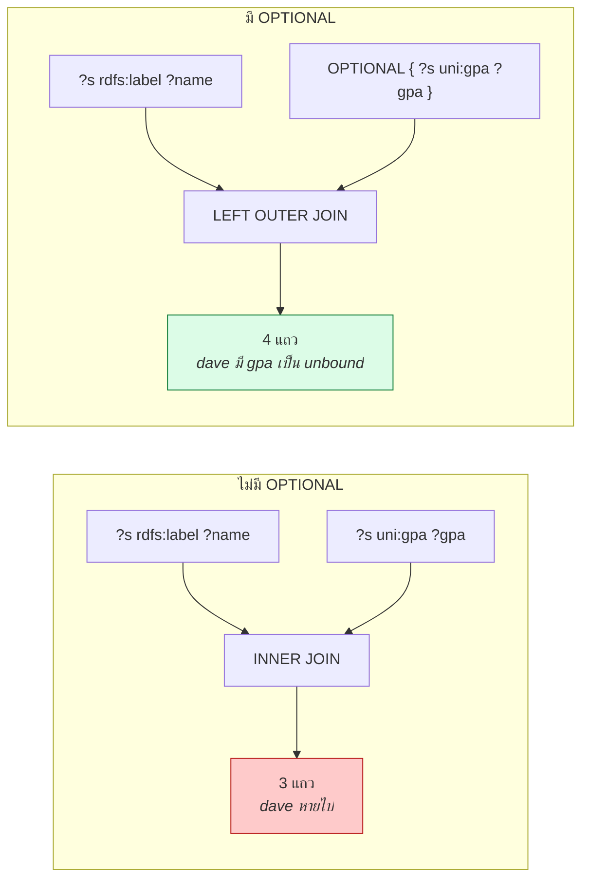
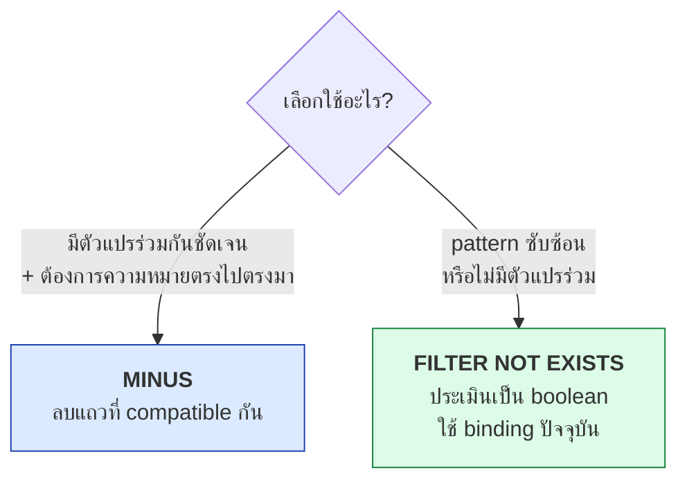

# 06.03 FILTER, OPTIONAL, UNION, MINUS และ NOT EXISTS

บทนี้ครอบคลุมกลไกที่ทำให้ SPARQL ยืดหยุ่นพอใช้กับข้อมูลจริง: **`FILTER`** กรองผลลัพธ์,
**`OPTIONAL`** จัดการข้อมูลที่อาจไม่มี, **`UNION`** รวมทางเลือก และ **`MINUS`/`NOT EXISTS`** สำหรับ negation
ซึ่งเป็นจุดที่คนสับสนมากที่สุดในทั้งภาษา

---

## `FILTER` — กรองผลลัพธ์

```sparql
PREFIX uni:  <http://example.org/university#>
PREFIX rdfs: <http://www.w3.org/2000/01/rdf-schema#>

SELECT ?name ?gpa
WHERE {
  ?student a          uni:Student ;
           rdfs:label ?name ;
           uni:gpa    ?gpa .
  FILTER(?gpa > 3.5)
}
```

Expected output:

| ?name | ?gpa |
| --- | --- |
| `"Alice Johnson"@en` | `3.85` |
| `"Carol Nguyen"@en` | `3.95` |

### Operator ที่ใช้ใน FILTER

| กลุ่ม | Operator |
| --- | --- |
| **เปรียบเทียบ** | `=` `!=` `<` `>` `<=` `>=` |
| **ตรรกะ** | `&&` `\|\|` `!` |
| **คณิตศาสตร์** | `+` `-` `*` `/` |
| **สมาชิก** | `IN` `NOT IN` |

```sparql
FILTER(?gpa > 3.5 && ?gpa < 4.0)
FILTER(?credits = 3 || ?credits = 4)
FILTER(?course IN (uni:cs101, uni:cs201, uni:cs301))
FILTER(!(?gpa < 3.0))
```

### Built-in function ที่ใช้บ่อย

| กลุ่ม | Function | ตัวอย่าง |
| --- | --- | --- |
| **ตรวจชนิด** | `isIRI`, `isBlank`, `isLiteral`, `isNumeric` | `FILTER(isIRI(?o))` |
| **ค่าของ term** | `STR`, `LANG`, `DATATYPE` | `FILTER(LANG(?l) = "en")` |
| **ตรรกะ** | `BOUND`, `sameTerm`, `IF`, `COALESCE` | `FILTER(!BOUND(?gpa))` |
| **String** | `STRLEN`, `SUBSTR`, `UCASE`, `LCASE`, `STRSTARTS`, `STRENDS`, `CONTAINS`, `REPLACE`, `REGEX`, `CONCAT` | `FILTER(CONTAINS(?name, "Alice"))` |
| **ตัวเลข** | `ABS`, `ROUND`, `CEIL`, `FLOOR`, `RAND` | `FILTER(ROUND(?gpa) = 4)` |
| **วันเวลา** | `NOW`, `YEAR`, `MONTH`, `DAY`, `HOURS`, `TIMEZONE` | `FILTER(YEAR(?date) = 2024)` |
| **Hash** | `MD5`, `SHA1`, `SHA256` | `BIND(SHA256(?email) AS ?hash)` |

### ตัวอย่างใช้จริง

```sparql
PREFIX uni:  <http://example.org/university#>
PREFIX rdfs: <http://www.w3.org/2000/01/rdf-schema#>

# กรองภาษา
SELECT ?name WHERE {
  ?s rdfs:label ?name .
  FILTER(LANG(?name) = "en")
}

# ค้นหาข้อความ (case-insensitive)
SELECT ?course WHERE {
  ?course rdfs:label ?title .
  FILTER(REGEX(?title, "programming", "i"))
}

# กรองด้วย string function
SELECT ?course WHERE {
  ?course uni:courseCode ?code .
  FILTER(STRSTARTS(?code, "CS"))
}

# กรองตามช่วง
SELECT ?course WHERE {
  ?course uni:credits ?c .
  FILTER(?c >= 3 && ?c <= 4)
}
```

> ⚠️ **`FILTER` ทำงานหลัง pattern matching เสมอ** — ไม่ว่าจะวางไว้ตำแหน่งไหนใน block เดียวกัน
> `FILTER` มี scope เท่ากับ **group graph pattern `{ }` ที่มันอยู่**

---

## `OPTIONAL` — ข้อมูลที่อาจไม่มี

```sparql
PREFIX uni:  <http://example.org/university#>
PREFIX rdfs: <http://www.w3.org/2000/01/rdf-schema#>

SELECT ?name ?gpa
WHERE {
  ?student a          uni:Student ;
           rdfs:label ?name .
  OPTIONAL { ?student uni:gpa ?gpa }
}
```

Expected output:

| ?name | ?gpa |
| --- | --- |
| `"Alice Johnson"@en` | `3.85` |
| `"Bob Martinez"@en` | `3.20` |
| `"Carol Nguyen"@en` | `3.95` |
| `"Dave Wilson"@en` | *(unbound)* |

**`uni:dave` ปรากฏแล้ว** ต่างจาก [06.02](06.02-select-basics.md) ที่หายไป



**`OPTIONAL` = LEFT OUTER JOIN ของ SQL**

### OPTIONAL หลายอัน

```sparql
SELECT ?name ?gpa ?supervisor
WHERE {
  ?student a uni:Student ; rdfs:label ?name .
  OPTIONAL { ?student uni:gpa ?gpa }
  OPTIONAL { ?student uni:hasSupervisor ?supervisor }
}
```

แต่ละ `OPTIONAL` ทำงานอิสระ — ถ้า block หนึ่งไม่ match อีก block ยังทำงานได้

### ⚠️ ลำดับของ OPTIONAL สำคัญ

```sparql
# ผลลัพธ์อาจต่างกัน!
{ ?a ?b ?c OPTIONAL { ?d } OPTIONAL { ?e } }
{ ?a ?b ?c OPTIONAL { ?e } OPTIONAL { ?d } }
```

เพราะ `OPTIONAL` เป็น **left-associative** และ binding จาก block ก่อนหน้าส่งต่อไปยัง block ถัดไป

### FILTER ภายใน OPTIONAL

```sparql
# ✅ กรองภายใน OPTIONAL -- ยังได้ dave กลับมา (gpa unbound)
SELECT ?name ?gpa WHERE {
  ?s a uni:Student ; rdfs:label ?name .
  OPTIONAL { ?s uni:gpa ?gpa . FILTER(?gpa > 3.5) }
}

# ❌ กรองนอก OPTIONAL -- dave หายไปเพราะ ?gpa unbound ทำให้ FILTER เป็น false
SELECT ?name ?gpa WHERE {
  ?s a uni:Student ; rdfs:label ?name .
  OPTIONAL { ?s uni:gpa ?gpa }
  FILTER(?gpa > 3.5)
}
```

| Query | ผลลัพธ์ |
| --- | --- |
| FILTER ใน OPTIONAL | 4 แถว — bob และ dave มี `?gpa` unbound |
| FILTER นอก OPTIONAL | 2 แถว — alice, carol |

---

## `UNION` — ทางเลือก

```sparql
PREFIX uni:  <http://example.org/university#>
PREFIX rdfs: <http://www.w3.org/2000/01/rdf-schema#>

SELECT ?person ?name ?role
WHERE {
  {
    ?person a uni:Student ; rdfs:label ?name .
    BIND("student" AS ?role)
  }
  UNION
  {
    ?person a uni:Professor ; rdfs:label ?name .
    BIND("professor" AS ?role)
  }
}
```

Expected output:

| ?person | ?name | ?role |
| --- | --- | --- |
| `uni:alice` | `"Alice Johnson"@en` | `"student"` |
| `uni:bob` | `"Bob Martinez"@en` | `"student"` |
| `uni:carol` | `"Carol Nguyen"@en` | `"student"` |
| `uni:dave` | `"Dave Wilson"@en` | `"student"` |
| `uni:profSmith` | `"Jane Smith"@en` | `"professor"` |
| `uni:profJones` | `"Robert Jones"@en` | `"professor"` |

### UNION vs OPTIONAL

| | `UNION` | `OPTIONAL` |
| --- | --- | --- |
| ความหมาย | "อย่างใดอย่างหนึ่ง" (OR) | "ถ้ามี" (LEFT JOIN) |
| SQL | `UNION` | `LEFT OUTER JOIN` |
| จำนวนแถว | เพิ่มขึ้น | เท่าเดิมหรือเพิ่ม |
| ตัวแปรที่ unbound | ได้ | ได้ |

### ใช้ UNION แทน reasoner

```sparql
# ถ้าไม่มี reasoner — เขียน subclass ทุกตัวเอง
SELECT ?p WHERE {
  { ?p a uni:Student }   UNION
  { ?p a uni:Professor } UNION
  { ?p a uni:AdminStaff }
}

# ดีกว่า: ใช้ property path (ดู 06.05)
SELECT ?p WHERE {
  ?p a/rdfs:subClassOf* uni:Person .
}
```

---

## Negation: `MINUS` vs `NOT EXISTS`

### `NOT EXISTS`

```sparql
PREFIX uni:  <http://example.org/university#>
PREFIX rdfs: <http://www.w3.org/2000/01/rdf-schema#>

# นักศึกษาที่ไม่มี supervisor
SELECT ?name WHERE {
  ?student a uni:Student ; rdfs:label ?name .
  FILTER NOT EXISTS { ?student uni:hasSupervisor ?anySupervisor }
}
```

### `MINUS`

```sparql
SELECT ?name WHERE {
  ?student a uni:Student ; rdfs:label ?name .
  MINUS { ?student uni:hasSupervisor ?anySupervisor }
}
```

**ในกรณีข้างบนทั้งสองให้ผลเหมือนกัน** — แต่มีกรณีที่ต่างกันอย่างชัดเจน

### ⚠️ ความต่างที่สำคัญ

```sparql
# --- NOT EXISTS: ประเมิน pattern โดยใช้ binding ปัจจุบัน ---
SELECT ?s WHERE {
  ?s ?p ?o .
  FILTER NOT EXISTS { ?x ?y ?z }
}
# ผลลัพธ์: 0 แถว (เพราะ { ?x ?y ?z } มี match เสมอถ้า graph ไม่ว่าง)

# --- MINUS: ลบเฉพาะแถวที่ "แชร์ตัวแปร" กัน ---
SELECT ?s WHERE {
  ?s ?p ?o .
  MINUS { ?x ?y ?z }
}
# ผลลัพธ์: ทุกแถว (เพราะไม่มีตัวแปรร่วมกันเลย จึงไม่มีอะไรถูกลบ)
```



| | `MINUS` | `FILTER NOT EXISTS` |
| --- | --- | --- |
| ทำงานอย่างไร | ลบ solution ที่ **compatible** กับ pattern | ประเมิน pattern เป็น boolean ด้วย binding ปัจจุบัน |
| ไม่มีตัวแปรร่วม | **ไม่ลบอะไรเลย** | **ลบทุกแถว** (ถ้า pattern match) |
| ใช้ตัวแปรจากภายนอกได้ | ผ่านการ share variable | ✅ โดยตรง |
| ประสิทธิภาพ | มักเร็วกว่า | ขึ้นกับ engine |

> 💡 **หลักปฏิบัติ**: ใช้ **`FILTER NOT EXISTS`** เป็น default เพราะความหมายตรงกับที่คนคาดหวังมากกว่า

### `EXISTS` (บวก)

```sparql
# นักศึกษาที่ลงเรียนวิชาระดับบัณฑิตอย่างน้อยหนึ่งวิชา
SELECT ?name WHERE {
  ?student a uni:Student ; rdfs:label ?name .
  FILTER EXISTS {
    ?student uni:enrolledIn ?c .
    ?c a uni:GraduateCourse .
  }
}
```

---

## `BIND` และ `VALUES`

### `BIND` — สร้างตัวแปรใหม่

```sparql
PREFIX uni:  <http://example.org/university#>
PREFIX rdfs: <http://www.w3.org/2000/01/rdf-schema#>

SELECT ?name ?gpa ?grade
WHERE {
  ?s rdfs:label ?name ; uni:gpa ?gpa .
  BIND(
    IF(?gpa >= 3.75, "Excellent",
    IF(?gpa >= 3.25, "Good", "Satisfactory")) AS ?grade
  )
}
```

| ?name | ?gpa | ?grade |
| --- | --- | --- |
| `"Alice Johnson"@en` | `3.85` | `"Excellent"` |
| `"Bob Martinez"@en` | `3.20` | `"Satisfactory"` |
| `"Carol Nguyen"@en` | `3.95` | `"Excellent"` |

### `VALUES` — ระบุค่าที่ต้องการล่วงหน้า

```sparql
PREFIX uni:  <http://example.org/university#>
PREFIX rdfs: <http://www.w3.org/2000/01/rdf-schema#>

SELECT ?course ?title
WHERE {
  VALUES ?course { uni:cs101 uni:cs501 uni:ma101 }
  ?course rdfs:label ?title .
}
```

`VALUES` หลายตัวแปร:

```sparql
SELECT ?code ?credits WHERE {
  VALUES (?code ?credits) {
    ("CS101" 3)
    ("CS501" 4)
  }
  ?course uni:courseCode ?code ; uni:credits ?credits .
}
```

> 💡 `VALUES` มีประโยชน์มากใน **federated query** เพราะช่วยจำกัดจำนวน request ที่ส่งไปยัง endpoint ปลายทาง

---

## ตัวอย่างรวมทุกอย่าง

```sparql
PREFIX uni:  <http://example.org/university#>
PREFIX rdfs: <http://www.w3.org/2000/01/rdf-schema#>

SELECT ?name ?role ?gpa ?status
WHERE {
  # UNION: เอาทั้งนักศึกษาและอาจารย์
  {
    ?person a uni:Student ; rdfs:label ?name .
    BIND("student" AS ?role)
    OPTIONAL { ?person uni:gpa ?gpa }
  }
  UNION
  {
    ?person a uni:Professor ; rdfs:label ?name .
    BIND("professor" AS ?role)
  }

  # NOT EXISTS: ตัดคนที่ไม่ได้อยู่ภาควิชาใดเลย
  FILTER EXISTS { ?person uni:memberOf ?dept }

  # FILTER: เอาเฉพาะ label ภาษาอังกฤษ
  FILTER(LANG(?name) = "en")

  # BIND: คำนวณสถานะ
  BIND(IF(BOUND(?gpa) && ?gpa >= 3.5, "honors", "regular") AS ?status)
}
ORDER BY ?role DESC(?gpa)
```

Expected output:

| ?name | ?role | ?gpa | ?status |
| --- | --- | --- | --- |
| `"Jane Smith"@en` | `"professor"` | | `"regular"` |
| `"Robert Jones"@en` | `"professor"` | | `"regular"` |
| `"Carol Nguyen"@en` | `"student"` | `3.95` | `"honors"` |
| `"Alice Johnson"@en` | `"student"` | `3.85` | `"honors"` |
| `"Bob Martinez"@en` | `"student"` | `3.20` | `"regular"` |
| `"Dave Wilson"@en` | `"student"` | | `"regular"` |

---

## Key Points

- **`FILTER`** กรองหลัง pattern matching เสมอ และมี scope เท่ากับ group graph pattern `{ }` ที่มันอยู่
- Built-in function ครอบคลุม string (`REGEX`, `CONTAINS`, `STRSTARTS`), ตัวเลข, วันเวลา และ hash
- **`OPTIONAL` = LEFT OUTER JOIN** — ทำให้แถวที่ขาดข้อมูลบางส่วนยังคงอยู่
- ⚠️ **`FILTER` ในกับนอก `OPTIONAL` ให้ผลต่างกัน** — นอก block จะตัดแถวที่ตัวแปร unbound ทิ้ง
- **`UNION`** = ทางเลือก (OR) เพิ่มจำนวนแถว; **`OPTIONAL`** = "ถ้ามี" ไม่ลดจำนวนแถว
- **`MINUS`** ลบเฉพาะแถวที่ **แชร์ตัวแปร**; **`FILTER NOT EXISTS`** ประเมินเป็น boolean ด้วย binding ปัจจุบัน
- **ใช้ `FILTER NOT EXISTS` เป็น default** เพราะความหมายตรงกับที่คนคาดหวังมากกว่า
- **`BIND`** สร้างตัวแปรใหม่จากการคำนวณ; **`VALUES`** ระบุชุดค่าล่วงหน้า (มีประโยชน์มากใน federated query)
