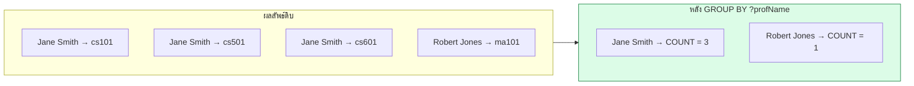

# 06.04 SELECT ขั้นสูง: Aggregate, Grouping และ Subquery

บทนี้ครอบคลุมส่วนที่ทำให้ SPARQL ตอบคำถามเชิงวิเคราะห์ได้จริง: **solution modifier** (`ORDER BY`, `LIMIT`, `DISTINCT`),
**aggregate function** (`COUNT`, `SUM`, `AVG`, ...), **`GROUP BY` / `HAVING`** และ **subquery**
ทั้งหมดนี้เป็นของใหม่ใน SPARQL 1.1

---

## Solution Modifiers

### `DISTINCT` และ `REDUCED`

```sparql
PREFIX uni: <http://example.org/university#>

# ตัดแถวซ้ำ
SELECT DISTINCT ?prof WHERE {
  ?prof uni:teaches ?course .
}

# REDUCED -- อนุญาตให้ engine ตัดซ้ำหรือไม่ก็ได้ (เร็วกว่าแต่ไม่รับประกัน)
SELECT REDUCED ?prof WHERE {
  ?prof uni:teaches ?course .
}
```

| | `DISTINCT` | `REDUCED` |
| --- | --- | --- |
| รับประกันไม่ซ้ำ | ✅ | ❌ |
| ประสิทธิภาพ | ช้ากว่า | เร็วกว่า |
| ใช้เมื่อ | ต้องการผลถูกต้อง | ผลซ้ำไม่เป็นไร |

### `ORDER BY`

```sparql
PREFIX uni:  <http://example.org/university#>
PREFIX rdfs: <http://www.w3.org/2000/01/rdf-schema#>

SELECT ?name ?gpa
WHERE {
  ?s rdfs:label ?name ; uni:gpa ?gpa .
}
ORDER BY DESC(?gpa) ASC(?name)
```

| ?name | ?gpa |
| --- | --- |
| `"Carol Nguyen"@en` | `3.95` |
| `"Alice Johnson"@en` | `3.85` |
| `"Bob Martinez"@en` | `3.20` |

**ลำดับการเรียงของ term ต่างชนิด** (จากน้อยไปมาก):

```
unbound  <  blank node  <  IRI  <  literal
```

### `LIMIT` และ `OFFSET`

```sparql
SELECT ?name ?gpa WHERE { ... }
ORDER BY DESC(?gpa)
LIMIT 10
OFFSET 20        # ข้าม 20 แถวแรก -- ใช้ทำ pagination
```

> ⚠️ **`LIMIT` โดยไม่มี `ORDER BY` ให้ผลที่ไม่แน่นอน** — engine อาจคืนแถวไหนก็ได้
> ต้องใส่ `ORDER BY` เสมอเมื่อทำ pagination

---

## Aggregate Functions

| Function | คืนอะไร | ตัวอย่าง |
| --- | --- | --- |
| `COUNT(?x)` | นับ (ไม่นับ unbound) | `COUNT(?course)` |
| `COUNT(DISTINCT ?x)` | นับค่าที่ไม่ซ้ำ | `COUNT(DISTINCT ?prof)` |
| `COUNT(*)` | นับทุกแถว | `COUNT(*)` |
| `SUM(?x)` | ผลรวม | `SUM(?credits)` |
| `AVG(?x)` | ค่าเฉลี่ย | `AVG(?gpa)` |
| `MIN(?x)` / `MAX(?x)` | ค่าน้อยสุด/มากสุด | `MAX(?gpa)` |
| `SAMPLE(?x)` | ค่าใดค่าหนึ่ง (สุ่ม) | `SAMPLE(?name)` |
| `GROUP_CONCAT(?x)` | ต่อเป็น string | `GROUP_CONCAT(?code; SEPARATOR=", ")` |

### Aggregate โดยไม่ GROUP BY

```sparql
PREFIX uni: <http://example.org/university#>

SELECT (COUNT(?s) AS ?totalStudents)
       (AVG(?gpa) AS ?avgGpa)
       (MAX(?gpa) AS ?maxGpa)
       (MIN(?gpa) AS ?minGpa)
WHERE {
  ?s a uni:Student ; uni:gpa ?gpa .
}
```

Expected output:

| ?totalStudents | ?avgGpa | ?maxGpa | ?minGpa |
| --- | --- | --- | --- |
| `3` | `3.6666666667` | `3.95` | `3.20` |

> ⚠️ **ต้องใช้ `(... AS ?var)` เสมอ** — เขียน `SELECT COUNT(?s)` เฉย ๆ ไม่ได้

---

## `GROUP BY`

```sparql
PREFIX uni:  <http://example.org/university#>
PREFIX rdfs: <http://www.w3.org/2000/01/rdf-schema#>

# นับจำนวนวิชาที่แต่ละอาจารย์สอน
SELECT ?profName (COUNT(?course) AS ?numCourses)
WHERE {
  ?prof uni:teaches ?course ;
        rdfs:label  ?profName .
}
GROUP BY ?profName
ORDER BY DESC(?numCourses)
```

Expected output:

| ?profName | ?numCourses |
| --- | --- |
| `"Jane Smith"@en` | `3` |
| `"Robert Jones"@en` | `1` |



### กฎของ `GROUP BY`

**ทุกตัวแปรใน `SELECT` ต้องอยู่ใน `GROUP BY` หรืออยู่ใน aggregate function**

```sparql
# ❌ ผิด -- ?courseCode ไม่ได้ group และไม่ได้ aggregate
SELECT ?profName ?courseCode (COUNT(?course) AS ?n)
WHERE { ... }
GROUP BY ?profName

# ✅ ถูก -- ใส่ใน GROUP BY
SELECT ?profName ?courseCode (COUNT(?course) AS ?n)
WHERE { ... }
GROUP BY ?profName ?courseCode

# ✅ ถูก -- ใช้ SAMPLE หรือ GROUP_CONCAT
SELECT ?profName (GROUP_CONCAT(?courseCode; SEPARATOR=", ") AS ?codes)
WHERE { ... }
GROUP BY ?profName
```

### `GROUP_CONCAT` — รวมค่าเป็นสตริง

```sparql
PREFIX uni:  <http://example.org/university#>
PREFIX rdfs: <http://www.w3.org/2000/01/rdf-schema#>

SELECT ?profName (GROUP_CONCAT(?code; SEPARATOR=", ") AS ?courses)
                 (COUNT(?course) AS ?n)
WHERE {
  ?prof uni:teaches    ?course ;
        rdfs:label     ?profName .
  ?course uni:courseCode ?code .
}
GROUP BY ?profName
ORDER BY DESC(?n)
```

Expected output:

| ?profName | ?courses | ?n |
| --- | --- | --- |
| `"Jane Smith"@en` | `"CS101, CS501, CS601"` | `3` |
| `"Robert Jones"@en` | `"MA101"` | `1` |

---

## `HAVING`

`HAVING` กรอง **หลัง** group — เทียบกับ `FILTER` ที่กรองก่อน

```sparql
PREFIX uni:  <http://example.org/university#>
PREFIX rdfs: <http://www.w3.org/2000/01/rdf-schema#>

# อาจารย์ที่สอนมากกว่า 2 วิชา
SELECT ?profName (COUNT(?course) AS ?n)
WHERE {
  ?prof uni:teaches ?course ; rdfs:label ?profName .
}
GROUP BY ?profName
HAVING (COUNT(?course) > 2)
```

Expected output:

| ?profName | ?n |
| --- | --- |
| `"Jane Smith"@en` | `3` |


**ลำดับการประมวลผล**: `WHERE` → `FILTER` → `GROUP BY` → `HAVING` → `SELECT` → `ORDER BY` → `LIMIT`

---

## Subquery

subquery คือ `SELECT` ซ้อนใน `WHERE` — **ทำงานก่อน** แล้วส่งผลลัพธ์ให้ query ภายนอก

```sparql
PREFIX uni:  <http://example.org/university#>
PREFIX rdfs: <http://www.w3.org/2000/01/rdf-schema#>

# หานักศึกษาที่มี GPA สูงสุด
SELECT ?name ?gpa
WHERE {
  ?s rdfs:label ?name ; uni:gpa ?gpa .

  {
    SELECT (MAX(?g) AS ?maxGpa)
    WHERE { ?x uni:gpa ?g }
  }

  FILTER(?gpa = ?maxGpa)
}
```

Expected output:

| ?name | ?gpa |
| --- | --- |
| `"Carol Nguyen"@en` | `3.95` |

### Subquery พร้อม LIMIT — top-N ต่อกลุ่ม

```sparql
PREFIX uni:  <http://example.org/university#>
PREFIX rdfs: <http://www.w3.org/2000/01/rdf-schema#>

# นักศึกษา 2 อันดับแรกตาม GPA พร้อมรายวิชาที่ลงเรียน
SELECT ?name ?courseCode
WHERE {
  {
    SELECT ?s ?name
    WHERE { ?s a uni:Student ; rdfs:label ?name ; uni:gpa ?gpa }
    ORDER BY DESC(?gpa)
    LIMIT 2
  }
  ?s uni:enrolledIn ?course .
  ?course uni:courseCode ?courseCode .
}
```

Expected output:

| ?name | ?courseCode |
| --- | --- |
| `"Carol Nguyen"@en` | `"MA101"` |
| `"Carol Nguyen"@en` | `"CS101"` |
| `"Alice Johnson"@en` | `"CS501"` |
| `"Alice Johnson"@en` | `"CS601"` |

> ⚠️ **subquery ทำงานจากในออกนอก (bottom-up)** — ต่างจาก SQL ที่ correlated subquery อ้างตัวแปรจากภายนอกได้
> SPARQL subquery **ไม่เห็นตัวแปรจาก query ภายนอก**

### วิธีจำลอง correlated subquery

```sparql
# ใช้ VALUES ส่งค่าเข้าไป
SELECT ?name ?n WHERE {
  VALUES ?dept { uni:csDept }
  ?dept rdfs:label ?name .
  {
    SELECT ?dept (COUNT(?s) AS ?n) WHERE {
      ?s uni:memberOf ?dept .
    }
    GROUP BY ?dept
  }
}
```

---

## ตัวอย่างเชิงวิเคราะห์ที่ใช้จริง

```sparql
PREFIX uni:  <http://example.org/university#>
PREFIX rdfs: <http://www.w3.org/2000/01/rdf-schema#>

# ---------- 1) สรุปจำนวนสมาชิกแต่ละภาควิชา ----------
SELECT ?deptName (COUNT(DISTINCT ?person) AS ?members)
WHERE {
  ?person uni:memberOf ?dept .
  ?dept   rdfs:label   ?deptName .
}
GROUP BY ?deptName
ORDER BY DESC(?members)
```

| ?deptName | ?members |
| --- | --- |
| `"Department of Computer Science"@en` | `5` |
| `"Department of Mathematics"@en` | `2` |

```sparql
# ---------- 2) หน่วยกิตรวมที่นักศึกษาแต่ละคนลงทะเบียน ----------
SELECT ?name (SUM(?credits) AS ?totalCredits) (COUNT(?course) AS ?numCourses)
WHERE {
  ?s a uni:Student ; rdfs:label ?name ; uni:enrolledIn ?course .
  ?course uni:credits ?credits .
}
GROUP BY ?name
ORDER BY DESC(?totalCredits)
```

| ?name | ?totalCredits | ?numCourses |
| --- | --- | --- |
| `"Alice Johnson"@en` | `8` | `2` |
| `"Bob Martinez"@en` | `6` | `2` |
| `"Carol Nguyen"@en` | `7` | `2` |

```sparql
# ---------- 3) วิชาที่มีนักศึกษามากที่สุด ----------
SELECT ?courseCode ?title (COUNT(?student) AS ?enrollment)
WHERE {
  ?student uni:enrolledIn ?course .
  ?course  uni:courseCode ?courseCode ;
           rdfs:label     ?title .
}
GROUP BY ?courseCode ?title
HAVING(COUNT(?student) >= 2)
ORDER BY DESC(?enrollment)
```

| ?courseCode | ?title | ?enrollment |
| --- | --- | --- |
| `"CS101"` | `"Introduction to Programming"@en` | `2` |

```sparql
# ---------- 4) เปอร์เซ็นต์นักศึกษาที่ได้เกียรตินิยม ----------
SELECT (?honors AS ?honorsCount) (?total AS ?totalCount)
       ((?honors * 100 / ?total) AS ?percentage)
WHERE {
  { SELECT (COUNT(?s) AS ?honors) WHERE { ?s uni:gpa ?g . FILTER(?g >= 3.5) } }
  { SELECT (COUNT(?s2) AS ?total) WHERE { ?s2 a uni:Student } }
}
```

| ?honorsCount | ?totalCount | ?percentage |
| --- | --- | --- |
| `2` | `4` | `50` |

---

## รันด้วย Python

```python
from rdflib import Graph

g = Graph().parse("data/university.ttl", format="turtle")

query = """
PREFIX uni:  <http://example.org/university#>
PREFIX rdfs: <http://www.w3.org/2000/01/rdf-schema#>

SELECT ?profName (COUNT(?course) AS ?n)
                 (GROUP_CONCAT(?code; SEPARATOR=", ") AS ?codes)
WHERE {
  ?prof uni:teaches ?course ; rdfs:label ?profName .
  ?course uni:courseCode ?code .
}
GROUP BY ?profName
ORDER BY DESC(?n)
"""

for row in g.query(query):
    print(f"{str(row.profName):20s} {row.n} วิชา: {row.codes}")
```

Expected output:

```
Jane Smith           3 วิชา: CS101, CS501, CS601
Robert Jones         1 วิชา: MA101
```

---

## Key Points

- **`DISTINCT`** รับประกันไม่ซ้ำ; **`REDUCED`** เร็วกว่าแต่ไม่รับประกัน
- ⚠️ **`LIMIT` ต้องคู่กับ `ORDER BY` เสมอ** มิฉะนั้นผลลัพธ์ไม่แน่นอน
- Aggregate ต้องเขียนในรูป **`(FUNC(?x) AS ?var)`** — เขียน `SELECT COUNT(?x)` เฉย ๆ ไม่ได้
- **ทุกตัวแปรใน SELECT ต้องอยู่ใน `GROUP BY` หรืออยู่ใน aggregate** มิฉะนั้น query ผิด
- **`GROUP_CONCAT`** รวมหลายค่าเป็นสตริงเดียว มีประโยชน์มากในรายงาน
- **`FILTER` กรองรายแถว (ก่อน group)**, **`HAVING` กรองรายกลุ่ม (หลัง group)**
- ลำดับประมวลผล: `WHERE` → `FILTER` → `GROUP BY` → `HAVING` → `SELECT` → `ORDER BY` → `LIMIT`
- ⚠️ **SPARQL subquery ทำงานจากในออกนอกและไม่เห็นตัวแปรจากภายนอก** — ต่างจาก correlated subquery ของ SQL
