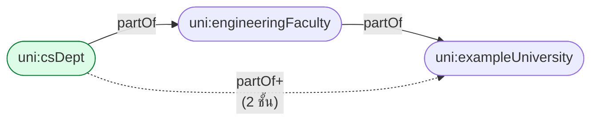
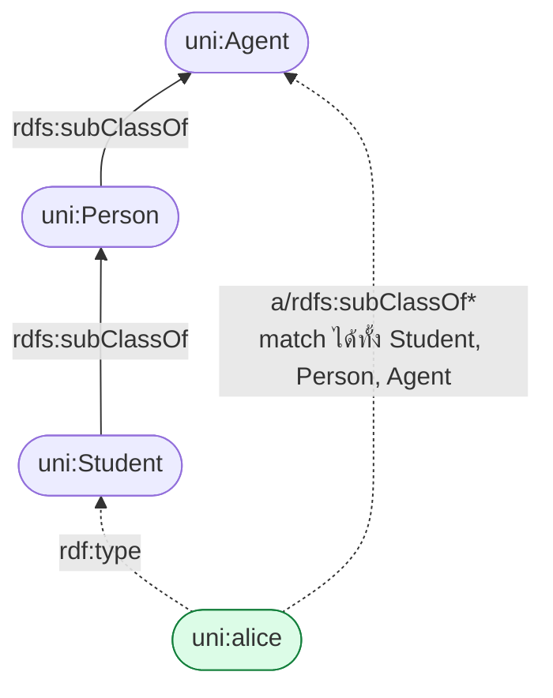
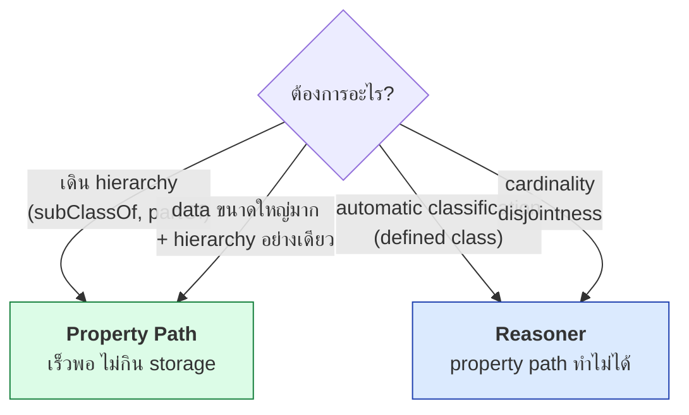

# 06.05 Property Paths

**Property path** เป็นฟีเจอร์ของ SPARQL 1.1 ที่ให้เดินตามความสัมพันธ์หลายชั้นได้ในบรรทัดเดียว
มันคือคำตอบของคำถาม *"จะ query hierarchy โดยไม่ต้องรัน reasoner ได้อย่างไร"*
และเป็นเครื่องมือที่ทรงพลังที่สุดตัวหนึ่งของ SPARQL

---

## Operator ทั้งหมด

| Operator | ชื่อ | ความหมาย |
| --- | --- | --- |
| `iri` | Predicate | ตาม predicate นั้นหนึ่งครั้ง |
| `^iri` | Inverse | ตามย้อนกลับ |
| `p1 / p2` | Sequence | ตาม p1 แล้วต่อด้วย p2 |
| `p1 \| p2` | Alternative | ตาม p1 **หรือ** p2 |
| `p*` | Zero or more | ตาม p ศูนย์ครั้งขึ้นไป |
| `p+` | One or more | ตาม p หนึ่งครั้งขึ้นไป |
| `p?` | Zero or one | ตาม p ศูนย์หรือหนึ่งครั้ง |
| `!iri` | Negated property set | predicate ใดก็ได้ **ยกเว้น** ที่ระบุ |
| `( p )` | Grouping | จัดกลุ่ม |

---

## 1. Sequence `/`

```sparql
PREFIX uni:  <http://example.org/university#>
PREFIX rdfs: <http://www.w3.org/2000/01/rdf-schema#>

# แบบธรรมดา
SELECT ?deptName WHERE {
  uni:alice uni:memberOf ?dept .
  ?dept     rdfs:label   ?deptName .
}

# แบบ property path -- สั้นกว่า
SELECT ?deptName WHERE {
  uni:alice uni:memberOf/rdfs:label ?deptName .
}
```

Expected output:

| ?deptName |
| --- |
| `"Department of Computer Science"@en` |

**ข้อดี**: ไม่ต้องประกาศตัวแปรกลาง (`?dept`) ที่ไม่ได้ใช้

---

## 2. Inverse `^`

```sparql
PREFIX uni:  <http://example.org/university#>
PREFIX rdfs: <http://www.w3.org/2000/01/rdf-schema#>

# ใครลงเรียน cs101 บ้าง -- เดินย้อนจาก course ไปหา student
SELECT ?name WHERE {
  uni:cs101 ^uni:enrolledIn/rdfs:label ?name .
}

# เทียบเท่ากับ
SELECT ?name WHERE {
  ?student uni:enrolledIn uni:cs101 ;
           rdfs:label     ?name .
}
```

Expected output:

| ?name |
| --- |
| `"Bob Martinez"@en` |
| `"Carol Nguyen"@en` |

> 💡 `^p` มีประโยชน์มากเมื่อ ontology ไม่ได้ประกาศ `owl:inverseOf` ไว้ หรือเมื่อไม่ได้รัน reasoner

---

## 3. Alternative `|`

```sparql
PREFIX uni:  <http://example.org/university#>
PREFIX rdfs: <http://www.w3.org/2000/01/rdf-schema#>

# ทุกคนที่เกี่ยวข้องกับ cs101 ไม่ว่าจะสอนหรือเรียน
SELECT ?name WHERE {
  ?person (uni:teaches|uni:enrolledIn) uni:cs101 ;
          rdfs:label ?name .
}
```

Expected output:

| ?name |
| --- |
| `"Jane Smith"@en` |
| `"Bob Martinez"@en` |
| `"Carol Nguyen"@en` |

---

## 4. Zero or more `*` — สำคัญที่สุด

```sparql
PREFIX uni: <http://example.org/university#>

# csDept อยู่ภายใต้องค์กรอะไรบ้าง (ทุกระดับ)
SELECT ?org WHERE {
  uni:csDept uni:partOf+ ?org .
}
```

Expected output:

| ?org |
| --- |
| `uni:engineeringFaculty` |
| `uni:exampleUniversity` |



### `*` vs `+` vs `?`

```sparql
uni:csDept uni:partOf* ?org .   # รวมตัวเอง: csDept, engineeringFaculty, exampleUniversity
uni:csDept uni:partOf+ ?org .   # ไม่รวมตัวเอง: engineeringFaculty, exampleUniversity
uni:csDept uni:partOf? ?org .   # ตัวเอง + หนึ่งชั้น: csDept, engineeringFaculty
```

| Path | ชั้นที่รวม | ผลลัพธ์ |
| --- | --- | --- |
| `partOf*` | 0, 1, 2, ... | csDept, engineeringFaculty, exampleUniversity |
| `partOf+` | 1, 2, ... | engineeringFaculty, exampleUniversity |
| `partOf?` | 0, 1 | csDept, engineeringFaculty |

---

## 5. ใช้ property path แทน reasoner

นี่คือ use case ที่สำคัญที่สุด

### หา instance ของ class รวม subclass

```sparql
PREFIX uni:  <http://example.org/university#>
PREFIX rdfs: <http://www.w3.org/2000/01/rdf-schema#>

# ❌ ไม่ได้ผลถ้าไม่รัน reasoner
SELECT ?p WHERE { ?p a uni:Person . }

# ✅ ได้ผลทันทีโดยไม่ต้องมี reasoner
SELECT ?p WHERE { ?p a/rdfs:subClassOf* uni:Person . }
```

**อธิบาย path**: `a/rdfs:subClassOf*` = "มี type ที่เป็น `uni:Person` หรือ subclass ของมันในระดับใดก็ได้"



### หา superclass ทั้งหมด

```sparql
PREFIX uni:  <http://example.org/university#>
PREFIX rdfs: <http://www.w3.org/2000/01/rdf-schema#>

SELECT ?super WHERE {
  uni:Professor rdfs:subClassOf+ ?super .
}
```

| ?super |
| --- |
| `uni:Staff` |
| `uni:Person` |
| `uni:Agent` |

### หา subclass ทั้งหมด

```sparql
SELECT ?sub WHERE {
  ?sub rdfs:subClassOf+ uni:Person .
}
```

### รวม property hierarchy

```sparql
PREFIX uni:  <http://example.org/university#>
PREFIX rdfs: <http://www.w3.org/2000/01/rdf-schema#>

# ใครเกี่ยวข้องกับ cs501 ผ่าน property ใดก็ตามที่เป็น subproperty ของ involvedIn
SELECT ?person ?prop WHERE {
  ?person ?prop uni:cs501 .
  ?prop rdfs:subPropertyOf* uni:involvedIn .
}
```

| ?person | ?prop |
| --- | --- |
| `uni:alice` | `uni:enrolledIn` |
| `uni:profSmith` | `uni:teaches` |

---

## 6. Negated Property Set `!`

```sparql
PREFIX uni:  <http://example.org/university#>
PREFIX rdf:  <http://www.w3.org/1999/02/22-rdf-syntax-ns#> .
PREFIX rdfs: <http://www.w3.org/2000/01/rdf-schema#>

# ทุก property ของ alice ยกเว้น type และ label
SELECT ?p ?o WHERE {
  uni:alice !(rdf:type|rdfs:label) ?o .
}

# ทุก property ยกเว้น subClassOf (ทั้งไปและกลับ)
SELECT ?s ?o WHERE {
  ?s !(rdfs:subClassOf|^rdfs:subClassOf) ?o .
}
```

> ⚠️ `!` ใช้ได้เฉพาะกับ **IRI ตรง ๆ หรือ alternative ของ IRI** — ใช้กับ `*`, `+`, `/` ไม่ได้

---

## 7. ตัวอย่างซับซ้อน

### หาบรรพบุรุษทางองค์กร พร้อมชื่อ

```sparql
PREFIX uni:  <http://example.org/university#>
PREFIX rdfs: <http://www.w3.org/2000/01/rdf-schema#>

SELECT ?personName ?orgName WHERE {
  ?person uni:memberOf/uni:partOf* ?org ;
          rdfs:label ?personName .
  ?org    rdfs:label ?orgName .
}
ORDER BY ?personName ?orgName
```

Expected output (ย่อ):

| ?personName | ?orgName |
| --- | --- |
| `"Alice Johnson"@en` | `"Department of Computer Science"@en` |
| `"Alice Johnson"@en` | `"Faculty of Engineering"@en` |
| `"Alice Johnson"@en` | `"Example University"@en` |
| `"Carol Nguyen"@en` | `"Department of Mathematics"@en` |
| ... | ... |

**path `uni:memberOf/uni:partOf*`** = "เป็นสมาชิกของหน่วยงานหนึ่ง แล้วเดินขึ้นไปทุกระดับ"

### หาเพื่อนร่วมชั้น (2 hop)

```sparql
PREFIX uni:  <http://example.org/university#>
PREFIX rdfs: <http://www.w3.org/2000/01/rdf-schema#>

SELECT DISTINCT ?classmateName WHERE {
  uni:alice uni:enrolledIn/^uni:enrolledIn ?classmate .
  ?classmate rdfs:label ?classmateName .
  FILTER(?classmate != uni:alice)
}
```

**path `uni:enrolledIn/^uni:enrolledIn`** = "ลงเรียนวิชาที่มีคนอื่นลงด้วย"

### เครือข่าย colleague แบบไม่จำกัดระยะ

```sparql
PREFIX uni:  <http://example.org/university#>
PREFIX rdfs: <http://www.w3.org/2000/01/rdf-schema#>

SELECT ?name WHERE {
  uni:profSmith uni:colleagueOf+ ?colleague .
  ?colleague rdfs:label ?name .
}
```

---

## เปรียบเทียบ: Property Path vs Reasoner

| | Property Path | Reasoner (materialized) |
| --- | --- | --- |
| Storage | ไม่เพิ่ม | โตหลายเท่า |
| ความเร็ว query | ช้ากว่า | เร็ว |
| ต้อง re-run เมื่อข้อมูลเปลี่ยน | ❌ | ✅ |
| รองรับ transitive | ✅ `+` `*` | ✅ |
| รองรับ `owl:sameAs` | ⚠️ ต้องเขียนเอง | ✅ |
| รองรับ defined class (`≡`) | ❌ | ✅ |
| รองรับ cardinality | ❌ | ✅ |
| ตรวจ inconsistency | ❌ | ✅ |



---

## ข้อควรระวังเรื่อง performance

| ปัญหา | ทำไม | ทางแก้ |
| --- | --- | --- |
| `?s ?p* ?o` ช้ามาก | ไม่มีจุดเริ่มต้นที่แน่นอน | ระบุ subject หรือ object ให้ชัด |
| `p*` บน graph ที่มี cycle | อาจวนซ้ำ | engine จัดการให้ แต่ช้า |
| `!(...)` บน graph ใหญ่ | ต้องสแกนทุก predicate | ระบุ predicate ที่ต้องการแทน |
| path ยาวหลายชั้น | combinatorial explosion | แบ่งเป็นหลาย pattern |

```sparql
# ❌ ช้ามาก -- ไม่มีจุดยึด
SELECT ?s ?o WHERE { ?s uni:partOf* ?o }

# ✅ เร็ว -- ระบุจุดเริ่ม
SELECT ?o WHERE { uni:csDept uni:partOf* ?o }
```

---

## รันด้วย Python

```python
from rdflib import Graph

g = Graph().parse("data/university.ttl", format="turtle")

queries = {
    "csDept partOf+ (transitive)": """
        PREFIX uni: <http://example.org/university#>
        SELECT ?org WHERE { uni:csDept uni:partOf+ ?org }
    """,
    "ทุก Person รวม subclass (แทน reasoner)": """
        PREFIX uni:  <http://example.org/university#>
        PREFIX rdfs: <http://www.w3.org/2000/01/rdf-schema#>
        SELECT DISTINCT ?p WHERE { ?p a/rdfs:subClassOf* uni:Person }
    """,
    "ใครลงเรียน cs101 (inverse)": """
        PREFIX uni:  <http://example.org/university#>
        PREFIX rdfs: <http://www.w3.org/2000/01/rdf-schema#>
        SELECT ?n WHERE { uni:cs101 ^uni:enrolledIn/rdfs:label ?n }
    """,
}

for title, q in queries.items():
    rows = sorted(str(r[0]).split("#")[-1] for r in g.query(q))
    print(f"{title}:\n  {rows}\n")
```

Expected output:

```
csDept partOf+ (transitive):
  ['engineeringFaculty', 'exampleUniversity']

ทุก Person รวม subclass (แทน reasoner):
  ['adminBrown', 'alice', 'bob', 'carol', 'dave', 'profJones', 'profSmith']

ใครลงเรียน cs101 (inverse):
  ['Bob Martinez', 'Carol Nguyen']
```

> 💡 **สังเกต**: query ที่สองได้ผลครบ **โดยไม่ได้รัน reasoner เลย** — นี่คือพลังของ property path

---

## Key Points

- Property path มี 9 operator: `iri`, `^`, `/`, `|`, `*`, `+`, `?`, `!`, `( )`
- **`/` (sequence)** ทำให้ไม่ต้องประกาศตัวแปรกลางที่ไม่ได้ใช้
- **`^` (inverse)** เดินย้อนกลับได้โดยไม่ต้องมี `owl:inverseOf` ใน ontology
- **`*` `+` `?`** เป็นตัวที่สำคัญที่สุด — ทำ recursive query ได้โดยไม่ต้องมี reasoner
- `p*` รวมตัวเอง (0 ชั้น), `p+` ไม่รวม (1 ชั้นขึ้นไป), `p?` รวมตัวเอง + 1 ชั้น
- **`a/rdfs:subClassOf*`** คือ pattern มาตรฐานสำหรับ "หา instance รวม subclass ทั้งหมด" โดยไม่ต้อง reason
- Property path **ทำ defined class, cardinality และ inconsistency check ไม่ได้** — ต้องใช้ reasoner
- ⚠️ **ต้องระบุจุดเริ่มต้น** (subject หรือ object ที่แน่นอน) มิฉะนั้น `p*` จะช้ามาก
