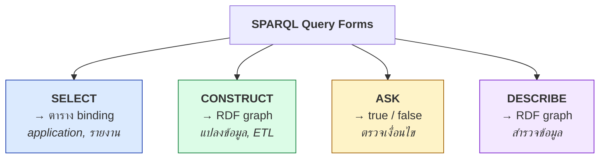
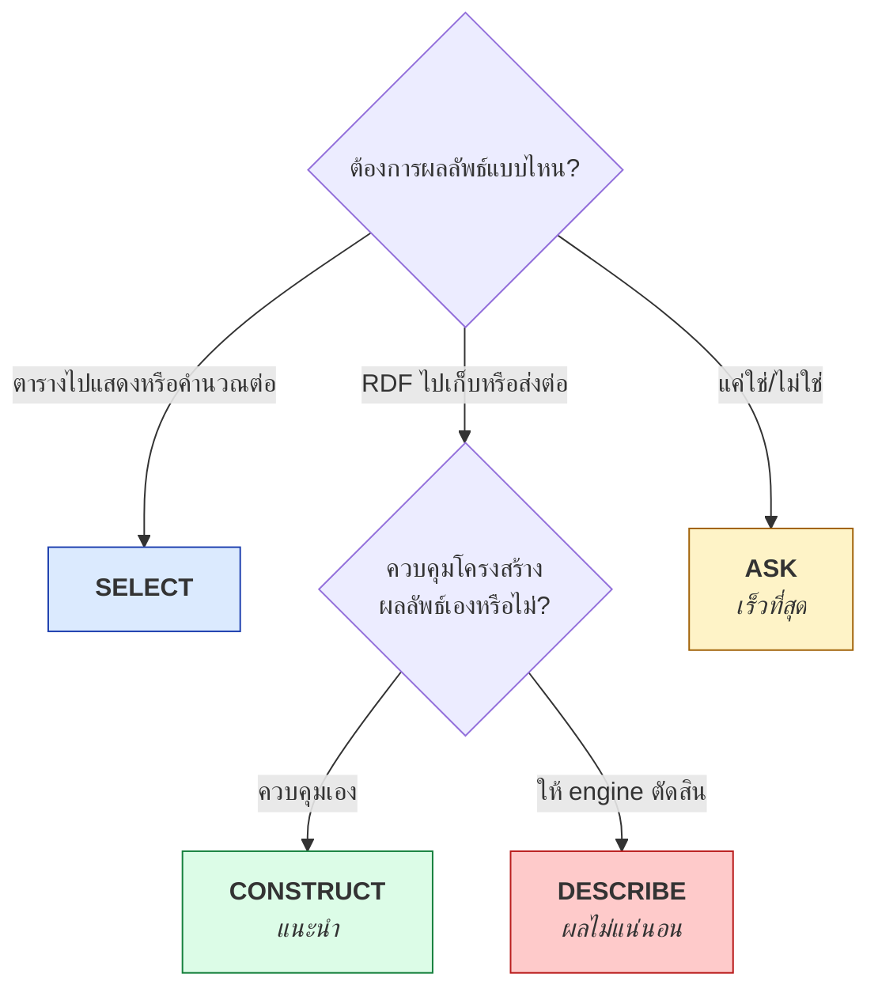

# 06.06 CONSTRUCT, ASK และ DESCRIBE

นอกจาก `SELECT` ที่คืนตาราง SPARQL ยังมี query form อีกสามแบบที่คืนผลลัพธ์คนละชนิด
**`CONSTRUCT`** คืน RDF graph ใหม่, **`ASK`** คืน boolean และ **`DESCRIBE`** คืน RDF ที่บรรยาย resource
บทนี้อธิบายทั้งสามแบบพร้อม use case ที่เหมาะสม

---

## ภาพรวม



---

## `CONSTRUCT` — สร้าง RDF graph ใหม่

```sparql
CONSTRUCT { template }
WHERE     { pattern }
```

**หลักการ**: match `pattern` แล้วเอา binding ไปเติมใน `template` — ได้ graph ใหม่

### ตัวอย่างที่ 1: แปลง vocabulary

```sparql
PREFIX uni:    <http://example.org/university#>
PREFIX rdfs:   <http://www.w3.org/2000/01/rdf-schema#>
PREFIX schema: <https://schema.org/>

CONSTRUCT {
  ?person a schema:Person ;
          schema:name        ?name ;
          schema:affiliation ?org .
}
WHERE {
  ?person a          uni:Student ;
          rdfs:label ?name ;
          uni:memberOf ?org .
}
```

Expected output (Turtle):

```turtle
@prefix schema: <https://schema.org/> .
@prefix uni:    <http://example.org/university#> .

uni:alice a schema:Person ;
    schema:name        "Alice Johnson"@en ;
    schema:affiliation uni:csDept .

uni:bob a schema:Person ;
    schema:name        "Bob Martinez"@en ;
    schema:affiliation uni:csDept .

uni:carol a schema:Person ;
    schema:name        "Carol Nguyen"@en ;
    schema:affiliation uni:mathDept .

uni:dave a schema:Person ;
    schema:name        "Dave Wilson"@en ;
    schema:affiliation uni:csDept .
```

**นี่คือวิธีมาตรฐานในการทำ vocabulary alignment แบบ materialize**

### ตัวอย่างที่ 2: Materialize inference

```sparql
PREFIX rdfs: <http://www.w3.org/2000/01/rdf-schema#>

# ทำ subClassOf transitivity ให้เป็น triple จริง
CONSTRUCT { ?s a ?superClass }
WHERE {
  ?s a ?class .
  ?class rdfs:subClassOf+ ?superClass .
}
```

### ตัวอย่างที่ 3: สร้าง link ใหม่

```sparql
PREFIX uni: <http://example.org/university#>

# สร้าง ex:classmateOf จากการลงเรียนวิชาเดียวกัน
CONSTRUCT { ?a uni:classmateOf ?b }
WHERE {
  ?a uni:enrolledIn ?course .
  ?b uni:enrolledIn ?course .
  FILTER(?a != ?b)
}
```

Expected output:

```turtle
uni:bob   uni:classmateOf uni:carol .
uni:carol uni:classmateOf uni:bob .
```

### ตัวอย่างที่ 4: `CONSTRUCT WHERE` แบบย่อ

```sparql
PREFIX uni: <http://example.org/university#>

# ดึง triple ทั้งหมดของ Student ออกมาเป็น subgraph
CONSTRUCT WHERE {
  ?s a uni:Student ;
     ?p ?o .
}
```

เทียบเท่ากับ

```sparql
CONSTRUCT { ?s a uni:Student . ?s ?p ?o }
WHERE     { ?s a uni:Student . ?s ?p ?o }
```

> ⚠️ **`CONSTRUCT WHERE` ใช้ได้เฉพาะเมื่อ template เหมือน pattern ทุกประการ** และ pattern ต้องเป็น BGP ล้วน

### ⚠️ ข้อควรรู้เกี่ยวกับ CONSTRUCT

| ประเด็น | รายละเอียด |
| --- | --- |
| **ตัดผลลัพธ์ที่ไม่ถูกต้อง** | triple ที่มี literal เป็น subject หรือ unbound variable จะถูกทิ้งเงียบ ๆ |
| **ผลลัพธ์เป็นเซต** | triple ซ้ำจะถูกรวมเป็นหนึ่ง |
| **สร้าง blank node ใหม่ได้** | `_:b` ใน template สร้าง bnode ใหม่ต่อหนึ่ง solution |
| **ไม่มี ORDER BY ที่มีความหมาย** | เพราะ graph ไม่มีลำดับ (แต่ `LIMIT` ยังใช้ได้) |

```sparql
# สร้าง blank node ใหม่ต่อหนึ่ง solution
PREFIX uni: <http://example.org/university#>
PREFIX ex:  <http://example.org/> .

CONSTRUCT {
  ?student ex:hasEnrollmentRecord _:rec .
  _:rec ex:course ?course ; ex:credits ?credits .
}
WHERE {
  ?student uni:enrolledIn ?course .
  ?course  uni:credits    ?credits .
}
```

---

## `ASK` — ตอบ true / false

```sparql
PREFIX uni: <http://example.org/university#>

ASK {
  uni:alice uni:enrolledIn uni:cs501 .
}
```

Expected output: `true`

### ตัวอย่างการใช้จริง

```sparql
PREFIX uni: <http://example.org/university#>

# มีนักศึกษาที่ GPA เกิน 3.9 หรือไม่
ASK { ?s a uni:Student ; uni:gpa ?g . FILTER(?g > 3.9) }
# -> true

# มีวิชาที่ไม่มีอาจารย์สอนหรือไม่
ASK {
  ?c a uni:Course .
  FILTER NOT EXISTS { ?p uni:teaches ?c }
}
# -> true  (cs201, cs301 ไม่มีคนสอน)

# ทุกนักศึกษามี studentId ครบหรือไม่ (ถามกลับด้าน)
ASK {
  ?s a uni:Student .
  FILTER NOT EXISTS { ?s uni:studentId ?id }
}
# -> false  (แปลว่าทุกคนมี studentId ครบ)
```

> 💡 **`ASK` เร็วกว่า `SELECT` มาก** เพราะ engine หยุดทันทีที่เจอ match แรก
> ใช้เมื่อต้องการรู้แค่ "มีหรือไม่มี" ไม่ต้องการข้อมูล

### Use case: data quality check

```python
from rdflib import Graph

g = Graph().parse("data/university.ttl", format="turtle")

CHECKS = {
    "มีนักศึกษาที่ไม่มี studentId": """
        PREFIX uni: <http://example.org/university#>
        ASK { ?s a uni:Student . FILTER NOT EXISTS { ?s uni:studentId ?id } }
    """,
    "มีวิชาที่ไม่มีอาจารย์สอน": """
        PREFIX uni: <http://example.org/university#>
        ASK { ?c a uni:Course . FILTER NOT EXISTS { ?p uni:teaches ?c } }
    """,
    "มี GPA ที่เกินช่วง 0-4": """
        PREFIX uni: <http://example.org/university#>
        ASK { ?s uni:gpa ?g . FILTER(?g < 0 || ?g > 4.0) }
    """,
}

for name, q in CHECKS.items():
    result = bool(g.query(q))
    mark = "⚠️ พบ" if result else "✅ ไม่พบ"
    print(f"{mark}: {name}")
```

Expected output:

```
✅ ไม่พบ: มีนักศึกษาที่ไม่มี studentId
⚠️ พบ: มีวิชาที่ไม่มีอาจารย์สอน
✅ ไม่พบ: มี GPA ที่เกินช่วง 0-4
```

---

## `DESCRIBE` — บรรยาย resource

```sparql
PREFIX uni: <http://example.org/university#>

DESCRIBE uni:alice
```

Expected output (Turtle):

```turtle
@prefix uni:  <http://example.org/university#> .
@prefix rdfs: <http://www.w3.org/2000/01/rdf-schema#> .
@prefix owl:  <http://www.w3.org/2002/07/owl#> .
@prefix foaf: <http://xmlns.com/foaf/0.1/> .

uni:alice a owl:NamedIndividual , uni:Student ;
    rdfs:label         "Alice Johnson"@en ;
    foaf:name          "Alice Johnson" ;
    uni:studentId      "S-2024-0421" ;
    uni:enrollmentYear 2022 ;
    uni:gpa            3.85 ;
    uni:memberOf       uni:csDept ;
    uni:enrolledIn     uni:cs501 , uni:cs601 ;
    uni:authorOf       uni:paper002 .
```

### รูปแบบการใช้

```sparql
# ระบุ IRI ตรง ๆ
DESCRIBE uni:alice uni:bob

# ใช้ตัวแปรจาก WHERE
PREFIX uni: <http://example.org/university#>
DESCRIBE ?student
WHERE { ?student a uni:Student ; uni:gpa ?g . FILTER(?g > 3.8) }

# ผสมกัน
DESCRIBE uni:alice ?prof
WHERE { ?prof uni:teaches uni:cs501 }
```

### ⚠️ ข้อจำกัดสำคัญของ DESCRIBE

**สเปกไม่ได้กำหนดว่า "บรรยาย" หมายถึงอะไร** — แต่ละ engine ตีความต่างกัน

| Engine | พฤติกรรมโดยทั่วไป |
| --- | --- |
| rdflib | triple ที่ resource เป็น subject |
| Fuseki | triple ที่เป็น subject + Concise Bounded Description |
| Virtuoso | ปรับได้ผ่าน pragma |
| GraphDB | ปรับได้ในการตั้งค่า |

**Concise Bounded Description (CBD)** = triple ที่ resource เป็น subject + ไล่ตาม blank node ต่อไปเรื่อย ๆ

> 💡 **ในทางปฏิบัติ**: ถ้าต้องการผลลัพธ์ที่แน่นอน **ใช้ `CONSTRUCT` แทน `DESCRIBE`**

```sparql
# แทน DESCRIBE uni:alice ด้วย CONSTRUCT ที่ควบคุมได้
PREFIX uni: <http://example.org/university#>

CONSTRUCT {
  uni:alice ?p ?o .
  ?s ?p2 uni:alice .
}
WHERE {
  { uni:alice ?p ?o }
  UNION
  { ?s ?p2 uni:alice }
}
```

---

## ตารางเปรียบเทียบทั้ง 4 form

| | `SELECT` | `CONSTRUCT` | `ASK` | `DESCRIBE` |
| --- | --- | --- | --- | --- |
| **ผลลัพธ์** | ตาราง | RDF graph | boolean | RDF graph |
| **MIME type** | `application/sparql-results+json` | `text/turtle` | `application/sparql-results+json` | `text/turtle` |
| **มี template** | ❌ | ✅ | ❌ | ❌ |
| **WHERE บังคับ** | ⚠️ ปกติมี | ✅ | ✅ | ❌ |
| **ผลลัพธ์แน่นอน** | ✅ | ✅ | ✅ | ❌ ขึ้นกับ engine |
| **ORDER BY มีผล** | ✅ | ❌ | ❌ | ❌ |
| **ความเร็ว** | ปกติ | ปกติ | **เร็วที่สุด** | ขึ้นกับ engine |
| **ใช้เมื่อ** | ดึงข้อมูลไปแสดง | แปลงข้อมูล / ETL | ตรวจเงื่อนไข | สำรวจ resource |

---

## Decision tree



---

## รันด้วย Python

```python
from rdflib import Graph

g = Graph().parse("data/university.ttl", format="turtle")

# --- CONSTRUCT: คืน Graph object ---
construct_q = """
PREFIX uni:    <http://example.org/university#>
PREFIX rdfs:   <http://www.w3.org/2000/01/rdf-schema#>
PREFIX schema: <https://schema.org/>

CONSTRUCT {
  ?person a schema:Person ; schema:name ?name .
}
WHERE {
  ?person a uni:Student ; rdfs:label ?name .
}
"""
result_graph = g.query(construct_q).graph
result_graph.bind("schema", "https://schema.org/")
print(f"CONSTRUCT ได้ {len(result_graph)} triples")
print(result_graph.serialize(format="turtle"))

# --- ASK: คืน boolean ---
ask_q = """
PREFIX uni: <http://example.org/university#>
ASK { uni:alice uni:enrolledIn uni:cs501 }
"""
print("ASK:", bool(g.query(ask_q)))

# --- DESCRIBE: คืน Graph object ---
describe_q = """
PREFIX uni: <http://example.org/university#>
DESCRIBE uni:alice
"""
desc = g.query(describe_q).graph
print(f"DESCRIBE ได้ {len(desc)} triples")
```

Expected output:

```
CONSTRUCT ได้ 8 triples
@prefix schema: <https://schema.org/> .
@prefix uni: <http://example.org/university#> .

uni:alice a schema:Person ;
    schema:name "Alice Johnson"@en .
...

ASK: True
DESCRIBE ได้ 14 triples
```

---

## Key Points

- **`CONSTRUCT`** สร้าง RDF graph ใหม่จาก template — เป็นเครื่องมือหลักของ **vocabulary alignment** และ **ETL**
- `CONSTRUCT` **ทิ้ง triple ที่ไม่ถูกต้องเงียบ ๆ** (literal เป็น subject, ตัวแปร unbound)
- `CONSTRUCT WHERE { ... }` แบบย่อใช้ได้เมื่อ template เหมือน pattern และ pattern เป็น BGP ล้วน
- **`ASK`** คืน boolean และ **เร็วที่สุด** เพราะหยุดที่ match แรก — เหมาะกับ data quality check
- **`DESCRIBE`** ผลลัพธ์ **ไม่แน่นอน** เพราะสเปกไม่ได้กำหนดความหมายของ "บรรยาย"
- **ใช้ `CONSTRUCT` แทน `DESCRIBE`** เมื่อต้องการผลลัพธ์ที่ควบคุมได้และทำซ้ำได้
- ใน Python: `g.query(q).graph` คืน `Graph` สำหรับ CONSTRUCT/DESCRIBE, `bool(g.query(q))` สำหรับ ASK
