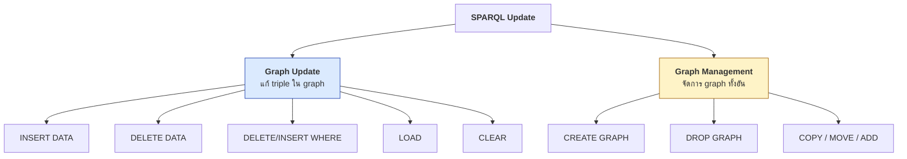
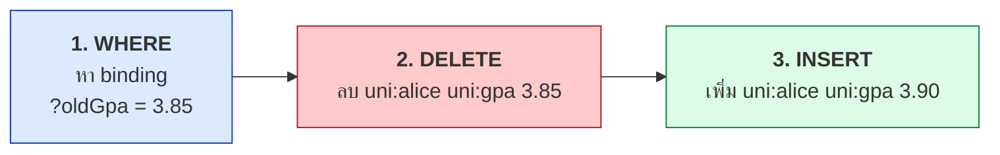
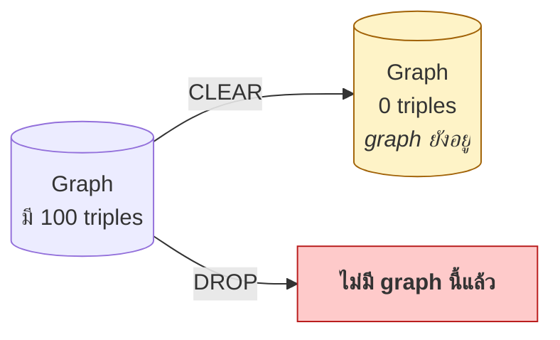

# 06.07 SPARQL Update

**SPARQL 1.1 Update** เป็นเอกสารมาตรฐานแยกต่างหากที่ให้ **แก้ไข** ข้อมูลใน RDF store ได้
ครอบคลุม `INSERT`, `DELETE`, `LOAD`, `CLEAR`, `DROP`, `CREATE` และ `COPY/MOVE/ADD`
บทนี้อธิบายทุกคำสั่งพร้อมข้อควรระวังในการใช้งานจริง

---

## ภาพรวมคำสั่ง



---

## `INSERT DATA` — เพิ่ม triple ที่รู้ค่าแน่นอน

```sparql
PREFIX uni:  <http://example.org/university#>
PREFIX rdfs: <http://www.w3.org/2000/01/rdf-schema#>
PREFIX xsd:  <http://www.w3.org/2001/XMLSchema#>

INSERT DATA {
  uni:eve a uni:Student ;
      rdfs:label     "Eve Chen"@en ;
      uni:studentId  "S-2025-0001" ;
      uni:gpa        3.60 ;
      uni:enrolledIn uni:cs101 , uni:cs201 .
}
```

**ข้อจำกัด**: `INSERT DATA` รับได้เฉพาะ **ground triple** — ห้ามมีตัวแปร

```sparql
# ❌ ผิด -- มีตัวแปร
INSERT DATA { ?s a uni:Student }

# ✅ ถูก -- ใช้ INSERT ... WHERE แทน
INSERT { ?s a uni:Student } WHERE { ?s uni:studentId ?id }
```

### เพิ่มเข้า named graph

```sparql
PREFIX uni: <http://example.org/university#>

INSERT DATA {
  GRAPH <http://example.org/graph/2025> {
    uni:eve a uni:Student .
  }
}
```

---

## `DELETE DATA` — ลบ triple ที่รู้ค่าแน่นอน

```sparql
PREFIX uni: <http://example.org/university#>

DELETE DATA {
  uni:bob uni:enrolledIn uni:cs201 .
}
```

**ข้อจำกัดเหมือนกัน**: ห้ามมีตัวแปรและห้ามมี blank node

> ⚠️ ถ้า triple ที่ระบุไม่มีอยู่ **ไม่ error** — คำสั่งสำเร็จโดยไม่ทำอะไร

---

## `DELETE ... WHERE` — ลบตาม pattern

```sparql
PREFIX uni: <http://example.org/university#>

# ลบทุกความสัมพันธ์ enrolledIn ของ bob
DELETE { ?s uni:enrolledIn ?c }
WHERE  { ?s uni:enrolledIn ?c . FILTER(?s = uni:bob) }

# แบบย่อ -- เมื่อ template เหมือน pattern
DELETE WHERE { uni:bob uni:enrolledIn ?c }
```

### ลบ resource ทั้งหมด

```sparql
PREFIX uni: <http://example.org/university#>

# ลบทุก triple ที่ bob เป็น subject หรือ object
DELETE { ?s ?p ?o }
WHERE {
  { ?s ?p ?o . FILTER(?s = uni:bob) }
  UNION
  { ?s ?p ?o . FILTER(?o = uni:bob) }
}
```

> ⚠️ **ต้องลบทั้งสองทิศทาง** มิฉะนั้นจะเหลือ **dangling reference** ที่ชี้ไปยัง resource ที่ไม่มีแล้ว

---

## `DELETE ... INSERT ... WHERE` — แก้ไขค่า

นี่คือคำสั่งที่ใช้บ่อยที่สุดในงานจริง

```sparql
PREFIX uni: <http://example.org/university#>

# อัปเดต GPA ของ alice
DELETE { uni:alice uni:gpa ?oldGpa }
INSERT { uni:alice uni:gpa 3.90 }
WHERE  { uni:alice uni:gpa ?oldGpa }
```

**ลำดับการทำงาน**: `WHERE` (หา binding) → `DELETE` → `INSERT`



### ตัวอย่างใช้จริง

```sparql
PREFIX uni:    <http://example.org/university#>
PREFIX rdfs:   <http://www.w3.org/2000/01/rdf-schema#>
PREFIX schema: <https://schema.org/>

# --- 1) เปลี่ยน predicate ทั้งหมด (migration) ---
DELETE { ?s uni:studentNumber ?v }
INSERT { ?s uni:studentId     ?v }
WHERE  { ?s uni:studentNumber ?v }

# --- 2) เพิ่ม type ให้ทุก resource ที่มี property หนึ่ง ---
INSERT { ?s a uni:Student }
WHERE  { ?s uni:studentId ?id }

# --- 3) materialize inference ---
INSERT { ?s a ?superClass }
WHERE  {
  ?s a ?class .
  ?class rdfs:subClassOf+ ?superClass .
}

# --- 4) เชื่อม vocabulary ---
INSERT { ?s a schema:Person ; schema:name ?name }
WHERE  { ?s a uni:Student ; rdfs:label ?name }

# --- 5) normalize ค่า ---
DELETE { ?s uni:courseCode ?old }
INSERT { ?s uni:courseCode ?new }
WHERE  {
  ?s uni:courseCode ?old .
  BIND(UCASE(?old) AS ?new)
  FILTER(?old != ?new)
}
```

### `INSERT ... WHERE` โดยไม่มี DELETE

```sparql
PREFIX uni: <http://example.org/university#>

# สร้าง classmateOf จากข้อมูลที่มี
INSERT { ?a uni:classmateOf ?b }
WHERE {
  ?a uni:enrolledIn ?c .
  ?b uni:enrolledIn ?c .
  FILTER(?a != ?b)
}
```

---

## `LOAD` — โหลด RDF จาก URL

```sparql
# โหลดเข้า default graph
LOAD <http://example.org/data/students.ttl>

# โหลดเข้า named graph
LOAD <http://example.org/data/students.ttl>
INTO GRAPH <http://example.org/graph/students>

# ไม่ error ถ้าโหลดไม่สำเร็จ
LOAD SILENT <http://example.org/data/maybe-missing.ttl>
```

---

## `CLEAR` — ลบ triple ทั้งหมดใน graph (แต่ graph ยังอยู่)

```sparql
CLEAR DEFAULT                                          # ลบ default graph
CLEAR GRAPH <http://example.org/graph/students>        # ลบ named graph หนึ่ง
CLEAR NAMED                                            # ลบทุก named graph
CLEAR ALL                                              # ลบทั้งหมด
CLEAR SILENT GRAPH <http://example.org/maybe-missing>  # ไม่ error ถ้าไม่มี graph
```

---

## Graph Management

```sparql
# สร้าง named graph ว่าง
CREATE GRAPH <http://example.org/graph/2025>
CREATE SILENT GRAPH <http://example.org/graph/2025>

# ลบ graph ทิ้งทั้งอัน (ต่างจาก CLEAR ที่เหลือ graph ว่างไว้)
DROP GRAPH <http://example.org/graph/2024>
DROP DEFAULT
DROP NAMED
DROP ALL

# คัดลอก -- ลบปลายทางก่อนแล้วคัดลอกทับ
COPY <http://example.org/graph/a> TO <http://example.org/graph/b>

# ย้าย -- คัดลอกแล้วลบต้นทาง
MOVE <http://example.org/graph/staging> TO <http://example.org/graph/production>

# เพิ่ม -- คัดลอกโดยไม่ลบปลายทาง (merge)
ADD <http://example.org/graph/new> TO <http://example.org/graph/main>
```

| คำสั่ง | ปลายทางถูกลบก่อน | ต้นทางถูกลบหลัง |
| --- | :---: | :---: |
| `COPY` | ✅ | ❌ |
| `MOVE` | ✅ | ✅ |
| `ADD` | ❌ | ❌ |

### `CLEAR` vs `DROP`



---

## หลายคำสั่งใน request เดียว

คั่นด้วย `;`

```sparql
PREFIX uni: <http://example.org/university#>

DROP SILENT GRAPH <http://example.org/graph/inferred> ;

CREATE GRAPH <http://example.org/graph/inferred> ;

INSERT { GRAPH <http://example.org/graph/inferred> { ?s a ?super } }
WHERE  {
  ?s a ?c .
  ?c <http://www.w3.org/2000/01/rdf-schema#subClassOf>+ ?super .
}
```

> 💡 **นี่คือ pattern มาตรฐานสำหรับ re-run reasoning**: ลบ inferred graph → สร้างใหม่ → materialize ใหม่

---

## รันจาก Python

### บน rdflib (in-memory)

```python
from rdflib import Graph

g = Graph().parse("data/university.ttl", format="turtle")
print(f"ก่อน: {len(g)} triples")

g.update("""
PREFIX uni:  <http://example.org/university#>
PREFIX rdfs: <http://www.w3.org/2000/01/rdf-schema#>

INSERT DATA {
  uni:eve a uni:Student ;
      rdfs:label    "Eve Chen"@en ;
      uni:studentId "S-2025-0001" ;
      uni:gpa       3.60 .
}
""")
print(f"หลัง INSERT: {len(g)} triples")

g.update("""
PREFIX uni: <http://example.org/university#>
DELETE { uni:eve uni:gpa ?old }
INSERT { uni:eve uni:gpa 3.75 }
WHERE  { uni:eve uni:gpa ?old }
""")

print("GPA ใหม่:", g.value(
    URIRef("http://example.org/university#eve"),
    URIRef("http://example.org/university#gpa")))
```

Expected output:

```
ก่อน: 426 triples
หลัง INSERT: 430 triples
GPA ใหม่: 3.75
```

### บน SPARQL endpoint (Fuseki)

```python
from SPARQLWrapper import SPARQLWrapper, POST, DIGEST

sparql = SPARQLWrapper("http://localhost:3030/university/update")
sparql.setMethod(POST)
sparql.setHTTPAuth(DIGEST)
sparql.setCredentials("admin", "password")

sparql.setQuery("""
PREFIX uni: <http://example.org/university#>
INSERT DATA { uni:eve a uni:Student }
""")
sparql.query()
```

> ⚠️ endpoint ของ update มัก **แยก URL จาก query endpoint** — Fuseki ใช้ `/dataset/query` และ `/dataset/update`

---

## ข้อควรระวังสำคัญ

| ⚠️ | ปัญหา | ทางแก้ |
| --- | --- | --- |
| **ไม่มี transaction ในสเปก** | ถ้าคำสั่งกลางล้มเหลว อาจเหลือสภาพครึ่ง ๆ กลาง ๆ | ใช้ transaction API ของ store (Fuseki, GraphDB มี) |
| **`DELETE WHERE { ?s ?p ?o }` ลบทุกอย่าง** | ไม่มีการยืนยัน | ทดสอบด้วย `SELECT` ที่ pattern เดียวกันก่อนเสมอ |
| **ไม่มี rollback มาตรฐาน** | แก้ผิดแล้วกู้ยาก | backup / ใช้ named graph แยก staging |
| **ลบ resource ไม่ครบ** | เหลือ dangling reference | ลบทั้ง subject และ object position |
| **`INSERT DATA` ห้ามมีตัวแปร** | error | ใช้ `INSERT ... WHERE` แทน |
| **สิทธิ์การเขียน** | endpoint สาธารณะไม่ให้ update | ต้องมี authentication |

### วิธีทดสอบก่อนลบจริง

```sparql
# --- ขั้นที่ 1: ดูก่อนว่าจะลบอะไร ---
PREFIX uni: <http://example.org/university#>
SELECT ?s ?p ?o WHERE {
  ?s ?p ?o .
  FILTER(?s = uni:bob)
}

# --- ขั้นที่ 2: นับจำนวน ---
SELECT (COUNT(*) AS ?n) WHERE {
  ?s ?p ?o . FILTER(?s = uni:bob)
}

# --- ขั้นที่ 3: ค่อยลบจริง ---
DELETE WHERE { uni:bob ?p ?o }
```

---

## Key Points

- **`INSERT DATA` / `DELETE DATA`** รับเฉพาะ **ground triple** — ห้ามมีตัวแปร
- **`DELETE ... INSERT ... WHERE`** เป็นคำสั่งที่ใช้บ่อยที่สุด — ลำดับคือ `WHERE` → `DELETE` → `INSERT`
- **`INSERT ... WHERE`** ใช้ materialize inference และทำ vocabulary alignment ได้
- **`CLEAR`** ลบ triple แต่ graph ยังอยู่; **`DROP`** ลบ graph ทิ้งทั้งอัน
- `COPY` (ทับ), `MOVE` (ทับ + ลบต้นทาง), `ADD` (merge) — ต่างกันที่การจัดการปลายทางและต้นทาง
- Pattern มาตรฐานสำหรับ re-run reasoning: **`DROP` inferred graph → `CREATE` → `INSERT ... WHERE`**
- ⚠️ **SPARQL Update ไม่มี transaction ในสเปก** — ต้องพึ่งกลไกของ triplestore
- ⚠️ **ทดสอบด้วย `SELECT` ที่ pattern เดียวกันก่อนลบจริงเสมอ** — ไม่มี rollback มาตรฐาน
- endpoint ของ update มัก **แยก URL จาก query endpoint** และต้องมี authentication
