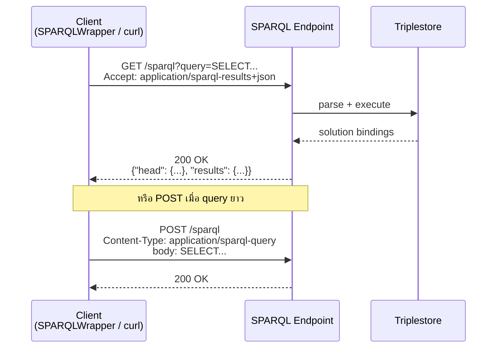
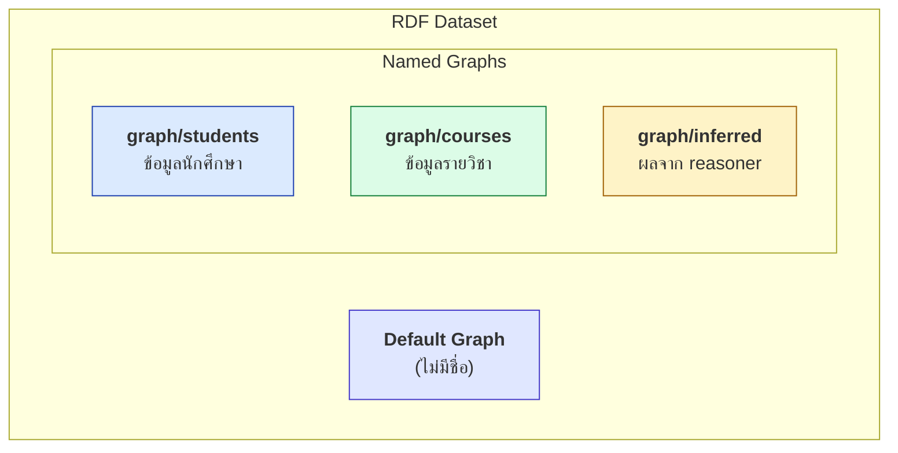

# 06.08 SPARQL Endpoint และ Named Graph

**SPARQL Endpoint** คือบริการ HTTP ที่รับ query แล้วคืนผลลัพธ์ — เป็นกลไกที่ทำให้ข้อมูล RDF เข้าถึงได้จากทั่วโลก
บทนี้อธิบาย SPARQL Protocol, การทำงานกับ **named graph** ผ่าน `GRAPH` keyword
และวิธีติดตั้ง endpoint ของตัวเองด้วย Apache Jena Fuseki

---

## SPARQL Protocol



### วิธีส่ง query 3 แบบ

| วิธี | Content-Type | ใช้เมื่อ |
| --- | --- | --- |
| **GET** พร้อม `?query=` | — | query สั้น, cache ได้ |
| **POST** แบบ URL-encoded | `application/x-www-form-urlencoded` | query ยาว |
| **POST** แบบ direct | `application/sparql-query` | query ยาว, ตรงไปตรงมาที่สุด |

```bash
# GET
curl -G 'https://dbpedia.org/sparql' \
  --data-urlencode 'query=SELECT * WHERE { ?s ?p ?o } LIMIT 5' \
  -H 'Accept: application/sparql-results+json'

# POST แบบ direct
curl -X POST 'https://query.wikidata.org/sparql' \
  -H 'Content-Type: application/sparql-query' \
  -H 'Accept: application/sparql-results+json' \
  -H 'User-Agent: SemanticWebCourse/1.0 (contact@example.org)' \
  --data-binary 'SELECT ?item WHERE { ?item wdt:P31 wd:Q5 } LIMIT 5'
```

### Parameter ที่สเปกกำหนด

| Parameter | ความหมาย |
| --- | --- |
| `query` | SPARQL query (สำหรับ query endpoint) |
| `update` | SPARQL update (สำหรับ update endpoint) |
| `default-graph-uri` | ระบุ default graph (ซ้ำได้) |
| `named-graph-uri` | ระบุ named graph ที่เข้าถึงได้ (ซ้ำได้) |

---

## Endpoint สาธารณะที่ควรรู้จัก

| Endpoint | URL | ขนาด | หมายเหตุ |
| --- | --- | --- | --- |
| **Wikidata** | `https://query.wikidata.org/sparql` | 100M+ items | ต้องใส่ `User-Agent`, มี timeout 60 วิ |
| **DBpedia** | `https://dbpedia.org/sparql` | 1B+ triples | Virtuoso, มี result limit |
| **LinkedGeoData** | `http://linkedgeodata.org/sparql` | OpenStreetMap | ข้อมูลภูมิศาสตร์ |
| **EU Open Data** | `https://data.europa.eu/sparql` | dataset catalog | DCAT-AP |
| **Bio2RDF** | หลาย endpoint | biomedical | รวมหลายฐาน |
| **UniProt** | `https://sparql.uniprot.org/sparql` | protein data | คุณภาพสูง |

> ⚠️ **มารยาทในการใช้ endpoint สาธารณะ**
> 1. ใส่ `User-Agent` ที่ระบุตัวตนและช่องทางติดต่อ
> 2. ใส่ `LIMIT` เสมอ
> 3. ห้ามยิงถี่ — เว้นระยะระหว่าง request
> 4. ถ้าต้องการข้อมูลจำนวนมาก **ให้ดาวน์โหลด dump แทน**

---

## Named Graph

ทบทวนจาก [02.03](../02-rdf/02.03-rdf-graph.md): **RDF Dataset** = default graph + named graph หลายอัน



---

## `GRAPH` keyword

### Query จาก named graph ที่ระบุ

```sparql
PREFIX uni: <http://example.org/university#>

SELECT ?s ?name
WHERE {
  GRAPH <http://example.org/graph/students> {
    ?s a uni:Student ;
       rdfs:label ?name .
  }
}
```

### Query แล้วรู้ว่าข้อมูลมาจาก graph ไหน

```sparql
PREFIX uni: <http://example.org/university#>

SELECT ?g ?s ?name
WHERE {
  GRAPH ?g {
    ?s a uni:Student ;
       rdfs:label ?name .
  }
}
ORDER BY ?g
```

| ?g | ?s | ?name |
| --- | --- | --- |
| `graph/students` | `uni:alice` | `"Alice Johnson"@en` |
| `graph/students` | `uni:bob` | `"Bob Martinez"@en` |

### ผสม default graph กับ named graph

```sparql
PREFIX uni: <http://example.org/university#>

SELECT ?student ?course ?g
WHERE {
  # จาก default graph
  ?student a uni:Student .

  # จาก named graph
  GRAPH ?g {
    ?student uni:enrolledIn ?course .
  }
}
```

### กรอง graph ตาม metadata

```sparql
PREFIX uni:     <http://example.org/university#>
PREFIX dcterms: <http://purl.org/dc/terms/>
PREFIX xsd:     <http://www.w3.org/2001/XMLSchema#>

# เอาเฉพาะข้อมูลจาก graph ที่ปรับปรุงหลังปี 2025
SELECT ?student ?name
WHERE {
  ?g dcterms:modified ?date .
  FILTER(?date >= "2025-01-01"^^xsd:date)

  GRAPH ?g {
    ?student a uni:Student ; rdfs:label ?name .
  }
}
```

**metadata ของ graph อยู่ใน default graph** — เป็น pattern ที่ใช้กันทั่วไป

---

## `FROM` และ `FROM NAMED`

```sparql
PREFIX uni: <http://example.org/university#>

SELECT ?s ?name
FROM       <http://example.org/graph/students>     # รวมเข้า default graph ของ query
FROM       <http://example.org/graph/staff>        # รวมเข้าด้วย (merge)
FROM NAMED <http://example.org/graph/courses>      # ให้เข้าถึงผ่าน GRAPH ได้
WHERE {
  ?s a uni:Student ; rdfs:label ?name .
  GRAPH <http://example.org/graph/courses> {
    ?s uni:enrolledIn ?c .
  }
}
```

| Clause | ผลลัพธ์ |
| --- | --- |
| `FROM <g>` | **merge** graph นั้นเข้า default graph ของ query |
| `FROM NAMED <g>` | ทำให้ graph นั้น **เข้าถึงได้ผ่าน `GRAPH`** |

> ⚠️ **ถ้าใช้ `FROM` แม้แต่ครั้งเดียว default graph เดิมของ dataset จะถูกแทนที่**
> — เป็นข้อผิดพลาดที่พบบ่อย

---

## Use case ของ Named Graph

| Use case | วิธีใช้ |
| --- | --- |
| **Provenance** | 1 graph ต่อ 1 แหล่งข้อมูล + metadata ใน default graph |
| **Versioning** | `graph/v1`, `graph/v2` |
| **แยก asserted/inferred** | `graph/asserted` vs `graph/inferred` — `DROP` แล้ว re-run ได้ |
| **Multi-tenancy** | 1 graph ต่อ 1 ลูกค้า |
| **ETL batch** | 1 graph ต่อ 1 รอบ load — rollback ด้วย `DROP GRAPH` |
| **Access control** | ให้สิทธิ์รายกลุ่ม graph |
| **Staging → Production** | `MOVE <staging> TO <production>` |

### Pattern: re-run reasoning อย่างปลอดภัย

```sparql
PREFIX rdfs: <http://www.w3.org/2000/01/rdf-schema#>

DROP SILENT GRAPH <http://example.org/graph/inferred> ;
CREATE GRAPH <http://example.org/graph/inferred> ;

INSERT { GRAPH <http://example.org/graph/inferred> { ?s a ?super } }
WHERE {
  GRAPH <http://example.org/graph/asserted> { ?s a ?c }
  ?c rdfs:subClassOf+ ?super .
}
```

### Pattern: ETL แบบ atomic

```sparql
# 1) โหลดเข้า staging
DROP SILENT GRAPH <http://example.org/graph/staging> ;
LOAD <http://example.org/new-data.ttl> INTO GRAPH <http://example.org/graph/staging> ;

# 2) ตรวจสอบข้อมูลใน staging ก่อน (รัน SHACL / ASK)

# 3) ถ้าผ่าน -- สลับเข้า production
MOVE <http://example.org/graph/staging> TO <http://example.org/graph/production>
```

---

## ติดตั้ง Endpoint ของตัวเอง: Apache Jena Fuseki

### ติดตั้งและรัน

```bash
# ดาวน์โหลดจาก https://jena.apache.org/download/
curl -L -O https://dlcdn.apache.org/jena/binaries/apache-jena-fuseki-5.1.0.tar.gz
tar xzf apache-jena-fuseki-5.1.0.tar.gz
cd apache-jena-fuseki-5.1.0

# รันแบบ in-memory พร้อม dataset ชื่อ university
./fuseki-server --mem /university

# หรือรันแบบเก็บลงดิสก์ (TDB2)
./fuseki-server --loc=./databases/university /university

# หรือโหลดไฟล์เข้าไปตอนเริ่ม
./fuseki-server --file=data/university.ttl /university
```

เปิด `http://localhost:3030` เพื่อเข้า UI

### Endpoint ที่ได้

| URL | ใช้ทำอะไร | HTTP method |
| --- | --- | --- |
| `http://localhost:3030/university/query` | SPARQL query | GET, POST |
| `http://localhost:3030/university/update` | SPARQL update | POST |
| `http://localhost:3030/university/data` | Graph Store Protocol | GET, PUT, POST, DELETE |
| `http://localhost:3030/university/get` | อ่าน graph | GET |

### โหลดข้อมูลเข้า

```bash
# ผ่าน Graph Store Protocol -- default graph
curl -X POST 'http://localhost:3030/university/data?default' \
  -H 'Content-Type: text/turtle' \
  --data-binary @data/university.ttl

# ผ่าน Graph Store Protocol -- named graph
curl -X PUT 'http://localhost:3030/university/data?graph=http://example.org/graph/students' \
  -H 'Content-Type: text/turtle' \
  --data-binary @data/students.ttl

# ผ่าน SPARQL Update
curl -X POST 'http://localhost:3030/university/update' \
  -H 'Content-Type: application/sparql-update' \
  --data-binary 'LOAD <file:///path/to/university.ttl>'
```

### Query

```bash
curl -X POST 'http://localhost:3030/university/query' \
  -H 'Content-Type: application/sparql-query' \
  -H 'Accept: application/sparql-results+json' \
  --data-binary '
PREFIX uni: <http://example.org/university#>
SELECT ?s WHERE { ?s a uni:Student } LIMIT 10'
```

---

## Graph Store HTTP Protocol

มาตรฐานแยกที่ให้จัดการ graph ผ่าน HTTP verb ตรง ๆ

| Method | ความหมาย | เทียบกับ SPARQL Update |
| --- | --- | --- |
| `GET ?graph=<g>` | อ่าน graph | `CONSTRUCT { ?s ?p ?o } WHERE { GRAPH <g> { ?s ?p ?o } }` |
| `PUT ?graph=<g>` | แทนที่ graph ทั้งอัน | `DROP GRAPH <g>` + `INSERT DATA` |
| `POST ?graph=<g>` | merge เข้า graph | `INSERT DATA { GRAPH <g> { ... } }` |
| `DELETE ?graph=<g>` | ลบ graph | `DROP GRAPH <g>` |

```bash
# อ่าน named graph ออกมาเป็น Turtle
curl -H 'Accept: text/turtle' \
  'http://localhost:3030/university/data?graph=http://example.org/graph/students'

# ลบ named graph
curl -X DELETE \
  'http://localhost:3030/university/data?graph=http://example.org/graph/staging'
```

---

## Service Description

endpoint ที่ทำตามสเปกจะบรรยายตัวเองได้เมื่อเรียกโดยไม่มี query

```bash
curl -H 'Accept: text/turtle' 'http://localhost:3030/university'
```

```turtle
@prefix sd: <http://www.w3.org/ns/sparql-service-description#> .

<http://localhost:3030/university/query> a sd:Service ;
    sd:endpoint          <http://localhost:3030/university/query> ;
    sd:supportedLanguage sd:SPARQL11Query ;
    sd:resultFormat      <http://www.w3.org/ns/formats/SPARQL_Results_JSON> ,
                         <http://www.w3.org/ns/formats/Turtle> ;
    sd:feature           sd:UnionDefaultGraph .
```

---

## Key Points

- **SPARQL Protocol** กำหนดวิธีส่ง query ผ่าน HTTP — GET (`?query=`), POST URL-encoded หรือ POST direct
- endpoint สาธารณะสำคัญ: **Wikidata**, **DBpedia**, **UniProt** — ต้องใส่ `User-Agent` และ `LIMIT` เสมอ
- **`GRAPH <iri> { ... }`** query จาก named graph ที่ระบุ; **`GRAPH ?g { ... }`** ทำให้รู้ว่าข้อมูลมาจากไหน
- **metadata ของ graph เก็บใน default graph** — เป็น pattern มาตรฐานสำหรับ provenance
- **`FROM`** merge graph เข้า default graph ของ query; **`FROM NAMED`** ทำให้เข้าถึงผ่าน `GRAPH` ได้
- ⚠️ **ใช้ `FROM` แม้แต่ครั้งเดียวจะแทนที่ default graph เดิมทั้งหมด**
- Pattern สำคัญ: **แยก asserted/inferred graph** เพื่อ re-run reasoning และ **staging → production** ด้วย `MOVE`
- **Apache Jena Fuseki** ติดตั้งง่ายที่สุดสำหรับ endpoint ของตัวเอง — `./fuseki-server --mem /dataset`
- **Graph Store HTTP Protocol** จัดการ graph ด้วย HTTP verb (`GET`/`PUT`/`POST`/`DELETE`) ตรง ๆ
