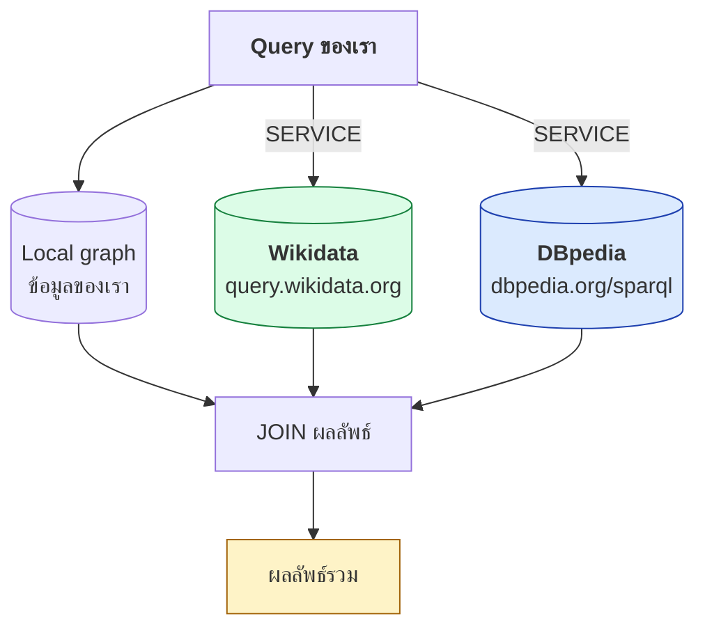
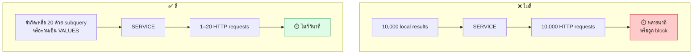

# 06.09 Federated Query: `SERVICE`

**Federated query** คือการ query ข้าม endpoint หลายแห่งใน query เดียว โดยใช้ keyword **`SERVICE`**
เป็นสิ่งที่ทำให้วิสัยทัศน์ "Web of Data" เป็นจริง — ข้อมูลอยู่คนละที่แต่ถามพร้อมกันได้
บทนี้สอนวิธีใช้ พร้อมข้อควรระวังเรื่อง performance ที่สำคัญมาก

---

## แนวคิด



---

## Syntax พื้นฐาน

```sparql
SERVICE <endpoint-iri> {
  graph pattern
}

# ไม่ error ถ้า endpoint ล่ม
SERVICE SILENT <endpoint-iri> {
  graph pattern
}

# endpoint เป็นตัวแปร (SPARQL 1.1 รองรับ แต่ engine ส่วนใหญ่ไม่รองรับ)
SERVICE ?endpoint { ... }
```

---

## ตัวอย่างที่ 1: Query Wikidata อย่างเดียว

```sparql
PREFIX wd:   <http://www.wikidata.org/entity/>
PREFIX wdt:  <http://www.wikidata.org/prop/direct/>
PREFIX rdfs: <http://www.w3.org/2000/01/rdf-schema#>

SELECT ?person ?personLabel ?birthDate
WHERE {
  SERVICE <https://query.wikidata.org/sparql> {
    ?person wdt:P166 wd:Q38104 ;      # award received = Nobel Prize in Physics
            wdt:P569 ?birthDate ;
            rdfs:label ?personLabel .
    FILTER(LANG(?personLabel) = "en")
  }
}
ORDER BY ?birthDate
LIMIT 10
```

---

## ตัวอย่างที่ 2: เชื่อมข้อมูลของเรากับ Wikidata

```sparql
PREFIX uni:  <http://example.org/university#>
PREFIX owl:  <http://www.w3.org/2002/07/owl#>
PREFIX rdfs: <http://www.w3.org/2000/01/rdf-schema#>
PREFIX wdt:  <http://www.wikidata.org/prop/direct/>

SELECT ?localName ?wikidataLabel ?website
WHERE {
  # --- จาก graph ของเรา ---
  ?org a          uni:University ;
       rdfs:label ?localName ;
       owl:sameAs ?wdEntity .

  FILTER(STRSTARTS(STR(?wdEntity), "http://www.wikidata.org/entity/"))

  # --- ไปเอาข้อมูลเพิ่มจาก Wikidata ---
  SERVICE <https://query.wikidata.org/sparql> {
    ?wdEntity rdfs:label ?wikidataLabel ;
              wdt:P856   ?website .              # official website
    FILTER(LANG(?wikidataLabel) = "en")
  }
}
```

**หลักการสำคัญ**: ต้องมี **`owl:sameAs` link** เชื่อม entity ของเราไปยัง entity ภายนอกก่อน
มิฉะนั้น join ข้าม endpoint ทำไม่ได้ — นี่คือเหตุผลที่ Linked Data ต้องมี link (ดู [12.03](../12-linked-open-data/12.03-linked-data-principles.md))

---

## ตัวอย่างที่ 3: Federated ข้าม 2 endpoint

```sparql
PREFIX dbo:  <http://dbpedia.org/ontology/>
PREFIX dbr:  <http://dbpedia.org/resource/>
PREFIX owl:  <http://www.w3.org/2002/07/owl#>
PREFIX rdfs: <http://www.w3.org/2000/01/rdf-schema#>
PREFIX wdt:  <http://www.wikidata.org/prop/direct/>

SELECT ?scientist ?dbpediaAbstract ?wikidataOccupation
WHERE {
  # --- DBpedia: หานักวิทยาศาสตร์ที่เกิดในโปแลนด์ ---
  SERVICE <https://dbpedia.org/sparql> {
    ?scientist a          dbo:Scientist ;
               dbo:birthPlace dbr:Poland ;
               dbo:abstract   ?dbpediaAbstract ;
               owl:sameAs     ?wdEntity .
    FILTER(LANG(?dbpediaAbstract) = "en")
    FILTER(STRSTARTS(STR(?wdEntity), "http://www.wikidata.org/entity/"))
  }

  # --- Wikidata: เอาอาชีพมาเพิ่ม ---
  SERVICE <https://query.wikidata.org/sparql> {
    ?wdEntity wdt:P106/rdfs:label ?wikidataOccupation .
    FILTER(LANG(?wikidataOccupation) = "en")
  }
}
LIMIT 10
```

---

## ⚠️ Performance: เรื่องที่สำคัญที่สุด

Federated query **ช้ามาก** ถ้าเขียนไม่ระวัง เพราะ engine อาจส่ง request หลายพันครั้ง

### ปัญหา: bound join

```sparql
# ❌ ช้ามาก -- ส่ง request ไป Wikidata หนึ่งครั้งต่อหนึ่ง ?person
SELECT ?person ?label WHERE {
  ?person a uni:Student .                     # ได้ 10,000 คน
  SERVICE <https://query.wikidata.org/sparql> {
    ?person rdfs:label ?label .               # ยิง 10,000 request!
  }
}
```

### ทางแก้ 1: จำกัดจำนวนก่อนเข้า SERVICE

```sparql
# ✅ ดีขึ้นมาก
SELECT ?person ?label WHERE {
  {
    SELECT ?person WHERE { ?person a uni:Student }
    LIMIT 20
  }
  SERVICE <https://query.wikidata.org/sparql> {
    ?person rdfs:label ?label .
  }
}
```

### ทางแก้ 2: ใช้ `VALUES` ส่งค่าเป็นชุด

```sparql
# ✅ ดีที่สุด -- request เดียว
PREFIX wd:   <http://www.wikidata.org/entity/>
PREFIX rdfs: <http://www.w3.org/2000/01/rdf-schema#>

SELECT ?item ?label WHERE {
  SERVICE <https://query.wikidata.org/sparql> {
    VALUES ?item { wd:Q7186 wd:Q937 wd:Q9095 wd:Q935 }
    ?item rdfs:label ?label .
    FILTER(LANG(?label) = "en")
  }
}
```



### ทางแก้ 3: ผลัก FILTER เข้าไปใน SERVICE

```sparql
# ❌ ดึงข้อมูลมาหมดแล้วค่อยกรอง
SELECT ?item WHERE {
  SERVICE <https://query.wikidata.org/sparql> {
    ?item wdt:P31 wd:Q5 ; wdt:P569 ?birth .
  }
  FILTER(YEAR(?birth) > 1900)
}

# ✅ กรองที่ต้นทาง
SELECT ?item WHERE {
  SERVICE <https://query.wikidata.org/sparql> {
    ?item wdt:P31 wd:Q5 ; wdt:P569 ?birth .
    FILTER(YEAR(?birth) > 1900)
  }
}
```

---

## `SERVICE SILENT`

```sparql
SELECT ?person ?extraInfo WHERE {
  ?person a uni:Student .

  # ถ้า endpoint ล่ม -> ?extraInfo เป็น unbound แทนที่จะ error ทั้ง query
  SERVICE SILENT <https://query.wikidata.org/sparql> {
    ?person rdfs:label ?extraInfo .
  }
}
```

| | `SERVICE` | `SERVICE SILENT` |
| --- | --- | --- |
| endpoint ล่ม | query ทั้งหมด **fail** | ตัวแปรใน block เป็น **unbound** |
| ใช้เมื่อ | ข้อมูลนั้นจำเป็น | ข้อมูลเสริม |

> 💡 ใน production ควรใช้ `SERVICE SILENT` เกือบเสมอ เพราะ endpoint ภายนอกล่มได้ตลอดเวลา

---

## Checklist ก่อนเขียน Federated Query

- [ ] มี **`owl:sameAs`** หรือ link อื่นเชื่อม entity ระหว่างสอง dataset หรือยัง
- [ ] จำกัดจำนวนผลลัพธ์ **ก่อน** เข้า `SERVICE` แล้วหรือยัง (subquery + `LIMIT`)
- [ ] ผลัก `FILTER` เข้าไปใน `SERVICE` block แล้วหรือยัง
- [ ] ใช้ `VALUES` แทนการยิงทีละตัวได้หรือไม่
- [ ] ใช้ `SERVICE SILENT` เพื่อกัน endpoint ล่มหรือยัง
- [ ] ทดสอบ query แต่ละ `SERVICE` block **แยกกันก่อน** แล้วหรือยัง
- [ ] ตรวจว่า endpoint ปลายทาง **รองรับ federation** หรือไม่ (บางแห่งปิด)

---

## ข้อจำกัดในทางปฏิบัติ

| ปัญหา | รายละเอียด | ทางแก้ |
| --- | --- | --- |
| **Endpoint ปิด federation** | บาง endpoint ไม่ยอมให้ถูกเรียกจาก `SERVICE` | ดึงข้อมูลมาเก็บ local |
| **Timeout** | Wikidata timeout 60 วินาที | ลด scope ของ query |
| **Rate limiting** | ถูก block ถ้ายิงถี่ | เว้นระยะ, ใส่ `User-Agent` |
| **Endpoint ล่ม** | endpoint สาธารณะ downtime บ่อย | `SERVICE SILENT` + retry |
| **ผลลัพธ์ไม่ครบ** | endpoint จำกัดจำนวนแถวเงียบ ๆ | ใส่ `LIMIT` ให้ชัด, ตรวจว่าครบไหม |
| **Engine ไม่รองรับ** | rdflib ไม่รองรับ `SERVICE` โดยตรง | ใช้ SPARQLWrapper เรียกทีละ endpoint แล้ว join เอง |

### ⚠️ rdflib ไม่รองรับ SERVICE

```python
# ❌ ใช้ไม่ได้ใน rdflib
g.query("SELECT * WHERE { SERVICE <...> { ?s ?p ?o } }")

# ✅ ทำเองด้วย SPARQLWrapper
from SPARQLWrapper import SPARQLWrapper, JSON

def query_endpoint(url: str, query: str) -> list:
    sparql = SPARQLWrapper(url, agent="SemanticWebCourse/1.0")
    sparql.setQuery(query)
    sparql.setReturnFormat(JSON)
    return sparql.query().convert()["results"]["bindings"]

# 1) query local
local_results = list(g.query("SELECT ?wd WHERE { ?s owl:sameAs ?wd }"))

# 2) สร้าง VALUES จากผลลัพธ์ local
values = " ".join(f"<{r.wd}>" for r in local_results[:20])

# 3) query remote ครั้งเดียว
remote = query_endpoint(
    "https://query.wikidata.org/sparql",
    f"""
    PREFIX rdfs: <http://www.w3.org/2000/01/rdf-schema#>
    SELECT ?item ?label WHERE {{
      VALUES ?item {{ {values} }}
      ?item rdfs:label ?label .
      FILTER(LANG(?label) = "en")
    }}
    """
)

# 4) join เอง
```

รายละเอียดเต็มใน [06.10](06.10-python-sparql.md) และ [`code/ch06/federated_query.py`](../code/ch06/federated_query.py)

---

## Wikidata Query Service: ข้อควรรู้เฉพาะ

```sparql
# Wikidata มี label service ในตัว -- สะดวกมาก
PREFIX wd:   <http://www.wikidata.org/entity/>
PREFIX wdt:  <http://www.wikidata.org/prop/direct/>
PREFIX wikibase: <http://wikiba.se/ontology#>
PREFIX bd:   <http://www.bigdata.com/rdf#>

SELECT ?person ?personLabel ?occupationLabel
WHERE {
  ?person wdt:P166 wd:Q38104 ;     # Nobel Prize in Physics
          wdt:P106 ?occupation .

  # ตัวช่วยของ Wikidata: เติม ?xxxLabel ให้อัตโนมัติ
  SERVICE wikibase:label {
    bd:serviceParam wikibase:language "en,th" .
  }
}
LIMIT 20
```

| Prefix ของ Wikidata | ใช้กับ |
| --- | --- |
| `wd:` | item (`wd:Q7186`) |
| `wdt:` | property แบบ direct (`wdt:P31`) |
| `p:` | property ที่นำไปสู่ statement (มี qualifier) |
| `ps:` | ค่าของ statement |
| `pq:` | qualifier |
| `wikibase:` | ontology ของ Wikibase |

---

## Key Points

- **`SERVICE <endpoint> { ... }`** ส่ง sub-pattern ไปให้ endpoint อื่นประมวลผลแล้ว join ผลลัพธ์กลับมา
- ต้องมี **`owl:sameAs`** หรือ link อื่นเชื่อม entity ระหว่าง dataset ก่อน มิฉะนั้น join ทำไม่ได้
- ⚠️ **ปัญหาหลักคือ performance** — engine อาจยิง request หนึ่งครั้งต่อหนึ่ง binding
- **ทางแก้ 3 ข้อ**: จำกัดจำนวนด้วย subquery + `LIMIT`, ใช้ **`VALUES`** ส่งเป็นชุด, ผลัก `FILTER` เข้าไปใน `SERVICE`
- **`SERVICE SILENT`** ทำให้ query ไม่พังเมื่อ endpoint ล่ม — ควรใช้เกือบเสมอใน production
- ⚠️ **rdflib ไม่รองรับ `SERVICE`** — ต้องใช้ SPARQLWrapper เรียกทีละ endpoint แล้ว join เอง
- **Wikidata** มี `SERVICE wikibase:label` ที่เติม `?xxxLabel` ให้อัตโนมัติ
- ทดสอบแต่ละ `SERVICE` block **แยกกันก่อน** เสมอ ก่อนรวมเป็น query เดียว
