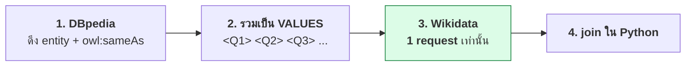

# 06.10 Python: rdflib และ SPARQLWrapper

บทนี้สอนการรัน SPARQL จาก Python สองแบบ — **rdflib** สำหรับ graph ในหน่วยความจำ
และ **SPARQLWrapper** สำหรับ endpoint ระยะไกล พร้อมเทคนิคที่จำเป็นในงานจริง:
แปลงผลเป็น DataFrame, จัดการ error, retry และ federation แบบ manual

> 📁 ไฟล์: [`sparql_select.py`](../code/ch06/sparql_select.py) · [`sparql_construct.py`](../code/ch06/sparql_construct.py) · [`federated_query.py`](../code/ch06/federated_query.py)

---

## ติดตั้ง

```bash
pip install rdflib SPARQLWrapper pandas
```

| Library | ใช้กับ |
| --- | --- |
| `rdflib` | graph ในหน่วยความจำ / ไฟล์ |
| `SPARQLWrapper` | SPARQL endpoint ผ่าน HTTP |
| `pandas` | แปลงผลลัพธ์เป็น DataFrame |

---

## ส่วนที่ 1: rdflib

### SELECT

```python
from rdflib import Graph

g = Graph().parse("data/university.ttl", format="turtle")

query = """
PREFIX uni:  <http://example.org/university#>
PREFIX rdfs: <http://www.w3.org/2000/01/rdf-schema#>

SELECT ?name ?gpa
WHERE {
  ?s a uni:Student ; rdfs:label ?name ; uni:gpa ?gpa .
}
ORDER BY DESC(?gpa)
"""

result = g.query(query)

print("ตัวแปร:", [str(v) for v in result.vars])

for row in result:
    print(f"{str(row.name):20s} {row.gpa}")       # เข้าถึงด้วยชื่อ
    print(f"{str(row[0]):20s} {row[1]}")          # หรือด้วย index
```

Expected output:

```
ตัวแปร: ['name', 'gpa']
Carol Nguyen         3.95
Alice Johnson        3.85
Bob Martinez         3.20
```

### CONSTRUCT และ DESCRIBE — คืน `Graph`

```python
construct_q = """
PREFIX uni:    <http://example.org/university#>
PREFIX rdfs:   <http://www.w3.org/2000/01/rdf-schema#>
PREFIX schema: <https://schema.org/>

CONSTRUCT { ?p a schema:Person ; schema:name ?name . }
WHERE     { ?p a uni:Student ; rdfs:label ?name . }
"""

new_graph = g.query(construct_q).graph        # ← .graph ไม่ใช่ list
new_graph.bind("schema", "https://schema.org/")
print(f"{len(new_graph)} triples")
print(new_graph.serialize(format="turtle"))
```

### ASK — คืน boolean

```python
ask_q = """
PREFIX uni: <http://example.org/university#>
ASK { uni:alice uni:enrolledIn uni:cs501 }
"""
print(bool(g.query(ask_q)))     # True
```

### UPDATE

```python
g.update("""
PREFIX uni:  <http://example.org/university#>
PREFIX rdfs: <http://www.w3.org/2000/01/rdf-schema#>

INSERT DATA {
  uni:eve a uni:Student ;
      rdfs:label    "Eve Chen"@en ;
      uni:studentId "S-2025-0001" ;
      uni:gpa       3.60 .
}
""")

g.update("""
PREFIX uni: <http://example.org/university#>
DELETE { uni:eve uni:gpa ?old }
INSERT { uni:eve uni:gpa 3.80 }
WHERE  { uni:eve uni:gpa ?old }
""")
```

### `initBindings` — ส่งค่าเข้า query อย่างปลอดภัย

```python
from rdflib import URIRef

query = """
PREFIX uni:  <http://example.org/university#>
PREFIX rdfs: <http://www.w3.org/2000/01/rdf-schema#>

SELECT ?course ?title WHERE {
  ?student uni:enrolledIn ?course .
  ?course  rdfs:label     ?title .
}
"""

for row in g.query(query, initBindings={
    "student": URIRef("http://example.org/university#alice")
}):
    print(row.title)
```

> 💡 **ใช้ `initBindings` แทนการต่อ string เสมอ** — ปลอดภัยกว่าและ engine optimize ได้ดีกว่า
> (เทียบได้กับ parameterized query ของ SQL)

### แปลงเป็น pandas DataFrame

```python
import pandas as pd
from rdflib import Graph

def query_to_dataframe(graph: Graph, query: str) -> pd.DataFrame:
    """แปลงผล SELECT เป็น DataFrame โดยตัด namespace ออก"""
    result = graph.query(query)

    def clean(term):
        if term is None:
            return None
        text = str(term)
        return text.split("#")[-1] if text.startswith("http") else text

    return pd.DataFrame(
        [[clean(row[v]) for v in result.vars] for row in result],
        columns=[str(v) for v in result.vars],
    )


df = query_to_dataframe(g, """
PREFIX uni:  <http://example.org/university#>
PREFIX rdfs: <http://www.w3.org/2000/01/rdf-schema#>

SELECT ?name (SUM(?cr) AS ?totalCredits) (COUNT(?c) AS ?numCourses)
WHERE {
  ?s a uni:Student ; rdfs:label ?name ; uni:enrolledIn ?c .
  ?c uni:credits ?cr .
}
GROUP BY ?name
ORDER BY DESC(?totalCredits)
""")
print(df.to_string(index=False))
```

Expected output:

```
         name totalCredits numCourses
Alice Johnson            8          2
 Carol Nguyen            7          2
 Bob Martinez            6          2
```

---

## ส่วนที่ 2: SPARQLWrapper

### พื้นฐาน

```python
from SPARQLWrapper import JSON, SPARQLWrapper

# ⚠️ endpoint สาธารณะบังคับให้ระบุตัวตน -- ไม่ใส่อาจถูก block
USER_AGENT = "SemanticWebCourse/1.0 (https://example.org/course; me@example.org)"

sparql = SPARQLWrapper("https://query.wikidata.org/sparql", agent=USER_AGENT)
sparql.setQuery("""
PREFIX wd:  <http://www.wikidata.org/entity/>
PREFIX wdt: <http://www.wikidata.org/prop/direct/>
PREFIX wikibase: <http://wikiba.se/ontology#>
PREFIX bd:  <http://www.bigdata.com/rdf#>

SELECT ?person ?personLabel ?birthDate
WHERE {
  ?person wdt:P166 wd:Q38104 ;      # Nobel Prize in Physics
          wdt:P569 ?birthDate .
  SERVICE wikibase:label { bd:serviceParam wikibase:language "en" . }
}
ORDER BY ?birthDate
LIMIT 10
""")
sparql.setReturnFormat(JSON)
sparql.setTimeout(60)

data = sparql.query().convert()

for binding in data["results"]["bindings"]:
    name = binding["personLabel"]["value"]
    birth = binding["birthDate"]["value"][:10]
    print(f"{name:35s} {birth}")
```

Expected output (จากการรันจริง):

```
Johannes Diderik van der Waals      1837-11-23
John William Strutt                 1842-11-12
Wilhelm Röntgen                     1845-03-27
Gabriel Lippmann                    1845-08-16
Karl Ferdinand Braun                1850-06-06
Antoine Henri Becquerel             1852-12-15
Albert Abraham Michelson            1852-12-19
Hendrik Lorentz                     1853-07-18
Heike Kamerlingh Onnes              1853-09-21
Joseph John Thomson                 1856-12-18
```

### โครงสร้างของ SPARQL Results JSON

```json
{
  "head": { "vars": ["person", "personLabel", "birthDate"] },
  "results": {
    "bindings": [
      {
        "person":      { "type": "uri",     "value": "http://www.wikidata.org/entity/Q9095" },
        "personLabel": { "type": "literal", "xml:lang": "en", "value": "Wilhelm Röntgen" },
        "birthDate":   { "type": "literal",
                         "datatype": "http://www.w3.org/2001/XMLSchema#dateTime",
                         "value": "1845-03-27T00:00:00Z" }
      }
    ]
  }
}
```

| Field | ความหมาย |
| --- | --- |
| `type` | `"uri"` / `"literal"` / `"bnode"` |
| `value` | ค่าจริง (เป็น string เสมอ) |
| `xml:lang` | language tag (ถ้ามี) |
| `datatype` | datatype IRI (ถ้ามี) |

### Return format ที่รองรับ

```python
from SPARQLWrapper import JSON, XML, TURTLE, N3, CSV, JSONLD, RDFXML

sparql.setReturnFormat(JSON)     # SELECT, ASK  ← แนะนำ
sparql.setReturnFormat(CSV)      # SELECT
sparql.setReturnFormat(TURTLE)   # CONSTRUCT, DESCRIBE
sparql.setReturnFormat(JSONLD)   # CONSTRUCT, DESCRIBE
```

### CONSTRUCT ผ่าน SPARQLWrapper

```python
from SPARQLWrapper import SPARQLWrapper, TURTLE
from rdflib import Graph

sparql = SPARQLWrapper("https://dbpedia.org/sparql", agent=USER_AGENT)
sparql.setQuery("""
PREFIX dbo:  <http://dbpedia.org/ontology/>
PREFIX dbr:  <http://dbpedia.org/resource/>

CONSTRUCT { dbr:Marie_Curie ?p ?o }
WHERE     { dbr:Marie_Curie ?p ?o }
LIMIT 50
""")
sparql.setReturnFormat(TURTLE)

turtle_bytes = sparql.query().convert()
g = Graph().parse(data=turtle_bytes, format="turtle")
print(f"{len(g)} triples")
```

### UPDATE ผ่าน SPARQLWrapper

```python
from SPARQLWrapper import SPARQLWrapper, POST, DIGEST

sparql = SPARQLWrapper("http://localhost:3030/university/update")
sparql.setMethod(POST)
sparql.setHTTPAuth(DIGEST)
sparql.setCredentials("admin", "password")

sparql.setQuery("""
PREFIX uni: <http://example.org/university#>
INSERT DATA { uni:eve a uni:Student }
""")
sparql.query()
```

---

## Error handling และ retry

```python
import time
from typing import Any, Dict, List, Optional

from SPARQLWrapper import JSON, SPARQLWrapper
from SPARQLWrapper.SPARQLExceptions import SPARQLWrapperException

USER_AGENT = "SemanticWebCourse/1.0 (contact@example.org)"


def run_query(
    endpoint: str,
    query: str,
    timeout: int = 60,
    retries: int = 3,
    backoff: float = 2.0,
) -> Optional[List[Dict[str, Any]]]:
    """ส่ง SELECT query พร้อม retry แบบ exponential backoff"""
    sparql = SPARQLWrapper(endpoint, agent=USER_AGENT)
    sparql.setQuery(query)
    sparql.setReturnFormat(JSON)
    sparql.setTimeout(timeout)

    for attempt in range(1, retries + 1):
        try:
            return sparql.query().convert()["results"]["bindings"]
        except SPARQLWrapperException as exc:
            print(f"  [{attempt}/{retries}] SPARQL error: {exc}")
        except Exception as exc:                       # network error หลายชนิด
            print(f"  [{attempt}/{retries}] {type(exc).__name__}: {exc}")

        if attempt < retries:
            wait = backoff ** attempt
            print(f"  รอ {wait:.1f} วินาที...")
            time.sleep(wait)

    return None
```

### Exception ที่พบบ่อย

| Exception | สาเหตุ | ทางแก้ |
| --- | --- | --- |
| `QueryBadFormed` (400) | syntax ผิด | ตรวจ query ด้วย validator |
| `EndPointNotFound` (404) | URL ผิด | ตรวจ endpoint URL |
| `Unauthorized` (401) | ต้องมี credential | `setCredentials()` |
| `EndPointInternalError` (500) | query หนักเกินไป / server พัง | ลด scope, ใส่ `LIMIT` |
| `URLError` / `socket.timeout` | network | retry + backoff |
| `HTTP 429` | ถูก rate limit | เว้นระยะระหว่าง request |

---

## Federation แบบ manual

⚠️ **rdflib ไม่รองรับ `SERVICE`** — ต้อง query แยกแล้ว join เอง

```python
# --- ขั้นที่ 1: ดึง Wikidata entity จาก DBpedia ---
dbpedia_rows = run_query("https://dbpedia.org/sparql", """
PREFIX dbo:  <http://dbpedia.org/ontology/>
PREFIX dbr:  <http://dbpedia.org/resource/>
PREFIX owl:  <http://www.w3.org/2002/07/owl#>
PREFIX rdfs: <http://www.w3.org/2000/01/rdf-schema#>

SELECT ?name ?wdEntity WHERE {
  ?s a dbo:Scientist ;
     dbo:birthPlace dbr:Poland ;
     rdfs:label     ?name ;
     owl:sameAs     ?wdEntity .
  FILTER(LANG(?name) = "en")
  FILTER(STRSTARTS(STR(?wdEntity), "http://www.wikidata.org/entity/"))
}
LIMIT 8
""")

name_by_entity = {r["wdEntity"]["value"]: r["name"]["value"] for r in dbpedia_rows}

# --- ขั้นที่ 2: ยิง Wikidata ครั้งเดียวด้วย VALUES ---
values = " ".join(f"<{iri}>" for iri in name_by_entity)
wikidata_rows = run_query("https://query.wikidata.org/sparql", f"""
PREFIX rdfs: <http://www.w3.org/2000/01/rdf-schema#>
PREFIX wdt:  <http://www.wikidata.org/prop/direct/>

SELECT ?item ?occupationLabel WHERE {{
  VALUES ?item {{ {values} }}
  ?item wdt:P106 ?occupation .
  ?occupation rdfs:label ?occupationLabel .
  FILTER(LANG(?occupationLabel) = "en")
}}
""")

# --- ขั้นที่ 3: join ใน Python ---
merged: dict = {}
for row in wikidata_rows:
    entity = row["item"]["value"]
    merged.setdefault(name_by_entity[entity], set()).add(row["occupationLabel"]["value"])

for name, occupations in sorted(merged.items()):
    print(f"{name:35s} {', '.join(sorted(occupations))}")
```



**ผลลัพธ์**: ใช้ HTTP request เพียง **2 ครั้ง** แทนที่จะเป็น N ครั้ง

---

## เทคนิคสำหรับ query จำนวนมาก

### Pagination

```python
def fetch_all(endpoint: str, base_query: str, page_size: int = 1000) -> list:
    """ดึงผลลัพธ์ทั้งหมดด้วย LIMIT/OFFSET"""
    all_rows, offset = [], 0
    while True:
        rows = run_query(endpoint, f"{base_query}\nLIMIT {page_size} OFFSET {offset}")
        if not rows:
            break
        all_rows.extend(rows)
        if len(rows) < page_size:
            break
        offset += page_size
        time.sleep(1)                 # มารยาท: เว้นระยะ
    return all_rows
```

> ⚠️ **ต้องมี `ORDER BY` ที่ deterministic** มิฉะนั้น pagination จะได้ข้อมูลซ้ำหรือตกหล่น

### Cache ผลลัพธ์

```python
import hashlib
import json
from pathlib import Path

CACHE_DIR = Path(".sparql_cache")
CACHE_DIR.mkdir(exist_ok=True)


def cached_query(endpoint: str, query: str) -> list:
    key = hashlib.sha256(f"{endpoint}\n{query}".encode()).hexdigest()[:16]
    cache_file = CACHE_DIR / f"{key}.json"

    if cache_file.exists():
        return json.loads(cache_file.read_text())

    rows = run_query(endpoint, query) or []
    cache_file.write_text(json.dumps(rows))
    return rows
```

---

## รันจริง

```bash
python code/ch06/sparql_select.py               # SELECT ทุกรูปแบบ
python code/ch06/sparql_select.py --only paths  # เฉพาะ property path
python code/ch06/sparql_construct.py            # CONSTRUCT/ASK/DESCRIBE/UPDATE
python code/ch06/federated_query.py             # federated (ต้องต่อ internet)
python code/ch06/federated_query.py --offline   # ข้าม network
```

---

## Troubleshooting

| อาการ | สาเหตุ | วิธีแก้ |
| --- | --- | --- |
| `SERVICE` ใน rdflib ไม่ทำงาน | rdflib ไม่รองรับ | ทำ manual federation |
| ผลลัพธ์ว่างทั้งที่ข้อมูลมี | datatype/lang tag ไม่ตรง | ใช้ `FILTER(STR(?x) = ...)` |
| Wikidata คืน 403 | ไม่ได้ใส่ `User-Agent` | ตั้ง `agent=` ใน `SPARQLWrapper()` |
| Wikidata timeout | query หนัก | ลด scope, ใส่ `LIMIT`, ผลัก `FILTER` เข้า `SERVICE` |
| `?var` เข้าถึงไม่ได้ใน rdflib | ชื่อตัวแปรผิด | ใช้ `row["varName"]` หรือ index |
| `.graph` เป็น `None` | ใช้กับ SELECT | `.graph` ใช้ได้เฉพาะ CONSTRUCT/DESCRIBE |
| pagination ได้ข้อมูลซ้ำ | ไม่มี `ORDER BY` | เพิ่ม `ORDER BY` ที่ deterministic |
| ต่อ string สร้าง query แล้วพัง | injection / escaping | ใช้ `initBindings` หรือ `VALUES` |

---

## Key Points

- **rdflib**: `g.query()` สำหรับ SELECT/CONSTRUCT/ASK, `g.update()` สำหรับ UPDATE
- `result.graph` คืน `Graph` สำหรับ **CONSTRUCT/DESCRIBE**; `bool(result)` สำหรับ **ASK**
- **ใช้ `initBindings` แทนการต่อ string** — ปลอดภัยและ optimize ได้ดีกว่า
- **SPARQLWrapper**: ต้องตั้ง `agent=`, `setReturnFormat(JSON)` และ `setTimeout()` เสมอ
- ผลลัพธ์ JSON มีโครงสร้าง `data["results"]["bindings"][i]["var"]["value"]`
- ทำ **retry แบบ exponential backoff** เพราะ endpoint สาธารณะล่มบ่อย
- ⚠️ **rdflib ไม่รองรับ `SERVICE`** — ทำ manual federation ด้วย `VALUES` เพื่อลดเหลือ request เดียว
- **Pagination ต้องมี `ORDER BY` ที่ deterministic** มิฉะนั้นข้อมูลซ้ำหรือตกหล่น
- Cache ผลลัพธ์ลงไฟล์เมื่อ query ซ้ำ ๆ เพื่อไม่รบกวน endpoint สาธารณะ
