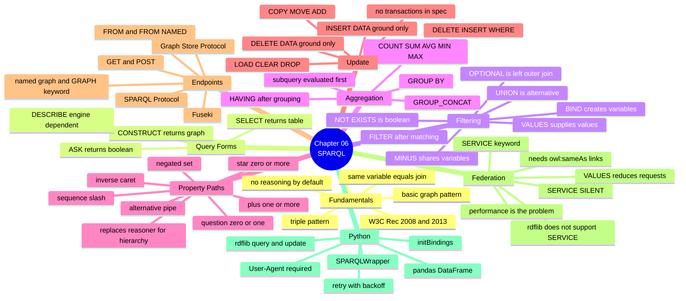

# 06.11 สรุป Chapter 06 + SPARQL Cheat Sheet

Chapter 06 ครอบคลุม SPARQL ทั้งภาษา ตั้งแต่ triple pattern พื้นฐานไปจนถึง federated query ข้าม endpoint
บทสรุปนี้รวมทุกอย่างเป็น cheat sheet ที่เปิดค้างไว้ใช้งานได้จริง

---

## Concept Map



---

## SPARQL Cheat Sheet

### โครงสร้าง query

```sparql
PREFIX ex: <http://example.org/>            # ไม่มีจุดปิดท้าย!

SELECT DISTINCT ?a ?b (COUNT(?c) AS ?n)
FROM <http://example.org/graph/data>
FROM NAMED <http://example.org/graph/meta>
WHERE {
  ?a ex:p ?b .
  OPTIONAL { ?a ex:q ?c }
  FILTER(?b > 10)
  GRAPH ?g { ?a ex:r ?d }
}
GROUP BY ?a ?b
HAVING(COUNT(?c) > 1)
ORDER BY DESC(?n) ASC(?a)
LIMIT 10
OFFSET 20
```

### Query forms

| Form | คืนอะไร | Python (rdflib) |
| --- | --- | --- |
| `SELECT ?x WHERE {}` | ตาราง | `for row in g.query(q): row.x` |
| `CONSTRUCT {} WHERE {}` | graph | `g.query(q).graph` |
| `ASK {}` | boolean | `bool(g.query(q))` |
| `DESCRIBE <iri>` | graph | `g.query(q).graph` |

### Pattern operators

| ต้องการ | เขียน |
| --- | --- |
| AND (โดยปริยาย) | `?a ex:p ?b . ?b ex:q ?c .` |
| OR | `{ ... } UNION { ... }` |
| ถ้ามี | `OPTIONAL { ... }` |
| ไม่มี | `FILTER NOT EXISTS { ... }` หรือ `MINUS { ... }` |
| มี | `FILTER EXISTS { ... }` |
| ตั้งค่าตัวแปร | `BIND(expr AS ?var)` |
| ระบุชุดค่า | `VALUES ?x { v1 v2 }` |
| named graph | `GRAPH ?g { ... }` |
| ส่งไป endpoint อื่น | `SERVICE <url> { ... }` |

### FILTER functions

| กลุ่ม | Function |
| --- | --- |
| ตรวจชนิด | `isIRI` `isBlank` `isLiteral` `isNumeric` `BOUND` `sameTerm` |
| term | `STR` `LANG` `DATATYPE` `IRI` `BNODE` `UUID` |
| ตรรกะ | `IF(c,a,b)` `COALESCE(a,b,...)` |
| String | `STRLEN` `SUBSTR` `UCASE` `LCASE` `STRSTARTS` `STRENDS` `CONTAINS` `STRBEFORE` `STRAFTER` `REPLACE` `REGEX` `CONCAT` `LANGMATCHES` |
| ตัวเลข | `ABS` `ROUND` `CEIL` `FLOOR` `RAND` |
| วันเวลา | `NOW` `YEAR` `MONTH` `DAY` `HOURS` `MINUTES` `SECONDS` `TIMEZONE` `TZ` |
| Hash | `MD5` `SHA1` `SHA256` `SHA512` |

### Aggregates

| Function | ตัวอย่าง |
| --- | --- |
| `COUNT` | `(COUNT(?x) AS ?n)` `(COUNT(DISTINCT ?x) AS ?n)` `(COUNT(*) AS ?n)` |
| `SUM` `AVG` | `(SUM(?credits) AS ?total)` |
| `MIN` `MAX` | `(MAX(?gpa) AS ?best)` |
| `SAMPLE` | `(SAMPLE(?name) AS ?any)` |
| `GROUP_CONCAT` | `(GROUP_CONCAT(?x; SEPARATOR=", ") AS ?list)` |

### Property paths

| Path | ความหมาย | ตัวอย่าง |
| --- | --- | --- |
| `p` | หนึ่งขั้น | `ex:knows` |
| `^p` | ย้อนกลับ | `^ex:enrolledIn` |
| `p1/p2` | ต่อกัน | `ex:memberOf/rdfs:label` |
| `p1\|p2` | หรือ | `ex:teaches\|ex:enrolledIn` |
| `p*` | 0 ครั้งขึ้นไป | `rdfs:subClassOf*` |
| `p+` | 1 ครั้งขึ้นไป | `ex:partOf+` |
| `p?` | 0 หรือ 1 | `ex:partOf?` |
| `!p` | ยกเว้น | `!(rdf:type\|rdfs:label)` |
| `a/rdfs:subClassOf*` | **แทน reasoner** | หา instance รวม subclass |

### Update

| คำสั่ง | ใช้ทำอะไร |
| --- | --- |
| `INSERT DATA { ... }` | เพิ่ม ground triple |
| `DELETE DATA { ... }` | ลบ ground triple |
| `DELETE {...} INSERT {...} WHERE {...}` | แก้ไขค่า |
| `DELETE WHERE { ... }` | ลบตาม pattern |
| `INSERT { ... } WHERE { ... }` | materialize |
| `LOAD <url> INTO GRAPH <g>` | โหลดจาก URL |
| `CLEAR GRAPH <g>` | ล้าง triple (graph ยังอยู่) |
| `DROP GRAPH <g>` | ลบ graph ทิ้ง |
| `COPY` / `MOVE` / `ADD` | คัดลอก / ย้าย / merge |

---

## Python Cheat Sheet

```python
# ===== rdflib =====
from rdflib import Graph, URIRef

g = Graph().parse("data.ttl", format="turtle")

for row in g.query(q):                 # SELECT
    print(row.name, row[0])

new_g = g.query(construct_q).graph     # CONSTRUCT / DESCRIBE
answer = bool(g.query(ask_q))          # ASK
g.update(update_q)                     # UPDATE

g.query(q, initBindings={"s": URIRef("http://example.org/alice")})   # ปลอดภัย


# ===== SPARQLWrapper =====
from SPARQLWrapper import JSON, SPARQLWrapper

sparql = SPARQLWrapper(
    "https://query.wikidata.org/sparql",
    agent="MyApp/1.0 (me@example.org)",     # ⚠️ บังคับ
)
sparql.setQuery(q)
sparql.setReturnFormat(JSON)
sparql.setTimeout(60)

data = sparql.query().convert()
for b in data["results"]["bindings"]:
    print(b["varName"]["value"])


# ===== pandas =====
import pandas as pd

df = pd.DataFrame(
    [[str(row[v]) for v in res.vars] for row in res],
    columns=[str(v) for v in res.vars],
)
```

---

## กับดักที่พบบ่อย 10 ข้อ

| # | กับดัก | ทางแก้ |
| --- | --- | --- |
| 1 | `"3"` ไม่ match `"3"^^xsd:integer` | ระบุ datatype ให้ตรง หรือใช้ `FILTER(STR(?x)=...)` |
| 2 | `"Alice"` ไม่ match `"Alice"@en` | ใช้ `FILTER(STR(?l) = "Alice")` |
| 3 | แถวหายเพราะ pattern หนึ่งไม่ match | ใช้ `OPTIONAL` |
| 4 | `FILTER` นอก `OPTIONAL` ตัดแถวทิ้ง | ย้าย `FILTER` เข้าไปใน `OPTIONAL` |
| 5 | `MINUS` ไม่ทำงานเมื่อไม่มีตัวแปรร่วม | ใช้ `FILTER NOT EXISTS` แทน |
| 6 | `SELECT COUNT(?x)` โดยไม่มี `AS` | เขียน `(COUNT(?x) AS ?n)` |
| 7 | ตัวแปรใน `SELECT` ไม่อยู่ใน `GROUP BY` | เพิ่มเข้า `GROUP BY` หรือใช้ `SAMPLE` |
| 8 | `LIMIT` โดยไม่มี `ORDER BY` | ใส่ `ORDER BY` ที่ deterministic |
| 9 | Federated query ช้ามาก | ใช้ `VALUES` + `LIMIT` + ผลัก `FILTER` เข้า `SERVICE` |
| 10 | `?p a uni:Person` ได้ 0 แถว | ใช้ `a/rdfs:subClassOf*` หรือรัน reasoner ก่อน |

---

## Self-check

1. `?a ex:p ?b . ?b ex:q ?c .` เกิด JOIN ที่ตัวแปรไหน
2. `OPTIONAL` เทียบเท่ากับอะไรใน SQL
3. `MINUS` กับ `FILTER NOT EXISTS` ต่างกันเมื่อไหร่
4. `FILTER` กับ `HAVING` กรองในขั้นตอนไหนของการประมวลผล
5. `partOf*` กับ `partOf+` ต่างกันอย่างไร
6. เขียน query หา "ทุก instance ของ Person รวม subclass" โดยไม่ใช้ reasoner
7. `CLEAR GRAPH` กับ `DROP GRAPH` ต่างกันอย่างไร
8. ทำไม federated query จึงมักช้า และแก้อย่างไร 3 วิธี

---

## Preview: Chapter 07 — Python Semantic Web

Chapter 06 สอน SPARQL ในฐานะภาษา — Chapter 07 จะพา **ประกอบทุกอย่างเข้าด้วยกันเป็นระบบจริง**

| จะได้เรียน | สาระ |
| --- | --- |
| Ecosystem map | library ทั้งหมดในโลก Python Semantic Web |
| rdflib ขั้นสูง | `ConjunctiveGraph`, `Dataset`, namespace manager, plugin, graph operations |
| SPARQLWrapper ขั้นสูง | auth, timeout, retry, bulk query strategy |
| owlready2 | โหลด/บันทึก OWL, navigate class, สร้าง individual |
| owlready2 + reasoning | HermiT, SQWRL, ตรวจ inferred fact |
| **pySHACL** | validate RDF ด้วย SHACL shape — closed world |
| **Visualization** | networkx + pyvis — กราฟแบบ interactive |
| **pandas ↔ RDF** | CSV/JSON → RDF และกลับ |
| **ETL pipeline** | open dataset → RDF → Fuseki → SPARQL |
| **API** | FastAPI + content negotiation ให้บริการ Linked Data |

ตัวอย่างสิ่งที่จะทำได้ตอนจบ Chapter 07:

```
CSV จาก data.go.th
   ↓ pandas + rdflib
RDF (Turtle)
   ↓ pySHACL validate
   ↓ HTTP POST
Fuseki triplestore
   ↓ SPARQL
FastAPI endpoint ที่ตอบทั้ง HTML และ Turtle
```

---

## Key Points

- SPARQL มี **4 query form**: `SELECT` (ตาราง), `CONSTRUCT` (graph), `ASK` (boolean), `DESCRIBE` (ไม่แน่นอน)
- **ตัวแปรเดียวกัน = JOIN โดยอัตโนมัติ** — ไม่ต้องเขียน `JOIN ... ON ...`
- **`OPTIONAL` = LEFT OUTER JOIN**; `UNION` = ทางเลือก; `MINUS`/`NOT EXISTS` = negation ที่ต่างกันในรายละเอียด
- ลำดับประมวลผล: `WHERE` → `FILTER` → `GROUP BY` → `HAVING` → `SELECT` → `ORDER BY` → `LIMIT`
- **Property path** (`*` `+` `?` `^` `/` `|`) ทำ recursive query ได้โดยไม่ต้องมี reasoner
- **`a/rdfs:subClassOf*`** คือ pattern มาตรฐานแทน reasoner สำหรับ class hierarchy
- **SPARQL Update** ไม่มี transaction ในสเปก — ทดสอบด้วย `SELECT` ก่อนลบเสมอ
- **Federated query ช้าเพราะจำนวน request** — แก้ด้วย `VALUES`, `LIMIT` และผลัก `FILTER` เข้า `SERVICE`
- ⚠️ **datatype และ language tag ต้องตรงเป๊ะ** — เป็นสาเหตุอันดับหนึ่งที่ query ได้ 0 แถว
