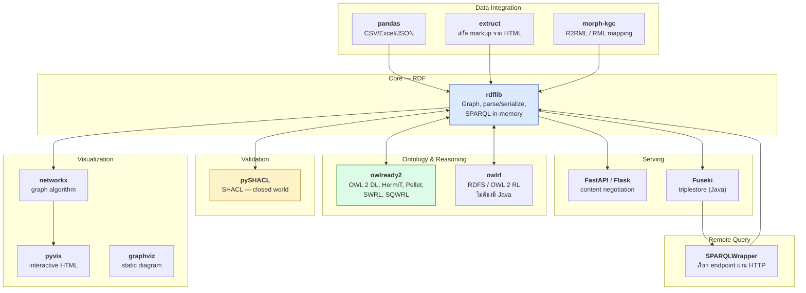
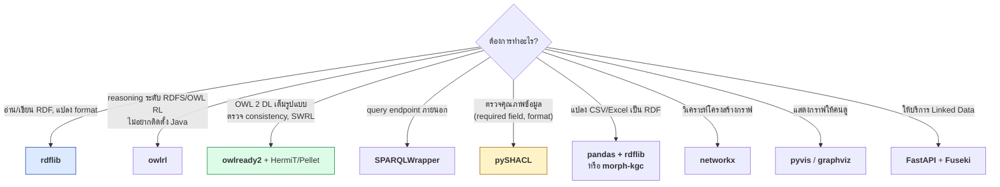
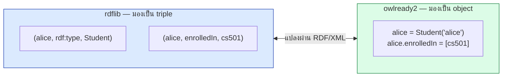
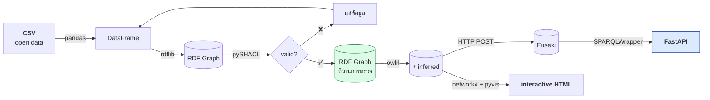

# 07.01 Python Semantic Web Ecosystem

Python มี library ครบวงจรสำหรับงาน Semantic Web ตั้งแต่จัดการ RDF ไปจนถึงรัน reasoner และ visualize กราฟ
บทนี้ให้แผนที่ทั้ง ecosystem ว่าแต่ละตัวทำอะไร ทำงานร่วมกันอย่างไร และควรเลือกตัวไหนกับงานแบบใด

---

## แผนที่ ecosystem



> **rdflib เป็นศูนย์กลาง** — เกือบทุก library เชื่อมเข้าหามันได้

---

## ตารางสรุป library

| Library | ทำอะไร | จุดเด่น | ข้อจำกัด |
| --- | --- | --- | --- |
| **rdflib** | จัดการ RDF graph | ครบเครื่อง, มาตรฐาน, active | ช้ากับข้อมูลใหญ่ (> 1M triples) |
| **owlready2** | OWL ontology + reasoner | map DL เข้า Python class, มี HermiT/Pellet ในตัว | ต้องมี Java, ไม่รองรับ Turtle โดยตรง |
| **owlrl** | RDFS/OWL 2 RL reasoning | ไม่ต้องมี Java, ทำงานบน rdflib | ไม่ครบ OWL 2 DL |
| **SPARQLWrapper** | เรียก SPARQL endpoint | มาตรฐาน, ใช้กันแพร่หลาย | ไม่มี connection pooling |
| **pySHACL** | validate ด้วย SHACL | closed world, รายงานละเอียด | ช้ากับ shape ซับซ้อน |
| **pandas** | ตารางข้อมูล | ecosystem ใหญ่ | ไม่รู้จัก RDF |
| **networkx** | graph algorithm | algorithm ครบ (centrality, path, community) | ไม่ใช่ RDF โดยตรง |
| **pyvis** | interactive graph | สร้าง HTML ที่โต้ตอบได้ | ไม่เหมาะกับ node เกิน ~1000 |
| **extruct** | สกัด JSON-LD/Microdata/RDFa | รองรับทุกรูปแบบ markup | เฉพาะงาน web scraping |
| **morph-kgc** | RML/R2RML mapping | แปลง CSV/SQL → RDF ตามมาตรฐาน | learning curve ของ RML |
| **FastAPI** | Web API | async, มี OpenAPI ในตัว | ต้องเขียน content negotiation เอง |
| **kglab** | wrapper รวมหลาย library | เริ่มต้นง่าย | abstraction layer เพิ่ม |

---

## เลือกเครื่องมือให้ตรงงาน



---

## ติดตั้งครบชุด

```bash
python -m venv .venv
source .venv/bin/activate

# core
pip install rdflib owlrl SPARQLWrapper pyshacl

# ontology + reasoning (ต้องมี Java 8+)
pip install owlready2

# data integration
pip install pandas openpyxl requests extruct

# visualization
pip install networkx pyvis matplotlib

# serving
pip install fastapi uvicorn jinja2
```

ตรวจสอบ:

```python
import importlib

MODULES = [
    "rdflib", "owlrl", "SPARQLWrapper", "pyshacl", "owlready2",
    "pandas", "networkx", "pyvis", "fastapi",
]

for name in MODULES:
    try:
        mod = importlib.import_module(name)
        version = getattr(mod, "__version__", getattr(mod, "VERSION", "?"))
        print(f"✅ {name:16s} {version}")
    except ImportError:
        print(f"❌ {name:16s} ไม่ได้ติดตั้ง")
```

Expected output:

```
✅ rdflib           7.1.1
✅ owlrl            6.0.2
✅ SPARQLWrapper    2.0.0
✅ pyshacl          0.26.0
✅ owlready2        0.51
✅ pandas           2.2.3
✅ networkx         3.2.1
✅ pyvis            0.3.2
✅ fastapi          0.115.0
```

---

## rdflib กับ owlready2: ต่างกันอย่างไร

นี่คือความสับสนที่พบบ่อยที่สุด — ทั้งสองตัวจัดการ ontology ได้แต่มองโลกคนละแบบ

| | **rdflib** | **owlready2** |
| --- | --- | --- |
| มองข้อมูลเป็น | **เซตของ triple** | **object ใน Python** |
| สร้าง class | `g.add((C, RDF.type, OWL.Class))` | `class C(Thing): pass` |
| เข้าถึงข้อมูล | pattern matching / SPARQL | attribute access (`alice.enrolledIn`) |
| Reasoning | ผ่าน `owlrl` (OWL 2 RL) | HermiT / Pellet (OWL 2 DL) |
| ตรวจ consistency | ❌ | ✅ |
| SPARQL | ✅ เต็มรูปแบบ | ⚠️ จำกัด |
| อ่าน Turtle | ✅ | ❌ (RDF/XML, NT เท่านั้น) |
| เหมาะกับ | **ข้อมูล / ETL / query** | **ontology / reasoning** |



### แปลงไปมาระหว่างสองตัว

```python
from pathlib import Path
from rdflib import Graph
from rdflib.namespace import OWL
from owlready2 import World

def rdflib_to_owlready(g: Graph, tmp: Path) -> "owlready2.Ontology":
    """rdflib Graph -> owlready2 Ontology (ผ่าน RDF/XML)"""
    g = g + Graph()                                # copy
    g.remove((None, OWL.imports, None))            # ⚠️ กัน network fetch
    g.serialize(destination=str(tmp), format="xml")
    world = World()
    return world.get_ontology(f"file://{tmp.resolve()}").load()


def owlready_to_rdflib(onto, tmp: Path) -> Graph:
    """owlready2 Ontology -> rdflib Graph"""
    onto.save(file=str(tmp), format="rdfxml")
    return Graph().parse(str(tmp), format="xml")
```

> ⚠️ **owlready2 อ่าน Turtle ไม่ได้** และ **ต้องตัด `owl:imports` ออกก่อน** มิฉะนั้นจะพยายามดึงผ่าน network
> (ปัญหาที่เจอจริงใน [05.09](../05-knowledge-management/05.09-python-kb.md))

---

## Triplestore ที่ Python เชื่อมได้

| Triplestore | ภาษา | Reasoning | เชื่อมด้วย |
| --- | --- | --- | --- |
| **Apache Jena Fuseki** | Java | RDFS, OWL subset, custom rules | SPARQLWrapper, HTTP |
| **GraphDB** | Java | RDFS, OWL 2 RL, custom ruleset | SPARQLWrapper |
| **Virtuoso** | C | RDFS + OWL subset | SPARQLWrapper |
| **Blazegraph** | Java | RDFS+ | SPARQLWrapper |
| **Stardog** | Java | OWL 2 QL/EL/RL/DL (query rewriting) | `pystardog` |
| **Oxigraph** | Rust | ไม่มี | `pyoxigraph` (native Python!) |
| **QLever** | C++ | ไม่มี | HTTP |

> 💡 **Oxigraph** น่าสนใจเป็นพิเศษเพราะมี Python binding แบบ native (`pip install pyoxigraph`)
> เร็วกว่า rdflib มากและไม่ต้องรัน server แยก

```python
# ตัวอย่าง pyoxigraph -- เร็วกว่า rdflib หลายเท่าสำหรับข้อมูลใหญ่
from pyoxigraph import Store

store = Store()
store.load(path="data/university.ttl", format="text/turtle")
for solution in store.query("SELECT ?s WHERE { ?s a <http://example.org/university#Student> }"):
    print(solution["s"])
```

---

## Pipeline ตัวอย่างที่ประกอบทุกอย่างเข้าด้วยกัน



**นี่คือสิ่งที่เราจะสร้างจริงตลอด Chapter 07** — ตั้งแต่ [07.08](07.08-pandas-rdf.md) ถึง [07.10](07.10-api-integration.md)

---

## ข้อจำกัดด้าน performance ที่ควรรู้

| ขนาดข้อมูล | เครื่องมือที่เหมาะ |
| --- | --- |
| < 100K triples | **rdflib** ในหน่วยความจำ — สะดวกที่สุด |
| 100K – 1M | rdflib + `Memory` store หรือ **pyoxigraph** |
| 1M – 100M | **triplestore** (Fuseki, GraphDB, Oxigraph server) |
| > 100M | triplestore ที่ optimize (Virtuoso, QLever) + ไม่ materialize inference |

```python
# rdflib กับข้อมูลใหญ่: ใช้ store ที่เก็บลงดิสก์
from rdflib import Graph
from rdflib.plugins.stores.memory import Memory

# in-memory (default)
g = Graph()

# หรือใช้ SPARQL endpoint เป็น backing store
from rdflib.plugins.stores.sparqlstore import SPARQLStore
store = SPARQLStore("http://localhost:3030/university/query")
g = Graph(store=store)
for s in g.subjects():                # query ผ่าน endpoint จริง
    ...
```

---

## Key Points

- **rdflib เป็นศูนย์กลาง** ของ ecosystem — เกือบทุก library เชื่อมเข้าหามันได้
- แบ่งเครื่องมือตามหน้าที่: **RDF** (rdflib), **reasoning** (owlrl/owlready2), **query ระยะไกล** (SPARQLWrapper), **validation** (pySHACL)
- **owlrl** สำหรับ RDFS/OWL 2 RL โดยไม่ต้องมี Java; **owlready2 + HermiT** สำหรับ OWL 2 DL เต็มรูปแบบ
- ⚠️ **owlready2 อ่าน Turtle ไม่ได้** และต้อง **ตัด `owl:imports`** ก่อนแปลงจาก rdflib
- rdflib มองข้อมูลเป็น **triple**; owlready2 มองเป็น **Python object** — เลือกตามลักษณะงาน
- **pyoxigraph** เป็นทางเลือกที่เร็วกว่า rdflib มากสำหรับข้อมูลขนาดใหญ่ และเป็น native Python
- Pipeline มาตรฐาน: **pandas → rdflib → pySHACL → owlrl → Fuseki → FastAPI**
- เลือกเครื่องมือตามขนาดข้อมูล: rdflib (< 100K), pyoxigraph (< 1M), triplestore (> 1M)
