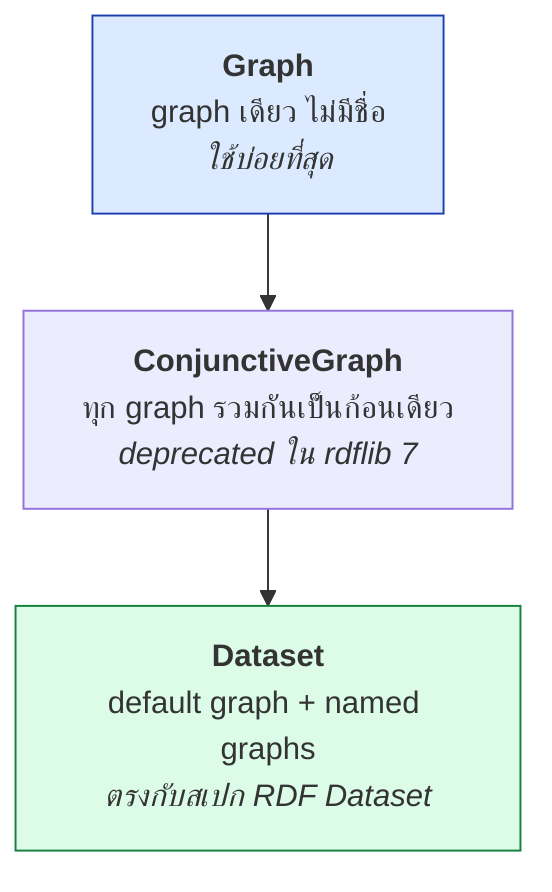
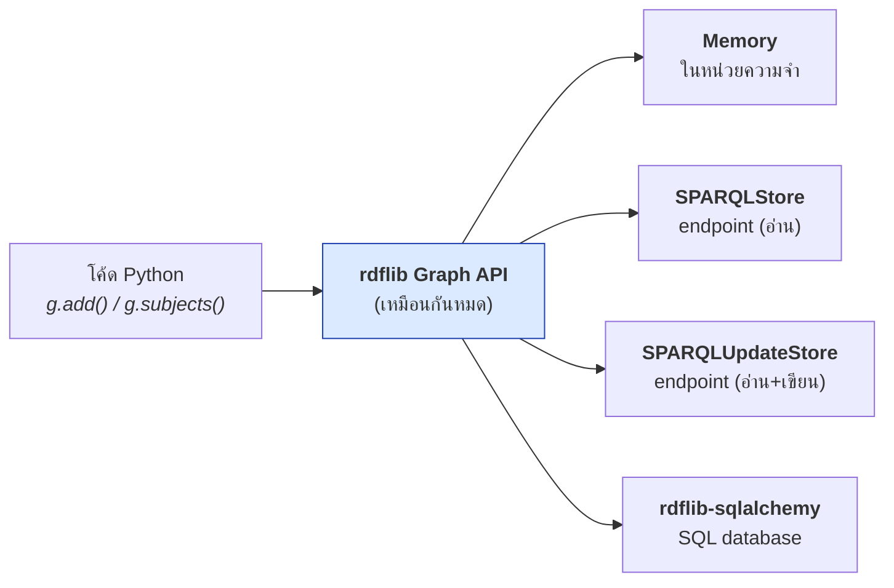

# 07.02 rdflib ขั้นสูง

บทนี้ครอบคลุมความสามารถของ rdflib ที่ยังไม่ได้กล่าวถึงใน [02.08](../02-rdf/02.08-python-rdflib.md):
**`Dataset` และ named graph**, **namespace manager**, **plugin system**, **store backend**
และเทคนิคจัดการ graph ขนาดใหญ่

---

## Graph, ConjunctiveGraph และ Dataset



| Class | เมื่อไหร่ใช้ |
| --- | --- |
| `Graph` | ข้อมูลชุดเดียว ไม่ต้องแยก provenance — **95% ของงาน** |
| `Dataset` | ต้องการ **named graph** ตามสเปก RDF Dataset |
| `ConjunctiveGraph` | legacy — ใช้ `Dataset` แทน |

### ใช้ `Dataset`

```python
from rdflib import Dataset, Literal, Namespace, URIRef
from rdflib.namespace import RDF, RDFS

EX = Namespace("http://example.org/university#")

ds = Dataset()
ds.bind("uni", EX)

# --- สร้าง named graph ---
asserted = ds.graph(URIRef("http://example.org/graph/asserted"))
inferred = ds.graph(URIRef("http://example.org/graph/inferred"))

asserted.add((EX.alice, RDF.type, EX.Student))
asserted.add((EX.alice, RDFS.label, Literal("Alice Johnson", lang="en")))
inferred.add((EX.alice, RDF.type, EX.Person))

# --- metadata ใน default graph ---
ds.default_context.add((
    URIRef("http://example.org/graph/asserted"),
    EX.source,
    Literal("student information system"),
))

# --- สำรวจ ---
print(f"จำนวน context: {len(list(ds.contexts()))}")
for ctx in ds.contexts():
    print(f"  {ctx.identifier}: {len(ctx)} triples")

# --- query ข้าม graph ---
for row in ds.query("""
    PREFIX uni: <http://example.org/university#>
    SELECT ?g ?s WHERE { GRAPH ?g { ?s a uni:Student } }
"""):
    print(row.g, row.s)

ds.serialize("dataset.trig", format="trig")
```

Expected output:

```
จำนวน context: 3
  urn:x-rdflib:default: 1 triples
  http://example.org/graph/asserted: 2 triples
  http://example.org/graph/inferred: 1 triples
http://example.org/graph/asserted http://example.org/university#alice
```

### ⚠️ ข้อควรรู้เรื่อง `Dataset`

```python
# default_context คือ default graph
ds.default_context.add(triple)

# ds.add() ใส่ลง default graph
ds.add((s, p, o))

# ds.add() แบบ 4 ตัว ใส่ลง named graph
ds.add((s, p, o, graph_uri))

# iterate ทุก triple ในทุก graph
for s, p, o, g in ds.quads():
    ...

# ลบ named graph
ds.remove_graph(URIRef("http://example.org/graph/inferred"))
```

---

## Namespace Manager

```python
from rdflib import Graph, Namespace, URIRef
from rdflib.namespace import DCTERMS, FOAF, OWL, RDF, RDFS, SKOS, XSD

g = Graph()

# --- bind prefix ---
UNI = Namespace("http://example.org/university#")
g.bind("uni", UNI)
g.bind("foaf", FOAF)
g.bind("skos", SKOS)

# override=False -- ไม่ทับ prefix เดิมถ้ามีแล้ว
g.bind("ex", "http://other.example.org/", override=False)

# replace=True -- แทนที่ namespace เดิมของ prefix นี้
g.bind("uni", "http://new.example.org/", replace=True)

# --- ดู prefix ทั้งหมด ---
for prefix, namespace in g.namespaces():
    print(f"{prefix:12s} -> {namespace}")

# --- แปลง IRI <-> prefixed name ---
nsm = g.namespace_manager
print(nsm.normalizeUri(URIRef("http://example.org/university#alice")))   # uni:alice
print(nsm.compute_qname(URIRef("http://xmlns.com/foaf/0.1/name")))       # ('foaf', ..., 'name')
print(URIRef("http://example.org/university#alice").n3(nsm))             # uni:alice
```

### Namespace ที่ rdflib มีให้แล้ว

```python
from rdflib.namespace import (
    RDF, RDFS, OWL, XSD,           # core
    DC, DCTERMS, DCAT, DCMITYPE,   # metadata
    FOAF, SKOS, SDO, VOID, PROV,   # description
    ODRL2, ORG, TIME, GEO, QB,     # domain
)

# SDO = schema.org
print(SDO.Person)      # https://schema.org/Person
print(PROV.Activity)   # http://www.w3.org/ns/prov#Activity
```

### สร้าง Namespace แบบมี validation

```python
from rdflib.namespace import DefinedNamespace, Namespace
from rdflib.term import URIRef


class UNI(DefinedNamespace):
    """University vocabulary — เข้าถึงเฉพาะ term ที่ประกาศไว้"""
    _NS = Namespace("http://example.org/university#")

    Student: URIRef
    Professor: URIRef
    Course: URIRef
    enrolledIn: URIRef
    teaches: URIRef


print(UNI.Student)       # http://example.org/university#Student
print(UNI.Typo)          # ❌ AttributeError -- จับ typo ได้ตั้งแต่ตอนเขียนโค้ด!
```

> 💡 `DefinedNamespace` ช่วยจับ typo ได้ทันที ต่างจาก `Namespace` ธรรมดาที่ยอมรับทุกชื่อ

---

## Graph Operations

```python
from rdflib import Graph
from rdflib.compare import graph_diff, isomorphic, to_isomorphic

g1 = Graph().parse("v1.ttl", format="turtle")
g2 = Graph().parse("v2.ttl", format="turtle")

# --- set operations ---
union        = g1 + g2      # หรือ g1 | g2
intersection = g1 * g2      # หรือ g1 & g2
difference   = g1 - g2
symmetric    = g1 ^ g2

# --- in-place ---
g1 += g2
g1 -= g2

# --- เปรียบเทียบ ---
print(isomorphic(g1, g2))

# --- diff แบบละเอียด: ได้ 3 graph ---
in_both, only_in_g1, only_in_g2 = graph_diff(to_isomorphic(g1), to_isomorphic(g2))
print(f"เหมือนกัน   : {len(in_both)} triples")
print(f"มีเฉพาะ v1  : {len(only_in_g1)} triples")
print(f"มีเฉพาะ v2  : {len(only_in_g2)} triples")

for s, p, o in only_in_g2:
    print(f"  + {s.n3(g2.namespace_manager)} {p.n3(g2.namespace_manager)} {o.n3(g2.namespace_manager)}")
```

> 💡 `graph_diff` เป็นเครื่องมือหลักในการ **เทียบ ontology สอง version** — ดีกว่า `diff` ธรรมดามาก
> เพราะจัดการ blank node และลำดับให้

---

## Plugin System

rdflib ใช้ระบบ plugin สำหรับ parser, serializer และ store

```python
from rdflib.plugin import plugins
from rdflib.parser import Parser
from rdflib.serializer import Serializer
from rdflib.store import Store

print("Parsers:")
for p in sorted(plugins(kind=Parser), key=lambda x: x.name):
    print(f"  {p.name}")

print("\nSerializers:")
for s in sorted(plugins(kind=Serializer), key=lambda x: x.name):
    print(f"  {s.name}")

print("\nStores:")
for s in sorted(plugins(kind=Store), key=lambda x: x.name):
    print(f"  {s.name}")
```

Expected output (ย่อ):

```
Parsers:
  application/ld+json
  application/n-quads
  application/n-triples
  application/rdf+xml
  application/trig
  json-ld
  n3
  nquads
  nt
  trig
  turtle
  xml
  ...

Stores:
  Auditable
  Concurrent
  Memory
  SPARQLStore
  SPARQLUpdateStore
  default
```

### ติดตั้ง plugin เพิ่ม

```bash
pip install rdflib-sqlalchemy      # เก็บลง SQL database
pip install rdflib-hdt             # อ่านไฟล์ HDT (compressed RDF)
```

---

## Store Backend

```python
from rdflib import Graph
from rdflib.plugins.stores.sparqlstore import SPARQLStore, SPARQLUpdateStore

# --- 1) in-memory (default) ---
g = Graph()

# --- 2) SPARQL endpoint เป็น backing store (read-only) ---
store = SPARQLStore("http://localhost:3030/university/query")
g = Graph(store=store)
print(len(g))                                   # นับผ่าน endpoint จริง
for s in g.subjects(RDF.type, UNI.Student):     # query ผ่าน endpoint
    print(s)

# --- 3) SPARQL endpoint แบบเขียนได้ ---
store = SPARQLUpdateStore(
    query_endpoint="http://localhost:3030/university/query",
    update_endpoint="http://localhost:3030/university/update",
)
g = Graph(store=store)
g.add((UNI.eve, RDF.type, UNI.Student))         # ส่ง INSERT DATA ไปที่ endpoint
```



**ข้อดี**: โค้ดที่เขียนไว้ใช้ได้กับทุก backend โดยไม่ต้องแก้

---

## Custom SPARQL Function

```python
from rdflib import Literal, URIRef
from rdflib.plugins.sparql.operators import register_custom_function

EX = "http://example.org/function#"


def gpa_to_grade(gpa):
    """แปลง GPA เป็นเกรดตัวอักษร"""
    value = float(gpa)
    if value >= 3.75:
        return Literal("A")
    if value >= 3.25:
        return Literal("B")
    if value >= 2.75:
        return Literal("C")
    return Literal("D")


register_custom_function(URIRef(EX + "gpaToGrade"), gpa_to_grade)

# ใช้ใน query
result = g.query("""
PREFIX uni: <http://example.org/university#>
PREFIX fn:  <http://example.org/function#>
PREFIX rdfs: <http://www.w3.org/2000/01/rdf-schema#>

SELECT ?name ?gpa (fn:gpaToGrade(?gpa) AS ?grade)
WHERE { ?s rdfs:label ?name ; uni:gpa ?gpa }
ORDER BY DESC(?gpa)
""")

for row in result:
    print(f"{str(row.name):20s} {row.gpa}  {row.grade}")
```

Expected output:

```
Carol Nguyen         3.95  A
Alice Johnson        3.85  A
Bob Martinez         3.20  C
```

---

## เทคนิคจัดการ graph ขนาดใหญ่

### 1. Parse แบบ streaming ด้วย N-Triples

```python
from rdflib import Graph

# N-Triples parse ได้เร็วที่สุดเพราะเป็น line-based
g = Graph()
g.parse("dump.nt", format="nt")
```

### 2. ประมวลผลทีละก้อนโดยไม่โหลดทั้งหมด

```python
from rdflib import Graph
from rdflib.plugins.parsers.ntriples import NTriplesParser, W3CNTriplesParser


class BatchSink:
    """ประมวลผล triple ทีละก้อนโดยไม่เก็บทั้งหมดในหน่วยความจำ"""

    def __init__(self, batch_size: int = 10_000):
        self.batch_size = batch_size
        self.buffer = []
        self.total = 0

    def triple(self, s, p, o):
        self.buffer.append((s, p, o))
        self.total += 1
        if len(self.buffer) >= self.batch_size:
            self.flush()

    def flush(self):
        if not self.buffer:
            return
        batch = Graph()
        for t in self.buffer:
            batch.add(t)
        # ... ส่ง batch ไป triplestore หรือประมวลผลต่อ ...
        print(f"  ประมวลผล {len(batch)} triples (สะสม {self.total:,})")
        self.buffer.clear()


sink = BatchSink()
parser = W3CNTriplesParser(sink)
with open("large-dump.nt", encoding="utf-8") as f:
    parser.parse(f)
sink.flush()
```

### 3. ลบ prefix ที่ไม่ได้ใช้ก่อน serialize

```python
# rdflib จะ serialize เฉพาะ prefix ที่ใช้จริงอยู่แล้ว
# แต่ถ้า bind ไว้เยอะ อาจอยากล้าง
g.namespace_manager.reset()
g.bind("uni", UNI)
```

### 4. ใช้ index ที่เหมาะสม

```python
# ❌ ช้า -- สแกนทุก triple
for s, p, o in g:
    if p == UNI.enrolledIn:
        ...

# ✅ เร็ว -- ใช้ index ของ store
for s, o in g.subject_objects(UNI.enrolledIn):
    ...
```

---

## Utility ที่มีประโยชน์

```python
from rdflib import Graph, URIRef
from rdflib.util import guess_format
from rdflib.extras.describer import Describer

# --- เดา format จากนามสกุลไฟล์ ---
print(guess_format("data.ttl"))       # turtle
print(guess_format("data.jsonld"))    # json-ld

# --- Describer: สร้าง graph แบบ fluent API ---
g = Graph()
d = Describer(g, base="http://example.org/university#")
d.about("alice")
d.rdftype(UNI.Student)
d.value(RDFS.label, "Alice Johnson", lang="en")
d.rel(UNI.enrolledIn, "cs501")
print(g.serialize(format="turtle"))

# --- ตรวจ transitive closure ---
list(g.transitive_objects(UNI.Student, RDFS.subClassOf))    # superclass ทุกชั้น
list(g.transitive_subjects(RDFS.subClassOf, UNI.Person))    # subclass ทุกชั้น

# --- Connected Bounded Description ---
from rdflib.extras.cbd import get_cbd
cbd = get_cbd(g, URIRef("http://example.org/university#alice"))
```

---

## Key Points

- **`Graph`** สำหรับงานทั่วไป, **`Dataset`** เมื่อต้องการ named graph (`ConjunctiveGraph` เป็น legacy)
- `ds.graph(uri)` สร้าง/เข้าถึง named graph, `ds.default_context` คือ default graph, `ds.quads()` วนทุก triple
- **`DefinedNamespace`** จับ typo ของชื่อ term ได้ตั้งแต่ตอนเขียนโค้ด — ดีกว่า `Namespace` ธรรมดา
- **`graph_diff()`** เทียบ ontology สอง version ได้อย่างถูกต้อง (จัดการ blank node ให้)
- rdflib ใช้ **plugin system** — เปลี่ยน store backend ได้โดยโค้ดไม่ต้องแก้
- **`SPARQLStore` / `SPARQLUpdateStore`** ทำให้ใช้ Graph API กับ endpoint ระยะไกลได้เหมือน graph ในเครื่อง
- **`register_custom_function()`** เพิ่ม function ของเราเองเข้าไปใน SPARQL ได้
- ข้อมูลใหญ่: ใช้ **N-Triples** (parse เร็วสุด), ประมวลผลทีละ batch และใช้ **`subject_objects()`** แทนการ iterate ทั้ง graph
