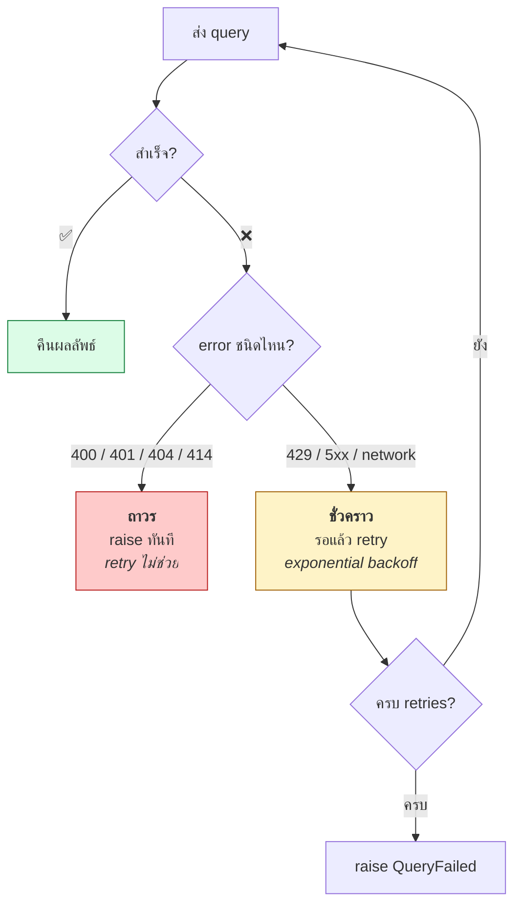

# 07.03 SPARQLWrapper ขั้นสูง

บทนี้ลงลึกเรื่องการใช้ **SPARQLWrapper** ในสภาพจริง: **authentication**, **timeout**, **retry**,
**bulk query strategy** และ **error handling** ที่ครอบคลุม — สิ่งที่ทำให้สคริปต์ทนทานพอจะรันใน production

---

## Configuration ครบถ้วน

```python
from SPARQLWrapper import BASIC, DIGEST, GET, JSON, POST, SPARQLWrapper

sparql = SPARQLWrapper(
    endpoint="https://query.wikidata.org/sparql",
    agent="MyApp/1.0 (https://example.org; contact@example.org)",   # ⚠️ บังคับ
)

sparql.setQuery(query)
sparql.setReturnFormat(JSON)        # JSON | XML | TURTLE | N3 | CSV | TSV | JSONLD | RDFXML
sparql.setMethod(POST)              # GET (default) | POST
sparql.setTimeout(60)               # วินาที
sparql.setOnlyConneg(True)          # ใช้ Accept header อย่างเดียว ไม่ใส่ &format=
sparql.addCustomHttpHeader("Accept-Encoding", "gzip")
sparql.addParameter("infer", "false")     # parameter เฉพาะของบาง endpoint
```

| Setting | ทำไมสำคัญ |
| --- | --- |
| `agent` | Wikidata **บล็อก** request ที่ไม่ระบุตัวตน |
| `setTimeout()` | ป้องกันโปรแกรมค้างเมื่อ endpoint ไม่ตอบ |
| `setMethod(POST)` | query ยาวเกิน URL limit ต้องใช้ POST |
| `setOnlyConneg(True)` | บาง endpoint สับสนเมื่อได้ทั้ง header และ parameter |

---

## Authentication

```python
from SPARQLWrapper import BASIC, DIGEST, SPARQLWrapper

# --- HTTP Basic ---
sparql = SPARQLWrapper("https://secure.example.org/sparql")
sparql.setHTTPAuth(BASIC)
sparql.setCredentials("user", "password")

# --- HTTP Digest (Fuseki ใช้แบบนี้) ---
sparql = SPARQLWrapper("http://localhost:3030/university/update")
sparql.setHTTPAuth(DIGEST)
sparql.setCredentials("admin", "adminpassword")

# --- Bearer token / API key ---
sparql = SPARQLWrapper("https://api.example.org/sparql")
sparql.addCustomHttpHeader("Authorization", "Bearer eyJhbGciOi...")
sparql.addCustomHttpHeader("X-API-Key", "your-api-key")
```

> ⚠️ **อย่า hardcode credential ในโค้ด** — อ่านจาก environment variable

```python
import os

sparql.setCredentials(
    os.environ["SPARQL_USER"],
    os.environ["SPARQL_PASSWORD"],
)
```

---

## Error Handling ที่ครอบคลุม

```python
import socket
import time
from typing import Any, Dict, List, Optional
from urllib.error import HTTPError, URLError

from SPARQLWrapper import JSON, SPARQLWrapper
from SPARQLWrapper.SPARQLExceptions import (
    EndPointInternalError,
    EndPointNotFound,
    QueryBadFormed,
    SPARQLWrapperException,
    Unauthorized,
    URITooLong,
)

USER_AGENT = "SemanticWebCourse/1.0 (contact@example.org)"

# HTTP status ที่ควร retry (ชั่วคราว) vs ไม่ควร retry (ผิดถาวร)
RETRYABLE_STATUS = {429, 500, 502, 503, 504}


class QueryFailed(Exception):
    """query ล้มเหลวถาวร -- ไม่ควร retry"""


def run_query(
    endpoint: str,
    query: str,
    *,
    timeout: int = 60,
    retries: int = 3,
    backoff: float = 2.0,
    use_post: bool = True,
) -> List[Dict[str, Any]]:
    """
    รัน SELECT query พร้อม retry เฉพาะ error ที่เป็นชั่วคราว

    Raises:
        QueryFailed: เมื่อ error เป็นแบบถาวร (syntax ผิด, ไม่มีสิทธิ์)
    """
    from SPARQLWrapper import POST

    sparql = SPARQLWrapper(endpoint, agent=USER_AGENT)
    sparql.setQuery(query)
    sparql.setReturnFormat(JSON)
    sparql.setTimeout(timeout)
    if use_post:
        sparql.setMethod(POST)

    last_error: Optional[Exception] = None

    for attempt in range(1, retries + 1):
        try:
            data = sparql.query().convert()
            return data["results"]["bindings"]

        # ----- error ถาวร: ไม่ต้อง retry -----
        except QueryBadFormed as exc:
            raise QueryFailed(f"SPARQL syntax ผิด: {exc}") from exc
        except Unauthorized as exc:
            raise QueryFailed(f"ไม่มีสิทธิ์เข้าถึง endpoint: {exc}") from exc
        except EndPointNotFound as exc:
            raise QueryFailed(f"ไม่พบ endpoint: {exc}") from exc
        except URITooLong as exc:
            raise QueryFailed("query ยาวเกินไปสำหรับ GET — ใช้ use_post=True") from exc

        # ----- error ชั่วคราว: retry ได้ -----
        except EndPointInternalError as exc:
            last_error = exc
            print(f"  [{attempt}/{retries}] server error: {exc}")
        except HTTPError as exc:
            last_error = exc
            if exc.code not in RETRYABLE_STATUS:
                raise QueryFailed(f"HTTP {exc.code}: {exc.reason}") from exc
            print(f"  [{attempt}/{retries}] HTTP {exc.code} — retry ได้")
        except (URLError, socket.timeout) as exc:
            last_error = exc
            print(f"  [{attempt}/{retries}] network: {exc}")
        except SPARQLWrapperException as exc:
            last_error = exc
            print(f"  [{attempt}/{retries}] SPARQL error: {exc}")

        if attempt < retries:
            wait = backoff ** attempt
            print(f"  รอ {wait:.1f} วินาที...")
            time.sleep(wait)

    raise QueryFailed(f"ล้มเหลวหลัง {retries} ครั้ง: {last_error}")
```

### ตาราง exception

| Exception | HTTP | สาเหตุ | Retry? |
| --- | :---: | --- | :---: |
| `QueryBadFormed` | 400 | syntax ผิด | ❌ |
| `Unauthorized` | 401 | ไม่มีสิทธิ์ | ❌ |
| `EndPointNotFound` | 404 | URL ผิด | ❌ |
| `URITooLong` | 414 | query ยาวเกิน GET | ❌ (ใช้ POST) |
| — | 429 | rate limited | ✅ (รอนานขึ้น) |
| `EndPointInternalError` | 500 | query หนัก / server พัง | ✅ |
| — | 502/503/504 | gateway / overload | ✅ |
| `URLError`, `socket.timeout` | — | network | ✅ |



---

## Bulk Query Strategies

### กลยุทธ์ 1: `VALUES` — ดีที่สุด

```python
def query_by_values(endpoint: str, entities: list, chunk_size: int = 100) -> list:
    """
    ยิง query เป็นชุดด้วย VALUES แทนการยิงทีละตัว
    ลดจาก N request เหลือ ceil(N / chunk_size)
    """
    results = []
    for i in range(0, len(entities), chunk_size):
        chunk = entities[i:i + chunk_size]
        values = " ".join(f"<{e}>" for e in chunk)

        rows = run_query(endpoint, f"""
        PREFIX rdfs: <http://www.w3.org/2000/01/rdf-schema#>
        SELECT ?item ?label WHERE {{
          VALUES ?item {{ {values} }}
          ?item rdfs:label ?label .
          FILTER(LANG(?label) = "en")
        }}
        """)
        results.extend(rows)
        print(f"  chunk {i // chunk_size + 1}: {len(rows)} แถว")
        time.sleep(1)                      # มารยาท
    return results
```

| จำนวน entity | ยิงทีละตัว | ใช้ `VALUES` chunk=100 |
| --- | --- | --- |
| 100 | 100 requests | **1 request** |
| 1,000 | 1,000 requests | **10 requests** |
| 10,000 | 10,000 requests | **100 requests** |

### กลยุทธ์ 2: Pagination

```python
def fetch_all(
    endpoint: str,
    base_query: str,
    page_size: int = 1000,
    max_pages: int = 100,
    delay: float = 1.0,
) -> list:
    """
    ดึงผลลัพธ์ทั้งหมดด้วย LIMIT/OFFSET

    ⚠️ base_query ต้องมี ORDER BY ที่ deterministic
       มิฉะนั้นจะได้ข้อมูลซ้ำหรือตกหล่น
    """
    if "ORDER BY" not in base_query.upper():
        raise ValueError("base_query ต้องมี ORDER BY สำหรับ pagination")

    all_rows, offset = [], 0
    for page in range(max_pages):
        rows = run_query(endpoint, f"{base_query}\nLIMIT {page_size} OFFSET {offset}")
        if not rows:
            break
        all_rows.extend(rows)
        print(f"  page {page + 1}: +{len(rows)} (รวม {len(all_rows):,})")

        if len(rows) < page_size:
            break
        offset += page_size
        time.sleep(delay)
    else:
        print(f"  ⚠️ ถึงขีดจำกัด {max_pages} หน้า — อาจยังมีข้อมูลเหลือ")

    return all_rows
```

### กลยุทธ์ 3: แบ่งตามช่วง (range partitioning)

เมื่อ pagination ช้าเพราะ `OFFSET` สูง ให้แบ่งด้วยเงื่อนไขแทน

```python
def fetch_by_year_range(endpoint: str, start: int, end: int) -> list:
    """แบ่ง query ตามช่วงปี แทนการใช้ OFFSET"""
    all_rows = []
    for year in range(start, end + 1):
        rows = run_query(endpoint, f"""
        PREFIX wdt: <http://www.wikidata.org/prop/direct/>
        PREFIX wd:  <http://www.wikidata.org/entity/>
        PREFIX xsd: <http://www.w3.org/2001/XMLSchema#>

        SELECT ?person ?birthDate WHERE {{
          ?person wdt:P31 wd:Q5 ; wdt:P569 ?birthDate .
          FILTER(YEAR(?birthDate) = {year})
        }}
        """)
        all_rows.extend(rows)
        print(f"  ปี {year}: {len(rows)} แถว")
        time.sleep(1)
    return all_rows
```

> 💡 **`OFFSET` สูง ๆ ช้ามาก** เพราะ engine ต้องคำนวณผลลัพธ์ทั้งหมดแล้วข้าม
> การแบ่งด้วย `FILTER` มักเร็วกว่ามาก

---

## Caching

```python
import hashlib
import json
import time
from pathlib import Path
from typing import Optional

CACHE_DIR = Path(".sparql_cache")
CACHE_DIR.mkdir(exist_ok=True)
CACHE_TTL = 86_400          # 1 วัน


def cache_key(endpoint: str, query: str) -> str:
    return hashlib.sha256(f"{endpoint}\n{query}".encode()).hexdigest()[:20]


def cached_query(endpoint: str, query: str, ttl: int = CACHE_TTL) -> list:
    """query พร้อม cache ลงไฟล์ -- ลดภาระ endpoint สาธารณะ"""
    path = CACHE_DIR / f"{cache_key(endpoint, query)}.json"

    if path.exists():
        payload = json.loads(path.read_text(encoding="utf-8"))
        age = time.time() - payload["cached_at"]
        if age < ttl:
            print(f"  [cache hit] อายุ {age / 3600:.1f} ชม.")
            return payload["rows"]
        print("  [cache expired]")

    rows = run_query(endpoint, query)
    path.write_text(
        json.dumps({"cached_at": time.time(), "rows": rows}, ensure_ascii=False),
        encoding="utf-8",
    )
    return rows
```

---

## Rate Limiting

```python
import threading
import time


class RateLimiter:
    """จำกัดจำนวน request ต่อวินาที -- thread-safe"""

    def __init__(self, calls_per_second: float = 1.0):
        self.min_interval = 1.0 / calls_per_second
        self.last_call = 0.0
        self.lock = threading.Lock()

    def wait(self) -> None:
        with self.lock:
            elapsed = time.time() - self.last_call
            if elapsed < self.min_interval:
                time.sleep(self.min_interval - elapsed)
            self.last_call = time.time()


limiter = RateLimiter(calls_per_second=1.0)

for query in queries:
    limiter.wait()
    rows = run_query(endpoint, query)
```

---

## แปลงผลลัพธ์เป็นโครงสร้างที่ใช้ง่าย

```python
from typing import Any, Dict, List

import pandas as pd
from rdflib import BNode, Graph, Literal, URIRef


def bindings_to_dataframe(bindings: List[Dict[str, Any]]) -> pd.DataFrame:
    """SPARQL JSON bindings -> DataFrame"""
    return pd.DataFrame([
        {var: cell["value"] for var, cell in row.items()}
        for row in bindings
    ])


def bindings_to_rdflib_terms(bindings: List[Dict[str, Any]]) -> List[Dict[str, Any]]:
    """แปลง JSON binding เป็น rdflib term ที่มี type ถูกต้อง"""
    converted = []
    for row in bindings:
        item = {}
        for var, cell in row.items():
            kind = cell["type"]
            value = cell["value"]
            if kind == "uri":
                item[var] = URIRef(value)
            elif kind == "bnode":
                item[var] = BNode(value)
            else:
                item[var] = Literal(
                    value,
                    datatype=URIRef(cell["datatype"]) if "datatype" in cell else None,
                    lang=cell.get("xml:lang"),
                )
        converted.append(item)
    return converted
```

> 💡 `bindings_to_rdflib_terms` สำคัญเมื่อต้องการนำผลลัพธ์กลับเข้า rdflib Graph
> เพราะ JSON binding ทำให้ทุกอย่างเป็น string

---

## Checklist สำหรับ production

- [ ] ตั้ง `agent=` ที่ระบุตัวตนและช่องทางติดต่อ
- [ ] ตั้ง `setTimeout()` ทุกครั้ง
- [ ] แยก **error ถาวร** (ไม่ retry) จาก **error ชั่วคราว** (retry ได้)
- [ ] ทำ **exponential backoff** ไม่ใช่ retry ทันที
- [ ] ใช้ **`VALUES`** แทนการยิงทีละตัว
- [ ] Pagination ต้องมี **`ORDER BY`** ที่ deterministic
- [ ] ใส่ **rate limiting** เมื่อยิงหลาย request
- [ ] **Cache** ผลลัพธ์ที่ query ซ้ำ ๆ
- [ ] อ่าน credential จาก **environment variable**
- [ ] ใช้ **POST** เมื่อ query ยาว

---

## Key Points

- ตั้ง **`agent=`** เสมอ — Wikidata และ endpoint หลายแห่งบล็อก request ที่ไม่ระบุตัวตน
- **แยก error ถาวรจากชั่วคราว**: 400/401/404/414 ไม่ควร retry; 429/5xx/network ควร retry
- ใช้ **exponential backoff** (`backoff ** attempt`) ไม่ใช่ retry ทันที
- **`VALUES` + chunking** ลดจำนวน request จาก N เหลือ N/chunk_size — เป็นเทคนิคที่สำคัญที่สุด
- **Pagination ต้องมี `ORDER BY` ที่ deterministic** มิฉะนั้นข้อมูลซ้ำหรือตกหล่น
- ⚠️ **`OFFSET` สูง ๆ ช้ามาก** — แบ่งด้วย `FILTER` ตามช่วงค่าแทนถ้าเป็นไปได้
- **Cache ลงไฟล์** เมื่อ query ซ้ำ และใส่ **rate limiter** เพื่อไม่รบกวน endpoint สาธารณะ
- JSON binding ทำให้ทุกค่าเป็น **string** — ต้องแปลงกลับเป็น rdflib term ถ้าจะนำเข้า Graph
