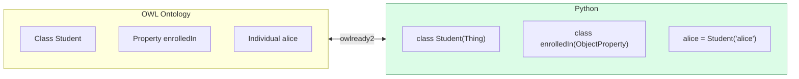

# 07.04 owlready2: โหลด แก้ไข และสำรวจ Ontology

**owlready2** มอง ontology เป็น **Python object** แทนที่จะเป็นเซตของ triple ทำให้เขียนโค้ดที่อ่านง่ายกว่า rdflib มาก
เมื่อทำงานกับ OWL บทนี้ครอบคลุมการโหลด/บันทึก OWL, navigate class และ property, สร้าง individual
และการค้นหาภายใน ontology

---

## แนวคิดหลัก: ontology = Python module



| OWL | owlready2 |
| --- | --- |
| Class | Python class ที่สืบทอดจาก `Thing` |
| Object property | Python class ที่สืบทอดจาก `ObjectProperty` |
| Data property | Python class ที่สืบทอดจาก `DataProperty` |
| Individual | instance ของ Python class |
| Property value | attribute ของ instance (**เป็น list เสมอ**) |
| Ontology | Python namespace |

---

## โหลด Ontology

```python
from owlready2 import World, get_ontology, onto_path

# --- จากไฟล์ local ---
onto = get_ontology("file:///absolute/path/to/university.owl").load()

# --- จาก URL ---
onto = get_ontology("http://purl.obolibrary.org/obo/pato.owl").load()

# --- ตั้ง search path ให้ owlready2 หาไฟล์เอง ---
onto_path.append("/path/to/ontologies")
onto = get_ontology("http://example.org/university").load()

# --- ใช้ World แยก (แนะนำเมื่อทำงานหลาย ontology) ---
world = World()
onto = world.get_ontology("file:///path/to/university.owl").load()

# --- เก็บลง SQLite เพื่อไม่ต้องโหลดใหม่ทุกครั้ง ---
world = World(filename="university.sqlite3")
onto = world.get_ontology("file:///path/to/university.owl").load()
world.save()
```

### ⚠️ owlready2 อ่าน Turtle ไม่ได้

```python
from pathlib import Path
from rdflib import Graph
from rdflib.namespace import OWL
from owlready2 import World


def load_turtle(ttl_path: str, tmp: str = "_tmp.owl"):
    """แปลง Turtle -> RDF/XML แล้วโหลดเข้า owlready2"""
    g = Graph().parse(ttl_path, format="turtle")

    # ⚠️ ตัด owl:imports ออก มิฉะนั้น owlready2 จะพยายามดึงผ่าน network
    g.remove((None, OWL.imports, None))

    g.serialize(destination=tmp, format="xml")
    world = World()
    onto = world.get_ontology(f"file://{Path(tmp).resolve()}").load()
    return world, onto


world, onto = load_turtle("data/university.ttl")
print(f"โหลดสำเร็จ: {onto.base_iri}")
```

| Format ที่ owlready2 รองรับ | อ่าน | เขียน |
| --- | :---: | :---: |
| RDF/XML (`.owl`, `.rdf`) | ✅ | ✅ |
| N-Triples (`.nt`) | ✅ | ✅ |
| OWL/XML | ✅ | ❌ |
| **Turtle (`.ttl`)** | ❌ | ❌ |
| JSON-LD | ❌ | ❌ |

---

## สำรวจ Ontology

```python
# --- นับสิ่งต่าง ๆ ---
print(f"classes            : {len(list(onto.classes()))}")
print(f"object properties  : {len(list(onto.object_properties()))}")
print(f"data properties    : {len(list(onto.data_properties()))}")
print(f"annotation props   : {len(list(onto.annotation_properties()))}")
print(f"individuals        : {len(list(onto.individuals()))}")
print(f"disjoint axioms    : {len(list(onto.disjoint_classes()))}")

# --- ลิสต์ class พร้อม parent ---
for cls in onto.classes():
    parents = [p.name for p in cls.is_a if hasattr(p, "name")]
    print(f"  {cls.name:22s} ⊑ {', '.join(parents) or '-'}")

# --- ลิสต์ property พร้อม domain/range ---
for prop in onto.object_properties():
    domain = [c.name for c in prop.domain]
    range_ = [c.name for c in prop.range]
    print(f"  {prop.name:20s} {domain} -> {range_}")
```

Expected output (บน university ontology):

```
classes            : 21
object properties  : 14
data properties    : 6
individuals        : 22

  Agent                  ⊑ Thing
  Person                 ⊑ Agent
  Student                ⊑ Person, Not(university.Staff)
  Professor              ⊑ Staff
  ...

  enrolledIn           ['Student'] -> ['Course']
  teaches              ['Professor'] -> ['Course']
  partOf               ['Organization'] -> ['Organization']
  ...
```

---

## เข้าถึง entity

```python
# --- ด้วย attribute (ตรงตามชื่อใน ontology) ---
Student = onto.Student
alice = onto.alice

# --- ด้วย search_one (รองรับ wildcard) ---
Student = onto.search_one(iri="*Student")
alice = onto.search_one(iri="*alice")

# --- ด้วย IRI เต็ม ---
Student = world["http://example.org/university#Student"]

# --- search แบบมีเงื่อนไข ---
students = onto.search(type=onto.Student)
enrolled = onto.search(enrolledIn=onto.cs501)
both = onto.search(type=onto.Student, enrolledIn=onto.cs501)

# --- search แบบ subclass ด้วย ** ---
all_people = onto.search(type=onto.Person, _use_str_as_loc_str=False)

# --- search ด้วย label ---
by_label = onto.search(label="Alice Johnson")
```

> 💡 `onto.search()` เร็วกว่าการ loop เอง เพราะใช้ index ของ quadstore ภายใน

---

## Navigate Class Hierarchy

```python
Student = onto.Student

# --- ขึ้นบน ---
print(Student.is_a)          # superclass ตรง (+ restriction)
print(Student.ancestors())   # superclass ทุกชั้น รวมตัวเอง + Thing

# --- ลงล่าง ---
print(list(Student.subclasses()))   # subclass ตรง
print(Student.descendants())        # subclass ทุกชั้น รวมตัวเอง

# --- instance ---
print(list(Student.instances()))    # ⚠️ direct instance เท่านั้น!

# --- annotation ---
print(Student.label)                # เป็น list เสมอ
print(Student.comment)
print(Student.isDefinedBy)

# --- equivalent / disjoint ---
print(Student.equivalent_to)
print(list(Student.disjoints()))
```

### ⚠️ `instances()` คืนเฉพาะ direct instance

```python
def all_instances(cls) -> set:
    """หา instance ทั้งหมดรวม subclass"""
    result = set(cls.instances())
    for sub in cls.subclasses():
        result |= all_instances(sub)
    return result


print(sorted(i.name for i in all_instances(onto.Person)))
```

---

## เข้าถึงและแก้ไข Property Value

**ค่าของ property เป็น list เสมอ** (ยกเว้น functional property)

```python
alice = onto.alice

# --- อ่าน ---
print(alice.enrolledIn)       # [university.cs501, university.cs601]
print(alice.label)            # ['Alice Johnson']
print(alice.gpa)              # 3.85  ← functional property คืนค่าเดียว

# --- เขียน ---
alice.enrolledIn.append(onto.cs101)
alice.enrolledIn = [onto.cs501]            # แทนที่ทั้งหมด
alice.enrolledIn.remove(onto.cs601)

# --- functional property เขียนตรง ๆ ---
alice.gpa = 3.90

# --- ดูทุก property ที่ individual นี้มี ---
for prop in alice.get_properties():
    print(f"  {prop.python_name:18s} = {prop[alice]}")

# --- inverse property (owlready2 คำนวณให้อัตโนมัติ) ---
print(onto.cs501.hasStudent)     # inverse ของ enrolledIn

# --- ค่าที่ไม่ได้ประกาศ inverse: ใช้ INDIRECT_ ---
print(alice.INDIRECT_enrolledIn) # รวมค่าที่อนุมานได้ (หลัง reasoning)
```

| Prefix | ความหมาย |
| --- | --- |
| `alice.prop` | ค่าที่ประกาศไว้ตรง ๆ |
| `alice.INDIRECT_prop` | รวมค่าที่อนุมานผ่าน subproperty/inverse/transitive |

---

## สร้าง Ontology ใหม่

```python
from owlready2 import (
    AllDifferent, DataProperty, FunctionalProperty, Not, ObjectProperty,
    Thing, TransitiveProperty, get_ontology,
)

onto = get_ontology("http://example.org/library#")

with onto:                                  # ⚠️ ทุกอย่างต้องอยู่ใน block นี้

    # ----- classes -----
    class Book(Thing):
        pass

    class Author(Thing):
        pass

    class Publisher(Thing):
        pass

    class FictionBook(Book):
        pass

    class NonFictionBook(Book):
        pass

    FictionBook.is_a.append(Not(NonFictionBook))       # disjoint

    # ----- object properties -----
    class writtenBy(ObjectProperty):
        domain = [Book]
        range = [Author]

    class wrote(ObjectProperty):
        inverse_property = writtenBy

    class publishedBy(ObjectProperty, FunctionalProperty):
        domain = [Book]
        range = [Publisher]

    # ----- data properties -----
    class isbn(DataProperty, FunctionalProperty):
        domain = [Book]
        range = [str]

    class publicationYear(DataProperty, FunctionalProperty):
        domain = [Book]
        range = [int]

    # ----- defined class -----
    class ProlificAuthor(Thing):
        equivalent_to = [Author & wrote.min(3, Book)]

    # ----- individuals -----
    orwell = Author("orwell", label="George Orwell")
    book1 = FictionBook("nineteen_eighty_four",
                        label="Nineteen Eighty-Four",
                        isbn="978-0451524935",
                        publicationYear=1949)
    book1.writtenBy = [orwell]

    AllDifferent([book1, orwell])

onto.save(file="library.owl", format="rdfxml")
print(f"บันทึกแล้ว: {len(list(onto.classes()))} classes, "
      f"{len(list(onto.individuals()))} individuals")
```

Expected output:

```
บันทึกแล้ว: 7 classes, 2 individuals
```

### Restriction constructors

| DL | owlready2 |
| --- | --- |
| `∃r.C` | `r.some(C)` |
| `∀r.C` | `r.only(C)` |
| `≥n r.C` | `r.min(n, C)` |
| `≤n r.C` | `r.max(n, C)` |
| `=n r.C` | `r.exactly(n, C)` |
| `∃r.{a}` | `r.value(a)` |
| `{a,b}` | `OneOf([a, b])` |
| `C ⊓ D` | `C & D` |
| `C ⊔ D` | `C \| D` |
| `¬C` | `Not(C)` |

---

## แก้ไข Ontology ที่โหลดมา

```python
with onto:
    # --- เพิ่ม class ใหม่ ---
    class Alumnus(onto.Person):
        pass

    # --- เพิ่ม superclass ให้ class เดิม ---
    onto.Student.is_a.append(onto.Agent)

    # --- เพิ่ม restriction ---
    onto.Professor.is_a.append(onto.teaches.some(onto.Course))

    # --- เพิ่ม annotation ---
    onto.Student.comment.append("Updated in version 1.3.0")

    # --- เพิ่ม individual ---
    eve = onto.Student("eve", label="Eve Chen")
    eve.enrolledIn = [onto.cs101]

    # --- ลบ entity ---
    from owlready2 import destroy_entity
    destroy_entity(onto.dave)

onto.save(file="university-v2.owl", format="rdfxml")
```

> ⚠️ `destroy_entity()` ลบ entity และทุก triple ที่เกี่ยวข้อง — ใช้ระวัง

---

## ทำงานกับหลาย Ontology

```python
from owlready2 import World

world = World()

core = world.get_ontology("file:///path/to/core.owl").load()
domain = world.get_ontology("file:///path/to/domain.owl").load()

# --- ให้ domain import core ---
domain.imports.append(core)

# --- เข้าถึง entity ข้าม ontology ---
print(core.Person)
print(domain.Researcher.is_a)

# --- ลิสต์ ontology ทั้งหมดใน world ---
for onto in world.ontologies.values():
    print(f"  {onto.base_iri}: {len(list(onto.classes()))} classes")

# --- บันทึกทั้ง world ---
world.save()
```

---

## แปลง owlready2 ↔ rdflib

```python
from pathlib import Path
from rdflib import Graph

# --- owlready2 -> rdflib ---
onto.save(file="_tmp.owl", format="rdfxml")
g = Graph().parse("_tmp.owl", format="xml")
g.serialize("output.ttl", format="turtle")

# --- owlready2 world -> rdflib โดยตรง (ผ่าน as_rdflib_graph) ---
graph = world.as_rdflib_graph()
print(f"{len(graph)} triples")

for row in graph.query("""
    PREFIX uni: <http://example.org/university#>
    SELECT ?s WHERE { ?s a uni:Student }
"""):
    print(row.s)
```

> 💡 **`world.as_rdflib_graph()`** เป็นวิธีที่สะดวกที่สุดในการใช้ SPARQL เต็มรูปแบบกับ ontology ที่โหลดใน owlready2

---

## Troubleshooting

| อาการ | สาเหตุ | วิธีแก้ |
| --- | --- | --- |
| `HTTPError 403` ตอน load | `owl:imports` ชี้ไป IRI ที่ดึงไม่ได้ | ตัด `owl:imports` หรือใช้ `onto_path` |
| `onto.X` เป็น `None` | สะกดผิด / ยังไม่ได้โหลด | ตรวจด้วย `list(onto.classes())` |
| class ไปอยู่ ontology ผิด | ลืม `with onto:` | ห่อทุกการประกาศด้วย `with onto:` |
| อ่าน `.ttl` ไม่ได้ | owlready2 ไม่รองรับ | แปลงเป็น RDF/XML ด้วย rdflib ก่อน |
| `instances()` ไม่ครบ | คืนเฉพาะ direct instance | ไล่ `subclasses()` เอง หรือใช้ SPARQL |
| ข้อมูลปนกันข้ามการรัน | ใช้ default world ร่วมกัน | สร้าง `World()` แยก |
| property คืน list ทั้งที่ควรเป็นค่าเดียว | ไม่ได้ประกาศ `FunctionalProperty` | เพิ่ม `FunctionalProperty` เป็น base class |
| แก้ ontology แล้วไม่ถูกบันทึก | ลืม `onto.save()` | เรียก `onto.save()` หรือ `world.save()` |

---

## Key Points

- owlready2 map **OWL entity เข้ากับ Python object** — class เป็น Python class, individual เป็น instance
- ทุกการประกาศต้องอยู่ใน **`with onto:` block**
- **ค่าของ property เป็น list เสมอ** ยกเว้นเมื่อประกาศเป็น `FunctionalProperty`
- ⚠️ **owlready2 อ่าน Turtle ไม่ได้** — แปลงเป็น RDF/XML ด้วย rdflib และ **ตัด `owl:imports` ออก** ก่อนเสมอ
- ⚠️ **`instances()` คืนเฉพาะ direct instance** — ต้องไล่ `subclasses()` เองถ้าต้องการครบ
- `onto.search()` เร็วกว่าการ loop เอง เพราะใช้ index ภายใน
- `INDIRECT_prop` ให้ค่าที่รวมการอนุมานผ่าน subproperty / inverse / transitive
- ใช้ **`World()` แยก** เมื่อทำงานหลาย ontology และ **`world.as_rdflib_graph()`** เมื่อต้องการ SPARQL เต็มรูปแบบ
