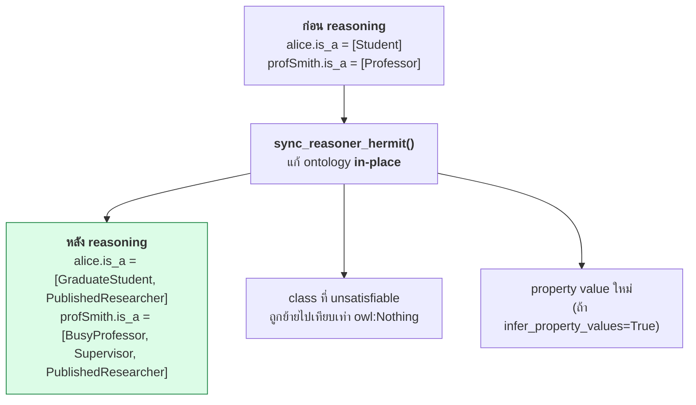
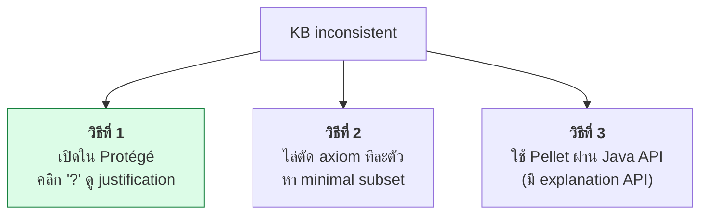
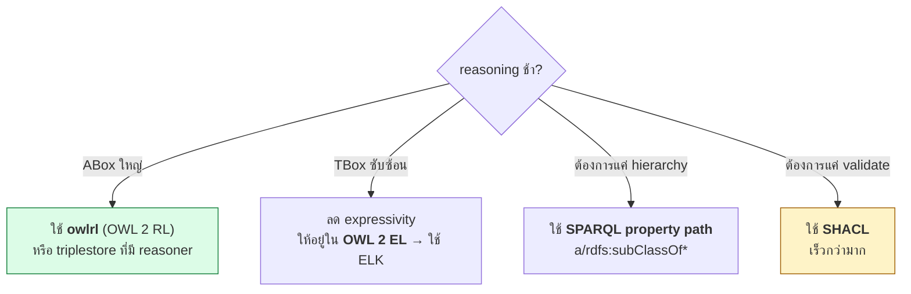

# 07.05 owlready2: Reasoning และ SQWRL

บทนี้ลงลึกการรัน reasoner ผ่าน owlready2 — **HermiT** และ **Pellet** — พร้อมเทคนิคดักจับ inferred fact,
อ่าน **explanation** เมื่อ ontology inconsistent และใช้ **SQWRL** query ความรู้ที่อนุมานได้
ผลลัพธ์ในบทนี้อ้างอิงจากการรันจริงใน [Chapter 04](../04-logics/04.11-python-logic.md) และ [Chapter 05](../05-knowledge-management/05.09-python-kb.md)

---

## เรียก reasoner

```python
from owlready2 import (
    OwlReadyInconsistentOntologyError,
    sync_reasoner,           # = HermiT
    sync_reasoner_hermit,
    sync_reasoner_pellet,
)

try:
    with onto:
        sync_reasoner_hermit(x=world, infer_property_values=True)
    print("✅ consistent")
except OwlReadyInconsistentOntologyError:
    print("❌ inconsistent")
```

| ฟังก์ชัน | Reasoner | SWRL | Data property inference |
| --- | --- | :---: | :---: |
| `sync_reasoner_hermit()` | HermiT | ⚠️ บางส่วน | ❌ |
| `sync_reasoner_pellet()` | Pellet | ✅ | ✅ |
| `sync_reasoner()` | = HermiT | ⚠️ | ❌ |

### Parameters

```python
sync_reasoner_pellet(
    x=world,                            # World ที่ต้องการ (ถ้าไม่ใช่ default)
    infer_property_values=True,         # อนุมานค่าของ object property
    infer_data_property_values=True,    # อนุมานค่าของ data property (Pellet เท่านั้น)
    debug=2,                            # 0=เงียบ, 1=ปกติ, 2=ละเอียด
    keep_tmp_file=True,                 # เก็บไฟล์ชั่วคราวไว้ debug
)
```

---

## Reasoner ทำอะไรกับ ontology



> ⚠️ **reasoner แก้ ontology in-place** — ถ้าต้องการเทียบก่อน/หลัง ต้องเก็บ snapshot ไว้เอง

```python
def snapshot(onto) -> dict:
    """เก็บสภาพ type ของทุก individual ก่อน reasoning"""
    return {
        ind.name: sorted(c.name for c in ind.is_a if hasattr(c, "name"))
        for ind in onto.individuals()
    }


before = snapshot(onto)

with onto:
    sync_reasoner_hermit(x=world, infer_property_values=True)

after = snapshot(onto)

for name in sorted(before):
    old, new = before[name], after[name]
    gained = [t for t in new if t not in old]
    if gained:
        print(f"  {name:14s} {old} → {new}   ← เพิ่ม {gained}")
```

Expected output (บน university KB):

```
  alice          ['Student'] → ['GraduateStudent', 'PublishedResearcher']   ← เพิ่ม ['GraduateStudent', 'PublishedResearcher']
  profSmith      ['Professor'] → ['BusyProfessor', 'PublishedResearcher', 'Supervisor']   ← เพิ่ม [...]
```

---

## ตรวจ unsatisfiable class

```python
from owlready2 import Nothing

unsat = [c for c in onto.classes() if Nothing in c.equivalent_to]

if unsat:
    print("❌ unsatisfiable classes:")
    for cls in unsat:
        print(f"   {cls.name}")
        print(f"     is_a          = {cls.is_a}")
        print(f"     equivalent_to = {cls.equivalent_to}")
else:
    print("✅ ทุก class satisfiable")
```

Expected output (จากตัวอย่างใน Chapter 04):

```
❌ unsatisfiable classes:
   StudentProfessor
     equivalent_to = [university.Student & university.Professor, owl.Nothing]
```

**สาเหตุ**: `StudentProfessor ≡ Student ⊓ Professor` แต่ `Student ⊑ ¬Professor`

---

## ดักจับ inferred property value

```python
def property_snapshot(onto) -> dict:
    """เก็บค่า object property ของทุก individual"""
    result = {}
    for ind in onto.individuals():
        for prop in ind.get_properties():
            values = prop[ind]
            key = (ind.name, prop.python_name)
            result[key] = sorted(
                v.name if hasattr(v, "name") else str(v) for v in values
            )
    return result


before = property_snapshot(onto)

with onto:
    sync_reasoner_hermit(x=world, infer_property_values=True)

after = property_snapshot(onto)

print("Property value ที่อนุมานเพิ่ม:")
for key, new_values in sorted(after.items()):
    old_values = before.get(key, [])
    gained = [v for v in new_values if v not in old_values]
    if gained:
        ind_name, prop_name = key
        print(f"  {ind_name}.{prop_name} += {gained}")
```

Expected output (จาก role chain `instructorOf ≡ teaches ∘ hasStudent`):

```
Property value ที่อนุมานเพิ่ม:
  profSmith.instructorOf += ['alice', 'bob', 'carol']
  profJones.instructorOf += ['carol']
  cs501.hasStudent += ['alice']
  cs501.taughtBy += ['profSmith']
```

---

## Explanation: ทำไม ontology จึง inconsistent

owlready2 ไม่มี API สำหรับ justification โดยตรง แต่หาได้ด้วย **การไล่ตัด axiom**

```python
from owlready2 import OwlReadyInconsistentOntologyError, World, sync_reasoner_hermit


def is_consistent(world) -> bool:
    try:
        sync_reasoner_hermit(x=world, debug=0)
        return True
    except OwlReadyInconsistentOntologyError:
        return False


def find_justification(build_world, axioms: list) -> list:
    """
    หา minimal subset ของ axiom ที่ยังทำให้ inconsistent
    (อัลกอริทึม greedy แบบง่าย — เพียงพอสำหรับกรณีทั่วไป)
    """
    current = list(axioms)
    for axiom in list(current):
        candidate = [a for a in current if a is not axiom]
        world = build_world(candidate)
        if not is_consistent(world):
            current = candidate          # ตัดออกได้ ยัง inconsistent อยู่
    return current
```

ในทางปฏิบัติ **Protégé แสดง justification ได้ดีที่สุด** — คลิกปุ่ม `?` ข้าง inferred axiom



### สาเหตุ inconsistency ที่พบบ่อย

| สาเหตุ | ตัวอย่าง | วิธีตรวจ |
| --- | --- | --- |
| **disjoint ขัดกัน** | `alice : Student` + `alice : Staff` + `Student ⊑ ¬Staff` | ดู `list(onto.disjoint_classes())` |
| **functional property มี 2 ค่า + differentFrom** | `hasSupervisor` มี 2 ค่าที่ต่างกัน | ตรวจ functional property |
| **cardinality ขัดกัน** | `≤1 r` แต่มี 3 ค่าที่ต่างกัน | ตรวจ cardinality restriction |
| **irreflexive แต่มี self-loop** | `alice colleagueOf alice` | ตรวจ irreflexive property |
| **asymmetric ทั้งสองทาง** | `a hasParent b` + `b hasParent a` | ตรวจ asymmetric property |
| **datatype ผิด** | `gpa = "abc"^^xsd:decimal` | ตรวจ data property range |

---

## SWRL Rules

owlready2 รองรับการเพิ่ม SWRL rule ตรง ๆ

```python
from owlready2 import Imp, sync_reasoner_pellet

with onto:
    rule = Imp()
    rule.set_as_rule("""
        Professor(?p), teaches(?p, ?c), enrolledIn(?s, ?c)
        -> instructorOf(?p, ?s)
    """)

# ⚠️ SWRL ต้องใช้ Pellet -- HermiT รองรับไม่ครบ
with onto:
    sync_reasoner_pellet(x=world, infer_property_values=True)

# ดู rule ทั้งหมด
for imp in onto.rules():
    print(imp)
```

รายละเอียดเต็มของ SWRL อยู่ใน [Chapter 11](../11-swrl/11.10-python-swrl.md)

---

## SQWRL: Query ผ่าน rule

**SQWRL (Semantic Query-Enhanced Web Rule Language)** คือส่วนขยายของ SWRL ที่ใช้ query แทนการอนุมาน

```python
from owlready2 import Imp

with onto:
    query = Imp()
    query.set_as_rule("""
        Student(?s), enrolledIn(?s, ?c), GraduateCourse(?c)
        -> sqwrl:select(?s, ?c)
    """)
```

### SQWRL built-ins

| Built-in | ทำอะไร |
| --- | --- |
| `sqwrl:select(?x, ?y)` | เลือกตัวแปรออกมาเป็นผลลัพธ์ |
| `sqwrl:selectDistinct(?x)` | เลือกแบบไม่ซ้ำ |
| `sqwrl:count(?x)` | นับ |
| `sqwrl:sum(?x)` / `sqwrl:avg(?x)` | ผลรวม / ค่าเฉลี่ย |
| `sqwrl:min(?x)` / `sqwrl:max(?x)` | ค่าน้อยสุด / มากสุด |
| `sqwrl:orderBy(?x)` | เรียงลำดับ |
| `sqwrl:limit(n)` | จำกัดจำนวน |
| `sqwrl:columnNames(...)` | ตั้งชื่อคอลัมน์ |

### SQWRL vs SPARQL

| | **SQWRL** | **SPARQL** |
| --- | --- | --- |
| ทำงานบน | ผลหลัง OWL reasoning | triple ใน graph |
| Syntax | rule-based | pattern-based |
| การรองรับ | Protégé, บาง reasoner | **มาตรฐาน W3C, ทุกที่** |
| Aggregate | มี built-in | มี |
| Negation | จำกัด | `NOT EXISTS` / `MINUS` |
| Federation | ❌ | ✅ `SERVICE` |
| เครื่องมือ | น้อย | เยอะมาก |

> 💡 **ในทางปฏิบัติแนะนำ SPARQL มากกว่า SQWRL** เพราะเป็นมาตรฐานและมีเครื่องมือรองรับกว้างกว่ามาก
> ใช้ SQWRL เมื่อทำงานใน Protégé หรือเมื่อต้องการ query ที่พึ่ง OWL reasoning โดยตรง

### ทางเลือกที่ดีกว่า: reasoning แล้ว query ด้วย SPARQL

```python
# 1) รัน reasoner
with onto:
    sync_reasoner_pellet(x=world, infer_property_values=True)

# 2) แปลงเป็น rdflib graph
graph = world.as_rdflib_graph()

# 3) query ด้วย SPARQL เต็มรูปแบบ
for row in graph.query("""
    PREFIX uni: <http://example.org/university#>
    SELECT ?prof ?student WHERE {
      ?prof uni:instructorOf ?student .
    }
"""):
    print(f"{row.prof.split('#')[-1]} สอน {row.student.split('#')[-1]}")
```

Expected output:

```
profSmith สอน alice
profSmith สอน bob
profSmith สอน carol
profJones สอน carol
```


**นี่คือ pattern ที่แนะนำที่สุด** — ใช้ OWL reasoning เพื่ออนุมาน แล้วใช้ SPARQL เพื่อ query

---

## Performance

| ปัจจัย | ผลกระทบ | ทางแก้ |
| --- | --- | --- |
| ABox ใหญ่ | reasoning ช้าแบบ exponential | แยก TBox reasoning ออกจาก ABox |
| Nominal (`oneOf`, `hasValue`) | เชื่อม TBox กับ ABox | ใช้เท่าที่จำเป็น |
| Cardinality สูง | สร้าง node จำนวนมาก | ลดตัวเลข |
| `infer_property_values=True` | ช้าขึ้นมาก | ปิดถ้าไม่ต้องการ |
| Disjunction (`⊔`) | แตกกิ่งมหาศาล | ปรับเป็น hierarchy |

```python
import time

start = time.perf_counter()
with onto:
    sync_reasoner_hermit(x=world, debug=0)
print(f"reasoning ใช้เวลา {time.perf_counter() - start:.2f} วินาที")
```

### เมื่อ reasoning ช้าเกินไป



---

## Troubleshooting

| อาการ | สาเหตุ | วิธีแก้ |
| --- | --- | --- |
| `JavaNotFoundError` | ไม่มี Java | ติดตั้ง JDK 8+ / ตั้ง `owlready2.JAVA_EXE` |
| `UnsupportedDatatypeException: xsd:gYear` | datatype ไม่อยู่ใน OWL 2 map | ใช้ `xsd:integer` แทน |
| reasoner ไม่อนุมานอะไรเลย | ใช้ `is_a` แทน `equivalent_to` | defined class ต้องใช้ `equivalent_to` |
| cardinality ไม่ทำงาน | ไม่มี `AllDifferent` | ประกาศ `AllDifferent` ให้ครบ |
| SWRL ไม่ทำงาน | ใช้ HermiT | เปลี่ยนเป็น `sync_reasoner_pellet()` |
| `∀r.C` ไม่ถูกอนุมาน | OWA | เพิ่ม closure axiom |
| reasoning ช้ามาก | ABox ใหญ่ / nominal เยอะ | ลด expressivity หรือใช้ owlrl |
| ผลปนกันข้ามการรัน | default world ร่วมกัน | ใช้ `World()` แยก |

---

## Key Points

- `sync_reasoner_hermit()` สำหรับ OWL 2 DL ทั่วไป; **`sync_reasoner_pellet()` เมื่อต้องใช้ SWRL** หรือ data property inference
- ⚠️ **reasoner แก้ ontology in-place** — เก็บ snapshot ไว้ก่อนถ้าต้องการเทียบ
- ตรวจ **unsatisfiable class** ด้วย `Nothing in cls.equivalent_to`
- ตรวจ **inconsistency** ด้วย `try/except OwlReadyInconsistentOntologyError`
- owlready2 **ไม่มี API สำหรับ justification** — ใช้ Protégé หรือไล่ตัด axiom เอง
- **SQWRL** query ผ่าน rule ได้ แต่ **SPARQL เป็นมาตรฐานและมีเครื่องมือมากกว่ามาก**
- **Pattern ที่แนะนำ**: รัน reasoner ด้วย owlready2 → `world.as_rdflib_graph()` → query ด้วย SPARQL
- เมื่อ reasoning ช้า: ลดเป็น **OWL 2 EL + ELK**, ใช้ **owlrl**, หรือใช้ **SPARQL property path** แทน
