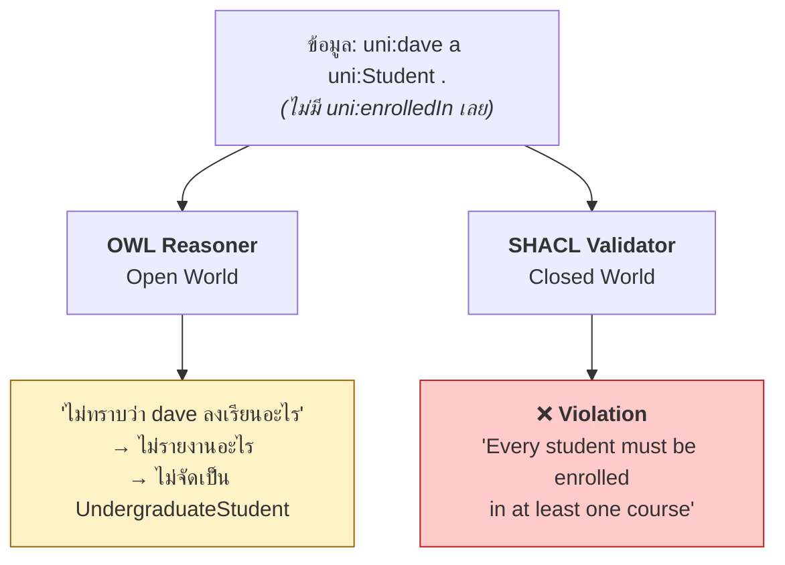
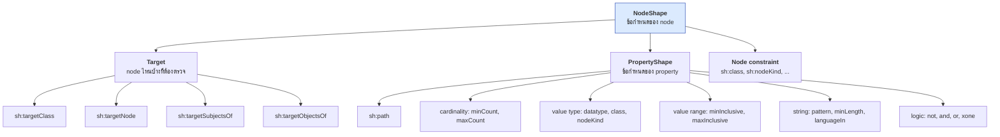
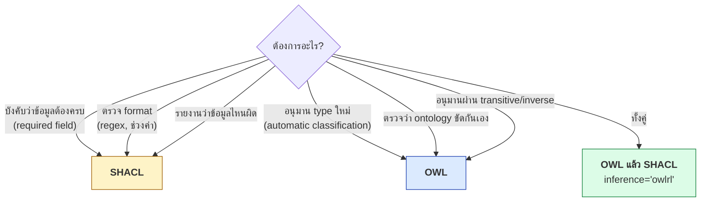

# 07.06 SHACL และ pySHACL

**SHACL (Shapes Constraint Language)** เป็น W3C Recommendation (2017) สำหรับ **validate** ข้อมูล RDF
ต่างจาก OWL ที่ **อนุมาน** ความรู้ SHACL ทำงานแบบ **closed world** จึงตอบคำถามว่า
"ข้อมูลชุดนี้ครบถ้วนและถูกต้องตามที่กำหนดหรือไม่" ได้จริง

---

## SHACL vs OWL — ความต่างที่สำคัญที่สุด



| | **OWL** | **SHACL** |
| --- | --- | --- |
| สมมติฐาน | Open World (OWA) | **Closed World (CWA)** |
| จุดประสงค์ | **อนุมาน** ความรู้ใหม่ | **ตรวจสอบ** ข้อมูล |
| ข้อมูลขาด | "ไม่ทราบ" | **"ผิด"** |
| `minCardinality 1` | อนุมานว่ามีอยู่ที่ไหนสักแห่ง | รายงาน violation ถ้าไม่มีจริง |
| Unique Name | ไม่มี (No-UNA) | **มี** (IRI ต่างกัน = คนละสิ่ง) |
| ผลลัพธ์ | inferred triple | **validation report** |
| ใช้เมื่อ | ต้องการความรู้เพิ่ม | ต้องการรับประกันคุณภาพข้อมูล |

> 💡 **ใช้ทั้งสองอย่างคู่กัน**: OWL เพื่ออนุมาน แล้ว SHACL เพื่อตรวจว่าข้อมูลครบถ้วน

---

## องค์ประกอบของ SHACL



---

## Shape แรกของคุณ

```turtle
@prefix sh:   <http://www.w3.org/ns/shacl#> .
@prefix uni:  <http://example.org/university#> .
@prefix xsd:  <http://www.w3.org/2001/XMLSchema#> .

uni:StudentShape a sh:NodeShape ;
    sh:targetClass uni:Student ;

    sh:property [
        sh:path     uni:studentId ;
        sh:datatype xsd:string ;
        sh:minCount 1 ;
        sh:maxCount 1 ;
        sh:pattern  "^S-[0-9]{4}-[0-9]{4}$" ;
        sh:message  "Every student must have exactly one studentId matching S-YYYY-NNNN." ;
    ] ;

    sh:property [
        sh:path         uni:gpa ;
        sh:datatype     xsd:decimal ;
        sh:minInclusive 0.0 ;
        sh:maxInclusive 4.0 ;
        sh:maxCount     1 ;
        sh:message      "GPA must be a decimal between 0.0 and 4.0." ;
    ] ;

    sh:property [
        sh:path     uni:enrolledIn ;
        sh:class    uni:Course ;
        sh:minCount 1 ;
        sh:message  "Every student must be enrolled in at least one course." ;
    ] .
```

### รันจริงบน `data/university.ttl`

```python
from pyshacl import validate
from rdflib import Graph

data = Graph().parse("data/university.ttl", format="turtle")
shapes = Graph().parse("shapes/university-shapes.ttl", format="turtle")

conforms, results_graph, results_text = validate(
    data_graph=data,
    shacl_graph=shapes,
    inference="rdfs",          # รัน RDFS inference ก่อน validate
    abort_on_first=False,
    meta_shacl=False,
)

print("conforms:", conforms)
print(results_text)
```

Expected output (จากการรันจริง):

```
conforms: False
Validation Report
Conforms: False
Results (1):
Constraint Violation in MinCountConstraintComponent (http://www.w3.org/ns/shacl#MinCountConstraintComponent):
	Severity: sh:Violation
	Source Shape: [ sh:class uni:Course ; sh:message Literal("Every student must be enrolled in at least one course.") ; sh:minCount Literal("1", datatype=xsd:integer) ; sh:path uni:enrolledIn ]
	Focus Node: uni:dave
	Result Path: uni:enrolledIn
	Message: Every student must be enrolled in at least one course.
```

**นี่คือสิ่งที่ OWL ทำไม่ได้** — `uni:dave` ไม่มี `uni:enrolledIn` เลย
OWL บอกได้แค่ "ไม่ทราบ" แต่ SHACL รายงานเป็น **violation** ทันที

---

## Constraint Component ครบชุด

### Cardinality

```turtle
sh:property [
    sh:path     uni:studentId ;
    sh:minCount 1 ;              # ต้องมีอย่างน้อย 1
    sh:maxCount 1 ;              # ไม่เกิน 1
] .
```

### Value Type

```turtle
sh:property [ sh:path uni:gpa       ; sh:datatype xsd:decimal ] .    # literal datatype
sh:property [ sh:path uni:enrolledIn ; sh:class uni:Course ] .        # เป็น instance ของ class
sh:property [ sh:path uni:homepage  ; sh:nodeKind sh:IRI ] .          # IRI | BlankNode | Literal
```

| `sh:nodeKind` | ความหมาย |
| --- | --- |
| `sh:IRI` | ต้องเป็น IRI |
| `sh:BlankNode` | ต้องเป็น blank node |
| `sh:Literal` | ต้องเป็น literal |
| `sh:BlankNodeOrIRI` | IRI หรือ bnode |
| `sh:IRIOrLiteral` | IRI หรือ literal |

### Value Range

```turtle
sh:property [
    sh:path         uni:gpa ;
    sh:minInclusive 0.0 ;
    sh:maxInclusive 4.0 ;
] ;
sh:property [
    sh:path         uni:credits ;
    sh:minExclusive 0 ;
    sh:maxExclusive 10 ;
] .
```

### String

```turtle
sh:property [
    sh:path       uni:studentId ;
    sh:pattern    "^S-[0-9]{4}-[0-9]{4}$" ;
    sh:flags      "i" ;                        # case-insensitive
    sh:minLength  5 ;
    sh:maxLength  20 ;
] ;
sh:property [
    sh:path       rdfs:label ;
    sh:languageIn ( "en" "th" ) ;              # ต้องเป็นภาษาเหล่านี้
    sh:uniqueLang true ;                        # ห้ามมีสองค่าในภาษาเดียวกัน
] .
```

### Value Set

```turtle
sh:property [
    sh:path uni:status ;
    sh:in   ( "active" "graduated" "suspended" ) ;
] ;
sh:property [
    sh:path        uni:department ;
    sh:hasValue    uni:csDept ;                # ต้องมีค่านี้อยู่ด้วย
] .
```

### Property Pair

```turtle
sh:property [
    sh:path       uni:endDate ;
    sh:minExclusive uni:startDate ;            # ไม่รองรับตรง ๆ -- ใช้ SPARQL constraint
] ;
sh:property [
    sh:path        uni:enrolledIn ;
    sh:disjoint    uni:teaches ;               # ห้ามซ้ำกับ teaches
] ;
sh:property [
    sh:path        uni:hasSupervisor ;
    sh:lessThan    uni:hasCoSupervisor ;
] .
```

### Logical

```turtle
# NOT
uni:NoStaffShape a sh:NodeShape ;
    sh:targetClass uni:Student ;
    sh:not [ sh:class uni:Staff ] .

# AND — ต้องผ่านทุกอัน
uni:GradShape a sh:NodeShape ;
    sh:targetClass uni:GraduateStudent ;
    sh:and ( uni:StudentShape uni:ResearcherShape ) .

# OR — ผ่านอย่างน้อยหนึ่งอัน
uni:PersonShape a sh:NodeShape ;
    sh:targetClass uni:Person ;
    sh:or ( [ sh:path uni:studentId ; sh:minCount 1 ]
            [ sh:path uni:employeeId ; sh:minCount 1 ] ) .

# XONE — ผ่านหนึ่งอันเท่านั้น
uni:ExclusiveShape a sh:NodeShape ;
    sh:targetClass uni:Person ;
    sh:xone ( [ sh:class uni:Student ] [ sh:class uni:Staff ] ) .
```

### Closed Shape — ห้าม property นอกเหนือจากที่ระบุ

```turtle
uni:StrictCourseShape a sh:NodeShape ;
    sh:targetClass uni:Course ;
    sh:closed true ;
    sh:ignoredProperties ( rdf:type rdfs:label ) ;
    sh:property [ sh:path uni:courseCode ; sh:minCount 1 ] ;
    sh:property [ sh:path uni:credits    ; sh:minCount 1 ] ;
    sh:message "Course may only have courseCode and credits." .
```

---

## SPARQL-based Constraint

เมื่อ constraint พื้นฐานไม่พอ ใช้ SPARQL เขียนเงื่อนไขเองได้

```turtle
@prefix sh:  <http://www.w3.org/ns/shacl#> .
@prefix uni: <http://example.org/university#> .

uni:NoSelfSupervisionShape a sh:NodeShape ;
    sh:targetClass uni:Student ;
    sh:sparql [
        sh:message "A student cannot supervise themselves." ;
        sh:prefixes uni: ;
        sh:select """
            SELECT $this
            WHERE {
              $this <http://example.org/university#hasSupervisor> $this .
            }
        """ ;
    ] .

uni:CreditLimitShape a sh:NodeShape ;
    sh:targetClass uni:Student ;
    sh:sparql [
        sh:message "A student cannot enrol in more than 21 credits per term." ;
        sh:select """
            SELECT $this (SUM(?cr) AS ?total)
            WHERE {
              $this <http://example.org/university#enrolledIn> ?c .
              ?c    <http://example.org/university#credits>    ?cr .
            }
            GROUP BY $this
            HAVING (SUM(?cr) > 21)
        """ ;
    ] .
```

> **`$this`** คือตัวแปรพิเศษที่แทน focus node ที่กำลังตรวจ
> ถ้า SELECT คืนแถวใด ๆ ถือว่า **มี violation**

---

## Severity

```turtle
sh:property [
    sh:path     uni:studentId ;
    sh:minCount 1 ;
    sh:severity sh:Violation ;      # default — ผิดจริง
] ;
sh:property [
    sh:path     uni:gpa ;
    sh:minCount 1 ;
    sh:severity sh:Warning ;        # เตือน แต่ยัง conforms
] ;
sh:property [
    sh:path     foaf:homepage ;
    sh:minCount 1 ;
    sh:severity sh:Info ;           # แค่แจ้งให้ทราบ
] .
```

| Severity | `conforms` เป็น false ไหม |
| --- | :---: |
| `sh:Violation` | ✅ |
| `sh:Warning` | ❌ |
| `sh:Info` | ❌ |

---

## อ่าน Validation Report แบบ programmatic

report เป็น RDF graph — query ด้วย SPARQL ได้

```python
from pyshacl import validate
from rdflib import Graph, Namespace

SH = Namespace("http://www.w3.org/ns/shacl#")

conforms, report_graph, report_text = validate(
    data_graph=data, shacl_graph=shapes, inference="rdfs"
)

if not conforms:
    rows = report_graph.query("""
        PREFIX sh: <http://www.w3.org/ns/shacl#>

        SELECT ?focusNode ?path ?value ?message ?severity ?component
        WHERE {
          ?result a sh:ValidationResult ;
                  sh:focusNode                 ?focusNode ;
                  sh:resultSeverity            ?severity ;
                  sh:sourceConstraintComponent ?component .
          OPTIONAL { ?result sh:resultPath    ?path }
          OPTIONAL { ?result sh:value         ?value }
          OPTIONAL { ?result sh:resultMessage ?message }
        }
        ORDER BY ?severity ?focusNode
    """)

    print(f"{'Node':<20} {'Path':<18} {'Severity':<12} Message")
    print("-" * 90)
    for r in rows:
        node = str(r.focusNode).split("#")[-1]
        path = str(r.path).split("#")[-1] if r.path else "—"
        sev = str(r.severity).split("#")[-1]
        msg = str(r.message) if r.message else str(r.component).split("#")[-1]
        print(f"{node:<20} {path:<18} {sev:<12} {msg}")
```

Expected output:

```
Node                 Path               Severity     Message
------------------------------------------------------------------------------------------
dave                 enrolledIn         Violation    Every student must be enrolled in at least one course.
```

### Property ใน validation report

| Property | ความหมาย |
| --- | --- |
| `sh:conforms` | ผ่านทั้งหมดหรือไม่ (boolean) |
| `sh:focusNode` | node ที่มีปัญหา |
| `sh:resultPath` | property ที่มีปัญหา |
| `sh:value` | ค่าที่ผิด |
| `sh:resultMessage` | ข้อความ (จาก `sh:message`) |
| `sh:resultSeverity` | ระดับความรุนแรง |
| `sh:sourceShape` | shape ที่ตรวจพบ |
| `sh:sourceConstraintComponent` | ชนิด constraint ที่ละเมิด |

---

## Options ของ pySHACL

```python
conforms, report_graph, report_text = validate(
    data_graph=data,
    shacl_graph=shapes,
    ont_graph=ontology,           # ontology เพิ่มเติมสำหรับ inference
    inference="rdfs",             # none | rdfs | owlrl | both
    abort_on_first=False,         # หยุดที่ violation แรก
    allow_infos=False,            # นับ Info เป็น violation ด้วยไหม
    allow_warnings=False,         # นับ Warning เป็น violation ด้วยไหม
    meta_shacl=False,             # validate ตัว shape graph เองด้วย
    advanced=True,                # เปิด SHACL Advanced Features (rule, function)
    js=False,                     # เปิด SHACL-JS
    debug=False,
)
```

| `inference` | ทำอะไรก่อน validate |
| --- | --- |
| `"none"` | ไม่ทำ inference |
| `"rdfs"` | RDFS entailment |
| `"owlrl"` | OWL 2 RL entailment |
| `"both"` | ทั้งสอง |

> ⚠️ **`inference` สำคัญมาก** — ถ้า shape ใช้ `sh:targetClass uni:Person` แต่ข้อมูลประกาศเป็น `uni:Student`
> จะไม่ตรวจอะไรเลยหากไม่เปิด inference

---

## SHACL Rules (Advanced Features)

SHACL ทำ inference ได้ด้วยเช่นกัน (ต่างจาก OWL ที่เป็น OWA)

```turtle
@prefix sh:  <http://www.w3.org/ns/shacl#> .
@prefix uni: <http://example.org/university#> .

uni:ClassmateRule a sh:NodeShape ;
    sh:targetClass uni:Student ;
    sh:rule [
        a sh:TripleRule ;
        sh:subject   sh:this ;
        sh:predicate uni:classmateOf ;
        sh:object    ?other ;
        sh:condition uni:StudentShape ;
        sh:sparql [
            sh:select """
                SELECT $this ?other WHERE {
                  $this  <http://example.org/university#enrolledIn> ?c .
                  ?other <http://example.org/university#enrolledIn> ?c .
                  FILTER($this != ?other)
                }
            """
        ] ;
    ] .
```

```python
conforms, _, _ = validate(data_graph=data, shacl_graph=shapes, advanced=True)
# triple ที่ rule สร้างจะถูกเพิ่มเข้า data_graph
```

---

## CLI

```bash
# ตรวจไฟล์
pyshacl -s shapes/university-shapes.ttl \
        -df turtle -sf turtle \
        data/university.ttl

# เปิด inference และเลือก format ของ report
pyshacl -s shapes/university-shapes.ttl \
        -i rdfs \
        -f table \
        data/university.ttl

# ออก exit code 1 เมื่อไม่ conform -- ใช้ใน CI ได้เลย
pyshacl -s shapes.ttl data.ttl || echo "validation failed"
```

| `-f` | รูปแบบ report |
| --- | --- |
| `human` | ข้อความอ่านง่าย (default) |
| `table` | ตาราง |
| `turtle` | RDF |
| `json-ld` | JSON-LD |

---

## ใช้ใน CI Pipeline

```python
#!/usr/bin/env python
"""validate_data.py — ใช้ใน CI, exit code 1 เมื่อไม่ผ่าน"""

import sys
from pathlib import Path

from pyshacl import validate
from rdflib import Graph

SHAPES = Path("shapes/university-shapes.ttl")
DATA_FILES = sorted(Path("data").glob("*.ttl"))


def main() -> int:
    shapes = Graph().parse(SHAPES, format="turtle")
    failed = 0

    for path in DATA_FILES:
        data = Graph().parse(path, format="turtle")
        conforms, report, text = validate(
            data_graph=data,
            shacl_graph=shapes,
            inference="rdfs",
            allow_warnings=True,        # Warning ไม่ทำให้ fail
        )
        mark = "✅" if conforms else "❌"
        print(f"{mark} {path}  ({len(data)} triples)")
        if not conforms:
            failed += 1
            print(text)

    print(f"\nสรุป: ผ่าน {len(DATA_FILES) - failed}/{len(DATA_FILES)} ไฟล์")
    return 1 if failed else 0


if __name__ == "__main__":
    sys.exit(main())
```

---

## เมื่อไหร่ใช้ SHACL vs OWL



| งาน | ใช้ |
| --- | --- |
| "ทุก Student ต้องมี email" | **SHACL** |
| "studentId ต้องตรง regex" | **SHACL** |
| "GPA ต้องอยู่ระหว่าง 0–4" | **SHACL** |
| "ห้ามมี property นอกเหนือจากที่กำหนด" | **SHACL** (`sh:closed`) |
| "ใครมีลูก = Parent" | **OWL** (defined class) |
| "Student กับ Staff ห้ามทับกัน" | **OWL** (`disjointWith`) |
| "partOf เป็น transitive" | **OWL** |
| "ตรวจว่า ontology ไม่ขัดกันเอง" | **OWL** reasoner |

---

## Key Points

- **SHACL = validation (CWA)**, **OWL = inference (OWA)** — คนละหน้าที่กันโดยสิ้นเชิง
- SHACL จับ **ข้อมูลที่ขาด** ได้ ในขณะที่ OWL บอกได้แค่ "ไม่ทราบ" — เช่นกรณี `uni:dave` ที่ไม่มี `enrolledIn`
- โครงสร้าง: **`sh:NodeShape`** (target + constraint) → **`sh:PropertyShape`** (`sh:path` + constraint)
- Constraint หลัก: **cardinality** (`minCount`/`maxCount`), **type** (`datatype`/`class`/`nodeKind`), **range**, **string** (`pattern`), **logical** (`not`/`and`/`or`/`xone`)
- **`sh:sparql`** เขียน constraint ด้วย SPARQL เมื่อ constraint พื้นฐานไม่พอ (ใช้ `$this` แทน focus node)
- **`sh:severity`**: `Violation` ทำให้ไม่ conform; `Warning`/`Info` ไม่ทำ
- ⚠️ **ตั้ง `inference="rdfs"` หรือ `"owlrl"`** มิฉะนั้น `sh:targetClass` อาจไม่ match ข้อมูลที่ประกาศเป็น subclass
- Validation report เป็น **RDF graph** — query ด้วย SPARQL เพื่อทำรายงานเองได้
- `pyshacl` CLI คืน **exit code 1** เมื่อไม่ผ่าน — ใช้ใน CI ได้ทันที
