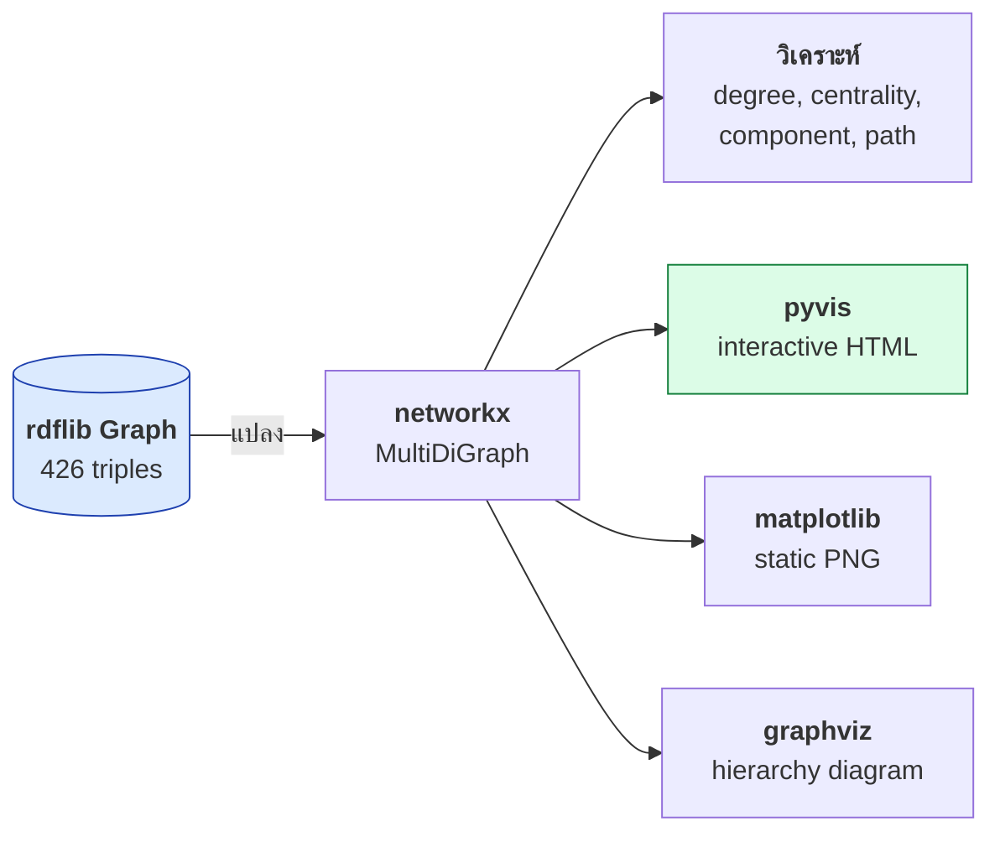
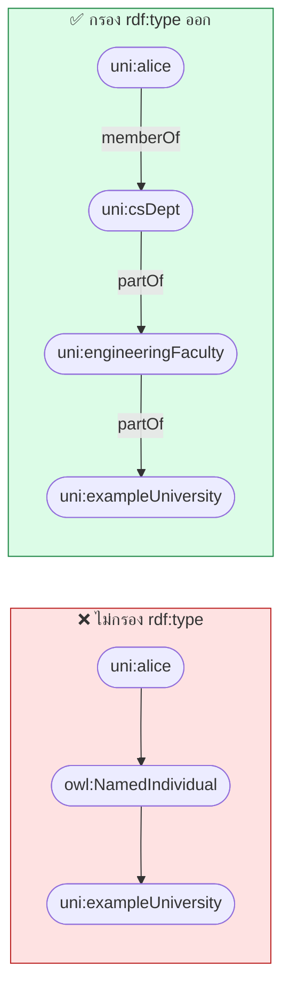
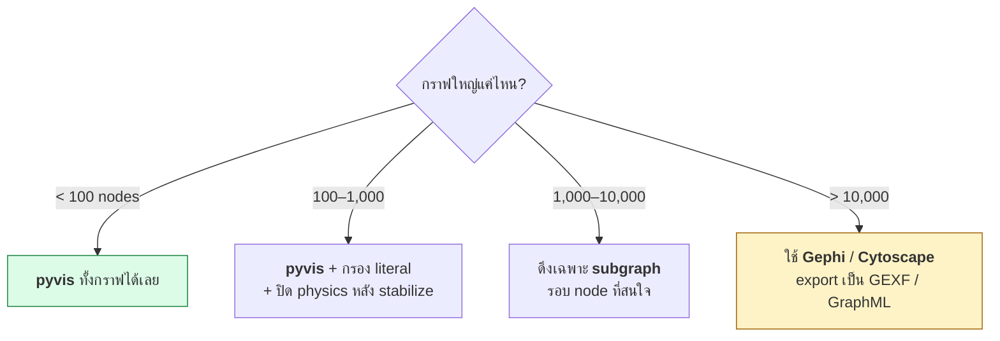

# 07.07 Visualization: networkx และ pyvis

การเห็นกราฟด้วยตาช่วยจับปัญหาที่ query ไม่บอก — node ที่โดดเดี่ยว, hub ที่ไม่คาดคิด, หรือความสัมพันธ์ที่ขาดหาย
บทนี้แปลง RDF graph เป็น **networkx** เพื่อวิเคราะห์เชิงโครงสร้าง แล้วเป็น **pyvis** เพื่อสร้างกราฟ interactive
ผลลัพธ์ทุกตัวเลขมาจากการรัน [`code/ch07/visualize_graph.py`](../code/ch07/visualize_graph.py) จริงบน `data/university.ttl`

---

## Pipeline



---

## ติดตั้ง

```bash
pip install networkx pyvis matplotlib
```

---

## 1. RDF → networkx

```python
import networkx as nx
from rdflib import BNode, Graph, Literal, URIRef
from rdflib.namespace import RDF, RDFS

# predicate ที่รกเกินไป ไม่ต้องแสดง
SKIP_PREDICATES = {
    RDF.first, RDF.rest,
    URIRef("http://www.w3.org/2002/07/owl#members"),
}


def short(term, graph: Graph) -> str:
    """ย่อ IRI เป็น prefixed name"""
    if isinstance(term, Literal):
        text = str(term)
        return text if len(text) <= 40 else text[:37] + "…"
    if isinstance(term, BNode):
        return f"_:{str(term)[:8]}"
    return term.n3(graph.namespace_manager)


def node_kind(term, graph: Graph) -> str:
    """เดาชนิดของ node เพื่อกำหนดสี"""
    if isinstance(term, Literal):
        return "literal"
    if isinstance(term, BNode):
        return "bnode"

    types = set(graph.objects(term, RDF.type))
    OWL_CLASS = URIRef("http://www.w3.org/2002/07/owl#Class")
    OWL_OP = URIRef("http://www.w3.org/2002/07/owl#ObjectProperty")
    OWL_DP = URIRef("http://www.w3.org/2002/07/owl#DatatypeProperty")

    if types & {RDFS.Class, OWL_CLASS}:
        return "class"
    if types & {RDF.Property, OWL_OP, OWL_DP}:
        return "property"
    return "individual"


def rdf_to_networkx(graph: Graph, include_literals: bool = True) -> nx.MultiDiGraph:
    """แปลง rdflib Graph เป็น networkx MultiDiGraph"""
    nx_graph = nx.MultiDiGraph()

    for subject, predicate, obj in graph:
        if predicate in SKIP_PREDICATES:
            continue
        if not include_literals and isinstance(obj, Literal):
            continue

        s_label, o_label = short(subject, graph), short(obj, graph)
        p_label = short(predicate, graph)

        nx_graph.add_node(s_label, kind=node_kind(subject, graph), iri=str(subject))
        nx_graph.add_node(o_label, kind=node_kind(obj, graph), iri=str(obj))
        nx_graph.add_edge(s_label, o_label, key=p_label, label=p_label)

    return nx_graph
```

> 💡 ใช้ **`MultiDiGraph`** เพราะระหว่าง node สองตัวมี edge ได้หลายเส้น (predicate ต่างกัน)
> ตรงกับธรรมชาติของ RDF พอดี

---

## 2. วิเคราะห์ด้วย networkx

```python
def analyse(nx_graph: nx.MultiDiGraph) -> None:
    print(f"nodes            : {nx_graph.number_of_nodes()}")
    print(f"edges            : {nx_graph.number_of_edges()}")
    print(f"density          : {nx.density(nx_graph):.4f}")

    undirected = nx_graph.to_undirected()
    components = list(nx.connected_components(undirected))
    print(f"connected comps  : {len(components)}")
    print(f"largest comp     : {len(max(components, key=len))} nodes")

    print("\n▸ node ที่เชื่อมต่อมากที่สุด")
    for node, degree in sorted(nx_graph.degree(), key=lambda x: -x[1])[:10]:
        kind = nx_graph.nodes[node].get("kind", "?")
        print(f"    {node:<38} {degree:>3}  ({kind})")

    print("\n▸ betweenness centrality (node ที่เป็นสะพาน)")
    simple = nx.DiGraph(nx_graph)                # บาง metric ใช้กับ MultiGraph ไม่ได้
    for node, score in sorted(
        nx.betweenness_centrality(simple).items(), key=lambda x: -x[1]
    )[:5]:
        print(f"    {node:<38} {score:.4f}")
```

Expected output (จากการรันจริง, `--no-literals`):

```
nodes            : 88
edges            : 212
density          : 0.0277
connected comps  : 2
largest comp     : 83 nodes
node types       : bnode=1, class=21, individual=46, property=20

▸ node ที่เชื่อมต่อมากที่สุด (degree)
    _:n2a7a288                              30  (bnode)
    owl:NamedIndividual                     22  (individual)
    owl:Class                               22  (individual)
    owl:ObjectProperty                      14  (individual)
    uni:Student                             12  (class)
    uni:profSmith                           11  (individual)
    ...

▸ betweenness centrality สูงสุด
    _:n2a7a288                             0.0590
    uni:Professor                          0.0221
    uni:bob                                0.0209
    uni:csDept                             0.0195
```

### ⚠️ บทเรียนจากผลจริง: hub ปลอม

**`owl:NamedIndividual` มี degree 22** เพราะทุก individual ชี้ไปหามันด้วย `rdf:type`
มันไม่ใช่ node ที่สำคัญเชิงความหมาย แต่เป็น **hub ปลอม** ที่เกิดจากโครงสร้าง RDF

ผลตามมาที่เห็นชัดคือการหาเส้นทาง:

```
เส้นทางจาก uni:alice ไป uni:exampleUniversity
  uni:alice  →  owl:NamedIndividual  →  uni:exampleUniversity
  (2 hop)
```

**เส้นทางนี้ไร้ความหมาย** — มันเดินผ่าน `owl:NamedIndividual` เพราะทั้งสอง node ต่างเป็น `owl:NamedIndividual`

**ทางแก้: กรอง `rdf:type` ออกก่อนวิเคราะห์เส้นทาง**

```python
SKIP_FOR_PATH = {
    RDF.type,
    RDFS.subClassOf,
    RDFS.domain,
    RDFS.range,
}


def rdf_to_networkx_semantic(graph: Graph) -> nx.MultiDiGraph:
    """เอาเฉพาะความสัมพันธ์เชิงความหมาย ตัด schema-level edge ออก"""
    nx_graph = nx.MultiDiGraph()
    for s, p, o in graph:
        if p in SKIP_FOR_PATH or p in SKIP_PREDICATES:
            continue
        if isinstance(o, Literal):
            continue
        nx_graph.add_edge(short(s, graph), short(o, graph), key=short(p, graph))
    return nx_graph


semantic = rdf_to_networkx_semantic(graph)
path = nx.shortest_path(semantic.to_undirected(), "uni:alice", "uni:exampleUniversity")
print(" → ".join(path))
```

Expected output:

```
uni:alice → uni:csDept → uni:engineeringFaculty → uni:exampleUniversity
```

**ตอนนี้เส้นทางมีความหมายแล้ว** — alice อยู่ภาควิชา CS ซึ่งอยู่คณะวิศวะ ซึ่งอยู่ในมหาวิทยาลัย



---

## Metric ของ networkx ที่มีประโยชน์

| Metric | ตอบคำถามอะไร | ฟังก์ชัน |
| --- | --- | --- |
| **Degree** | node ไหนเชื่อมต่อมากที่สุด | `G.degree()` |
| **In/Out degree** | ถูกอ้างถึงบ่อย vs อ้างถึงคนอื่นบ่อย | `G.in_degree()`, `G.out_degree()` |
| **Betweenness centrality** | node ไหนเป็น "สะพาน" | `nx.betweenness_centrality(G)` |
| **PageRank** | node ไหนสำคัญในเครือข่าย | `nx.pagerank(G)` |
| **Connected components** | มีกลุ่มที่แยกขาดกันไหม | `nx.connected_components(G)` |
| **Shortest path** | สองสิ่งเชื่อมกันอย่างไร | `nx.shortest_path(G, a, b)` |
| **Cycles** | มีวงวนไหม (เช่น subClassOf วน) | `nx.simple_cycles(G)` |
| **Density** | กราฟหนาแน่นแค่ไหน | `nx.density(G)` |

### ใช้ตรวจคุณภาพ ontology

```python
# --- 1) หา orphan: node ที่ไม่เชื่อมกับใครเลย ---
orphans = [n for n, d in nx_graph.degree() if d <= 1]
print(f"orphan nodes: {orphans}")

# --- 2) ตรวจ cycle ใน subClassOf (เป็น bug เกือบเสมอ) ---
subclass_graph = nx.DiGraph()
for s, o in graph.subject_objects(RDFS.subClassOf):
    subclass_graph.add_edge(short(s, graph), short(o, graph))

cycles = list(nx.simple_cycles(subclass_graph))
if cycles:
    print("⚠️ พบ cycle ใน subClassOf:")
    for cycle in cycles:
        print("   " + " ⊑ ".join(cycle + [cycle[0]]))
else:
    print("✅ ไม่มี cycle ใน class hierarchy")

# --- 3) ความลึกของ hierarchy ---
roots = [n for n in subclass_graph if subclass_graph.out_degree(n) == 0]
for root in roots:
    depths = nx.single_source_shortest_path_length(subclass_graph.reverse(), root)
    print(f"  {root}: ลึกสุด {max(depths.values())} ชั้น, {len(depths)} class")

# --- 4) component ที่แยกขาด (ควรมีแค่ 1) ---
components = list(nx.connected_components(nx_graph.to_undirected()))
if len(components) > 1:
    print(f"⚠️ กราฟแตกเป็น {len(components)} ส่วน:")
    for i, comp in enumerate(sorted(components, key=len, reverse=True), 1):
        print(f"   ส่วนที่ {i}: {len(comp)} nodes — {sorted(comp)[:5]}")
```

---

## 3. networkx → pyvis (interactive HTML)

```python
from pyvis.network import Network

COLORS = {
    "class":      "#a78bfa",   # ม่วง
    "property":   "#fbbf24",   # เหลือง
    "individual": "#60a5fa",   # ฟ้า
    "literal":    "#fde68a",   # ครีม
    "bnode":      "#d1d5db",   # เทา
}


def to_pyvis(nx_graph: nx.MultiDiGraph, output: str = "graph.html") -> str:
    net = Network(
        height="800px",
        width="100%",
        directed=True,
        bgcolor="#ffffff",
        font_color="#1f2937",
        cdn_resources="in_line",       # ⚠️ ฝัง JS ในไฟล์ — เปิดได้โดยไม่ต้องต่อ internet
    )

    for node, data in nx_graph.nodes(data=True):
        kind = data.get("kind", "individual")
        net.add_node(
            node,
            label=node,
            title=f"{data.get('iri', node)}\n({kind})",     # tooltip
            color=COLORS.get(kind, "#9ca3af"),
            size=15 + min(nx_graph.degree(node), 20),        # ใหญ่ตาม degree
            shape="box" if kind == "literal" else "dot",
        )

    for source, target, key in nx_graph.edges(keys=True):
        net.add_edge(source, target, title=key, label=key, arrows="to")

    net.set_options("""
    {
      "physics": {
        "forceAtlas2Based": {
          "gravitationalConstant": -60,
          "centralGravity": 0.01,
          "springLength": 120,
          "springConstant": 0.08
        },
        "solver": "forceAtlas2Based",
        "stabilization": { "iterations": 200 }
      },
      "edges": {
        "font": { "size": 10, "align": "middle" },
        "smooth": { "type": "continuous" }
      },
      "nodes": { "font": { "size": 14 } },
      "interaction": { "hover": true, "tooltipDelay": 100 }
    }
    """)

    net.save_graph(output)
    return output
```

Expected output:

```
✅ บันทึก graph.html — เปิดในเบราว์เซอร์เพื่อดูกราฟแบบโต้ตอบ
(ขนาดไฟล์ประมาณ 740 KB สำหรับกราฟ 88 nodes)
```

### ⚠️ `cdn_resources`

| ค่า | ผลลัพธ์ |
| --- | --- |
| `"in_line"` | ฝัง vis.js ในไฟล์ — **เปิดได้ offline** แต่ไฟล์ใหญ่ (~700 KB) |
| `"remote"` | โหลด JS จาก CDN — ไฟล์เล็ก แต่ต้องต่อ internet |
| `"local"` | ต้องมีโฟลเดอร์ `lib/` อยู่ข้างไฟล์ |

---

## Physics options ที่ควรรู้

| Solver | เหมาะกับ |
| --- | --- |
| `forceAtlas2Based` | กราฟทั่วไป — **แนะนำ** |
| `barnesHut` | กราฟใหญ่ (เร็วกว่า) |
| `repulsion` | กราฟเล็กที่ต้องการระยะห่างเท่า ๆ กัน |
| `hierarchicalRepulsion` | ใช้คู่กับ hierarchical layout |

### Layout แบบลำดับชั้น (เหมาะกับ class hierarchy)

```python
net.set_options("""
{
  "layout": {
    "hierarchical": {
      "enabled": true,
      "direction": "DU",
      "sortMethod": "directed",
      "levelSeparation": 120,
      "nodeSpacing": 150
    }
  },
  "physics": { "enabled": false }
}
""")
```

`direction`: `"UD"` (บนลงล่าง), `"DU"` (ล่างขึ้นบน), `"LR"`, `"RL"`

---

## 4. Static diagram ด้วย matplotlib

```python
import matplotlib.pyplot as plt
import networkx as nx

simple = nx.DiGraph(nx_graph)
pos = nx.spring_layout(simple, k=0.5, iterations=50, seed=42)

plt.figure(figsize=(16, 12))
node_colors = [
    COLORS.get(simple.nodes[n].get("kind", "individual"), "#9ca3af")
    for n in simple.nodes()
]
nx.draw_networkx_nodes(simple, pos, node_color=node_colors, node_size=600, alpha=0.9)
nx.draw_networkx_edges(simple, pos, edge_color="#9ca3af", arrows=True,
                       arrowsize=12, alpha=0.5, connectionstyle="arc3,rad=0.1")
nx.draw_networkx_labels(simple, pos, font_size=8)

plt.axis("off")
plt.tight_layout()
plt.savefig("graph.png", dpi=150, bbox_inches="tight")
print("บันทึก graph.png")
```

| Layout | เหมาะกับ |
| --- | --- |
| `spring_layout` | ทั่วไป |
| `kamada_kawai_layout` | กราฟเล็ก สวยที่สุด |
| `circular_layout` | แสดงความสัมพันธ์รอบวง |
| `shell_layout` | จัดเป็นชั้น |
| `spectral_layout` | เน้นโครงสร้าง cluster |

---

## 5. Class hierarchy ด้วย graphviz

```python
import graphviz
from rdflib.namespace import RDFS


def render_hierarchy(graph, output: str = "hierarchy") -> None:
    dot = graphviz.Digraph(comment="Class Hierarchy", format="svg")
    dot.attr(rankdir="BT", bgcolor="white")
    dot.attr("node", shape="box", style="rounded,filled",
             fillcolor="#dbeafe", fontname="Helvetica")

    for sub, sup in graph.subject_objects(RDFS.subClassOf):
        if isinstance(sup, BNode) or isinstance(sub, BNode):
            continue                       # ข้าม restriction
        dot.edge(short(sub, graph), short(sup, graph))

    dot.render(output, cleanup=True)
    print(f"บันทึก {output}.svg")
```

> 💡 **graphviz เหมาะที่สุดสำหรับ hierarchy** เพราะจัด layout แบบลำดับชั้นได้สวยกว่า force-directed มาก

---

## เทคนิคจัดการกราฟใหญ่



### ดึง subgraph รอบ node ที่สนใจ

```python
def neighborhood(nx_graph: nx.MultiDiGraph, center: str, radius: int = 2) -> nx.MultiDiGraph:
    """ดึง subgraph ในรัศมี n hop รอบ node ที่ระบุ"""
    undirected = nx_graph.to_undirected()
    nodes = nx.single_source_shortest_path_length(undirected, center, cutoff=radius)
    return nx_graph.subgraph(nodes.keys()).copy()


sub = neighborhood(nx_graph, "uni:alice", radius=2)
print(f"subgraph: {sub.number_of_nodes()} nodes, {sub.number_of_edges()} edges")
to_pyvis(sub, "alice-neighborhood.html")
```

### Export ไปยัง tool ภายนอก

```python
nx.write_gexf(simple, "graph.gexf")           # Gephi
nx.write_graphml(simple, "graph.graphml")     # Cytoscape, yEd
nx.write_gml(simple, "graph.gml")
```

---

## รันจริง

```bash
python code/ch07/visualize_graph.py                    # ทั้งกราฟ
python code/ch07/visualize_graph.py --no-literals      # ซ่อน literal (แนะนำ)
python code/ch07/visualize_graph.py my-data.ttl
```

---

## Troubleshooting

| อาการ | สาเหตุ | วิธีแก้ |
| --- | --- | --- |
| กราฟรกมากจนอ่านไม่ออก | literal node เยอะ | ใช้ `--no-literals` |
| เส้นทางที่หาได้ไร้ความหมาย | เดินผ่าน `rdf:type` hub | กรอง `rdf:type`, `rdfs:subClassOf` ออก |
| `owl:Class` มี degree สูงผิดปกติ | ทุก class ชี้ไปหามัน | เป็นเรื่องปกติ — ตัดออกได้ |
| pyvis เปิดแล้วหน้าว่าง | `cdn_resources="remote"` แต่ไม่มี internet | ใช้ `"in_line"` |
| กราฟกระตุกเมื่อ node เยอะ | physics ทำงานตลอด | ปิด physics หลัง stabilize |
| `nx.betweenness_centrality` error | MultiDiGraph ไม่รองรับ | แปลงเป็น `nx.DiGraph(G)` ก่อน |
| ไฟล์ HTML ใหญ่มาก | `cdn_resources="in_line"` | ใช้ `"remote"` ถ้ามี internet |
| blank node ทำให้กราฟรก | OWL restriction สร้าง bnode เยอะ | กรอง `isinstance(n, BNode)` |

---

## Key Points

- แปลง RDF เป็น **`nx.MultiDiGraph`** เพราะรองรับหลาย edge ระหว่าง node คู่เดียวกัน — ตรงกับ RDF พอดี
- ⚠️ **`rdf:type` สร้าง hub ปลอม** (`owl:NamedIndividual` มี degree 22) — ต้องกรองออกก่อนวิเคราะห์เส้นทาง
- Metric ที่ใช้ตรวจ ontology: **cycle ใน `subClassOf`** (bug เกือบเสมอ), **orphan node**, **connected component** (ควรมี 1)
- **`nx.betweenness_centrality`** ใช้กับ `MultiDiGraph` ไม่ได้ — แปลงเป็น `nx.DiGraph(G)` ก่อน
- **pyvis** สร้าง HTML interactive; ใช้ **`cdn_resources="in_line"`** เพื่อให้เปิดได้ offline (ไฟล์ ~700 KB)
- ใช้สีแยกชนิด node (class / property / individual / literal) และขนาดตาม **degree**
- **graphviz** เหมาะกับ class hierarchy มากกว่า force-directed layout
- กราฟใหญ่: ดึง **subgraph รอบ node ที่สนใจ** หรือ export เป็น **GEXF/GraphML** ไปใช้ Gephi/Cytoscape
