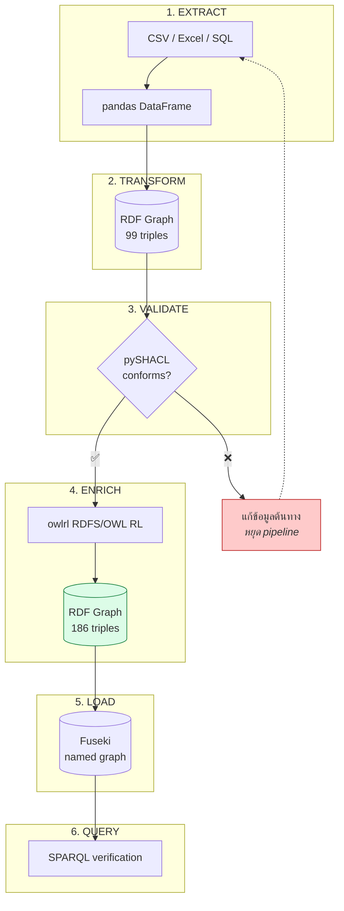
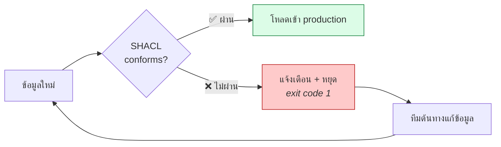
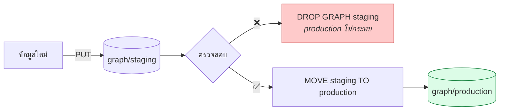

# 07.09 ETL Pipeline เต็มรูปแบบ

บทนี้ประกอบทุกอย่างที่เรียนมาเป็น **pipeline เดียวที่รันได้จริง**:
อ่าน CSV → แปลงเป็น RDF → validate ด้วย SHACL → reason → โหลดเข้า Fuseki → query ตรวจผล
ตัวเลขทุกตัวมาจากการรัน [`code/ch07/etl_pipeline.py`](../code/ch07/etl_pipeline.py) จริง

---

## สถาปัตยกรรม



---

## ขั้นที่ 1: EXTRACT

```python
import pandas as pd
from pathlib import Path


def extract(path: Path) -> pd.DataFrame:
    """อ่าน CSV พร้อมตรวจคุณภาพเบื้องต้น"""
    # ⚠️ keep_default_na=False -- ไม่ให้ pandas แปลงค่าว่างเป็น NaN
    df = pd.read_csv(path, dtype=str, keep_default_na=False)
    df["credits"] = pd.to_numeric(df["credits"], errors="coerce")

    print(f"  อ่าน {path.name}: {len(df)} แถว, {len(df.columns)} คอลัมน์")
    print(f"  นักศึกษาที่ไม่ซ้ำ : {df['student_id'].nunique()}")
    print(f"  รายวิชาที่ไม่ซ้ำ  : {df['course_code'].nunique()}")

    empty = {c: (df[c] == "").sum() for c in df.columns if (df[c] == "").sum() > 0}
    if empty:
        print(f"  ⚠️ คอลัมน์ที่มีค่าว่าง: {empty}")
    return df
```

Expected output:

```
  อ่าน courses_enrollment.csv: 8 แถว, 9 คอลัมน์
  นักศึกษาที่ไม่ซ้ำ : 5
  รายวิชาที่ไม่ซ้ำ  : 6
  ⚠️ คอลัมน์ที่มีค่าว่าง: {'email': 1, 'grade': 1}
```

> 💡 **รายงานค่าว่างตั้งแต่ขั้น extract** — จะได้รู้ว่าปัญหาเกิดที่ต้นทาง ไม่ใช่ที่ transform

---

## ขั้นที่ 2: TRANSFORM

รายละเอียดเต็มอยู่ใน [07.08](07.08-pandas-rdf.md) — จุดสำคัญ:

```python
def transform(df: pd.DataFrame) -> Graph:
    g = Graph()
    g.bind("ex", EX)
    g.bind("uni", UNI)

    students, courses, departments = set(), set(), set()      # กันการเขียนซ้ำ

    for _, row in df.iterrows():
        student = EX[f"student/{slugify(row['student_id'])}"]
        course = EX[f"course/{slugify(row['course_code'])}"]
        enrollment = EX[f"enrollment/{slugify(row['student_id'])}-{slugify(row['course_code'])}"]

        if student not in students:
            students.add(student)
            g.add((student, RDF.type, UNI.Student))
            g.add((student, UNI.studentId, Literal(row["student_id"], datatype=XSD.string)))
            if row["email"]:                                   # ข้ามค่าว่าง
                g.add((student, EX.email, Literal(row["email"], datatype=XSD.string)))
        # ... course, department ...

        g.add((student, UNI.enrolledIn, course))               # binary shortcut

        # reify n-ary relation
        g.add((enrollment, RDF.type, EX.Enrollment))
        g.add((enrollment, EX.enrolledStudent, student))
        g.add((enrollment, EX.enrolledCourse, course))
        g.add((enrollment, EX["term"], Literal(row["term"], datatype=XSD.string)))
        if row["grade"]:
            g.add((enrollment, EX.grade, Literal(row["grade"], datatype=XSD.string)))

    return g
```

Expected output:

```
  สร้าง 99 triples
    students    : 5
    courses     : 6
    departments : 2
  บันทึก etl_output.ttl
```

---

## ขั้นที่ 3: VALIDATE

**นี่คือ gate ที่สำคัญที่สุดของ pipeline** — ถ้าข้อมูลไม่ผ่าน ไม่ควรโหลดเข้าระบบ

```python
from pathlib import Path
from pyshacl import validate as shacl_validate
from rdflib import Graph


def validate_graph(g: Graph, shapes_path: Path) -> bool:
    shapes = Graph().parse(shapes_path, format="turtle")

    conforms, _, text = shacl_validate(
        data_graph=g,
        shacl_graph=shapes,
        inference="rdfs",          # ⚠️ จำเป็น มิฉะนั้น targetClass อาจไม่ match
        allow_warnings=True,       # Warning ไม่ทำให้ fail
    )

    if conforms:
        print("  ✅ ข้อมูลผ่านการตรวจสอบ")
    else:
        print("  ❌ พบ violation:")
        for line in text.splitlines():
            if line.strip().startswith(("Focus Node", "Message", "Result Path")):
                print(f"     {line.strip()}")
    return conforms
```

Expected output:

```
  ✅ ข้อมูลผ่านการตรวจสอบ
```

### ในระบบจริง: หยุด pipeline เมื่อไม่ผ่าน

```python
conforms = validate_graph(graph, SHAPES_PATH)
if not conforms:
    print("❌ หยุด pipeline — ข้อมูลไม่ผ่านการตรวจสอบ")
    sys.exit(1)          # CI จะเห็น exit code 1
```



---

## ขั้นที่ 4: ENRICH

```python
import owlrl
from rdflib import Graph
from pathlib import Path
from typing import Optional


def enrich(g: Graph, tbox_path: Optional[Path] = None) -> Graph:
    """เพิ่ม TBox แล้วรัน reasoning"""
    before = len(g)

    if tbox_path and tbox_path.exists():
        g.parse(tbox_path, format="turtle")
        print(f"  โหลด TBox: +{len(g) - before} triples")
        before = len(g)

    owlrl.DeductiveClosure(owlrl.RDFS_Semantics).expand(g)
    print(f"  หลัง RDFS reasoning: {len(g)} triples  (+{len(g) - before} inferred)")
    return g
```

Expected output:

```
  หลัง RDFS reasoning: 186 triples  (+87 inferred)
```

### เลือกระดับ reasoning ให้เหมาะ

| Semantics | ใช้เมื่อ | ต้นทุน |
| --- | --- | --- |
| ไม่ reason | ต้องการข้อมูลดิบ, ใช้ property path ตอน query แทน | ต่ำสุด |
| `RDFS_Semantics` | ต้องการ subClassOf/subPropertyOf/domain/range | ปานกลาง |
| `OWLRL_Semantics` | ต้องการ `sameAs`, `inverseOf`, `TransitiveProperty` | สูง |
| `RDFS_OWLRL_Semantics` | ครอบคลุมที่สุด | สูงสุด |

> 💡 **แยก inferred triple ไว้ named graph ต่างหาก** เพื่อให้ล้างแล้ว re-run ได้ง่าย (ดู [06.08](../06-sparql/06.08-endpoints.md))

---

## ขั้นที่ 5: LOAD เข้า Fuseki

```python
import requests
from rdflib import Graph
from typing import Optional


def load_to_fuseki(g: Graph, base_url: str, graph_iri: Optional[str] = None) -> bool:
    """ส่งข้อมูลเข้า Fuseki ผ่าน Graph Store Protocol"""
    data_url = f"{base_url.rstrip('/')}/data"
    params = {"graph": graph_iri} if graph_iri else {"default": ""}

    try:
        response = requests.put(              # PUT = แทนที่ทั้ง graph
            data_url,
            params=params,
            data=g.serialize(format="turtle").encode("utf-8"),
            headers={"Content-Type": "text/turtle; charset=utf-8"},
            timeout=30,
        )
        response.raise_for_status()
        print(f"  ✅ โหลดเข้า {data_url} สำเร็จ (HTTP {response.status_code})")
        return True
    except Exception as exc:
        print(f"  ⚠️ โหลดไม่สำเร็จ: {exc}")
        return False
```

| HTTP method | ผลลัพธ์ |
| --- | --- |
| `PUT` | **แทนที่** graph ทั้งอัน — ใช้กับ full reload |
| `POST` | **merge** เข้า graph เดิม — ใช้กับ incremental |
| `DELETE` | ลบ graph |

### รัน Fuseki

```bash
# ดาวน์โหลดและรัน
./fuseki-server --mem /university

# หรือเก็บลงดิสก์
./fuseki-server --loc=./databases/university /university
```

### Pattern: staging → production แบบ atomic

```python
STAGING = "http://example.org/graph/staging"
PRODUCTION = "http://example.org/graph/production"

# 1) โหลดเข้า staging
load_to_fuseki(graph, FUSEKI_URL, STAGING)

# 2) ตรวจสอบใน staging (รัน SHACL / ASK บน endpoint จริง)
if not verify_on_endpoint(FUSEKI_URL, STAGING):
    sys.exit(1)

# 3) สลับเข้า production ด้วยคำสั่งเดียว
requests.post(
    f"{FUSEKI_URL}/update",
    data={"update": f"MOVE <{STAGING}> TO <{PRODUCTION}>"},
    timeout=30,
)
```



**ข้อดี**: production ไม่เคยอยู่ในสภาพครึ่ง ๆ กลาง ๆ — ถ้าข้อมูลใหม่ผิด ก็แค่ทิ้ง staging

---

## ขั้นที่ 6: QUERY ตรวจผล

```python
VERIFY_QUERIES = {
    "จำนวนนักศึกษา": """
        PREFIX uni: <http://example.org/university#>
        SELECT (COUNT(DISTINCT ?s) AS ?n) WHERE { ?s a uni:Student }
    """,
    "หน่วยกิตรวมต่อคน": """
        PREFIX uni:  <http://example.org/university#>
        PREFIX rdfs: <http://www.w3.org/2000/01/rdf-schema#>
        SELECT ?name (SUM(?cr) AS ?total) (COUNT(?c) AS ?courses)
        WHERE {
          ?s a uni:Student ; rdfs:label ?name ; uni:enrolledIn ?c .
          ?c uni:credits ?cr .
        }
        GROUP BY ?name ORDER BY DESC(?total)
    """,
    "นักศึกษาที่ไม่มี email": """
        PREFIX uni:  <http://example.org/university#>
        PREFIX ex:   <http://example.org/etl#>
        PREFIX rdfs: <http://www.w3.org/2000/01/rdf-schema#>
        SELECT ?name WHERE {
          ?s a uni:Student ; rdfs:label ?name .
          FILTER NOT EXISTS { ?s ex:email ?e }
        }
    """,
}
```

Expected output (จากการรันจริง):

```
  ▸ จำนวนนักศึกษา
      5

  ▸ หน่วยกิตรวมต่อคน
      Alice Johnson  |  8  |  2
      Carol Nguyen  |  7  |  2
      Bob Martinez  |  6  |  2
      Daniel Kim  |  3  |  1
      Emma Wilson  |  3  |  1

  ▸ เกรดต่อรายวิชา
      Advanced Machine Learning  |  A  |  1
      Calculus I  |  A  |  1
      Data Structures  |  B  |  1
      Database Systems  |  B+  |  1
      Introduction to Programming  |  B+  |  1
      Introduction to Programming  |  A-  |  1
      Knowledge Graphs  |  A  |  1

  ▸ นักศึกษาที่ไม่มี email
      Daniel Kim
```

> 💡 **query ตรวจสอบเป็นส่วนหนึ่งของ pipeline** ไม่ใช่ขั้นตอนแยก — ทำให้จับปัญหาได้ก่อนผู้ใช้เจอ

---

## รันจริง

```bash
# รันทั้ง pipeline (ข้าม LOAD ถ้าไม่มี Fuseki)
python code/ch07/etl_pipeline.py --skip-load

# รันพร้อมโหลดเข้า Fuseki
python code/ch07/etl_pipeline.py --fuseki http://localhost:3030/university

# ระบุ named graph ปลายทาง
python code/ch07/etl_pipeline.py --graph http://example.org/graph/2024
```

Expected output (สรุป):

```
============================================================================
  [1/6] EXTRACT — อ่าน CSV        → 8 แถว, 5 นักศึกษา, 6 รายวิชา
  [2/6] TRANSFORM — CSV -> RDF    → 99 triples
  [3/6] VALIDATE — pySHACL        → ✅ ผ่าน
  [4/6] ENRICH — RDFS reasoning   → 186 triples (+87 inferred)
  [5/6] LOAD — Fuseki             → ข้าม / ✅
  [6/6] QUERY — ตรวจผลลัพธ์        → ✅
============================================================================
  เสร็จสิ้น — graph สุดท้ายมี 186 triples
```

---

## ทำให้เป็น Production Pipeline

### 1. Incremental load

```python
import hashlib
import json
from pathlib import Path

STATE_FILE = Path(".etl_state.json")


def file_hash(path: Path) -> str:
    return hashlib.sha256(path.read_bytes()).hexdigest()


def should_process(path: Path) -> bool:
    """ประมวลผลเฉพาะไฟล์ที่เปลี่ยนแปลง"""
    state = json.loads(STATE_FILE.read_text()) if STATE_FILE.exists() else {}
    current = file_hash(path)
    if state.get(str(path)) == current:
        print(f"  ข้าม {path.name} (ไม่เปลี่ยนแปลง)")
        return False
    state[str(path)] = current
    STATE_FILE.write_text(json.dumps(state, indent=2))
    return True
```

### 2. Provenance metadata

```python
from datetime import datetime, timezone
from rdflib import Literal, Namespace, URIRef
from rdflib.namespace import RDF, XSD

PROV = Namespace("http://www.w3.org/ns/prov#")
DCTERMS = Namespace("http://purl.org/dc/terms/")


def add_provenance(g: Graph, source_file: Path, graph_iri: str) -> None:
    """บันทึกว่าข้อมูลนี้มาจากไหน แปลงเมื่อไหร่ ด้วยอะไร"""
    activity = URIRef(f"{graph_iri}/activity/{datetime.now(timezone.utc):%Y%m%dT%H%M%S}")
    source = URIRef(f"file://{source_file.resolve()}")

    g.add((URIRef(graph_iri), RDF.type, PROV.Entity))
    g.add((URIRef(graph_iri), PROV.wasGeneratedBy, activity))
    g.add((URIRef(graph_iri), DCTERMS.created,
           Literal(datetime.now(timezone.utc).isoformat(), datatype=XSD.dateTime)))

    g.add((activity, RDF.type, PROV.Activity))
    g.add((activity, PROV.used, source))
    g.add((activity, DCTERMS.title, Literal("CSV to RDF ETL", lang="en")))
    g.add((activity, PROV.wasAssociatedWith,
           URIRef("https://example.org/software/etl-pipeline")))
```

### 3. Logging และ metric

```python
import logging
import time

logging.basicConfig(
    level=logging.INFO,
    format="%(asctime)s [%(levelname)s] %(message)s",
)
log = logging.getLogger("etl")


def timed(step_name: str):
    """decorator วัดเวลาแต่ละขั้น"""
    def decorator(func):
        def wrapper(*args, **kwargs):
            start = time.perf_counter()
            log.info("เริ่ม %s", step_name)
            result = func(*args, **kwargs)
            log.info("จบ %s (%.2f วินาที)", step_name, time.perf_counter() - start)
            return result
        return wrapper
    return decorator


@timed("TRANSFORM")
def transform(df):
    ...
```

### 4. Error handling ที่ระบุแถวที่ผิด

```python
def transform_safe(df: pd.DataFrame) -> tuple:
    """แปลงพร้อมเก็บแถวที่ผิดไว้รายงาน"""
    g = Graph()
    errors = []

    for index, row in df.iterrows():
        try:
            process_row(g, row)
        except Exception as exc:
            errors.append({
                "row": index + 2,                  # +2 = header + 0-indexed
                "student_id": row.get("student_id"),
                "error": f"{type(exc).__name__}: {exc}",
            })

    if errors:
        print(f"  ⚠️ ข้าม {len(errors)} แถวที่มีปัญหา:")
        for e in errors[:5]:
            print(f"     แถว {e['row']} ({e['student_id']}): {e['error']}")
        pd.DataFrame(errors).to_csv("etl_errors.csv", index=False)

    return g, errors
```

---

## CI Pipeline

```yaml
# .github/workflows/etl.yml
name: ETL Pipeline

on:
  push:
    paths: ['data/**.csv', 'shapes/**.ttl', 'code/ch07/**.py']
  schedule:
    - cron: '0 2 * * *'          # ทุกคืนตี 2

jobs:
  etl:
    runs-on: ubuntu-latest
    steps:
      - uses: actions/checkout@v4
      - uses: actions/setup-python@v5
        with:
          python-version: '3.11'

      - name: ติดตั้ง dependency
        run: pip install pandas rdflib pyshacl owlrl requests

      - name: รัน ETL
        run: python code/ch07/etl_pipeline.py --skip-load

      - name: Validate ผลลัพธ์
        run: pyshacl -s shapes/university-shapes.ttl -i rdfs code/ch07/etl_output.ttl

      - name: Upload artifact
        uses: actions/upload-artifact@v4
        with:
          name: rdf-output
          path: code/ch07/etl_output.ttl
```

---

## Troubleshooting

| อาการ | สาเหตุ | วิธีแก้ |
| --- | --- | --- |
| `Literal("nan")` ปรากฏใน output | pandas แปลงค่าว่างเป็น NaN | `keep_default_na=False` + ตรวจ `pd.notna()` |
| `AssertionError: Predicate ... must be an rdflib term` | ชื่อ property ชนกับ method ของ `Namespace` | ใช้ `NS["name"]` |
| SHACL ไม่จับอะไรเลย | `sh:targetClass` ไม่ match | ตั้ง `inference="rdfs"` |
| triple น้อยกว่าที่คาด | เขียน entity ซ้ำแล้ว RDF ตัดออก (เป็นเซต) | ปกติ — ตรวจด้วย `COUNT(DISTINCT ?s)` |
| `FILTER(?credits > 3)` ไม่ได้ผล | datatype เป็น string | ระบุ `datatype=XSD.integer` |
| Fuseki ตอบ 404 | URL ผิด (`/data` vs `/update`) | ใช้ `/data` สำหรับ Graph Store Protocol |
| reload แล้ว IRI เปลี่ยน | ใช้ auto-increment เป็น key | ใช้ business key |
| memory เต็มกับไฟล์ใหญ่ | โหลดทั้งไฟล์เข้า memory | ประมวลผลทีละ chunk ด้วย `pd.read_csv(chunksize=)` |

### ประมวลผลไฟล์ใหญ่ทีละ chunk

```python
CHUNK = 10_000

for i, chunk in enumerate(pd.read_csv(path, chunksize=CHUNK, dtype=str,
                                       keep_default_na=False)):
    g = transform(chunk)
    load_to_fuseki(g, FUSEKI_URL, f"http://example.org/graph/batch-{i}")
    print(f"  batch {i}: {len(chunk)} แถว -> {len(g)} triples")
```

---

## Key Points

- ETL pipeline มี 6 ขั้น: **EXTRACT → TRANSFORM → VALIDATE → ENRICH → LOAD → QUERY**
- **VALIDATE เป็น gate ที่สำคัญที่สุด** — ต้องหยุด pipeline (exit code 1) เมื่อข้อมูลไม่ผ่าน
- ตั้ง **`inference="rdfs"`** ใน pySHACL มิฉะนั้น `sh:targetClass` อาจไม่ match
- ใช้ **Graph Store Protocol** (`PUT` = แทนที่, `POST` = merge) โหลดเข้า Fuseki
- Pattern **staging → production ด้วย `MOVE`** ทำให้ production ไม่เคยอยู่ในสภาพครึ่ง ๆ กลาง ๆ
- **QUERY ตรวจผลเป็นส่วนหนึ่งของ pipeline** ไม่ใช่ขั้นตอนแยก
- Production pipeline ต้องมี: **incremental load** (hash), **provenance** (PROV-O), **logging** และ **error report ที่ระบุแถวที่ผิด**
- ไฟล์ใหญ่: ประมวลผล **ทีละ chunk** ด้วย `pd.read_csv(chunksize=)` แล้วโหลดเข้า named graph แยกกัน
