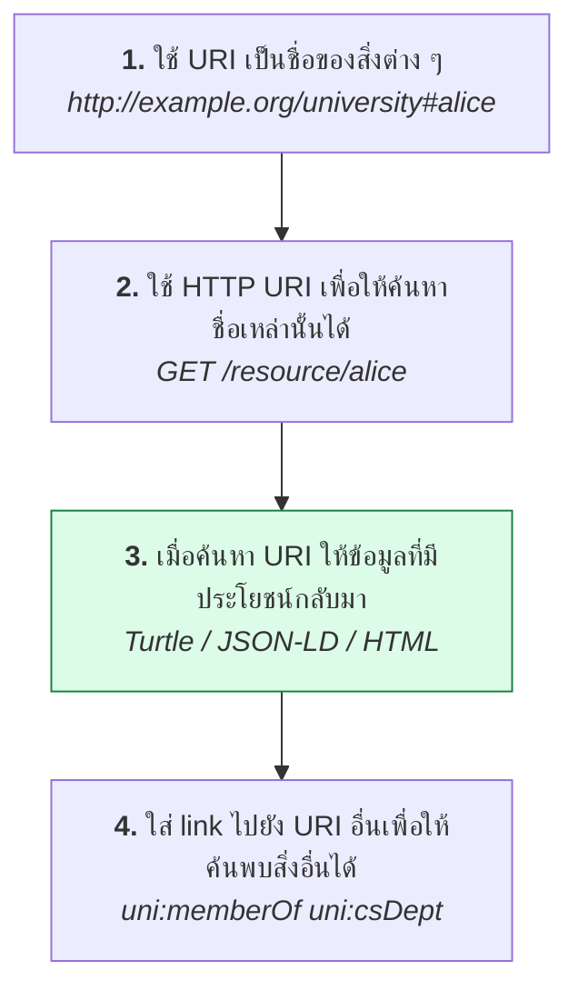
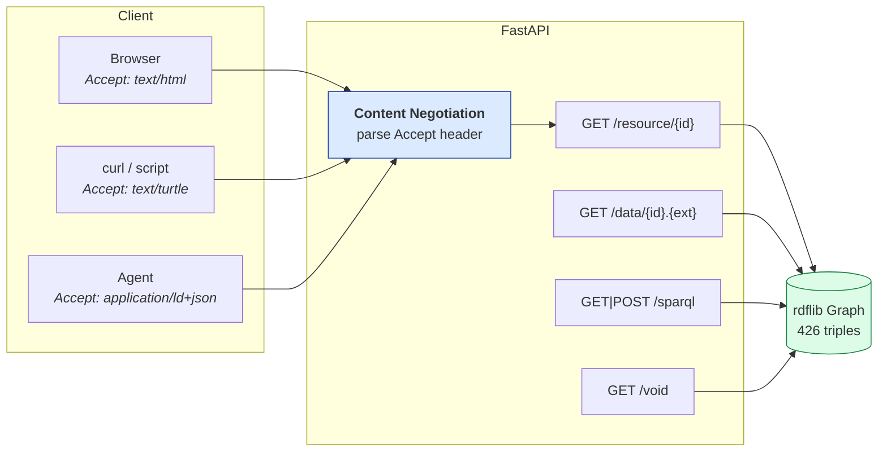

# 07.10 FastAPI: ให้บริการ Linked Data

บทสุดท้ายของ Chapter 07 สร้าง **Linked Data service** ที่ทำตามหลัก Linked Data Principles ครบทั้ง 4 ข้อ
พร้อม **content negotiation** ที่ตอบได้ทั้ง HTML สำหรับมนุษย์และ RDF สำหรับ machine
และมี **SPARQL endpoint** ในตัว ผลลัพธ์ทุกอย่างมาจากการรัน [`code/ch07/fastapi_ld.py`](../code/ch07/fastapi_ld.py) จริง

---

## Linked Data Principles ที่ต้องทำให้ครบ



รายละเอียดเต็มอยู่ใน [12.03](../12-linked-open-data/12.03-linked-data-principles.md) — บทนี้เน้นการ implement

---

## สถาปัตยกรรมของ service



---

## Content Negotiation

หัวใจของ Linked Data service — **URI เดียว แต่ตอบได้หลายรูปแบบตามที่ client ขอ**

### แยก Accept header

```python
from typing import Dict, Optional, Tuple

MIME_MAP: Dict[str, Tuple[str, str]] = {
    "text/turtle":            ("turtle", "ttl"),
    "application/x-turtle":   ("turtle", "ttl"),
    "application/ld+json":    ("json-ld", "jsonld"),
    "application/json":       ("json-ld", "jsonld"),
    "application/rdf+xml":    ("xml", "rdf"),
    "application/n-triples":  ("nt", "nt"),
    "text/n3":                ("n3", "n3"),
}


def parse_accept(header: str) -> list:
    """
    แยก Accept header เป็น (mime, q) เรียงตาม q จากมากไปน้อย
    "text/turtle;q=0.9, text/html" -> [("text/html", 1.0), ("text/turtle", 0.9)]
    """
    entries = []
    for part in header.split(","):
        part = part.strip()
        if not part:
            continue
        pieces = part.split(";")
        mime = pieces[0].strip()
        quality = 1.0
        for piece in pieces[1:]:
            piece = piece.strip()
            if piece.startswith("q="):
                try:
                    quality = float(piece[2:])
                except ValueError:
                    quality = 1.0
        entries.append((mime, quality))
    return sorted(entries, key=lambda x: -x[1])


def negotiate(accept_header: Optional[str]) -> Tuple[str, str]:
    """เลือก format ที่ดีที่สุด; คืน (rdflib_format, content_type)"""
    if not accept_header:
        return "turtle", "text/turtle"

    for mime, _ in parse_accept(accept_header):
        if mime in ("text/html", "application/xhtml+xml"):
            return "html", "text/html"
        if mime in MIME_MAP:
            return MIME_MAP[mime][0], mime
        if mime == "*/*":
            return "turtle", "text/turtle"

    return "turtle", "text/turtle"
```

> ⚠️ **ต้องเรียงตาม `q` value** — browser ส่ง Accept header ที่ซับซ้อนมาก
> เช่น `text/html,application/xhtml+xml,application/xml;q=0.9,*/*;q=0.8`

### ⚠️ Header `Vary: Accept`

```python
return Response(
    content=graph.serialize(format=fmt),
    media_type=content_type,
    headers={"Vary": "Accept"},          # ⚠️ สำคัญมาก
)
```

**ถ้าไม่ใส่ `Vary: Accept`** cache (CDN, browser, proxy) จะเก็บผลลัพธ์แรกไว้แล้วส่งให้ทุกคน
— ผู้ใช้ที่ขอ HTML อาจได้ Turtle กลับไป

---

## Endpoint: dereference resource

```python
from fastapi import FastAPI, HTTPException, Request
from fastapi.responses import HTMLResponse
from rdflib import Graph, URIRef
from rdflib.namespace import RDFS

BASE_IRI = "http://example.org/university#"
GRAPH = Graph().parse("data/university.ttl", format="turtle")

app = FastAPI(title="University Linked Data Service")


def describe(resource: URIRef) -> Graph:
    """
    Concise Bounded Description แบบง่าย:
    triple ที่ resource เป็น subject + inbound link + label ของ node ที่เชื่อมถึง
    """
    result = Graph()
    for prefix, namespace in GRAPH.namespaces():
        result.bind(prefix, namespace)

    found = False

    # outbound
    for predicate, obj in GRAPH.predicate_objects(resource):
        result.add((resource, predicate, obj))
        found = True
        if isinstance(obj, URIRef):
            for label in GRAPH.objects(obj, RDFS.label):
                result.add((obj, RDFS.label, label))     # ให้ client แสดงชื่อได้

    # inbound
    for subject, predicate in GRAPH.subject_predicates(resource):
        result.add((subject, predicate, resource))
        found = True
        for label in GRAPH.objects(subject, RDFS.label):
            result.add((subject, RDFS.label, label))

    return result if found else Graph()


@app.get("/resource/{identifier}")
def resource(identifier: str, request: Request) -> Response:
    iri = URIRef(BASE_IRI + identifier)
    graph = describe(iri)

    if len(graph) == 0:
        raise HTTPException(status_code=404, detail=f"ไม่พบ resource: {identifier}")

    fmt, content_type = negotiate(request.headers.get("accept"))

    if fmt == "html":
        return HTMLResponse(render_html(iri, graph))

    return Response(
        content=graph.serialize(format=fmt),
        media_type=content_type,
        headers={"Vary": "Accept"},
    )
```

> 💡 **ใส่ `rdfs:label` ของ node ที่เชื่อมถึงมาด้วย** — client จะแสดงชื่อได้โดยไม่ต้องยิง request เพิ่ม
> เป็นเทคนิคที่ทำให้ Linked Data ใช้งานได้จริง

---

## ทดสอบ content negotiation

```bash
curl -H "Accept: text/turtle"         http://localhost:8000/resource/alice
curl -H "Accept: application/ld+json" http://localhost:8000/resource/alice
curl -H "Accept: text/html"           http://localhost:8000/resource/alice
curl -H "Accept: application/rdf+xml" http://localhost:8000/resource/alice
```

ผลรันจริง:

| Accept header | Status | Content-Type | ขนาด |
| --- | --- | --- | --- |
| `text/turtle` | 200 | `text/turtle; charset=utf-8` | Turtle |
| `application/ld+json` | 200 | `application/ld+json` | 2,848 bytes |
| `text/html` | 200 | `text/html; charset=utf-8` | 3,182 bytes |
| (ไม่มี) | 200 | `text/turtle` | default |
| resource ที่ไม่มี | **404** | — | — |

ตัวอย่างผล Turtle:

```turtle
@prefix foaf: <http://xmlns.com/foaf/0.1/> .
@prefix owl:  <http://www.w3.org/2002/07/owl#> .
@prefix rdfs: <http://www.w3.org/2000/01/rdf-schema#> .
@prefix uni:  <http://example.org/university#> .
@prefix xsd:  <http://www.w3.org/2001/XMLSchema#> .

uni:profSmith rdfs:label "Jane Smith"@en ;
    uni:supervises uni:alice .

uni:alice a owl:NamedIndividual , uni:Student ;
    rdfs:label      "Alice Johnson"@en ;
    uni:studentId   "S-2024-0421" ;
    uni:gpa         3.85 ;
    uni:enrolledIn  uni:cs501 , uni:cs601 ;
    uni:memberOf    uni:csDept .
```

**สังเกต**: มี `uni:profSmith uni:supervises uni:alice` ติดมาด้วย (inbound link) และมี `rdfs:label` ของ profSmith
— ทำให้ client รู้ว่าใครดูแล alice โดยไม่ต้องยิง request เพิ่ม

---

## Endpoint: ระบุ format ในนามสกุล

บาง client (โดยเฉพาะ browser) ตั้ง Accept header ไม่ได้ — ให้ทางเลือกผ่านนามสกุลไฟล์

```python
EXT_MAP = {
    "ttl":    ("turtle", "text/turtle"),
    "jsonld": ("json-ld", "application/ld+json"),
    "rdf":    ("xml", "application/rdf+xml"),
    "nt":     ("nt", "application/n-triples"),
    "n3":     ("n3", "text/n3"),
    "html":   ("html", "text/html"),
}


@app.get("/data/{identifier}.{ext}")
def data(identifier: str, ext: str) -> Response:
    if ext not in EXT_MAP:
        raise HTTPException(
            status_code=400,
            detail=f"ไม่รองรับนามสกุล .{ext} — รองรับ: {', '.join(EXT_MAP)}",
        )
    iri = URIRef(BASE_IRI + identifier)
    graph = describe(iri)
    if len(graph) == 0:
        raise HTTPException(status_code=404, detail=f"ไม่พบ resource: {identifier}")

    fmt, content_type = EXT_MAP[ext]
    return Response(content=graph.serialize(format=fmt), media_type=content_type)
```

```bash
curl http://localhost:8000/data/alice.ttl       # → 19 บรรทัด N-Triples เมื่อใช้ .nt
curl http://localhost:8000/data/alice.jsonld
curl http://localhost:8000/data/alice.nt        # → 19 triples
```

---

## หน้า HTML สำหรับมนุษย์

```python
from urllib.parse import quote
from rdflib import Literal, URIRef


def render_html(resource: URIRef, graph: Graph) -> str:
    labels = list(GRAPH.objects(resource, RDFS.label))
    title = str(labels[0]) if labels else str(resource).split("#")[-1]

    def cell(term) -> str:
        if isinstance(term, URIRef):
            name = str(term).split("#")[-1].split("/")[-1]
            if str(term).startswith(BASE_IRI):
                # ⚠️ link ภายในต้องชี้ไปยัง endpoint ของเราเอง
                return f'<a href="/resource/{quote(name)}">{name}</a>'
            return f'<a href="{term}" rel="external">{name}</a>'
        if isinstance(term, Literal):
            suffix = ""
            if term.language:
                suffix = f' <span class="tag">@{term.language}</span>'
            elif term.datatype:
                dt = str(term.datatype).split("#")[-1]
                suffix = f' <span class="tag">^^{dt}</span>'
            return f"{term}{suffix}"
        return str(term)

    outgoing = sorted(((p, o) for s, p, o in graph if s == resource), key=lambda x: str(x[0]))
    incoming = sorted(((s, p) for s, p, o in graph if o == resource), key=lambda x: str(x[1]))
    # ... สร้าง HTML ...
```

**สิ่งที่หน้า HTML ควรมี**

- [ ] ชื่อจาก `rdfs:label` เป็นหัวเรื่อง
- [ ] IRI เต็มแสดงให้เห็น
- [ ] ตาราง **outgoing properties**
- [ ] ตาราง **incoming links** (referenced by)
- [ ] **link ภายในชี้กลับมาที่ service ของเรา** (ไม่ใช่ IRI ดิบ)
- [ ] link ไปยัง format อื่น (`.ttl`, `.jsonld`, `.rdf`, `.nt`)

---

## SPARQL Endpoint

```python
from fastapi import Query
from urllib.parse import parse_qs


def run_sparql(query: str, accept: Optional[str]) -> Response:
    try:
        result = GRAPH.query(query)
    except Exception as exc:
        raise HTTPException(status_code=400, detail=f"SPARQL error: {exc}") from exc

    accept = accept or ""

    # CONSTRUCT / DESCRIBE -> RDF graph
    if result.type in ("CONSTRUCT", "DESCRIBE"):
        fmt, content_type = negotiate(accept)
        if fmt == "html":
            fmt, content_type = "turtle", "text/turtle"
        return Response(content=result.graph.serialize(format=fmt), media_type=content_type)

    # SELECT / ASK -> SPARQL Results
    if "text/csv" in accept:
        return Response(content=result.serialize(format="csv"), media_type="text/csv")
    if "application/sparql-results+xml" in accept:
        return Response(content=result.serialize(format="xml"),
                        media_type="application/sparql-results+xml")

    return Response(content=result.serialize(format="json"),
                    media_type="application/sparql-results+json")


@app.get("/sparql")
def sparql_get(request: Request, query: str = Query(...)) -> Response:
    return run_sparql(query, request.headers.get("accept"))


@app.post("/sparql")
async def sparql_post(request: Request) -> Response:
    content_type = request.headers.get("content-type", "")
    body = (await request.body()).decode("utf-8")

    if "application/sparql-query" in content_type:
        query = body                             # POST direct
    else:
        parsed = parse_qs(body)                  # POST URL-encoded
        if "query" not in parsed:
            raise HTTPException(status_code=400, detail="ไม่พบ parameter 'query'")
        query = parsed["query"][0]

    return run_sparql(query, request.headers.get("accept"))
```

ผลรันจริง:

```json
{
  "head": { "vars": ["s"] },
  "results": {
    "bindings": [
      { "s": { "type": "uri", "value": "http://example.org/university#carol" } },
      { "s": { "type": "uri", "value": "http://example.org/university#dave" } },
      ...
    ]
  }
}
```

> ⚠️ **SPARQL endpoint สาธารณะต้องมีการป้องกัน** — ดูหัวข้อ Security ด้านล่าง

---

## VoID Description

**VoID (Vocabulary of Interlinked Datasets)** อธิบาย dataset ให้ machine เข้าใจว่ามีอะไรอยู่ข้างใน

```python
from rdflib import Literal, URIRef
from rdflib.namespace import DCTERMS, RDF, VOID, XSD


@app.get("/void")
def void_description() -> Response:
    g = Graph()
    g.bind("void", VOID)
    g.bind("dcterms", DCTERMS)

    dataset = URIRef("http://localhost:8000/void#dataset")
    g.add((dataset, RDF.type, VOID.Dataset))
    g.add((dataset, DCTERMS.title, Literal("University Linked Data", lang="en")))
    g.add((dataset, DCTERMS.license,
           URIRef("https://creativecommons.org/licenses/by/4.0/")))
    g.add((dataset, VOID.sparqlEndpoint, URIRef("http://localhost:8000/sparql")))
    g.add((dataset, VOID.uriSpace, Literal(BASE_IRI)))
    g.add((dataset, VOID.triples, Literal(len(GRAPH), datatype=XSD.integer)))
    g.add((dataset, VOID.distinctSubjects,
           Literal(len(set(GRAPH.subjects())), datatype=XSD.integer)))
    g.add((dataset, VOID.properties,
           Literal(len(set(GRAPH.predicates())), datatype=XSD.integer)))

    return Response(content=g.serialize(format="turtle"), media_type="text/turtle")
```

ผลรันจริง:

```turtle
@prefix dcterms: <http://purl.org/dc/terms/> .
@prefix void:    <http://rdfs.org/ns/void#> .
@prefix xsd:     <http://www.w3.org/2001/XMLSchema#> .

<http://localhost:8000/void#dataset> a void:Dataset ;
    dcterms:title       "University Linked Data"@en ;
    dcterms:description "Example dataset for the Semantic Web course."@en ;
    dcterms:license     <https://creativecommons.org/licenses/by/4.0/> ;
    void:sparqlEndpoint <http://localhost:8000/sparql> ;
    void:uriSpace       "http://example.org/university#" ;
    void:triples        426 ;
    void:distinctSubjects 117 ;
    void:properties     31 .
```

---

## รันจริง

```bash
uvicorn fastapi_ld:app --reload --port 8000
```

```bash
curl http://localhost:8000/health
```

```json
{"status": "ok", "triples": 426, "subjects": 117, "source": "university.ttl"}
```

เปิด `http://localhost:8000` ในเบราว์เซอร์เพื่อดูหน้าแรก
และ `http://localhost:8000/docs` เพื่อดู OpenAPI documentation ที่ FastAPI สร้างให้อัตโนมัติ

---

## Security สำหรับ SPARQL Endpoint สาธารณะ

⚠️ **SPARQL endpoint ที่เปิดสาธารณะโดยไม่ป้องกัน = ช่องโหว่ DoS**

```python
import asyncio
import re
import time
from collections import defaultdict

from fastapi import HTTPException, Request

# --- 1) ห้าม UPDATE ผ่าน query endpoint ---
FORBIDDEN = re.compile(
    r"\b(INSERT|DELETE|LOAD|CLEAR|DROP|CREATE|COPY|MOVE|ADD)\b",
    re.IGNORECASE,
)


def check_read_only(query: str) -> None:
    if FORBIDDEN.search(query):
        raise HTTPException(status_code=403, detail="endpoint นี้เป็น read-only")


# --- 2) บังคับ LIMIT ---
MAX_LIMIT = 10_000


def enforce_limit(query: str, max_limit: int = MAX_LIMIT) -> str:
    if not re.search(r"\bLIMIT\b", query, re.IGNORECASE):
        return f"{query.rstrip()}\nLIMIT {max_limit}"
    return query


# --- 3) timeout ---
async def query_with_timeout(query: str, seconds: int = 30):
    loop = asyncio.get_running_loop()
    try:
        return await asyncio.wait_for(
            loop.run_in_executor(None, GRAPH.query, query),
            timeout=seconds,
        )
    except asyncio.TimeoutError:
        raise HTTPException(status_code=408, detail=f"query เกิน {seconds} วินาที")


# --- 4) rate limiting ---
REQUESTS: dict = defaultdict(list)
WINDOW = 60
MAX_PER_WINDOW = 30


def check_rate_limit(request: Request) -> None:
    client = request.client.host if request.client else "unknown"
    now = time.time()
    REQUESTS[client] = [t for t in REQUESTS[client] if now - t < WINDOW]
    if len(REQUESTS[client]) >= MAX_PER_WINDOW:
        raise HTTPException(status_code=429, detail="ยิง request ถี่เกินไป")
    REQUESTS[client].append(now)
```

| ภัยคุกคาม | การป้องกัน |
| --- | --- |
| **SPARQL Update** ผ่าน query endpoint | blacklist keyword + แยก endpoint |
| Query ที่กิน CPU มหาศาล (`?s ?p ?o` ไม่มี LIMIT) | บังคับ `LIMIT` + `timeout` |
| ยิง request ถี่ | rate limiting |
| ดึงข้อมูลทั้ง dataset | จำกัด `LIMIT` สูงสุด + ให้ dump ดาวน์โหลดแทน |
| Property path ที่ระเบิด (`?s ?p* ?o`) | ตรวจ pattern + timeout |
| ข้อมูลส่วนบุคคลหลุด | แยก graph ที่เปิดสาธารณะออกจากข้อมูลภายใน |

---

## CORS สำหรับ client ฝั่ง browser

```python
from fastapi.middleware.cors import CORSMiddleware

app.add_middleware(
    CORSMiddleware,
    allow_origins=["*"],                # production ควรระบุ domain ให้ชัด
    allow_methods=["GET", "POST"],
    allow_headers=["Accept", "Content-Type"],
    expose_headers=["Content-Type", "Vary"],
)
```

---

## Caching

```python
import hashlib

from fastapi import Response


@app.get("/resource/{identifier}")
def resource(identifier: str, request: Request) -> Response:
    iri = URIRef(BASE_IRI + identifier)
    graph = describe(iri)
    if len(graph) == 0:
        raise HTTPException(status_code=404, detail="ไม่พบ resource")

    fmt, content_type = negotiate(request.headers.get("accept"))
    body = graph.serialize(format=fmt)

    # ETag จากเนื้อหา -- client ที่มีของเดิมอยู่แล้วจะได้ 304
    etag = hashlib.sha256(body.encode()).hexdigest()[:16]
    if request.headers.get("if-none-match") == etag:
        return Response(status_code=304)

    return Response(
        content=body,
        media_type=content_type,
        headers={
            "Vary": "Accept",
            "ETag": etag,
            "Cache-Control": "public, max-age=3600",
        },
    )
```

---

## Deploy

```dockerfile
FROM python:3.11-slim
WORKDIR /app

COPY requirements.txt .
RUN pip install --no-cache-dir -r requirements.txt

COPY code/ch07/fastapi_ld.py .
COPY data/ ./data/

EXPOSE 8000
CMD ["uvicorn", "fastapi_ld:app", "--host", "0.0.0.0", "--port", "8000"]
```

```bash
docker build -t university-ld .
docker run -p 8000:8000 university-ld
```

### ต่อกับ triplestore แทนการโหลดไฟล์

```python
from rdflib import Graph
from rdflib.plugins.stores.sparqlstore import SPARQLStore

# แทนที่จะโหลดไฟล์เข้า memory ให้ใช้ Fuseki เป็น backing store
store = SPARQLStore("http://fuseki:3030/university/query")
GRAPH = Graph(store=store)
```

**ข้อดี**: โค้ดที่เหลือไม่ต้องแก้เลย และรองรับข้อมูลขนาดใหญ่ได้

---

## Troubleshooting

| อาการ | สาเหตุ | วิธีแก้ |
| --- | --- | --- |
| browser ได้ Turtle แทน HTML | negotiate ไม่ได้เรียงตาม `q` | เรียงตาม q value ให้ถูก |
| cache ส่ง format ผิดให้ผู้ใช้ | ไม่ได้ใส่ `Vary: Accept` | เพิ่ม header `Vary: Accept` |
| link ใน HTML ชี้ออกนอก service | ใช้ IRI ดิบเป็น href | แปลงเป็น `/resource/{id}` |
| SPARQL endpoint ค้าง | query ไม่มี `LIMIT` | บังคับ `LIMIT` + `timeout` |
| JavaScript client เรียกไม่ได้ | ไม่มี CORS | เพิ่ม `CORSMiddleware` |
| ข้อมูลไม่อัปเดตหลังแก้ไฟล์ | โหลดกราฟครั้งเดียวตอน startup | ใช้ `--reload` ตอน dev / ต่อ triplestore |
| 404 ทั้งที่ resource มีอยู่ | IRI ไม่ตรง (`#` vs `/`) | ตรวจ `BASE_IRI` ให้ตรงกับข้อมูล |
| memory โตเรื่อย ๆ | โหลดกราฟใหญ่เข้า memory | ใช้ `SPARQLStore` ต่อกับ triplestore |

---

## Key Points

- **Content negotiation** คือหัวใจของ Linked Data service — URI เดียวตอบได้ทั้ง HTML และ RDF
- ต้อง **เรียง Accept header ตาม `q` value** เพราะ browser ส่ง header ที่ซับซ้อน
- ⚠️ **ต้องใส่ `Vary: Accept`** มิฉะนั้น cache จะส่ง format ผิดให้ผู้ใช้
- ให้ทางเลือกผ่าน **นามสกุลไฟล์** (`/data/alice.ttl`) สำหรับ client ที่ตั้ง Accept header ไม่ได้
- **ใส่ `rdfs:label` ของ node ที่เชื่อมถึงมาด้วย** — client แสดงชื่อได้โดยไม่ต้องยิง request เพิ่ม
- หน้า HTML ต้องมี **inbound link** และ **link ภายในชี้กลับมาที่ service** ไม่ใช่ IRI ดิบ
- **VoID description** บอก machine ว่า dataset มีอะไร มี endpoint ที่ไหน license อะไร
- ⚠️ **SPARQL endpoint สาธารณะต้องมี**: read-only guard, บังคับ `LIMIT`, timeout และ rate limiting
- ใช้ **`SPARQLStore`** ต่อกับ triplestore แทนการโหลดไฟล์เมื่อข้อมูลใหญ่ — โค้ดที่เหลือไม่ต้องแก้
