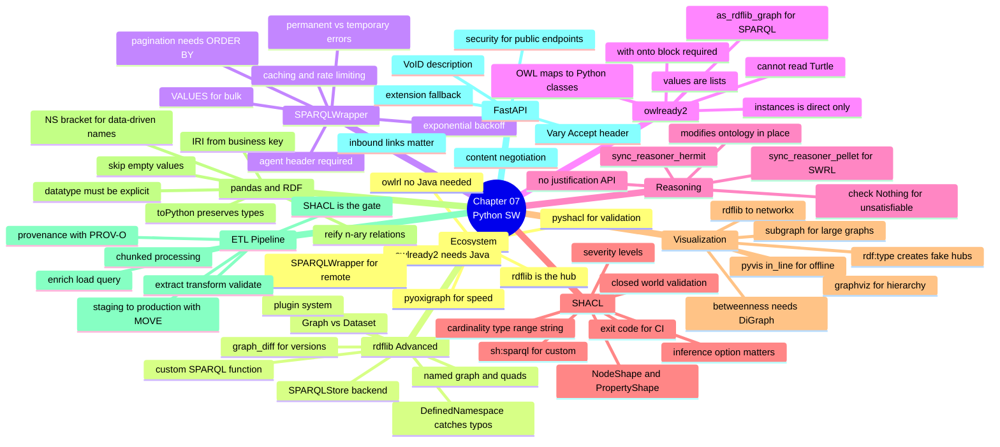
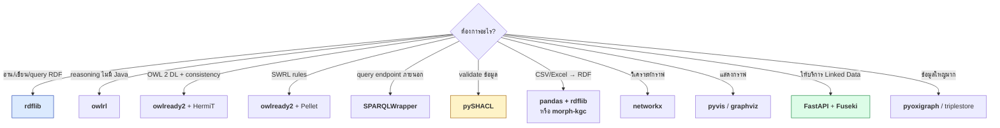
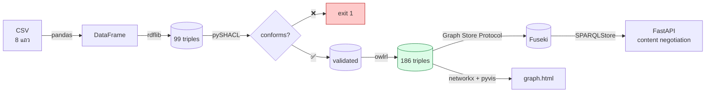

# 07.11 สรุป Chapter 07 + Library Cheat Sheet

Chapter 07 เปลี่ยนจาก "รู้ทฤษฎี" เป็น "สร้างระบบได้" — เราประกอบ rdflib, owlready2, pySHACL,
networkx, pandas และ FastAPI เข้าเป็น pipeline ที่รันได้จริงตั้งแต่ CSV จนถึง Linked Data service

---

## Concept Map



---

## Library Cheat Sheet

### rdflib

```python
from rdflib import BNode, Dataset, Graph, Literal, Namespace, URIRef
from rdflib.namespace import DCTERMS, FOAF, OWL, RDF, RDFS, SDO, SKOS, VOID, XSD
from rdflib.compare import graph_diff, isomorphic, to_isomorphic
from rdflib.collection import Collection

EX = Namespace("http://example.org/")

g = Graph(); g.bind("ex", EX)
g.parse("data.ttl", format="turtle")
g.serialize("out.jsonld", format="json-ld")

g.add((EX.a, RDF.type, EX.C))
g.remove((EX.a, EX.p, None))
g.set((EX.a, EX.p, Literal(1)))

g.value(EX.a, RDFS.label)                  # ค่าเดียว
list(g.objects(EX.a, RDFS.label))          # หลายค่า
list(g.subjects(RDF.type, EX.C))
list(g.triples((EX.a, None, None)))
list(g.subject_objects(EX.p))              # ← เร็วกว่า iterate ทั้ง graph

g1 + g2 ; g1 * g2 ; g1 - g2 ; g1 ^ g2
isomorphic(g1, g2)
graph_diff(to_isomorphic(g1), to_isomorphic(g2))     # (both, only_1, only_2)

g.query(q, initBindings={"s": EX.alice})   # ← ปลอดภัยกว่าต่อ string
g.query(q).graph                           # CONSTRUCT / DESCRIBE
bool(g.query(ask_q))                       # ASK
g.update(update_q)

# Dataset (named graph)
ds = Dataset()
gr = ds.graph(URIRef("http://example.org/graph/a"))
ds.default_context.add(triple)
for s, p, o, ctx in ds.quads(): ...
ds.serialize("out.trig", format="trig")
```

### SPARQLWrapper

```python
from SPARQLWrapper import JSON, POST, SPARQLWrapper

sparql = SPARQLWrapper(endpoint, agent="MyApp/1.0 (me@example.org)")   # ⚠️ บังคับ
sparql.setQuery(query)
sparql.setReturnFormat(JSON)
sparql.setTimeout(60)
sparql.setMethod(POST)

rows = sparql.query().convert()["results"]["bindings"]
value = rows[0]["varName"]["value"]
```

### owlrl

```python
import owlrl

owlrl.DeductiveClosure(owlrl.RDFS_Semantics).expand(g)
owlrl.DeductiveClosure(owlrl.OWLRL_Semantics).expand(g)
owlrl.DeductiveClosure(owlrl.RDFS_OWLRL_Semantics).expand(g)
```

### owlready2

```python
from owlready2 import (
    AllDifferent, DataProperty, FunctionalProperty, Not, Nothing, ObjectProperty,
    OneOf, Thing, TransitiveProperty, World,
    OwlReadyInconsistentOntologyError, sync_reasoner_hermit, sync_reasoner_pellet,
)

world = World()
onto = world.get_ontology("file:///path/to/onto.owl").load()

with onto:                                     # ⚠️ บังคับ
    class Person(Thing): pass
    class Student(Person): pass
    class enrolledIn(ObjectProperty):
        domain, range = [Student], [Course]
    Student.is_a.append(Not(Staff))
    class GradStudent(Thing):
        equivalent_to = [Student & enrolledIn.some(GradCourse)]
    alice = Student("alice")
    AllDifferent([alice, bob])

try:
    with onto:
        sync_reasoner_hermit(x=world, infer_property_values=True)
except OwlReadyInconsistentOntologyError:
    print("inconsistent")

[c for c in onto.classes() if Nothing in c.equivalent_to]     # unsatisfiable
alice.is_a                                                     # realization
list(onto.Student.instances())                                 # ⚠️ direct เท่านั้น
alice.INDIRECT_enrolledIn                                      # รวม inferred
graph = world.as_rdflib_graph()                                # → SPARQL เต็มรูปแบบ
onto.save(file="out.owl", format="rdfxml")                     # ⚠️ ไม่มี Turtle
```

### pySHACL

```python
from pyshacl import validate

conforms, report_graph, report_text = validate(
    data_graph=data,
    shacl_graph=shapes,
    inference="rdfs",           # ⚠️ สำคัญ: none | rdfs | owlrl | both
    allow_warnings=True,
    advanced=True,              # เปิด SHACL rules
)
```

```bash
pyshacl -s shapes.ttl -i rdfs -f table data.ttl || echo "failed"   # exit code 1
```

### networkx + pyvis

```python
import networkx as nx
from pyvis.network import Network

G = nx.MultiDiGraph()
G.add_edge(s, o, key=p, label=p)

nx.density(G)
sorted(G.degree(), key=lambda x: -x[1])
nx.betweenness_centrality(nx.DiGraph(G))      # ⚠️ ต้องแปลงเป็น DiGraph
list(nx.connected_components(G.to_undirected()))
nx.shortest_path(G.to_undirected(), a, b)
list(nx.simple_cycles(subclass_graph))        # ตรวจ cycle ใน subClassOf

net = Network(directed=True, cdn_resources="in_line")   # ⚠️ offline ได้
net.add_node(n, color=..., size=...)
net.add_edge(s, t, label=p)
net.save_graph("graph.html")
```

### pandas ↔ RDF

```python
import pandas as pd
from rdflib import Graph, Literal
from rdflib.namespace import XSD

df = pd.read_csv(path, dtype=str, keep_default_na=False)   # ⚠️ กัน "nan"

g.add((EX[f"student/{slugify(sid)}"], EX["term"], Literal(v, datatype=XSD.string)))
#          ↑ business key                  ↑ ใช้ bracket เมื่อชื่อมาจากข้อมูล

df = pd.DataFrame(
    [[row[v].toPython() if hasattr(row[v], "toPython") else row[v] for v in res.vars]
     for row in res],
    columns=[str(v) for v in res.vars],
)
```

### FastAPI Linked Data

```python
from fastapi import FastAPI, HTTPException, Request
from fastapi.responses import HTMLResponse, Response

@app.get("/resource/{identifier}")
def resource(identifier: str, request: Request) -> Response:
    fmt, content_type = negotiate(request.headers.get("accept"))
    if fmt == "html":
        return HTMLResponse(render_html(iri, graph))
    return Response(
        content=graph.serialize(format=fmt),
        media_type=content_type,
        headers={"Vary": "Accept"},      # ⚠️ บังคับ
    )
```

---

## กับดักที่เจอจริงตอนพัฒนา Chapter นี้ 8 ข้อ

| # | กับดัก | อาการ | ทางแก้ |
| --- | --- | --- | --- |
| 1 | `NS.term` ชนกับ `Namespace.term()` | `AssertionError: Predicate ... must be an rdflib term` | ใช้ `NS["term"]` |
| 2 | `xsd:gYear` ไม่อยู่ใน OWL 2 datatype map | HermiT `UnsupportedDatatypeException` | ใช้ `xsd:integer` |
| 3 | owlready2 fetch `owl:imports` ผ่าน network | `HTTPError 403` | `g.remove((None, OWL.imports, None))` |
| 4 | owlready2 อ่าน Turtle ไม่ได้ | parse error | แปลงเป็น RDF/XML ด้วย rdflib ก่อน |
| 5 | `rdf:type` สร้าง hub ปลอมใน networkx | เส้นทางไร้ความหมาย | กรอง `rdf:type` ออกก่อนหา path |
| 6 | `instances()` คืนเฉพาะ direct | ผลไม่ครบ | ไล่ `subclasses()` เอง / ใช้ SPARQL |
| 7 | pandas แปลงค่าว่างเป็น `NaN` → `"nan"` | literal `"nan"` โผล่ใน RDF | `keep_default_na=False` + `pd.notna()` |
| 8 | ไม่มี `Vary: Accept` | cache ส่ง format ผิด | เพิ่ม header |

---

## Decision Tree: เลือก library



---

## Pipeline ที่สร้างได้ตอนจบ Chapter นี้



**ตัวเลขจากการรันจริง**: CSV 8 แถว → 99 triples → SHACL ผ่าน → 186 triples หลัง RDFS reasoning
→ FastAPI ตอบได้ 4 format + SPARQL endpoint + VoID

---

## Self-check

1. rdflib กับ owlready2 มองข้อมูลต่างกันอย่างไร และเลือกใช้ตัวไหนเมื่อไหร่
2. ทำไม `EX.term` จึงพัง และแก้อย่างไร
3. `Graph` กับ `Dataset` ต่างกันอย่างไร
4. SHACL กับ OWL ต่างกันอย่างไรในเรื่องข้อมูลที่ขาดหาย
5. ทำไม `inference="rdfs"` จึงสำคัญใน pySHACL
6. ทำไม `rdf:type` จึงทำให้การหาเส้นทางใน networkx ผิดพลาด
7. ทำไมต้องใส่ `Vary: Accept` ใน HTTP response
8. `VALUES` ช่วยลดจำนวน request ใน federated query อย่างไร

---

## Preview: Chapter 08 — OWL

Chapter 07 ใช้ OWL ผ่าน owlready2 มาแล้วบ้าง — Chapter 08 จะลงรายละเอียด **OWL vocabulary ครบทุกตัว**
ในรูป Turtle ที่เขียนเองได้

| จะได้เรียน | สาระ |
| --- | --- |
| OWL species | Lite / DL / Full + OWL 2 Profiles (EL, QL, RL) |
| Class axioms | `equivalentClass`, `disjointWith`, `complementOf` |
| Class constructors | `intersectionOf`, `unionOf`, `oneOf` |
| Property types | Object / Datatype / Annotation property |
| Property axioms | `equivalentProperty`, `inverseOf` + ตาราง characteristics |
| Property characteristics | Symmetric, Transitive, Functional, InverseFunctional, Asymmetric, Irreflexive |
| **Restrictions** | `someValuesFrom` (∃), `allValuesFrom` (∀), `hasValue`, `hasSelf` |
| **Cardinality** | min/max/exact + qualified cardinality |
| Individual axioms | `sameAs`, `differentFrom`, `AllDifferent`, negative assertion |
| Python | สร้าง library ontology, ใส่ restriction, ตรวจ inconsistency |

---

## Key Points

- **rdflib เป็นศูนย์กลาง** — เกือบทุก library เชื่อมเข้าหามันได้ผ่าน `Graph`
- ใช้ **`owlrl`** เมื่อไม่อยากติดตั้ง Java, **`owlready2` + HermiT/Pellet** เมื่อต้องการ OWL 2 DL เต็มรูปแบบ
- **SHACL (CWA) validate**, **OWL (OWA) infer** — คนละหน้าที่ ใช้คู่กันได้
- **`VALUES` + chunking** ลดจำนวน HTTP request จาก N เหลือ N/chunk_size
- ⚠️ กับดักที่เจอจริง: **`NS.term`**, **`xsd:gYear`**, **`owl:imports` fetch**, **`rdf:type` hub**, **`"nan"` literal**, **`Vary: Accept`**
- ETL pipeline มาตรฐาน: **extract → transform → validate → enrich → load → query** โดย **VALIDATE เป็น gate**
- **Content negotiation + `Vary: Accept`** คือหัวใจของ Linked Data service ที่ถูกต้อง
- SPARQL endpoint สาธารณะต้องมี **read-only guard, LIMIT, timeout และ rate limiting**
