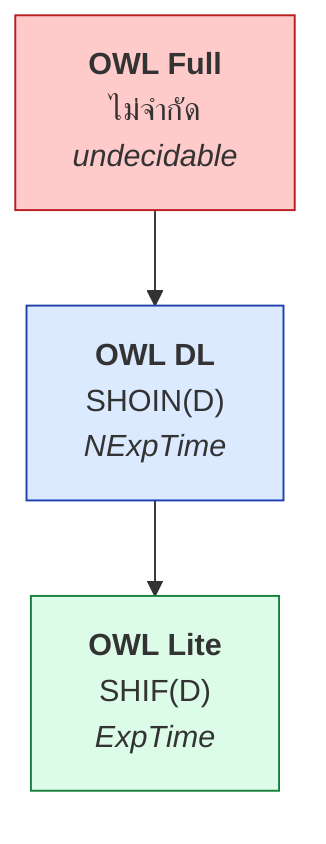
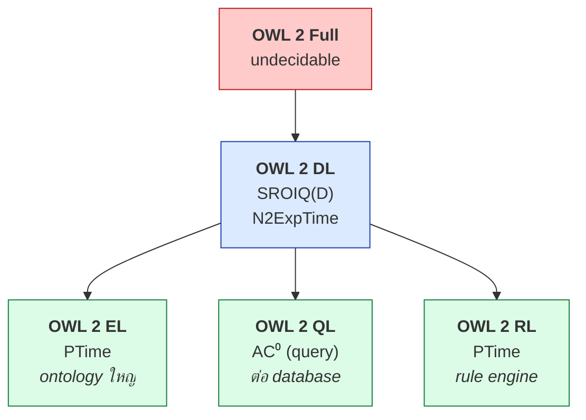
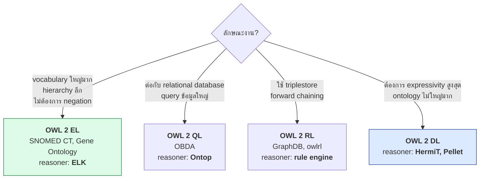
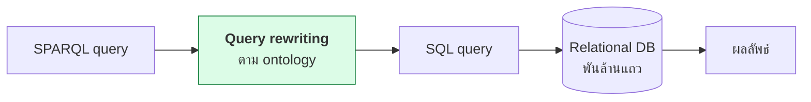

# 08.01 OWL Species และ Profiles

**OWL (Web Ontology Language)** เป็น W3C Recommendation ที่ให้ความสามารถเหนือ RDFS อย่างมาก
แต่มาพร้อมกับการเลือกว่าจะใช้ "แค่ไหน" — เพราะยิ่ง expressive ยิ่งช้า
บทนี้อธิบาย **species ของ OWL 1**, **profiles ของ OWL 2** และวิธีเลือกให้เหมาะกับงาน

---

## ประวัติ

| ปี | เหตุการณ์ |
| --- | --- |
| 2004 | **OWL 1** เป็น W3C Recommendation — แบ่งเป็น Lite / DL / Full |
| 2009 | **OWL 2** เป็น W3C Recommendation — เพิ่ม profiles EL / QL / RL |
| 2012 | OWL 2 ฉบับปรับปรุงครั้งที่ 2 |

---

## OWL 1 Species



| Species | DL | Decidable | ข้อจำกัด |
| --- | --- | :---: | --- |
| **OWL Lite** | `SHIF(D)` | ✅ | cardinality ได้แค่ 0/1, ไม่มี `oneOf`, `unionOf`, `complementOf` |
| **OWL DL** | `SHOIN(D)` | ✅ | class/property/individual ต้องแยกกันชัด (ไม่มี punning) |
| **OWL Full** | — | ❌ | ไม่จำกัดอะไรเลย |

### ทำไม OWL Full จึง undecidable

```turtle
@prefix ex:  <http://example.org/> .
@prefix owl: <http://www.w3.org/2002/07/owl#> .

# ใน OWL Full ทำได้ทั้งหมดนี้ -- ใน OWL DL ทำไม่ได้
ex:Eagle a owl:Class .
ex:Eagle a ex:Species .              # class เป็น instance ของอีก class

owl:Class a owl:Class .              # metaclass ไม่จำกัดชั้น

ex:hasParent owl:sameAs ex:hasFather .   # sameAs กับ property
ex:Person owl:sameAs foaf:Person .        # sameAs กับ class

ex:someProperty a owl:Class .        # property เป็น class ด้วย
```

> ⚠️ **OWL Lite ไม่ได้ "ง่าย" อย่างที่ตั้งใจ** — ในทางปฏิบัติมันซับซ้อนเกือบเท่า OWL DL
> แต่แสดงอะไรได้น้อยกว่ามาก จึงแทบไม่มีใครใช้

---

## OWL 2

OWL 2 เพิ่มความสามารถหลายอย่างที่ OWL 1 ไม่มี

| ความสามารถใหม่ใน OWL 2 | ตัวอย่าง |
| --- | --- |
| **Qualified cardinality** | `owl:minQualifiedCardinality` + `owl:onClass` |
| **Property chain** | `owl:propertyChainAxiom` |
| **Reflexive/Irreflexive/Asymmetric property** | `owl:ReflexiveProperty` ฯลฯ |
| **Disjoint property** | `owl:propertyDisjointWith` |
| **Self restriction** | `owl:hasSelf` |
| **Negative property assertion** | `owl:NegativePropertyAssertion` |
| **Keys** | `owl:hasKey` |
| **Datatype restriction** | `owl:withRestrictions` + facet |
| **Punning** (จำกัด) | ชื่อเดียวเป็นทั้ง class และ individual ได้ |
| **Top/Bottom property** | `owl:topObjectProperty`, `owl:bottomObjectProperty` |

### OWL 2 Punning

```turtle
@prefix ex:  <http://example.org/> .
@prefix owl: <http://www.w3.org/2002/07/owl#> .

# ✅ OWL 2 DL อนุญาต -- ชื่อเดียวกันใช้เป็นทั้ง class และ individual
ex:Eagle a owl:Class .                       # ในฐานะ class
ex:Eddie a ex:Eagle .

ex:Eagle a owl:NamedIndividual ;             # ในฐานะ individual
    ex:conservationStatus "Least Concern" .

# ❌ แต่ยังห้าม: object property กับ datatype property ชื่อเดียวกัน
ex:name a owl:ObjectProperty , owl:DatatypeProperty .   # ผิด!
```

**Punning ต่างจาก OWL Full ตรงที่** reasoner มองว่าเป็น **สองสิ่งที่ไม่เกี่ยวกัน** ที่บังเอิญมีชื่อเดียวกัน
— ไม่ได้ทำให้ระบบ undecidable

---

## OWL 2 Profiles

**Profile** คือ subset ของ OWL 2 DL ที่ตัดความสามารถบางอย่างออกเพื่อแลกกับ **polynomial complexity**



### เปรียบเทียบ Profiles

| | **EL** | **QL** | **RL** | **DL** |
| --- | :---: | :---: | :---: | :---: |
| **Complexity** | PTime | AC⁰ (query) | PTime | N2ExpTime |
| `rdfs:subClassOf` | ✅ | ✅ | ✅ | ✅ |
| `owl:equivalentClass` | ✅ | ⚠️ จำกัด | ⚠️ จำกัด | ✅ |
| `owl:intersectionOf` | ✅ | ⚠️ | ✅ | ✅ |
| `owl:unionOf` | ❌ | ❌ | ⚠️ (ซ้าย) | ✅ |
| `owl:complementOf` | ❌ | ⚠️ | ⚠️ | ✅ |
| `owl:someValuesFrom` (∃) | ✅ | ✅ | ⚠️ | ✅ |
| `owl:allValuesFrom` (∀) | ❌ | ❌ | ⚠️ (ขวา) | ✅ |
| Cardinality | ❌ | ❌ | ⚠️ max 0/1 | ✅ |
| `owl:inverseOf` | ❌ | ✅ | ✅ | ✅ |
| `owl:TransitiveProperty` | ✅ | ❌ | ✅ | ✅ |
| `owl:FunctionalProperty` | ❌ | ❌ | ✅ | ✅ |
| `owl:oneOf` (nominal) | ✅ (singleton) | ❌ | ⚠️ | ✅ |
| `owl:propertyChainAxiom` | ✅ | ❌ | ✅ | ✅ |
| `owl:disjointWith` | ✅ | ✅ | ✅ | ✅ |
| `owl:hasKey` | ✅ | ❌ | ✅ | ✅ |

---

## เลือก Profile ไหน



### OWL 2 EL — สำหรับ vocabulary ขนาดใหญ่

**ตัดออก**: `¬`, `⊔`, `∀r.C`, cardinality, inverse property, functional property

```turtle
@prefix ex:  <http://example.org/> .
@prefix owl: <http://www.w3.org/2002/07/owl#> .
@prefix rdfs: <http://www.w3.org/2000/01/rdf-schema#> .

# ✅ อยู่ใน EL
ex:Pneumonia rdfs:subClassOf ex:LungDisease ,
    [ a owl:Restriction ;
      owl:onProperty     ex:hasLocation ;
      owl:someValuesFrom ex:Lung ] .

ex:BacterialPneumonia owl:equivalentClass [
    a owl:Class ;
    owl:intersectionOf (
        ex:Pneumonia
        [ a owl:Restriction ;
          owl:onProperty     ex:causedBy ;
          owl:someValuesFrom ex:Bacterium ]
    )
] .

ex:partOf a owl:TransitiveProperty .
ex:hasLocation owl:propertyChainAxiom ( ex:hasPart ex:hasLocation ) .

# ❌ ไม่อยู่ใน EL
ex:NonSmoker owl:equivalentClass [ owl:complementOf ex:Smoker ] .     # ¬
ex:Adult rdfs:subClassOf [ owl:onProperty ex:age ; owl:minCardinality 1 ] .  # cardinality
```

**ผลลัพธ์ที่จับต้องได้**: SNOMED CT มี **350,000+ concepts** และ ELK classify ได้ใน **ไม่กี่นาที**
ถ้าใช้ OWL 2 DL เต็มรูปแบบจะรันไม่ไหวเลย

### OWL 2 QL — สำหรับต่อกับ database

**จุดเด่น**: query ถูก **rewrite เป็น SQL** โดยไม่ต้อง materialize RDF เลย



**ตัดออก**: transitive property, cardinality, `oneOf`, property chain

**เครื่องมือ**: [Ontop](https://ontop-vkg.org/) — เชื่อม ontology กับ SQL database โดยตรง

### OWL 2 RL — สำหรับ triplestore

**จุดเด่น**: implement ด้วย **forward-chaining rule engine** ได้ทั้งหมด

```python
# owlrl ที่ใช้ตลอดคอร์สนี้คือ OWL 2 RL
import owlrl
owlrl.DeductiveClosure(owlrl.OWLRL_Semantics).expand(g)
```

**ข้อจำกัดที่สำคัญ**: axiom บางตัวใช้ได้เฉพาะ **ฝั่งซ้าย** หรือ **ฝั่งขวา** ของ `rdfs:subClassOf`

| Constructor | ฝั่งซ้าย (subclass) | ฝั่งขวา (superclass) |
| --- | :---: | :---: |
| `owl:intersectionOf` | ✅ | ✅ |
| `owl:unionOf` | ✅ | ❌ |
| `owl:someValuesFrom` | ✅ | ❌ |
| `owl:allValuesFrom` | ❌ | ✅ |
| `owl:maxCardinality 0/1` | ❌ | ✅ |

```turtle
# ✅ อยู่ใน RL -- someValuesFrom ฝั่งซ้าย
[ a owl:Restriction ; owl:onProperty ex:hasChild ; owl:someValuesFrom ex:Person ]
    rdfs:subClassOf ex:Parent .

# ❌ ไม่อยู่ใน RL -- someValuesFrom ฝั่งขวา
ex:Parent rdfs:subClassOf
    [ a owl:Restriction ; owl:onProperty ex:hasChild ; owl:someValuesFrom ex:Person ] .
```

---

## ตรวจว่า ontology ของคุณอยู่ profile ไหน

### วิธีที่ 1: Protégé

```
Ontology → Ontology metrics → OWL 2 profiles
```

Protégé แสดงว่าอยู่ใน profile ไหนบ้าง และถ้าไม่อยู่ **บอกว่า axiom ตัวไหนที่ทำให้หลุด**

### วิธีที่ 2: ROBOT CLI

```bash
robot validate-profile --input ontology.ttl --profile EL --output report.txt
robot validate-profile --input ontology.ttl --profile DL
```

### วิธีที่ 3: ตรวจเองด้วย SPARQL

```sparql
PREFIX owl: <http://www.w3.org/2002/07/owl#>

# หา axiom ที่ทำให้หลุดจาก OWL 2 EL
SELECT ?feature (COUNT(*) AS ?n)
WHERE {
  {
    ?s owl:complementOf ?o .
    BIND("complementOf (ไม่อยู่ใน EL)" AS ?feature)
  } UNION {
    ?s owl:unionOf ?o .
    BIND("unionOf (ไม่อยู่ใน EL)" AS ?feature)
  } UNION {
    ?s owl:allValuesFrom ?o .
    BIND("allValuesFrom (ไม่อยู่ใน EL)" AS ?feature)
  } UNION {
    ?s owl:inverseOf ?o .
    BIND("inverseOf (ไม่อยู่ใน EL)" AS ?feature)
  } UNION {
    { ?s owl:minCardinality ?o } UNION { ?s owl:maxCardinality ?o }
    UNION { ?s owl:cardinality ?o }
    BIND("cardinality (ไม่อยู่ใน EL)" AS ?feature)
  }
}
GROUP BY ?feature
```

รันบน `data/university.ttl` ได้:

| ?feature | ?n |
| --- | --- |
| `allValuesFrom (ไม่อยู่ใน EL)` | 1 |
| `inverseOf (ไม่อยู่ใน EL)` | 3 |
| `cardinality (ไม่อยู่ใน EL)` | 1 |

→ **University ontology ไม่อยู่ใน OWL 2 EL** เพราะมี `allValuesFrom`, `inverseOf` และ qualified cardinality

---

## OWL Header

```turtle
@prefix owl:     <http://www.w3.org/2002/07/owl#> .
@prefix rdf:     <http://www.w3.org/1999/02/22-rdf-syntax-ns#> .
@prefix rdfs:    <http://www.w3.org/2000/01/rdf-schema#> .
@prefix dcterms: <http://purl.org/dc/terms/> .
@prefix xsd:     <http://www.w3.org/2001/XMLSchema#> .
@prefix vann:    <http://purl.org/vocab/vann/> .

<http://example.org/library> a owl:Ontology ;
    dcterms:title       "Library Ontology"@en ;
    dcterms:description "An ontology for books, authors and loans."@en ;
    dcterms:creator     <https://orcid.org/0000-0002-1825-0097> ;
    dcterms:created     "2025-01-15"^^xsd:date ;
    dcterms:license     <https://creativecommons.org/licenses/by/4.0/> ;
    owl:versionInfo     "1.0.0" ;
    owl:versionIRI      <http://example.org/library/1.0.0> ;
    owl:priorVersion    <http://example.org/library/0.9.0> ;
    owl:imports         <http://xmlns.com/foaf/0.1/> ;
    vann:preferredNamespacePrefix "lib" ;
    vann:preferredNamespaceUri    "http://example.org/library#" ;
    rdfs:comment        "See https://example.org/library/docs for usage guide."@en .
```

---

## OWL vs RDFS: สรุปสิ่งที่เพิ่มเข้ามา

| ความสามารถ | RDFS | OWL |
| --- | :---: | :---: |
| Class hierarchy | ✅ | ✅ |
| Property hierarchy | ✅ | ✅ |
| Domain / Range | ✅ | ✅ |
| **Disjointness** | ❌ | ✅ |
| **Equivalence** | ❌ | ✅ |
| **Cardinality** | ❌ | ✅ |
| **Inverse property** | ❌ | ✅ |
| **Property characteristics** | ❌ | ✅ |
| **Class constructors** (`⊓ ⊔ ¬`) | ❌ | ✅ |
| **Restrictions** (`∃ ∀`) | ❌ | ✅ |
| **Identity** (`sameAs` / `differentFrom`) | ❌ | ✅ |
| **Property chain** | ❌ | ✅ (OWL 2) |
| **Keys** | ❌ | ✅ (OWL 2) |
| ตรวจ inconsistency | ❌ | ✅ |
| Automatic classification | ❌ | ✅ |

---

## Key Points

- **OWL 1**: Lite (`SHIF`) / DL (`SHOIN`) / Full (undecidable); **OWL Lite แทบไม่มีใครใช้** เพราะไม่ได้ง่ายจริง
- **OWL Full undecidable** เพราะอนุญาต metaclass ไม่จำกัดและ `owl:sameAs` กับ class/property
- **OWL 2** เพิ่ม qualified cardinality, property chain, reflexive/irreflexive/asymmetric, `hasSelf`, `hasKey` และ **punning แบบจำกัด**
- **OWL 2 Profiles** ตัด expressivity เพื่อแลก **polynomial complexity** — ไม่ใช่ของด้อยกว่า
- **EL** = vocabulary ใหญ่ (SNOMED CT 350k concepts, reasoner ELK); **QL** = ต่อ database (Ontop); **RL** = rule engine (owlrl, GraphDB)
- ⚠️ **OWL 2 RL จำกัดว่า constructor ใดใช้ได้ฝั่งซ้ายหรือขวาของ `subClassOf`**
- ตรวจ profile ได้ด้วย **Protégé** (Ontology metrics), **ROBOT** (`validate-profile`) หรือ SPARQL
- OWL เพิ่มจาก RDFS: **disjointness, equivalence, cardinality, inverse, characteristics, constructors, restrictions, identity**
