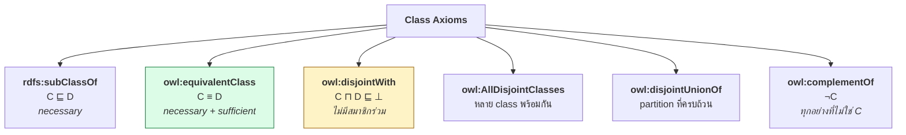
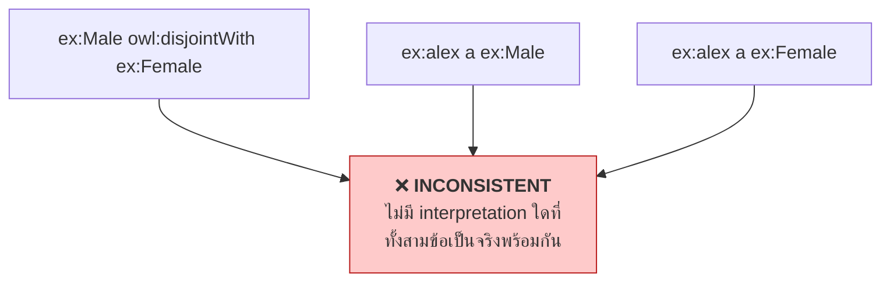
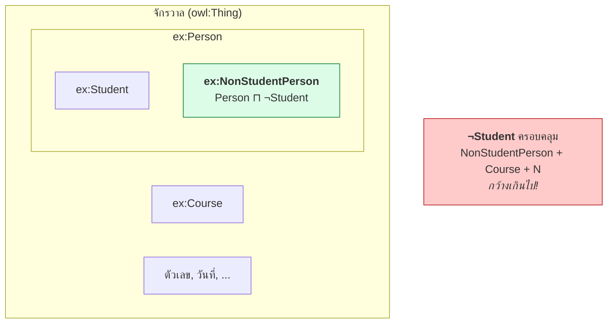

# 08.02 Class Axioms: equivalentClass, disjointWith, complementOf

บทนี้ครอบคลุม axiom ที่ใช้ประกาศ **ความสัมพันธ์ระหว่าง class** — สิ่งที่ RDFS ทำไม่ได้เลย
`owl:equivalentClass` ทำให้เกิด automatic classification, `owl:disjointWith` ทำให้ reasoner จับ error ได้
และ `owl:complementOf` เปิดประตูสู่การใช้ negation

---

## ภาพรวม



---

## `owl:equivalentClass`

### กรณีที่ 1: class สองตัวเท่ากัน

<table>
<tr><th width="50%">Full form</th><th width="50%">Shorthand</th></tr>
<tr valign="top">
<td>

```turtle
@prefix ex:   <http://example.org/> .
@prefix rdf:  <http://www.w3.org/1999/02/22-rdf-syntax-ns#> .
@prefix owl:  <http://www.w3.org/2002/07/owl#> .
@prefix foaf: <http://xmlns.com/foaf/0.1/> .

ex:Car rdf:type owl:Class .
ex:Automobile rdf:type owl:Class .
ex:Car owl:equivalentClass ex:Automobile .

ex:Person rdf:type owl:Class .
ex:Person owl:equivalentClass foaf:Person .
```

</td>
<td>

```turtle
@prefix ex:   <http://example.org/> .
@prefix rdf:  <http://www.w3.org/1999/02/22-rdf-syntax-ns#> .
@prefix owl:  <http://www.w3.org/2002/07/owl#> .
@prefix foaf: <http://xmlns.com/foaf/0.1/> .

ex:Car a owl:Class ;
    owl:equivalentClass ex:Automobile .

ex:Person a owl:Class ;
    owl:equivalentClass foaf:Person .
```

</td>
</tr>
</table>

**ผลของ reasoner**: ทุก instance ของ `ex:Car` เป็น instance ของ `ex:Automobile` และกลับกัน

```turtle
ex:myVehicle a ex:Car .
# → inferred: ex:myVehicle a ex:Automobile .
```

### กรณีที่ 2: defined class (สำคัญที่สุด)

```turtle
@prefix ex:  <http://example.org/> .
@prefix owl: <http://www.w3.org/2002/07/owl#> .

# Parent ≡ Person ⊓ ∃hasChild.Person
ex:Parent a owl:Class ;
    owl:equivalentClass [
        a owl:Class ;
        owl:intersectionOf (
            ex:Person
            [ a owl:Restriction ;
              owl:onProperty     ex:hasChild ;
              owl:someValuesFrom ex:Person ]
        )
    ] .
```

**นี่คือสิ่งที่ทำให้เกิด automatic classification** — รายละเอียดใน [05.02](../05-knowledge-management/05.02-tbox-deep.md)

### คุณสมบัติของ `owl:equivalentClass`

| คุณสมบัติ | ความหมาย |
| --- | --- |
| **Symmetric** | `A ≡ B` → `B ≡ A` |
| **Transitive** | `A ≡ B` และ `B ≡ C` → `A ≡ C` |
| **แปลงเป็น subClassOf** | `A ≡ B` เทียบเท่ากับ `A ⊑ B` และ `B ⊑ A` |

```turtle
# สองบรรทัดนี้เทียบเท่ากับ owl:equivalentClass
ex:Car rdfs:subClassOf ex:Automobile .
ex:Automobile rdfs:subClassOf ex:Car .
```

---

## `owl:disjointWith`

**ประกาศว่าสอง class ไม่มีสมาชิกร่วมกันเลย** — `C ⊓ D ⊑ ⊥`

```turtle
@prefix ex:  <http://example.org/> .
@prefix owl: <http://www.w3.org/2002/07/owl#> .

ex:Male   owl:disjointWith ex:Female .
ex:Student owl:disjointWith ex:Staff .
```

### ผลที่เกิดขึ้น

```turtle
ex:alex a ex:Male , ex:Female .
```

→ **reasoner รายงาน `OwlReadyInconsistentOntologyError`**



### ⚠️ `owl:disjointWith` เป็นสิ่งที่คนลืมมากที่สุด

**ถ้าไม่ประกาศ disjointness เลย reasoner จะจับ error อะไรไม่ได้เลย** — เพราะไม่มีทางเกิด contradiction

```turtle
# ❌ ontology ที่ไม่มี disjointness -- reasoner ตรวจอะไรไม่ได้
ex:Student rdfs:subClassOf ex:Person .
ex:Course  a owl:Class .

ex:cs101 a ex:Student , ex:Course .    # ผิดชัด ๆ แต่ reasoner ไม่ว่าอะไร

# ✅ เพิ่ม disjointness -- reasoner จับได้ทันที
ex:Person owl:disjointWith ex:Course .
```

> 💡 **หลักปฏิบัติ**: ประกาศ `owl:disjointWith` ระหว่าง **sibling class ทุกคู่** ที่ไม่ควรทับกัน
> เป็นการลงทุนที่คุ้มค่าที่สุดในการทำให้ ontology ตรวจ error ได้

### `owl:AllDisjointClasses`

เมื่อมี sibling หลายตัว การเขียน `owl:disjointWith` แบบคู่จะยาวมาก

```turtle
@prefix ex:  <http://example.org/> .
@prefix owl: <http://www.w3.org/2002/07/owl#> .

# ❌ ต้องเขียน n(n-1)/2 บรรทัด
ex:Solid  owl:disjointWith ex:Liquid , ex:Gas , ex:Plasma .
ex:Liquid owl:disjointWith ex:Gas , ex:Plasma .
ex:Gas    owl:disjointWith ex:Plasma .

# ✅ เขียนครั้งเดียว
[] a owl:AllDisjointClasses ;
   owl:members ( ex:Solid ex:Liquid ex:Gas ex:Plasma ) .
```

| จำนวน class | `disjointWith` | `AllDisjointClasses` |
| --- | --- | --- |
| 3 | 3 บรรทัด | 1 บล็อก |
| 5 | 10 บรรทัด | 1 บล็อก |
| 10 | **45 บรรทัด** | 1 บล็อก |
| 20 | **190 บรรทัด** | 1 บล็อก |

<table>
<tr><th width="50%">Full form</th><th width="50%">Shorthand</th></tr>
<tr valign="top">
<td>

```turtle
@prefix ex:  <http://example.org/> .
@prefix rdf: <http://www.w3.org/1999/02/22-rdf-syntax-ns#> .
@prefix owl: <http://www.w3.org/2002/07/owl#> .

_:d rdf:type owl:AllDisjointClasses .
_:d owl:members _:list1 .
_:list1 rdf:first ex:Solid .
_:list1 rdf:rest _:list2 .
_:list2 rdf:first ex:Liquid .
_:list2 rdf:rest _:list3 .
_:list3 rdf:first ex:Gas .
_:list3 rdf:rest rdf:nil .
```

</td>
<td>

```turtle
@prefix ex:  <http://example.org/> .
@prefix rdf: <http://www.w3.org/1999/02/22-rdf-syntax-ns#> .
@prefix owl: <http://www.w3.org/2002/07/owl#> .

[] a owl:AllDisjointClasses ;
   owl:members ( ex:Solid ex:Liquid ex:Gas ) .
```

</td>
</tr>
</table>

---

## `owl:disjointUnionOf`

**บอกว่า class หนึ่งแบ่งออกเป็นส่วนย่อยที่ครบถ้วนและไม่ทับกัน** (partition)

```turtle
@prefix ex:  <http://example.org/> .
@prefix owl: <http://www.w3.org/2002/07/owl#> .

ex:Person owl:disjointUnionOf ( ex:Male ex:Female ) .
```

เทียบเท่ากับ **4 axiom รวมกัน**:

```turtle
ex:Person owl:equivalentClass [ a owl:Class ; owl:unionOf ( ex:Male ex:Female ) ] .
ex:Male   rdfs:subClassOf ex:Person .
ex:Female rdfs:subClassOf ex:Person .
ex:Male   owl:disjointWith ex:Female .
```

### ผลที่เกิดขึ้น

```turtle
ex:alex a ex:Person .
ex:alex a [ a owl:Class ; owl:complementOf ex:Male ] .
# → inferred: ex:alex a ex:Female
```

**reasoner สรุปได้** เพราะรู้ว่า Person มีแค่สองแบบและ alex ไม่ใช่ Male

> ⚠️ **`disjointUnionOf` เป็นการปิดโลกบางส่วน** — บอกว่า "ไม่มีอะไรอื่นนอกจากที่ระบุ"
> ถ้าไม่แน่ใจว่า partition ครบจริง **อย่าใช้**

```turtle
# ❌ อันตราย -- ถ้ามีเพศอื่นที่ยังไม่ได้ระบุ ontology จะผิด
ex:Person owl:disjointUnionOf ( ex:Male ex:Female ) .

# ✅ ปลอดภัยกว่า -- บอกแค่ว่าไม่ทับกัน ไม่ได้บอกว่าครบ
ex:Male   rdfs:subClassOf ex:Person .
ex:Female rdfs:subClassOf ex:Person .
ex:Male   owl:disjointWith ex:Female .
```

---

## `owl:complementOf`

**ทุกอย่างที่ไม่ใช่ C** — `¬C`

```turtle
@prefix ex:  <http://example.org/> .
@prefix owl: <http://www.w3.org/2002/07/owl#> .

ex:NonStudent a owl:Class ;
    owl:equivalentClass [
        a owl:Class ;
        owl:complementOf ex:Student
    ] .
```

### ⚠️ กับดัก: complement ครอบคลุมทุกอย่างในจักรวาล

```turtle
ex:cs101 a ex:Course .
# → inferred: ex:cs101 a ex:NonStudent    (รายวิชาไม่ใช่นักศึกษา — ถูกแต่ไร้ประโยชน์)

ex:someNumber a xsd:integer .
# → ก็เป็น NonStudent เช่นกัน
```

**ในทางปฏิบัติต้องจำกัดขอบเขตด้วย `intersectionOf` เสมอ**

```turtle
# ✅ "คนที่ไม่ใช่นักศึกษา" -- ไม่ใช่ "ทุกอย่างที่ไม่ใช่นักศึกษา"
ex:NonStudentPerson a owl:Class ;
    owl:equivalentClass [
        a owl:Class ;
        owl:intersectionOf (
            ex:Person
            [ a owl:Class ; owl:complementOf ex:Student ]
        )
    ] .
```



### complementOf กับ disjointWith: เหมือนหรือต่าง

```turtle
# แบบที่ 1: disjointWith
ex:Male owl:disjointWith ex:Female .

# แบบที่ 2: subClassOf complementOf
ex:Male rdfs:subClassOf [ a owl:Class ; owl:complementOf ex:Female ] .

# ทั้งสองแบบให้ผลเหมือนกัน
```

| | `owl:disjointWith` | `subClassOf complementOf` |
| --- | --- | --- |
| อ่านง่าย | ✅ | ❌ |
| Symmetric โดยอัตโนมัติ | ✅ | ❌ (ต้องเขียนสองทาง) |
| อยู่ใน OWL 2 EL | ✅ | ❌ |
| แนะนำ | ✅ | ใช้เมื่อจำเป็นเท่านั้น |

---

## `owl:hasKey` (OWL 2)

**ประกาศว่า property ชุดหนึ่งระบุ individual ได้เฉพาะเจาะจง** — คล้าย primary key

```turtle
@prefix ex:  <http://example.org/> .
@prefix owl: <http://www.w3.org/2002/07/owl#> .

# studentId ระบุ Student ได้ตัวเดียว
ex:Student owl:hasKey ( ex:studentId ) .

# composite key: ภาควิชา + รหัสวิชา ระบุ Course ได้ตัวเดียว
ex:Course owl:hasKey ( ex:department ex:courseNumber ) .
```

```turtle
ex:alice   a ex:Student ; ex:studentId "S-001" .
ex:aJohnson a ex:Student ; ex:studentId "S-001" .
# → inferred: ex:alice owl:sameAs ex:aJohnson
```

### `owl:hasKey` vs `owl:InverseFunctionalProperty`

| | `owl:hasKey` | `InverseFunctionalProperty` |
| --- | --- | --- |
| ขอบเขต | เฉพาะ **named individual** ของ class ที่ระบุ | ทุก individual รวม anonymous |
| Composite key | ✅ หลาย property | ❌ ทีละ property |
| จำกัดตาม class | ✅ | ❌ |
| OWL version | 2 | 1 |

> 💡 **`owl:hasKey` ปลอดภัยกว่า** เพราะจำกัดขอบเขตอยู่ที่ named individual ของ class ที่ระบุ
> ทำให้ไม่เกิด `sameAs` ที่ไม่ตั้งใจกับ blank node

---

## ตัวอย่างเต็ม: Library ontology

<table>
<tr><th width="50%">Full form</th><th width="50%">Shorthand</th></tr>
<tr valign="top">
<td>

```turtle
@prefix lib:  <http://example.org/library#> .
@prefix rdf:  <http://www.w3.org/1999/02/22-rdf-syntax-ns#> .
@prefix rdfs: <http://www.w3.org/2000/01/rdf-schema#> .
@prefix owl:  <http://www.w3.org/2002/07/owl#> .

lib:Publication rdf:type owl:Class .

lib:Book rdf:type owl:Class .
lib:Book rdfs:subClassOf lib:Publication .

lib:Journal rdf:type owl:Class .
lib:Journal rdfs:subClassOf lib:Publication .

lib:Thesis rdf:type owl:Class .
lib:Thesis rdfs:subClassOf lib:Publication .

_:d rdf:type owl:AllDisjointClasses .
_:d owl:members _:l1 .
_:l1 rdf:first lib:Book .
_:l1 rdf:rest _:l2 .
_:l2 rdf:first lib:Journal .
_:l2 rdf:rest _:l3 .
_:l3 rdf:first lib:Thesis .
_:l3 rdf:rest rdf:nil .

lib:FictionBook rdf:type owl:Class .
lib:FictionBook rdfs:subClassOf lib:Book .
lib:NonFictionBook rdf:type owl:Class .
lib:NonFictionBook rdfs:subClassOf lib:Book .
lib:Book owl:disjointUnionOf _:l4 .
_:l4 rdf:first lib:FictionBook .
_:l4 rdf:rest _:l5 .
_:l5 rdf:first lib:NonFictionBook .
_:l5 rdf:rest rdf:nil .

lib:Book owl:hasKey _:l6 .
_:l6 rdf:first lib:isbn .
_:l6 rdf:rest rdf:nil .
```

</td>
<td>

```turtle
@prefix lib:  <http://example.org/library#> .
@prefix rdf:  <http://www.w3.org/1999/02/22-rdf-syntax-ns#> .
@prefix rdfs: <http://www.w3.org/2000/01/rdf-schema#> .
@prefix owl:  <http://www.w3.org/2002/07/owl#> .

lib:Publication a owl:Class .

lib:Book    a owl:Class ; rdfs:subClassOf lib:Publication .
lib:Journal a owl:Class ; rdfs:subClassOf lib:Publication .
lib:Thesis  a owl:Class ; rdfs:subClassOf lib:Publication .

# ทั้งสามไม่ทับกัน
[] a owl:AllDisjointClasses ;
   owl:members ( lib:Book lib:Journal lib:Thesis ) .

# Book แบ่งเป็นสองแบบพอดี
lib:FictionBook    a owl:Class ; rdfs:subClassOf lib:Book .
lib:NonFictionBook a owl:Class ; rdfs:subClassOf lib:Book .
lib:Book owl:disjointUnionOf ( lib:FictionBook lib:NonFictionBook ) .

# ISBN ระบุหนังสือได้เล่มเดียว
lib:Book owl:hasKey ( lib:isbn ) .

# หนังสือที่ยืมได้ = หนังสือที่ไม่ใช่ reference
lib:LoanableBook a owl:Class ;
    owl:equivalentClass [
        a owl:Class ;
        owl:intersectionOf (
            lib:Book
            [ a owl:Class ; owl:complementOf lib:ReferenceBook ]
        )
    ] .
```

</td>
</tr>
</table>

---

## ทดสอบด้วย Python

```python
from owlready2 import (
    AllDisjoint, Not, OwlReadyInconsistentOntologyError, Thing,
    get_ontology, sync_reasoner_hermit,
)

onto = get_ontology("http://example.org/library#")

with onto:
    class Publication(Thing): pass
    class Book(Publication): pass
    class Journal(Publication): pass
    class Thesis(Publication): pass

    AllDisjoint([Book, Journal, Thesis])

    class ReferenceBook(Book): pass

    class LoanableBook(Thing):
        equivalent_to = [Book & Not(ReferenceBook)]

    # ทดสอบ: หนังสือธรรมดา -> ควรเป็น LoanableBook
    b1 = Book("book1")
    b1.is_a.append(Not(ReferenceBook))

    # ทดสอบ: violate disjointness
    bad = Book("bad_item")

with onto:
    sync_reasoner_hermit(infer_property_values=True)

print("book1 types:", [c.name for c in b1.is_a if hasattr(c, "name")])

# ทำให้ inconsistent โดยตั้งใจ
with onto:
    bad.is_a.append(Journal)

try:
    with onto:
        sync_reasoner_hermit()
    print("consistent (ไม่คาดคิด)")
except OwlReadyInconsistentOntologyError:
    print("❌ INCONSISTENT — bad_item เป็นทั้ง Book และ Journal")
```

Expected output:

```
book1 types: ['LoanableBook']
❌ INCONSISTENT — bad_item เป็นทั้ง Book และ Journal
```

---

## Checklist

- [ ] ใช้ **`owl:equivalentClass`** สำหรับ defined class (เพื่อ automatic classification)
- [ ] ประกาศ **`owl:disjointWith`** ระหว่าง sibling ทุกคู่ที่ไม่ควรทับกัน
- [ ] ใช้ **`owl:AllDisjointClasses`** เมื่อมี sibling ≥ 3 ตัว
- [ ] ใช้ **`owl:disjointUnionOf`** เฉพาะเมื่อแน่ใจว่า partition ครบจริง
- [ ] ห่อ **`owl:complementOf`** ด้วย `owl:intersectionOf` เสมอเพื่อจำกัดขอบเขต
- [ ] ใช้ **`owl:hasKey`** สำหรับ business key แทน `InverseFunctionalProperty` ถ้าใช้ OWL 2

---

## Key Points

- **`owl:equivalentClass`** = `C ≡ D` (necessary + sufficient) — เป็นสิ่งที่ทำให้เกิด **automatic classification**
- **`owl:disjointWith`** = `C ⊓ D ⊑ ⊥` — เป็น axiom ที่สำคัญที่สุดสำหรับการตรวจ error
- ⚠️ **ontology ที่ไม่มี disjointness เลย reasoner จะจับ error อะไรไม่ได้เลย**
- **`owl:AllDisjointClasses`** ประหยัดกว่ามากเมื่อมี sibling หลายตัว (20 ตัว → 1 บล็อก แทน 190 บรรทัด)
- **`owl:disjointUnionOf`** = union + subclass + disjoint รวมกัน — **ปิดโลกบางส่วน** ใช้เมื่อแน่ใจเท่านั้น
- ⚠️ **`owl:complementOf` ครอบคลุมทุกอย่างในจักรวาล** — ต้องห่อด้วย `owl:intersectionOf` เสมอ
- **`owl:hasKey`** (OWL 2) รองรับ composite key และจำกัดขอบเขตอยู่ที่ named individual — ปลอดภัยกว่า `InverseFunctionalProperty`
