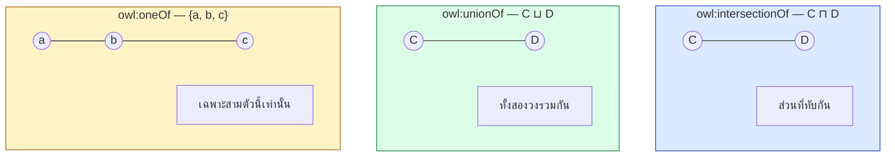
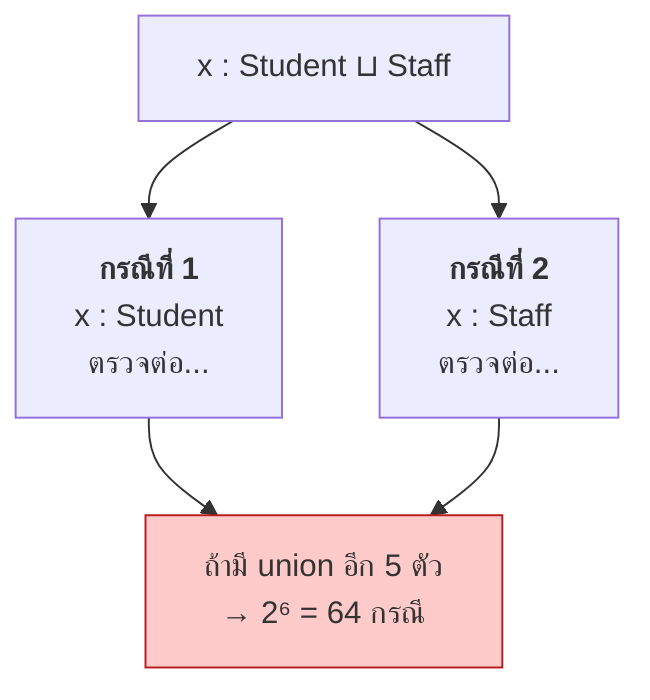
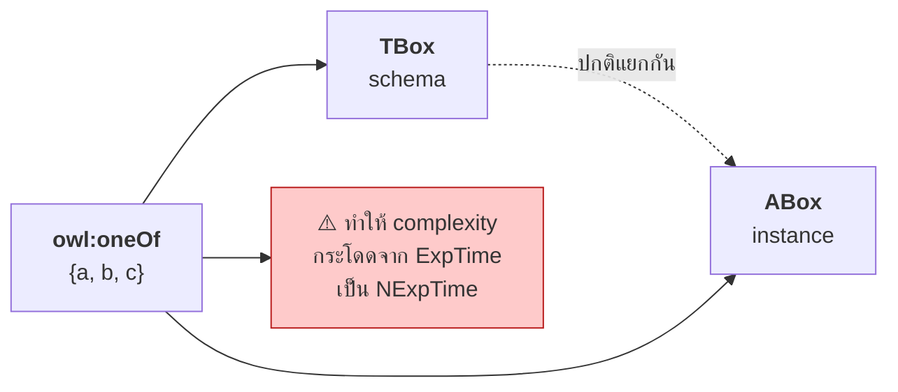
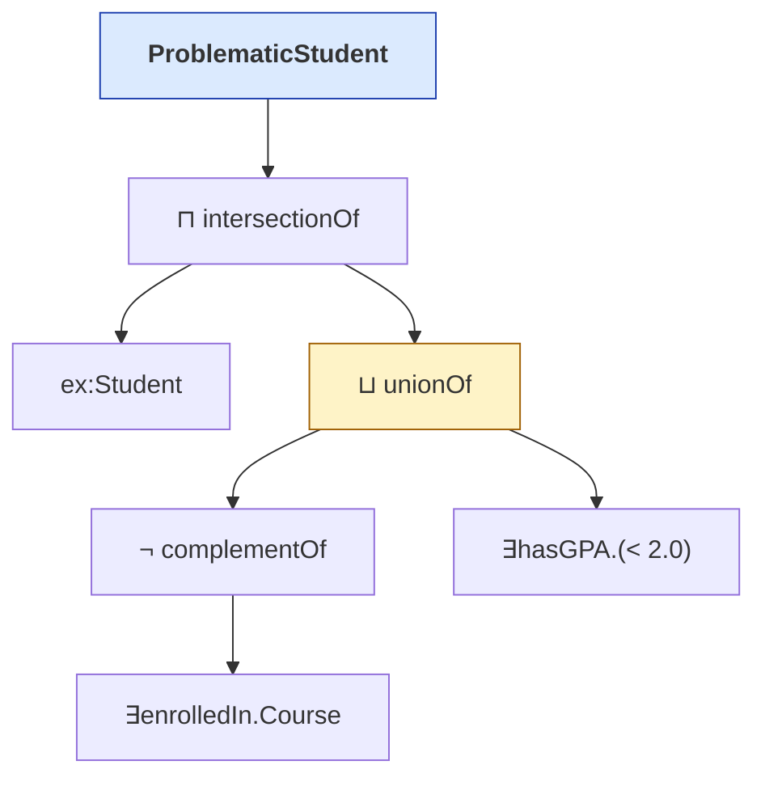

# 08.03 Class Constructors: intersectionOf, unionOf, oneOf

**Class constructor** คือกลไกที่ให้สร้าง class ใหม่จาก class ที่มีอยู่ — เป็นความสามารถที่ RDFS ไม่มีเลย
บทนี้ครอบคลุม `owl:intersectionOf` (`⊓`), `owl:unionOf` (`⊔`) และ `owl:oneOf` (`{a,b,c}`)
พร้อมการซ้อนกันเป็น class expression ที่ซับซ้อน

---

## ภาพรวม

| Constructor | DL | ความหมายเชิงเซต | ตัวอย่าง |
| --- | --- | --- | --- |
| `owl:intersectionOf` | `C ⊓ D` | `C ∩ D` | Person ⊓ Female = ผู้หญิง |
| `owl:unionOf` | `C ⊔ D` | `C ∪ D` | Student ⊔ Staff = สมาชิกมหาวิทยาลัย |
| `owl:complementOf` | `¬C` | `Δ \ C` | ¬Student |
| `owl:oneOf` | `{a, b, c}` | เซตที่ระบุสมาชิกครบ | {mon, tue, wed, thu, fri} |



---

## `owl:intersectionOf`

**ใช้บ่อยที่สุด** — เป็นแกนของ defined class เกือบทุกตัว

<table>
<tr><th width="50%">Full form</th><th width="50%">Shorthand</th></tr>
<tr valign="top">
<td>

```turtle
@prefix ex:  <http://example.org/> .
@prefix rdf: <http://www.w3.org/1999/02/22-rdf-syntax-ns#> .
@prefix owl: <http://www.w3.org/2002/07/owl#> .

ex:Woman rdf:type owl:Class .
ex:Woman owl:equivalentClass _:c1 .
_:c1 rdf:type owl:Class .
_:c1 owl:intersectionOf _:l1 .
_:l1 rdf:first ex:Person .
_:l1 rdf:rest _:l2 .
_:l2 rdf:first ex:Female .
_:l2 rdf:rest rdf:nil .
```

**11 บรรทัด**

</td>
<td>

```turtle
@prefix ex:  <http://example.org/> .
@prefix rdf: <http://www.w3.org/1999/02/22-rdf-syntax-ns#> .
@prefix owl: <http://www.w3.org/2002/07/owl#> .

ex:Woman a owl:Class ;
    owl:equivalentClass [
        a owl:Class ;
        owl:intersectionOf ( ex:Person ex:Female )
    ] .
```

**5 บรรทัด**

</td>
</tr>
</table>

### ผสมกับ restriction

```turtle
@prefix ex:  <http://example.org/> .
@prefix owl: <http://www.w3.org/2002/07/owl#> .
@prefix xsd: <http://www.w3.org/2001/XMLSchema#> .

# Mother ≡ Woman ⊓ ∃hasChild.Person
ex:Mother a owl:Class ;
    owl:equivalentClass [
        a owl:Class ;
        owl:intersectionOf (
            ex:Woman
            [ a owl:Restriction ;
              owl:onProperty     ex:hasChild ;
              owl:someValuesFrom ex:Person ]
        )
    ] .

# BusyProfessor ≡ Professor ⊓ (≥3 teaches.Course)
ex:BusyProfessor a owl:Class ;
    owl:equivalentClass [
        a owl:Class ;
        owl:intersectionOf (
            ex:Professor
            [ a owl:Restriction ;
              owl:onProperty              ex:teaches ;
              owl:minQualifiedCardinality "3"^^xsd:nonNegativeInteger ;
              owl:onClass                 ex:Course ]
        )
    ] .
```

### intersectionOf หลายตัว

```turtle
# HonorsGraduateStudent ≡ Student ⊓ ∃enrolledIn.GradCourse ⊓ ∃hasGPA.{x | x ≥ 3.5}
ex:HonorsGraduateStudent a owl:Class ;
    owl:equivalentClass [
        a owl:Class ;
        owl:intersectionOf (
            ex:Student
            [ a owl:Restriction ;
              owl:onProperty     ex:enrolledIn ;
              owl:someValuesFrom ex:GraduateCourse ]
            [ a owl:Restriction ;
              owl:onProperty     ex:hasGPA ;
              owl:someValuesFrom [
                  a rdfs:Datatype ;
                  owl:onDatatype xsd:decimal ;
                  owl:withRestrictions ( [ xsd:minInclusive "3.5"^^xsd:decimal ] )
              ] ]
        )
    ] .
```

---

## `owl:unionOf`

```turtle
@prefix ex:  <http://example.org/> .
@prefix owl: <http://www.w3.org/2002/07/owl#> .

ex:UniversityMember a owl:Class ;
    owl:equivalentClass [
        a owl:Class ;
        owl:unionOf ( ex:Student ex:Staff ex:Visitor )
    ] .
```

### Use case: กำหนด domain/range แบบ union

```turtle
# ปัญหา: rdfs:domain หลายค่า = intersection ไม่ใช่ union (ดู 03.04)
ex:involvedIn rdfs:domain ex:Student ;
              rdfs:domain ex:Professor .    # ❌ ต้องเป็นทั้งสองอย่างพร้อมกัน!

# ✅ วิธีที่ถูก
ex:involvedIn rdfs:domain [
    a owl:Class ;
    owl:unionOf ( ex:Student ex:Professor )
] .
```

### ⚠️ `unionOf` ทำให้ reasoning ช้าลงมาก

reasoner ต้อง **แตกกรณี (case split)** ทุกครั้งที่เจอ union



**นี่คือเหตุผลที่ OWL 2 EL ตัด `unionOf` ออก** — เพื่อให้ได้ polynomial complexity

> 💡 **ถ้าเลี่ยงได้ให้เลี่ยง** — มักปรับเป็น class hierarchy ได้แทน

```turtle
# แทนที่จะใช้ unionOf
ex:UniversityMember owl:equivalentClass [ owl:unionOf ( ex:Student ex:Staff ) ] .

# ใช้ hierarchy แทน (ถ้าความหมายยอมรับได้)
ex:Student rdfs:subClassOf ex:UniversityMember .
ex:Staff   rdfs:subClassOf ex:UniversityMember .
```

| | `unionOf` | `subClassOf` hierarchy |
| --- | --- | --- |
| ความหมาย | Member **คือ** Student หรือ Staff เท่านั้น | Student และ Staff **เป็น** Member (อาจมีอย่างอื่นอีก) |
| Reasoning | ช้า (case split) | เร็ว |
| อยู่ใน EL | ❌ | ✅ |
| อนุมานย้อนกลับได้ | ✅ | ❌ |

---

## `owl:oneOf` — Enumerated Class (Nominal)

**ระบุสมาชิกทั้งหมดของ class อย่างครบถ้วน**

<table>
<tr><th width="50%">Full form</th><th width="50%">Shorthand</th></tr>
<tr valign="top">
<td>

```turtle
@prefix ex:  <http://example.org/> .
@prefix rdf: <http://www.w3.org/1999/02/22-rdf-syntax-ns#> .
@prefix owl: <http://www.w3.org/2002/07/owl#> .

ex:Weekday rdf:type owl:Class .
ex:Weekday owl:equivalentClass _:c1 .
_:c1 rdf:type owl:Class .
_:c1 owl:oneOf _:l1 .
_:l1 rdf:first ex:monday .
_:l1 rdf:rest _:l2 .
_:l2 rdf:first ex:tuesday .
_:l2 rdf:rest _:l3 .
_:l3 rdf:first ex:wednesday .
_:l3 rdf:rest _:l4 .
_:l4 rdf:first ex:thursday .
_:l4 rdf:rest _:l5 .
_:l5 rdf:first ex:friday .
_:l5 rdf:rest rdf:nil .
```

</td>
<td>

```turtle
@prefix ex:  <http://example.org/> .
@prefix rdf: <http://www.w3.org/1999/02/22-rdf-syntax-ns#> .
@prefix owl: <http://www.w3.org/2002/07/owl#> .

ex:Weekday a owl:Class ;
    owl:equivalentClass [
        a owl:Class ;
        owl:oneOf ( ex:monday ex:tuesday ex:wednesday
                    ex:thursday ex:friday )
    ] .
```

</td>
</tr>
</table>

### ผลของ `oneOf`

```turtle
ex:someDay a ex:Weekday .
ex:someDay owl:differentFrom ex:monday , ex:tuesday , ex:wednesday , ex:thursday .
# → inferred: ex:someDay owl:sameAs ex:friday
```

**reasoner สรุปได้** เพราะรู้ว่า Weekday มีสมาชิกแค่ 5 ตัวและตัดออกไปแล้ว 4 ตัว

### Use case ที่เหมาะสม

```turtle
@prefix ex:  <http://example.org/> .
@prefix owl: <http://www.w3.org/2002/07/owl#> .

# ค่าที่เป็นไปได้จำกัดและคงที่
ex:BloodType a owl:Class ;
    owl:equivalentClass [
        a owl:Class ;
        owl:oneOf ( ex:typeA ex:typeB ex:typeAB ex:typeO )
    ] .

ex:Gender a owl:Class ;
    owl:equivalentClass [
        a owl:Class ; owl:oneOf ( ex:male ex:female ex:other )
    ] .

ex:AcademicStatus a owl:Class ;
    owl:equivalentClass [
        a owl:Class ;
        owl:oneOf ( ex:enrolled ex:graduated ex:suspended ex:withdrawn )
    ] .
```

### ⚠️ Nominal ทำให้ reasoning แพงมาก

`owl:oneOf` เชื่อม **TBox เข้ากับ ABox** — reasoner ต้องพิจารณา individual เฉพาะเจาะจงตอนทำ TBox reasoning



**นี่คือเหตุผลที่ `SHOIN` (มี `O` = nominal) เป็น NExpTime แต่ `SHIN` เป็น ExpTime**

> 💡 **ทางเลือกที่เบากว่า**: ถ้าไม่ต้องการให้ reasoner สรุปย้อนกลับ ใช้ **SKOS concept scheme** แทน

```turtle
@prefix skos: <http://www.w3.org/2004/02/skos/core#> .

ex:BloodTypeScheme a skos:ConceptScheme .
ex:typeA a skos:Concept ; skos:inScheme ex:BloodTypeScheme .
ex:typeB a skos:Concept ; skos:inScheme ex:BloodTypeScheme .
# ... ไม่มีผลต่อ reasoning แต่เพียงพอสำหรับการจัดหมวดหมู่
```

---

## `owl:hasValue` — Nominal แบบ singleton

```turtle
@prefix ex:  <http://example.org/> .
@prefix owl: <http://www.w3.org/2002/07/owl#> .

# FrenchPerson ≡ Person ⊓ ∃nationality.{France}
ex:FrenchPerson a owl:Class ;
    owl:equivalentClass [
        a owl:Class ;
        owl:intersectionOf (
            ex:Person
            [ a owl:Restriction ;
              owl:onProperty ex:nationality ;
              owl:hasValue   ex:France ]
        )
    ] .
```

เทียบเท่ากับ

```turtle
[ a owl:Restriction ;
  owl:onProperty     ex:nationality ;
  owl:someValuesFrom [ a owl:Class ; owl:oneOf ( ex:France ) ] ]
```

> 💡 **`owl:hasValue` อยู่ใน OWL 2 EL** ในขณะที่ `owl:oneOf` ทั่วไปไม่อยู่
> เพราะ singleton nominal ไม่ทำให้ complexity ระเบิด

---

## Class Expression ซ้อนกัน

```turtle
@prefix ex:  <http://example.org/> .
@prefix owl: <http://www.w3.org/2002/07/owl#> .
@prefix xsd: <http://www.w3.org/2001/XMLSchema#> .

# ProblematicStudent ≡ Student ⊓ ( (¬∃enrolledIn.Course) ⊔ (∃hasGPA.{x | x < 2.0}) )
# "นักศึกษาที่ไม่ได้ลงเรียนอะไรเลย หรือ GPA ต่ำกว่า 2.0"
ex:ProblematicStudent a owl:Class ;
    owl:equivalentClass [
        a owl:Class ;
        owl:intersectionOf (
            ex:Student
            [ a owl:Class ;
              owl:unionOf (
                  # ไม่ได้ลงเรียนอะไรเลย
                  [ a owl:Class ;
                    owl:complementOf [
                        a owl:Restriction ;
                        owl:onProperty     ex:enrolledIn ;
                        owl:someValuesFrom ex:Course ] ]
                  # หรือ GPA ต่ำกว่า 2.0
                  [ a owl:Restriction ;
                    owl:onProperty     ex:hasGPA ;
                    owl:someValuesFrom [
                        a rdfs:Datatype ;
                        owl:onDatatype xsd:decimal ;
                        owl:withRestrictions ( [ xsd:maxExclusive "2.0"^^xsd:decimal ] ) ] ]
              ) ]
        )
    ] .
```



> ⚠️ **class expression ที่ซ้อนลึกอ่านยากมาก** — ใช้ **Manchester Syntax** ใน Protégé แทน

```
Class: ProblematicStudent
    EquivalentTo:
        Student and (
            (not (enrolledIn some Course))
            or (hasGPA some decimal[< 2.0])
        )
```

---

## Datatype Restriction (OWL 2)

```turtle
@prefix ex:   <http://example.org/> .
@prefix owl:  <http://www.w3.org/2002/07/owl#> .
@prefix rdfs: <http://www.w3.org/2000/01/rdf-schema#> .
@prefix xsd:  <http://www.w3.org/2001/XMLSchema#> .

# ค่า GPA ที่ถูกต้อง: 0.0 ≤ x ≤ 4.0
ex:ValidGPA a rdfs:Datatype ;
    owl:onDatatype xsd:decimal ;
    owl:withRestrictions (
        [ xsd:minInclusive "0.0"^^xsd:decimal ]
        [ xsd:maxInclusive "4.0"^^xsd:decimal ]
    ) .

ex:hasGPA rdfs:range ex:ValidGPA .

# รหัสนักศึกษาที่ตรง pattern
ex:StudentIdFormat a rdfs:Datatype ;
    owl:onDatatype xsd:string ;
    owl:withRestrictions ( [ xsd:pattern "^S-[0-9]{4}-[0-9]{4}$" ] ) .
```

### Facet ที่ใช้ได้

| Facet | ใช้กับ | ตัวอย่าง |
| --- | --- | --- |
| `xsd:minInclusive` / `xsd:maxInclusive` | ตัวเลข, วันที่ | `[ xsd:minInclusive 0 ]` |
| `xsd:minExclusive` / `xsd:maxExclusive` | ตัวเลข, วันที่ | `[ xsd:maxExclusive "2.0"^^xsd:decimal ]` |
| `xsd:length` / `xsd:minLength` / `xsd:maxLength` | string | `[ xsd:maxLength 20 ]` |
| `xsd:pattern` | string | `[ xsd:pattern "^[A-Z]{2}[0-9]{4}$" ]` |
| `rdf:langRange` | langString | `[ rdf:langRange "en" ]` |

> ⚠️ **HermiT ไม่รองรับ facet ทุกตัว** และ reasoner หลายตัวจัดการ datatype restriction ได้จำกัด
> ถ้าต้องการ validate ค่าจริงจัง **ใช้ SHACL แทน** (ดู [07.06](../07-python-semantic-web/07.06-pyshacl.md))

---

## เปรียบเทียบ Turtle กับ Manchester Syntax

| Turtle (shorthand) | Manchester |
| --- | --- |
| `owl:intersectionOf ( A B )` | `A and B` |
| `owl:unionOf ( A B )` | `A or B` |
| `owl:complementOf A` | `not A` |
| `owl:oneOf ( a b c )` | `{a, b, c}` |
| `owl:onProperty r ; owl:someValuesFrom C` | `r some C` |
| `owl:onProperty r ; owl:allValuesFrom C` | `r only C` |
| `owl:onProperty r ; owl:hasValue a` | `r value a` |
| `owl:minQualifiedCardinality n ; owl:onClass C` | `r min n C` |

**ตัวอย่างเดียวกัน**

```turtle
# Turtle
ex:Mother owl:equivalentClass [
    a owl:Class ;
    owl:intersectionOf (
        ex:Woman
        [ a owl:Restriction ; owl:onProperty ex:hasChild ; owl:someValuesFrom ex:Person ]
    )
] .
```

```
Class: Mother
    EquivalentTo: Woman and (hasChild some Person)
```

---

## Key Points

- **`owl:intersectionOf` (`⊓`)** ใช้บ่อยที่สุด — เป็นแกนของ defined class เกือบทุกตัว
- **`owl:unionOf` (`⊔`)** ทำให้ reasoner ต้อง **แตกกรณี** → ช้ามาก และไม่อยู่ใน OWL 2 EL
- ถ้าเลี่ยง `unionOf` ได้ ให้ใช้ **class hierarchy** แทน (แต่ความหมายต่างกัน: hierarchy ไม่ปิดโลก)
- **`owl:oneOf` (nominal)** ระบุสมาชิกครบถ้วน — ทำให้ reasoner สรุปย้อนกลับได้ แต่ **แพงมาก**
- Nominal เชื่อม **TBox เข้ากับ ABox** — เป็นเหตุผลที่ `SHOIN` เป็น NExpTime แต่ `SHIN` เป็น ExpTime
- **`owl:hasValue`** = singleton nominal — เบากว่ามากและ **อยู่ใน OWL 2 EL**
- `owl:unionOf` แก้ปัญหา `rdfs:domain` หลายค่าที่เป็น intersection ได้
- **Datatype restriction** (`owl:withRestrictions` + facet) มีจำกัดในทางปฏิบัติ — **ใช้ SHACL แทนถ้าต้องการ validate จริงจัง**
- Class expression ซ้อนลึกอ่านยากใน Turtle — ใช้ **Manchester Syntax** ใน Protégé
