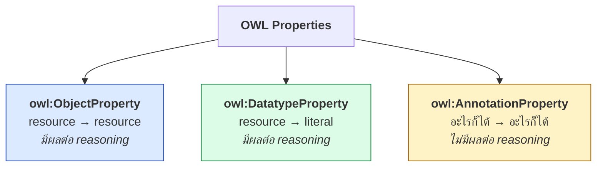
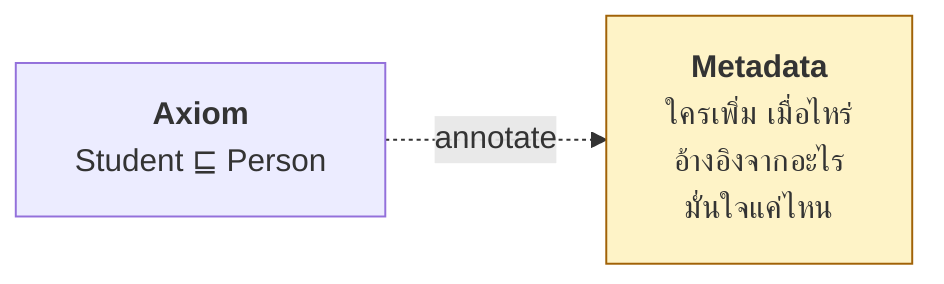

# 08.04 Property Types: Object, Datatype และ Annotation

OWL แบ่ง property ออกเป็น **3 ชนิดที่แยกกันเด็ดขาด** ต่างจาก RDFS ที่มี `rdf:Property` แบบเดียว
การแยกนี้จำเป็นสำหรับ decidability และเป็นข้อผิดพลาดที่พบบ่อยเมื่อประกาศผิดชนิด

---

## สามชนิด



| | Object | Datatype | Annotation |
| --- | --- | --- | --- |
| **Range** | resource (IRI) | literal | อะไรก็ได้ |
| **มีผลต่อ reasoning** | ✅ | ✅ | ❌ |
| **ใช้ใน restriction ได้** | ✅ | ✅ | ❌ |
| **มี characteristics ได้** | ✅ ครบทุกตัว | ⚠️ เฉพาะ functional | ❌ |
| **มี inverse ได้** | ✅ | ❌ | ❌ |
| **มี domain/range** | ✅ | ✅ | ⚠️ ไม่มีผล |
| **ตัวอย่าง** | `foaf:knows` | `foaf:name` | `rdfs:label` |

---

## `owl:ObjectProperty`

เชื่อม **resource กับ resource**

<table>
<tr><th width="50%">Full form</th><th width="50%">Shorthand</th></tr>
<tr valign="top">
<td>

```turtle
@prefix ex:   <http://example.org/> .
@prefix rdf:  <http://www.w3.org/1999/02/22-rdf-syntax-ns#> .
@prefix rdfs: <http://www.w3.org/2000/01/rdf-schema#> .
@prefix owl:  <http://www.w3.org/2002/07/owl#> .

ex:enrolledIn rdf:type owl:ObjectProperty .
ex:enrolledIn rdfs:label "enrolled in"@en .
ex:enrolledIn rdfs:comment "Relates a student to a course."@en .
ex:enrolledIn rdfs:domain ex:Student .
ex:enrolledIn rdfs:range ex:Course .
ex:enrolledIn rdfs:subPropertyOf ex:involvedIn .
```

</td>
<td>

```turtle
@prefix ex:   <http://example.org/> .
@prefix rdf:  <http://www.w3.org/1999/02/22-rdf-syntax-ns#> .
@prefix rdfs: <http://www.w3.org/2000/01/rdf-schema#> .
@prefix owl:  <http://www.w3.org/2002/07/owl#> .

ex:enrolledIn a owl:ObjectProperty ;
    rdfs:label         "enrolled in"@en ;
    rdfs:comment       "Relates a student to a course."@en ;
    rdfs:domain        ex:Student ;
    rdfs:range         ex:Course ;
    rdfs:subPropertyOf ex:involvedIn .
```

</td>
</tr>
</table>

### Object property พิเศษของ OWL 2

```turtle
@prefix owl: <http://www.w3.org/2002/07/owl#> .

owl:topObjectProperty        # เชื่อมทุกคู่ของ individual
owl:bottomObjectProperty     # ไม่เชื่ออะไรเลย
```

```turtle
# ทุก object property เป็น subproperty ของ topObjectProperty โดยปริยาย
ex:enrolledIn rdfs:subPropertyOf owl:topObjectProperty .

# ใช้ประกาศว่า property นี้ห้ามมีค่าเลย
ex:deprecatedRelation rdfs:subPropertyOf owl:bottomObjectProperty .
```

---

## `owl:DatatypeProperty`

เชื่อม **resource กับ literal**

```turtle
@prefix ex:   <http://example.org/> .
@prefix rdfs: <http://www.w3.org/2000/01/rdf-schema#> .
@prefix owl:  <http://www.w3.org/2002/07/owl#> .
@prefix xsd:  <http://www.w3.org/2001/XMLSchema#> .

ex:studentId a owl:DatatypeProperty , owl:FunctionalProperty ;
    rdfs:label  "student ID"@en ;
    rdfs:domain ex:Student ;
    rdfs:range  xsd:string .

ex:gpa a owl:DatatypeProperty , owl:FunctionalProperty ;
    rdfs:label  "grade point average"@en ;
    rdfs:domain ex:Student ;
    rdfs:range  xsd:decimal .

ex:credits a owl:DatatypeProperty ;
    rdfs:domain ex:Course ;
    rdfs:range  xsd:integer .
```

### Datatype property ทำอะไรได้บ้าง

| Characteristic | ใช้กับ Datatype property ได้ไหม |
| --- | :---: |
| `owl:FunctionalProperty` | ✅ |
| `owl:InverseFunctionalProperty` | ⚠️ OWL 2 DL อนุญาต, OWL 1 DL ไม่อนุญาต |
| `owl:TransitiveProperty` | ❌ |
| `owl:SymmetricProperty` | ❌ |
| `owl:inverseOf` | ❌ |
| `owl:propertyChainAxiom` | ❌ |
| ใช้ใน cardinality restriction | ✅ |
| ใช้ใน `someValuesFrom` / `allValuesFrom` | ✅ (กับ datatype) |

```turtle
# ✅ datatype property ใน restriction
ex:AdultStudent a owl:Class ;
    owl:equivalentClass [
        a owl:Class ;
        owl:intersectionOf (
            ex:Student
            [ a owl:Restriction ;
              owl:onProperty     ex:age ;
              owl:someValuesFrom [
                  a rdfs:Datatype ;
                  owl:onDatatype xsd:integer ;
                  owl:withRestrictions ( [ xsd:minInclusive 18 ] ) ] ]
        )
    ] .
```

### Top/Bottom data property

```turtle
owl:topDataProperty       # เชื่อม individual กับ literal ทุกตัว
owl:bottomDataProperty    # ไม่เชื่ออะไรเลย
```

---

## ⚠️ ห้ามประกาศเป็นทั้งสองชนิด

```turtle
# ❌ ผิด -- ทำให้หลุดจาก OWL 2 DL
ex:name a owl:ObjectProperty , owl:DatatypeProperty .
```

**เหตุผล**: ถ้า property เดียวเชื่อมได้ทั้ง resource และ literal จะทำให้ reasoning ซับซ้อนจนไม่ decidable

### ข้อผิดพลาดที่พบบ่อย

```turtle
# ❌ ผิด: ประกาศเป็น ObjectProperty แต่ใช้กับ literal
ex:hasName a owl:ObjectProperty .
ex:alice ex:hasName "Alice Johnson" .        # → หลุดจาก OWL DL

# ❌ ผิด: ประกาศเป็น DatatypeProperty แต่ใช้กับ resource
ex:worksAt a owl:DatatypeProperty .
ex:alice ex:worksAt ex:csDept .              # → หลุดจาก OWL DL

# ✅ ถูก
ex:hasName a owl:DatatypeProperty ; rdfs:range xsd:string .
ex:worksAt a owl:ObjectProperty  ; rdfs:range ex:Organization .
```

### ตรวจด้วย SPARQL

```sparql
PREFIX owl: <http://www.w3.org/2002/07/owl#>
PREFIX rdf: <http://www.w3.org/1999/02/22-rdf-syntax-ns#>

# หา property ที่ประกาศเป็นทั้งสองชนิด
SELECT ?p WHERE {
  ?p a owl:ObjectProperty , owl:DatatypeProperty .
}

# หา ObjectProperty ที่ถูกใช้กับ literal
SELECT ?p ?s ?o WHERE {
  ?p a owl:ObjectProperty .
  ?s ?p ?o .
  FILTER(isLiteral(?o))
}

# หา DatatypeProperty ที่ถูกใช้กับ IRI
SELECT ?p ?s ?o WHERE {
  ?p a owl:DatatypeProperty .
  ?s ?p ?o .
  FILTER(isIRI(?o))
}
```

---

## `owl:AnnotationProperty`

**ไม่มีผลต่อ reasoning เลย** — ใช้สำหรับ metadata ที่มนุษย์อ่าน

```turtle
@prefix ex:      <http://example.org/> .
@prefix rdfs:    <http://www.w3.org/2000/01/rdf-schema#> .
@prefix owl:     <http://www.w3.org/2002/07/owl#> .
@prefix dcterms: <http://purl.org/dc/terms/> .
@prefix skos:    <http://www.w3.org/2004/02/skos/core#> .

# annotation property ที่ OWL กำหนดไว้แล้ว
rdfs:label
rdfs:comment
rdfs:seeAlso
rdfs:isDefinedBy
owl:versionInfo
owl:deprecated
owl:backwardCompatibleWith
owl:incompatibleWith
owl:priorVersion

# ประกาศ annotation property ของตัวเอง
ex:reviewedBy a owl:AnnotationProperty ;
    rdfs:label "reviewed by"@en .

ex:confidenceScore a owl:AnnotationProperty ;
    rdfs:label "confidence score"@en .

ex:sourceSystem a owl:AnnotationProperty .
```

### ใช้งาน

```turtle
ex:Student a owl:Class ;
    rdfs:label       "Student"@en ;
    rdfs:comment     "A person enrolled in a degree programme."@en ;
    skos:example     "ex:alice is a Student."@en ;
    ex:reviewedBy    "Dr. Jane Smith" ;
    ex:confidenceScore 0.95 ;
    owl:versionInfo  "added in 1.0.0" ;
    rdfs:isDefinedBy <http://example.org/university> .
```

### Annotation บน axiom (OWL 2)

สามารถ annotate **axiom** ไม่ใช่แค่ entity

```turtle
@prefix ex:  <http://example.org/> .
@prefix owl: <http://www.w3.org/2002/07/owl#> .
@prefix rdfs: <http://www.w3.org/2000/01/rdf-schema#> .
@prefix xsd: <http://www.w3.org/2001/XMLSchema#> .

# axiom ปกติ
ex:Student rdfs:subClassOf ex:Person .

# annotate axiom นั้น
[] a owl:Axiom ;
   owl:annotatedSource   ex:Student ;
   owl:annotatedProperty rdfs:subClassOf ;
   owl:annotatedTarget   ex:Person ;
   rdfs:comment          "Based on university regulation 2024/15."@en ;
   ex:reviewedBy         "Dr. Jane Smith" ;
   ex:confidenceScore    "0.98"^^xsd:decimal ;
   dcterms:created       "2025-01-15"^^xsd:date .
```



**Use case**: บันทึก provenance ของ axiom ที่มาจากการสกัดอัตโนมัติหรือจากผู้เชี่ยวชาญคนละคน

---

## ⚠️ Annotation property ห้ามใช้ใน restriction

```turtle
# ❌ ผิด -- annotation property ใช้ใน restriction ไม่ได้
ex:WellDocumentedClass owl:equivalentClass [
    a owl:Restriction ;
    owl:onProperty     rdfs:comment ;
    owl:someValuesFrom xsd:string
] .
```

**เหตุผล**: annotation property ไม่มี semantics ทางตรรกะ reasoner จึงตีความไม่ได้

**ถ้าต้องการตรวจว่า class มี comment ครบ → ใช้ SHACL**

```turtle
@prefix sh:   <http://www.w3.org/ns/shacl#> .
@prefix owl:  <http://www.w3.org/2002/07/owl#> .
@prefix rdfs: <http://www.w3.org/2000/01/rdf-schema#> .

ex:DocumentedClassShape a sh:NodeShape ;
    sh:targetClass owl:Class ;
    sh:property [
        sh:path     rdfs:label ;
        sh:minCount 1 ;
        sh:message  "ทุก class ต้องมี rdfs:label" ;
    ] ;
    sh:property [
        sh:path     rdfs:comment ;
        sh:minCount 1 ;
        sh:severity sh:Warning ;
        sh:message  "ควรมี rdfs:comment" ;
    ] .
```

---

## Property Declaration ที่สมบูรณ์

```turtle
@prefix ex:   <http://example.org/university#> .
@prefix rdf:  <http://www.w3.org/1999/02/22-rdf-syntax-ns#> .
@prefix rdfs: <http://www.w3.org/2000/01/rdf-schema#> .
@prefix owl:  <http://www.w3.org/2002/07/owl#> .
@prefix xsd:  <http://www.w3.org/2001/XMLSchema#> .
@prefix skos: <http://www.w3.org/2004/02/skos/core#> .

ex:hasSupervisor a owl:ObjectProperty ,
                   owl:FunctionalProperty ,
                   owl:AsymmetricProperty ,
                   owl:IrreflexiveProperty ;
    # --- annotation ---
    rdfs:label   "has supervisor"@en , "มีอาจารย์ที่ปรึกษา"@th ;
    rdfs:comment """Relates a graduate student to their academic supervisor.
Each student has at most one primary supervisor; use ex:hasCoSupervisor
for additional advisors."""@en ;
    skos:example "ex:alice ex:hasSupervisor ex:profSmith ."@en ;
    rdfs:isDefinedBy <http://example.org/university> ;
    owl:versionInfo  "added in 1.0.0" ;

    # --- semantics ---
    rdfs:domain  ex:GraduateStudent ;
    rdfs:range   ex:Professor ;
    owl:inverseOf ex:supervises ;
    rdfs:subPropertyOf ex:hasAdvisor ;
    owl:propertyDisjointWith ex:supervises .
```

**Checklist ของ property ที่ประกาศครบถ้วน**

- [ ] ระบุชนิด (`ObjectProperty` / `DatatypeProperty` / `AnnotationProperty`)
- [ ] `rdfs:label` พร้อม language tag
- [ ] `rdfs:comment` ที่บอก **ขอบเขต** และ **กรณีที่ไม่ใช้**
- [ ] `rdfs:domain` และ `rdfs:range` (ให้กว้างที่สุดเท่าที่ยังจริง)
- [ ] `owl:inverseOf` ถ้ามีความสัมพันธ์กลับ
- [ ] characteristics ที่เหมาะสม
- [ ] `rdfs:isDefinedBy`

---

## Property Hierarchy ข้ามชนิด

```turtle
# ❌ ผิด -- object property เป็น subproperty ของ datatype property ไม่ได้
ex:worksAt a owl:ObjectProperty ;
    rdfs:subPropertyOf ex:employerName .    # ex:employerName เป็น DatatypeProperty

# ✅ ถูก -- ต้องเป็นชนิดเดียวกัน
ex:worksAt a owl:ObjectProperty ;
    rdfs:subPropertyOf ex:affiliatedWith .  # ObjectProperty เหมือนกัน
```

---

## ตรวจสอบด้วย Python

```python
from rdflib import Graph
from rdflib.namespace import OWL, RDF, RDFS

g = Graph().parse("data/university.ttl", format="turtle")

object_props = set(g.subjects(RDF.type, OWL.ObjectProperty))
data_props = set(g.subjects(RDF.type, OWL.DatatypeProperty))
annot_props = set(g.subjects(RDF.type, OWL.AnnotationProperty))

print(f"ObjectProperty     : {len(object_props)}")
print(f"DatatypeProperty   : {len(data_props)}")
print(f"AnnotationProperty : {len(annot_props)}")

# ⚠️ ตรวจการประกาศซ้ำชนิด
both = object_props & data_props
if both:
    print(f"❌ ประกาศเป็นทั้งสองชนิด: {[str(p).split('#')[-1] for p in both]}")

# ⚠️ ตรวจการใช้ผิดชนิด
print("\nObjectProperty ที่ถูกใช้กับ literal:")
for prop in object_props:
    for s, o in g.subject_objects(prop):
        if hasattr(o, "datatype") or hasattr(o, "language"):
            print(f"  {str(prop).split('#')[-1]}: {o!r}")
            break

print("\nDatatypeProperty ที่ถูกใช้กับ IRI:")
for prop in data_props:
    for s, o in g.subject_objects(prop):
        if str(o).startswith("http"):
            print(f"  {str(prop).split('#')[-1]}: {o}")
            break

# ตรวจ property ที่ไม่ได้ประกาศชนิด
all_used = set(g.predicates())
declared = object_props | data_props | annot_props
undeclared = {
    p for p in all_used - declared
    if str(p).startswith("http://example.org/")
}
if undeclared:
    print(f"\n⚠️ ใช้แต่ไม่ได้ประกาศชนิด: {[str(p).split('#')[-1] for p in undeclared]}")
```

Expected output (บน `data/university.ttl`):

```
ObjectProperty     : 14
DatatypeProperty   : 6
AnnotationProperty : 0
```

---

## Key Points

- OWL แบ่ง property เป็น **3 ชนิดที่แยกกันเด็ดขาด**: Object (→ resource), Datatype (→ literal), Annotation (ไม่มีผลต่อ reasoning)
- ⚠️ **ห้ามประกาศ property เป็นทั้ง Object และ Datatype** — ทำให้หลุดจาก OWL 2 DL
- ⚠️ **ใช้ ObjectProperty กับ literal หรือ DatatypeProperty กับ IRI** ก็ทำให้หลุดจาก OWL DL เช่นกัน
- **Datatype property มีได้แค่ `FunctionalProperty`** (และ `InverseFunctionalProperty` ใน OWL 2 DL) — ไม่มี transitive, symmetric, inverse
- **Annotation property ไม่มีผลต่อ reasoning** และ **ใช้ใน restriction ไม่ได้** — ถ้าต้องการตรวจให้ใช้ SHACL
- OWL 2 รองรับ **annotation บน axiom** ผ่าน `owl:Axiom` + `owl:annotatedSource/Property/Target` — ใช้เก็บ provenance
- `owl:topObjectProperty` / `owl:bottomObjectProperty` (และเวอร์ชัน data) เป็น property พิเศษของ OWL 2
- **Property hierarchy ต้องอยู่ในชนิดเดียวกัน** — object property เป็น subproperty ของ datatype property ไม่ได้
