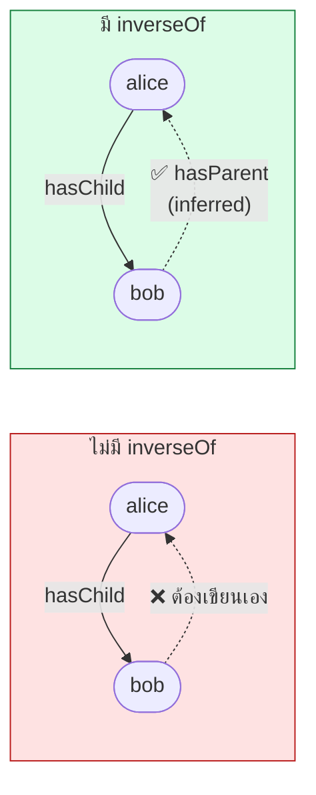
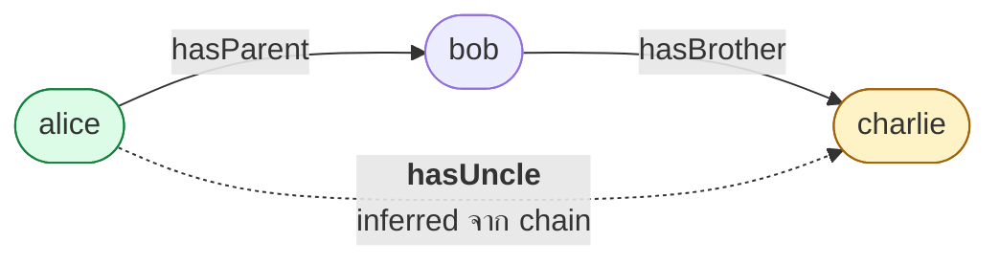
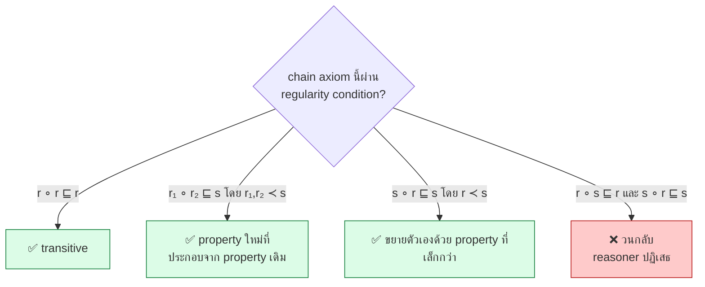

# 08.05 Property Axioms: equivalentProperty, inverseOf และ Property Chain

บทนี้ครอบคลุม axiom ที่ประกาศ **ความสัมพันธ์ระหว่าง property** — `owl:equivalentProperty`,
`owl:inverseOf`, `owl:propertyDisjointWith` และ **`owl:propertyChainAxiom`**
ซึ่งเป็นความสามารถใหม่ของ OWL 2 ที่ทรงพลังที่สุดตัวหนึ่ง

---

## ภาพรวม

| Axiom | DL | ความหมาย |
| --- | --- | --- |
| `rdfs:subPropertyOf` | `r ⊑ s` | ทุก r เป็น s |
| `owl:equivalentProperty` | `r ≡ s` | r กับ s เหมือนกันทุกประการ |
| `owl:inverseOf` | `r ≡ s⁻` | r เป็นตรงข้ามกับ s |
| `owl:propertyDisjointWith` | `r ⊓ s ⊑ ⊥` | ใช้พร้อมกันไม่ได้ |
| `owl:AllDisjointProperties` | — | หลาย property disjoint กัน |
| `owl:propertyChainAxiom` | `r ∘ s ⊑ t` | เดินตาม r แล้ว s = t |

---

## `owl:equivalentProperty`

```turtle
@prefix ex:   <http://example.org/> .
@prefix owl:  <http://www.w3.org/2002/07/owl#> .
@prefix foaf: <http://xmlns.com/foaf/0.1/> .

ex:worksAt owl:equivalentProperty ex:employedBy .
ex:fullName owl:equivalentProperty foaf:name .
```

**ผลของ reasoner** — triple ถูก merge ทั้งสองทิศทาง

```turtle
ex:alice ex:worksAt ex:acme .
# → inferred: ex:alice ex:employedBy ex:acme .

ex:bob ex:employedBy ex:acme .
# → inferred: ex:bob ex:worksAt ex:acme .
```

### เทียบเท่ากับ subPropertyOf สองทาง

```turtle
ex:worksAt    rdfs:subPropertyOf ex:employedBy .
ex:employedBy rdfs:subPropertyOf ex:worksAt .
# = ex:worksAt owl:equivalentProperty ex:employedBy .
```

### Use case: vocabulary alignment

```turtle
@prefix ex:      <http://example.org/> .
@prefix owl:     <http://www.w3.org/2002/07/owl#> .
@prefix foaf:    <http://xmlns.com/foaf/0.1/> .
@prefix schema:  <https://schema.org/> .
@prefix dcterms: <http://purl.org/dc/terms/> .

# เชื่อม vocabulary ของเรากับมาตรฐาน
ex:personName  owl:equivalentProperty foaf:name , schema:name .
ex:createdDate owl:equivalentProperty dcterms:created .
ex:hasEmail    owl:equivalentProperty schema:email .
```

> ⚠️ **ใช้ `equivalentProperty` เมื่อความหมายตรงกัน 100% เท่านั้น**
> ถ้าไม่แน่ใจ ใช้ `rdfs:subPropertyOf` ทางเดียวจะปลอดภัยกว่า

| สถานการณ์ | ใช้ |
| --- | --- |
| ความหมายตรงกันทุกประการ | `owl:equivalentProperty` |
| ของเราเป็นกรณีเฉพาะของมาตรฐาน | `rdfs:subPropertyOf` (ของเรา → มาตรฐาน) |
| มาตรฐานเป็นกรณีเฉพาะของเรา | `rdfs:subPropertyOf` (มาตรฐาน → ของเรา) |
| คล้ายกันแต่ไม่แน่ใจ | `rdfs:seeAlso` หรือ `skos:closeMatch` |

---

## `owl:inverseOf`

```turtle
@prefix ex:  <http://example.org/> .
@prefix owl: <http://www.w3.org/2002/07/owl#> .

ex:hasChild   owl:inverseOf ex:hasParent .
ex:teaches    owl:inverseOf ex:taughtBy .
ex:enrolledIn owl:inverseOf ex:hasStudent .
ex:supervises owl:inverseOf ex:hasSupervisor .
```

**ผลของ reasoner**

```turtle
ex:alice ex:hasChild ex:bob .
# → inferred: ex:bob ex:hasParent ex:alice .

ex:profSmith ex:teaches ex:cs501 .
# → inferred: ex:cs501 ex:taughtBy ex:profSmith .
```



### คุณสมบัติ

| คุณสมบัติ | รายละเอียด |
| --- | --- |
| **Symmetric** | `r inverseOf s` → `s inverseOf r` (ไม่ต้องเขียนสองครั้ง) |
| ใช้กับ ObjectProperty เท่านั้น | ❌ DatatypeProperty ใช้ไม่ได้ |
| domain/range สลับกัน | `r` domain = `s` range และกลับกัน |

```turtle
ex:teaches   rdfs:domain ex:Professor ; rdfs:range  ex:Course .
ex:taughtBy  owl:inverseOf ex:teaches .
# → inferred: ex:taughtBy rdfs:domain ex:Course ; rdfs:range ex:Professor .
```

### Anonymous inverse property (OWL 2)

ไม่ต้องตั้งชื่อ property กลับก็ใช้ได้

```turtle
@prefix ex:  <http://example.org/> .
@prefix owl: <http://www.w3.org/2002/07/owl#> .

# Parent ≡ ∃hasChild⁻.Person  -- "คนที่มีคนอื่นมี hasChild มาหา"
ex:ChildOfSomeone a owl:Class ;
    owl:equivalentClass [
        a owl:Restriction ;
        owl:onProperty     [ owl:inverseOf ex:hasChild ] ;
        owl:someValuesFrom ex:Person
    ] .
```

### ⚠️ Inverse ทำให้ reasoning แพงขึ้น

reasoner ต้องขยายกราฟ **สองทิศทาง** ทำให้ search space โตขึ้นมาก
— เป็นเหตุผลที่ตัวอักษร `I` เพิ่ม complexity ใน DL family และ **OWL 2 EL ไม่มี inverse**

> 💡 **ทางเลือกที่เบากว่า**: ถ้าแค่ต้องการ query ย้อนกลับ ใช้ **property path `^p`** ใน SPARQL แทน

```sparql
# ไม่ต้องมี owl:inverseOf ใน ontology
SELECT ?student WHERE {
  uni:cs101 ^uni:enrolledIn ?student .
}
```

---

## `owl:propertyDisjointWith`

```turtle
@prefix ex:  <http://example.org/> .
@prefix owl: <http://www.w3.org/2002/07/owl#> .

ex:hasParent owl:propertyDisjointWith ex:hasChild .
ex:teaches   owl:propertyDisjointWith ex:enrolledIn .
```

```turtle
ex:alice ex:hasParent ex:bob .
ex:alice ex:hasChild  ex:bob .
# → ❌ INCONSISTENT
```

### `owl:AllDisjointProperties`

```turtle
[] a owl:AllDisjointProperties ;
   owl:members ( ex:hasParent ex:hasChild ex:hasSibling ex:hasSpouse ) .
```

### ⚠️ ใช้ได้เฉพาะ simple role

```turtle
# ❌ ผิด -- transitive property ไม่ใช่ simple role
ex:hasAncestor a owl:TransitiveProperty .
ex:hasAncestor owl:propertyDisjointWith ex:hasDescendant .
```

ทบทวนจาก [05.06](../05-knowledge-management/05.06-rbox.md): **simple role** = ไม่ได้เกิดจาก role chain หรือ transitive property

---

## `owl:propertyChainAxiom` (OWL 2)

**ความสามารถที่ทรงพลังที่สุดของ OWL 2** — บอกว่าการเดินตาม property หลายตัวต่อกันเทียบเท่ากับ property อีกตัว

```
r₁ ∘ r₂ ∘ ... ∘ rₙ ⊑ s
```

<table>
<tr><th width="50%">Full form</th><th width="50%">Shorthand</th></tr>
<tr valign="top">
<td>

```turtle
@prefix ex:  <http://example.org/> .
@prefix rdf: <http://www.w3.org/1999/02/22-rdf-syntax-ns#> .
@prefix owl: <http://www.w3.org/2002/07/owl#> .

ex:hasUncle rdf:type owl:ObjectProperty .
ex:hasUncle owl:propertyChainAxiom _:c1 .
_:c1 rdf:first ex:hasParent .
_:c1 rdf:rest _:c2 .
_:c2 rdf:first ex:hasBrother .
_:c2 rdf:rest rdf:nil .
```

</td>
<td>

```turtle
@prefix ex:  <http://example.org/> .
@prefix rdf: <http://www.w3.org/1999/02/22-rdf-syntax-ns#> .
@prefix owl: <http://www.w3.org/2002/07/owl#> .

ex:hasUncle a owl:ObjectProperty ;
    owl:propertyChainAxiom ( ex:hasParent ex:hasBrother ) .
```

</td>
</tr>
</table>

### ตัวอย่างการทำงาน

```turtle
ex:alice ex:hasParent  ex:bob .
ex:bob   ex:hasBrother ex:charlie .
# → inferred: ex:alice ex:hasUncle ex:charlie .
```



### ตัวอย่างที่ใช้จริง

```turtle
@prefix ex:  <http://example.org/> .
@prefix owl: <http://www.w3.org/2002/07/owl#> .

# --- 1) ตำแหน่งที่ตั้งซ้อนกัน ---
# "อยู่ในสิ่งที่อยู่ใน X" = "อยู่ใน X"
ex:locatedIn owl:propertyChainAxiom ( ex:locatedIn ex:partOf ) .

# --- 2) หน่วยงานข้ามระดับ ---
ex:memberOfFaculty owl:propertyChainAxiom ( ex:memberOf ex:partOf ) .

# --- 3) ปู่ย่าตายาย ---
ex:hasGrandparent owl:propertyChainAxiom ( ex:hasParent ex:hasParent ) .

# --- 4) อาจารย์ผู้สอนของนักศึกษา ---
ex:instructorOf owl:propertyChainAxiom ( ex:teaches ex:hasStudent ) .

# --- 5) ยาที่รักษาโรคที่เกิดจากเชื้อ ---
ex:treatsPathogen owl:propertyChainAxiom ( ex:treats ex:causedBy ) .

# --- 6) chain ยาว 3 ตัว ---
ex:hasGreatGrandparent owl:propertyChainAxiom
    ( ex:hasParent ex:hasParent ex:hasParent ) .

# --- 7) ใช้ inverse ใน chain ---
ex:hasSiblingViaParent owl:propertyChainAxiom
    ( ex:hasParent [ owl:inverseOf ex:hasParent ] ) .
```

### ตัวอย่างจริงจาก University ontology

จาก [`code/ch05/university_tbox.ttl`](../code/ch05/university_tbox.ttl):

```turtle
uni:instructorOf a owl:ObjectProperty ;
    rdfs:comment "A professor is an instructor of every student enrolled in a course they teach."@en ;
    owl:propertyChainAxiom ( uni:teaches uni:hasStudent ) .
```

ผลจากการรัน HermiT จริง:

```
* Owlready * Adding relation university.profSmith instructorOf university.alice
* Owlready * Adding relation university.profSmith instructorOf university.bob
* Owlready * Adding relation university.profSmith instructorOf university.carol
* Owlready * Adding relation university.profJones instructorOf university.carol
```

---

## Transitive property คือ chain แบบพิเศษ

```turtle
# สองบรรทัดนี้เทียบเท่ากัน
ex:partOf a owl:TransitiveProperty .
ex:partOf owl:propertyChainAxiom ( ex:partOf ex:partOf ) .
```

**แต่ควรใช้ `owl:TransitiveProperty`** เพราะ:

- อ่านง่ายกว่า
- reasoner optimize ได้ดีกว่า
- อยู่ใน OWL 2 EL

---

## ⚠️ Regularity Condition

OWL 2 DL จำกัดรูปแบบของ role chain เพื่อคง decidability

### รูปแบบที่อนุญาต

| รูปแบบ | ตัวอย่าง |
| --- | --- |
| `s ∘ s ⊑ s` (transitive) | `partOf ∘ partOf ⊑ partOf` ✅ |
| `s⁻ ⊑ s` | `marriedTo⁻ ⊑ marriedTo` ✅ |
| `r₁ ∘ ... ∘ rₙ ⊑ s` โดยทุก `rᵢ ≺ s` | `hasParent ∘ hasBrother ⊑ hasUncle` ✅ |
| `s ∘ r₁ ∘ ... ∘ rₙ ⊑ s` โดยทุก `rᵢ ≺ s` | `locatedIn ∘ partOf ⊑ locatedIn` ✅ |
| `r₁ ∘ ... ∘ rₙ ∘ s ⊑ s` โดยทุก `rᵢ ≺ s` | `partOf ∘ locatedIn ⊑ locatedIn` ✅ |

โดย `≺` คือ **strict partial order** บน property

### ตัวอย่างที่ผิดกฎ

```turtle
# ❌ วนกลับ -- ไม่มี strict partial order ที่รองรับ
ex:r owl:propertyChainAxiom ( ex:s ex:r ) .
ex:s owl:propertyChainAxiom ( ex:r ex:s ) .
```

reasoner จะรายงาน **"non-simple role"** หรือ **"regularity violation"**



---

## Simple Role: ข้อจำกัดที่ตามมา

property ที่เกิดจาก **chain** หรือ **transitive** จะไม่ใช่ **simple role** และใช้กับสิ่งเหล่านี้ไม่ได้

| ใช้ไม่ได้กับ | ตัวอย่างที่ผิด |
| --- | --- |
| Cardinality restriction | `[ owl:onProperty ex:hasAncestor ; owl:maxCardinality 5 ]` ❌ |
| `owl:FunctionalProperty` | `ex:hasAncestor a owl:FunctionalProperty` ❌ |
| `owl:InverseFunctionalProperty` | ❌ |
| `owl:AsymmetricProperty` | ❌ |
| `owl:IrreflexiveProperty` | ❌ |
| `owl:propertyDisjointWith` | ❌ |
| `owl:hasSelf` | ❌ |

```turtle
# ❌ ผิด
ex:hasAncestor a owl:TransitiveProperty , owl:AsymmetricProperty .

# ✅ ถูก -- แยก property
ex:hasParent   a owl:AsymmetricProperty , owl:IrreflexiveProperty .
ex:hasAncestor a owl:TransitiveProperty .
ex:hasParent   rdfs:subPropertyOf ex:hasAncestor .
```

---

## ตัวอย่างเต็ม: Family ontology

```turtle
@prefix ex:   <http://example.org/family#> .
@prefix rdf:  <http://www.w3.org/1999/02/22-rdf-syntax-ns#> .
@prefix rdfs: <http://www.w3.org/2000/01/rdf-schema#> .
@prefix owl:  <http://www.w3.org/2002/07/owl#> .

# ===== base properties (simple roles) =====
ex:hasParent a owl:ObjectProperty ,
               owl:AsymmetricProperty ,
               owl:IrreflexiveProperty ;
    rdfs:domain ex:Person ;
    rdfs:range  ex:Person .

ex:hasChild a owl:ObjectProperty ;
    owl:inverseOf ex:hasParent .

ex:hasMother a owl:ObjectProperty , owl:FunctionalProperty ;
    rdfs:subPropertyOf ex:hasParent ;
    rdfs:range ex:Woman .

ex:hasFather a owl:ObjectProperty , owl:FunctionalProperty ;
    rdfs:subPropertyOf ex:hasParent ;
    rdfs:range ex:Man .

ex:hasSibling a owl:ObjectProperty , owl:SymmetricProperty , owl:IrreflexiveProperty .

ex:hasBrother a owl:ObjectProperty ;
    rdfs:subPropertyOf ex:hasSibling ;
    rdfs:range ex:Man .

ex:hasSister a owl:ObjectProperty ;
    rdfs:subPropertyOf ex:hasSibling ;
    rdfs:range ex:Woman .

ex:marriedTo a owl:ObjectProperty , owl:SymmetricProperty , owl:IrreflexiveProperty .

# ===== derived properties (non-simple roles) =====
ex:hasAncestor a owl:ObjectProperty , owl:TransitiveProperty .
ex:hasParent rdfs:subPropertyOf ex:hasAncestor .

ex:hasDescendant a owl:ObjectProperty , owl:TransitiveProperty ;
    owl:inverseOf ex:hasAncestor .

ex:hasGrandparent a owl:ObjectProperty ;
    owl:propertyChainAxiom ( ex:hasParent ex:hasParent ) .

ex:hasGrandmother a owl:ObjectProperty ;
    rdfs:subPropertyOf ex:hasGrandparent ;
    owl:propertyChainAxiom ( ex:hasParent ex:hasMother ) .

ex:hasUncle a owl:ObjectProperty ;
    owl:propertyChainAxiom ( ex:hasParent ex:hasBrother ) .

ex:hasAunt a owl:ObjectProperty ;
    owl:propertyChainAxiom ( ex:hasParent ex:hasSister ) .

ex:hasNephew a owl:ObjectProperty ;
    owl:propertyChainAxiom ( ex:hasSibling ex:hasChild ) .

ex:hasCousin a owl:ObjectProperty ;
    owl:propertyChainAxiom ( ex:hasParent ex:hasSibling ex:hasChild ) .

ex:hasStepMother a owl:ObjectProperty ;
    owl:propertyChainAxiom ( ex:hasFather ex:marriedTo ) .

# ===== disjointness =====
[] a owl:AllDisjointProperties ;
   owl:members ( ex:hasParent ex:hasChild ex:hasSibling ex:marriedTo ) .
```

### ทดสอบ

```turtle
ex:alice   ex:hasFather  ex:bob .
ex:bob     ex:hasBrother ex:charlie .
ex:bob     ex:hasMother  ex:diana .
ex:charlie ex:hasChild   ex:eve .
```

**reasoner อนุมาน**:

| Inferred triple | มาจาก |
| --- | --- |
| `ex:alice ex:hasParent ex:bob` | `hasFather ⊑ hasParent` |
| `ex:bob ex:hasChild ex:alice` | `hasChild ≡ hasParent⁻` |
| `ex:alice ex:hasUncle ex:charlie` | chain `hasParent ∘ hasBrother` |
| `ex:alice ex:hasGrandmother ex:diana` | chain `hasParent ∘ hasMother` |
| `ex:alice ex:hasGrandparent ex:diana` | `hasGrandmother ⊑ hasGrandparent` |
| `ex:alice ex:hasAncestor ex:bob , ex:diana` | `hasParent ⊑ hasAncestor` + transitive |
| `ex:charlie ex:hasSibling ex:bob` | symmetric |

---

## Key Points

- **`owl:equivalentProperty`** merge triple ทั้งสองทิศทาง — ใช้เมื่อความหมายตรงกัน 100% เท่านั้น
- **`owl:inverseOf`** เป็น **symmetric** (เขียนครั้งเดียวพอ) และใช้ได้เฉพาะ **ObjectProperty**
- Inverse ทำให้ reasoning แพงขึ้น — ถ้าแค่ query ย้อนกลับ ใช้ **property path `^p`** ใน SPARQL แทน
- **`owl:propertyChainAxiom`** (OWL 2) เป็นความสามารถที่ทรงพลังที่สุด — สร้าง property ใหม่จากการเดินตามหลาย property
- **Transitive property = chain แบบพิเศษ** (`r ∘ r ⊑ r`) แต่ควรใช้ `owl:TransitiveProperty` เพราะ optimize ได้ดีกว่า
- ⚠️ **Regularity condition** จำกัดรูปแบบ chain — chain ที่วนกลับจะถูก reasoner ปฏิเสธ
- ⚠️ **Non-simple role** (จาก chain/transitive) ใช้กับ **cardinality, functional, asymmetric, irreflexive, disjoint, hasSelf ไม่ได้**
- ทางแก้: **แยก property** — ให้ base property เป็น simple role และ derived property เป็น transitive/chain
