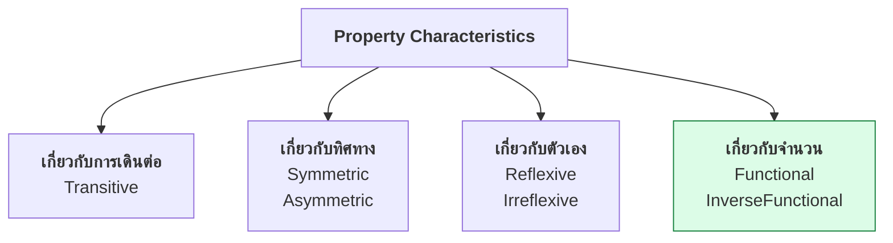
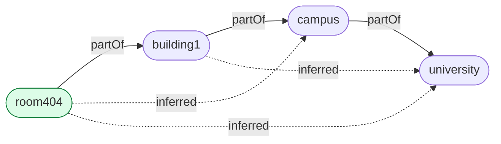
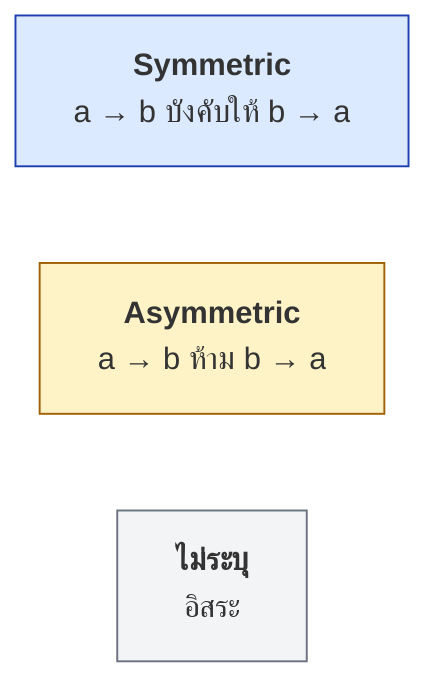
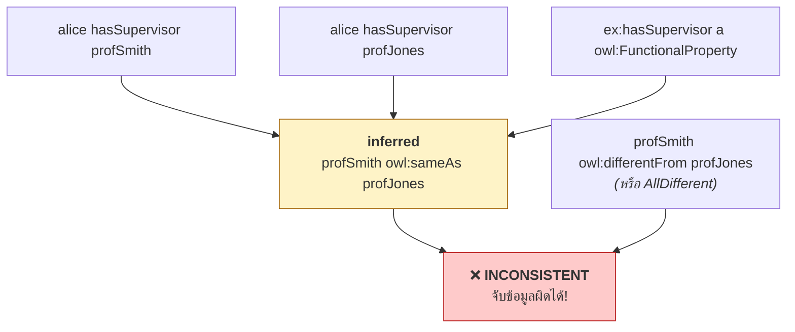
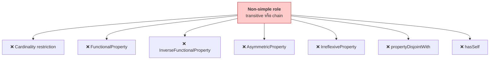

# 08.06 Property Characteristics

OWL ให้ประกาศ **คุณสมบัติทางคณิตศาสตร์** ของ property ได้ 7 แบบ ซึ่งทำให้ reasoner อนุมานความรู้ใหม่
และตรวจจับข้อมูลที่ขัดแย้งกันได้ บทนี้อธิบายทั้ง 7 ตัวพร้อมตัวอย่างที่เหมาะสม
และข้อจำกัดเรื่อง **simple role** ที่ต้องระวัง

---

## ตารางสรุปทั้ง 7

| Characteristic | DL | กฎอนุมาน | ต้องเป็น simple role |
| --- | --- | --- | :---: |
| **Transitive** | `r⁺ ⊑ r` | `r(a,b) ∧ r(b,c) → r(a,c)` | ❌ |
| **Symmetric** | `r ≡ r⁻` | `r(a,b) → r(b,a)` | ❌ |
| **Asymmetric** | `r ⊓ r⁻ ⊑ ⊥` | `r(a,b) → ¬r(b,a)` | **✅** |
| **Reflexive** | `⊤ ⊑ ∃r.Self` | `r(a,a)` เสมอ | ❌ |
| **Irreflexive** | `∃r.Self ⊑ ⊥` | `¬r(a,a)` | **✅** |
| **Functional** | `⊤ ⊑ ≤1 r` | `r(a,b) ∧ r(a,c) → b = c` | **✅** |
| **InverseFunctional** | `⊤ ⊑ ≤1 r⁻` | `r(a,c) ∧ r(b,c) → a = b` | **✅** |



---

## 1. `owl:TransitiveProperty`

```turtle
@prefix ex:  <http://example.org/> .
@prefix owl: <http://www.w3.org/2002/07/owl#> .

ex:partOf     a owl:ObjectProperty , owl:TransitiveProperty .
ex:hasAncestor a owl:ObjectProperty , owl:TransitiveProperty .
ex:largerThan a owl:ObjectProperty , owl:TransitiveProperty .
```

```turtle
ex:room404   ex:partOf ex:building1 .
ex:building1 ex:partOf ex:campus .
ex:campus    ex:partOf ex:university .
```

**อนุมานได้**

```turtle
ex:room404   ex:partOf ex:campus , ex:university .
ex:building1 ex:partOf ex:university .
```



### ตัวอย่างที่เหมาะสม

| Property | เหมาะเป็น transitive |
| --- | :---: |
| `partOf`, `containedIn`, `locatedIn` | ✅ |
| `hasAncestor`, `hasDescendant` | ✅ |
| `subClassOf`, `broader` (SKOS) | ✅ |
| `largerThan`, `precedes` | ✅ |
| `hasParent` | ❌ (พ่อของพ่อไม่ใช่พ่อ) |
| `knows` | ❌ (เพื่อนของเพื่อนไม่ใช่เพื่อน) |
| `marriedTo` | ❌ |

### ⚠️ ข้อจำกัด

```turtle
# ❌ transitive + cardinality = ไม่ decidable
ex:partOf a owl:TransitiveProperty .
ex:Room rdfs:subClassOf [
    a owl:Restriction ; owl:onProperty ex:partOf ; owl:maxCardinality 1
] .

# ❌ transitive + functional
ex:partOf a owl:TransitiveProperty , owl:FunctionalProperty .

# ❌ transitive + asymmetric / irreflexive
ex:partOf a owl:TransitiveProperty , owl:AsymmetricProperty .
```

---

## 2. `owl:SymmetricProperty`

```turtle
@prefix ex:  <http://example.org/> .
@prefix owl: <http://www.w3.org/2002/07/owl#> .

ex:marriedTo   a owl:ObjectProperty , owl:SymmetricProperty .
ex:siblingOf   a owl:ObjectProperty , owl:SymmetricProperty .
ex:colleagueOf a owl:ObjectProperty , owl:SymmetricProperty .
ex:borderWith  a owl:ObjectProperty , owl:SymmetricProperty .
```

```turtle
ex:alice ex:marriedTo ex:bob .
# → inferred: ex:bob ex:marriedTo ex:alice .
```

**เทียบเท่ากับ** `ex:marriedTo owl:inverseOf ex:marriedTo .`

### ตัวอย่างที่เหมาะสม

| Property | Symmetric |
| --- | :---: |
| `marriedTo`, `siblingOf`, `colleagueOf` | ✅ |
| `borderWith`, `adjacentTo`, `connectedTo` | ✅ |
| `differentFrom`, `disjointWith` | ✅ |
| `hasParent`, `teaches` | ❌ |
| `knows` | ⚠️ ขึ้นกับนิยาม (FOAF บอกว่าไม่จำเป็น) |

---

## 3. `owl:AsymmetricProperty` (OWL 2)

**ตรงข้ามกับ symmetric** — ถ้า `r(a,b)` แล้ว `r(b,a)` **ต้องเป็นเท็จ**

```turtle
@prefix ex:  <http://example.org/> .
@prefix owl: <http://www.w3.org/2002/07/owl#> .

ex:hasParent  a owl:ObjectProperty , owl:AsymmetricProperty .
ex:tallerThan a owl:ObjectProperty , owl:AsymmetricProperty .
ex:supervises a owl:ObjectProperty , owl:AsymmetricProperty .
```

```turtle
ex:alice ex:hasParent ex:bob .
ex:bob   ex:hasParent ex:alice .
# → ❌ INCONSISTENT
```

### ⚠️ Asymmetric ≠ "ไม่ใช่ symmetric"

| | ความหมาย |
| --- | --- |
| **Symmetric** | `r(a,b) → r(b,a)` เสมอ |
| **Asymmetric** | `r(a,b) → ¬r(b,a)` เสมอ |
| **ไม่ใช่ทั้งสอง** | บางคู่กลับได้ บางคู่ไม่ได้ |



**Asymmetric implies Irreflexive** — ถ้า `r(a,a)` จะขัดกับ asymmetric ทันที

---

## 4. `owl:ReflexiveProperty` (OWL 2)

**ทุก individual สัมพันธ์กับตัวเอง**

```turtle
@prefix ex:  <http://example.org/> .
@prefix owl: <http://www.w3.org/2002/07/owl#> .

ex:hasSameAgeAs a owl:ObjectProperty , owl:ReflexiveProperty .
ex:relatedTo    a owl:ObjectProperty , owl:ReflexiveProperty .
```

```turtle
ex:alice a ex:Person .
# → inferred: ex:alice ex:hasSameAgeAs ex:alice .
```

> ⚠️ **`owl:ReflexiveProperty` บังคับให้ทุก individual ในจักรวาล (รวม non-Person) มีความสัมพันธ์กับตัวเอง**
> ซึ่งมักไม่ใช่สิ่งที่ต้องการ — ใช้ **local reflexivity** (`owl:hasSelf`) แทนถ้าต้องการจำกัดขอบเขต

```turtle
# ✅ จำกัดเฉพาะ Person
ex:Person rdfs:subClassOf [
    a owl:Restriction ;
    owl:onProperty ex:relatedTo ;
    owl:hasSelf    "true"^^xsd:boolean
] .
```

**ในทางปฏิบัติ `owl:ReflexiveProperty` แทบไม่ได้ใช้**

---

## 5. `owl:IrreflexiveProperty` (OWL 2)

**ไม่มี individual ใดสัมพันธ์กับตัวเอง**

```turtle
@prefix ex:  <http://example.org/> .
@prefix owl: <http://www.w3.org/2002/07/owl#> .

ex:hasParent   a owl:ObjectProperty , owl:IrreflexiveProperty .
ex:marriedTo   a owl:ObjectProperty , owl:IrreflexiveProperty .
ex:colleagueOf a owl:ObjectProperty , owl:IrreflexiveProperty .
ex:supervises  a owl:ObjectProperty , owl:IrreflexiveProperty .
```

```turtle
ex:alice ex:hasParent ex:alice .
# → ❌ INCONSISTENT
```

> 💡 **`owl:IrreflexiveProperty` มีประโยชน์มากในการจับข้อมูลผิดพลาด**
> เช่น นักศึกษาที่เป็นอาจารย์ที่ปรึกษาของตัวเอง หรือแผนกที่เป็นส่วนหนึ่งของตัวเอง

---

## 6. `owl:FunctionalProperty`

**มีค่าได้อย่างมาก 1 ค่า** — `⊤ ⊑ ≤1 r`

```turtle
@prefix ex:  <http://example.org/> .
@prefix owl: <http://www.w3.org/2002/07/owl#> .

ex:hasBiologicalMother a owl:ObjectProperty , owl:FunctionalProperty .
ex:hasSupervisor       a owl:ObjectProperty , owl:FunctionalProperty .
ex:studentId           a owl:DatatypeProperty , owl:FunctionalProperty .
ex:dateOfBirth         a owl:DatatypeProperty , owl:FunctionalProperty .
```

### ผลที่สำคัญ: reasoner สรุป `owl:sameAs` เอง

```turtle
ex:alice ex:hasBiologicalMother ex:mary .
ex:alice ex:hasBiologicalMother ex:maria .
# → inferred: ex:mary owl:sameAs ex:maria .
```

**เพราะมีได้ค่าเดียว → ทั้งสองต้องเป็นคนเดียวกัน**

### และจับข้อผิดพลาดได้

```turtle
ex:mary owl:differentFrom ex:maria .
# → ❌ INCONSISTENT
```



> 💡 **Functional property + `owl:AllDifferent` เป็นคู่ที่ทรงพลังที่สุดในการตรวจคุณภาพข้อมูล**
> เพราะจับกรณีที่ข้อมูลขัดแย้งกันได้อัตโนมัติ

### ⚠️ Functional ≠ required

```turtle
ex:hasSupervisor a owl:FunctionalProperty .

ex:alice a ex:Student .    # ไม่มี supervisor เลย → ไม่ผิด!
```

**`FunctionalProperty` บอกว่า "อย่างมาก 1" ไม่ใช่ "ต้องมี 1"**

| ต้องการ | ใช้ |
| --- | --- |
| อย่างมาก 1 | `owl:FunctionalProperty` หรือ `owl:maxCardinality 1` |
| อย่างน้อย 1 | `owl:minCardinality 1` |
| **พอดี 1** | `owl:cardinality 1` (= ทั้งสองรวมกัน) |
| ต้องมีจริง (validate) | **SHACL** `sh:minCount 1` |

---

## 7. `owl:InverseFunctionalProperty`

**ค่าระบุ subject ได้ตัวเดียว** — `⊤ ⊑ ≤1 r⁻`

```turtle
@prefix ex:   <http://example.org/> .
@prefix owl:  <http://www.w3.org/2002/07/owl#> .
@prefix foaf: <http://xmlns.com/foaf/0.1/> .

ex:studentId   a owl:DatatypeProperty , owl:InverseFunctionalProperty .
ex:nationalId  a owl:DatatypeProperty , owl:InverseFunctionalProperty .
ex:isbn        a owl:DatatypeProperty , owl:InverseFunctionalProperty .
foaf:mbox      a owl:ObjectProperty , owl:InverseFunctionalProperty .
foaf:homepage  a owl:ObjectProperty , owl:InverseFunctionalProperty .
```

```turtle
ex:alice     ex:studentId "S-001" .
ex:aJohnson  ex:studentId "S-001" .
# → inferred: ex:alice owl:sameAs ex:aJohnson .
```

**นี่คือ entity resolution อัตโนมัติ** — ดู [05.05](../05-knowledge-management/05.05-abox-negation.md)

### ⚠️ อย่าใช้กับ property ที่ค่าซ้ำได้จริง

```turtle
# ❌ อันตราย -- บ้านเดียวกันใช้เบอร์เดียวกัน
ex:phoneNumber a owl:InverseFunctionalProperty .
ex:alice ex:phoneNumber "02-123-4567" .
ex:bob   ex:phoneNumber "02-123-4567" .
# → inferred: ex:alice owl:sameAs ex:bob   😱

# ❌ อันตราย -- ชื่อซ้ำได้
ex:personName a owl:InverseFunctionalProperty .
```

| Property | เหมาะเป็น InverseFunctional |
| --- | :---: |
| `studentId`, `employeeId`, `nationalId` | ✅ |
| `isbn`, `doi`, `orcid` | ✅ |
| `foaf:mbox` (email ส่วนตัว) | ✅ |
| `phoneNumber` | ❌ |
| `personName`, `address` | ❌ |
| `birthDate` | ❌ |

### ทางเลือกที่ดีกว่าใน OWL 2: `owl:hasKey`

```turtle
# InverseFunctionalProperty -- ใช้กับทุก individual รวม anonymous
ex:studentId a owl:InverseFunctionalProperty .

# hasKey -- จำกัดเฉพาะ named individual ของ class ที่ระบุ
ex:Student owl:hasKey ( ex:studentId ) .

# hasKey รองรับ composite key ด้วย
ex:Course owl:hasKey ( ex:department ex:courseNumber ) .
```

---

## ตารางเลือกใช้

| ความต้องการ | Characteristic |
| --- | --- |
| "ถ้า A อยู่ใน B และ B อยู่ใน C แล้ว A อยู่ใน C" | `TransitiveProperty` |
| "ถ้า A แต่งงานกับ B แล้ว B แต่งงานกับ A" | `SymmetricProperty` |
| "ถ้า A เป็นพ่อของ B แล้ว B ไม่ใช่พ่อของ A" | `AsymmetricProperty` |
| "ไม่มีใครเป็นพ่อของตัวเอง" | `IrreflexiveProperty` |
| "แต่ละคนมีแม่ทางสายเลือดคนเดียว" | `FunctionalProperty` |
| "รหัสนักศึกษาระบุคนได้คนเดียว" | `InverseFunctionalProperty` / `hasKey` |
| "ทุกคนสัมพันธ์กับตัวเอง" | `ReflexiveProperty` (แทบไม่ใช้) |

---

## ⚠️ ข้อจำกัด Simple Role — สรุป

**property ที่เป็น transitive หรือเกิดจาก property chain (รวมถึงผ่าน subproperty) = ไม่ใช่ simple role**



### ทางแก้: แยก property

```turtle
# ❌ ผิด
ex:hasAncestor a owl:TransitiveProperty ,
                 owl:AsymmetricProperty ,
                 owl:IrreflexiveProperty .

# ✅ ถูก -- base property เป็น simple, derived property เป็น transitive
ex:hasParent a owl:ObjectProperty ,
               owl:AsymmetricProperty ,
               owl:IrreflexiveProperty ;
    rdfs:subPropertyOf ex:hasAncestor .

ex:hasAncestor a owl:ObjectProperty , owl:TransitiveProperty .
```

### ⚠️ subproperty ก็ทำให้ไม่ simple ได้

```turtle
# ex:hasParent กลายเป็น non-simple เพราะ superproperty เป็น transitive?
ex:hasAncestor a owl:TransitiveProperty .
ex:hasParent rdfs:subPropertyOf ex:hasAncestor .
# ✅ hasParent ยัง simple อยู่ -- ทิศทางนี้ปลอดภัย

# แต่ทิศทางนี้ทำให้ hasParent ไม่ simple
ex:hasAncestor rdfs:subPropertyOf ex:hasParent .   # ❌ ผิดความหมายด้วย
```

**กฎ**: property จะไม่ simple ถ้า **ตัวมันเองหรือ subproperty ของมัน** เป็น transitive/chain

---

## ตัวอย่างเต็ม

```turtle
@prefix ex:   <http://example.org/social#> .
@prefix rdfs: <http://www.w3.org/2000/01/rdf-schema#> .
@prefix owl:  <http://www.w3.org/2002/07/owl#> .
@prefix xsd:  <http://www.w3.org/2001/XMLSchema#> .

# ===== simple roles =====
ex:hasParent a owl:ObjectProperty ,
               owl:AsymmetricProperty ,
               owl:IrreflexiveProperty ;
    rdfs:domain ex:Person ;
    rdfs:range  ex:Person ;
    rdfs:subPropertyOf ex:hasAncestor .

ex:hasBiologicalMother a owl:ObjectProperty ,
                         owl:FunctionalProperty ,
                         owl:AsymmetricProperty ,
                         owl:IrreflexiveProperty ;
    rdfs:subPropertyOf ex:hasParent ;
    rdfs:range ex:Woman .

ex:marriedTo a owl:ObjectProperty ,
               owl:SymmetricProperty ,
               owl:IrreflexiveProperty ;
    rdfs:domain ex:Person ;
    rdfs:range  ex:Person .

ex:nationalId a owl:DatatypeProperty ,
                owl:FunctionalProperty ,
                owl:InverseFunctionalProperty ;
    rdfs:domain ex:Person ;
    rdfs:range  xsd:string .

ex:email a owl:DatatypeProperty , owl:InverseFunctionalProperty ;
    rdfs:range xsd:string .

# ===== non-simple roles =====
ex:hasAncestor a owl:ObjectProperty , owl:TransitiveProperty ;
    rdfs:domain ex:Person ;
    rdfs:range  ex:Person .

ex:hasUncle a owl:ObjectProperty ;
    owl:propertyChainAxiom ( ex:hasParent ex:hasBrother ) .

# ===== key (ทางเลือกที่ปลอดภัยกว่า InverseFunctional) =====
ex:Person owl:hasKey ( ex:nationalId ) .
```

### ทดสอบด้วย Python

```python
from owlready2 import (
    AllDifferent, FunctionalProperty, IrreflexiveProperty, ObjectProperty,
    OwlReadyInconsistentOntologyError, SymmetricProperty, Thing,
    TransitiveProperty, get_ontology, sync_reasoner_hermit,
)

onto = get_ontology("http://example.org/social#")

with onto:
    class Person(Thing): pass

    class hasParent(ObjectProperty, IrreflexiveProperty):
        domain, range = [Person], [Person]

    class hasSupervisor(ObjectProperty, FunctionalProperty):
        domain, range = [Person], [Person]

    class marriedTo(ObjectProperty, SymmetricProperty, IrreflexiveProperty):
        domain, range = [Person], [Person]

    alice = Person("alice")
    bob = Person("bob")
    carol = Person("carol")
    AllDifferent([alice, bob, carol])

    alice.marriedTo = [bob]                   # symmetric -> bob.marriedTo = [alice]
    alice.hasSupervisor = [bob]
    alice.hasSupervisor.append(carol)         # functional + AllDifferent -> inconsistent!

try:
    with onto:
        sync_reasoner_hermit(infer_property_values=True)
    print("consistent")
    print("bob.marriedTo:", bob.marriedTo)
except OwlReadyInconsistentOntologyError:
    print("❌ INCONSISTENT")
    print("   สาเหตุ: hasSupervisor เป็น FunctionalProperty")
    print("           แต่ alice มี supervisor 2 คนที่ประกาศว่าเป็นคนละคน")
```

Expected output:

```
❌ INCONSISTENT
   สาเหตุ: hasSupervisor เป็น FunctionalProperty
           แต่ alice มี supervisor 2 คนที่ประกาศว่าเป็นคนละคน
```

---

## Key Points

- OWL มี **7 property characteristics**: Transitive, Symmetric, Asymmetric, Reflexive, Irreflexive, Functional, InverseFunctional
- **Transitive** เหมาะกับ `partOf`, `hasAncestor`; ⚠️ **ใช้กับ cardinality ไม่ได้**
- **Asymmetric ≠ ไม่ใช่ symmetric** — asymmetric บังคับว่าทิศทางกลับต้องเป็นเท็จ และ **implies irreflexive**
- **`owl:ReflexiveProperty` แทบไม่ได้ใช้** — ใช้ `owl:hasSelf` เพื่อจำกัดขอบเขตแทน
- **`owl:IrreflexiveProperty` มีประโยชน์มากในการจับข้อมูลผิด** (เป็นที่ปรึกษาตัวเอง, เป็นส่วนของตัวเอง)
- **Functional property ทำให้ reasoner สรุป `owl:sameAs` เอง** — คู่กับ `owl:AllDifferent` จะจับข้อมูลขัดแย้งได้
- ⚠️ **Functional ≠ required** — บอกว่า "อย่างมาก 1" ไม่ใช่ "ต้องมี"; ถ้าต้องการบังคับให้มีใช้ **SHACL**
- ⚠️ **อย่าใช้ `InverseFunctionalProperty` กับ property ที่ค่าซ้ำได้จริง** (phone, name) — จะ merge คนที่ไม่ใช่คนเดียวกัน
- **Non-simple role** (transitive/chain) ใช้กับ **cardinality, functional, asymmetric, irreflexive, disjoint, hasSelf ไม่ได้** — แก้ด้วยการแยก property
