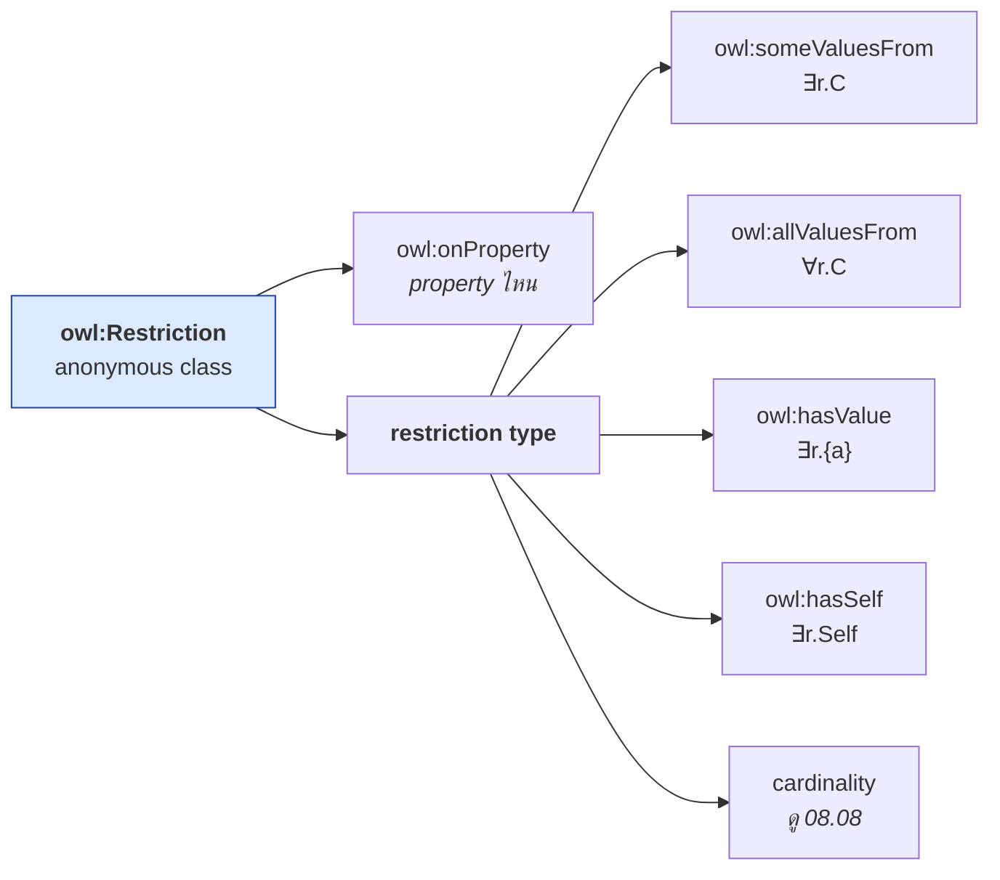
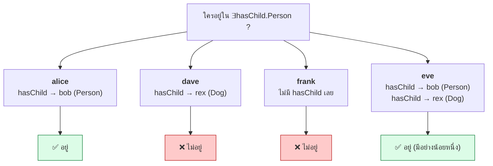
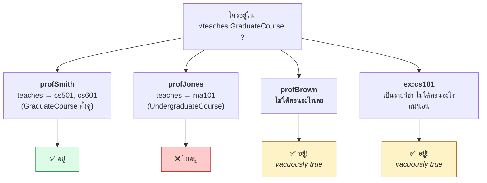
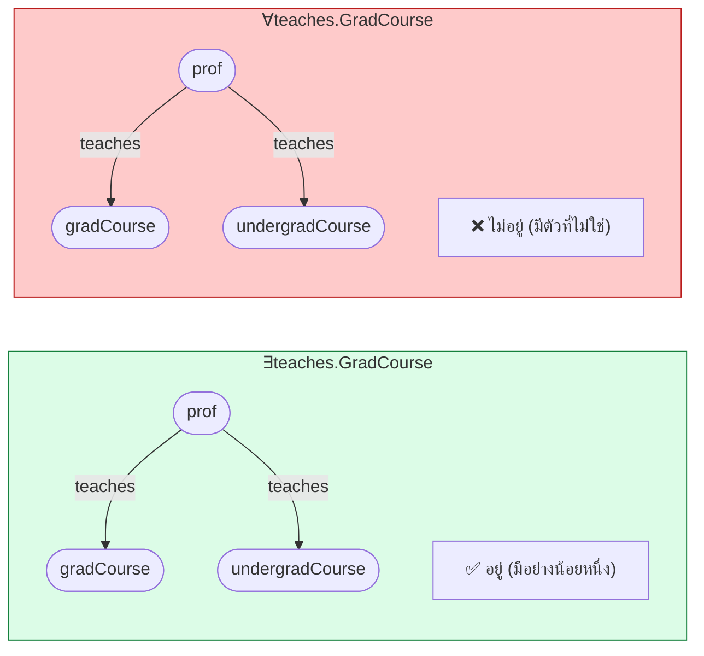

# 08.07 Restrictions: someValuesFrom, allValuesFrom, hasValue, hasSelf

**Restriction** คือ class ที่นิยามจาก**ความสัมพันธ์** แทนที่จะระบุสมาชิกโดยตรง
เป็นกลไกที่ทรงพลังที่สุดของ OWL และเป็นที่มาของ **automatic classification**
บทนี้ครอบคลุม value restriction ทั้ง 4 แบบ พร้อมกับดักสำคัญเรื่อง **vacuous truth**

---

## Restriction คืออะไร

```turtle
[ a owl:Restriction ;
  owl:onProperty     <property> ;
  <restriction-type> <value> ]
```

**Restriction เป็น anonymous class** — ไม่มีชื่อ แต่มีสมาชิกที่ชัดเจน



---

## 1. `owl:someValuesFrom` — ∃r.C

**"มีอย่างน้อยหนึ่ง"** — existential restriction

<table>
<tr><th width="50%">Full form</th><th width="50%">Shorthand</th></tr>
<tr valign="top">
<td>

```turtle
@prefix ex:  <http://example.org/> .
@prefix rdf: <http://www.w3.org/1999/02/22-rdf-syntax-ns#> .
@prefix rdfs: <http://www.w3.org/2000/01/rdf-schema#> .
@prefix owl: <http://www.w3.org/2002/07/owl#> .

ex:Parent rdf:type owl:Class .
ex:Parent owl:equivalentClass _:c1 .
_:c1 rdf:type owl:Class .
_:c1 owl:intersectionOf _:l1 .
_:l1 rdf:first ex:Person .
_:l1 rdf:rest _:l2 .
_:l2 rdf:first _:r1 .
_:l2 rdf:rest rdf:nil .
_:r1 rdf:type owl:Restriction .
_:r1 owl:onProperty ex:hasChild .
_:r1 owl:someValuesFrom ex:Person .
```

</td>
<td>

```turtle
@prefix ex:  <http://example.org/> .
@prefix rdf: <http://www.w3.org/1999/02/22-rdf-syntax-ns#> .
@prefix rdfs: <http://www.w3.org/2000/01/rdf-schema#> .
@prefix owl: <http://www.w3.org/2002/07/owl#> .

ex:Parent a owl:Class ;
    owl:equivalentClass [
        a owl:Class ;
        owl:intersectionOf (
            ex:Person
            [ a owl:Restriction ;
              owl:onProperty     ex:hasChild ;
              owl:someValuesFrom ex:Person ]
        )
    ] .
```

</td>
</tr>
</table>

### ใครอยู่ใน `∃hasChild.Person`



### ใช้กับ datatype property

```turtle
@prefix ex:   <http://example.org/> .
@prefix owl:  <http://www.w3.org/2002/07/owl#> .
@prefix rdfs: <http://www.w3.org/2000/01/rdf-schema#> .
@prefix xsd:  <http://www.w3.org/2001/XMLSchema#> .

# นักศึกษาที่มี GPA อย่างน้อยหนึ่งค่าที่ ≥ 3.5
ex:HonorsStudent a owl:Class ;
    owl:equivalentClass [
        a owl:Class ;
        owl:intersectionOf (
            ex:Student
            [ a owl:Restriction ;
              owl:onProperty     ex:gpa ;
              owl:someValuesFrom [
                  a rdfs:Datatype ;
                  owl:onDatatype xsd:decimal ;
                  owl:withRestrictions ( [ xsd:minInclusive "3.5"^^xsd:decimal ] )
              ] ]
        )
    ] .
```

### `∃r.⊤` — มีความสัมพันธ์นี้ (ไม่สนว่าไปหาอะไร)

```turtle
# "คนที่มีลูก" -- ไม่สนว่าลูกเป็นอะไร
ex:HasAnyChild a owl:Class ;
    owl:equivalentClass [
        a owl:Restriction ;
        owl:onProperty     ex:hasChild ;
        owl:someValuesFrom owl:Thing
    ] .
```

> 💡 `∃r.⊤` เทียบเท่ากับ `rdfs:domain` ในเชิงความหมาย:
> `ex:hasChild rdfs:domain ex:Person` = `∃hasChild.⊤ ⊑ Person`

---

## 2. `owl:allValuesFrom` — ∀r.C

**"ทุกตัวที่มี (ถ้ามี) ต้องเป็น C"** — universal restriction

```turtle
@prefix ex:  <http://example.org/> .
@prefix owl: <http://www.w3.org/2002/07/owl#> .

# คนที่สอนเฉพาะวิชาระดับบัณฑิต
ex:GraduateOnlyTeacher a owl:Class ;
    owl:equivalentClass [
        a owl:Class ;
        owl:intersectionOf (
            ex:Professor
            [ a owl:Restriction ;
              owl:onProperty    ex:teaches ;
              owl:allValuesFrom ex:GraduateCourse ]
        )
    ] .
```

### ⚠️ กับดักที่สำคัญที่สุดของ OWL: Vacuous Truth



**เหตุผล**: `∀y ( teaches(x,y) → GraduateCourse(y) )` เป็นจริงเมื่อ `teaches(x,y)` เป็นเท็จเสมอ
— ทบทวน vacuous truth จาก [04.02](../04-logics/04.02-fol-basics.md)

### ทางแก้: ใช้ `∃` คู่กับ `∀`

```turtle
# ✅ "สอนอย่างน้อยหนึ่งวิชา และสอนเฉพาะวิชาระดับบัณฑิต"
ex:GraduateOnlyTeacher a owl:Class ;
    owl:equivalentClass [
        a owl:Class ;
        owl:intersectionOf (
            ex:Professor
            [ a owl:Restriction ;
              owl:onProperty     ex:teaches ;
              owl:someValuesFrom ex:GraduateCourse ]      # ต้องมีอย่างน้อยหนึ่ง
            [ a owl:Restriction ;
              owl:onProperty    ex:teaches ;
              owl:allValuesFrom ex:GraduateCourse ]       # และเฉพาะระดับบัณฑิต
        )
    ] .
```

### ⚠️ กับดักที่สอง: `∀r.C` สรุปไม่ได้ภายใต้ OWA

```turtle
uni:UndergraduateStudent owl:equivalentClass [
    a owl:Class ;
    owl:intersectionOf (
        uni:Student
        [ a owl:Restriction ; owl:onProperty uni:enrolledIn ;
          owl:allValuesFrom uni:UndergraduateCourse ]
        [ a owl:Restriction ; owl:onProperty uni:enrolledIn ;
          owl:someValuesFrom uni:UndergraduateCourse ]
    )
] .

uni:bob a uni:Student ;
    uni:enrolledIn uni:cs101 , uni:cs201 .   # ทั้งคู่เป็น UndergraduateCourse
```

**ผลจากการรันจริงใน [05.09](../05-knowledge-management/05.09-python-kb.md)**:

```
UndergraduateStudent   = []          ← ว่าง!
```

**เหตุผล**: ภายใต้ OWA reasoner ไม่รู้ว่า bob ลงเรียนวิชาอื่นอีกหรือไม่ จึงสรุป `∀` ไม่ได้

### ทางแก้: Closure Axiom

```turtle
@prefix uni: <http://example.org/university#> .
@prefix owl: <http://www.w3.org/2002/07/owl#> .
@prefix xsd: <http://www.w3.org/2001/XMLSchema#> .

# วิธีที่ 1: ระบุค่าที่เป็นไปได้ทั้งหมด
uni:bob a [
    a owl:Restriction ;
    owl:onProperty    uni:enrolledIn ;
    owl:allValuesFrom [ a owl:Class ; owl:oneOf ( uni:cs101 uni:cs201 ) ]
] .

# วิธีที่ 2: ระบุจำนวนสูงสุด
uni:bob a [
    a owl:Restriction ;
    owl:onProperty     uni:enrolledIn ;
    owl:maxCardinality "2"^^xsd:nonNegativeInteger
] .
```

หลังเพิ่มแล้ว reasoner สรุปได้ว่า `uni:bob a uni:UndergraduateStudent` ✅

---

## เทียบ `∃r.C` กับ `∀r.C`

| | `owl:someValuesFrom` (`∃r.C`) | `owl:allValuesFrom` (`∀r.C`) |
| --- | --- | --- |
| อ่านว่า | "มีอย่างน้อยหนึ่ง r ที่เป็น C" | "ทุก r ต้องเป็น C" |
| **ไม่มี r เลย** | ❌ ไม่อยู่ | ✅ **อยู่** (vacuous) |
| มี r บางตัวเป็น C | ✅ อยู่ | ❌ ไม่อยู่ |
| มี r ทุกตัวเป็น C | ✅ อยู่ | ✅ อยู่ |
| Manchester | `r some C` | `r only C` |
| สรุปได้ภายใต้ OWA | ✅ | ❌ ต้องมี closure |
| อยู่ใน OWL 2 EL | ✅ | ❌ |
| ใช้เพื่อ | **บังคับให้มี** | **จำกัดชนิดที่มีได้** |



---

## 3. `owl:hasValue` — ∃r.{a}

**"มีความสัมพันธ์ไปยัง individual ตัวนี้"**

```turtle
@prefix ex:  <http://example.org/> .
@prefix owl: <http://www.w3.org/2002/07/owl#> .

# คนสัญชาติฝรั่งเศส
ex:FrenchPerson a owl:Class ;
    owl:equivalentClass [
        a owl:Class ;
        owl:intersectionOf (
            ex:Person
            [ a owl:Restriction ;
              owl:onProperty ex:nationality ;
              owl:hasValue   ex:France ]
        )
    ] .

# นักศึกษาภาควิชา CS
ex:CSStudent a owl:Class ;
    owl:equivalentClass [
        a owl:Class ;
        owl:intersectionOf (
            ex:Student
            [ a owl:Restriction ;
              owl:onProperty ex:memberOf ;
              owl:hasValue   ex:csDept ]
        )
    ] .

# ใช้กับ literal ได้ด้วย
ex:ThreeCreditCourse a owl:Class ;
    owl:equivalentClass [
        a owl:Class ;
        owl:intersectionOf (
            ex:Course
            [ a owl:Restriction ;
              owl:onProperty ex:credits ;
              owl:hasValue   3 ]
        )
    ] .
```

**ผลของ reasoner**

```turtle
ex:alice a ex:Student ; ex:memberOf ex:csDept .
# → inferred: ex:alice a ex:CSStudent .
```

### เทียบเท่ากับ

```turtle
[ a owl:Restriction ;
  owl:onProperty     ex:nationality ;
  owl:someValuesFrom [ a owl:Class ; owl:oneOf ( ex:France ) ] ]
```

> 💡 **`owl:hasValue` อยู่ใน OWL 2 EL** ในขณะที่ `owl:oneOf` ทั่วไปไม่อยู่
> เพราะ singleton nominal ไม่ทำให้ complexity ระเบิด

---

## 4. `owl:hasSelf` — ∃r.Self (OWL 2)

**"มีความสัมพันธ์กับตัวเอง"** — local reflexivity

```turtle
@prefix ex:  <http://example.org/> .
@prefix owl: <http://www.w3.org/2002/07/owl#> .
@prefix xsd: <http://www.w3.org/2001/XMLSchema#> .

# คนที่รักตัวเอง
ex:NarcissisticPerson a owl:Class ;
    owl:equivalentClass [
        a owl:Class ;
        owl:intersectionOf (
            ex:Person
            [ a owl:Restriction ;
              owl:onProperty ex:loves ;
              owl:hasSelf    "true"^^xsd:boolean ]
        )
    ] .

# กระบวนการที่เรียกตัวเอง
ex:RecursiveProcess a owl:Class ;
    owl:equivalentClass [
        a owl:Class ;
        owl:intersectionOf (
            ex:Process
            [ a owl:Restriction ;
              owl:onProperty ex:calls ;
              owl:hasSelf    "true"^^xsd:boolean ]
        )
    ] .
```

```turtle
ex:alice a ex:Person ; ex:loves ex:alice .
# → inferred: ex:alice a ex:NarcissisticPerson .
```

### `hasSelf` vs `ReflexiveProperty`

| | `owl:hasSelf` | `owl:ReflexiveProperty` |
| --- | --- | --- |
| ขอบเขต | **เฉพาะ class ที่ระบุ** | **ทุก individual ในจักรวาล** |
| ใช้ | local reflexivity | global reflexivity |
| ในทางปฏิบัติ | ใช้ได้จริง | แทบไม่ได้ใช้ |

```turtle
# ✅ จำกัดขอบเขต -- เฉพาะ Person เท่านั้นที่ relatedTo ตัวเอง
ex:Person rdfs:subClassOf [
    a owl:Restriction ;
    owl:onProperty ex:relatedTo ;
    owl:hasSelf    "true"^^xsd:boolean
] .

# ❌ กว้างเกินไป -- ทุกอย่างรวมตัวเลข วันที่ ก็ relatedTo ตัวเอง
ex:relatedTo a owl:ReflexiveProperty .
```

> ⚠️ **`owl:hasSelf` ต้องใช้กับ simple role เท่านั้น**

---

## Restriction ใน `rdfs:subClassOf` vs `owl:equivalentClass`

นี่คือความต่างที่สำคัญที่สุด (ทบทวนจาก [05.02](../05-knowledge-management/05.02-tbox-deep.md))

```turtle
# --- necessary condition (primitive) ---
ex:Parent rdfs:subClassOf [
    a owl:Restriction ; owl:onProperty ex:hasChild ; owl:someValuesFrom ex:Person
] .
# "ทุก Parent มีลูก" -- แต่ใครที่มีลูกไม่จำเป็นต้องเป็น Parent

# --- necessary + sufficient (defined) ---
ex:Parent owl:equivalentClass [
    a owl:Restriction ; owl:onProperty ex:hasChild ; owl:someValuesFrom ex:Person
] .
# "Parent = คนที่มีลูก" -- ใครมีลูกก็เป็น Parent อัตโนมัติ
```

| | `rdfs:subClassOf` | `owl:equivalentClass` |
| --- | --- | --- |
| ทิศทาง | Parent → มีลูก | Parent ↔ มีลูก |
| Automatic classification | ❌ | ✅ |
| ใช้เมื่อ | นิยามไม่ครบ | นิยามครบถ้วน |

---

## ตัวอย่างเต็ม: Pizza ontology (ตัวอย่างคลาสสิก)

```turtle
@prefix pz:   <http://example.org/pizza#> .
@prefix rdf:  <http://www.w3.org/1999/02/22-rdf-syntax-ns#> .
@prefix rdfs: <http://www.w3.org/2000/01/rdf-schema#> .
@prefix owl:  <http://www.w3.org/2002/07/owl#> .
@prefix xsd:  <http://www.w3.org/2001/XMLSchema#> .

# ===== primitive classes =====
pz:Pizza a owl:Class .
pz:Topping a owl:Class .

pz:MeatTopping      a owl:Class ; rdfs:subClassOf pz:Topping .
pz:VegetableTopping a owl:Class ; rdfs:subClassOf pz:Topping .
pz:CheeseTopping    a owl:Class ; rdfs:subClassOf pz:Topping .
pz:SeafoodTopping   a owl:Class ; rdfs:subClassOf pz:Topping .

[] a owl:AllDisjointClasses ;
   owl:members ( pz:MeatTopping pz:VegetableTopping
                 pz:CheeseTopping pz:SeafoodTopping ) .

pz:hasTopping a owl:ObjectProperty ;
    rdfs:domain pz:Pizza ;
    rdfs:range  pz:Topping .

# ===== necessary condition: ทุกพิซซ่ามี topping =====
pz:Pizza rdfs:subClassOf [
    a owl:Restriction ;
    owl:onProperty     pz:hasTopping ;
    owl:someValuesFrom pz:Topping
] .

# ===== defined class: someValuesFrom =====
# พิซซ่าที่มีเนื้อสัตว์
pz:MeatyPizza a owl:Class ;
    owl:equivalentClass [
        a owl:Class ;
        owl:intersectionOf (
            pz:Pizza
            [ a owl:Restriction ;
              owl:onProperty     pz:hasTopping ;
              owl:someValuesFrom pz:MeatTopping ]
        )
    ] .

# ===== defined class: allValuesFrom + someValuesFrom =====
# พิซซ่ามังสวิรัติ -- ⚠️ ต้องมี someValuesFrom ด้วย มิฉะนั้น vacuous!
pz:VegetarianPizza a owl:Class ;
    owl:equivalentClass [
        a owl:Class ;
        owl:intersectionOf (
            pz:Pizza
            [ a owl:Restriction ;
              owl:onProperty     pz:hasTopping ;
              owl:someValuesFrom pz:Topping ]
            [ a owl:Restriction ;
              owl:onProperty    pz:hasTopping ;
              owl:allValuesFrom [
                  a owl:Class ;
                  owl:unionOf ( pz:VegetableTopping pz:CheeseTopping ) ] ]
        )
    ] .

# ===== defined class: hasValue =====
# พิซซ่าที่มีชีสมอสซาเรลลา
pz:MozzarellaPizza a owl:Class ;
    owl:equivalentClass [
        a owl:Class ;
        owl:intersectionOf (
            pz:Pizza
            [ a owl:Restriction ;
              owl:onProperty pz:hasTopping ;
              owl:hasValue   pz:mozzarella ]
        )
    ] .

pz:mozzarella a owl:NamedIndividual , pz:CheeseTopping .

# ===== disjointness ทำให้ reasoner จับ error ได้ =====
pz:MeatyPizza owl:disjointWith pz:VegetarianPizza .
```

### ทดสอบ

```turtle
# พิซซ่ามาร์เกอริต้า -- ชีส + มะเขือเทศ
pz:margherita a pz:Pizza ;
    pz:hasTopping pz:mozzarella , pz:tomato .

pz:tomato a pz:VegetableTopping .

# ⚠️ ต้องมี closure axiom มิฉะนั้น allValuesFrom สรุปไม่ได้
pz:margherita a [
    a owl:Restriction ;
    owl:onProperty    pz:hasTopping ;
    owl:allValuesFrom [ a owl:Class ; owl:oneOf ( pz:mozzarella pz:tomato ) ]
] .
```

**reasoner อนุมาน**: `pz:margherita a pz:VegetarianPizza , pz:MozzarellaPizza`

### ทดสอบ inconsistency

```turtle
pz:badPizza a pz:MeatyPizza , pz:VegetarianPizza .
# → ❌ INCONSISTENT (disjointWith)
```

---

## Manchester Syntax เทียบ Turtle

| Turtle | Manchester |
| --- | --- |
| `owl:onProperty r ; owl:someValuesFrom C` | `r some C` |
| `owl:onProperty r ; owl:allValuesFrom C` | `r only C` |
| `owl:onProperty r ; owl:hasValue a` | `r value a` |
| `owl:onProperty r ; owl:hasSelf true` | `r Self` |

```
Class: VegetarianPizza
    EquivalentTo:
        Pizza
        and (hasTopping some Topping)
        and (hasTopping only (VegetableTopping or CheeseTopping))
```

**อ่านง่ายกว่ามาก** — นี่คือเหตุผลที่ควรใช้ Protégé สร้าง restriction

---

## Checklist

- [ ] ใช้ **`someValuesFrom`** เมื่อต้องการบังคับให้มีความสัมพันธ์
- [ ] ใช้ **`allValuesFrom`** เมื่อต้องการจำกัดชนิดของค่า
- [ ] ⚠️ **ใช้ `allValuesFrom` คู่กับ `someValuesFrom` เสมอ** มิฉะนั้นเกิด vacuous truth
- [ ] ⚠️ เพิ่ม **closure axiom** ถ้าต้องการให้ `allValuesFrom` สรุปได้ภายใต้ OWA
- [ ] ใช้ **`hasValue`** แทน `oneOf` แบบ singleton (เบากว่าและอยู่ใน EL)
- [ ] ใช้ **`hasSelf`** แทน `ReflexiveProperty` เพื่อจำกัดขอบเขต
- [ ] เลือก **`equivalentClass`** เมื่อต้องการ automatic classification, **`subClassOf`** เมื่อเป็น necessary condition

---

## Key Points

- **Restriction เป็น anonymous class** ที่นิยามจากความสัมพันธ์ — เป็นหัวใจของ automatic classification
- **`owl:someValuesFrom` (∃r.C)** = "มีอย่างน้อยหนึ่ง"; **`owl:allValuesFrom` (∀r.C)** = "ทุกตัวต้องเป็น C"
- ⚠️ **`∀r.C` เป็นจริงโดย vacuous truth เมื่อไม่มี `r` เลย** — กับดักที่สำคัญที่สุดของ OWL
- ⚠️ **ใช้ `∃r.C ⊓ ∀r.C` คู่กันเสมอ** เมื่อต้องการ "มีและเฉพาะ"
- ⚠️ **`∀r.C` สรุปไม่ได้ภายใต้ OWA** — ต้องเพิ่ม **closure axiom** (`oneOf` หรือ `maxCardinality`)
- **`owl:hasValue`** = singleton nominal — เบากว่า `oneOf` และ **อยู่ใน OWL 2 EL**
- **`owl:hasSelf`** ให้ local reflexivity ที่จำกัดขอบเขตได้ — ดีกว่า `owl:ReflexiveProperty` ที่กว้างเกินไป
- **`subClassOf` + restriction** = necessary; **`equivalentClass` + restriction** = necessary + sufficient (มี automatic classification)
- **Manchester Syntax** (`r some C`, `r only C`, `r value a`) อ่านง่ายกว่า Turtle มาก
