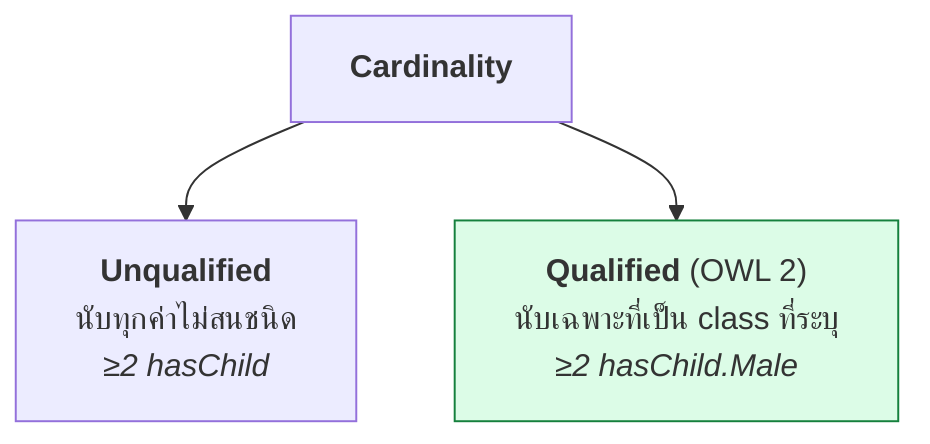
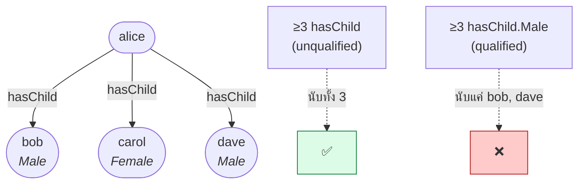
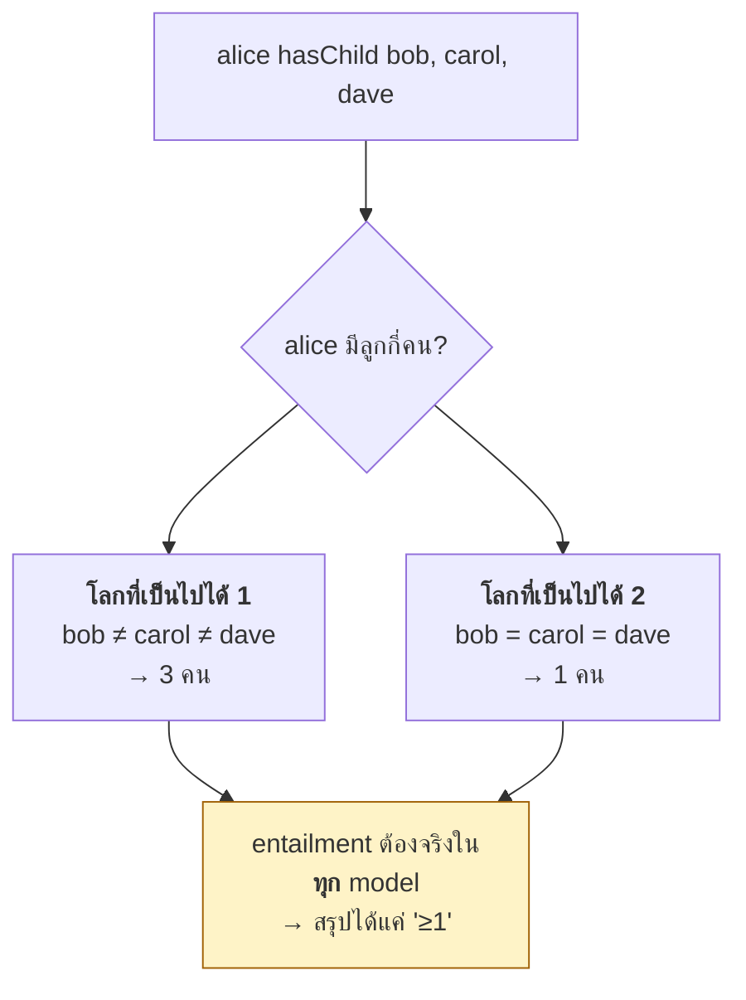
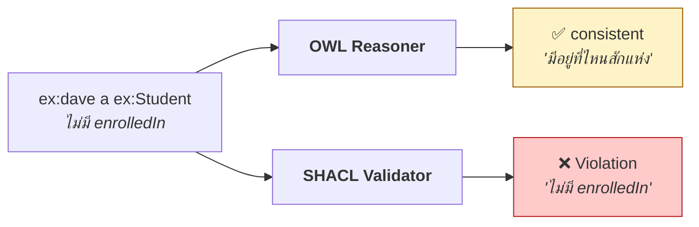

# 08.08 Cardinality Restrictions

**Cardinality restriction** จำกัด **จำนวน** ค่าที่ property มีได้ — `≥n`, `≤n`, `=n`
OWL 2 เพิ่ม **qualified cardinality** ที่ระบุ class ของสิ่งที่นับได้ด้วย
บทนี้ครอบคลุมทั้งหมด พร้อมกับดักสำคัญเรื่อง **No Unique Name Assumption**

---

## ภาพรวม

| Restriction | DL | OWL 1 | OWL 2 |
| --- | --- | :---: | :---: |
| `owl:minCardinality` | `≥n r` | ✅ | ✅ |
| `owl:maxCardinality` | `≤n r` | ✅ | ✅ |
| `owl:cardinality` | `=n r` | ✅ | ✅ |
| `owl:minQualifiedCardinality` + `owl:onClass` | `≥n r.C` | ❌ | ✅ |
| `owl:maxQualifiedCardinality` + `owl:onClass` | `≤n r.C` | ❌ | ✅ |
| `owl:qualifiedCardinality` + `owl:onClass` | `=n r.C` | ❌ | ✅ |



---

## Unqualified Cardinality

<table>
<tr><th width="50%">Full form</th><th width="50%">Shorthand</th></tr>
<tr valign="top">
<td>

```turtle
@prefix ex:   <http://example.org/> .
@prefix rdf:  <http://www.w3.org/1999/02/22-rdf-syntax-ns#> .
@prefix rdfs: <http://www.w3.org/2000/01/rdf-schema#> .
@prefix owl:  <http://www.w3.org/2002/07/owl#> .
@prefix xsd:  <http://www.w3.org/2001/XMLSchema#> .

ex:LargeFamily rdf:type owl:Class .
ex:LargeFamily rdfs:subClassOf _:r1 .
_:r1 rdf:type owl:Restriction .
_:r1 owl:onProperty ex:hasChild .
_:r1 owl:minCardinality "3"^^xsd:nonNegativeInteger .
```

</td>
<td>

```turtle
@prefix ex:   <http://example.org/> .
@prefix rdf:  <http://www.w3.org/1999/02/22-rdf-syntax-ns#> .
@prefix rdfs: <http://www.w3.org/2000/01/rdf-schema#> .
@prefix owl:  <http://www.w3.org/2002/07/owl#> .
@prefix xsd:  <http://www.w3.org/2001/XMLSchema#> .

ex:LargeFamily a owl:Class ;
    rdfs:subClassOf [
        a owl:Restriction ;
        owl:onProperty     ex:hasChild ;
        owl:minCardinality "3"^^xsd:nonNegativeInteger
    ] .
```

</td>
</tr>
</table>

### ทั้งสามแบบ

```turtle
@prefix ex:  <http://example.org/> .
@prefix owl: <http://www.w3.org/2002/07/owl#> .
@prefix xsd: <http://www.w3.org/2001/XMLSchema#> .

# ≥ 3 hasChild
[ a owl:Restriction ;
  owl:onProperty     ex:hasChild ;
  owl:minCardinality "3"^^xsd:nonNegativeInteger ]

# ≤ 5 hasChild
[ a owl:Restriction ;
  owl:onProperty     ex:hasChild ;
  owl:maxCardinality "5"^^xsd:nonNegativeInteger ]

# = 1 hasBiologicalMother
[ a owl:Restriction ;
  owl:onProperty  ex:hasBiologicalMother ;
  owl:cardinality "1"^^xsd:nonNegativeInteger ]
```

### `owl:cardinality` = min + max

```turtle
# สองบรรทัดนี้เทียบเท่ากัน
[ owl:onProperty ex:r ; owl:cardinality 1 ]

[ a owl:Class ; owl:intersectionOf (
    [ owl:onProperty ex:r ; owl:minCardinality 1 ]
    [ owl:onProperty ex:r ; owl:maxCardinality 1 ]
) ]
```

---

## Qualified Cardinality (OWL 2)

**นับเฉพาะค่าที่เป็น class ที่ระบุ**

<table>
<tr><th width="50%">Full form</th><th width="50%">Shorthand</th></tr>
<tr valign="top">
<td>

```turtle
@prefix ex:   <http://example.org/> .
@prefix rdf:  <http://www.w3.org/1999/02/22-rdf-syntax-ns#> .
@prefix rdfs: <http://www.w3.org/2000/01/rdf-schema#> .
@prefix owl:  <http://www.w3.org/2002/07/owl#> .
@prefix xsd:  <http://www.w3.org/2001/XMLSchema#> .

ex:FamilyWithSons rdf:type owl:Class .
ex:FamilyWithSons rdfs:subClassOf _:r1 .
_:r1 rdf:type owl:Restriction .
_:r1 owl:onProperty ex:hasChild .
_:r1 owl:minQualifiedCardinality "2"^^xsd:nonNegativeInteger .
_:r1 owl:onClass ex:Male .
```

</td>
<td>

```turtle
@prefix ex:   <http://example.org/> .
@prefix rdf:  <http://www.w3.org/1999/02/22-rdf-syntax-ns#> .
@prefix rdfs: <http://www.w3.org/2000/01/rdf-schema#> .
@prefix owl:  <http://www.w3.org/2002/07/owl#> .
@prefix xsd:  <http://www.w3.org/2001/XMLSchema#> .

ex:FamilyWithSons a owl:Class ;
    rdfs:subClassOf [
        a owl:Restriction ;
        owl:onProperty              ex:hasChild ;
        owl:minQualifiedCardinality "2"^^xsd:nonNegativeInteger ;
        owl:onClass                 ex:Male
    ] .
```

</td>
</tr>
</table>

### ความต่างที่ชัดเจน

```turtle
ex:alice ex:hasChild ex:bob , ex:carol , ex:dave .
ex:bob   a ex:Male .
ex:carol a ex:Female .
ex:dave  a ex:Male .

[] a owl:AllDifferent ; owl:members ( ex:bob ex:carol ex:dave ) .
```

| Restriction | alice อยู่ในนี้ไหม |
| --- | :---: |
| `≥3 hasChild` (unqualified) | ✅ (มีลูก 3 คน) |
| `≥3 hasChild.Male` (qualified) | ❌ (มีลูกชาย 2 คน) |
| `≥2 hasChild.Male` | ✅ |
| `=1 hasChild.Female` | ✅ |



### ใช้กับ datatype property

```turtle
@prefix ex:   <http://example.org/> .
@prefix owl:  <http://www.w3.org/2002/07/owl#> .
@prefix rdfs: <http://www.w3.org/2000/01/rdf-schema#> .
@prefix xsd:  <http://www.w3.org/2001/XMLSchema#> .

# ใช้ owl:onDataRange แทน owl:onClass
ex:MultilingualResource a owl:Class ;
    rdfs:subClassOf [
        a owl:Restriction ;
        owl:onProperty              rdfs:label ;
        owl:minQualifiedCardinality "2"^^xsd:nonNegativeInteger ;
        owl:onDataRange             rdfs:Literal
    ] .
```

| Property type | ใช้คู่กับ |
| --- | --- |
| ObjectProperty | `owl:onClass` |
| DatatypeProperty | `owl:onDataRange` |

---

## ⚠️ กับดักที่ 1: No Unique Name Assumption

**นี่คือข้อผิดพลาดที่พบบ่อยที่สุดเมื่อใช้ cardinality**

```turtle
ex:alice ex:hasChild ex:bob , ex:carol , ex:dave .

ex:LargeFamily owl:equivalentClass [
    a owl:Restriction ;
    owl:onProperty     ex:hasChild ;
    owl:minCardinality "3"^^xsd:nonNegativeInteger
] .
```

**reasoner สรุปว่า `ex:alice a ex:LargeFamily` หรือไม่?**

→ **❌ ไม่** — เพราะ OWL ไม่มี Unique Name Assumption
reasoner ไม่รู้ว่า `bob`, `carol`, `dave` เป็นคนละคน — อาจเป็นคนเดียวกันที่มี 3 IRI!



### ทางแก้: `owl:AllDifferent`

```turtle
@prefix owl: <http://www.w3.org/2002/07/owl#> .

[] a owl:AllDifferent ;
   owl:members ( ex:bob ex:carol ex:dave ) .
```

**หลังเพิ่มแล้ว** reasoner สรุปได้ว่า `ex:alice a ex:LargeFamily` ✅

> 💡 **กฎเหล็ก**: **ถ้า ontology ของคุณใช้ cardinality ที่ไหนก็ตาม ต้องประกาศ `owl:AllDifferent` ให้ครบ**
> มิฉะนั้น cardinality จะไม่ทำงานเลย

### ตัวอย่างจริงจาก University ontology

จาก [`code/ch05/university_abox.ttl`](../code/ch05/university_abox.ttl):

```turtle
uni:BusyProfessor owl:equivalentClass [
    a owl:Class ;
    owl:intersectionOf (
        uni:Professor
        [ a owl:Restriction ;
          owl:onProperty              uni:teaches ;
          owl:minQualifiedCardinality "3"^^xsd:nonNegativeInteger ;
          owl:onClass                 uni:Course ]
    )
] .

uni:profSmith uni:teaches uni:cs101 , uni:cs501 , uni:cs601 .

# ⚠️ บรรทัดนี้จำเป็น มิฉะนั้น BusyProfessor จะว่าง
[] a owl:AllDifferent ;
   owl:members ( uni:cs101 uni:cs201 uni:cs301 uni:cs501 uni:cs601 uni:ma101 ) .
```

ผลจากการรัน HermiT จริง:

```
BusyProfessor          = ['profSmith']    ✅
```

---

## ⚠️ กับดักที่ 2: Cardinality ≠ Validation

```turtle
ex:Student rdfs:subClassOf [
    a owl:Restriction ;
    owl:onProperty     ex:enrolledIn ;
    owl:minCardinality "1"^^xsd:nonNegativeInteger
] .

ex:dave a ex:Student .    # ไม่มี enrolledIn เลย
```

**reasoner รายงาน error หรือไม่?** → **❌ ไม่**

**ภายใต้ OWA reasoner สรุปว่า "dave ต้องมี enrolledIn อยู่ที่ไหนสักแห่ง เราแค่ยังไม่รู้"**
และอาจสร้าง anonymous individual ขึ้นมาเพื่อทำให้ model สมบูรณ์



### ถ้าต้องการบังคับให้มีจริง → ใช้ SHACL

```turtle
@prefix sh:  <http://www.w3.org/ns/shacl#> .
@prefix uni: <http://example.org/university#> .

uni:StudentShape a sh:NodeShape ;
    sh:targetClass uni:Student ;
    sh:property [
        sh:path     uni:enrolledIn ;
        sh:class    uni:Course ;
        sh:minCount 1 ;
        sh:message  "Every student must be enrolled in at least one course." ;
    ] .
```

ผลจากการรัน pySHACL จริงบน `data/university.ttl`:

```
Constraint Violation in MinCountConstraintComponent:
	Focus Node: uni:dave
	Result Path: uni:enrolledIn
	Message: Every student must be enrolled in at least one course.
```

| ต้องการ | ใช้ |
| --- | --- |
| อนุมานว่า "ต้องมีอยู่" | **OWL** `owl:minCardinality` |
| **ตรวจว่ามีจริงในข้อมูล** | **SHACL** `sh:minCount` |

---

## ⚠️ กับดักที่ 3: Cardinality ต้องใช้กับ Simple Role

```turtle
# ❌ ผิด -- transitive property ไม่ใช่ simple role
ex:partOf a owl:TransitiveProperty .

ex:Room rdfs:subClassOf [
    a owl:Restriction ;
    owl:onProperty     ex:partOf ;
    owl:maxCardinality "1"^^xsd:nonNegativeInteger
] .
```

reasoner จะปฏิเสธด้วย **"non-simple role in cardinality restriction"**

### ทางแก้: แยก property

```turtle
# ✅ ถูก
ex:directlyPartOf a owl:ObjectProperty ;            # simple role
    rdfs:subPropertyOf ex:partOf .

ex:partOf a owl:ObjectProperty , owl:TransitiveProperty .

ex:Room rdfs:subClassOf [
    a owl:Restriction ;
    owl:onProperty     ex:directlyPartOf ;          # ใช้ simple role
    owl:maxCardinality "1"^^xsd:nonNegativeInteger
] .
```

---

## `maxCardinality 0` — ปฏิเสธการมีอยู่

```turtle
@prefix ex:  <http://example.org/> .
@prefix owl: <http://www.w3.org/2002/07/owl#> .
@prefix xsd: <http://www.w3.org/2001/XMLSchema#> .

# คนที่ไม่มีลูก
ex:ChildlessPerson a owl:Class ;
    owl:equivalentClass [
        a owl:Class ;
        owl:intersectionOf (
            ex:Person
            [ a owl:Restriction ;
              owl:onProperty     ex:hasChild ;
              owl:maxCardinality "0"^^xsd:nonNegativeInteger ]
        )
    ] .
```

**เทียบเท่ากับ** `Person ⊓ ¬∃hasChild.⊤`

```turtle
ex:ChildlessPerson owl:equivalentClass [
    a owl:Class ;
    owl:intersectionOf (
        ex:Person
        [ a owl:Class ;
          owl:complementOf [ a owl:Restriction ;
                             owl:onProperty     ex:hasChild ;
                             owl:someValuesFrom owl:Thing ] ]
    )
] .
```

> 💡 **`maxCardinality 0` เป็นวิธีเขียน closure axiom ที่กระชับที่สุด**

```turtle
# ปิดโลก: dave ไม่ได้ลงเรียนอะไรเลยจริง ๆ
uni:dave a [
    a owl:Restriction ;
    owl:onProperty     uni:enrolledIn ;
    owl:maxCardinality "0"^^xsd:nonNegativeInteger
] .
```

---

## Cardinality กับ Functional Property

```turtle
# สองบรรทัดนี้เทียบเท่ากัน
ex:hasSupervisor a owl:FunctionalProperty .

owl:Thing rdfs:subClassOf [
    a owl:Restriction ;
    owl:onProperty     ex:hasSupervisor ;
    owl:maxCardinality "1"^^xsd:nonNegativeInteger
] .
```

| | `owl:FunctionalProperty` | `maxCardinality 1` |
| --- | --- | --- |
| ขอบเขต | **ทุก individual ในจักรวาล** | **เฉพาะ class ที่ระบุ** |
| ประกาศที่ | property | class |
| ใช้เมื่อ | property นั้นเป็น functional เสมอ | เฉพาะบาง class เท่านั้น |

```turtle
# ✅ จำกัดขอบเขต -- เฉพาะ GraduateStudent ที่มี supervisor ได้คนเดียว
ex:GraduateStudent rdfs:subClassOf [
    a owl:Restriction ;
    owl:onProperty     ex:hasSupervisor ;
    owl:maxCardinality "1"^^xsd:nonNegativeInteger
] .
# undergraduate อาจมีหลายคนได้
```

---

## ตัวอย่างเต็ม: ระบบลงทะเบียนเรียน

```turtle
@prefix ex:   <http://example.org/enrollment#> .
@prefix rdf:  <http://www.w3.org/1999/02/22-rdf-syntax-ns#> .
@prefix rdfs: <http://www.w3.org/2000/01/rdf-schema#> .
@prefix owl:  <http://www.w3.org/2002/07/owl#> .
@prefix xsd:  <http://www.w3.org/2001/XMLSchema#> .

# ===== primitive classes =====
ex:Student a owl:Class .
ex:Course  a owl:Class .
ex:GraduateCourse      a owl:Class ; rdfs:subClassOf ex:Course .
ex:UndergraduateCourse a owl:Class ; rdfs:subClassOf ex:Course .
ex:GraduateCourse owl:disjointWith ex:UndergraduateCourse .

ex:enrolledIn a owl:ObjectProperty ;
    rdfs:domain ex:Student ; rdfs:range ex:Course .

# ===== necessary condition: นักศึกษาต้องลงเรียน 1-7 วิชา =====
ex:Student rdfs:subClassOf
    [ a owl:Restriction ;
      owl:onProperty     ex:enrolledIn ;
      owl:minCardinality "1"^^xsd:nonNegativeInteger ] ,
    [ a owl:Restriction ;
      owl:onProperty     ex:enrolledIn ;
      owl:maxCardinality "7"^^xsd:nonNegativeInteger ] .

# ===== defined class: qualified cardinality =====
# นักศึกษาเต็มเวลา = ลงเรียน ≥ 4 วิชา
ex:FullTimeStudent a owl:Class ;
    owl:equivalentClass [
        a owl:Class ;
        owl:intersectionOf (
            ex:Student
            [ a owl:Restriction ;
              owl:onProperty              ex:enrolledIn ;
              owl:minQualifiedCardinality "4"^^xsd:nonNegativeInteger ;
              owl:onClass                 ex:Course ]
        )
    ] .

# นักศึกษาบัณฑิตศึกษาเต็มเวลา = ลงวิชาบัณฑิต ≥ 3 วิชา
ex:FullTimeGradStudent a owl:Class ;
    owl:equivalentClass [
        a owl:Class ;
        owl:intersectionOf (
            ex:Student
            [ a owl:Restriction ;
              owl:onProperty              ex:enrolledIn ;
              owl:minQualifiedCardinality "3"^^xsd:nonNegativeInteger ;
              owl:onClass                 ex:GraduateCourse ]
        )
    ] .

# นักศึกษาที่ไม่ได้ลงวิชาบัณฑิตเลย
ex:PureUndergradStudent a owl:Class ;
    owl:equivalentClass [
        a owl:Class ;
        owl:intersectionOf (
            ex:Student
            [ a owl:Restriction ;
              owl:onProperty              ex:enrolledIn ;
              owl:maxQualifiedCardinality "0"^^xsd:nonNegativeInteger ;
              owl:onClass                 ex:GraduateCourse ]
        )
    ] .

# ===== ABox =====
ex:alice a ex:Student ;
    ex:enrolledIn ex:cs501 , ex:cs601 , ex:cs701 , ex:ma101 .

ex:cs501 a ex:GraduateCourse .
ex:cs601 a ex:GraduateCourse .
ex:cs701 a ex:GraduateCourse .
ex:ma101 a ex:UndergraduateCourse .

# ⚠️ จำเป็นสำหรับ cardinality
[] a owl:AllDifferent ;
   owl:members ( ex:cs501 ex:cs601 ex:cs701 ex:ma101 ) .
```

**reasoner อนุมาน**

| Individual | Inferred class | เหตุผล |
| --- | --- | --- |
| `ex:alice` | `ex:FullTimeStudent` | ลงเรียน 4 วิชา ≥ 4 |
| `ex:alice` | `ex:FullTimeGradStudent` | ลงวิชาบัณฑิต 3 วิชา ≥ 3 |
| `ex:alice` | **ไม่ใช่** `ex:PureUndergradStudent` | มีวิชาบัณฑิต 3 วิชา > 0 |

---

## ทดสอบด้วย Python

```python
from owlready2 import (
    AllDifferent, ObjectProperty, OwlReadyInconsistentOntologyError,
    Thing, get_ontology, sync_reasoner_hermit,
)

onto = get_ontology("http://example.org/enrollment#")

with onto:
    class Student(Thing): pass
    class Course(Thing): pass
    class GraduateCourse(Course): pass

    class enrolledIn(ObjectProperty):
        domain, range = [Student], [Course]

    class FullTimeStudent(Thing):
        equivalent_to = [Student & enrolledIn.min(4, Course)]

    class FullTimeGradStudent(Thing):
        equivalent_to = [Student & enrolledIn.min(3, GraduateCourse)]

    alice = Student("alice")
    c1, c2, c3 = GraduateCourse("cs501"), GraduateCourse("cs601"), GraduateCourse("cs701")
    c4 = Course("ma101")
    alice.enrolledIn = [c1, c2, c3, c4]

    # ⚠️ จำเป็น! ถ้าไม่มีบรรทัดนี้ cardinality จะไม่ทำงาน
    AllDifferent([c1, c2, c3, c4])

with onto:
    sync_reasoner_hermit(infer_property_values=True)

print("alice types:", sorted(c.name for c in alice.is_a if hasattr(c, "name")))
print("FullTimeStudent     :", [i.name for i in FullTimeStudent.instances()])
print("FullTimeGradStudent :", [i.name for i in FullTimeGradStudent.instances()])
```

Expected output:

```
alice types: ['FullTimeGradStudent', 'FullTimeStudent']
FullTimeStudent     : ['alice']
FullTimeGradStudent : ['alice']
```

### ทดลองลบ `AllDifferent` ออก

```python
    # AllDifferent([c1, c2, c3, c4])     ← comment ออก
```

```
alice types: ['Student']                  ← ไม่ได้อะไรเลย!
FullTimeStudent     : []
FullTimeGradStudent : []
```

**นี่คือหลักฐานว่า `owl:AllDifferent` จำเป็นจริง ๆ**

---

## Manchester Syntax

| Turtle | Manchester |
| --- | --- |
| `owl:minCardinality n` | `r min n` |
| `owl:maxCardinality n` | `r max n` |
| `owl:cardinality n` | `r exactly n` |
| `owl:minQualifiedCardinality n ; owl:onClass C` | `r min n C` |
| `owl:maxQualifiedCardinality n ; owl:onClass C` | `r max n C` |
| `owl:qualifiedCardinality n ; owl:onClass C` | `r exactly n C` |

```
Class: FullTimeGradStudent
    EquivalentTo: Student and (enrolledIn min 3 GraduateCourse)
```

---

## Checklist

- [ ] ⚠️ **ประกาศ `owl:AllDifferent` ให้ครบ** เมื่อใช้ cardinality
- [ ] ใช้ **qualified cardinality** (OWL 2) เมื่อต้องการนับเฉพาะบาง class
- [ ] ใช้ `owl:onClass` กับ ObjectProperty, `owl:onDataRange` กับ DatatypeProperty
- [ ] ⚠️ **ใช้กับ simple role เท่านั้น** (ไม่ใช่ transitive/chain)
- [ ] ถ้าต้องการ **บังคับให้มีข้อมูลจริง** ใช้ **SHACL** ไม่ใช่ `minCardinality`
- [ ] ใช้ `maxCardinality 0` เป็น closure axiom ที่กระชับ
- [ ] ใช้ **`maxCardinality 1` ใน class** แทน `FunctionalProperty` เมื่อต้องการจำกัดขอบเขต

---

## Key Points

- **Unqualified cardinality** (`minCardinality`) นับทุกค่า; **qualified** (`minQualifiedCardinality` + `owl:onClass`) นับเฉพาะ class ที่ระบุ
- ⚠️ **Cardinality ไม่ทำงานถ้าไม่ประกาศ `owl:AllDifferent`** — เพราะ OWL ไม่มี Unique Name Assumption
- ⚠️ **`minCardinality` ไม่ใช่ validation** — ภายใต้ OWA reasoner สรุปว่า "มีอยู่ที่ไหนสักแห่ง" ไม่ใช่ error
- ต้องการ **บังคับให้ข้อมูลมีจริง** → ใช้ **SHACL `sh:minCount`**
- ⚠️ **Cardinality ใช้ได้เฉพาะ simple role** — transitive property และ property chain ใช้ไม่ได้
- **`maxCardinality 0`** = "ไม่มีเลย" เป็นวิธีเขียน **closure axiom** ที่กระชับที่สุด
- **`FunctionalProperty`** ครอบคลุมทุก individual; **`maxCardinality 1` ใน class** จำกัดเฉพาะ class นั้น
- ใช้ `owl:onClass` กับ ObjectProperty และ `owl:onDataRange` กับ DatatypeProperty
