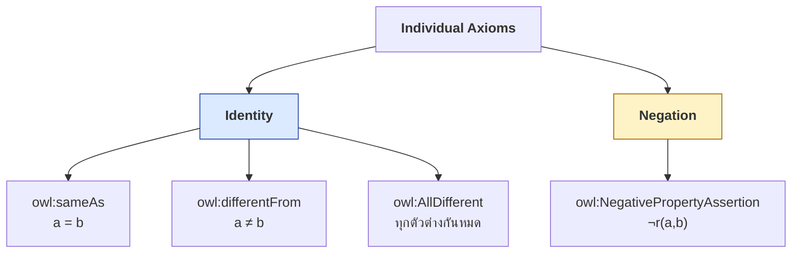
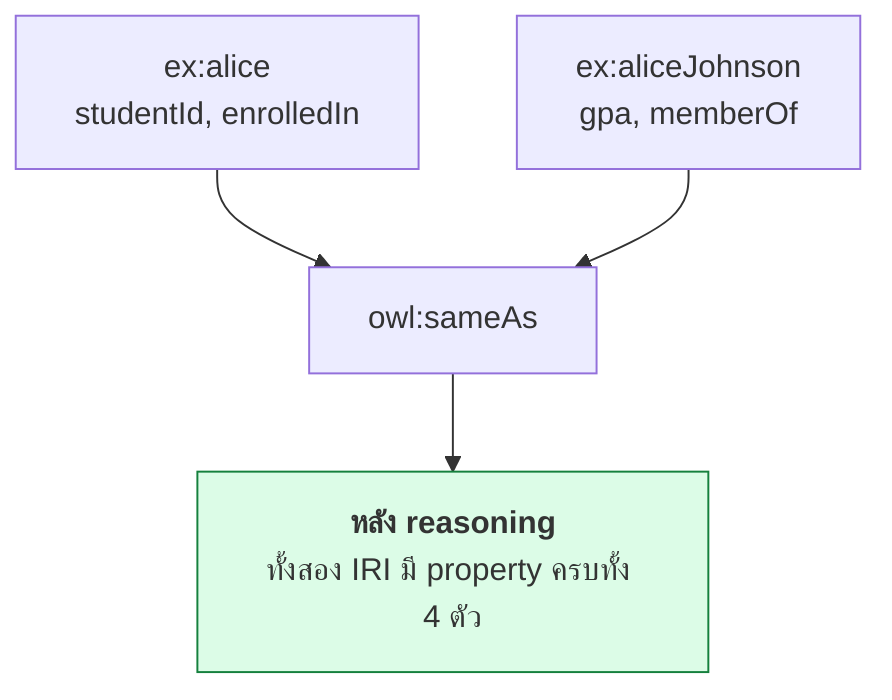
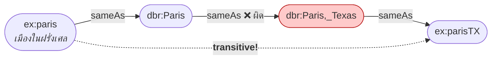
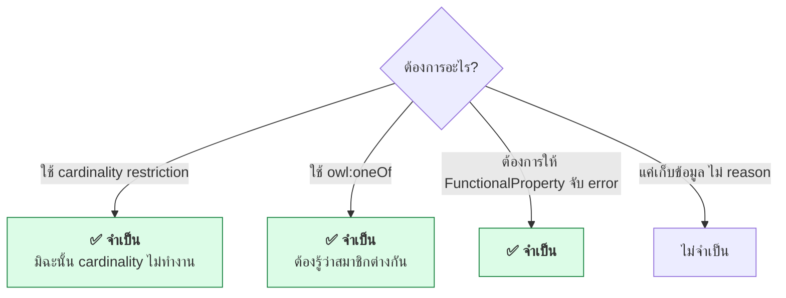
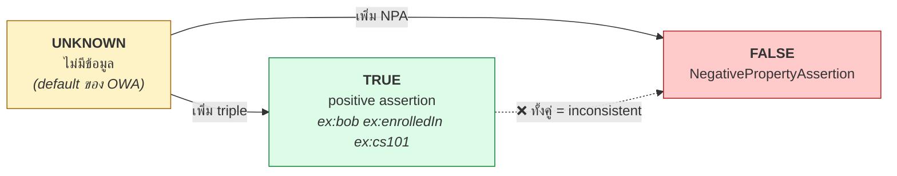

# 08.09 Individual Axioms

บทนี้ครอบคลุม axiom ที่พูดถึง **individual โดยตรง** — `owl:sameAs`, `owl:differentFrom`,
`owl:AllDifferent` และ `owl:NegativePropertyAssertion` ซึ่งเป็นเครื่องมือจัดการ **identity**
และ **การปฏิเสธ** ในโลกที่ไม่มี Unique Name Assumption

---

## ภาพรวม



---

## `owl:sameAs`

**บอกว่า IRI สองตัวชี้ไปที่สิ่งเดียวกัน**

```turtle
@prefix ex:  <http://example.org/> .
@prefix owl: <http://www.w3.org/2002/07/owl#> .
@prefix wd:  <http://www.wikidata.org/entity/> .
@prefix dbr: <http://dbpedia.org/resource/> .

ex:MarieCurie owl:sameAs wd:Q7186 , dbr:Marie_Curie .
```

### ผลของ reasoner: merge ทุกอย่าง

```turtle
ex:alice ex:studentId "S-001" ;
         ex:enrolledIn ex:cs101 .

ex:aliceJohnson ex:gpa 3.85 ;
                ex:memberOf ex:csDept .

ex:alice owl:sameAs ex:aliceJohnson .
```

**อนุมานได้**

```turtle
ex:alice        ex:gpa 3.85 ; ex:memberOf ex:csDept .
ex:aliceJohnson ex:studentId "S-001" ; ex:enrolledIn ex:cs101 .
```



### คุณสมบัติ

| คุณสมบัติ | ผลตามมา |
| --- | --- |
| **Reflexive** | `a owl:sameAs a` เสมอ |
| **Symmetric** | `a sameAs b` → `b sameAs a` |
| **Transitive** | `a sameAs b` และ `b sameAs c` → `a sameAs c` |

### ⚠️ sameAs Explosion

**transitivity คือดาบสองคม** — `sameAs` ผิดเพียงเส้นเดียวทำให้ entity ที่ไม่เกี่ยวกันถูกรวมเป็นลูกโซ่



**ปัญหานี้เกิดขึ้นจริงใน LOD Cloud** — งานวิจัยพบว่า `owl:sameAs` จำนวนมากในเว็บใช้ผิด

### ทางเลือกที่ปลอดภัยกว่า

| ระดับความมั่นใจ | ใช้ |
| --- | --- |
| **แน่นอน 100%** (มี identifier ทางการยืนยัน) | `owl:sameAs` |
| ใกล้เคียงมาก แต่ไม่แน่ใจ | `skos:closeMatch` |
| ตรงกันในบริบทเฉพาะ | `skos:exactMatch` |
| เกี่ยวข้องกัน | `skos:relatedMatch` |
| แค่ชี้ให้ดูเพิ่ม | `rdfs:seeAlso` |

```turtle
@prefix skos: <http://www.w3.org/2004/02/skos/core#> .

# ✅ ปลอดภัย -- ไม่มี transitivity, ไม่ merge property
ex:paris skos:closeMatch dbr:Paris .
ex:paris rdfs:seeAlso    <https://www.paris.fr/> .
```

---

## `owl:differentFrom`

```turtle
@prefix ex:  <http://example.org/> .
@prefix owl: <http://www.w3.org/2002/07/owl#> .

ex:alice owl:differentFrom ex:bob .
ex:cs101 owl:differentFrom ex:cs501 .
```

```turtle
ex:alice owl:sameAs ex:bob .
ex:alice owl:differentFrom ex:bob .
# → ❌ INCONSISTENT
```

### เมื่อไหร่จำเป็น



---

## `owl:AllDifferent`

**ประกาศว่า individual ทุกตัวในรายการต่างกันหมด**

<table>
<tr><th width="50%">Full form</th><th width="50%">Shorthand</th></tr>
<tr valign="top">
<td>

```turtle
@prefix ex:  <http://example.org/> .
@prefix rdf: <http://www.w3.org/1999/02/22-rdf-syntax-ns#> .
@prefix owl: <http://www.w3.org/2002/07/owl#> .

_:ad rdf:type owl:AllDifferent .
_:ad owl:members _:l1 .
_:l1 rdf:first ex:alice .
_:l1 rdf:rest _:l2 .
_:l2 rdf:first ex:bob .
_:l2 rdf:rest _:l3 .
_:l3 rdf:first ex:carol .
_:l3 rdf:rest rdf:nil .
```

</td>
<td>

```turtle
@prefix ex:  <http://example.org/> .
@prefix rdf: <http://www.w3.org/1999/02/22-rdf-syntax-ns#> .
@prefix owl: <http://www.w3.org/2002/07/owl#> .

[] a owl:AllDifferent ;
   owl:members ( ex:alice ex:bob ex:carol ) .
```

</td>
</tr>
</table>

### ประหยัดกว่ามาก

| จำนวน individual | `owl:differentFrom` | `owl:AllDifferent` |
| --- | --- | --- |
| 3 | 3 บรรทัด | 1 บล็อก |
| 5 | 10 บรรทัด | 1 บล็อก |
| 10 | **45 บรรทัด** | 1 บล็อก |
| 20 | **190 บรรทัด** | 1 บล็อก |
| 100 | **4,950 บรรทัด** | 1 บล็อก |

### ⚠️ `owl:members` vs `owl:distinctMembers`

```turtle
# OWL 2 -- ใช้ owl:members (แนะนำ)
[] a owl:AllDifferent ;
   owl:members ( ex:a ex:b ex:c ) .

# OWL 1 -- ใช้ owl:distinctMembers (ยังใช้ได้เพื่อ backward compatibility)
[] a owl:AllDifferent ;
   owl:distinctMembers ( ex:a ex:b ex:c ) .
```

### จัดกลุ่มตามชนิด

```turtle
# ✅ แยกตามชนิด -- ชัดเจนและจัดการง่ายกว่า
[] a owl:AllDifferent ;
   owl:members ( uni:alice uni:bob uni:carol uni:dave ) .

[] a owl:AllDifferent ;
   owl:members ( uni:cs101 uni:cs201 uni:cs301 uni:cs501 uni:cs601 uni:ma101 ) .

[] a owl:AllDifferent ;
   owl:members ( uni:csDept uni:mathDept uni:engineeringFaculty ) .
```

> 💡 **ไม่ต้องประกาศว่า individual ต่างชนิดกันต่างกัน** — ถ้ามี `owl:disjointWith` ระหว่าง class อยู่แล้ว
> reasoner สรุปเองได้ว่า Student กับ Course เป็นคนละสิ่ง

---

## `owl:NegativePropertyAssertion`

**ยืนยันว่าความสัมพันธ์หนึ่ง "เป็นเท็จ"** — ไม่ใช่แค่ "ไม่มีข้อมูล"

<table>
<tr><th width="50%">Object property</th><th width="50%">Data property</th></tr>
<tr valign="top">
<td>

```turtle
@prefix ex:  <http://example.org/> .
@prefix owl: <http://www.w3.org/2002/07/owl#> .

[] a owl:NegativePropertyAssertion ;
   owl:sourceIndividual  ex:bob ;
   owl:assertionProperty ex:enrolledIn ;
   owl:targetIndividual  ex:cs501 .
```

**"bob ไม่ได้ลงเรียน cs501"**

</td>
<td>

```turtle
@prefix ex:  <http://example.org/> .
@prefix owl: <http://www.w3.org/2002/07/owl#> .
@prefix xsd: <http://www.w3.org/2001/XMLSchema#> .

[] a owl:NegativePropertyAssertion ;
   owl:sourceIndividual  ex:alice ;
   owl:assertionProperty ex:gpa ;
   owl:targetValue       "4.00"^^xsd:decimal .
```

**"alice ไม่ได้มี GPA 4.00"**

</td>
</tr>
</table>

| Property type | ใช้ |
| --- | --- |
| ObjectProperty | `owl:targetIndividual` |
| DatatypeProperty | `owl:targetValue` |

### สามสถานะ



| สถานะ | `ASK { ex:bob ex:enrolledIn ex:cs501 }` |
| --- | --- |
| มี positive assertion | **YES** |
| ไม่มีอะไร | **UNKNOWN** (SPARQL ตอบ false แต่ reasoner ตอบ unknown) |
| มี NPA | **NO** |

### ตัวอย่างจริงจาก University ABox

จาก [`code/ch05/university_abox.ttl`](../code/ch05/university_abox.ttl):

```turtle
# Explicit negative assertion: bob is definitely NOT enrolled in cs501.
# This is different from simply having no triple (which would mean "unknown").
[] a owl:NegativePropertyAssertion ;
   owl:sourceIndividual  uni:bob ;
   owl:assertionProperty uni:enrolledIn ;
   owl:targetIndividual  uni:cs501 .
```

### ทำให้เกิด inconsistency

```turtle
ex:bob ex:enrolledIn ex:cs501 .

[] a owl:NegativePropertyAssertion ;
   owl:sourceIndividual  ex:bob ;
   owl:assertionProperty ex:enrolledIn ;
   owl:targetIndividual  ex:cs501 .

# → ❌ INCONSISTENT
```

### Use case

```turtle
@prefix ex:  <http://example.org/medical#> .
@prefix owl: <http://www.w3.org/2002/07/owl#> .

# ยืนยันว่าผู้ป่วยไม่แพ้ยานี้ (ต่างจาก "ยังไม่ได้ทดสอบ")
[] a owl:NegativePropertyAssertion ;
   owl:sourceIndividual  ex:patient001 ;
   owl:assertionProperty ex:allergicTo ;
   owl:targetIndividual  ex:penicillin .

# ยืนยันว่านักศึกษาไม่ได้ถูกพักการเรียน
[] a owl:NegativePropertyAssertion ;
   owl:sourceIndividual  ex:alice ;
   owl:assertionProperty ex:hasStatus ;
   owl:targetIndividual  ex:suspended .
```

> 💡 **NPA มีค่ามากในโดเมนที่ "ไม่ทราบ" กับ "ไม่ใช่" ต่างกันอย่างมีนัยสำคัญ**
> เช่น การแพทย์, กฎหมาย, การเงิน

---

## Class assertion แบบปฏิเสธ

```turtle
@prefix ex:  <http://example.org/> .
@prefix owl: <http://www.w3.org/2002/07/owl#> .
@prefix xsd: <http://www.w3.org/2001/XMLSchema#> .

# alice ไม่ใช่ Professor
ex:alice a [ a owl:Class ; owl:complementOf ex:Professor ] .

# alice ไม่มีลูกเลย (closure axiom)
ex:alice a [
    a owl:Restriction ;
    owl:onProperty     ex:hasChild ;
    owl:maxCardinality "0"^^xsd:nonNegativeInteger
] .

# alice ไม่ได้ลงเรียนวิชาบัณฑิตเลย
ex:alice a [
    a owl:Restriction ;
    owl:onProperty              ex:enrolledIn ;
    owl:maxQualifiedCardinality "0"^^xsd:nonNegativeInteger ;
    owl:onClass                 ex:GraduateCourse
] .
```

---

## Individual Declaration

```turtle
@prefix ex:  <http://example.org/> .
@prefix owl: <http://www.w3.org/2002/07/owl#> .

# OWL 2 DL แบบเคร่งครัดต้องประกาศ
ex:alice a owl:NamedIndividual , ex:Student .

# ใช้งานทั่วไปเขียนแค่นี้ก็พอ
ex:alice a ex:Student .
```

| กรณี | ต้องมี `owl:NamedIndividual` |
| --- | :---: |
| OWL 2 DL แบบเคร่งครัด | ✅ |
| ส่งออกจาก Protégé | ✅ (Protégé ใส่ให้เอง) |
| ใช้งานทั่วไป / RDFS | ❌ |

---

## ตัวอย่างเต็ม

```turtle
@prefix ex:   <http://example.org/university#> .
@prefix rdf:  <http://www.w3.org/1999/02/22-rdf-syntax-ns#> .
@prefix rdfs: <http://www.w3.org/2000/01/rdf-schema#> .
@prefix owl:  <http://www.w3.org/2002/07/owl#> .
@prefix xsd:  <http://www.w3.org/2001/XMLSchema#> .
@prefix skos: <http://www.w3.org/2004/02/skos/core#> .
@prefix wd:   <http://www.wikidata.org/entity/> .

# ===== TBox =====
ex:studentId a owl:DatatypeProperty , owl:InverseFunctionalProperty .

ex:BusyStudent owl:equivalentClass [
    a owl:Restriction ;
    owl:onProperty     ex:enrolledIn ;
    owl:minCardinality "3"^^xsd:nonNegativeInteger
] .

# ===== ABox =====
ex:alice a owl:NamedIndividual , ex:Student ;
    rdfs:label    "Alice Johnson"@en ;
    ex:studentId  "S-2024-0421" ;
    ex:enrolledIn ex:cs101 , ex:cs501 , ex:cs601 .

ex:a_johnson a owl:NamedIndividual , ex:Student ;
    ex:studentId "S-2024-0421" ;          # ← InverseFunctional → sameAs alice
    ex:gpa       3.85 .

ex:bob a owl:NamedIndividual , ex:Student ;
    ex:studentId "S-2024-0512" ;
    ex:enrolledIn ex:cs101 .

# ===== identity =====
# วิชาทั้งหมดเป็นคนละวิชา -- จำเป็นสำหรับ cardinality
[] a owl:AllDifferent ;
   owl:members ( ex:cs101 ex:cs201 ex:cs501 ex:cs601 ) .

# คนทั้งหมดเป็นคนละคน (ยกเว้น alice/a_johnson ที่ reasoner จะรวมให้)
[] a owl:AllDifferent ;
   owl:members ( ex:alice ex:bob ex:carol ) .

# link ไปยัง dataset ภายนอก -- แน่ใจ
ex:exampleUniversity owl:sameAs wd:Q1234567 .

# link ที่ไม่แน่ใจ -- ใช้ skos แทน
ex:csDept skos:closeMatch <http://other.example.org/dept/computing> .

# ===== negative assertion =====
[] a owl:NegativePropertyAssertion ;
   owl:sourceIndividual  ex:bob ;
   owl:assertionProperty ex:enrolledIn ;
   owl:targetIndividual  ex:cs501 .

# bob ไม่ได้เป็น BusyStudent (ยืนยัน)
ex:bob a [
    a owl:Restriction ;
    owl:onProperty     ex:enrolledIn ;
    owl:maxCardinality "1"^^xsd:nonNegativeInteger
] .
```

**reasoner อนุมาน**

| Inferred | เหตุผล |
| --- | --- |
| `ex:alice owl:sameAs ex:a_johnson` | `ex:studentId` เป็น InverseFunctional |
| `ex:alice ex:gpa 3.85` | merge จาก sameAs |
| `ex:a_johnson ex:enrolledIn ex:cs101, cs501, cs601` | merge จาก sameAs |
| `ex:alice a ex:BusyStudent` | ลงเรียน 3 วิชา + AllDifferent |
| `ex:bob` **ไม่ใช่** `ex:BusyStudent` | maxCardinality 1 |

---

## ทดสอบด้วย Python

```python
from owlready2 import (
    AllDifferent, DataProperty, FunctionalProperty, InverseFunctionalProperty,
    ObjectProperty, OwlReadyInconsistentOntologyError, Thing,
    get_ontology, sync_reasoner_hermit,
)

onto = get_ontology("http://example.org/university#")

with onto:
    class Student(Thing): pass
    class Course(Thing): pass

    class enrolledIn(ObjectProperty):
        domain, range = [Student], [Course]

    class studentId(DataProperty, FunctionalProperty, InverseFunctionalProperty):
        domain, range = [Student], [str]

    class BusyStudent(Thing):
        equivalent_to = [enrolledIn.min(3, Course)]

    # --- entity resolution ผ่าน InverseFunctionalProperty ---
    alice = Student("alice", studentId="S-2024-0421")
    a_johnson = Student("a_johnson", studentId="S-2024-0421")

    c1, c2, c3 = Course("cs101"), Course("cs501"), Course("cs601")
    alice.enrolledIn = [c1, c2, c3]

    AllDifferent([c1, c2, c3])              # ⚠️ จำเป็นสำหรับ cardinality

with onto:
    sync_reasoner_hermit(infer_property_values=True)

print("alice == a_johnson?", alice == a_johnson)
print("alice.equivalent_to:", alice.equivalent_to)
print("alice types:", sorted(c.name for c in alice.is_a if hasattr(c, "name")))
print("BusyStudent:", [i.name for i in BusyStudent.instances()])
```

Expected output:

```
alice == a_johnson? False        ← owlready2 เก็บเป็นคนละ object
alice.equivalent_to: [university.a_johnson]    ← แต่ reasoner รู้ว่าเป็นคนเดียวกัน
alice types: ['BusyStudent']
BusyStudent: ['alice']
```

### ทดสอบ inconsistency

```python
from owlready2 import Not

with onto:
    bob = Student("bob", studentId="S-2024-0512")
    AllDifferent([alice, bob])

    # ทำให้ขัดกัน: bob มี studentId เดียวกับ alice
    bob.studentId = "S-2024-0421"

try:
    with onto:
        sync_reasoner_hermit()
    print("consistent (ไม่คาดคิด)")
except OwlReadyInconsistentOntologyError:
    print("❌ INCONSISTENT")
    print("   1. studentId เป็น InverseFunctionalProperty")
    print("   2. alice และ bob มี studentId เดียวกัน → sameAs")
    print("   3. แต่ AllDifferent บอกว่าเป็นคนละคน")
```

Expected output:

```
❌ INCONSISTENT
   1. studentId เป็น InverseFunctionalProperty
   2. alice และ bob มี studentId เดียวกัน → sameAs
   3. แต่ AllDifferent บอกว่าเป็นคนละคน
```

**นี่คือกลไกตรวจคุณภาพข้อมูลอัตโนมัติที่ทรงพลังที่สุดของ OWL**

---

## Checklist

- [ ] ใช้ **`owl:sameAs` เมื่อแน่ใจ 100%** เท่านั้น — มิฉะนั้นใช้ `skos:closeMatch`
- [ ] ระวัง **sameAs explosion** จาก transitivity
- [ ] ประกาศ **`owl:AllDifferent`** ให้ครบเมื่อใช้ cardinality หรือ `oneOf`
- [ ] จัดกลุ่ม `owl:AllDifferent` **ตามชนิดของ individual**
- [ ] ใช้ **`owl:members`** (OWL 2) ไม่ใช่ `owl:distinctMembers` (OWL 1)
- [ ] ใช้ **`owl:NegativePropertyAssertion`** เมื่อ "ไม่ทราบ" กับ "ไม่ใช่" ต่างกันอย่างมีนัยสำคัญ
- [ ] ประกาศ `owl:NamedIndividual` ถ้าต้องการให้เป็น OWL 2 DL ที่เคร่งครัด

---

## Key Points

- **`owl:sameAs`** merge property ทั้งหมดของสอง individual และเป็น **reflexive, symmetric, transitive**
- ⚠️ **transitivity ทำให้เกิด sameAs explosion** — ใช้ `skos:closeMatch` เมื่อไม่แน่ใจ
- **`owl:AllDifferent`** ประหยัดกว่า `owl:differentFrom` มหาศาล (100 ตัว → 1 บล็อก แทน 4,950 บรรทัด)
- ⚠️ **cardinality และ `oneOf` ไม่ทำงานถ้าไม่ประกาศ `owl:AllDifferent`**
- OWL 2 ใช้ **`owl:members`**; OWL 1 ใช้ `owl:distinctMembers` (ยังรองรับเพื่อ backward compatibility)
- **`owl:NegativePropertyAssertion`** แยก "**เท็จ**" ออกจาก "**ไม่ทราบ**" — เป็นวิธีเดียวที่ระบุความเป็นเท็จได้ใน OWL
- ใช้ `owl:targetIndividual` กับ ObjectProperty และ `owl:targetValue` กับ DatatypeProperty
- **`InverseFunctionalProperty` + `AllDifferent`** เป็นกลไกตรวจคุณภาพข้อมูลอัตโนมัติที่ทรงพลังที่สุดของ OWL
