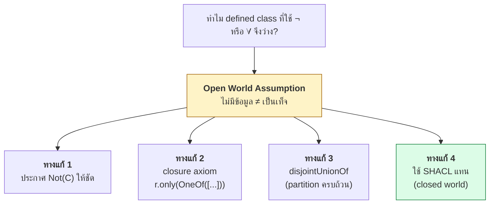
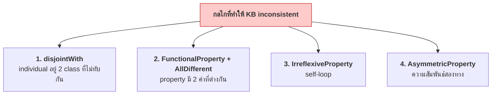

# 08.10 Python: สร้าง OWL Ontology และตรวจ Inconsistency

บทนี้สร้าง **Library ontology** ที่ใช้ OWL construct ครบทุกกลุ่มจาก Chapter 08 แล้วรัน HermiT
เพื่อดู **automatic classification**, **property inference** และ **การตรวจจับ inconsistency 4 กลไก**
ตัวเลขและผลลัพธ์ทุกอย่างมาจากการรันจริง

> 📁 ไฟล์: [`library_ontology.py`](../code/ch08/library_ontology.py) และ [`owl_reasoning.py`](../code/ch08/owl_reasoning.py)

---

## Mapping: OWL → owlready2

| OWL | owlready2 |
| --- | --- |
| `rdfs:subClassOf` | `class A(B): pass` |
| `owl:equivalentClass` | `A.equivalent_to = [...]` |
| `owl:disjointWith` | `A.is_a.append(Not(B))` |
| `owl:AllDisjointClasses` | `AllDisjoint([A, B, C])` |
| `owl:intersectionOf` | `A & B` |
| `owl:unionOf` | `A \| B` |
| `owl:complementOf` | `Not(A)` |
| `owl:oneOf` | `OneOf([a, b, c])` |
| `owl:someValuesFrom` | `r.some(C)` |
| `owl:allValuesFrom` | `r.only(C)` |
| `owl:hasValue` | `r.value(a)` |
| `owl:minQualifiedCardinality` | `r.min(n, C)` |
| `owl:maxQualifiedCardinality` | `r.max(n, C)` |
| `owl:qualifiedCardinality` | `r.exactly(n, C)` |
| `owl:inverseOf` | `inverse_property = r` |
| `owl:TransitiveProperty` | `class r(ObjectProperty, TransitiveProperty)` |
| `owl:AllDifferent` | `AllDifferent([a, b, c])` |

---

## 1. สร้าง class hierarchy พร้อม disjointness

```python
from owlready2 import AllDisjoint, Not, Thing, get_ontology

onto = get_ontology("http://example.org/library#")

with onto:
    class Agent(Thing):
        """Anything that can act: a person or an organization."""

    class Person(Agent): pass
    class Author(Person): pass
    class Member(Person): pass
    class Librarian(Person): pass

    class Publication(Thing): pass
    class Book(Publication): pass
    class Journal(Publication): pass
    class Thesis(Publication): pass
    class FictionBook(Book): pass
    class NonFictionBook(Book): pass
    class ReferenceBook(Book): pass

    class Loan(Thing): pass

# ⚠️ ถ้าไม่มีส่วนนี้ reasoner จะจับ error ไม่ได้เลย
with onto:
    AllDisjoint([Book, Journal, Thesis])
    AllDisjoint([Publication, Person, Organization, Loan])
    FictionBook.is_a.append(Not(NonFictionBook))
    Member.is_a.append(Not(Librarian))
```

---

## 2. สร้าง property พร้อม characteristics

```python
from owlready2 import (
    AsymmetricProperty, DataProperty, FunctionalProperty,
    InverseFunctionalProperty, IrreflexiveProperty, ObjectProperty,
    SymmetricProperty, TransitiveProperty,
)

with onto:
    class writtenBy(ObjectProperty):
        domain, range = [Publication], [Author]

    class wrote(ObjectProperty):
        inverse_property = writtenBy          # owl:inverseOf

    class publishedBy(ObjectProperty, FunctionalProperty):
        domain, range = [Publication], [Publisher]

    class partOf(ObjectProperty, TransitiveProperty):
        domain, range = [Location], [Location]

    class coAuthorOf(ObjectProperty, SymmetricProperty, IrreflexiveProperty):
        domain, range = [Author], [Author]

    class citedBy(ObjectProperty, AsymmetricProperty, IrreflexiveProperty):
        domain, range = [Publication], [Publication]

    class isbn(DataProperty, FunctionalProperty, InverseFunctionalProperty):
        domain, range = [Book], [str]
```

### ⚠️ กับดักจริง: Functional property รับ "ค่าเดี่ยว" ไม่ใช่ list

```python
# ❌ พัง -- AttributeError: 'list' object has no attribute 'storid'
book.publishedBy = [penguin]

# ✅ ถูก -- functional property รับค่าเดี่ยว
book.publishedBy = penguin

# ✅ property ที่ไม่ functional ยังใช้ list
book.heldBy = [cityLibrary]
```

| Property | assignment |
| --- | --- |
| `FunctionalProperty` | `obj.prop = value` (ค่าเดี่ยว) |
| ไม่ใช่ functional | `obj.prop = [v1, v2]` (list) |

---

## 3. Defined class — automatic classification

```python
with onto:
    # --- someValuesFrom (∃) ---
    class PublishedAuthor(Thing):
        equivalent_to = [Author & wrote.some(Publication)]

    # --- complementOf (¬) + intersectionOf (⊓) ---
    class LoanableBook(Thing):
        equivalent_to = [Book & Not(ReferenceBook)]

    # --- qualified cardinality (≥n r.C) ---
    class ProlificAuthor(Thing):
        equivalent_to = [Author & wrote.min(3, Publication)]

    class ActiveMember(Thing):
        equivalent_to = [Member & hasLoan.min(1, Loan)]

    class HeavyBorrower(Thing):
        equivalent_to = [Member & hasLoan.min(5, Loan)]

    # --- allValuesFrom (∀) + someValuesFrom (∃) ---
    # ⚠️ ต้องมี ∃ ด้วย มิฉะนั้น vacuous truth
    class FictionOnlyAuthor(Thing):
        equivalent_to = [
            Author & wrote.some(FictionBook) & wrote.only(FictionBook)
        ]

    # --- unionOf (⊔) ---
    class SerialPublication(Thing):
        equivalent_to = [Journal | Thesis]

    # --- oneOf (nominal) ---
    class CoreGenre(Thing): pass

with onto:
    fiction = Genre("fictionGenre")
    science = Genre("scienceGenre")
    history = Genre("historyGenre")
    CoreGenre.equivalent_to = [OneOf([fiction, science, history])]
```

---

## 4. ABox พร้อม `AllDifferent`

```python
with onto:
    orwell = Author("georgeOrwell")
    huxley = Author("aldousHuxley")
    hawking = Author("stephenHawking")

    orwell.coAuthorOf = [huxley]         # symmetric -> huxley.coAuthorOf = [orwell]

    b1984 = FictionBook("nineteenEightyFour",
                        title="Nineteen Eighty-Four",
                        isbn="978-0451524935",
                        publicationYear=1949,
                        pageCount=328)
    # ... หนังสือเล่มอื่น ...

    orwell.wrote = [b1984, animalFarm, homage]     # 3 เล่ม -> ProlificAuthor
    huxley.wrote = [braveNew]

    for book in (b1984, animalFarm, homage, braveNew, briefHistory, dictionary):
        book.publishedBy = penguin       # functional -> ค่าเดี่ยว
        book.shelvedAt = shelfA1         # functional -> ค่าเดี่ยว
        book.heldBy = [cityLibrary]      # ไม่ functional -> list

    # ===== ⚠️ AllDifferent -- จำเป็นสำหรับ cardinality ทุกตัว =====
    AllDifferent([b1984, animalFarm, homage, braveNew, briefHistory, dictionary])
    AllDifferent([orwell, huxley, hawking])
    AllDifferent([alice, bob])
    AllDifferent([fiction, science, history])
```

---

## 5. รัน reasoner

```python
from owlready2 import OwlReadyInconsistentOntologyError, sync_reasoner_hermit

try:
    with onto:
        sync_reasoner_hermit(infer_property_values=True, debug=0)
    print("✅ ontology consistent")
except OwlReadyInconsistentOntologyError:
    print("❌ ontology inconsistent")
```

Expected output:

```
✅ ontology consistent
```

---

## 6. ผลลัพธ์: Automatic Classification

```
  fictionGenre             ['Genre']    → ['CoreGenre']           ← เพิ่ม ['CoreGenre']
  scienceGenre             ['Genre']    → ['CoreGenre']           ← เพิ่ม ['CoreGenre']
  historyGenre             ['Genre']    → ['CoreGenre']           ← เพิ่ม ['CoreGenre']
  georgeOrwell             ['Author']   → ['ProlificAuthor']      ← เพิ่ม ['ProlificAuthor']
  aldousHuxley             ['Author']   → ['PublishedAuthor']     ← เพิ่ม ['PublishedAuthor']
  stephenHawking           ['Author']   → ['PublishedAuthor']     ← เพิ่ม ['PublishedAuthor']
  nineteenEightyFour       ['FictionBook']    → ['FictionBook', 'LongBook']
  aBriefHistoryOfTime      ['NonFictionBook'] → ['LongBook', 'NonFictionBook']
  aliceMember              ['Member']   → ['ActiveMember']        ← เพิ่ม ['ActiveMember']
```

### Retrieval

```
PublishedAuthor      = ['aldousHuxley', 'georgeOrwell', 'stephenHawking']
ProlificAuthor       = ['georgeOrwell']
FictionOnlyAuthor    = []                    ← ⚠️ ว่าง!
LoanableBook         = []                    ← ⚠️ ว่าง!
ActiveMember         = ['aliceMember']
HeavyBorrower        = []
SerialPublication    = []
CoreGenre            = ['fictionGenre', 'historyGenre', 'scienceGenre']
LongBook             = ['aBriefHistoryOfTime', 'nineteenEightyFour']
```

### ⚠️ ทำไม `FictionOnlyAuthor` จึงว่าง

```python
class FictionOnlyAuthor(Thing):
    equivalent_to = [Author & wrote.some(FictionBook) & wrote.only(FictionBook)]
```

`orwell` เขียนเฉพาะ `FictionBook` ทั้ง 3 เล่ม แต่ **ภายใต้ OWA reasoner ไม่รู้ว่ามีงานอื่นอีกหรือไม่**
จึงสรุป `wrote.only(FictionBook)` ไม่ได้

**ทางแก้: closure axiom**

```python
from owlready2 import OneOf

with onto:
    orwell.is_a.append(wrote.only(OneOf([b1984, animalFarm, homage])))
```

### ⚠️ ทำไม `LoanableBook` จึงว่าง

```python
class LoanableBook(Thing):
    equivalent_to = [Book & Not(ReferenceBook)]
```

ภายใต้ OWA reasoner **ไม่รู้ว่าหนังสือเล่มไหน "ไม่ใช่" ReferenceBook**
— การที่ไม่ได้ประกาศว่าเป็น ReferenceBook ไม่ได้แปลว่าไม่ใช่

**ทางแก้ 2 แบบ**

```python
# แบบที่ 1: ประกาศให้ชัดว่าไม่ใช่
with onto:
    b1984.is_a.append(Not(ReferenceBook))

# แบบที่ 2: ทำให้ Book แบ่งเป็น partition ที่ครบถ้วน (disjointUnionOf)
# Book = LendingBook ⊔ ReferenceBook (disjoint)
```



---

## 7. ผลลัพธ์: Property Inference

```
▸ inverseOf (wrote ↔ writtenBy)
    orwell.wrote                 = ['animalFarm', 'homageToCatalonia', 'nineteenEightyFour']
    nineteenEightyFour.writtenBy = ['georgeOrwell']

▸ SymmetricProperty (coAuthorOf)
    orwell.coAuthorOf            = ['aldousHuxley']
    huxley.coAuthorOf            = ['georgeOrwell']        ← inferred!

▸ TransitiveProperty (partOf)
    shelfA1.partOf               = ['mainBuilding', 'roomA']   ← mainBuilding inferred!
    shelfA1.INDIRECT_partOf      = ['mainBuilding', 'roomA']

▸ inverseOf (borrowedBy ↔ hasLoan)
    alice.hasLoan                = ['loan001', 'loan002']      ← inferred!
```

**ข้อสังเกต**: `shelfA1.partOf` เดิมมีแค่ `roomA` — `mainBuilding` มาจาก transitivity

---

## 8. Unsatisfiable Class

```python
from owlready2 import Nothing

unsat = [c for c in onto.classes() if Nothing in c.equivalent_to]
```

สร้าง class ที่ unsatisfiable โดยตั้งใจ:

```python
from owlready2 import Not, Thing, World, sync_reasoner_hermit

world = World()
test = world.get_ontology("http://example.org/test#")

with test:
    class Item(Thing): pass
    class Digital(Item): pass
    class Physical(Item): pass
    Digital.is_a.append(Not(Physical))

    class DigitalPhysical(Thing):
        equivalent_to = [Digital & Physical]

with test:
    sync_reasoner_hermit(x=world, debug=0)

for cls in test.classes():
    if Nothing in cls.equivalent_to:
        print(f"❌ {cls.name} ≡ ⊥")
```

Expected output:

```
❌ DigitalPhysical ≡ ⊥
   เพราะ Digital ⊑ ¬Physical แต่ DigitalPhysical ≡ Digital ⊓ Physical
```

---

## 9. Inconsistency Detection — 4 กลไก



### กลไกที่ 1: `disjointWith`

```python
with test:
    class Publication(Thing): pass
    class Book(Publication): pass
    class Journal(Publication): pass
    Book.is_a.append(Not(Journal))

    bad = Book("badItem")
    bad.is_a.append(Journal)         # ❌ เป็นทั้ง Book และ Journal
```

### กลไกที่ 2: `FunctionalProperty` + `AllDifferent`

```python
with test:
    class Member(Thing): pass
    class Loan(Thing): pass

    # ประกาศเป็น ObjectProperty ธรรมดาก่อน เพื่อให้ใส่ค่าได้ 2 ค่า
    class borrowedBy(ObjectProperty):
        domain, range = [Loan], [Member]

    m1, m2 = Member("alice"), Member("bob")
    AllDifferent([m1, m2])           # ⚠️ จำเป็น มิฉะนั้น reasoner แค่สรุป sameAs

    loan = Loan("loan1")
    loan.borrowedBy = [m1, m2]

    # แล้วค่อยประกาศให้เป็น functional -> ขัดกับ AllDifferent ทันที
    borrowedBy.is_a.append(FunctionalProperty)
```

> 💡 **เทคนิค**: ประกาศ property เป็น non-functional ก่อน ใส่ค่าหลายค่า แล้วค่อยเพิ่ม `FunctionalProperty`
> เพราะ owlready2 บังคับค่าเดี่ยวตั้งแต่ตอน assign ถ้าประกาศ functional ตั้งแต่แรก

### กลไกที่ 3: `IrreflexiveProperty`

```python
with test:
    class Author(Thing): pass

    class coAuthorOf(ObjectProperty, SymmetricProperty, IrreflexiveProperty):
        domain, range = [Author], [Author]

    a = Author("selfAuthor")
    a.coAuthorOf = [a]               # ❌ เป็นผู้เขียนร่วมกับตัวเอง
```

### กลไกที่ 4: `AsymmetricProperty`

```python
with test:
    class Paper(Thing): pass

    class citedBy(ObjectProperty, AsymmetricProperty):
        domain, range = [Paper], [Paper]

    p1, p2 = Paper("paperA"), Paper("paperB")
    p1.citedBy = [p2]
    p2.citedBy = [p1]                # ❌ อ้างอิงกันเอง
```

### ผลรันจริงทั้ง 4 กลไก

```
❌ INCONSISTENT ตามที่คาด
   กลไก : disjointWith
   กรณี : item เป็นทั้ง Book และ Journal

❌ INCONSISTENT ตามที่คาด
   กลไก : FunctionalProperty + AllDifferent
   กรณี : loan มี borrowedBy 2 คนที่ต่างกัน

❌ INCONSISTENT ตามที่คาด
   กลไก : IrreflexiveProperty
   กรณี : author เป็น coAuthorOf ตัวเอง

❌ INCONSISTENT ตามที่คาด
   กลไก : AsymmetricProperty
   กรณี : paper A citedBy B และ B citedBy A
```

---

## 10. พิสูจน์ว่า `AllDifferent` จำเป็นจริง

```python
for use_all_different in (False, True):
    world = World()
    test = world.get_ontology("http://example.org/test#")
    with test:
        class Author(Thing): pass
        class Publication(Thing): pass

        class wrote(ObjectProperty):
            domain, range = [Author], [Publication]

        class ProlificAuthor(Thing):
            equivalent_to = [Author & wrote.min(3, Publication)]

        author = Author("someAuthor")
        p1, p2, p3 = (Publication(f"pub{i}") for i in range(1, 4))
        author.wrote = [p1, p2, p3]

        if use_all_different:
            AllDifferent([p1, p2, p3])

    with test:
        sync_reasoner_hermit(x=world, debug=0)

    members = sorted(i.name for i in test.ProlificAuthor.instances())
    print(f"{'มี' if use_all_different else 'ไม่มี'} AllDifferent: ProlificAuthor = {members}")
```

Expected output:

```
❌ ไม่มี AllDifferent: ProlificAuthor = []
✅ มี AllDifferent   : ProlificAuthor = ['someAuthor']
```

**นี่คือหลักฐานว่า `owl:AllDifferent` จำเป็นจริง** — ถ้าไม่มี cardinality restriction จะไม่ทำงานเลย

---

## รันจริง

```bash
python code/ch08/library_ontology.py            # สร้างและแสดงโครงสร้าง
python code/ch08/library_ontology.py out.owl    # บันทึกเป็นไฟล์
python code/ch08/owl_reasoning.py               # รัน reasoning + demo ทั้ง 5
```

> ⚠️ `owl_reasoning.py` เรียก HermiT **7 ครั้ง** (แต่ละ World แยกกัน) — รอบแรกอาจใช้เวลา 1–2 นาที
> เพราะ JVM ต้อง cold start; รอบถัด ๆ ไปเร็วขึ้นมาก

---

## แปลง owlready2 → Turtle

owlready2 **ไม่ save Turtle โดยตรง** — ต้องผ่าน rdflib

```python
from pathlib import Path
from rdflib import Graph

onto.save(file="library.owl", format="rdfxml")

g = Graph().parse("library.owl", format="xml")
g.bind("lib", "http://example.org/library#")
g.serialize("library.ttl", format="turtle")
print(f"{len(g)} triples")
```

---

## Troubleshooting

| อาการ | สาเหตุ | วิธีแก้ |
| --- | --- | --- |
| `AttributeError: 'list' object has no attribute 'storid'` | assign list ให้ FunctionalProperty | ใช้ค่าเดี่ยว: `obj.prop = value` |
| defined class ว่างทั้งที่ควรมีสมาชิก | ใช้ `Not()` หรือ `.only()` ภายใต้ OWA | เพิ่ม closure axiom หรือประกาศ `Not(C)` ให้ชัด |
| cardinality ไม่ทำงาน | ไม่มี `AllDifferent` | ประกาศ `AllDifferent` ให้ครบ |
| reasoner ช้ามาก / ค้าง | เรียก HermiT หลายครั้ง (JVM cold start) | รวมเป็นครั้งเดียว หรือรอรอบแรก |
| `UnsupportedDatatypeException` | datatype ไม่อยู่ใน OWL 2 map | ใช้ `int`, `str`, `float`, `bool` |
| `HTTPError 403` ตอน load | `owl:imports` ดึงผ่าน network | ตัด `owl:imports` ออกก่อน |
| ผลปนกันข้ามการทดสอบ | ใช้ default world ร่วมกัน | สร้าง `World()` แยกทุกครั้ง |
| `instances()` ไม่ครบ | คืนเฉพาะ direct instance | ไล่ `subclasses()` เอง หรือใช้ SPARQL |

---

## Key Points

- owlready2 map OWL construct เข้า Python ตรง ๆ: `&` `|` `Not()` `OneOf()` `r.some()` `r.only()` `r.min(n, C)`
- ⚠️ **FunctionalProperty รับค่าเดี่ยว ไม่ใช่ list** — `obj.prop = value` ไม่ใช่ `obj.prop = [value]`
- ⚠️ **defined class ที่ใช้ `Not()` หรือ `.only()` มักว่างภายใต้ OWA** — ต้องเพิ่ม closure axiom
- ⚠️ **cardinality ไม่ทำงานเลยถ้าไม่มี `AllDifferent`** — พิสูจน์แล้วด้วยการทดลองเทียบ
- **4 กลไกที่ทำให้ inconsistent**: `disjointWith`, `FunctionalProperty + AllDifferent`, `IrreflexiveProperty`, `AsymmetricProperty`
- เทคนิคทดสอบ functional: ประกาศเป็น non-functional ก่อน ใส่ค่าหลายค่า แล้วค่อย `is_a.append(FunctionalProperty)`
- ตรวจ unsatisfiable ด้วย `Nothing in cls.equivalent_to`; ตรวจ inconsistency ด้วย `try/except OwlReadyInconsistentOntologyError`
- ใช้ **`World()` แยก** ทุกครั้งที่ทดสอบหลายกรณี เพื่อไม่ให้ผลปนกัน
- owlready2 **ไม่ save Turtle** — save RDF/XML แล้วแปลงด้วย rdflib
