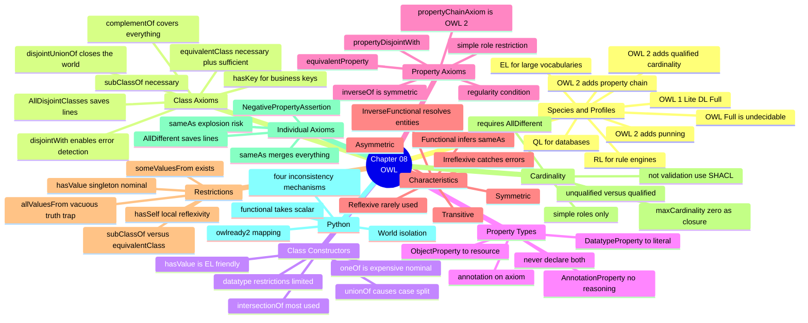
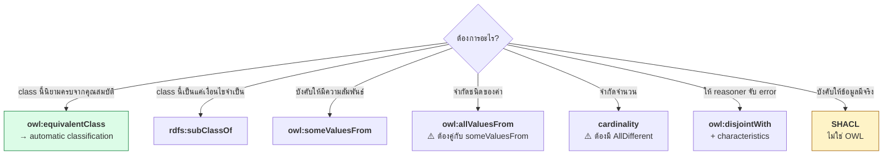

# 08.11 สรุป Chapter 08 + OWL Cheat Sheet

Chapter 08 ครอบคลุม OWL vocabulary ครบทุกตัว ตั้งแต่ species/profiles ไปจนถึง restriction และ cardinality
บทสรุปนี้รวมทุกอย่างเป็น cheat sheet พร้อมกับดักที่เจอจริงตอนพัฒนา

---

## Concept Map



---

## OWL Vocabulary Cheat Sheet

### Class Axioms

| ต้องการ | Turtle | Manchester |
| --- | --- | --- |
| A ⊑ B | `ex:A rdfs:subClassOf ex:B .` | `SubClassOf: B` |
| A ≡ B | `ex:A owl:equivalentClass ex:B .` | `EquivalentTo: B` |
| A ⊓ B ⊑ ⊥ | `ex:A owl:disjointWith ex:B .` | `DisjointWith: B` |
| หลาย class disjoint | `[] a owl:AllDisjointClasses ; owl:members ( ex:A ex:B ex:C ) .` | `DisjointClasses: A, B, C` |
| partition ครบถ้วน | `ex:A owl:disjointUnionOf ( ex:B ex:C ) .` | `DisjointUnionOf: B, C` |
| business key | `ex:A owl:hasKey ( ex:id ) .` | `HasKey: id` |
| เลิกใช้ | `ex:A owl:deprecated true .` | — |

### Class Constructors

| DL | Turtle | Manchester |
| --- | --- | --- |
| `C ⊓ D` | `[ a owl:Class ; owl:intersectionOf ( ex:C ex:D ) ]` | `C and D` |
| `C ⊔ D` | `[ a owl:Class ; owl:unionOf ( ex:C ex:D ) ]` | `C or D` |
| `¬C` | `[ a owl:Class ; owl:complementOf ex:C ]` | `not C` |
| `{a,b,c}` | `[ a owl:Class ; owl:oneOf ( ex:a ex:b ex:c ) ]` | `{a, b, c}` |

### Restrictions

| DL | Turtle | Manchester |
| --- | --- | --- |
| `∃r.C` | `[ a owl:Restriction ; owl:onProperty ex:r ; owl:someValuesFrom ex:C ]` | `r some C` |
| `∀r.C` | `[ ... owl:allValuesFrom ex:C ]` | `r only C` |
| `∃r.{a}` | `[ ... owl:hasValue ex:a ]` | `r value a` |
| `∃r.Self` | `[ ... owl:hasSelf true ]` | `r Self` |
| `≥n r` | `[ ... owl:minCardinality "n"^^xsd:nonNegativeInteger ]` | `r min n` |
| `≤n r` | `[ ... owl:maxCardinality "n"^^xsd:nonNegativeInteger ]` | `r max n` |
| `=n r` | `[ ... owl:cardinality "n"^^xsd:nonNegativeInteger ]` | `r exactly n` |
| `≥n r.C` | `[ ... owl:minQualifiedCardinality "n"^^xsd:nonNegativeInteger ; owl:onClass ex:C ]` | `r min n C` |
| `≤n r.C` | `[ ... owl:maxQualifiedCardinality ... ; owl:onClass ex:C ]` | `r max n C` |
| `=n r.C` | `[ ... owl:qualifiedCardinality ... ; owl:onClass ex:C ]` | `r exactly n C` |

### Property Axioms

| ต้องการ | Turtle |
| --- | --- |
| ชนิด object | `ex:r a owl:ObjectProperty .` |
| ชนิด datatype | `ex:r a owl:DatatypeProperty .` |
| ชนิด annotation | `ex:r a owl:AnnotationProperty .` |
| r ⊑ s | `ex:r rdfs:subPropertyOf ex:s .` |
| r ≡ s | `ex:r owl:equivalentProperty ex:s .` |
| r ≡ s⁻ | `ex:r owl:inverseOf ex:s .` |
| r ⊓ s ⊑ ⊥ | `ex:r owl:propertyDisjointWith ex:s .` |
| r ∘ s ⊑ t | `ex:t owl:propertyChainAxiom ( ex:r ex:s ) .` |

### Property Characteristics

| Characteristic | Turtle | Simple role? |
| --- | --- | :---: |
| Transitive | `ex:r a owl:TransitiveProperty .` | — |
| Symmetric | `ex:r a owl:SymmetricProperty .` | — |
| Asymmetric | `ex:r a owl:AsymmetricProperty .` | **✅** |
| Reflexive | `ex:r a owl:ReflexiveProperty .` | — |
| Irreflexive | `ex:r a owl:IrreflexiveProperty .` | **✅** |
| Functional | `ex:r a owl:FunctionalProperty .` | **✅** |
| InverseFunctional | `ex:r a owl:InverseFunctionalProperty .` | **✅** |

### Individual Axioms

| ต้องการ | Turtle |
| --- | --- |
| a = b | `ex:a owl:sameAs ex:b .` |
| a ≠ b | `ex:a owl:differentFrom ex:b .` |
| ทุกตัวต่างกัน | `[] a owl:AllDifferent ; owl:members ( ex:a ex:b ex:c ) .` |
| ¬r(a,b) | `[] a owl:NegativePropertyAssertion ; owl:sourceIndividual ex:a ; owl:assertionProperty ex:r ; owl:targetIndividual ex:b .` |

---

## owlready2 Cheat Sheet

```python
from owlready2 import (
    AllDifferent, AllDisjoint, AsymmetricProperty, DataProperty,
    FunctionalProperty, InverseFunctionalProperty, IrreflexiveProperty,
    Not, Nothing, ObjectProperty, OneOf, SymmetricProperty, Thing,
    TransitiveProperty, World, get_ontology,
    OwlReadyInconsistentOntologyError, sync_reasoner_hermit, sync_reasoner_pellet,
)

onto = get_ontology("http://example.org/onto#")

with onto:
    # --- classes ---
    class A(Thing): pass                             # A ⊑ ⊤
    class B(A): pass                                 # B ⊑ A
    AllDisjoint([B, C, D])                           # AllDisjointClasses
    B.is_a.append(Not(C))                            # B ⊑ ¬C

    # --- properties ---
    class r(ObjectProperty, TransitiveProperty):
        domain, range = [A], [A]
    class s(ObjectProperty):
        inverse_property = r                         # owl:inverseOf
    class d(DataProperty, FunctionalProperty):
        domain, range = [A], [str]

    # --- defined class ---
    class Defined(Thing):
        equivalent_to = [A & r.some(B)]              # A ⊓ ∃r.B
        # r.only(B)      -- ∀r.B
        # r.value(x)     -- ∃r.{x}
        # r.min(3, B)    -- ≥3 r.B
        # r.max(5, B)    -- ≤5 r.B
        # r.exactly(1,B) -- =1 r.B
        # OneOf([a,b,c]) -- {a,b,c}

    # --- individuals ---
    a1 = A("a1")
    a1.r = [a2]                                      # non-functional -> list
    a1.d = "value"                                   # ⚠️ functional -> ค่าเดี่ยว
    AllDifferent([a1, a2, a3])                       # ⚠️ จำเป็นสำหรับ cardinality

# --- reasoning ---
try:
    with onto:
        sync_reasoner_hermit(infer_property_values=True, debug=0)
except OwlReadyInconsistentOntologyError:
    print("inconsistent")

[c for c in onto.classes() if Nothing in c.equivalent_to]   # unsatisfiable
sorted(c.name for c in a1.is_a if hasattr(c, "name"))       # realization
[i.name for i in Defined.instances()]                        # retrieval (direct!)
a1.INDIRECT_r                                                # รวม inferred
```

---

## กับดักที่เจอจริง 10 ข้อ

| # | กับดัก | อาการ | ทางแก้ |
| --- | --- | --- | --- |
| 1 | `∀r.C` vacuous truth | ทุกอย่างที่ไม่มี `r` เข้าข่าย | ใช้ `∃r.C ⊓ ∀r.C` |
| 2 | `∀r.C` ภายใต้ OWA | class ว่างเปล่า | เพิ่ม closure axiom |
| 3 | `Not(C)` ภายใต้ OWA | class ว่างเปล่า | ประกาศ `Not(C)` ให้ชัด |
| 4 | ไม่มี `AllDifferent` | cardinality ไม่ทำงาน | ประกาศให้ครบ |
| 5 | ไม่มี `disjointWith` | reasoner จับ error ไม่ได้ | ประกาศระหว่าง sibling |
| 6 | Functional รับ list | `AttributeError: 'list' ... storid` | ใช้ค่าเดี่ยว |
| 7 | Transitive + cardinality | reasoner ปฏิเสธ | แยก property |
| 8 | `complementOf` กว้างเกิน | ได้ทุกอย่างในจักรวาล | ห่อด้วย `intersectionOf` |
| 9 | `sameAs` transitive | entity ที่ไม่เกี่ยวถูก merge | ใช้ `skos:closeMatch` |
| 10 | `InverseFunctional` กับ property ที่ซ้ำได้ | merge คนผิด | ใช้กับ identifier เท่านั้น |

---

## Decision Tree



---

## OWL vs SHACL — สรุป

| งาน | OWL | SHACL |
| --- | :---: | :---: |
| อนุมาน type ใหม่ | ✅ | ❌ |
| ตรวจว่า class ขัดกันเอง | ✅ | ❌ |
| อนุมานผ่าน transitive/inverse/chain | ✅ | ❌ |
| **ตรวจว่าข้อมูลมีครบ** | ❌ | ✅ |
| **ตรวจ format (regex, ช่วงค่า)** | ⚠️ จำกัด | ✅ |
| **รายงานว่าข้อมูลไหนผิด** | ❌ | ✅ |
| ห้าม property นอกเหนือจากที่กำหนด | ❌ | ✅ `sh:closed` |

> 💡 **ใช้คู่กัน**: OWL เพื่ออนุมาน → SHACL เพื่อตรวจว่าข้อมูลครบถ้วน

---

## Self-check

1. OWL Full ต่างจาก OWL DL อย่างไร และทำไมจึง undecidable
2. `owl:equivalentClass` กับ `rdfs:subClassOf` ให้ผล reasoning ต่างกันอย่างไร
3. ทำไม `owl:complementOf` จึงต้องห่อด้วย `owl:intersectionOf` เสมอ
4. `∃r.C` กับ `∀r.C` ต่างกันอย่างไรเมื่อ individual ไม่มี `r` เลย
5. ทำไม cardinality restriction จึงไม่ทำงานถ้าไม่มี `owl:AllDifferent`
6. Simple role คืออะไร และใช้กับอะไรไม่ได้บ้าง
7. `owl:hasKey` ต่างจาก `owl:InverseFunctionalProperty` อย่างไร
8. ยกกลไก 4 แบบที่ทำให้ KB inconsistent

---

## Preview: Chapter 09 — Well-known Ontologies

Chapter 08 สอนวิธี **สร้าง** ontology — Chapter 09 จะสอนวิธี **ใช้ของที่มีอยู่แล้ว**
ซึ่งสำคัญกว่าในทางปฏิบัติ เพราะหลักการอันดับหนึ่งคือ **reuse ก่อน reinvent**

| จะได้เรียน | สาระ |
| --- | --- |
| Dublin Core | `dc:` vs `dcterms:` — metadata มาตรฐาน |
| FOAF | Person, knows, mbox — สร้าง social graph |
| schema.org | Thing, Person, Organization, Event — JSON-LD สำหรับเว็บ |
| SKOS | Concept, broader, narrower — thesaurus |
| PROV-O, DCAT, VoID | provenance และ dataset catalog |
| Domain ontologies | Gene Ontology, SNOMED CT, ChEBI, GeoNames |
| **Wikidata** | Item, Property, Statement, Qualifier, P31/P279 |
| **DBpedia** | โครงสร้าง + เปรียบเทียบกับ Wikidata |
| Reusing | ค้นบน LOV/BioPortal, `owl:imports`, namespace collision |
| Python | รวม FOAF + schema.org, query Wikidata และ DBpedia |

---

## Key Points

- **OWL 1**: Lite/DL/Full; **OWL 2**: DL/Full + profiles **EL, QL, RL** ที่เป็น polynomial
- **`owl:equivalentClass` ทำให้เกิด automatic classification**; `rdfs:subClassOf` ไม่ทำ
- **`owl:disjointWith` เป็น axiom ที่สำคัญที่สุดสำหรับการตรวจ error** — ไม่มีก็จับอะไรไม่ได้
- ⚠️ **`∀r.C` เป็นจริงโดย vacuous truth** และ **สรุปไม่ได้ภายใต้ OWA** — ต้องคู่กับ `∃r.C` และ closure axiom
- ⚠️ **cardinality ไม่ทำงานถ้าไม่มี `owl:AllDifferent`** — พิสูจน์แล้วด้วยการทดลอง
- ⚠️ **Simple role เท่านั้น** ที่ใช้กับ cardinality, functional, asymmetric, irreflexive, disjoint, hasSelf
- **4 กลไกที่ทำให้ inconsistent**: disjointWith, Functional+AllDifferent, Irreflexive, Asymmetric
- **OWL อนุมาน, SHACL ตรวจสอบ** — ใช้คู่กันเพื่อให้ได้ทั้งความรู้เพิ่มและคุณภาพข้อมูล
