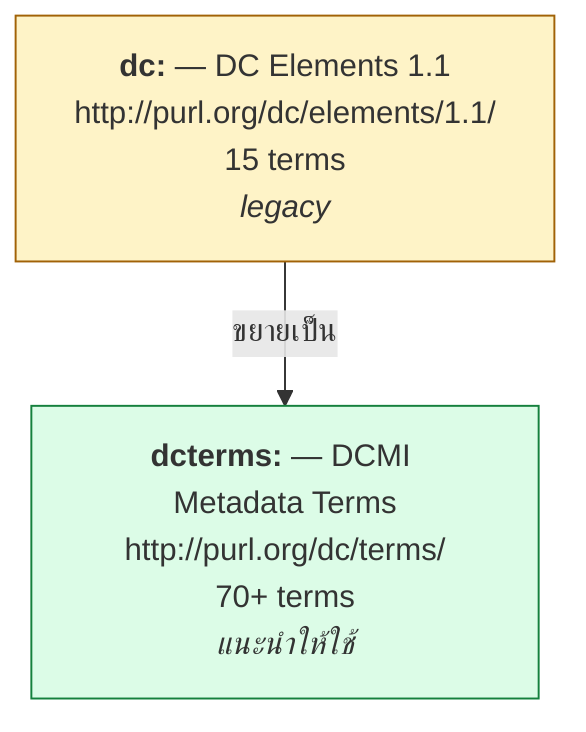
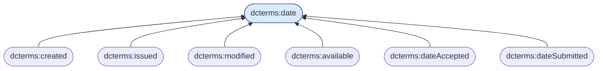

# 09.01 Dublin Core

**Dublin Core** เป็น vocabulary สำหรับ **metadata ของทรัพยากร** ที่เก่าแก่และแพร่หลายที่สุดชุดหนึ่ง
เกิดจากการประชุมที่เมือง Dublin รัฐ Ohio ปี 1995 และปัจจุบันเป็นมาตรฐาน ISO 15836
บทนี้อธิบายความต่างสำคัญระหว่าง **`dc:`** กับ **`dcterms:`** พร้อมตัวอย่างการใช้จริง

---

## สอง namespace ที่ต้องแยกให้ออก



| | `dc:` | `dcterms:` |
| --- | --- | --- |
| Namespace | `http://purl.org/dc/elements/1.1/` | `http://purl.org/dc/terms/` |
| จำนวน term | 15 | 70+ |
| `rdfs:range` | **ไม่กำหนด** | **กำหนดชัดเจน** |
| ค่าเป็น literal ได้ | ✅ | ⚠️ บาง term ต้องเป็น resource |
| สถานะ | legacy (ยังใช้ได้) | **แนะนำ** |

### ตัวอย่างความต่าง

```turtle
@prefix ex:      <http://example.org/> .
@prefix dc:      <http://purl.org/dc/elements/1.1/> .
@prefix dcterms: <http://purl.org/dc/terms/> .

# ❌ dc: -- creator เป็นแค่ string, link ต่อไม่ได้
ex:paper001 dc:creator "Marie Curie" .

# ✅ dcterms: -- creator เป็น resource ที่ link ต่อได้
ex:paper001 dcterms:creator ex:MarieCurie .
ex:MarieCurie a foaf:Person ; foaf:name "Marie Curie" .
```

> 💡 **หลักปฏิบัติ**: ใช้ `dcterms:` เสมอในงานใหม่
> ใช้ `dc:` เฉพาะเมื่อต้องเข้ากันได้กับระบบเก่าที่ต้องการ literal

---

## 15 Element ดั้งเดิม

```
title       creator     subject     description
publisher   contributor date        type
format      identifier  source      language
relation    coverage    rights
```

ทั้ง 15 ตัวมีอยู่ทั้งใน `dc:` และ `dcterms:`

---

## `dcterms:` แยกย่อยละเอียดกว่า

### Date

```turtle
@prefix dcterms: <http://purl.org/dc/terms/> .
@prefix xsd:     <http://www.w3.org/2001/XMLSchema#> .

ex:paper001
    dcterms:created      "2024-01-15"^^xsd:date ;   # วันที่สร้าง
    dcterms:issued       "2024-03-01"^^xsd:date ;   # วันที่เผยแพร่
    dcterms:modified     "2024-06-15"^^xsd:date ;   # วันที่แก้ไขล่าสุด
    dcterms:available    "2024-03-01"^^xsd:date ;   # วันที่เปิดให้เข้าถึง
    dcterms:dateAccepted "2024-02-20"^^xsd:date ;   # วันที่ตอบรับ
    dcterms:dateSubmitted "2024-01-30"^^xsd:date ;  # วันที่ส่ง
    dcterms:valid        "2024-2029" .              # ช่วงที่ใช้ได้
```

**ทั้งหมดนี้เป็น `rdfs:subPropertyOf dcterms:date`** — query `dcterms:date` ได้ทุกตัวหลังรัน reasoner



### Agent

```turtle
ex:paper001
    dcterms:creator     ex:MarieCurie ;      # ผู้สร้างหลัก
    dcterms:contributor ex:PierreCurie ;     # ผู้ร่วม
    dcterms:publisher   ex:AcademicPress ;   # สำนักพิมพ์
    dcterms:rightsHolder ex:University .     # เจ้าของสิทธิ์
```

`dcterms:creator` เป็น `rdfs:subPropertyOf dcterms:contributor`

### Relation

```turtle
ex:paper002
    dcterms:isVersionOf   ex:paper001 ;      # เป็นเวอร์ชันของ
    dcterms:replaces      ex:paper001 ;      # แทนที่
    dcterms:isPartOf      ex:proceedings ;   # เป็นส่วนหนึ่งของ
    dcterms:references    ex:paper000 ;      # อ้างอิงถึง
    dcterms:isReferencedBy ex:paper003 ;     # ถูกอ้างอิงโดย
    dcterms:requires      ex:dataset001 ;    # ต้องใช้
    dcterms:hasFormat     ex:paper002PDF .   # มีรูปแบบ
```

| Property | Inverse |
| --- | --- |
| `dcterms:isVersionOf` | `dcterms:hasVersion` |
| `dcterms:isPartOf` | `dcterms:hasPart` |
| `dcterms:references` | `dcterms:isReferencedBy` |
| `dcterms:replaces` | `dcterms:isReplacedBy` |
| `dcterms:requires` | `dcterms:isRequiredBy` |
| `dcterms:hasFormat` | `dcterms:isFormatOf` |

---

## Term ที่ใช้บ่อยที่สุด

| Property | Range ที่แนะนำ | ตัวอย่าง |
| --- | --- | --- |
| `dcterms:title` | Literal | `"On the Radiation of Uranium"@en` |
| `dcterms:description` | Literal | `"A study of..."@en` |
| `dcterms:creator` | `dcterms:Agent` | `ex:MarieCurie` |
| `dcterms:contributor` | `dcterms:Agent` | `ex:PierreCurie` |
| `dcterms:publisher` | `dcterms:Agent` | `ex:AcademicPress` |
| `dcterms:created` | `dcterms:Period` / literal | `"1898-04-12"^^xsd:date` |
| `dcterms:issued` | literal | `"1898-05-01"^^xsd:date` |
| `dcterms:modified` | literal | `"2024-06-15"^^xsd:date` |
| `dcterms:subject` | `skos:Concept` / literal | `ex:radioactivity` |
| `dcterms:language` | `dcterms:LinguisticSystem` | `<http://id.loc.gov/vocabulary/iso639-1/en>` |
| `dcterms:format` | `dcterms:MediaType` | `"application/pdf"` |
| `dcterms:identifier` | Literal | `"doi:10.1000/xyz123"` |
| `dcterms:license` | `dcterms:LicenseDocument` | `<https://creativecommons.org/licenses/by/4.0/>` |
| `dcterms:rights` | `dcterms:RightsStatement` | `"© 2024 Example University"` |
| `dcterms:type` | `dcterms:DCMIType` | `dcmitype:Text` |
| `dcterms:extent` | `dcterms:SizeOrDuration` | `"24 pages"` |
| `dcterms:spatial` | `dcterms:Location` | `<http://sws.geonames.org/1605651/>` |
| `dcterms:temporal` | `dcterms:PeriodOfTime` | `"1898-1902"` |

---

## DCMI Type Vocabulary

```turtle
@prefix dcmitype: <http://purl.org/dc/dcmitype/> .

dcmitype:Collection      # ชุดของสิ่งต่าง ๆ
dcmitype:Dataset         # ข้อมูลที่เข้ารหัสไว้
dcmitype:Event           # เหตุการณ์
dcmitype:Image           # ภาพ
dcmitype:StillImage      # ภาพนิ่ง
dcmitype:MovingImage     # ภาพเคลื่อนไหว
dcmitype:InteractiveResource  # สื่อโต้ตอบ
dcmitype:PhysicalObject  # วัตถุจริง
dcmitype:Service         # บริการ
dcmitype:Software        # ซอฟต์แวร์
dcmitype:Sound           # เสียง
dcmitype:Text            # ข้อความ
```

```turtle
ex:paper001 dcterms:type dcmitype:Text .
ex:dataset001 dcterms:type dcmitype:Dataset .
```

---

## ตัวอย่างเต็ม: บทความวิชาการ

<table>
<tr><th width="50%">Full form</th><th width="50%">Shorthand</th></tr>
<tr valign="top">
<td>

```turtle
@prefix ex:       <http://example.org/> .
@prefix rdf:      <http://www.w3.org/1999/02/22-rdf-syntax-ns#> .
@prefix dcterms:  <http://purl.org/dc/terms/> .
@prefix dcmitype: <http://purl.org/dc/dcmitype/> .
@prefix foaf:     <http://xmlns.com/foaf/0.1/> .
@prefix xsd:      <http://www.w3.org/2001/XMLSchema#> .

ex:paper001 rdf:type dcterms:BibliographicResource .
ex:paper001 dcterms:type dcmitype:Text .
ex:paper001 dcterms:title "On the Radiation of Uranium"@en .
ex:paper001 dcterms:creator ex:MarieCurie .
ex:paper001 dcterms:contributor ex:PierreCurie .
ex:paper001 dcterms:publisher ex:AcademieDesSciences .
ex:paper001 dcterms:created "1898-04-12"^^xsd:date .
ex:paper001 dcterms:issued "1898-05-01"^^xsd:date .
ex:paper001 dcterms:language "en" .
ex:paper001 dcterms:format "application/pdf" .
ex:paper001 dcterms:extent "24 pages" .
ex:paper001 dcterms:identifier "doi:10.1000/xyz123" .
ex:paper001 dcterms:license <https://creativecommons.org/licenses/by/4.0/> .
ex:paper001 dcterms:subject ex:radioactivity .
ex:paper001 dcterms:subject ex:uranium .
ex:paper001 dcterms:isPartOf ex:proceedings1898 .

ex:MarieCurie rdf:type foaf:Person .
ex:MarieCurie foaf:name "Marie Curie" .
```

</td>
<td>

```turtle
@prefix ex:       <http://example.org/> .
@prefix rdf:      <http://www.w3.org/1999/02/22-rdf-syntax-ns#> .
@prefix dcterms:  <http://purl.org/dc/terms/> .
@prefix dcmitype: <http://purl.org/dc/dcmitype/> .
@prefix foaf:     <http://xmlns.com/foaf/0.1/> .
@prefix xsd:      <http://www.w3.org/2001/XMLSchema#> .

ex:paper001 a dcterms:BibliographicResource ;
    dcterms:type        dcmitype:Text ;
    dcterms:title       "On the Radiation of Uranium"@en ;
    dcterms:creator     ex:MarieCurie ;
    dcterms:contributor ex:PierreCurie ;
    dcterms:publisher   ex:AcademieDesSciences ;
    dcterms:created     "1898-04-12"^^xsd:date ;
    dcterms:issued      "1898-05-01"^^xsd:date ;
    dcterms:language    "en" ;
    dcterms:format      "application/pdf" ;
    dcterms:extent      "24 pages" ;
    dcterms:identifier  "doi:10.1000/xyz123" ;
    dcterms:license     <https://creativecommons.org/licenses/by/4.0/> ;
    dcterms:subject     ex:radioactivity , ex:uranium ;
    dcterms:isPartOf    ex:proceedings1898 .

ex:MarieCurie a foaf:Person ;
    foaf:name "Marie Curie" .
```

</td>
</tr>
</table>

---

## ใช้กับ ontology header

Dublin Core เป็นมาตรฐานสำหรับ **บรรยาย ontology เอง** ด้วย

```turtle
@prefix owl:     <http://www.w3.org/2002/07/owl#> .
@prefix dcterms: <http://purl.org/dc/terms/> .
@prefix xsd:     <http://www.w3.org/2001/XMLSchema#> .
@prefix vann:    <http://purl.org/vocab/vann/> .

<http://example.org/university> a owl:Ontology ;
    dcterms:title       "University Ontology"@en ;
    dcterms:description "Schema for students, courses and staff."@en ;
    dcterms:creator     <https://orcid.org/0000-0002-1825-0097> ;
    dcterms:created     "2025-01-15"^^xsd:date ;
    dcterms:modified    "2025-06-01"^^xsd:date ;
    dcterms:license     <https://creativecommons.org/licenses/by/4.0/> ;
    dcterms:publisher   <https://example.org/> ;
    dcterms:rights      "© 2025 Example University"@en ;
    owl:versionInfo     "1.2.0" ;
    vann:preferredNamespacePrefix "uni" .
```

**นี่คือ pattern ที่ใช้ใน [`university_tbox.ttl`](../code/ch05/university_tbox.ttl) ของคอร์สนี้**

---

## Query ข้อมูล Dublin Core

```sparql
PREFIX dcterms: <http://purl.org/dc/terms/>
PREFIX foaf:    <http://xmlns.com/foaf/0.1/>

# --- 1) เอกสารทั้งหมดพร้อมผู้แต่ง ---
SELECT ?title ?authorName ?issued
WHERE {
  ?doc dcterms:title   ?title ;
       dcterms:creator ?author ;
       dcterms:issued  ?issued .
  ?author foaf:name ?authorName .
}
ORDER BY DESC(?issued)

# --- 2) ใช้ property hierarchy: หาวันที่ใดก็ได้ ---
SELECT ?doc ?date ?dateType
WHERE {
  ?doc ?dateType ?date .
  ?dateType rdfs:subPropertyOf* dcterms:date .
}

# --- 3) เอกสารที่เผยแพร่ภายใต้ CC license ---
SELECT ?title ?license
WHERE {
  ?doc dcterms:title   ?title ;
       dcterms:license ?license .
  FILTER(STRSTARTS(STR(?license), "https://creativecommons.org/"))
}

# --- 4) นับเอกสารต่อผู้แต่ง ---
SELECT ?authorName (COUNT(?doc) AS ?n)
WHERE {
  ?doc dcterms:creator ?author .
  ?author foaf:name ?authorName .
}
GROUP BY ?authorName
ORDER BY DESC(?n)
```

---

## ⚠️ กับดักที่พบบ่อย

| กับดัก | ปัญหา | ทางแก้ |
| --- | --- | --- |
| ใช้ `dc:creator` กับ string | link ต่อไม่ได้ | ใช้ `dcterms:creator` กับ resource |
| ใช้ `dcterms:creator` กับ string | ผิด range (`dcterms:Agent`) | สร้าง resource ให้ผู้แต่ง |
| ใช้ `dcterms:date` ตรง ๆ | ไม่ระบุว่าเป็นวันที่อะไร | ใช้ `created`/`issued`/`modified` |
| `dcterms:subject` เป็น string | ไม่เป็นมาตรฐาน | ใช้ `skos:Concept` |
| ไม่ระบุ datatype ของวันที่ | query ตามช่วงเวลาไม่ได้ | `"2024-01-15"^^xsd:date` |
| ใช้ `dcterms:rights` แทน `dcterms:license` | สับสน | `license` = สัญญาอนุญาต, `rights` = ข้อความสิทธิ์ |

### เปรียบเทียบ `dcterms:rights` กับ `dcterms:license`

```turtle
ex:paper001
    dcterms:license <https://creativecommons.org/licenses/by/4.0/> ;  # IRI ของ license
    dcterms:rights  "© 2024 Example University. All rights reserved."@en ;  # ข้อความ
    dcterms:accessRights <http://purl.org/eprint/accessRights/OpenAccess> .
```

---

## Dublin Core ในบริบทอื่น

### ใน DCAT (dataset catalog)

```turtle
@prefix dcat:    <http://www.w3.org/ns/dcat#> .
@prefix dcterms: <http://purl.org/dc/terms/> .

ex:airQualityDataset a dcat:Dataset ;
    dcterms:title       "Air Quality Measurements 2024"@en ;
    dcterms:description "Hourly PM2.5 readings."@en ;
    dcterms:publisher   ex:EnvironmentAgency ;
    dcterms:issued      "2025-01-15"^^xsd:date ;
    dcterms:license     <https://creativecommons.org/licenses/by/4.0/> ;
    dcat:keyword        "air quality" , "PM2.5" ;
    dcat:distribution   ex:airQualityCSV .
```

ดูละเอียดใน [09.05](09.05-provenance-dcat.md)

### ใน schema.org (mapping)

| `dcterms:` | `schema:` |
| --- | --- |
| `dcterms:title` | `schema:name` |
| `dcterms:description` | `schema:description` |
| `dcterms:creator` | `schema:author` / `schema:creator` |
| `dcterms:publisher` | `schema:publisher` |
| `dcterms:issued` | `schema:datePublished` |
| `dcterms:modified` | `schema:dateModified` |
| `dcterms:license` | `schema:license` |
| `dcterms:subject` | `schema:about` |

```turtle
# เชื่อม vocabulary เข้าด้วยกัน
ex:title owl:equivalentProperty dcterms:title , schema:name .
```

---

## Python

```python
from rdflib import Graph, Literal, Namespace, URIRef
from rdflib.namespace import DC, DCTERMS, FOAF, RDF, XSD

EX = Namespace("http://example.org/")
DCMITYPE = Namespace("http://purl.org/dc/dcmitype/")

g = Graph()
g.bind("ex", EX)
g.bind("dcterms", DCTERMS)
g.bind("dcmitype", DCMITYPE)
g.bind("foaf", FOAF)

paper = EX.paper001
g.add((paper, RDF.type, DCTERMS.BibliographicResource))
g.add((paper, DCTERMS.type, DCMITYPE.Text))
g.add((paper, DCTERMS.title, Literal("On the Radiation of Uranium", lang="en")))
g.add((paper, DCTERMS.creator, EX.MarieCurie))
g.add((paper, DCTERMS.issued, Literal("1898-05-01", datatype=XSD.date)))
g.add((paper, DCTERMS.license,
       URIRef("https://creativecommons.org/licenses/by/4.0/")))
g.add((paper, DCTERMS.subject, EX.radioactivity))

g.add((EX.MarieCurie, RDF.type, FOAF.Person))
g.add((EX.MarieCurie, FOAF.name, Literal("Marie Curie")))

print(g.serialize(format="turtle"))
```

> 💡 rdflib มี `DC` และ `DCTERMS` namespace ให้แล้ว ไม่ต้องประกาศเอง

---

## Key Points

- **Dublin Core** มีสอง namespace: **`dc:`** (15 terms, legacy, range ไม่กำหนด) และ **`dcterms:`** (70+ terms, แนะนำ)
- **ใช้ `dcterms:` เสมอในงานใหม่** เพราะ range กำหนดชัดและ link ต่อได้
- `dcterms:` แยก date ละเอียด: `created`, `issued`, `modified`, `available`, `dateAccepted` — ทั้งหมดเป็น **subproperty ของ `dcterms:date`**
- Relation property มาเป็นคู่ inverse: `isPartOf`/`hasPart`, `references`/`isReferencedBy`, `replaces`/`isReplacedBy`
- **`dcterms:license` (IRI ของสัญญาอนุญาต)** ต่างจาก **`dcterms:rights` (ข้อความสิทธิ์)**
- ใช้ `dcterms:subject` กับ **`skos:Concept`** ไม่ใช่ string เพื่อให้เป็นมาตรฐาน
- Dublin Core เป็นมาตรฐานสำหรับ **บรรยาย ontology เอง** ใน `owl:Ontology` header
- `DCMIType` vocabulary ให้ชนิดของทรัพยากร: `Text`, `Dataset`, `Image`, `Software`, `Event` ฯลฯ
