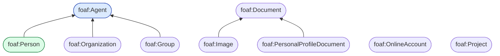
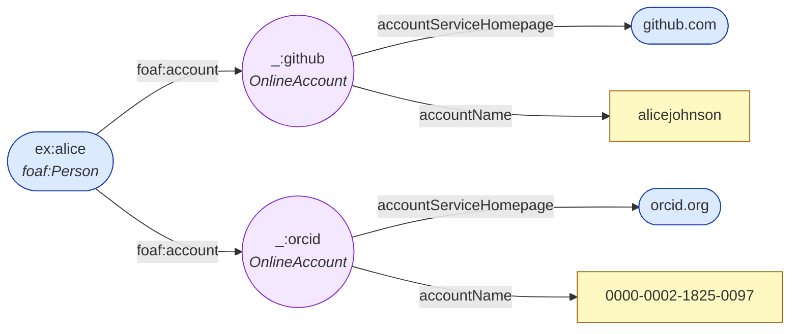
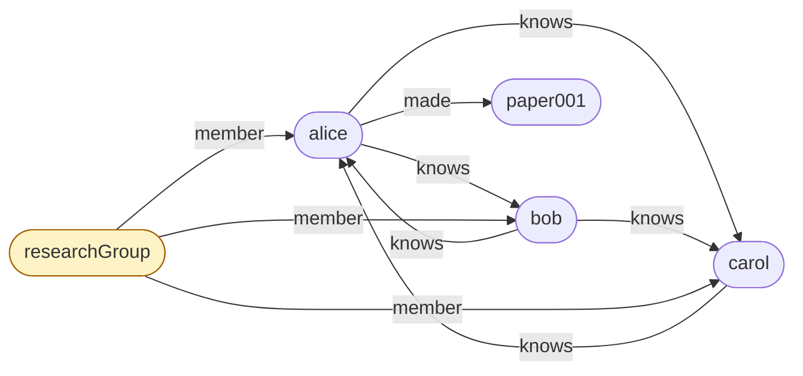

# 09.02 FOAF (Friend of a Friend)

**FOAF** เป็น vocabulary สำหรับอธิบาย **คน องค์กร และความสัมพันธ์ระหว่างกัน** เผยแพร่ตั้งแต่ปี 2000
เป็นหนึ่งใน vocabulary ที่เก่าแก่และถูกใช้มากที่สุดใน LOD Cloud
บทนี้ครอบคลุม class และ property ที่สำคัญ พร้อมสร้าง **social graph** ที่ query ได้จริง

---

## Namespace

```turtle
@prefix foaf: <http://xmlns.com/foaf/0.1/> .
```

> ⚠️ สังเกตว่าเป็น `http://` ไม่ใช่ `https://` และลงท้ายด้วย `/`

---

## Class Hierarchy



| Class | ความหมาย |
| --- | --- |
| `foaf:Agent` | สิ่งที่กระทำได้ — คน องค์กร หรือกลุ่ม |
| `foaf:Person` | คน |
| `foaf:Organization` | องค์กร |
| `foaf:Group` | กลุ่มของ Agent |
| `foaf:Document` | เอกสาร |
| `foaf:Image` | ภาพ (subclass ของ Document) |
| `foaf:PersonalProfileDocument` | หน้าโปรไฟล์ FOAF |
| `foaf:OnlineAccount` | บัญชีออนไลน์ |
| `foaf:Project` | โครงการ |

---

## Property ที่ใช้บ่อย

### ชื่อ

| Property | Range | หมายเหตุ |
| --- | --- | --- |
| `foaf:name` | Literal | ชื่อเต็ม — **`rdfs:subPropertyOf rdfs:label`** |
| `foaf:givenName` | Literal | ชื่อต้น |
| `foaf:familyName` | Literal | นามสกุล |
| `foaf:nick` | Literal | ชื่อเล่น |
| `foaf:title` | Literal | คำนำหน้า (Dr., Prof.) |

```turtle
@prefix ex:   <http://example.org/> .
@prefix foaf: <http://xmlns.com/foaf/0.1/> .

ex:alice a foaf:Person ;
    foaf:name       "Alice Johnson" ;
    foaf:givenName  "Alice" ;
    foaf:familyName "Johnson" ;
    foaf:nick       "AJ" ;
    foaf:title      "Dr." .
```

### การติดต่อ

| Property | Range | Characteristics |
| --- | --- | --- |
| `foaf:mbox` | Thing (**`mailto:` IRI**) | **InverseFunctional** |
| `foaf:mbox_sha1sum` | Literal | **InverseFunctional** |
| `foaf:homepage` | `foaf:Document` | **InverseFunctional** |
| `foaf:weblog` | `foaf:Document` | InverseFunctional |
| `foaf:phone` | Thing (`tel:` IRI) | — |

```turtle
ex:alice
    foaf:mbox         <mailto:alice@example.org> ;     # ⚠️ ต้องเป็น IRI
    foaf:mbox_sha1sum "cb7c11d19f1b3ba9c1a8f77e0f0e1cf1a0e1a5e2" ;
    foaf:homepage     <https://alice.example.org/> ;
    foaf:phone        <tel:+66-2-123-4567> .
```

### ⚠️ `foaf:mbox` ต้องเป็น IRI

```turtle
# ❌ ผิด
ex:alice foaf:mbox "alice@example.org" .

# ✅ ถูก
ex:alice foaf:mbox <mailto:alice@example.org> .
```

### ⚠️ `foaf:mbox` เป็น InverseFunctionalProperty

```turtle
ex:alice     foaf:mbox <mailto:alice@example.org> .
ex:aJohnson  foaf:mbox <mailto:alice@example.org> .
# → inferred: ex:alice owl:sameAs ex:aJohnson
```

**นี่คือ entity resolution อัตโนมัติ** — เป็นเหตุผลที่ FOAF ออกแบบให้ `mbox` เป็น IFP

> 💡 **`foaf:mbox_sha1sum`** มีไว้เพื่อความเป็นส่วนตัว — เผยแพร่ hash แทน email จริง
> แต่ยังทำ entity resolution ได้เพราะเป็น IFP เช่นกัน

### ความสัมพันธ์

| Property | Domain | Range |
| --- | --- | --- |
| `foaf:knows` | `foaf:Person` | `foaf:Person` |
| `foaf:member` | `foaf:Group` | `foaf:Agent` |
| `foaf:made` | `owl:Thing` | `owl:Thing` |
| `foaf:maker` | `owl:Thing` | `foaf:Agent` |
| `foaf:currentProject` | `foaf:Person` | `owl:Thing` |
| `foaf:pastProject` | `foaf:Person` | `owl:Thing` |
| `foaf:account` | `foaf:Agent` | `foaf:OnlineAccount` |
| `foaf:based_near` | `owl:Thing` | `owl:Thing` |

```turtle
ex:alice foaf:knows ex:bob , ex:carol .
ex:acme  foaf:member ex:alice , ex:bob .
ex:alice foaf:made ex:paper001 .
ex:paper001 foaf:maker ex:alice .            # inverse ของ foaf:made
```

### ⚠️ `foaf:knows` ไม่ใช่ symmetric

**FOAF spec ระบุชัดว่า `foaf:knows` ไม่จำเป็นต้อง symmetric**

```turtle
ex:alice foaf:knows ex:bob .
# reasoner ไม่อนุมาน ex:bob foaf:knows ex:alice
```

**เหตุผล**: การที่ A รู้จัก B ไม่ได้แปลว่า B รู้จัก A (เช่น แฟนคลับรู้จักดารา)

หากต้องการความสัมพันธ์แบบสองทาง ให้ประกาศเอง:

```turtle
@prefix owl: <http://www.w3.org/2002/07/owl#> .

ex:mutuallyKnows a owl:ObjectProperty , owl:SymmetricProperty ;
    rdfs:subPropertyOf foaf:knows .
```

### อื่น ๆ

```turtle
@prefix xsd: <http://www.w3.org/2001/XMLSchema#> .

ex:alice
    foaf:img         <https://alice.example.org/photo.jpg> ;
    foaf:depiction   <https://alice.example.org/photo.jpg> ;
    foaf:age         30 ;
    foaf:birthday    "04-12" ;                       # MM-DD (ไม่มีปี!)
    foaf:gender      "female" ;
    foaf:workplaceHomepage <https://acme.example.org/> ;
    foaf:schoolHomepage    <https://university.example.org/> ;
    foaf:interest    <https://en.wikipedia.org/wiki/Semantic_Web> ;
    foaf:topic_interest ex:SemanticWeb .
```

---

## `foaf:OnlineAccount`

```turtle
@prefix ex:   <http://example.org/> .
@prefix foaf: <http://xmlns.com/foaf/0.1/> .

ex:alice foaf:account [
    a foaf:OnlineAccount ;
    foaf:accountServiceHomepage <https://github.com/> ;
    foaf:accountName            "alicejohnson" ;
    foaf:homepage               <https://github.com/alicejohnson>
] , [
    a foaf:OnlineAccount ;
    foaf:accountServiceHomepage <https://orcid.org/> ;
    foaf:accountName            "0000-0002-1825-0097"
] .
```



---

## Social Graph ตัวอย่างเต็ม

<table>
<tr><th width="50%">Full form</th><th width="50%">Shorthand</th></tr>
<tr valign="top">
<td>

```turtle
@prefix ex:   <http://example.org/> .
@prefix rdf:  <http://www.w3.org/1999/02/22-rdf-syntax-ns#> .
@prefix foaf: <http://xmlns.com/foaf/0.1/> .
@prefix owl:  <http://www.w3.org/2002/07/owl#> .

ex:alice rdf:type foaf:Person .
ex:alice foaf:name "Alice Johnson" .
ex:alice foaf:givenName "Alice" .
ex:alice foaf:familyName "Johnson" .
ex:alice foaf:mbox <mailto:alice@example.org> .
ex:alice foaf:homepage <https://alice.example.org/> .
ex:alice foaf:knows ex:bob .
ex:alice foaf:knows ex:carol .
ex:alice foaf:made ex:paper001 .

ex:bob rdf:type foaf:Person .
ex:bob foaf:name "Bob Smith" .
ex:bob foaf:mbox <mailto:bob@example.org> .
ex:bob foaf:knows ex:alice .
ex:bob foaf:knows ex:carol .

ex:carol rdf:type foaf:Person .
ex:carol foaf:name "Carol Nguyen" .
ex:carol foaf:mbox <mailto:carol@example.org> .
ex:carol foaf:knows ex:alice .

ex:acme rdf:type foaf:Organization .
ex:acme foaf:name "Acme Research Lab" .
ex:acme foaf:homepage <https://acme.example.org/> .

ex:researchGroup rdf:type foaf:Group .
ex:researchGroup foaf:name "Semantic Web Group" .
ex:researchGroup foaf:member ex:alice .
ex:researchGroup foaf:member ex:bob .
ex:researchGroup foaf:member ex:carol .
```

</td>
<td>

```turtle
@prefix ex:   <http://example.org/> .
@prefix rdf:  <http://www.w3.org/1999/02/22-rdf-syntax-ns#> .
@prefix foaf: <http://xmlns.com/foaf/0.1/> .
@prefix owl:  <http://www.w3.org/2002/07/owl#> .

ex:alice a foaf:Person ;
    foaf:name       "Alice Johnson" ;
    foaf:givenName  "Alice" ;
    foaf:familyName "Johnson" ;
    foaf:mbox       <mailto:alice@example.org> ;
    foaf:homepage   <https://alice.example.org/> ;
    foaf:knows      ex:bob , ex:carol ;
    foaf:made       ex:paper001 .

ex:bob a foaf:Person ;
    foaf:name  "Bob Smith" ;
    foaf:mbox  <mailto:bob@example.org> ;
    foaf:knows ex:alice , ex:carol .

ex:carol a foaf:Person ;
    foaf:name  "Carol Nguyen" ;
    foaf:mbox  <mailto:carol@example.org> ;
    foaf:knows ex:alice .

ex:acme a foaf:Organization ;
    foaf:name     "Acme Research Lab" ;
    foaf:homepage <https://acme.example.org/> .

ex:researchGroup a foaf:Group ;
    foaf:name   "Semantic Web Group" ;
    foaf:member ex:alice , ex:bob , ex:carol .
```

</td>
</tr>
</table>



---

## Query Social Graph

```sparql
PREFIX foaf: <http://xmlns.com/foaf/0.1/>
PREFIX ex:   <http://example.org/>

# --- 1) ทุกคนที่ alice รู้จัก ---
SELECT ?name WHERE {
  ex:alice foaf:knows ?p .
  ?p foaf:name ?name .
}

# --- 2) เพื่อนของเพื่อน (friend of a friend) ---
SELECT DISTINCT ?name WHERE {
  ex:alice foaf:knows/foaf:knows ?fof .
  ?fof foaf:name ?name .
  FILTER(?fof != ex:alice)
}

# --- 3) ความสัมพันธ์แบบสองทาง (mutual) ---
SELECT ?n1 ?n2 WHERE {
  ?p1 foaf:knows ?p2 .
  ?p2 foaf:knows ?p1 .
  ?p1 foaf:name ?n1 .
  ?p2 foaf:name ?n2 .
  FILTER(STR(?p1) < STR(?p2))     # กันผลซ้ำ
}

# --- 4) คนที่รู้จักมากที่สุด ---
SELECT ?name (COUNT(?other) AS ?n) WHERE {
  ?p foaf:knows ?other ; foaf:name ?name .
}
GROUP BY ?name
ORDER BY DESC(?n)

# --- 5) คนที่ไม่มีใครรู้จักเลย ---
SELECT ?name WHERE {
  ?p a foaf:Person ; foaf:name ?name .
  FILTER NOT EXISTS { ?other foaf:knows ?p }
}

# --- 6) ระยะทางในเครือข่าย (property path) ---
SELECT ?name WHERE {
  ex:alice foaf:knows+ ?reachable .
  ?reachable foaf:name ?name .
  FILTER(?reachable != ex:alice)
}
```

---

## FOAF Profile Document

FOAF ออกแบบมาให้แต่ละคน publish โปรไฟล์ของตัวเองที่ URL ของตัวเอง

```turtle
# ไฟล์นี้อยู่ที่ https://alice.example.org/foaf.rdf
@prefix foaf: <http://xmlns.com/foaf/0.1/> .
@prefix rdfs: <http://www.w3.org/2000/01/rdf-schema#> .

<> a foaf:PersonalProfileDocument ;
    foaf:maker    <#me> ;
    foaf:primaryTopic <#me> .

<#me> a foaf:Person ;
    foaf:name     "Alice Johnson" ;
    foaf:mbox_sha1sum "cb7c11d19f1b3ba9c1a8f77e0f0e1cf1a0e1a5e2" ;
    foaf:homepage <https://alice.example.org/> ;
    foaf:knows [
        a foaf:Person ;
        foaf:name "Bob Smith" ;
        rdfs:seeAlso <https://bob.example.org/foaf.rdf>
    ] .
```

**Pattern สำคัญ**

| Term | ความหมาย |
| --- | --- |
| `<>` | เอกสารนี้เอง |
| `<#me>` | คนที่เอกสารนี้พูดถึง |
| `foaf:primaryTopic` | หัวข้อหลักของเอกสาร |
| `rdfs:seeAlso` | ชี้ไปยัง FOAF profile ของคนอื่น |

> 💡 **`rdfs:seeAlso` ชี้ไปยัง profile ของเพื่อน** ทำให้ crawler เดินตามเครือข่ายได้
> นี่คือแนวคิด "**Friend of a Friend**" ที่เป็นที่มาของชื่อ

---

## ⚠️ ข้อควรระวังเรื่องความเป็นส่วนตัว

```turtle
# ❌ เปิดเผย email จริงบนเว็บสาธารณะ
ex:alice foaf:mbox <mailto:alice@example.org> .

# ✅ ใช้ hash แทน -- ยังทำ entity resolution ได้แต่ไม่เปิดเผย email
ex:alice foaf:mbox_sha1sum "cb7c11d19f1b3ba9c1a8f77e0f0e1cf1a0e1a5e2" .
```

```python
import hashlib

email = "mailto:alice@example.org"
sha1 = hashlib.sha1(email.encode()).hexdigest()
print(sha1)
```

> ⚠️ SHA-1 ของ email ยัง **brute-force ได้** ถ้ารู้ domain — อย่าถือว่าปลอดภัยเต็มที่
> ในระบบสมัยใหม่ควรพิจารณาไม่เผยแพร่ email เลย

---

## FOAF กับ schema.org

| `foaf:` | `schema:` |
| --- | --- |
| `foaf:Person` | `schema:Person` |
| `foaf:Organization` | `schema:Organization` |
| `foaf:name` | `schema:name` |
| `foaf:givenName` | `schema:givenName` |
| `foaf:familyName` | `schema:familyName` |
| `foaf:mbox` | `schema:email` |
| `foaf:homepage` | `schema:url` |
| `foaf:knows` | `schema:knows` |
| `foaf:member` | `schema:member` |
| `foaf:img` | `schema:image` |

```turtle
@prefix owl:    <http://www.w3.org/2002/07/owl#> .
@prefix foaf:   <http://xmlns.com/foaf/0.1/> .
@prefix schema: <https://schema.org/> .

# เชื่อมสอง vocabulary
foaf:Person owl:equivalentClass schema:Person .
foaf:name   owl:equivalentProperty schema:name .
foaf:knows  owl:equivalentProperty schema:knows .
```

> ⚠️ **`foaf:mbox` กับ `schema:email` ไม่ equivalent** เพราะ range ต่างกัน
> (`foaf:mbox` เป็น IRI, `schema:email` เป็น string) — ใช้ `rdfs:seeAlso` แทน

---

## Python: สร้างและวิเคราะห์ social graph

```python
import networkx as nx
from rdflib import Graph, Literal, Namespace, URIRef
from rdflib.namespace import FOAF, RDF

EX = Namespace("http://example.org/")

g = Graph()
g.bind("ex", EX)
g.bind("foaf", FOAF)

people = {
    "alice": ("Alice Johnson", ["bob", "carol"]),
    "bob":   ("Bob Smith",     ["alice", "carol"]),
    "carol": ("Carol Nguyen",  ["alice"]),
    "dave":  ("Dave Wilson",   []),
}

for pid, (name, knows) in people.items():
    person = EX[pid]
    g.add((person, RDF.type, FOAF.Person))
    g.add((person, FOAF.name, Literal(name)))
    g.add((person, FOAF.mbox, URIRef(f"mailto:{pid}@example.org")))
    for other in knows:
        g.add((person, FOAF.knows, EX[other]))

# --- วิเคราะห์ด้วย networkx ---
social = nx.DiGraph()
for s, o in g.subject_objects(FOAF.knows):
    social.add_edge(str(s).split("/")[-1], str(o).split("/")[-1])

print("in-degree (มีคนรู้จักกี่คน):")
for node, degree in sorted(social.in_degree(), key=lambda x: -x[1]):
    print(f"  {node:8s} {degree}")

print("\nreciprocal (รู้จักกันสองทาง):")
for a, b in social.edges():
    if social.has_edge(b, a) and a < b:
        print(f"  {a} ↔ {b}")

print("\nPageRank:")
for node, score in sorted(nx.pagerank(social).items(), key=lambda x: -x[1]):
    print(f"  {node:8s} {score:.4f}")
```

Expected output:

```
in-degree (มีคนรู้จักกี่คน):
  alice    2
  carol    2
  bob      1
  dave     0

reciprocal (รู้จักกันสองทาง):
  alice ↔ bob
  alice ↔ carol

PageRank:
  alice    0.3893
  carol    0.3062
  bob      0.2295
  dave     0.0750
```

---

## Key Points

- **FOAF** อธิบายคน องค์กร กลุ่ม และความสัมพันธ์ — namespace คือ `http://xmlns.com/foaf/0.1/`
- **`foaf:Agent`** เป็น superclass ของ `Person`, `Organization`, `Group`
- ⚠️ **`foaf:mbox` ต้องเป็น `mailto:` IRI** ไม่ใช่ string
- **`foaf:mbox`, `foaf:mbox_sha1sum`, `foaf:homepage` เป็น InverseFunctionalProperty** — ทำ entity resolution อัตโนมัติ
- ⚠️ **`foaf:knows` ไม่ใช่ symmetric** ตาม spec — ต้องสร้าง symmetric subproperty เองถ้าต้องการ
- **`foaf:name` เป็น `rdfs:subPropertyOf rdfs:label`** — query `rdfs:label` ได้ FOAF name มาด้วย
- **FOAF Profile Document** ใช้ pattern `<>` (เอกสาร) + `<#me>` (คน) + `rdfs:seeAlso` ชี้ไป profile เพื่อน
- ใช้ **`foaf:mbox_sha1sum`** แทน email จริงเพื่อความเป็นส่วนตัว (แต่ยัง brute-force ได้)
- FOAF map กับ schema.org ได้เกือบทุก term ยกเว้น `mbox`/`email` ที่ range ต่างกัน
