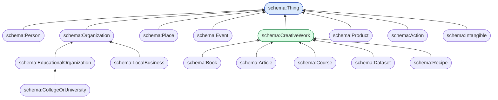
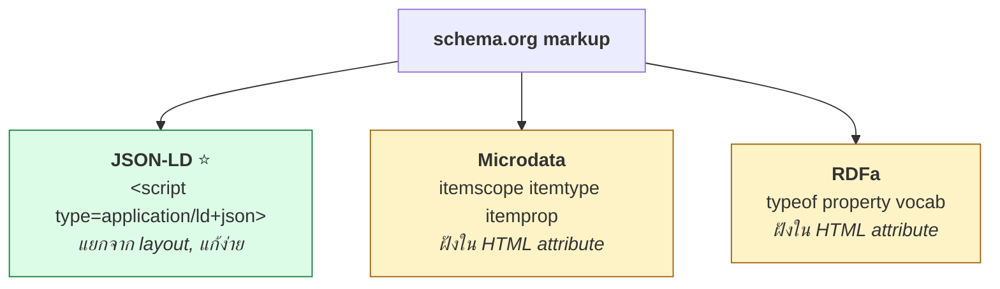

# 09.03 schema.org

**schema.org** เป็น vocabulary ที่ถูกใช้มากที่สุดบน Web — ก่อตั้งปี 2011 โดย Google, Microsoft, Yahoo และ Yandex
มี type มากกว่า 800 ชนิดครอบคลุมแทบทุกโดเมนที่เกี่ยวกับเว็บ
บทนี้เน้นการใช้จริงในรูป **JSON-LD ฝังในหน้าเว็บ** ซึ่งเป็นรูปแบบที่แนะนำในปัจจุบัน

---

## Namespace

```turtle
@prefix schema: <https://schema.org/> .
```

> ⚠️ **ต้องเป็น `https://` และลงท้ายด้วย `/`**
> เดิมเคยใช้ `http://schema.org/` — ปัจจุบันยังรองรับแต่ **รูปแบบทางการคือ `https://`**

---

## Class Hierarchy



### Type หลัก 8 ตัว

| Type | ครอบคลุม |
| --- | --- |
| `schema:Thing` | รากของทุกอย่าง |
| `schema:Person` | คน |
| `schema:Organization` | องค์กร |
| `schema:Place` | สถานที่ |
| `schema:Event` | เหตุการณ์ |
| `schema:CreativeWork` | ผลงานสร้างสรรค์ (หนังสือ บทความ วิดีโอ ซอฟต์แวร์) |
| `schema:Product` | สินค้า |
| `schema:Action` | การกระทำ |
| `schema:Intangible` | สิ่งนามธรรม (Offer, Rating, Quantity) |

---

## Property ของ `schema:Thing`

ทุก type สืบทอด property เหล่านี้

```turtle
schema:name           # ชื่อ
schema:description    # คำอธิบาย
schema:url            # URL หลัก
schema:image          # รูปภาพ
schema:identifier     # รหัส
schema:sameAs         # ⚠️ ไม่ใช่ owl:sameAs! เป็นแค่ link ไปยังหน้าอื่น
schema:alternateName  # ชื่ออื่น
schema:additionalType # type เพิ่มเติม
schema:mainEntityOfPage  # หน้าหลักที่บรรยายสิ่งนี้
schema:potentialAction   # การกระทำที่ทำได้
```

### ⚠️ `schema:sameAs` ไม่ใช่ `owl:sameAs`

```turtle
# schema:sameAs = "ดูเพิ่มเติมที่นี่" -- ไม่มี semantics ของ identity
ex:MarieCurie schema:sameAs <https://en.wikipedia.org/wiki/Marie_Curie> ;
              schema:sameAs <https://www.wikidata.org/entity/Q7186> .

# owl:sameAs = "เป็นสิ่งเดียวกัน" -- reasoner merge property ทั้งหมด
ex:MarieCurie owl:sameAs <https://www.wikidata.org/entity/Q7186> .
```

| | `schema:sameAs` | `owl:sameAs` |
| --- | --- | --- |
| ความหมาย | ชี้ไปยังหน้าอื่นที่พูดถึงสิ่งเดียวกัน | เป็น individual เดียวกัน |
| reasoner merge property | ❌ | ✅ |
| Transitive | ❌ | ✅ |
| ใช้กับ | Wikipedia, social profile | LOD linking |

---

## JSON-LD: รูปแบบที่แนะนำ

**ฝังใน `<script type="application/ld+json">` ในหน้า HTML**

```html
<script type="application/ld+json">
{
  "@context": "https://schema.org",
  "@type": "Course",
  "@id": "https://example.org/course/semantic-web",
  "name": "Semantic Web & Linked Open Data with Python",
  "description": "An introductory course on RDF, OWL, SPARQL and Linked Open Data.",
  "provider": {
    "@type": "CollegeOrUniversity",
    "name": "Example University",
    "url": "https://www.example.edu/",
    "sameAs": "https://www.wikidata.org/entity/Q1234567"
  },
  "inLanguage": "th",
  "teaches": ["RDF", "SPARQL", "OWL", "Linked Open Data"],
  "coursePrerequisites": "Basic Python programming",
  "educationalLevel": "Beginner",
  "hasCourseInstance": {
    "@type": "CourseInstance",
    "courseMode": "online",
    "startDate": "2025-09-01",
    "endDate": "2025-12-15",
    "instructor": {
      "@type": "Person",
      "name": "Dr. Jane Smith",
      "sameAs": "https://orcid.org/0000-0002-1825-0097"
    }
  },
  "offers": {
    "@type": "Offer",
    "price": "0",
    "priceCurrency": "THB",
    "availability": "https://schema.org/InStock"
  }
}
</script>
```

### เทียบกับ Turtle

```turtle
@prefix schema: <https://schema.org/> .
@prefix xsd:    <http://www.w3.org/2001/XMLSchema#> .

<https://example.org/course/semantic-web> a schema:Course ;
    schema:name        "Semantic Web & Linked Open Data with Python" ;
    schema:description "An introductory course on RDF, OWL, SPARQL and Linked Open Data." ;
    schema:inLanguage  "th" ;
    schema:teaches     "RDF" , "SPARQL" , "OWL" , "Linked Open Data" ;
    schema:coursePrerequisites "Basic Python programming" ;
    schema:provider [
        a schema:CollegeOrUniversity ;
        schema:name   "Example University" ;
        schema:url    <https://www.example.edu/> ;
        schema:sameAs <https://www.wikidata.org/entity/Q1234567>
    ] ;
    schema:hasCourseInstance [
        a schema:CourseInstance ;
        schema:courseMode "online" ;
        schema:startDate  "2025-09-01"^^xsd:date ;
        schema:instructor [
            a schema:Person ;
            schema:name   "Dr. Jane Smith" ;
            schema:sameAs <https://orcid.org/0000-0002-1825-0097>
        ]
    ] .
```

---

## รูปแบบ markup 3 แบบ



### เทียบกันด้วยข้อมูลชุดเดียวกัน

<table>
<tr><th width="50%">JSON-LD ⭐</th><th width="50%">Microdata</th></tr>
<tr valign="top">
<td>

```html
<script type="application/ld+json">
{
  "@context": "https://schema.org",
  "@type": "Person",
  "name": "Marie Curie",
  "jobTitle": "Professor of Physics",
  "birthDate": "1867-11-07",
  "birthPlace": {
    "@type": "City",
    "name": "Warsaw"
  }
}
</script>

<div class="profile">
  <h2>Marie Curie</h2>
  <p>Professor of Physics</p>
  <p>Born 7 November 1867 in Warsaw</p>
</div>
```

**ข้อดี**: markup แยกจาก layout — แก้ HTML ไม่กระทบ markup

</td>
<td>

```html
<div itemscope itemtype="https://schema.org/Person">
  <h2 itemprop="name">Marie Curie</h2>
  <p itemprop="jobTitle">Professor of Physics</p>
  <p>Born
    <time itemprop="birthDate" datetime="1867-11-07">
      7 November 1867
    </time>
    in
    <span itemprop="birthPlace" itemscope
          itemtype="https://schema.org/City">
      <span itemprop="name">Warsaw</span>
    </span>
  </p>
</div>
```

**ข้อดี**: ข้อมูลที่แสดงกับที่ machine อ่านเป็นชุดเดียวกัน

</td>
</tr>
</table>

### RDFa

```html
<div vocab="https://schema.org/" typeof="Person">
  <h2 property="name">Marie Curie</h2>
  <p property="jobTitle">Professor of Physics</p>
  <time property="birthDate" datetime="1867-11-07">7 November 1867</time>
  <span property="birthPlace" typeof="City">
    <span property="name">Warsaw</span>
  </span>
</div>
```

| | JSON-LD | Microdata | RDFa |
| --- | :---: | :---: | :---: |
| แยกจาก layout | ✅ | ❌ | ❌ |
| แก้ไขง่าย | ✅ | ❌ | ❌ |
| ข้อมูลตรงกับที่แสดงเสมอ | ❌ | ✅ | ✅ |
| Google แนะนำ | ✅ | ⚠️ | ⚠️ |
| generate จาก server ง่าย | ✅ | ❌ | ❌ |

> 💡 **Google แนะนำ JSON-LD อย่างเป็นทางการ** — ใช้ตัวนี้เป็น default

---

## Type ที่ใช้บ่อยในงานจริง

### `schema:Organization`

```json
{
  "@context": "https://schema.org",
  "@type": "CollegeOrUniversity",
  "name": "Example University",
  "url": "https://www.example.edu/",
  "logo": "https://www.example.edu/logo.png",
  "foundingDate": "1892",
  "address": {
    "@type": "PostalAddress",
    "streetAddress": "123 University Road",
    "addressLocality": "Bangkok",
    "postalCode": "10330",
    "addressCountry": "TH"
  },
  "telephone": "+66-2-123-4567",
  "email": "info@example.edu",
  "sameAs": [
    "https://www.wikidata.org/entity/Q1234567",
    "https://www.facebook.com/exampleuniversity"
  ]
}
```

### `schema:Event`

```json
{
  "@context": "https://schema.org",
  "@type": "EducationEvent",
  "name": "International Semantic Web Conference 2024",
  "startDate": "2024-11-11T09:00",
  "endDate": "2024-11-15T17:00",
  "eventAttendanceMode": "https://schema.org/MixedEventAttendanceMode",
  "eventStatus": "https://schema.org/EventScheduled",
  "location": {
    "@type": "Place",
    "name": "Baltimore Convention Center",
    "address": {
      "@type": "PostalAddress",
      "addressLocality": "Baltimore",
      "addressRegion": "MD",
      "addressCountry": "US"
    }
  },
  "organizer": {
    "@type": "Organization",
    "name": "Semantic Web Science Association"
  },
  "offers": {
    "@type": "Offer",
    "price": "650",
    "priceCurrency": "USD",
    "url": "https://iswc2024.example.org/register",
    "availability": "https://schema.org/InStock",
    "validFrom": "2024-06-01"
  }
}
```

### `schema:Dataset`

```json
{
  "@context": "https://schema.org",
  "@type": "Dataset",
  "name": "Air Quality Measurements 2024",
  "description": "Hourly PM2.5 and PM10 readings from 120 monitoring stations.",
  "url": "https://example.org/data/air-quality-2024",
  "license": "https://creativecommons.org/licenses/by/4.0/",
  "creator": {
    "@type": "Organization",
    "name": "Environment Agency"
  },
  "datePublished": "2025-01-15",
  "temporalCoverage": "2024-01-01/2024-12-31",
  "spatialCoverage": {
    "@type": "Place",
    "name": "Thailand"
  },
  "keywords": ["air quality", "PM2.5", "environment"],
  "distribution": {
    "@type": "DataDownload",
    "encodingFormat": "text/csv",
    "contentUrl": "https://example.org/data/air-quality-2024.csv",
    "contentSize": "48 MB"
  }
}
```

> 💡 **Google Dataset Search** ใช้ `schema:Dataset` markup ในการ index — ใส่แล้วค้นเจอได้จริง

### `schema:Book`

```json
{
  "@context": "https://schema.org",
  "@type": "Book",
  "name": "Nineteen Eighty-Four",
  "author": {
    "@type": "Person",
    "name": "George Orwell",
    "sameAs": "https://www.wikidata.org/entity/Q3335"
  },
  "isbn": "978-0451524935",
  "numberOfPages": 328,
  "datePublished": "1949-06-08",
  "publisher": {"@type": "Organization", "name": "Secker & Warburg"},
  "inLanguage": "en",
  "genre": "Dystopian fiction",
  "aggregateRating": {
    "@type": "AggregateRating",
    "ratingValue": "4.19",
    "reviewCount": 3521
  }
}
```

---

## `@context` — หัวใจของ JSON-LD

```json
{
  "@context": "https://schema.org",
  ...
}
```

**บรรทัดเดียวนี้** ทำให้ทุก key ในเอกสารถูกตีความเป็น `https://schema.org/<key>`

### กำหนด context เอง

```json
{
  "@context": {
    "@vocab": "https://schema.org/",
    "ex": "http://example.org/",
    "owl": "http://www.w3.org/2002/07/owl#",
    "xsd": "http://www.w3.org/2001/XMLSchema#",
    "sameAsEntity": {"@id": "owl:sameAs", "@type": "@id"},
    "birthDate": {"@id": "schema:birthDate", "@type": "xsd:date"}
  },
  "@id": "ex:MarieCurie",
  "@type": "Person",
  "name": "Marie Curie",
  "birthDate": "1867-11-07",
  "sameAsEntity": "https://www.wikidata.org/entity/Q7186"
}
```

| Keyword | ทำอะไร |
| --- | --- |
| `@vocab` | namespace โดยปริยายของ key ที่ไม่ได้ระบุ |
| `@id` | IRI ของ node |
| `@type` | `rdf:type` |
| `"@type": "@id"` | บอกว่าค่าของ key นี้เป็น IRI ไม่ใช่ string |
| `@language` | ภาษาโดยปริยาย |
| `@graph` | ชุดของ node หลายตัว |

### หลาย entity ในเอกสารเดียว

```json
{
  "@context": "https://schema.org",
  "@graph": [
    {
      "@id": "https://example.org/person/alice",
      "@type": "Person",
      "name": "Alice Johnson",
      "worksFor": {"@id": "https://example.org/org/acme"}
    },
    {
      "@id": "https://example.org/org/acme",
      "@type": "Organization",
      "name": "Acme Research Lab"
    }
  ]
}
```

---

## เครื่องมือตรวจสอบ

| เครื่องมือ | URL | ใช้ทำอะไร |
| --- | --- | --- |
| **Schema Markup Validator** | `validator.schema.org` | ตรวจตาม schema.org spec |
| **Google Rich Results Test** | `search.google.com/test/rich-results` | ดูว่า Google เห็นอะไร |
| **Structured Data Linter** | `linter.structured-data.org` | แสดง triple ที่สกัดได้ |
| **JSON-LD Playground** | `json-ld.org/playground/` | ทดลอง expand/compact/flatten |

---

## Rich Results ที่ Google รองรับ

| Type | ผลลัพธ์ที่ได้ |
| --- | --- |
| `Article` / `NewsArticle` | บทความในกล่องข่าว |
| `Product` + `Offer` + `AggregateRating` | ราคา + ดาว |
| `Recipe` | รูป + เวลาทำ + แคลอรี |
| `Event` | วันเวลา + สถานที่ |
| `Course` | ชื่อ + ผู้สอน |
| `JobPosting` | ตำแหน่งงานใน Google Jobs |
| `FAQPage` | คำถาม-คำตอบขยายได้ |
| `HowTo` | ขั้นตอน |
| `LocalBusiness` | ที่อยู่ + เวลาเปิด |
| `Dataset` | Google Dataset Search |
| `BreadcrumbList` | เส้นทางนำทาง |

> 💡 **แรงจูงใจทางธุรกิจ** — rich result ได้พื้นที่แสดงผลมากกว่า ทำให้ CTR สูงขึ้น
> นี่คือเหตุผลที่ schema.org แพร่หลายกว่า vocabulary อื่นมาก

---

## Python: สกัดและสร้าง schema.org

### สกัดจากหน้าเว็บ

```python
import json
import re

import requests
from rdflib import Graph

JSONLD_PATTERN = re.compile(
    r'<script[^>]+type=["\']application/ld\+json["\'][^>]*>(.*?)</script>',
    re.DOTALL | re.IGNORECASE,
)


def extract_schema_org(url: str) -> Graph:
    html = requests.get(url, headers={"User-Agent": "Mozilla/5.0"}, timeout=15).text

    g = Graph()
    g.bind("schema", "https://schema.org/")

    for raw in JSONLD_PATTERN.findall(html):
        try:
            data = json.loads(raw.strip())
        except json.JSONDecodeError:
            continue
        g.parse(data=json.dumps(data), format="json-ld", publicID=url)

    return g
```

> 💡 ใน production ใช้ library **`extruct`** ซึ่งสกัดได้ทั้ง JSON-LD, Microdata และ RDFa

```bash
pip install extruct
```

```python
import extruct
import requests

html = requests.get(url).text
data = extruct.extract(html, base_url=url, syntaxes=["json-ld", "microdata", "rdfa"])
print(data["json-ld"])
```

### สร้าง JSON-LD จาก RDF

```python
from rdflib import Graph, Literal, Namespace, URIRef
from rdflib.namespace import RDF, SDO       # SDO = schema.org ใน rdflib

EX = Namespace("http://example.org/")

g = Graph()
g.bind("schema", SDO)

course = EX["course/semantic-web"]
g.add((course, RDF.type, SDO.Course))
g.add((course, SDO.name, Literal("Semantic Web with Python")))
g.add((course, SDO.inLanguage, Literal("th")))
for topic in ["RDF", "SPARQL", "OWL"]:
    g.add((course, SDO.teaches, Literal(topic)))

context = {
    "@vocab": "https://schema.org/",
    "name": "https://schema.org/name",
    "teaches": "https://schema.org/teaches",
}
print(g.serialize(format="json-ld", context=context, indent=2))
```

---

## schema.org กับ vocabulary อื่น

| schema.org | เทียบเท่ากับ |
| --- | --- |
| `schema:Person` | `foaf:Person` |
| `schema:name` | `foaf:name`, `rdfs:label`, `dcterms:title` |
| `schema:description` | `dcterms:description`, `rdfs:comment` |
| `schema:author` | `dcterms:creator` |
| `schema:datePublished` | `dcterms:issued` |
| `schema:dateModified` | `dcterms:modified` |
| `schema:license` | `dcterms:license` |
| `schema:about` | `dcterms:subject` |
| `schema:Dataset` | `dcat:Dataset` |
| `schema:DataDownload` | `dcat:Distribution` |
| `schema:keywords` | `dcat:keyword` |

```turtle
@prefix owl:     <http://www.w3.org/2002/07/owl#> .
@prefix schema:  <https://schema.org/> .
@prefix dcterms: <http://purl.org/dc/terms/> .
@prefix foaf:    <http://xmlns.com/foaf/0.1/> .

schema:Person owl:equivalentClass foaf:Person .
schema:name   owl:equivalentProperty foaf:name .
schema:author rdfs:subPropertyOf dcterms:creator .
```

---

## ⚠️ ข้อควรรู้เกี่ยวกับ schema.org

| ประเด็น | รายละเอียด |
| --- | --- |
| **ไม่ใช่ OWL ที่เข้มงวด** | ไม่มี disjointness, cardinality; ใช้ `schema:domainIncludes`/`rangeIncludes` แทน `rdfs:domain`/`rdfs:range` |
| **`domainIncludes` เป็นคำแนะนำ** | ไม่มีผลต่อ reasoning — ต่างจาก `rdfs:domain` |
| **`schema:sameAs` ≠ `owl:sameAs`** | เป็นแค่ link ไม่ใช่ identity |
| **เปลี่ยนแปลงบ่อย** | version ใหม่ทุก 2–3 เดือน |
| **มี extension** | `auto.schema.org`, `bib.schema.org`, `health-lifesci.schema.org` |
| **type เยอะมาก** | 800+ type — ใช้ `schema.org/docs/full.html` ค้นหา |

### `domainIncludes` vs `rdfs:domain`

```turtle
# schema.org ใช้แบบนี้ -- เป็นคำแนะนำ ไม่มีผลต่อ reasoning
schema:author schema:domainIncludes schema:CreativeWork , schema:Blog ;
              schema:rangeIncludes  schema:Person , schema:Organization .

# ถ้าใช้ rdfs:domain หลายค่าจะกลายเป็น intersection (ดู 03.04)
schema:author rdfs:domain schema:CreativeWork , schema:Blog .   # ต้องเป็นทั้งสอง!
```

---

## Key Points

- **schema.org** เป็น vocabulary ที่ถูกใช้มากที่สุดบน Web — namespace คือ **`https://schema.org/`** (มี `s`)
- **JSON-LD ใน `<script type="application/ld+json">` เป็นรูปแบบที่ Google แนะนำ** เพราะแยกจาก layout
- Type หลัก 8 ตัว: `Thing`, `Person`, `Organization`, `Place`, `Event`, `CreativeWork`, `Product`, `Action`
- ⚠️ **`schema:sameAs` ไม่ใช่ `owl:sameAs`** — เป็นแค่ link ไม่มี semantics ของ identity
- ⚠️ **`schema:domainIncludes`/`rangeIncludes` เป็นคำแนะนำ** ไม่มีผลต่อ reasoning (ต่างจาก `rdfs:domain`)
- `@context` แค่บรรทัดเดียว (`"https://schema.org"`) ทำให้ทุก key ถูกตีความเป็น schema.org term
- ใช้ **`@graph`** เมื่อมีหลาย entity ในเอกสารเดียว และ **`"@type": "@id"`** เมื่อค่าเป็น IRI
- ตรวจ markup ที่ **`validator.schema.org`** และ **Google Rich Results Test** ก่อนเผยแพร่
- ใช้ library **`extruct`** ใน production เพื่อสกัดทั้ง JSON-LD, Microdata และ RDFa
