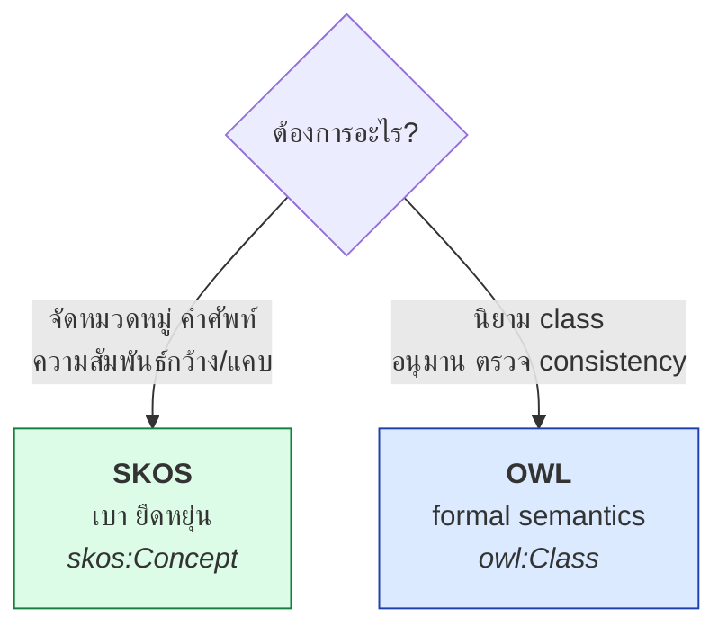
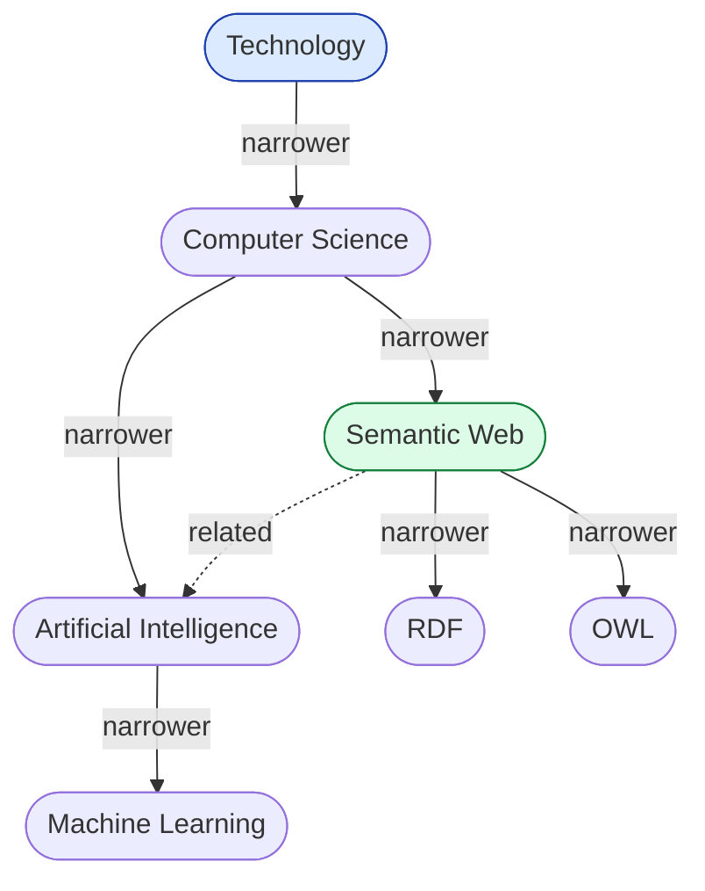
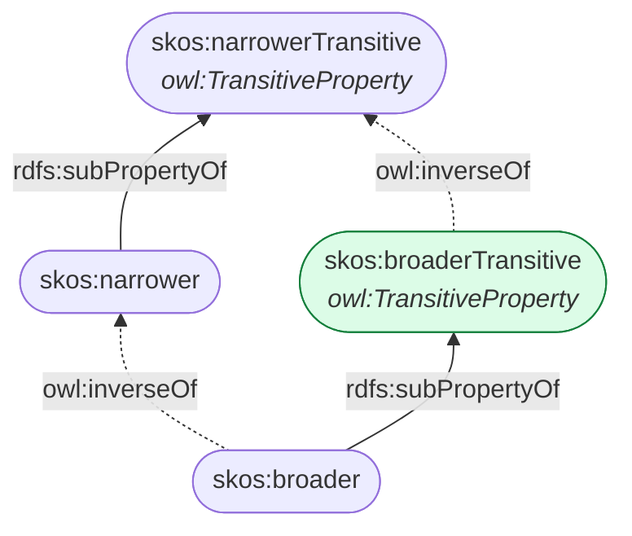
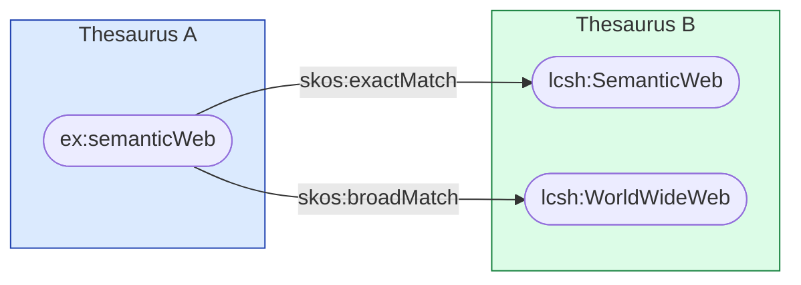
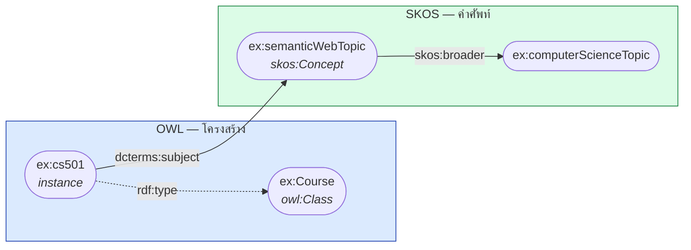

# 09.04 SKOS (Simple Knowledge Organization System)

**SKOS** เป็น W3C Recommendation (2009) สำหรับแสดง **thesaurus, taxonomy, classification scheme และ subject heading**
จุดเด่นคือ **เบากว่า OWL มาก** — เหมาะกับการจัดหมวดหมู่ที่ไม่ต้องการ formal semantics เข้มงวด
บทนี้ครอบคลุม term ทั้งหมดพร้อมตัวอย่าง thesaurus ที่ใช้งานได้จริง

---

## Namespace

```turtle
@prefix skos:   <http://www.w3.org/2004/02/skos/core#> .
@prefix skosxl: <http://www.w3.org/2008/05/skos-xl#> .
```

---

## SKOS ต่างจาก OWL อย่างไร



| | **SKOS** | **OWL** |
| --- | --- | --- |
| หน่วยพื้นฐาน | `skos:Concept` (**แนวคิด**) | `owl:Class` (**เซตของ individual**) |
| `broader` / `subClassOf` | **ไม่ transitive** โดยปริยาย | transitive เสมอ |
| Reasoning | แทบไม่มี | เต็มรูปแบบ |
| ตรวจ inconsistency | ❌ | ✅ |
| ความยืดหยุ่น | สูงมาก | ต่ำ (เข้มงวด) |
| เหมาะกับ | thesaurus, tag, subject heading | domain ontology |
| ต้นทุนการสร้าง | ต่ำ | สูง |

### ⚠️ `skos:Concept` ไม่ใช่ `owl:Class`

```turtle
# SKOS -- "Cat" เป็นแนวคิดหนึ่งในระบบจัดหมวดหมู่
ex:cat a skos:Concept ;
    skos:prefLabel "Cat"@en ;
    skos:broader ex:mammal .

# OWL -- "Cat" เป็นเซตของแมวทุกตัว
ex:Cat a owl:Class ;
    rdfs:subClassOf ex:Mammal .
ex:fluffy a ex:Cat .          # fluffy เป็นสมาชิกของเซต
```

**`ex:cat` (SKOS) ไม่มี instance** — มันคือแนวคิด ไม่ใช่เซต

---

## Core Classes

| Class | ความหมาย |
| --- | --- |
| `skos:Concept` | แนวคิด |
| `skos:ConceptScheme` | ชุดของแนวคิด (thesaurus หนึ่งชุด) |
| `skos:Collection` | กลุ่มของ concept ที่จัดไว้ด้วยกัน |
| `skos:OrderedCollection` | กลุ่มที่มีลำดับ |

---

## Labelling

| Property | จำนวนต่อภาษา | ความหมาย |
| --- | --- | --- |
| `skos:prefLabel` | **1 เท่านั้น** | ชื่อหลัก |
| `skos:altLabel` | หลายค่า | ชื่อพ้อง |
| `skos:hiddenLabel` | หลายค่า | คำสะกดผิดที่ควรค้นเจอ |

```turtle
@prefix ex:   <http://example.org/thesaurus/> .
@prefix skos: <http://www.w3.org/2004/02/skos/core#> .

ex:semanticWeb a skos:Concept ;
    skos:prefLabel   "Semantic Web"@en ,
                     "เว็บเชิงความหมาย"@th ;
    skos:altLabel    "Web of Data"@en ,
                     "Web 3.0"@en ,
                     "Linked Data Web"@en ;
    skos:hiddenLabel "Semantik Web"@en ,          # สะกดผิดที่พบบ่อย
                     "Sementic Web"@en .
```

### ⚠️ `skos:prefLabel` ได้ค่าเดียวต่อหนึ่งภาษา

```turtle
# ❌ ผิด -- มี prefLabel ภาษาอังกฤษสองค่า
ex:concept skos:prefLabel "Semantic Web"@en , "Web of Data"@en .

# ✅ ถูก
ex:concept skos:prefLabel "Semantic Web"@en ;
           skos:altLabel  "Web of Data"@en .
```

> 💡 กฎนี้ตรวจได้ด้วย **SHACL** (`sh:uniqueLang true`) เพราะ SKOS เองไม่บังคับ

```turtle
@prefix sh: <http://www.w3.org/ns/shacl#> .

ex:ConceptShape a sh:NodeShape ;
    sh:targetClass skos:Concept ;
    sh:property [
        sh:path       skos:prefLabel ;
        sh:minCount   1 ;
        sh:uniqueLang true ;
        sh:message    "แต่ละ concept ต้องมี prefLabel หนึ่งค่าต่อหนึ่งภาษา" ;
    ] .
```

---

## Semantic Relations



| Property | Inverse | ความหมาย |
| --- | --- | --- |
| `skos:broader` | `skos:narrower` | กว้างกว่า / แคบกว่า |
| `skos:broaderTransitive` | `skos:narrowerTransitive` | **transitive version** |
| `skos:related` | (symmetric) | เกี่ยวข้องกัน |
| `skos:semanticRelation` | — | superproperty ของทั้งหมด |

```turtle
@prefix ex:   <http://example.org/thesaurus/> .
@prefix skos: <http://www.w3.org/2004/02/skos/core#> .

ex:semanticWeb a skos:Concept ;
    skos:prefLabel "Semantic Web"@en ;
    skos:broader   ex:computerScience ;
    skos:narrower  ex:rdf , ex:owl , ex:sparql ;
    skos:related   ex:artificialIntelligence , ex:knowledgeRepresentation .
```

### ⚠️ `skos:broader` ไม่ transitive

**นี่คือความต่างสำคัญจาก `rdfs:subClassOf`**

```turtle
ex:rdf          skos:broader ex:semanticWeb .
ex:semanticWeb  skos:broader ex:computerScience .

# reasoner ไม่อนุมาน: ex:rdf skos:broader ex:computerScience
```

**เหตุผล**: ในบาง thesaurus ความสัมพันธ์กว้าง/แคบไม่ transitive จริง
(เช่น "ล้อรถ" narrower "รถยนต์" narrower "ยานพาหนะ" แต่ "ล้อรถ" ไม่ใช่ประเภทของ "ยานพาหนะ")

### ใช้ `skos:broaderTransitive` เมื่อต้องการ transitivity

```turtle
@prefix skos: <http://www.w3.org/2004/02/skos/core#> .

# broader เป็น subPropertyOf broaderTransitive อยู่แล้วตาม spec
ex:rdf         skos:broader ex:semanticWeb .
ex:semanticWeb skos:broader ex:computerScience .

# → inferred: ex:rdf skos:broaderTransitive ex:computerScience
```



### หรือใช้ property path ใน SPARQL

```sparql
PREFIX skos: <http://www.w3.org/2004/02/skos/core#>

# หา concept ที่กว้างกว่าทุกระดับ โดยไม่ต้องรัน reasoner
SELECT ?broader WHERE {
  ex:rdf skos:broader+ ?broader .
}
```

---

## `skos:ConceptScheme`

```turtle
@prefix ex:      <http://example.org/thesaurus/> .
@prefix skos:    <http://www.w3.org/2004/02/skos/core#> .
@prefix dcterms: <http://purl.org/dc/terms/> .
@prefix xsd:     <http://www.w3.org/2001/XMLSchema#> .

ex:ComputingThesaurus a skos:ConceptScheme ;
    dcterms:title       "Computing Thesaurus"@en ;
    dcterms:description "A controlled vocabulary for computing topics."@en ;
    dcterms:creator     ex:LibraryDepartment ;
    dcterms:created     "2025-01-15"^^xsd:date ;
    dcterms:license     <https://creativecommons.org/licenses/by/4.0/> ;
    skos:hasTopConcept  ex:technology , ex:mathematics .

ex:technology a skos:Concept ;
    skos:prefLabel   "Technology"@en ;
    skos:inScheme    ex:ComputingThesaurus ;
    skos:topConceptOf ex:ComputingThesaurus .
```

| Property | ความหมาย |
| --- | --- |
| `skos:inScheme` | concept นี้อยู่ใน scheme ไหน |
| `skos:hasTopConcept` | scheme → concept ระดับบนสุด |
| `skos:topConceptOf` | inverse ของ `hasTopConcept` |

---

## Documentation Properties

| Property | ใช้ทำอะไร |
| --- | --- |
| `skos:definition` | นิยาม |
| `skos:scopeNote` | ขอบเขตการใช้ |
| `skos:example` | ตัวอย่าง |
| `skos:note` | หมายเหตุทั่วไป |
| `skos:historyNote` | ประวัติการเปลี่ยนแปลง |
| `skos:editorialNote` | บันทึกสำหรับผู้ดูแล |
| `skos:changeNote` | บันทึกการแก้ไข |

```turtle
ex:semanticWeb a skos:Concept ;
    skos:prefLabel "Semantic Web"@en ;
    skos:definition """An extension of the World Wide Web through standards
that enable machines to process the meaning of data."""@en ;
    skos:scopeNote """Use for technologies based on W3C standards (RDF, OWL,
SPARQL). Do NOT use for blockchain-based 'Web3' — see ex:web3."""@en ;
    skos:example "RDF, OWL, SPARQL, Linked Open Data"@en ;
    skos:historyNote "Introduced in 2001 by Berners-Lee, Hendler and Lassila."@en ;
    skos:editorialNote "Review annually; the field evolves quickly."@en .
```

> 💡 **`skos:scopeNote` สำคัญที่สุด** — บอกว่า **ไม่ควร** ใช้เมื่อไหร่ ซึ่งเป็นสิ่งที่ผู้ใช้ thesaurus อยากรู้จริง

---

## Mapping Properties — เชื่อม thesaurus ข้ามชุด



| Property | ความหมาย | ความมั่นใจ |
| --- | --- | --- |
| `skos:exactMatch` | ตรงกันทุกประการ (**transitive, symmetric**) | สูงมาก |
| `skos:closeMatch` | ใกล้เคียงมาก (symmetric, **ไม่ transitive**) | สูง |
| `skos:broadMatch` | ของอีกชุดกว้างกว่า | ปานกลาง |
| `skos:narrowMatch` | ของอีกชุดแคบกว่า | ปานกลาง |
| `skos:relatedMatch` | เกี่ยวข้องกัน | ต่ำ |
| `skos:mappingRelation` | superproperty ของทั้งหมด | — |

```turtle
@prefix ex:   <http://example.org/thesaurus/> .
@prefix skos: <http://www.w3.org/2004/02/skos/core#> .
@prefix lcsh: <http://id.loc.gov/authorities/subjects/> .
@prefix wd:   <http://www.wikidata.org/entity/> .

ex:semanticWeb
    skos:exactMatch   lcsh:sh2004000479 ;
    skos:closeMatch   wd:Q54837 ;
    skos:broadMatch   lcsh:sh95000541 ;      # World Wide Web
    skos:relatedMatch ex:linkedData .
```

### ⚠️ `skos:exactMatch` vs `owl:sameAs`

| | `skos:exactMatch` | `owl:sameAs` |
| --- | --- | --- |
| ความหมาย | แนวคิดตรงกัน (ในบริบทการค้นคืน) | เป็น individual เดียวกัน |
| merge property | ❌ | ✅ |
| Transitive | ✅ | ✅ |
| ความเสี่ยง | ต่ำ | **สูง** (sameAs explosion) |

> 💡 **ใช้ `skos:exactMatch` เมื่อเชื่อม thesaurus** และ **`owl:sameAs` เมื่อเชื่อม individual จริง**

---

## `skos:Collection`

```turtle
@prefix ex:   <http://example.org/thesaurus/> .
@prefix skos: <http://www.w3.org/2004/02/skos/core#> .

# กลุ่มที่ไม่มีลำดับ
ex:w3cStandards a skos:Collection ;
    skos:prefLabel "W3C Semantic Web Standards"@en ;
    skos:member    ex:rdf , ex:rdfs , ex:owl , ex:sparql , ex:shacl .

# กลุ่มที่มีลำดับ
ex:learningPath a skos:OrderedCollection ;
    skos:prefLabel "Semantic Web Learning Path"@en ;
    skos:memberList ( ex:rdf ex:rdfs ex:owl ex:sparql ex:linkedData ) .
```

> ⚠️ **`skos:Collection` ไม่ใช่ `skos:Concept`** — ใช้จัดกลุ่มเพื่อการนำเสนอ ไม่ใช่ความสัมพันธ์เชิงความหมาย
> จึงไม่มี `skos:broader`

---

## Thesaurus ตัวอย่างเต็ม

<table>
<tr><th width="50%">Full form</th><th width="50%">Shorthand</th></tr>
<tr valign="top">
<td>

```turtle
@prefix ex:      <http://example.org/thesaurus/> .
@prefix rdf:     <http://www.w3.org/1999/02/22-rdf-syntax-ns#> .
@prefix skos:    <http://www.w3.org/2004/02/skos/core#> .
@prefix dcterms: <http://purl.org/dc/terms/> .

ex:ComputingThesaurus rdf:type skos:ConceptScheme .
ex:ComputingThesaurus dcterms:title "Computing Thesaurus"@en .
ex:ComputingThesaurus skos:hasTopConcept ex:technology .

ex:technology rdf:type skos:Concept .
ex:technology skos:prefLabel "Technology"@en .
ex:technology skos:inScheme ex:ComputingThesaurus .
ex:technology skos:topConceptOf ex:ComputingThesaurus .
ex:technology skos:narrower ex:computerScience .

ex:computerScience rdf:type skos:Concept .
ex:computerScience skos:prefLabel "Computer Science"@en .
ex:computerScience skos:altLabel "Computing"@en .
ex:computerScience skos:inScheme ex:ComputingThesaurus .
ex:computerScience skos:broader ex:technology .
ex:computerScience skos:narrower ex:semanticWeb .
ex:computerScience skos:narrower ex:artificialIntelligence .

ex:semanticWeb rdf:type skos:Concept .
ex:semanticWeb skos:prefLabel "Semantic Web"@en .
ex:semanticWeb skos:altLabel "Web of Data"@en .
ex:semanticWeb skos:inScheme ex:ComputingThesaurus .
ex:semanticWeb skos:broader ex:computerScience .
ex:semanticWeb skos:related ex:artificialIntelligence .
ex:semanticWeb skos:narrower ex:rdf .
ex:semanticWeb skos:narrower ex:owl .
```

</td>
<td>

```turtle
@prefix ex:      <http://example.org/thesaurus/> .
@prefix rdf:     <http://www.w3.org/1999/02/22-rdf-syntax-ns#> .
@prefix skos:    <http://www.w3.org/2004/02/skos/core#> .
@prefix dcterms: <http://purl.org/dc/terms/> .

ex:ComputingThesaurus a skos:ConceptScheme ;
    dcterms:title      "Computing Thesaurus"@en ;
    skos:hasTopConcept ex:technology .

ex:technology a skos:Concept ;
    skos:prefLabel    "Technology"@en , "เทคโนโลยี"@th ;
    skos:inScheme     ex:ComputingThesaurus ;
    skos:topConceptOf ex:ComputingThesaurus ;
    skos:narrower     ex:computerScience .

ex:computerScience a skos:Concept ;
    skos:prefLabel "Computer Science"@en , "วิทยาการคอมพิวเตอร์"@th ;
    skos:altLabel  "Computing"@en , "Informatics"@en ;
    skos:inScheme  ex:ComputingThesaurus ;
    skos:broader   ex:technology ;
    skos:narrower  ex:semanticWeb , ex:artificialIntelligence .

ex:semanticWeb a skos:Concept ;
    skos:prefLabel  "Semantic Web"@en , "เว็บเชิงความหมาย"@th ;
    skos:altLabel   "Web of Data"@en , "Web 3.0"@en ;
    skos:definition "An extension of the Web that lets machines process meaning."@en ;
    skos:scopeNote  "Do NOT use for blockchain-based 'Web3'."@en ;
    skos:inScheme   ex:ComputingThesaurus ;
    skos:broader    ex:computerScience ;
    skos:related    ex:artificialIntelligence ;
    skos:narrower   ex:rdf , ex:owl , ex:sparql ;
    skos:exactMatch <http://id.loc.gov/authorities/subjects/sh2004000479> ;
    skos:closeMatch <http://www.wikidata.org/entity/Q54837> .

ex:rdf a skos:Concept ;
    skos:prefLabel "RDF"@en ;
    skos:altLabel  "Resource Description Framework"@en ;
    skos:inScheme  ex:ComputingThesaurus ;
    skos:broader   ex:semanticWeb .
```

</td>
</tr>
</table>

---

## Query SKOS

```sparql
PREFIX skos: <http://www.w3.org/2004/02/skos/core#>
PREFIX ex:   <http://example.org/thesaurus/>

# --- 1) top concept ทั้งหมด ---
SELECT ?label WHERE {
  ex:ComputingThesaurus skos:hasTopConcept ?c .
  ?c skos:prefLabel ?label .
  FILTER(LANG(?label) = "en")
}

# --- 2) concept ที่กว้างกว่าทุกระดับ (property path) ---
SELECT ?label WHERE {
  ex:rdf skos:broader+ ?broader .
  ?broader skos:prefLabel ?label .
  FILTER(LANG(?label) = "en")
}

# --- 3) concept ที่แคบกว่าทุกระดับ ---
SELECT ?label WHERE {
  ex:technology skos:narrower+ ?narrower .
  ?narrower skos:prefLabel ?label .
  FILTER(LANG(?label) = "en")
}

# --- 4) ค้นหาจากทุก label (pref + alt + hidden) ---
SELECT DISTINCT ?concept ?prefLabel WHERE {
  ?concept ?labelProp ?label .
  ?labelProp rdfs:subPropertyOf* skos:altLabel .
  FILTER(CONTAINS(LCASE(STR(?label)), "web"))
  ?concept skos:prefLabel ?prefLabel .
  FILTER(LANG(?prefLabel) = "en")
}

# --- 5) ตรวจคุณภาพ: concept ที่ไม่มี prefLabel ---
SELECT ?concept WHERE {
  ?concept a skos:Concept .
  FILTER NOT EXISTS { ?concept skos:prefLabel ?l }
}

# --- 6) ตรวจ orphan: concept ที่ไม่เชื่อมกับใครเลย ---
SELECT ?concept WHERE {
  ?concept a skos:Concept .
  FILTER NOT EXISTS { ?concept skos:broader ?b }
  FILTER NOT EXISTS { ?concept skos:topConceptOf ?s }
}

# --- 7) นับ concept ต่อระดับความลึก ---
SELECT ?depth (COUNT(?c) AS ?n) WHERE {
  {
    SELECT ?c (COUNT(?mid) AS ?depth) WHERE {
      ?c skos:broader* ?mid .
    }
    GROUP BY ?c
  }
}
GROUP BY ?depth
ORDER BY ?depth
```

---

## SKOS-XL — Label ที่เป็น resource

เมื่อต้องการเก็บ metadata เกี่ยวกับ **ตัว label เอง**

```turtle
@prefix ex:      <http://example.org/thesaurus/> .
@prefix skos:    <http://www.w3.org/2004/02/skos/core#> .
@prefix skosxl:  <http://www.w3.org/2008/05/skos-xl#> .
@prefix dcterms: <http://purl.org/dc/terms/> .
@prefix xsd:     <http://www.w3.org/2001/XMLSchema#> .

ex:semanticWeb a skos:Concept ;
    skosxl:prefLabel ex:label001 .

ex:label001 a skosxl:Label ;
    skosxl:literalForm "Semantic Web"@en ;
    dcterms:created    "2025-01-15"^^xsd:date ;
    dcterms:creator    ex:editorAlice ;
    dcterms:source     <https://www.w3.org/standards/semanticweb/> .
```

> 💡 ใช้ SKOS-XL เมื่อต้องการ **provenance ของ label** — เช่นในงานแปลหรือ terminology management

---

## Thesaurus จริงที่ใช้ SKOS

| Thesaurus | โดเมน | ขนาด |
| --- | --- | --- |
| **AGROVOC** (FAO) | เกษตรและอาหาร | 40,000+ concepts, 40 ภาษา |
| **EuroVoc** (EU) | นโยบายและกฎหมาย EU | 7,000+ concepts, 24 ภาษา |
| **UNESCO Thesaurus** | การศึกษา วิทยาศาสตร์ วัฒนธรรม | 4,000+ concepts |
| **LCSH** (Library of Congress) | subject heading ห้องสมุด | 400,000+ headings |
| **Getty AAT** | ศิลปะและสถาปัตยกรรม | 55,000+ concepts |
| **MeSH** (NLM) | การแพทย์ | 30,000+ descriptors |
| **STW** (ZBW) | เศรษฐศาสตร์ | 6,000+ concepts |

```sparql
# Query AGROVOC จริง
PREFIX skos: <http://www.w3.org/2004/02/skos/core#>

SELECT ?concept ?label WHERE {
  SERVICE <https://agrovoc.fao.org/sparql> {
    ?concept a skos:Concept ;
             skos:prefLabel ?label .
    FILTER(LANG(?label) = "en")
    FILTER(CONTAINS(LCASE(STR(?label)), "rice"))
  }
}
LIMIT 20
```

---

## ใช้ SKOS คู่กับ OWL

**Pattern ที่ใช้กันทั่วไป**: ใช้ OWL สำหรับ structure และ SKOS สำหรับ terminology

```turtle
@prefix ex:   <http://example.org/> .
@prefix owl:  <http://www.w3.org/2002/07/owl#> .
@prefix rdfs: <http://www.w3.org/2000/01/rdf-schema#> .
@prefix skos: <http://www.w3.org/2004/02/skos/core#> .
@prefix dcterms: <http://purl.org/dc/terms/> .

# --- OWL: structure ---
ex:Course a owl:Class ;
    rdfs:label "Course"@en ;
    rdfs:subClassOf ex:EducationalResource .

# --- SKOS: subject terminology ---
ex:semanticWebTopic a skos:Concept ;
    skos:prefLabel "Semantic Web"@en ;
    skos:broader   ex:computerScienceTopic .

# --- เชื่อมกัน ---
ex:cs501 a ex:Course ;
    rdfs:label      "Knowledge Graphs"@en ;
    dcterms:subject ex:semanticWebTopic .        # ← ใช้ SKOS concept เป็น subject
```



---

## Python

```python
from rdflib import Graph, Literal, Namespace
from rdflib.namespace import DCTERMS, RDF, SKOS

EX = Namespace("http://example.org/thesaurus/")

g = Graph()
g.bind("ex", EX)
g.bind("skos", SKOS)

# --- สร้าง concept scheme ---
scheme = EX.ComputingThesaurus
g.add((scheme, RDF.type, SKOS.ConceptScheme))
g.add((scheme, DCTERMS.title, Literal("Computing Thesaurus", lang="en")))


def add_concept(cid: str, labels: dict, broader=None, alt=None, definition=None):
    """สร้าง SKOS concept พร้อม label หลายภาษา"""
    concept = EX[cid]
    g.add((concept, RDF.type, SKOS.Concept))
    g.add((concept, SKOS.inScheme, scheme))

    for lang, text in labels.items():
        g.add((concept, SKOS.prefLabel, Literal(text, lang=lang)))
    for text in (alt or []):
        g.add((concept, SKOS.altLabel, Literal(text, lang="en")))
    if definition:
        g.add((concept, SKOS.definition, Literal(definition, lang="en")))

    if broader is None:
        g.add((concept, SKOS.topConceptOf, scheme))
        g.add((scheme, SKOS.hasTopConcept, concept))
    else:
        g.add((concept, SKOS.broader, EX[broader]))
        g.add((EX[broader], SKOS.narrower, concept))       # ใส่ inverse เอง

    return concept


add_concept("technology", {"en": "Technology", "th": "เทคโนโลยี"})
add_concept("computerScience", {"en": "Computer Science", "th": "วิทยาการคอมพิวเตอร์"},
            broader="technology", alt=["Computing", "Informatics"])
add_concept("semanticWeb", {"en": "Semantic Web", "th": "เว็บเชิงความหมาย"},
            broader="computerScience", alt=["Web of Data", "Web 3.0"],
            definition="An extension of the Web that lets machines process meaning.")
add_concept("rdf", {"en": "RDF"}, broader="semanticWeb",
            alt=["Resource Description Framework"])
add_concept("owl", {"en": "OWL"}, broader="semanticWeb",
            alt=["Web Ontology Language"])

g.add((EX.semanticWeb, SKOS.related, EX.artificialIntelligence))

print(f"{len(g)} triples\n")

# --- แสดง hierarchy ---
def print_tree(concept, indent: int = 0) -> None:
    label = g.value(concept, SKOS.prefLabel)
    print("  " * indent + f"- {label}")
    for child in sorted(g.objects(concept, SKOS.narrower), key=str):
        print_tree(child, indent + 1)


print("Hierarchy:")
for top in g.objects(scheme, SKOS.hasTopConcept):
    print_tree(top)

# --- ค้นหาจากทุก label ---
def search(term: str) -> list:
    term = term.lower()
    found = set()
    for prop in (SKOS.prefLabel, SKOS.altLabel, SKOS.hiddenLabel):
        for concept, label in g.subject_objects(prop):
            if term in str(label).lower():
                found.add(concept)
    return sorted(found, key=str)


print("\nค้นหา 'web':")
for concept in search("web"):
    print(f"  {g.value(concept, SKOS.prefLabel)}")
```

Expected output:

```
21 triples

Hierarchy:
- Technology
  - Computer Science
    - Semantic Web
      - OWL
      - RDF

ค้นหา 'web':
  Semantic Web
  OWL
```

---

## Checklist สำหรับ SKOS thesaurus

- [ ] ทุก concept มี **`skos:prefLabel` หนึ่งค่าต่อหนึ่งภาษา**
- [ ] ทุก concept มี **`skos:inScheme`**
- [ ] concept ระดับบนมี **`skos:topConceptOf`** และ scheme มี **`skos:hasTopConcept`**
- [ ] ใส่ **`skos:definition`** และ **`skos:scopeNote`** ให้ concept ที่กำกวม
- [ ] ใส่ทั้ง `skos:broader` และ `skos:narrower` (หรือรัน reasoner ให้เติม inverse)
- [ ] ใช้ **`skos:altLabel`** สำหรับชื่อพ้อง ไม่ใช่ `prefLabel` หลายค่า
- [ ] เชื่อมกับ thesaurus อื่นด้วย **mapping property** ที่ระดับความมั่นใจเหมาะสม
- [ ] ตรวจ **orphan concept** และ **cycle ใน broader**
- [ ] Validate ด้วย **SHACL** (`sh:uniqueLang`, `sh:minCount`)

---

## Key Points

- **SKOS** เหมาะกับ **thesaurus, taxonomy, subject heading** — เบากว่า OWL มากและยืดหยุ่นกว่า
- ⚠️ **`skos:Concept` ไม่ใช่ `owl:Class`** — concept ไม่มี instance
- ⚠️ **`skos:broader` ไม่ transitive** ต่างจาก `rdfs:subClassOf` — ใช้ `skos:broaderTransitive` หรือ property path `broader+`
- **`skos:prefLabel` ได้ค่าเดียวต่อภาษา**; ชื่อพ้องใช้ **`skos:altLabel`**; คำสะกดผิดใช้ **`skos:hiddenLabel`**
- **`skos:scopeNote`** สำคัญที่สุดในเชิงปฏิบัติ เพราะบอกว่า**ไม่ควรใช้เมื่อไหร่**
- Mapping property เรียงตามความมั่นใจ: `exactMatch` > `closeMatch` > `broadMatch`/`narrowMatch` > `relatedMatch`
- **`skos:exactMatch` ปลอดภัยกว่า `owl:sameAs`** เมื่อเชื่อม thesaurus เพราะไม่ merge property
- Pattern ที่ดี: **ใช้ OWL สำหรับ structure และ SKOS สำหรับ terminology** เชื่อมด้วย `dcterms:subject`
- Thesaurus จริงที่ใช้ SKOS: **AGROVOC, EuroVoc, UNESCO, LCSH, Getty AAT, MeSH**
