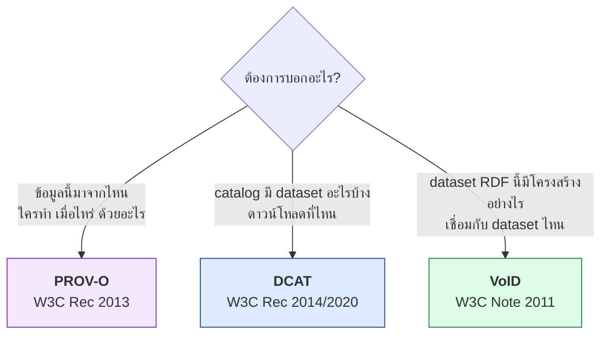
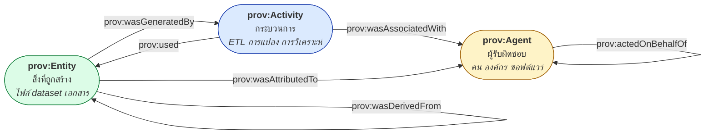
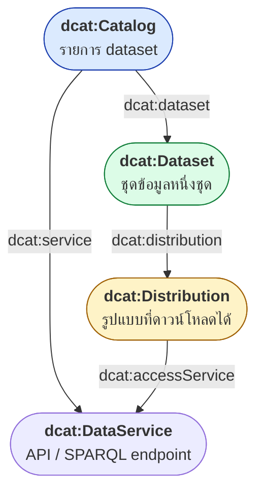
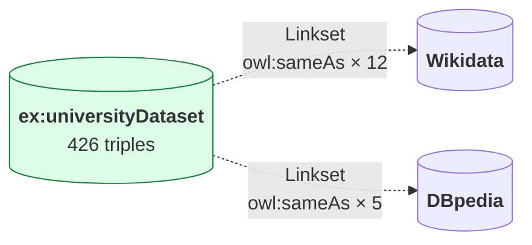

# 09.05 PROV-O, DCAT และ VoID

สาม vocabulary นี้ตอบคำถามคนละข้อเกี่ยวกับ **metadata ระดับ dataset**:
**PROV-O** ตอบว่า "ข้อมูลนี้มาจากไหน ใครทำ เมื่อไหร่", **DCAT** ตอบว่า "มี dataset อะไรบ้างใน catalog"
และ **VoID** ตอบว่า "dataset RDF นี้มีโครงสร้างอย่างไร เชื่อมกับ dataset ไหน"

---

## ภาพรวม



---

## PROV-O — Provenance Ontology

```turtle
@prefix prov: <http://www.w3.org/ns/prov#> .
```

### สามหน่วยหลัก



| Class | ความหมาย |
| --- | --- |
| `prov:Entity` | สิ่งที่มีอยู่จริง — dataset, ไฟล์, เอกสาร |
| `prov:Activity` | กระบวนการที่เกิดขึ้นในช่วงเวลาหนึ่ง |
| `prov:Agent` | ผู้รับผิดชอบ — `prov:Person`, `prov:Organization`, `prov:SoftwareAgent` |

### Property หลัก

| Property | Domain → Range | ความหมาย |
| --- | --- | --- |
| `prov:wasGeneratedBy` | Entity → Activity | ถูกสร้างโดยกระบวนการนี้ |
| `prov:used` | Activity → Entity | กระบวนการใช้สิ่งนี้ |
| `prov:wasAssociatedWith` | Activity → Agent | กระบวนการดำเนินโดย |
| `prov:wasAttributedTo` | Entity → Agent | สิ่งนี้เป็นผลงานของ |
| `prov:wasDerivedFrom` | Entity → Entity | ได้มาจาก |
| `prov:wasInformedBy` | Activity → Activity | กระบวนการต่อจาก |
| `prov:actedOnBehalfOf` | Agent → Agent | ทำในนามของ |
| `prov:startedAtTime` | Activity → dateTime | เริ่มเมื่อ |
| `prov:endedAtTime` | Activity → dateTime | จบเมื่อ |
| `prov:generatedAtTime` | Entity → dateTime | สร้างเมื่อ |
| `prov:invalidatedAtTime` | Entity → dateTime | หมดอายุเมื่อ |

### ตัวอย่างเต็ม: ETL pipeline

<table>
<tr><th width="50%">Full form</th><th width="50%">Shorthand</th></tr>
<tr valign="top">
<td>

```turtle
@prefix ex:      <http://example.org/> .
@prefix rdf:     <http://www.w3.org/1999/02/22-rdf-syntax-ns#> .
@prefix rdfs:    <http://www.w3.org/2000/01/rdf-schema#> .
@prefix prov:    <http://www.w3.org/ns/prov#> .
@prefix dcterms: <http://purl.org/dc/terms/> .
@prefix xsd:     <http://www.w3.org/2001/XMLSchema#> .

ex:enrollmentRDF rdf:type prov:Entity .
ex:enrollmentRDF rdfs:label "Enrollment RDF dataset"@en .
ex:enrollmentRDF prov:wasGeneratedBy ex:etlRun20250601 .
ex:enrollmentRDF prov:wasDerivedFrom ex:enrollmentCSV .
ex:enrollmentRDF prov:wasAttributedTo ex:dataTeam .
ex:enrollmentRDF prov:generatedAtTime
    "2025-06-01T02:15:00Z"^^xsd:dateTime .

ex:enrollmentCSV rdf:type prov:Entity .
ex:enrollmentCSV rdfs:label "Raw enrollment CSV"@en .
ex:enrollmentCSV prov:wasAttributedTo ex:registrarOffice .

ex:etlRun20250601 rdf:type prov:Activity .
ex:etlRun20250601 rdfs:label "Nightly ETL run"@en .
ex:etlRun20250601 prov:used ex:enrollmentCSV .
ex:etlRun20250601 prov:used ex:universityTBox .
ex:etlRun20250601 prov:wasAssociatedWith ex:etlPipeline .
ex:etlRun20250601 prov:startedAtTime
    "2025-06-01T02:00:00Z"^^xsd:dateTime .
ex:etlRun20250601 prov:endedAtTime
    "2025-06-01T02:15:00Z"^^xsd:dateTime .

ex:etlPipeline rdf:type prov:SoftwareAgent .
ex:etlPipeline rdfs:label "etl_pipeline.py v1.2.0"@en .
ex:etlPipeline prov:actedOnBehalfOf ex:dataTeam .

ex:dataTeam rdf:type prov:Organization .
ex:dataTeam rdfs:label "Data Engineering Team"@en .
```

</td>
<td>

```turtle
@prefix ex:      <http://example.org/> .
@prefix rdf:     <http://www.w3.org/1999/02/22-rdf-syntax-ns#> .
@prefix rdfs:    <http://www.w3.org/2000/01/rdf-schema#> .
@prefix prov:    <http://www.w3.org/ns/prov#> .
@prefix dcterms: <http://purl.org/dc/terms/> .
@prefix xsd:     <http://www.w3.org/2001/XMLSchema#> .

ex:enrollmentRDF a prov:Entity ;
    rdfs:label           "Enrollment RDF dataset"@en ;
    prov:wasGeneratedBy  ex:etlRun20250601 ;
    prov:wasDerivedFrom  ex:enrollmentCSV ;
    prov:wasAttributedTo ex:dataTeam ;
    prov:generatedAtTime "2025-06-01T02:15:00Z"^^xsd:dateTime .

ex:enrollmentCSV a prov:Entity ;
    rdfs:label           "Raw enrollment CSV"@en ;
    prov:wasAttributedTo ex:registrarOffice .

ex:etlRun20250601 a prov:Activity ;
    rdfs:label             "Nightly ETL run"@en ;
    prov:used              ex:enrollmentCSV , ex:universityTBox ;
    prov:wasAssociatedWith ex:etlPipeline ;
    prov:startedAtTime     "2025-06-01T02:00:00Z"^^xsd:dateTime ;
    prov:endedAtTime       "2025-06-01T02:15:00Z"^^xsd:dateTime .

ex:etlPipeline a prov:SoftwareAgent ;
    rdfs:label          "etl_pipeline.py v1.2.0"@en ;
    prov:actedOnBehalfOf ex:dataTeam .

ex:dataTeam a prov:Organization ;
    rdfs:label "Data Engineering Team"@en .

ex:registrarOffice a prov:Organization ;
    rdfs:label "Registrar Office"@en .
```

</td>
</tr>
</table>

### Query provenance

```sparql
PREFIX prov: <http://www.w3.org/ns/prov#>
PREFIX rdfs: <http://www.w3.org/2000/01/rdf-schema#>

# --- 1) dataset นี้มาจากไหน (ไล่ย้อนกลับทุกระดับ) ---
SELECT ?source ?label WHERE {
  ex:enrollmentRDF prov:wasDerivedFrom+ ?source .
  ?source rdfs:label ?label .
}

# --- 2) ใครรับผิดชอบ dataset นี้ (รวมผ่าน actedOnBehalfOf) ---
SELECT ?agent ?label WHERE {
  ex:enrollmentRDF prov:wasAttributedTo|
                   (prov:wasGeneratedBy/prov:wasAssociatedWith/prov:actedOnBehalfOf*) ?agent .
  ?agent rdfs:label ?label .
}

# --- 3) กระบวนการที่ใช้เวลานานที่สุด ---
SELECT ?activity ?label ?duration WHERE {
  ?activity a prov:Activity ;
            rdfs:label ?label ;
            prov:startedAtTime ?start ;
            prov:endedAtTime ?end .
  BIND(?end - ?start AS ?duration)
}
ORDER BY DESC(?duration)

# --- 4) dataset ที่สร้างหลังวันที่กำหนด ---
SELECT ?entity ?time WHERE {
  ?entity a prov:Entity ;
          prov:generatedAtTime ?time .
  FILTER(?time > "2025-06-01T00:00:00Z"^^xsd:dateTime)
}
```

### PROV-O Qualified Pattern

เมื่อต้องการรายละเอียดของความสัมพันธ์ (ไม่ใช่แค่ "ใช้" แต่ "ใช้เมื่อไหร่ ในบทบาทอะไร")

```turtle
@prefix ex:   <http://example.org/> .
@prefix prov: <http://www.w3.org/ns/prov#> .
@prefix xsd:  <http://www.w3.org/2001/XMLSchema#> .

ex:etlRun20250601 a prov:Activity ;
    prov:used ex:enrollmentCSV ;
    prov:qualifiedUsage [
        a prov:Usage ;
        prov:entity  ex:enrollmentCSV ;
        prov:hadRole ex:primaryInputRole ;
        prov:atTime  "2025-06-01T02:00:30Z"^^xsd:dateTime
    ] .

ex:primaryInputRole a prov:Role ;
    rdfs:label "Primary input"@en .
```

| Shortcut | Qualified version | Class |
| --- | --- | --- |
| `prov:used` | `prov:qualifiedUsage` | `prov:Usage` |
| `prov:wasGeneratedBy` | `prov:qualifiedGeneration` | `prov:Generation` |
| `prov:wasAssociatedWith` | `prov:qualifiedAssociation` | `prov:Association` |
| `prov:wasDerivedFrom` | `prov:qualifiedDerivation` | `prov:Derivation` |
| `prov:wasAttributedTo` | `prov:qualifiedAttribution` | `prov:Attribution` |

---

## DCAT — Data Catalog Vocabulary

```turtle
@prefix dcat: <http://www.w3.org/ns/dcat#> .
```

### โครงสร้าง



| Class | ความหมาย |
| --- | --- |
| `dcat:Catalog` | รายการของ dataset (เช่น data.go.th) |
| `dcat:Dataset` | ชุดข้อมูลหนึ่งชุด (แนวคิด ไม่ใช่ไฟล์) |
| `dcat:Distribution` | **ไฟล์จริง** ที่ดาวน์โหลดได้ (CSV, JSON, RDF) |
| `dcat:DataService` | บริการเข้าถึงข้อมูล (API, SPARQL endpoint) |
| `dcat:CatalogRecord` | metadata ของรายการใน catalog |

### ⚠️ Dataset vs Distribution

```turtle
# Dataset = แนวคิดของชุดข้อมูล (ไม่มีรูปแบบ)
ex:airQuality2024 a dcat:Dataset ;
    dcterms:title "Air Quality Measurements 2024"@en .

# Distribution = ไฟล์จริงในรูปแบบต่าง ๆ ของ dataset เดียวกัน
ex:airQuality2024 dcat:distribution ex:airQualityCSV , ex:airQualityJSON , ex:airQualityTTL .
```

**หนึ่ง dataset มีหลาย distribution** — CSV, JSON, RDF, Excel ล้วนเป็นข้อมูลชุดเดียวกัน

### ตัวอย่างเต็ม

```turtle
@prefix ex:      <http://example.org/catalog/> .
@prefix dcat:    <http://www.w3.org/ns/dcat#> .
@prefix dcterms: <http://purl.org/dc/terms/> .
@prefix foaf:    <http://xmlns.com/foaf/0.1/> .
@prefix vcard:   <http://www.w3.org/2006/vcard/ns#> .
@prefix xsd:     <http://www.w3.org/2001/XMLSchema#> .

# ===== Catalog =====
ex:openDataPortal a dcat:Catalog ;
    dcterms:title       "Example Open Data Portal"@en ;
    dcterms:description "Public datasets published by Example Agency."@en ;
    dcterms:publisher   ex:exampleAgency ;
    dcterms:issued      "2024-01-01"^^xsd:date ;
    dcterms:modified    "2025-06-01"^^xsd:date ;
    dcterms:language    <http://id.loc.gov/vocabulary/iso639-1/en> ;
    dcterms:license     <https://creativecommons.org/publicdomain/zero/1.0/> ;
    foaf:homepage       <https://data.example.org/> ;
    dcat:themeTaxonomy  <http://publications.europa.eu/resource/authority/data-theme> ;
    dcat:dataset        ex:airQuality2024 , ex:trafficCounts2024 ;
    dcat:service        ex:sparqlEndpoint .

# ===== Dataset =====
ex:airQuality2024 a dcat:Dataset ;
    dcterms:title       "Air Quality Measurements 2024"@en ;
    dcterms:description """Hourly PM2.5 and PM10 readings from 120 monitoring
stations across the country, covering the full year 2024."""@en ;
    dcterms:publisher   ex:environmentAgency ;
    dcterms:creator     ex:environmentAgency ;
    dcterms:issued      "2025-01-15"^^xsd:date ;
    dcterms:modified    "2025-03-01"^^xsd:date ;
    dcterms:license     <https://creativecommons.org/licenses/by/4.0/> ;
    dcterms:accrualPeriodicity <http://publications.europa.eu/resource/authority/frequency/ANNUAL> ;
    dcterms:spatial     <http://sws.geonames.org/1605651/> ;
    dcterms:temporal    [ a dcterms:PeriodOfTime ;
                          dcat:startDate "2024-01-01"^^xsd:date ;
                          dcat:endDate   "2024-12-31"^^xsd:date ] ;
    dcat:theme          <http://publications.europa.eu/resource/authority/data-theme/ENVI> ;
    dcat:keyword        "air quality"@en , "PM2.5"@en , "environment"@en ;
    dcat:landingPage    <https://data.example.org/dataset/air-quality-2024> ;
    dcat:contactPoint   [ a vcard:Organization ;
                          vcard:fn "Data Support Team" ;
                          vcard:hasEmail <mailto:data@example.org> ] ;
    dcat:distribution   ex:airQualityCSV , ex:airQualityTTL .

# ===== Distribution =====
ex:airQualityCSV a dcat:Distribution ;
    dcterms:title      "Air Quality 2024 (CSV)"@en ;
    dcat:accessURL     <https://data.example.org/dataset/air-quality-2024> ;
    dcat:downloadURL   <https://data.example.org/files/air-quality-2024.csv> ;
    dcat:mediaType     <https://www.iana.org/assignments/media-types/text/csv> ;
    dcterms:format     "CSV" ;
    dcat:byteSize      "48219043"^^xsd:decimal ;
    dcterms:issued     "2025-01-15"^^xsd:date ;
    dcterms:license    <https://creativecommons.org/licenses/by/4.0/> .

ex:airQualityTTL a dcat:Distribution ;
    dcterms:title      "Air Quality 2024 (RDF Turtle)"@en ;
    dcat:downloadURL   <https://data.example.org/files/air-quality-2024.ttl> ;
    dcat:mediaType     <https://www.iana.org/assignments/media-types/text/turtle> ;
    dcterms:format     "Turtle" ;
    dcat:byteSize      "192840112"^^xsd:decimal ;
    dcat:accessService ex:sparqlEndpoint .

# ===== DataService =====
ex:sparqlEndpoint a dcat:DataService ;
    dcterms:title      "Example SPARQL Endpoint"@en ;
    dcat:endpointURL   <https://data.example.org/sparql> ;
    dcat:endpointDescription <https://data.example.org/sparql/description> ;
    dcat:servesDataset ex:airQuality2024 .
```

### Property สำคัญของ DCAT

| Property | Domain | ความหมาย |
| --- | --- | --- |
| `dcat:dataset` | Catalog | dataset ใน catalog |
| `dcat:distribution` | Dataset | รูปแบบที่ดาวน์โหลดได้ |
| `dcat:accessURL` | Distribution | URL หน้าเข้าถึง (landing page ก็ได้) |
| `dcat:downloadURL` | Distribution | **URL ไฟล์โดยตรง** |
| `dcat:mediaType` | Distribution | MIME type (IANA IRI) |
| `dcat:byteSize` | Distribution | ขนาดไฟล์ |
| `dcat:keyword` | Dataset | คำสำคัญ (literal) |
| `dcat:theme` | Dataset | หมวดหมู่ (SKOS concept) |
| `dcat:landingPage` | Dataset | หน้าเว็บที่มนุษย์อ่าน |
| `dcat:contactPoint` | Dataset | ผู้ติดต่อ (vCard) |
| `dcat:endpointURL` | DataService | URL ของ API/SPARQL |

### DCAT-AP

**DCAT-AP (Application Profile)** เป็น profile ของ DCAT ที่ EU กำหนดให้เข้มงวดขึ้น
— ระบุว่า property ไหน **บังคับ / แนะนำ / ไม่บังคับ**

| ระดับ | ตัวอย่าง property |
| --- | --- |
| **Mandatory** | `dcterms:title`, `dcterms:description` |
| **Recommended** | `dcat:contactPoint`, `dcterms:publisher`, `dcat:keyword`, `dcterms:spatial` |
| **Optional** | `dcterms:accrualPeriodicity`, `dcterms:temporal` |

> 💡 มี **SHACL shape ของ DCAT-AP** ให้ validate ได้เลย — ค้น "DCAT-AP SHACL"

---

## VoID — Vocabulary of Interlinked Datasets

```turtle
@prefix void: <http://rdfs.org/ns/void#> .
```

**VoID บรรยาย RDF dataset โดยเฉพาะ** — สถิติ, vocabulary ที่ใช้, และ **link ไปยัง dataset อื่น**

### ตัวอย่างเต็ม

```turtle
@prefix ex:      <http://example.org/> .
@prefix void:    <http://rdfs.org/ns/void#> .
@prefix dcterms: <http://purl.org/dc/terms/> .
@prefix foaf:    <http://xmlns.com/foaf/0.1/> .
@prefix rdf:     <http://www.w3.org/1999/02/22-rdf-syntax-ns#> .
@prefix rdfs:    <http://www.w3.org/2000/01/rdf-schema#> .
@prefix owl:     <http://www.w3.org/2002/07/owl#> .
@prefix xsd:     <http://www.w3.org/2001/XMLSchema#> .

ex:universityDataset a void:Dataset ;
    # ----- metadata -----
    dcterms:title       "University Linked Data"@en ;
    dcterms:description "Students, courses and staff of Example University."@en ;
    dcterms:publisher   ex:exampleUniversity ;
    dcterms:license     <https://creativecommons.org/licenses/by/4.0/> ;
    dcterms:modified    "2025-06-01"^^xsd:date ;
    foaf:homepage       <https://data.example.edu/> ;

    # ----- การเข้าถึง -----
    void:sparqlEndpoint <https://data.example.edu/sparql> ;
    void:dataDump       <https://data.example.edu/dumps/university.nt.gz> ;
    void:uriSpace       "http://example.org/university#" ;
    void:uriRegexPattern "^http://example\\.org/university#" ;
    void:rootResource   ex:exampleUniversity ;
    void:openSearchDescription <https://data.example.edu/opensearch.xml> ;

    # ----- สถิติ -----
    void:triples          "426"^^xsd:integer ;
    void:entities         "22"^^xsd:integer ;
    void:classes          "21"^^xsd:integer ;
    void:properties       "31"^^xsd:integer ;
    void:distinctSubjects "117"^^xsd:integer ;
    void:distinctObjects  "203"^^xsd:integer ;
    void:documents        "1"^^xsd:integer ;

    # ----- vocabulary ที่ใช้ -----
    void:vocabulary <http://www.w3.org/2000/01/rdf-schema#> ,
                    <http://www.w3.org/2002/07/owl#> ,
                    <http://xmlns.com/foaf/0.1/> ,
                    <http://purl.org/dc/terms/> ;

    # ----- feature (format ที่รองรับ) -----
    void:feature <http://www.w3.org/ns/formats/Turtle> ,
                 <http://www.w3.org/ns/formats/RDF_XML> ,
                 <http://www.w3.org/ns/formats/JSON-LD> ;

    # ----- partition ตาม class -----
    void:classPartition [
        void:class    <http://example.org/university#Student> ;
        void:entities "4"^^xsd:integer
    ] , [
        void:class    <http://example.org/university#Course> ;
        void:entities "6"^^xsd:integer
    ] ;

    # ----- partition ตาม property -----
    void:propertyPartition [
        void:property <http://example.org/university#enrolledIn> ;
        void:triples  "6"^^xsd:integer
    ] .

# ----- linkset: link ไปยัง dataset อื่น -----
ex:universityToWikidata a void:Linkset ;
    void:target      ex:universityDataset ;
    void:target      <http://www.wikidata.org/> ;
    void:subjectsTarget ex:universityDataset ;
    void:objectsTarget  <http://www.wikidata.org/> ;
    void:linkPredicate  owl:sameAs ;
    void:triples        "1"^^xsd:integer .
```

### Property ของ VoID

| กลุ่ม | Property |
| --- | --- |
| **การเข้าถึง** | `void:sparqlEndpoint`, `void:dataDump`, `void:uriSpace`, `void:uriRegexPattern`, `void:rootResource` |
| **สถิติ** | `void:triples`, `void:entities`, `void:classes`, `void:properties`, `void:distinctSubjects`, `void:distinctObjects`, `void:documents` |
| **โครงสร้าง** | `void:vocabulary`, `void:classPartition`, `void:propertyPartition`, `void:subset` |
| **การเชื่อมโยง** | `void:Linkset`, `void:target`, `void:linkPredicate`, `void:subjectsTarget`, `void:objectsTarget` |
| **Format** | `void:feature` |

### ⚠️ `void:Linkset` — ส่วนที่สำคัญที่สุด

**Linkset บอกว่า dataset ของเราเชื่อมกับ dataset ไหน ด้วย predicate อะไร กี่ link**



**นี่คือข้อมูลที่ LOD Cloud diagram ใช้วาดเส้นเชื่อมระหว่าง dataset** (ดู [12.05](../12-linked-open-data/12.05-lod-cloud.md))

### วาง VoID ไว้ที่ไหน

| ตำแหน่ง | วิธี |
| --- | --- |
| `/.well-known/void` | มาตรฐาน — crawler หาเจอเอง |
| `<dataset>/void.ttl` | URL ที่ระบุใน metadata |
| ใน HTTP header | `Link: <void.ttl>; rel="describedby"` |
| ใน dataset เอง | เป็นส่วนหนึ่งของ triple |

```bash
curl -H "Accept: text/turtle" https://data.example.edu/.well-known/void
```

---

## เปรียบเทียบทั้งสาม

| | **PROV-O** | **DCAT** | **VoID** |
| --- | --- | --- | --- |
| สถานะ | W3C Rec (2013) | W3C Rec (2014/2020) | W3C Note (2011) |
| ตอบคำถาม | ข้อมูลมาจากไหน | catalog มีอะไรบ้าง | dataset RDF มีโครงสร้างอย่างไร |
| หน่วยหลัก | Entity / Activity / Agent | Catalog / Dataset / Distribution | Dataset / Linkset |
| ใช้กับ | ข้อมูลทุกชนิด | ข้อมูลทุกชนิด | **RDF โดยเฉพาะ** |
| จุดเด่น | ติดตามที่มา | จัดหมวดหมู่ + ดาวน์โหลด | สถิติ + **link ระหว่าง dataset** |
| ใช้ใน | ETL pipeline, research data | open data portal | LOD Cloud |

### ใช้ทั้งสามร่วมกัน

```turtle
@prefix ex:      <http://example.org/> .
@prefix dcat:    <http://www.w3.org/ns/dcat#> .
@prefix void:    <http://rdfs.org/ns/void#> .
@prefix prov:    <http://www.w3.org/ns/prov#> .
@prefix dcterms: <http://purl.org/dc/terms/> .
@prefix xsd:     <http://www.w3.org/2001/XMLSchema#> .

ex:universityDataset
    # --- DCAT: อยู่ใน catalog ไหน ดาวน์โหลดที่ไหน ---
    a dcat:Dataset , void:Dataset , prov:Entity ;
    dcterms:title     "University Linked Data"@en ;
    dcat:distribution ex:universityTTL ;
    dcat:keyword      "education"@en , "university"@en ;

    # --- VoID: โครงสร้างและสถิติ ---
    void:sparqlEndpoint <https://data.example.edu/sparql> ;
    void:triples        "426"^^xsd:integer ;
    void:uriSpace       "http://example.org/university#" ;

    # --- PROV-O: มาจากไหน ---
    prov:wasGeneratedBy  ex:etlRun20250601 ;
    prov:wasDerivedFrom  ex:registrarDatabase ;
    prov:wasAttributedTo ex:dataTeam ;
    prov:generatedAtTime "2025-06-01T02:15:00Z"^^xsd:dateTime .
```

**หนึ่ง resource เป็นได้ทั้งสาม type พร้อมกัน** — เพราะแต่ละ vocabulary ตอบคนละคำถาม

---

## Python: สร้าง metadata อัตโนมัติ

```python
from datetime import datetime, timezone
from pathlib import Path

from rdflib import Graph, Literal, Namespace, URIRef
from rdflib.namespace import DCAT, DCTERMS, FOAF, RDF, VOID, XSD

PROV = Namespace("http://www.w3.org/ns/prov#")
EX = Namespace("http://example.org/")


def generate_void(data_graph: Graph, dataset_iri: URIRef,
                  sparql_endpoint: str, uri_space: str) -> Graph:
    """สร้าง VoID description จากสถิติจริงของ graph"""
    g = Graph()
    g.bind("void", VOID)
    g.bind("dcterms", DCTERMS)

    subjects = set(data_graph.subjects())
    objects = set(data_graph.objects())
    predicates = set(data_graph.predicates())
    classes = set(data_graph.objects(None, RDF.type))
    entities = {s for s in subjects if (s, RDF.type, None) in data_graph}

    g.add((dataset_iri, RDF.type, VOID.Dataset))
    g.add((dataset_iri, VOID.sparqlEndpoint, URIRef(sparql_endpoint)))
    g.add((dataset_iri, VOID.uriSpace, Literal(uri_space)))
    g.add((dataset_iri, VOID.triples, Literal(len(data_graph), datatype=XSD.integer)))
    g.add((dataset_iri, VOID.entities, Literal(len(entities), datatype=XSD.integer)))
    g.add((dataset_iri, VOID.classes, Literal(len(classes), datatype=XSD.integer)))
    g.add((dataset_iri, VOID.properties, Literal(len(predicates), datatype=XSD.integer)))
    g.add((dataset_iri, VOID.distinctSubjects, Literal(len(subjects), datatype=XSD.integer)))
    g.add((dataset_iri, VOID.distinctObjects, Literal(len(objects), datatype=XSD.integer)))

    # vocabulary ที่ใช้จริง
    vocabularies = {
        str(p).rsplit("#", 1)[0] + "#" if "#" in str(p)
        else str(p).rsplit("/", 1)[0] + "/"
        for p in predicates
    }
    for vocab in sorted(vocabularies):
        g.add((dataset_iri, VOID.vocabulary, URIRef(vocab)))

    # class partition
    for cls in sorted(classes, key=str):
        count = len(set(data_graph.subjects(RDF.type, cls)))
        partition = URIRef(f"{dataset_iri}/partition/{str(cls).split('#')[-1]}")
        g.add((dataset_iri, VOID.classPartition, partition))
        g.add((partition, VOID["class"], cls))
        g.add((partition, VOID.entities, Literal(count, datatype=XSD.integer)))

    return g


def generate_prov(dataset_iri: URIRef, source_file: Path,
                  software: str, agent: URIRef) -> Graph:
    """สร้าง PROV-O provenance"""
    g = Graph()
    g.bind("prov", PROV)

    now = datetime.now(timezone.utc)
    activity = URIRef(f"{dataset_iri}/activity/{now:%Y%m%dT%H%M%S}")
    source = URIRef(f"file://{source_file.resolve()}")
    tool = URIRef(f"https://example.org/software/{software}")

    g.add((dataset_iri, RDF.type, PROV.Entity))
    g.add((dataset_iri, PROV.wasGeneratedBy, activity))
    g.add((dataset_iri, PROV.wasDerivedFrom, source))
    g.add((dataset_iri, PROV.wasAttributedTo, agent))
    g.add((dataset_iri, PROV.generatedAtTime,
           Literal(now.isoformat(), datatype=XSD.dateTime)))

    g.add((activity, RDF.type, PROV.Activity))
    g.add((activity, PROV.used, source))
    g.add((activity, PROV.wasAssociatedWith, tool))
    g.add((activity, PROV.endedAtTime,
           Literal(now.isoformat(), datatype=XSD.dateTime)))

    g.add((tool, RDF.type, PROV.SoftwareAgent))
    g.add((tool, PROV.actedOnBehalfOf, agent))
    g.add((agent, RDF.type, PROV.Organization))

    return g


# --- ใช้งาน ---
data = Graph().parse("data/university.ttl", format="turtle")
dataset = EX["dataset/university"]

void_g = generate_void(
    data, dataset,
    sparql_endpoint="https://data.example.edu/sparql",
    uri_space="http://example.org/university#",
)
prov_g = generate_prov(
    dataset, Path("data/university.ttl"),
    software="etl_pipeline-1.2.0", agent=EX["org/dataTeam"],
)

metadata = void_g + prov_g
metadata.bind("ex", EX)
print(metadata.serialize(format="turtle"))
```

Expected output (ย่อ):

```turtle
@prefix ex:   <http://example.org/> .
@prefix prov: <http://www.w3.org/ns/prov#> .
@prefix void: <http://rdfs.org/ns/void#> .
@prefix xsd:  <http://www.w3.org/2001/XMLSchema#> .

ex:dataset/university a void:Dataset , prov:Entity ;
    void:triples          426 ;
    void:entities         22 ;
    void:classes          21 ;
    void:properties       31 ;
    void:distinctSubjects 117 ;
    void:sparqlEndpoint   <https://data.example.edu/sparql> ;
    void:uriSpace         "http://example.org/university#" ;
    prov:wasGeneratedBy   ex:dataset/university/activity/20250601T021500 ;
    prov:generatedAtTime  "2025-06-01T02:15:00+00:00"^^xsd:dateTime .
```

---

## Key Points

- **PROV-O** ตอบ "ข้อมูลมาจากไหน" ด้วย 3 หน่วย: **Entity** (สิ่งที่ถูกสร้าง), **Activity** (กระบวนการ), **Agent** (ผู้รับผิดชอบ)
- PROV-O มี **qualified pattern** เมื่อต้องการรายละเอียดของความสัมพันธ์ (บทบาท, เวลา)
- **DCAT** ตอบ "catalog มีอะไรบ้าง" — ⚠️ แยก **Dataset** (แนวคิด) ออกจาก **Distribution** (ไฟล์จริง)
- หนึ่ง Dataset มีได้หลาย Distribution (CSV, JSON, RDF) — ใช้ `dcat:downloadURL` ชี้ไฟล์โดยตรง
- **DCAT-AP** เป็น profile ของ EU ที่ระบุว่า property ไหนบังคับ/แนะนำ — มี SHACL shape ให้ validate
- **VoID** บรรยาย **RDF dataset โดยเฉพาะ** — สถิติ, vocabulary, `void:sparqlEndpoint`, `void:dataDump`
- **`void:Linkset`** เป็นส่วนที่สำคัญที่สุด — บอกว่าเชื่อมกับ dataset ไหน ด้วย predicate อะไร กี่ link
- วาง VoID ที่ **`/.well-known/void`** เพื่อให้ crawler หาเจอเอง
- **ใช้ทั้งสามร่วมกันได้** — resource เดียวเป็น `dcat:Dataset`, `void:Dataset` และ `prov:Entity` พร้อมกัน
