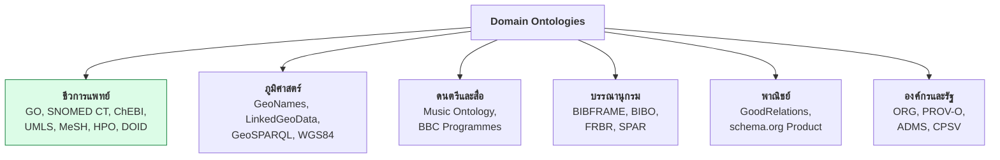
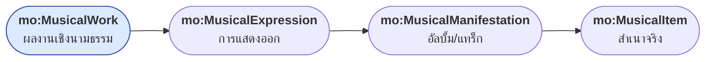
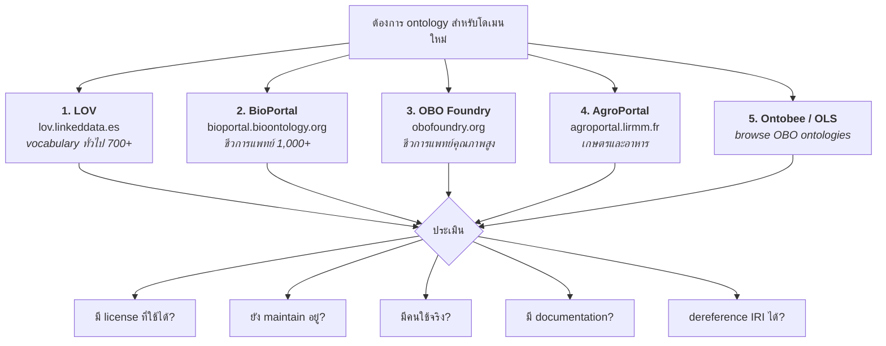

# 09.06 Domain Ontologies

บทนี้แนะนำ **ontology เฉพาะโดเมน** ที่ใหญ่และถูกใช้จริงในอุตสาหกรรม — โดยเฉพาะสายชีวการแพทย์
ที่เป็น early adopter ที่จริงจังที่สุดของ Semantic Web
พร้อมบอกวิธีเข้าถึงและใช้งานแต่ละตัว

---

## ภาพรวมตามโดเมน



---

## ชีวการแพทย์

### Gene Ontology (GO)

**ontology ที่ประสบความสำเร็จที่สุดในวงการวิทยาศาสตร์**

```turtle
@prefix obo:  <http://purl.obolibrary.org/obo/> .
@prefix rdfs: <http://www.w3.org/2000/01/rdf-schema#> .
@prefix owl:  <http://www.w3.org/2002/07/owl#> .

obo:GO_0006915 a owl:Class ;
    rdfs:label      "apoptotic process" ;
    obo:IAO_0000115 "A programmed cell death process which begins when a cell receives an internal or external signal..." ;
    rdfs:subClassOf obo:GO_0012501 .      # programmed cell death

obo:GO_0012501 a owl:Class ;
    rdfs:label      "programmed cell death" ;
    rdfs:subClassOf obo:GO_0008219 .      # cell death
```

| ประเด็น | รายละเอียด |
| --- | --- |
| ขนาด | 40,000+ terms |
| แบ่งเป็น 3 มิติ | **Biological Process**, **Molecular Function**, **Cellular Component** |
| Profile | **OWL 2 EL** (จึงใช้ ELK classify ได้เร็ว) |
| ดาวน์โหลด | `geneontology.org` — มี OWL, OBO, JSON |
| IRI pattern | `http://purl.obolibrary.org/obo/GO_XXXXXXX` |

**ประโยชน์ที่จับต้องได้**: เมื่อ GO บอกว่า `apoptotic process ⊑ programmed cell death`
การค้นหางานวิจัยเรื่อง programmed cell death จะได้ผลที่พูดถึง apoptosis มาด้วยอัตโนมัติ

```sparql
# หา process ทั้งหมดที่เป็น subclass ของ cell death
PREFIX obo:  <http://purl.obolibrary.org/obo/>
PREFIX rdfs: <http://www.w3.org/2000/01/rdf-schema#>

SELECT ?term ?label WHERE {
  ?term rdfs:subClassOf+ obo:GO_0008219 ;    # cell death
        rdfs:label ?label .
}
```

### SNOMED CT

**คำศัพท์ทางคลินิกที่ใหญ่ที่สุดในโลก**

| ประเด็น | รายละเอียด |
| --- | --- |
| ขนาด | **350,000+ concepts**, 1.4M relationships |
| ใช้ใน | ระบบ EHR ทั่วโลก (กว่า 80 ประเทศ) |
| Profile | **OWL 2 EL** โดยเจตนา |
| Reasoner | **ELK** — classify ได้ในไม่กี่นาที |
| License | ⚠️ **ต้องมี license** (ฟรีในประเทศสมาชิก IHTSDO) |
| เข้าถึง | `browser.ihtsdotools.org` |

```
SNOMED CT concept: 195967001 |Asthma (disorder)|
  IS-A: 50043002 |Disorder of respiratory system|
  Finding site: 89187006 |Airway structure|
  Pathological process: 472964009 |Allergic process|
```

> 💡 **SNOMED CT เป็นเหตุผลหลักที่ OWL 2 EL ถูกออกแบบมา** — เพื่อให้ classify ontology ขนาดนี้ได้จริง

### ChEBI

**Chemical Entities of Biological Interest**

```turtle
@prefix obo: <http://purl.obolibrary.org/obo/> .

obo:CHEBI_15377 a owl:Class ;
    rdfs:label "water" ;
    obo:chebi_formula "H2O" ;
    obo:chebi_inchi "InChI=1S/H2O/h1H2" ;
    obo:chebi_smiles "O" ;
    rdfs:subClassOf obo:CHEBI_33608 .    # hydrogen molecular entity
```

| ประเด็น | รายละเอียด |
| --- | --- |
| ขนาด | 150,000+ entities |
| เนื้อหา | โมเลกุล ยา สารเมตาบอไลต์ |
| เชื่อมกับ | PubChem, DrugBank, KEGG |
| เข้าถึง | `ebi.ac.uk/chebi` |

### UMLS

**Unified Medical Language System** — metathesaurus ที่รวม vocabulary ทางการแพทย์เข้าด้วยกัน

| ประเด็น | รายละเอียด |
| --- | --- |
| ขนาด | **4M+ concepts** จาก 200+ source vocabulary |
| รวม | SNOMED CT, ICD, MeSH, LOINC, RxNorm |
| จุดเด่น | **mapping ข้าม vocabulary** |
| License | ⚠️ ต้องสมัครฟรีที่ NLM |

### MeSH

**Medical Subject Headings** — ใช้ index บทความใน PubMed

```turtle
@prefix meshv: <http://id.nlm.nih.gov/mesh/vocab#> .
@prefix mesh:  <http://id.nlm.nih.gov/mesh/> .

mesh:D001249 a meshv:TopicalDescriptor ;
    meshv:prefLabel "Asthma"@en ;
    meshv:broaderDescriptor mesh:D001982 .    # Bronchial Diseases
```

**MeSH มี SPARQL endpoint สาธารณะ**: `id.nlm.nih.gov/mesh/sparql`

```sparql
PREFIX meshv: <http://id.nlm.nih.gov/mesh/vocab#>
PREFIX rdfs:  <http://www.w3.org/2000/01/rdf-schema#>

SELECT ?descriptor ?label WHERE {
  SERVICE <https://id.nlm.nih.gov/mesh/sparql> {
    ?descriptor a meshv:TopicalDescriptor ;
                rdfs:label ?label .
    FILTER(CONTAINS(LCASE(?label), "asthma"))
  }
}
LIMIT 20
```

### OBO Foundry

**กลุ่ม ontology ชีวการแพทย์ที่ทำตามหลักการร่วมกัน**

| หลักการ | รายละเอียด |
| --- | --- |
| **Open** | เปิดให้ใช้ฟรี |
| **Common format** | OWL หรือ OBO |
| **URI space ร่วมกัน** | `http://purl.obolibrary.org/obo/` |
| **Versioning** | มี version ชัดเจน |
| **Unique identifier** | prefix เฉพาะ (GO_, CHEBI_, DOID_) |
| **Textual definition** | ทุก term มีนิยามภาษาอังกฤษ |
| **Orthogonality** | ไม่ทับซ้อนกัน |

| Ontology | โดเมน |
| --- | --- |
| **GO** | gene function |
| **ChEBI** | chemical entities |
| **DOID** | human disease |
| **HPO** | human phenotype |
| **UBERON** | anatomy (ข้ามสปีชีส์) |
| **PATO** | phenotypic quality |
| **CL** | cell types |
| **PRO** | proteins |
| **OBI** | biomedical investigations |

> 💡 **OBO Foundry ontology ทั้งหมดใช้ URI pattern เดียวกัน** ทำให้เชื่อมกันได้ง่าย

---

## ภูมิศาสตร์

### GeoNames

```turtle
@prefix gn:  <http://www.geonames.org/ontology#> .
@prefix wgs: <http://www.w3.org/2003/01/geo/wgs84_pos#> .

<http://sws.geonames.org/1609350/> a gn:Feature ;
    gn:name          "Bangkok" ;
    gn:alternateName "กรุงเทพมหานคร"@th , "Krung Thep"@en ;
    gn:featureClass  gn:P ;                    # populated place
    gn:featureCode   gn:P.PPLC ;               # capital of a country
    gn:countryCode   "TH" ;
    gn:population    "5104476" ;
    gn:parentCountry <http://sws.geonames.org/1605651/> ;
    wgs:lat          "13.75398" ;
    wgs:long         "100.50144" .
```

| ประเด็น | รายละเอียด |
| --- | --- |
| ขนาด | **11M+ สถานที่** ทั่วโลก |
| License | CC BY 4.0 |
| เข้าถึง | `geonames.org` — มี REST API และ dump |
| IRI pattern | `http://sws.geonames.org/{id}/` |

**Feature class ของ GeoNames**

| Code | ความหมาย |
| --- | --- |
| `A` | ประเทศ รัฐ เขตปกครอง |
| `P` | เมือง หมู่บ้าน |
| `H` | แหล่งน้ำ |
| `L` | สวนสาธารณะ พื้นที่ |
| `R` | ถนน ทางรถไฟ |
| `S` | อาคาร สิ่งปลูกสร้าง |
| `T` | ภูเขา เนิน |
| `U` | ใต้ทะเล |
| `V` | ป่า พืชพรรณ |

### GeoSPARQL

**W3C/OGC standard สำหรับข้อมูลเชิงพื้นที่ใน RDF**

```turtle
@prefix geo:  <http://www.opengis.net/ont/geosparql#> .
@prefix geof: <http://www.opengis.net/def/function/geosparql/> .

ex:bangkok a geo:Feature ;
    geo:hasGeometry [
        a geo:Geometry ;
        geo:asWKT "POINT(100.50144 13.75398)"^^geo:wktLiteral
    ] .

ex:thailand a geo:Feature ;
    geo:hasGeometry [
        a geo:Geometry ;
        geo:asWKT "POLYGON((97.3 5.6, 105.6 5.6, 105.6 20.5, 97.3 20.5, 97.3 5.6))"^^geo:wktLiteral
    ] .
```

**GeoSPARQL function**

```sparql
PREFIX geo:  <http://www.opengis.net/ont/geosparql#>
PREFIX geof: <http://www.opengis.net/def/function/geosparql/>

# หาสถานที่ที่อยู่ในรัศมี 10 กม.
SELECT ?place WHERE {
  ?place geo:hasGeometry/geo:asWKT ?wkt .
  FILTER(geof:distance(?wkt, "POINT(100.5 13.75)"^^geo:wktLiteral,
                       <http://www.opengis.net/def/uom/OGC/1.0/metre>) < 10000)
}

# หาสิ่งที่อยู่ภายในพื้นที่
SELECT ?place WHERE {
  ex:thailand geo:hasGeometry/geo:asWKT ?boundary .
  ?place geo:hasGeometry/geo:asWKT ?point .
  FILTER(geof:sfWithin(?point, ?boundary))
}
```

| Topological function | ความหมาย |
| --- | --- |
| `geof:sfWithin` | อยู่ภายใน |
| `geof:sfContains` | ครอบคลุม |
| `geof:sfIntersects` | ตัดกัน |
| `geof:sfTouches` | สัมผัสกัน |
| `geof:sfOverlaps` | ทับซ้อนกัน |
| `geof:sfDisjoint` | แยกจากกัน |

> ⚠️ **ไม่ใช่ทุก triplestore ที่รองรับ GeoSPARQL** — GraphDB, Stardog, Virtuoso รองรับ; rdflib ไม่รองรับ

---

## Music Ontology

```turtle
@prefix mo:   <http://purl.org/ontology/mo/> .
@prefix foaf: <http://xmlns.com/foaf/0.1/> .
@prefix dcterms: <http://purl.org/dc/terms/> .

ex:theBeatles a mo:MusicGroup ;
    foaf:name "The Beatles" ;
    mo:member ex:johnLennon , ex:paulMcCartney .

ex:abbeyRoad a mo:Record ;
    dcterms:title "Abbey Road" ;
    mo:release_type mo:album ;
    dcterms:date "1969-09-26" ;
    mo:track ex:comeTogether .

ex:comeTogether a mo:Track ;
    dcterms:title "Come Together" ;
    mo:track_number 1 ;
    mo:duration 259000 ;                    # milliseconds
    foaf:maker ex:theBeatles .
```

**โมเดล 4 ระดับของ Music Ontology**



**อิงจากโมเดล FRBR** ของวงการห้องสมุด

---

## บรรณานุกรม

### BIBO และ SPAR

```turtle
@prefix bibo:    <http://purl.org/ontology/bibo/> .
@prefix dcterms: <http://purl.org/dc/terms/> .
@prefix foaf:    <http://xmlns.com/foaf/0.1/> .
@prefix xsd:     <http://www.w3.org/2001/XMLSchema#> .

ex:paper001 a bibo:AcademicArticle ;
    dcterms:title   "On the Radiation of Uranium"@en ;
    dcterms:creator ex:MarieCurie ;
    bibo:doi        "10.1000/xyz123" ;
    bibo:volume     "126" ;
    bibo:issue      "3" ;
    bibo:pageStart  "1101" ;
    bibo:pageEnd    "1103" ;
    dcterms:isPartOf ex:journalCR ;
    bibo:cites      ex:paper000 .

ex:journalCR a bibo:Journal ;
    dcterms:title "Comptes Rendus"@en ;
    bibo:issn     "0001-4036" .
```

**SPAR Ontologies** (Semantic Publishing and Referencing) — ชุด ontology 8 ตัวสำหรับ scholarly publishing

| Ontology | ครอบคลุม |
| --- | --- |
| **FaBiO** | FRBR-aligned bibliographic ontology |
| **CiTO** | เหตุผลของการอ้างอิง (`cito:agreesWith`, `cito:disputes`) |
| **BiRO** | โครงสร้างรายการอ้างอิง |
| **PRO** | บทบาทของผู้เขียน |
| **PSO** | สถานะการตีพิมพ์ |
| **DoCO** | โครงสร้างเอกสาร |

```turtle
@prefix cito: <http://purl.org/spar/cito/> .

# ไม่ใช่แค่ "อ้างอิง" แต่บอกว่าอ้างอิงเพื่ออะไร
ex:paper002 cito:extends       ex:paper001 ;
            cito:disputes      ex:paper000 ;
            cito:usesMethodIn  ex:paper003 ;
            cito:confirms      ex:paper004 .
```

---

## พาณิชย์: GoodRelations

```turtle
@prefix gr: <http://purl.org/goodrelations/v1#> .

ex:offer001 a gr:Offering ;
    gr:name "Semantic Web Textbook" ;
    gr:hasBusinessFunction gr:Sell ;
    gr:hasPriceSpecification [
        a gr:UnitPriceSpecification ;
        gr:hasCurrency "THB" ;
        gr:hasCurrencyValue "1200.00"^^xsd:float ;
        gr:validThrough "2025-12-31T23:59:59Z"^^xsd:dateTime
    ] ;
    gr:includesObject [
        a gr:TypeAndQuantityNode ;
        gr:amountOfThisGood "1"^^xsd:float ;
        gr:typeOfGood ex:book001
    ] .
```

> 💡 **GoodRelations ถูกรวมเข้า schema.org แล้ว** — งานใหม่ควรใช้ `schema:Offer` แทน

---

## องค์กร: ORG Ontology

```turtle
@prefix org:  <http://www.w3.org/ns/org#> .
@prefix foaf: <http://xmlns.com/foaf/0.1/> .

ex:exampleUniversity a org:FormalOrganization ;
    org:hasUnit ex:engineeringFaculty .

ex:engineeringFaculty a org:OrganizationalUnit ;
    org:unitOf ex:exampleUniversity ;
    org:hasUnit ex:csDept .

ex:alice org:memberOf ex:csDept ;
    org:holds [
        a org:Post ;
        org:role ex:professorRole ;
        org:postIn ex:csDept
    ] .

ex:professorRole a org:Role ;
    rdfs:label "Professor"@en .
```

**ORG แยก `Role` ออกจาก `Membership`** — เป็น ontology design pattern ที่ดี (ดู [10.05](../10-ontology-design/10.05-odp.md))

---

## วิธีค้นหาและประเมิน ontology



### เกณฑ์ประเมิน ontology

| เกณฑ์ | ตรวจอย่างไร |
| --- | --- |
| **License** | มี `dcterms:license` ที่ใช้เชิงพาณิชย์ได้ไหม |
| **Maintenance** | commit ล่าสุดเมื่อไหร่, มี `owl:versionInfo` ไหม |
| **Adoption** | LOV แสดงจำนวน dataset ที่ใช้ |
| **Documentation** | มี `rdfs:label`/`rdfs:comment` ครบไหม |
| **Dereferenceable** | เปิด IRI แล้วได้ RDF กลับมาไหม |
| **Stability** | IRI เปลี่ยนบ่อยไหม |
| **Profile** | อยู่ใน OWL 2 EL/QL/RL ไหม (มีผลต่อ performance) |

```bash
# ตรวจว่า dereference ได้ไหม
curl -H "Accept: text/turtle" -L http://purl.obolibrary.org/obo/GO_0006915

# ตรวจ license
curl -s -H "Accept: text/turtle" -L http://xmlns.com/foaf/0.1/ | grep -i license
```

---

## Python: โหลดและสำรวจ domain ontology

```python
from rdflib import Graph
from rdflib.namespace import OWL, RDF, RDFS


def profile_ontology(url: str, fmt: str = "xml") -> None:
    """โหลด ontology แล้วรายงานโครงสร้าง"""
    g = Graph()
    print(f"กำลังโหลด {url} ...")
    g.parse(url, format=fmt)
    print(f"  {len(g):,} triples\n")

    classes = set(g.subjects(RDF.type, OWL.Class)) | set(g.subjects(RDF.type, RDFS.Class))
    obj_props = set(g.subjects(RDF.type, OWL.ObjectProperty))
    data_props = set(g.subjects(RDF.type, OWL.DatatypeProperty))
    annot_props = set(g.subjects(RDF.type, OWL.AnnotationProperty))

    print(f"  classes            : {len(classes):,}")
    print(f"  object properties  : {len(obj_props):,}")
    print(f"  data properties    : {len(data_props):,}")
    print(f"  annotation props   : {len(annot_props):,}")

    # ความลึกของ hierarchy
    roots = [c for c in classes if not list(g.objects(c, RDFS.subClassOf))]
    print(f"  root classes       : {len(roots)}")

    # ตรวจ OWL 2 EL compatibility
    el_blockers = {
        "complementOf": len(list(g.subject_objects(OWL.complementOf))),
        "unionOf": len(list(g.subject_objects(OWL.unionOf))),
        "allValuesFrom": len(list(g.subject_objects(OWL.allValuesFrom))),
        "inverseOf": len(list(g.subject_objects(OWL.inverseOf))),
        "minCardinality": len(list(g.subject_objects(OWL.minCardinality))),
    }
    blockers = {k: v for k, v in el_blockers.items() if v > 0}
    if blockers:
        print(f"\n  ⚠️ ไม่อยู่ใน OWL 2 EL เพราะมี: {blockers}")
    else:
        print("\n  ✅ น่าจะอยู่ใน OWL 2 EL (ใช้ ELK ได้)")

    # ตัวอย่าง class
    print("\n  ตัวอย่าง class:")
    for cls in sorted(classes, key=str)[:10]:
        label = g.value(cls, RDFS.label)
        print(f"    {str(cls).split('/')[-1]:24s} {label}")


# FOAF -- เล็ก โหลดเร็ว
profile_ontology("http://xmlns.com/foaf/0.1/", fmt="xml")
```

Expected output:

```
กำลังโหลด http://xmlns.com/foaf/0.1/ ...
  631 triples

  classes            : 14
  object properties  : 31
  data properties    : 8
  annotation props   : 0
  root classes       : 8

  ⚠️ ไม่อยู่ใน OWL 2 EL เพราะมี: {'inverseOf': 2}

  ตัวอย่าง class:
    Agent                    Agent
    Document                 Document
    Group                    Group
    Image                    Image
    ...
```

> ⚠️ **ontology ใหญ่อย่าง GO หรือ ChEBI ใช้เวลาโหลดนานมาก** (หลายนาที + RAM หลาย GB)
> ให้ดาวน์โหลดไฟล์มาเก็บ local ก่อน หรือใช้ SPARQL endpoint แทน

---

## เชื่อม ontology ของเรากับ domain ontology

```turtle
@prefix ex:   <http://example.org/medical#> .
@prefix owl:  <http://www.w3.org/2002/07/owl#> .
@prefix rdfs: <http://www.w3.org/2000/01/rdf-schema#> .
@prefix skos: <http://www.w3.org/2004/02/skos/core#> .
@prefix obo:  <http://purl.obolibrary.org/obo/> .

# --- class ของเรา เชื่อมกับ ontology มาตรฐาน ---
ex:Asthma a owl:Class ;
    rdfs:label      "Asthma"@en ;
    owl:equivalentClass obo:DOID_2841 ;              # Disease Ontology
    skos:closeMatch <http://id.nlm.nih.gov/mesh/D001249> ;   # MeSH
    rdfs:seeAlso    <https://browser.ihtsdotools.org/?perspective=full&conceptId1=195967001> .

# --- ยาที่รักษา ---
ex:Salbutamol a owl:Class ;
    rdfs:label "Salbutamol"@en ;
    owl:equivalentClass obo:CHEBI_2549 ;             # ChEBI
    ex:treats ex:Asthma .

# --- ตำแหน่งทางกายวิภาค ---
ex:Lung a owl:Class ;
    owl:equivalentClass obo:UBERON_0002048 .         # UBERON
```

**หลักการ**: ใช้ `owl:equivalentClass` เมื่อแน่ใจว่าตรงกันจริง, `skos:closeMatch` เมื่อใกล้เคียง,
`rdfs:seeAlso` เมื่อแค่ต้องการชี้ให้ดูเพิ่ม

---

## ⚠️ ข้อควรระวัง

| ประเด็น | รายละเอียด |
| --- | --- |
| **License** | SNOMED CT และ UMLS ต้องมี license — ตรวจก่อนใช้ในผลิตภัณฑ์ |
| **ขนาด** | GO, ChEBI, SNOMED ใหญ่มาก — อย่า `owl:imports` ทั้งก้อน |
| **Module extraction** | ใช้ **ROBOT extract** ดึงเฉพาะส่วนที่ต้องการ |
| **Version** | ontology เปลี่ยนบ่อย — pin version ด้วย `owl:versionIRI` |
| **IRI ไม่ dereference** | บาง ontology IRI เปิดไม่ได้ — ต้อง download มาเก็บเอง |
| **Reasoning ช้า** | ontology ใหญ่ต้องใช้ ELK และต้องอยู่ใน OWL 2 EL |

### ดึงเฉพาะ module ที่ต้องการด้วย ROBOT

```bash
# สร้างไฟล์รายการ term ที่สนใจ
cat > terms.txt <<'EOF'
http://purl.obolibrary.org/obo/GO_0006915
http://purl.obolibrary.org/obo/GO_0012501
EOF

# ดึง module (BOT = bottom module, รวม superclass ทั้งหมด)
robot extract --input go.owl \
              --method BOT \
              --term-file terms.txt \
              --output go-apoptosis-module.owl

# ดู metric ของ module ที่ได้
robot measure --input go-apoptosis-module.owl --output metrics.tsv
```

| Method | ได้อะไร |
| --- | --- |
| `STAR` | เฉพาะ term ที่ระบุ + สิ่งที่จำเป็น (เล็กที่สุด) |
| `TOP` | term + subclass ทั้งหมด |
| `BOT` | term + superclass ทั้งหมด (**ใช้บ่อยที่สุด**) |
| `MIREOT` | ดึงแบบเลือกได้ละเอียด |

---

## Key Points

- **วงการชีวการแพทย์เป็น early adopter ที่จริงจังที่สุด** — GO, SNOMED CT, ChEBI, UMLS, MeSH
- **Gene Ontology** (40,000 terms) และ **SNOMED CT** (350,000 concepts) ออกแบบให้อยู่ใน **OWL 2 EL** จึงใช้ ELK classify ได้
- **OBO Foundry** กำหนดหลักการร่วมกัน: open, OWL/OBO, URI space เดียว (`purl.obolibrary.org/obo/`), มีนิยามทุก term
- **GeoNames** (11M สถานที่) และ **GeoSPARQL** (spatial function) สำหรับข้อมูลภูมิศาสตร์
- **SPAR Ontologies** โดยเฉพาะ **CiTO** บอกได้ว่าอ้างอิงเพื่ออะไร (agrees, disputes, extends)
- ⚠️ **SNOMED CT และ UMLS ต้องมี license** — ตรวจก่อนใช้เชิงพาณิชย์
- ⚠️ **อย่า `owl:imports` ontology ใหญ่ทั้งก้อน** — ใช้ **ROBOT extract** ดึงเฉพาะ module ที่ต้องการ
- ค้นหา ontology ที่ **LOV** (ทั่วไป), **BioPortal**/**OBO Foundry** (ชีวการแพทย์), **AgroPortal** (เกษตร)
- ประเมินด้วย: license, maintenance, adoption, documentation, dereferenceable, OWL profile
