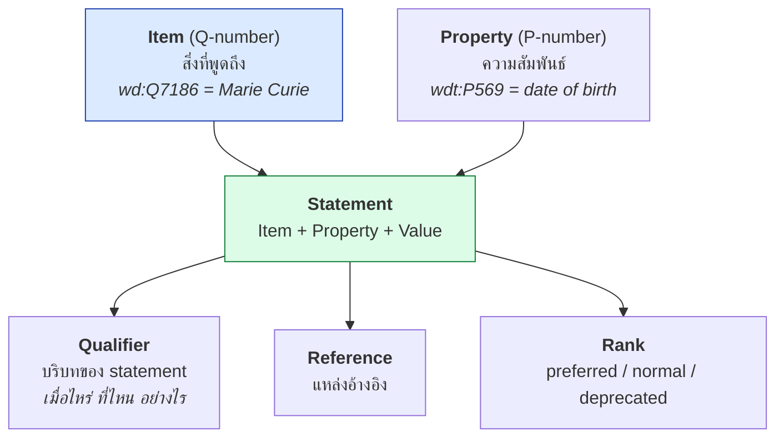
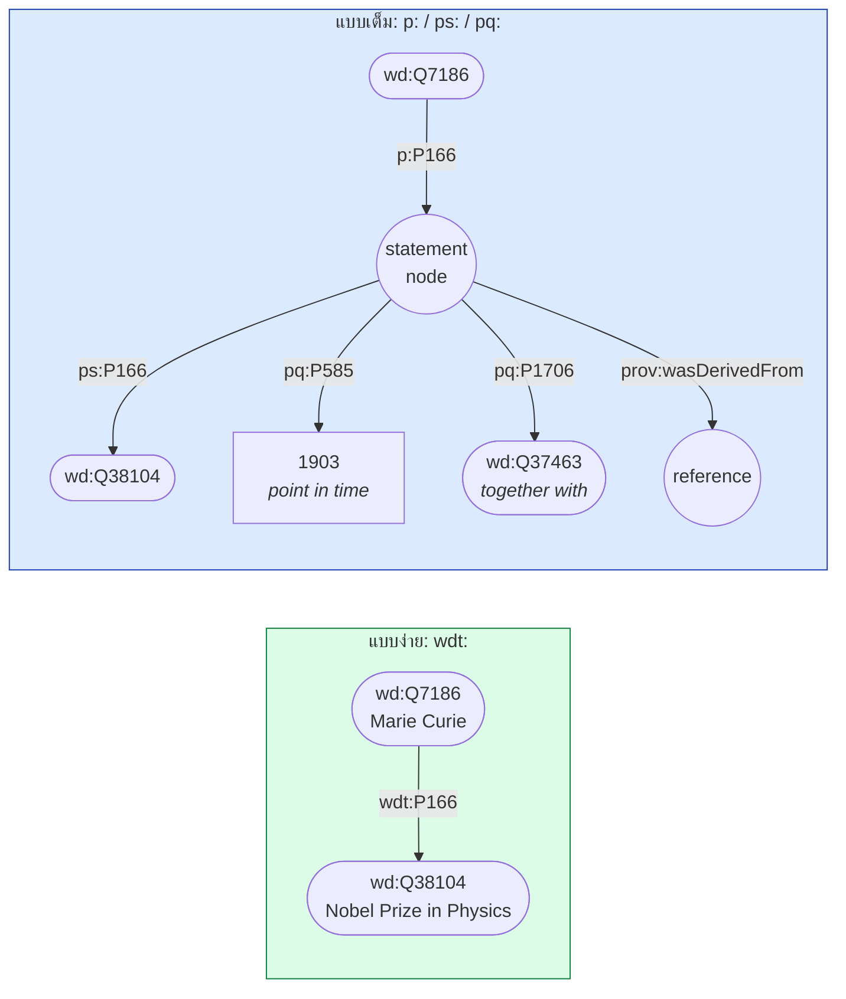
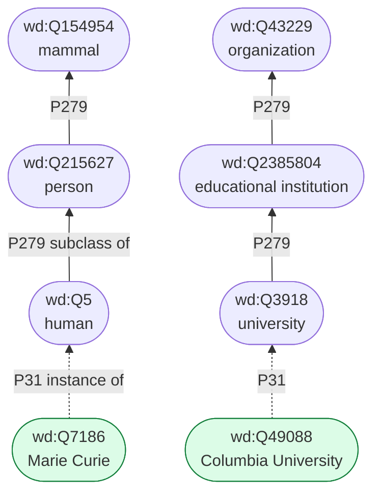
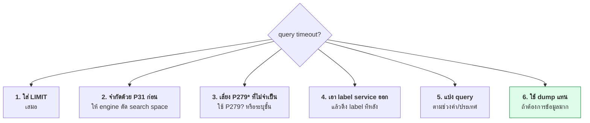

# 09.07 Wikidata Data Model

**Wikidata** เป็นฐานความรู้เปิดที่ใหญ่ที่สุดในโลก — มี **item มากกว่า 100 ล้านรายการ**
แก้ไขโดยชุมชนและเปิด SPARQL endpoint ให้ใช้ฟรี
บทนี้อธิบาย **data model** ที่ต่างจาก RDF ทั่วไป และวิธี query ที่ถูกต้อง

---

## Data Model



| หน่วย | Prefix | ตัวอย่าง |
| --- | --- | --- |
| **Item** | `wd:` | `wd:Q7186` (Marie Curie) |
| **Property** | `wd:` | `wd:P569` (date of birth) |
| **Lexeme** | `wd:L` | `wd:L1234` (คำในภาษา) |

---

## ⚠️ Prefix ที่ต้องแยกให้ออก

**นี่คือจุดที่คนสับสนมากที่สุดเมื่อเริ่ม query Wikidata**

```turtle
@prefix wd:       <http://www.wikidata.org/entity/> .
@prefix wdt:      <http://www.wikidata.org/prop/direct/> .
@prefix p:        <http://www.wikidata.org/prop/> .
@prefix ps:       <http://www.wikidata.org/prop/statement/> .
@prefix pq:       <http://www.wikidata.org/prop/qualifier/> .
@prefix pr:       <http://www.wikidata.org/prop/reference/> .
@prefix wdno:     <http://www.wikidata.org/prop/novalue/> .
@prefix wikibase: <http://wikiba.se/ontology#> .
@prefix bd:       <http://www.bigdata.com/rdf#> .
```

| Prefix | ใช้กับ | ตัวอย่าง |
| --- | --- | --- |
| `wd:` | **entity** (item หรือ property ในฐานะ item) | `wd:Q7186`, `wd:P569` |
| `wdt:` | **truthy statement** — ค่าโดยตรง ไม่มี qualifier | `wdt:P569` |
| `p:` | นำไปสู่ **statement node** (มี qualifier ได้) | `p:P166` |
| `ps:` | **ค่าของ statement** | `ps:P166` |
| `pq:` | **qualifier** | `pq:P585` (point in time) |
| `pr:` | **reference** | `pr:P248` (stated in) |



### เทียบด้วย query จริง

```sparql
# --- แบบง่าย: ใช้ wdt: -- ได้แค่ค่า ไม่มีบริบท ---
PREFIX wd:  <http://www.wikidata.org/entity/>
PREFIX wdt: <http://www.wikidata.org/prop/direct/>

SELECT ?award WHERE {
  wd:Q7186 wdt:P166 ?award .        # Marie Curie -> award received
}
```

| ?award |
| --- |
| `wd:Q38104` (Nobel Prize in Physics) |
| `wd:Q44585` (Nobel Prize in Chemistry) |
| ... |

```sparql
# --- แบบเต็ม: ใช้ p:/ps:/pq: -- ได้บริบทด้วย ---
PREFIX wd:  <http://www.wikidata.org/entity/>
PREFIX p:   <http://www.wikidata.org/prop/>
PREFIX ps:  <http://www.wikidata.org/prop/statement/>
PREFIX pq:  <http://www.wikidata.org/prop/qualifier/>
PREFIX wikibase: <http://wikiba.se/ontology#>
PREFIX bd:  <http://www.bigdata.com/rdf#>

SELECT ?awardLabel ?year ?togetherWithLabel WHERE {
  wd:Q7186 p:P166 ?statement .
  ?statement ps:P166 ?award .
  OPTIONAL { ?statement pq:P585  ?time .
             BIND(YEAR(?time) AS ?year) }
  OPTIONAL { ?statement pq:P1706 ?togetherWith }
  SERVICE wikibase:label { bd:serviceParam wikibase:language "en" . }
}
```

| ?awardLabel | ?year | ?togetherWithLabel |
| --- | --- | --- |
| Nobel Prize in Physics | 1903 | Pierre Curie |
| Nobel Prize in Chemistry | 1911 | |

> 💡 **ใช้ `wdt:` เป็น default** เพราะเร็วกว่ามาก — ใช้ `p:/ps:/pq:` เฉพาะเมื่อต้องการ qualifier

---

## Property สำคัญที่ต้องจำ

| Property | ความหมาย | ใช้บ่อยแค่ไหน |
| --- | --- | --- |
| **`wdt:P31`** | **instance of** | ⭐⭐⭐ ทุก query |
| **`wdt:P279`** | **subclass of** | ⭐⭐⭐ |
| `wdt:P17` | country | ⭐⭐ |
| `wdt:P131` | located in administrative entity | ⭐⭐ |
| `wdt:P106` | occupation | ⭐⭐ |
| `wdt:P569` | date of birth | ⭐⭐ |
| `wdt:P570` | date of death | ⭐⭐ |
| `wdt:P19` | place of birth | ⭐ |
| `wdt:P27` | country of citizenship | ⭐⭐ |
| `wdt:P21` | sex or gender | ⭐ |
| `wdt:P166` | award received | ⭐ |
| `wdt:P69` | educated at | ⭐ |
| `wdt:P108` | employer | ⭐ |
| `wdt:P856` | official website | ⭐ |
| `wdt:P625` | coordinate location | ⭐⭐ |
| `wdt:P1082` | population | ⭐ |
| `wdt:P18` | image | ⭐ |
| `wdt:P527` | has part | ⭐ |
| `wdt:P361` | part of | ⭐ |

### Item สำคัญ

| Item | ความหมาย |
| --- | --- |
| `wd:Q5` | **human** |
| `wd:Q6256` | country |
| `wd:Q515` | city |
| `wd:Q3918` | university |
| `wd:Q43229` | organization |
| `wd:Q571` | book |
| `wd:Q11424` | film |
| `wd:Q7397` | software |
| `wd:Q2221906` | geographic location |

---

## ⚠️ `P31` (instance of) vs `P279` (subclass of)

**นี่คือความต่างที่สำคัญที่สุดในการ query Wikidata**



```sparql
# ❌ ได้แค่ที่ประกาศ P31 ตรง ๆ -- ตกหล่นเยอะมาก
SELECT ?item WHERE { ?item wdt:P31 wd:Q3918 }        # university

# ✅ รวม subclass ทุกระดับ -- pattern มาตรฐาน
SELECT ?item WHERE { ?item wdt:P31/wdt:P279* wd:Q3918 }
```

**`wdt:P31/wdt:P279*` เป็น pattern ที่ต้องใช้เกือบทุก query** — เพราะ Wikidata มี class hierarchy ลึกมาก

---

## Label Service

Wikidata มีบริการพิเศษที่เติม label ให้อัตโนมัติ

```sparql
PREFIX wd:  <http://www.wikidata.org/entity/>
PREFIX wdt: <http://www.wikidata.org/prop/direct/>
PREFIX wikibase: <http://wikiba.se/ontology#>
PREFIX bd:  <http://www.bigdata.com/rdf#>

SELECT ?person ?personLabel ?occupationLabel ?birthDate
WHERE {
  ?person wdt:P166 wd:Q38104 ;      # award received = Nobel Prize in Physics
          wdt:P106 ?occupation ;
          wdt:P569 ?birthDate .

  # ✅ ตัวแปรที่ลงท้ายด้วย Label จะถูกเติมให้อัตโนมัติ
  SERVICE wikibase:label {
    bd:serviceParam wikibase:language "en,th" .
  }
}
LIMIT 10
```

**กฎของ label service**

| ตัวแปร | ได้อะไร |
| --- | --- |
| `?xLabel` | `rdfs:label` |
| `?xDescription` | `schema:description` |
| `?xAltLabel` | `skos:altLabel` |

> ⚠️ **ต้องวาง `SERVICE wikibase:label` ไว้ท้ายสุดของ WHERE clause**
> และ **ห้ามใช้ `?xLabel` ใน `FILTER`** เพราะยังไม่ถูก bind ตอนนั้น

```sparql
# ❌ ผิด -- ?personLabel ยังไม่ถูก bind
SELECT ?person ?personLabel WHERE {
  ?person wdt:P31 wd:Q5 .
  FILTER(CONTAINS(?personLabel, "Curie"))
  SERVICE wikibase:label { bd:serviceParam wikibase:language "en" . }
}

# ✅ ถูก -- query rdfs:label เอง
SELECT ?person ?label WHERE {
  ?person wdt:P31 wd:Q5 ;
          rdfs:label ?label .
  FILTER(LANG(?label) = "en")
  FILTER(CONTAINS(?label, "Curie"))
}
LIMIT 20
```

---

## Rank

Wikidata statement มี **rank** เพื่อจัดการค่าที่ขัดแย้งกันหรือเปลี่ยนตามเวลา

| Rank | ความหมาย | `wdt:` ให้ค่านี้ไหม |
| --- | --- | :---: |
| **Preferred** | ค่าที่ควรใช้ (เช่น ประชากรล่าสุด) | ✅ |
| **Normal** | ค่าปกติ | ✅ (ถ้าไม่มี preferred) |
| **Deprecated** | ค่าที่รู้ว่าผิด แต่เก็บไว้เพื่อประวัติ | ❌ |

```sparql
PREFIX wikibase: <http://wikiba.se/ontology#>

# ดู rank ของแต่ละ statement
SELECT ?value ?rank WHERE {
  wd:Q1861 p:P1082 ?statement .          # Bangkok -> population
  ?statement ps:P1082 ?value ;
             wikibase:rank ?rank .
}
```

> 💡 **`wdt:` กรอง deprecated ออกให้อัตโนมัติ** — เป็นอีกเหตุผลที่ควรใช้ `wdt:` เป็น default

---

## Value Types

### Time

```sparql
SELECT ?person ?birthDate ?precision WHERE {
  ?person wdt:P569 ?birthDate .
}
```

ค่าเป็น `xsd:dateTime` แต่ **มี precision** ที่ต้องระวัง

```sparql
# ดึง precision จาก statement node
PREFIX wikibase: <http://wikiba.se/ontology#>
PREFIX psv: <http://www.wikidata.org/prop/statement/value/>

SELECT ?time ?precision WHERE {
  wd:Q7186 p:P569 ?statement .
  ?statement psv:P569 ?valueNode .
  ?valueNode wikibase:timeValue     ?time ;
             wikibase:timePrecision ?precision .
}
```

| Precision | ความหมาย |
| --- | --- |
| 11 | วัน |
| 10 | เดือน |
| 9 | ปี |
| 8 | ทศวรรษ |
| 7 | ศตวรรษ |

### Quantity

```sparql
PREFIX psv: <http://www.wikidata.org/prop/statement/value/>
PREFIX wikibase: <http://wikiba.se/ontology#>

SELECT ?amount ?unitLabel WHERE {
  wd:Q1861 p:P1082 ?statement .           # Bangkok -> population
  ?statement psv:P1082 ?valueNode .
  ?valueNode wikibase:quantityAmount ?amount ;
             wikibase:quantityUnit   ?unit .
  SERVICE wikibase:label { bd:serviceParam wikibase:language "en" . }
}
```

### Coordinate

```sparql
SELECT ?place ?coord WHERE {
  ?place wdt:P625 ?coord .
}
# ค่าเป็น "Point(100.5 13.75)"^^geo:wktLiteral
```

```sparql
# ค้นหาตามระยะทาง (Wikidata รองรับ GeoSPARQL บางส่วน)
PREFIX wikibase: <http://wikiba.se/ontology#>
PREFIX geo: <http://www.opengis.net/ont/geosparql#>

SELECT ?place ?placeLabel ?dist WHERE {
  SERVICE wikibase:around {
    ?place wdt:P625 ?location .
    bd:serviceParam wikibase:center "Point(100.5 13.75)"^^geo:wktLiteral .
    bd:serviceParam wikibase:radius "10" .
    bd:serviceParam wikibase:distance ?dist .
  }
  ?place wdt:P31/wdt:P279* wd:Q3918 .        # university
  SERVICE wikibase:label { bd:serviceParam wikibase:language "en" . }
}
ORDER BY ?dist
```

---

## Query ตัวอย่างที่ใช้จริง

```sparql
PREFIX wd:  <http://www.wikidata.org/entity/>
PREFIX wdt: <http://www.wikidata.org/prop/direct/>
PREFIX p:   <http://www.wikidata.org/prop/>
PREFIX ps:  <http://www.wikidata.org/prop/statement/>
PREFIX pq:  <http://www.wikidata.org/prop/qualifier/>
PREFIX wikibase: <http://wikiba.se/ontology#>
PREFIX bd:  <http://www.bigdata.com/rdf#>
PREFIX rdfs: <http://www.w3.org/2000/01/rdf-schema#>

# --- 1) นักวิทยาศาสตร์หญิงที่ได้รางวัลโนเบล ---
SELECT ?person ?personLabel ?awardLabel ?year WHERE {
  ?person wdt:P31 wd:Q5 ;                    # human
          wdt:P21 wd:Q6581072 .              # female
  ?person p:P166 ?statement .
  ?statement ps:P166 ?award .
  ?award wdt:P31/wdt:P279* wd:Q7191 .        # Nobel Prize
  OPTIONAL { ?statement pq:P585 ?time . BIND(YEAR(?time) AS ?year) }
  SERVICE wikibase:label { bd:serviceParam wikibase:language "en" . }
}
ORDER BY ?year
LIMIT 30

# --- 2) มหาวิทยาลัยในประเทศไทยพร้อมพิกัด ---
SELECT ?uni ?uniLabel ?coord ?inception WHERE {
  ?uni wdt:P31/wdt:P279* wd:Q3918 ;          # university (รวม subclass)
       wdt:P17 wd:Q869 .                     # country = Thailand
  OPTIONAL { ?uni wdt:P625 ?coord }
  OPTIONAL { ?uni wdt:P571 ?inception }
  SERVICE wikibase:label { bd:serviceParam wikibase:language "en,th" . }
}
ORDER BY ?inception

# --- 3) เมืองที่มีประชากรมากที่สุด 20 อันดับ ---
SELECT ?city ?cityLabel ?countryLabel ?population WHERE {
  ?city wdt:P31/wdt:P279* wd:Q515 ;          # city
        wdt:P1082 ?population ;
        wdt:P17 ?country .
  SERVICE wikibase:label { bd:serviceParam wikibase:language "en" . }
}
ORDER BY DESC(?population)
LIMIT 20

# --- 4) หา subclass ทั้งหมดของ "vehicle" ---
SELECT ?item ?itemLabel WHERE {
  ?item wdt:P279* wd:Q42889 .                # vehicle
  SERVICE wikibase:label { bd:serviceParam wikibase:language "en" . }
}
LIMIT 100

# --- 5) นับจำนวน human ที่มี occupation แต่ละแบบ ---
SELECT ?occupationLabel (COUNT(?person) AS ?n) WHERE {
  ?person wdt:P31 wd:Q5 ;
          wdt:P106 ?occupation ;
          wdt:P27 wd:Q869 .                  # Thai citizens
  SERVICE wikibase:label { bd:serviceParam wikibase:language "en" . }
}
GROUP BY ?occupationLabel
ORDER BY DESC(?n)
LIMIT 20

# --- 6) หา identifier ภายนอกทั้งหมดของ entity ---
SELECT ?prop ?propLabel ?value WHERE {
  wd:Q7186 ?p ?value .
  ?prop wikibase:directClaim ?p ;
        wikibase:propertyType wikibase:ExternalId .
  SERVICE wikibase:label { bd:serviceParam wikibase:language "en" . }
}
```

---

## Federated Query: เชื่อมข้อมูลของเรากับ Wikidata

```sparql
PREFIX uni:  <http://example.org/university#>
PREFIX owl:  <http://www.w3.org/2002/07/owl#>
PREFIX rdfs: <http://www.w3.org/2000/01/rdf-schema#>
PREFIX wdt:  <http://www.wikidata.org/prop/direct/>

SELECT ?localName ?population ?website WHERE {
  # --- จาก graph ของเรา ---
  ?org a uni:University ;
       rdfs:label ?localName ;
       owl:sameAs ?wdEntity .
  FILTER(STRSTARTS(STR(?wdEntity), "http://www.wikidata.org/entity/"))

  # --- ไปเอาข้อมูลเพิ่มจาก Wikidata ---
  SERVICE <https://query.wikidata.org/sparql> {
    OPTIONAL { ?wdEntity wdt:P1082 ?population }
    OPTIONAL { ?wdEntity wdt:P856  ?website }
  }
}
```

> ⚠️ ทบทวนจาก [06.09](../06-sparql/06.09-federation.md): federated query ช้ามาก
> ให้ใช้ **`VALUES` + chunking** ในงานจริง

---

## Wikidata Query Service

| ประเด็น | รายละเอียด |
| --- | --- |
| URL | `https://query.wikidata.org/sparql` |
| UI | `https://query.wikidata.org` |
| Timeout | **60 วินาที** |
| Rate limit | ~5 concurrent queries/IP |
| `User-Agent` | **บังคับ** — ไม่ใส่จะถูก block |
| Backend | Blazegraph (กำลังย้ายไป QLever/graph split) |

```python
from SPARQLWrapper import JSON, POST, SPARQLWrapper

USER_AGENT = "MyApp/1.0 (https://example.org; contact@example.org)"

sparql = SPARQLWrapper("https://query.wikidata.org/sparql", agent=USER_AGENT)
sparql.setReturnFormat(JSON)
sparql.setTimeout(60)
sparql.setMethod(POST)
```

### เทคนิคเลี่ยง timeout



```sparql
# ❌ ช้า -- ไม่มีจุดยึด
SELECT ?item ?itemLabel WHERE {
  ?item wdt:P625 ?coord .
  SERVICE wikibase:label { bd:serviceParam wikibase:language "en" . }
}

# ✅ เร็ว -- จำกัดด้วย P31 ก่อน
SELECT ?item ?itemLabel WHERE {
  ?item wdt:P31 wd:Q3918 ;                   # university -- ตัด search space
        wdt:P17 wd:Q869 ;                    # Thailand
        wdt:P625 ?coord .
  SERVICE wikibase:label { bd:serviceParam wikibase:language "en" . }
}
```

---

## ดาวน์โหลด Dump

เมื่อต้องการข้อมูลจำนวนมาก **อย่ายิง endpoint** — ให้ดาวน์โหลด dump

| Dump | ขนาด | URL |
| --- | --- | --- |
| Full JSON | ~130 GB (bz2) | `dumps.wikimedia.org/wikidatawiki/entities/` |
| Truthy N-Triples | ~50 GB (gz) | `latest-truthy.nt.gz` |
| Full N-Triples | ~200 GB (gz) | `latest-all.nt.gz` |

```bash
# ดาวน์โหลด truthy dump (มีแค่ wdt: -- เล็กกว่ามาก)
curl -O https://dumps.wikimedia.org/wikidatawiki/entities/latest-truthy.nt.gz

# กรองเฉพาะที่สนใจโดยไม่ต้องแตกไฟล์
gzcat latest-truthy.nt.gz | grep 'P31.*Q3918' > universities.nt
```

> 💡 **truthy dump มีแค่ `wdt:` statement** — เล็กกว่า full dump มากและพอสำหรับงานส่วนใหญ่

---

## Python: query Wikidata

```python
import time
from typing import Any, Dict, List, Optional

from SPARQLWrapper import JSON, POST, SPARQLWrapper
from SPARQLWrapper.SPARQLExceptions import SPARQLWrapperException

WIKIDATA = "https://query.wikidata.org/sparql"
USER_AGENT = "SemanticWebCourse/1.0 (https://example.org; me@example.org)"

PREFIXES = """
PREFIX wd:       <http://www.wikidata.org/entity/>
PREFIX wdt:      <http://www.wikidata.org/prop/direct/>
PREFIX p:        <http://www.wikidata.org/prop/>
PREFIX ps:       <http://www.wikidata.org/prop/statement/>
PREFIX pq:       <http://www.wikidata.org/prop/qualifier/>
PREFIX wikibase: <http://wikiba.se/ontology#>
PREFIX bd:       <http://www.bigdata.com/rdf#>
PREFIX rdfs:     <http://www.w3.org/2000/01/rdf-schema#>
PREFIX schema:   <http://schema.org/>
"""


def query_wikidata(query: str, retries: int = 3) -> Optional[List[Dict[str, Any]]]:
    """ยิง query ไป Wikidata พร้อม retry"""
    sparql = SPARQLWrapper(WIKIDATA, agent=USER_AGENT)
    sparql.setQuery(PREFIXES + query)
    sparql.setReturnFormat(JSON)
    sparql.setTimeout(60)
    sparql.setMethod(POST)

    for attempt in range(1, retries + 1):
        try:
            return sparql.query().convert()["results"]["bindings"]
        except SPARQLWrapperException as exc:
            print(f"  [{attempt}/{retries}] {exc}")
        except Exception as exc:                      # noqa: BLE001
            print(f"  [{attempt}/{retries}] {type(exc).__name__}: {exc}")
        if attempt < retries:
            time.sleep(2 ** attempt)
    return None


def lookup_entities(qids: List[str], chunk_size: int = 50) -> List[Dict[str, Any]]:
    """
    ดึงข้อมูลหลาย entity ด้วย VALUES -- ลดจาก N request เหลือ N/chunk_size
    """
    results = []
    for i in range(0, len(qids), chunk_size):
        chunk = qids[i:i + chunk_size]
        values = " ".join(f"wd:{qid}" for qid in chunk)
        rows = query_wikidata(f"""
        SELECT ?item ?itemLabel ?itemDescription ?instanceOfLabel WHERE {{
          VALUES ?item {{ {values} }}
          OPTIONAL {{ ?item wdt:P31 ?instanceOf }}
          SERVICE wikibase:label {{ bd:serviceParam wikibase:language "en,th" . }}
        }}
        """)
        if rows:
            results.extend(rows)
        time.sleep(1)                                 # มารยาท
    return results


def find_by_label(label: str, instance_of: Optional[str] = None,
                  limit: int = 10) -> List[Dict[str, Any]]:
    """ค้นหา entity จาก label"""
    type_filter = f"?item wdt:P31/wdt:P279* wd:{instance_of} ." if instance_of else ""
    return query_wikidata(f"""
    SELECT ?item ?itemLabel ?itemDescription WHERE {{
      ?item rdfs:label ?label .
      FILTER(LANG(?label) IN ("en", "th"))
      FILTER(LCASE(STR(?label)) = LCASE("{label}"))
      {type_filter}
      SERVICE wikibase:label {{ bd:serviceParam wikibase:language "en,th" . }}
    }}
    LIMIT {limit}
    """) or []


# --- ใช้งาน ---
rows = query_wikidata("""
SELECT ?person ?personLabel ?birthDate WHERE {
  ?person wdt:P166 wd:Q38104 ;      # Nobel Prize in Physics
          wdt:P569 ?birthDate .
  SERVICE wikibase:label { bd:serviceParam wikibase:language "en" . }
}
ORDER BY ?birthDate
LIMIT 5
""")

for row in rows or []:
    name = row["personLabel"]["value"]
    birth = row["birthDate"]["value"][:10]
    print(f"{name:35s} {birth}")
```

Expected output (จากการรันจริง):

```
Johannes Diderik van der Waals      1837-11-23
John William Strutt                 1842-11-12
Wilhelm Röntgen                     1845-03-27
Gabriel Lippmann                    1845-08-16
Karl Ferdinand Braun                1850-06-06
```

---

## แปลง Wikidata result เป็น RDF ของเรา

```python
from rdflib import Graph, Literal, Namespace, URIRef
from rdflib.namespace import OWL, RDF, RDFS, XSD

EX = Namespace("http://example.org/nobel/")
SCHEMA = Namespace("https://schema.org/")


def wikidata_to_rdf(rows: List[Dict[str, Any]]) -> Graph:
    """แปลงผล Wikidata เป็น RDF ที่ใช้ schema.org"""
    g = Graph()
    g.bind("ex", EX)
    g.bind("schema", SCHEMA)
    g.bind("owl", OWL)

    for row in rows:
        wd_iri = row["person"]["value"]
        qid = wd_iri.rsplit("/", 1)[-1]
        person = EX[qid]

        g.add((person, RDF.type, SCHEMA.Person))
        g.add((person, OWL.sameAs, URIRef(wd_iri)))     # ⚠️ link กลับต้นทางเสมอ

        if "personLabel" in row:
            g.add((person, SCHEMA.name, Literal(row["personLabel"]["value"])))
        if "birthDate" in row:
            date = row["birthDate"]["value"][:10]
            g.add((person, SCHEMA.birthDate, Literal(date, datatype=XSD.date)))

    return g


graph = wikidata_to_rdf(rows or [])
print(f"{len(graph)} triples")
print(graph.serialize(format="turtle"))
```

> 💡 **ใส่ `owl:sameAs` ชี้กลับไปยัง Wikidata entity เสมอ** — ทำให้ตรวจสอบย้อนกลับได้และ update ใหม่ได้

---

## ⚠️ ข้อควรระวัง

| ประเด็น | รายละเอียด |
| --- | --- |
| **ข้อมูลผิดได้** | แก้ไขโดยชุมชน — ตรวจ reference ก่อนใช้ในงานสำคัญ |
| **Q-number opaque** | `wd:Q7186` อ่านไม่รู้เรื่อง — ต้องดึง label เสมอ |
| **P31 vs P279** | ใช้ `wdt:P31/wdt:P279*` เกือบทุกครั้ง |
| **Timeout 60 วินาที** | query ซับซ้อนต้องแบ่ง |
| **`User-Agent` บังคับ** | ไม่ใส่จะถูก block |
| **Label service ต้องอยู่ท้าย** | และห้ามใช้ `?xLabel` ใน FILTER |
| **`wdt:` ตัด deprecated** | ถ้าต้องการ deprecated ต้องใช้ `p:/ps:` |
| **License** | ข้อมูลเป็น **CC0** — ใช้ได้อิสระ ✅ |

---

## Key Points

- **Wikidata** มี item 100M+ รายการ เปิด SPARQL ฟรี และข้อมูลเป็น **CC0** (ใช้ได้อิสระ)
- Data model: **Item (Q-number)** + **Property (P-number)** + **Statement** + **Qualifier** + **Reference** + **Rank**
- ⚠️ **Prefix ที่ต้องแยก**: `wd:` (entity), **`wdt:` (truthy — ใช้เป็น default)**, `p:/ps:/pq:` (มี qualifier)
- ⚠️ **`wdt:P31/wdt:P279*`** เป็น pattern ที่ต้องใช้เกือบทุก query เพราะ hierarchy ลึกมาก
- **`SERVICE wikibase:label`** เติม `?xLabel` ให้อัตโนมัติ — ต้องวางท้ายสุดและห้ามใช้ใน FILTER
- **`wdt:` กรอง deprecated rank ออกให้อัตโนมัติ** — เป็นอีกเหตุผลที่ควรใช้เป็น default
- Timeout **60 วินาที** — เลี่ยงด้วย `LIMIT`, จำกัดด้วย `P31` ก่อน, แบ่ง query, หรือใช้ **dump**
- ⚠️ **`User-Agent` บังคับ** สำหรับ Wikidata Query Service
- เมื่อดึงข้อมูลมาใช้ **ใส่ `owl:sameAs` ชี้กลับไปยัง Wikidata entity เสมอ**
