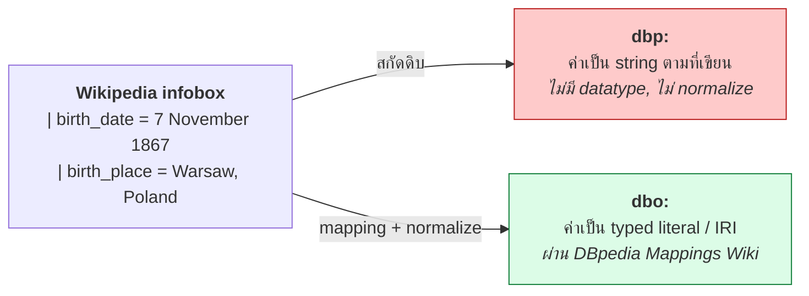
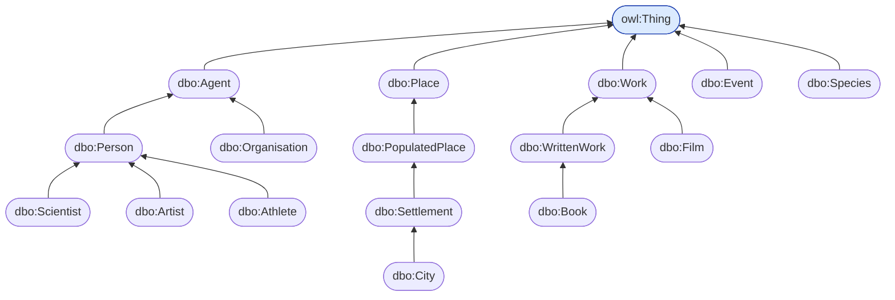
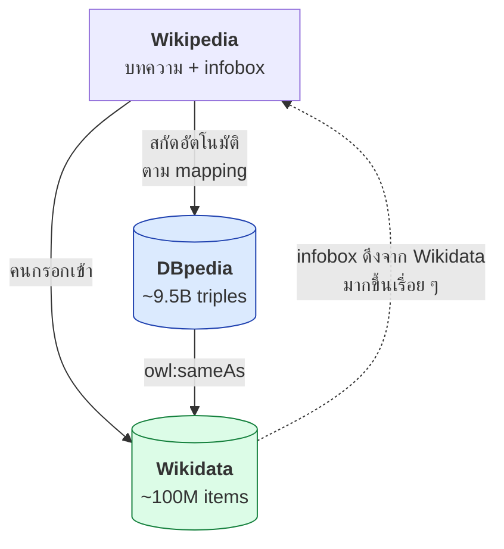
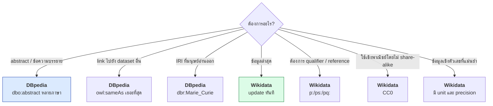

# 09.08 DBpedia

**DBpedia** สกัดข้อมูลจาก **infobox ของ Wikipedia** ออกมาเป็น RDF โดยอัตโนมัติ
เป็น **hub ของ LOD Cloud** เพราะมี `owl:sameAs` link ไปยัง dataset อื่นจำนวนมหาศาล
บทนี้อธิบายโครงสร้าง namespace ที่ซับซ้อน และเปรียบเทียบกับ Wikidata อย่างละเอียด

---

## Namespace ที่ต้องแยกให้ออก

```turtle
@prefix dbr:  <http://dbpedia.org/resource/> .      # instance
@prefix dbo:  <http://dbpedia.org/ontology/> .      # ontology (curated)
@prefix dbp:  <http://dbpedia.org/property/> .      # raw infobox property
@prefix dbc:  <http://dbpedia.org/resource/Category:> .   # Wikipedia category
@prefix yago: <http://dbpedia.org/class/yago/> .    # YAGO class
```

| Prefix | ใช้กับ | คุณภาพ | ตัวอย่าง |
| --- | --- | --- | --- |
| **`dbr:`** | **instance** | — | `dbr:Marie_Curie` |
| **`dbo:`** | **ontology ที่ curate แล้ว** | ⭐⭐⭐ | `dbo:birthDate`, `dbo:Scientist` |
| **`dbp:`** | property ดิบจาก infobox | ⭐ | `dbp:birthDate` |
| `dbc:` | หมวดหมู่ Wikipedia | ⭐⭐ | `dbc:Nobel_laureates_in_Physics` |
| `yago:` | class จาก YAGO | ⭐⭐ | `yago:Scientist110560637` |

### ⚠️ `dbo:` vs `dbp:` — ความต่างที่สำคัญที่สุด

```turtle
@prefix dbr: <http://dbpedia.org/resource/> .
@prefix dbo: <http://dbpedia.org/ontology/> .
@prefix dbp: <http://dbpedia.org/property/> .
@prefix xsd: <http://www.w3.org/2001/XMLSchema#> .

# ✅ dbo: -- ผ่านการ map และ normalize แล้ว
dbr:Marie_Curie dbo:birthDate "1867-11-07"^^xsd:date ;
                dbo:birthPlace dbr:Warsaw ;
                dbo:field dbr:Physics , dbr:Chemistry .

# ❌ dbp: -- ค่าดิบจาก infobox ไม่ normalize
dbr:Marie_Curie dbp:birthDate "7 November 1867"@en ;
                dbp:birthPlace "Warsaw, Congress Poland"@en ;
                dbp:fields "Physics, Chemistry"@en .
```



> 💡 **ใช้ `dbo:` เสมอถ้ามี** — ใช้ `dbp:` เฉพาะเมื่อ `dbo:` ไม่มี property ที่ต้องการ

---

## DBpedia Ontology (`dbo:`)

**สร้างด้วยมือโดยชุมชน** ผ่าน DBpedia Mappings Wiki

| ประเด็น | รายละเอียด |
| --- | --- |
| Class | ~800 |
| Property | ~3,000 |
| ความลึก hierarchy | ~7 ชั้น |
| Root | `owl:Thing` |



### Property ที่ใช้บ่อย

| Property | ความหมาย |
| --- | --- |
| `dbo:abstract` | บทคัดย่อ (ย่อหน้าแรกของบทความ) |
| `dbo:wikiPageWikiLink` | link ไปหน้า Wikipedia อื่น |
| `dbo:wikiPageExternalLink` | link ออกนอก Wikipedia |
| `dbo:wikiPageID` | ID ของหน้า |
| `dbo:thumbnail` | รูปย่อ |
| `dbo:birthDate` / `dbo:deathDate` | วันเกิด/ตาย |
| `dbo:birthPlace` / `dbo:deathPlace` | สถานที่เกิด/ตาย |
| `dbo:country` | ประเทศ |
| `dbo:populationTotal` | ประชากร |
| `dbo:areaTotal` | พื้นที่ |
| `dbo:foundingDate` | วันก่อตั้ง |
| `dbo:author` | ผู้แต่ง |
| `dbo:field` | สาขา |
| `dbo:award` | รางวัล |

---

## ตัวอย่างข้อมูลจริง

```turtle
@prefix dbr:     <http://dbpedia.org/resource/> .
@prefix dbo:     <http://dbpedia.org/ontology/> .
@prefix dbc:     <http://dbpedia.org/resource/Category:> .
@prefix owl:     <http://www.w3.org/2002/07/owl#> .
@prefix rdfs:    <http://www.w3.org/2000/01/rdf-schema#> .
@prefix foaf:    <http://xmlns.com/foaf/0.1/> .
@prefix dcterms: <http://purl.org/dc/terms/> .
@prefix xsd:     <http://www.w3.org/2001/XMLSchema#> .

dbr:Marie_Curie a dbo:Scientist , dbo:Person , foaf:Person ;
    rdfs:label      "Marie Curie"@en , "มารี กูรี"@th , "Marie Curie"@fr ;
    dbo:abstract    "Marie Salomea Skłodowska-Curie was a Polish and naturalised-French physicist and chemist..."@en ;
    dbo:birthDate   "1867-11-07"^^xsd:date ;
    dbo:deathDate   "1934-07-04"^^xsd:date ;
    dbo:birthPlace  dbr:Warsaw , dbr:Congress_Poland ;
    dbo:deathPlace  dbr:Passy,_Haute-Savoie ;
    dbo:field       dbr:Physics , dbr:Chemistry ;
    dbo:almaMater   dbr:University_of_Paris ;
    dbo:award       dbr:Nobel_Prize_in_Physics , dbr:Nobel_Prize_in_Chemistry ;
    dbo:doctoralAdvisor dbr:Gabriel_Lippmann ;
    dbo:thumbnail   <http://commons.wikimedia.org/wiki/Special:FilePath/Marie_Curie_c._1920s.jpg?width=300> ;
    foaf:isPrimaryTopicOf <http://en.wikipedia.org/wiki/Marie_Curie> ;
    dcterms:subject dbc:Nobel_laureates_in_Physics ,
                    dbc:Nobel_laureates_in_Chemistry ,
                    dbc:Polish_physicists ;
    owl:sameAs      <http://www.wikidata.org/entity/Q7186> ,
                    <http://viaf.org/viaf/61548432> ,
                    <http://id.loc.gov/authorities/names/n79066418> ,
                    <http://yago-knowledge.org/resource/Marie_Curie> ,
                    <http://de.dbpedia.org/resource/Marie_Curie> ,
                    <http://fr.dbpedia.org/resource/Marie_Curie> .
```

**สังเกต `owl:sameAs`** — DBpedia มี link ไปยัง Wikidata, VIAF, Library of Congress, YAGO และ DBpedia ภาษาอื่น
**นี่คือเหตุผลที่ DBpedia เป็น hub ของ LOD Cloud**

---

## SPARQL Endpoint

| ประเด็น | รายละเอียด |
| --- | --- |
| URL | `https://dbpedia.org/sparql` |
| UI | `https://dbpedia.org/snorql/` |
| Backend | **Virtuoso** |
| Result limit | 10,000 แถว (default) |
| Timeout | ~120 วินาที |
| License | **CC BY-SA 3.0** ⚠️ (ต่างจาก Wikidata ที่เป็น CC0) |

### Query ตัวอย่าง

```sparql
PREFIX dbr:     <http://dbpedia.org/resource/>
PREFIX dbo:     <http://dbpedia.org/ontology/>
PREFIX dbp:     <http://dbpedia.org/property/>
PREFIX dbc:     <http://dbpedia.org/resource/Category:>
PREFIX rdfs:    <http://www.w3.org/2000/01/rdf-schema#>
PREFIX dcterms: <http://purl.org/dc/terms/>
PREFIX owl:     <http://www.w3.org/2002/07/owl#>

# --- 1) นักวิทยาศาสตร์ที่เกิดในโปแลนด์ ---
SELECT ?scientist ?name ?birthDate WHERE {
  ?scientist a dbo:Scientist ;
             dbo:birthPlace dbr:Poland ;
             rdfs:label ?name .
  OPTIONAL { ?scientist dbo:birthDate ?birthDate }
  FILTER(LANG(?name) = "en")
}
ORDER BY ?birthDate
LIMIT 20

# --- 2) ใช้ Wikipedia category ---
SELECT ?person ?name WHERE {
  ?person dcterms:subject dbc:Nobel_laureates_in_Physics ;
          rdfs:label ?name .
  FILTER(LANG(?name) = "en")
}
LIMIT 30

# --- 3) เมืองที่มีประชากรมาก พร้อมพิกัด ---
SELECT ?city ?name ?population ?lat ?long WHERE {
  ?city a dbo:City ;
        rdfs:label ?name ;
        dbo:populationTotal ?population ;
        geo:lat ?lat ;
        geo:long ?long .
  FILTER(LANG(?name) = "en")
  FILTER(?population > 5000000)
}
ORDER BY DESC(?population)
LIMIT 20

# --- 4) หา owl:sameAs link ทั้งหมด ---
SELECT ?external WHERE {
  dbr:Marie_Curie owl:sameAs ?external .
}

# --- 5) abstract หลายภาษา ---
SELECT ?lang ?abstract WHERE {
  dbr:Semantic_Web dbo:abstract ?abstract .
  BIND(LANG(?abstract) AS ?lang)
  FILTER(?lang IN ("en", "th", "de", "fr", "ja"))
}

# --- 6) หา entity ที่เชื่อมกันผ่าน wikiPageWikiLink ---
SELECT ?related ?name (COUNT(*) AS ?strength) WHERE {
  dbr:Semantic_Web dbo:wikiPageWikiLink ?related .
  ?related dbo:wikiPageWikiLink dbr:Semantic_Web ;
           rdfs:label ?name .
  FILTER(LANG(?name) = "en")
}
GROUP BY ?related ?name
ORDER BY DESC(?strength)
LIMIT 20
```

---

## DBpedia vs Wikidata — เปรียบเทียบละเอียด



| ประเด็น | **DBpedia** | **Wikidata** |
| --- | --- | --- |
| **ที่มาข้อมูล** | สกัดอัตโนมัติจาก Wikipedia infobox | ชุมชนกรอกโดยตรง |
| **Identifier** | ชื่อบทความ (`dbr:Marie_Curie`) — **อ่านออก** | Q-number (`wd:Q7186`) — **opaque** |
| **ความสด** | ตาม release cycle (เดิม 6 เดือน; DBpedia Live เร็วกว่า) | **ทันที** |
| **คุณภาพ** | ขึ้นกับคุณภาพ infobox | มี **reference ต่อ statement** |
| **Qualifier** | ❌ ไม่มี | ✅ มี (เวลา สถานที่ บริบท) |
| **Reference** | ❌ ไม่มี | ✅ มี |
| **Rank** | ❌ | ✅ preferred/normal/deprecated |
| **หลายภาษา** | แยก dataset ต่อภาษา (`de.dbpedia.org`) | **รวมใน item เดียว** |
| **Ontology** | มี `dbo:` ที่ curate แล้ว (800 class) | ใช้ P31/P279 แบบยืดหยุ่น |
| **License** | **CC BY-SA 3.0** ⚠️ | **CC0** ✅ |
| **ขนาด** | ~9.5B triples (ทุกภาษา) | ~100M items, ~15B triples |
| **SPARQL** | `dbpedia.org/sparql` (Virtuoso) | `query.wikidata.org/sparql` (Blazegraph) |
| **Timeout** | ~120 วินาที | 60 วินาที |
| **จุดแข็ง** | **hub ของ LOD** — sameAs link เยอะที่สุด | **ข้อมูลมีโครงสร้างและ provenance** |

### เมื่อไหร่ใช้อะไร



### ⚠️ License เป็นประเด็นสำคัญ

| | DBpedia | Wikidata |
| --- | --- | --- |
| License | **CC BY-SA 3.0** | **CC0** |
| ต้องให้เครดิต | ✅ | ❌ (แนะนำแต่ไม่บังคับ) |
| **Share-alike** | ✅ **ผลงานต่อยอดต้องใช้ license เดียวกัน** | ❌ |
| ใช้เชิงพาณิชย์ | ✅ (แต่ติด share-alike) | ✅ อิสระ |

> ⚠️ **share-alike ของ DBpedia เป็นข้อจำกัดจริงในงานเชิงพาณิชย์**
> ถ้าจะปิด dataset ของตัวเอง ให้ใช้ Wikidata แทน

---

## ใช้ทั้งสองร่วมกัน

**Pattern ที่ดีที่สุด**: ใช้ DBpedia หา entity (เพราะ IRI อ่านออก) แล้วดึงข้อมูลจาก Wikidata (เพราะสดกว่า)

```sparql
PREFIX dbr:  <http://dbpedia.org/resource/>
PREFIX dbo:  <http://dbpedia.org/ontology/>
PREFIX owl:  <http://www.w3.org/2002/07/owl#>
PREFIX rdfs: <http://www.w3.org/2000/01/rdf-schema#>
PREFIX wdt:  <http://www.wikidata.org/prop/direct/>

SELECT ?name ?abstract ?population WHERE {
  # --- DBpedia: หา entity + abstract ---
  ?city a dbo:City ;
        dbo:country dbr:Thailand ;
        rdfs:label ?name ;
        dbo:abstract ?abstract ;
        owl:sameAs ?wdEntity .
  FILTER(LANG(?name) = "en")
  FILTER(LANG(?abstract) = "en")
  FILTER(STRSTARTS(STR(?wdEntity), "http://www.wikidata.org/entity/"))

  # --- Wikidata: ประชากรล่าสุด ---
  SERVICE SILENT <https://query.wikidata.org/sparql> {
    ?wdEntity wdt:P1082 ?population .
  }
}
LIMIT 10
```

> ⚠️ ทบทวนจาก [06.09](../06-sparql/06.09-federation.md): federated query ช้ามาก
> ในงานจริงให้ทำ **manual federation** ด้วย `VALUES`

---

## DBpedia Datasets

DBpedia แยกข้อมูลเป็นหลาย dataset ให้ดาวน์โหลดแยกกัน

| Dataset | เนื้อหา | ขนาดโดยประมาณ |
| --- | --- | --- |
| `mappingbased-objects` | **`dbo:` property ที่เป็น IRI** | ~30M triples |
| `mappingbased-literals` | `dbo:` property ที่เป็น literal | ~30M |
| `infobox-properties` | **`dbp:` ดิบ** | ~100M |
| `labels` | `rdfs:label` ทุกภาษา | ~50M |
| `short-abstracts` | ย่อหน้าแรก | ~5M |
| `long-abstracts` | บทคัดย่อเต็ม | ~5M |
| `article-categories` | `dcterms:subject` | ~25M |
| `instance-types` | `rdf:type` | ~20M |
| `page-links` | `dbo:wikiPageWikiLink` | ~150M |
| **`external-links`** | **`owl:sameAs`** | ~10M |
| `geo-coordinates` | พิกัด | ~1M |

```bash
# ดาวน์โหลดเฉพาะที่ต้องการ
curl -O https://downloads.dbpedia.org/repo/dbpedia/mappings/mappingbased-objects/2022.12.01/mappingbased-objects_lang=en.ttl.bz2

# แตกและกรอง
bzcat mappingbased-objects_lang=en.ttl.bz2 | grep 'dbo:birthPlace' > birthplaces.ttl
```

> 💡 **ดาวน์โหลดเฉพาะ dataset ที่ต้องการ** — ไม่ต้องเอาทั้งหมด (ทั้งหมดหลายร้อย GB)

---

## DBpedia Spotlight — Entity Linking

**เครื่องมือสำหรับหา entity ในข้อความอิสระแล้ว link กลับไปยัง DBpedia**

```python
import requests

def annotate(text: str, confidence: float = 0.5) -> list:
    """หา DBpedia entity ในข้อความ"""
    response = requests.get(
        "https://api.dbpedia-spotlight.org/en/annotate",
        params={"text": text, "confidence": confidence},
        headers={"Accept": "application/json"},
        timeout=30,
    )
    response.raise_for_status()
    return response.json().get("Resources", [])


text = """Marie Curie was a Polish physicist who won the Nobel Prize
in Physics in 1903 together with Pierre Curie."""

for resource in annotate(text):
    surface = resource["@surfaceForm"]
    uri = resource["@URI"]
    types = resource.get("@types", "")
    print(f"{surface:25s} -> {uri.split('/')[-1]:30s} [{types.split(',')[0]}]")
```

Expected output:

```
Marie Curie               -> Marie_Curie                    [DBpedia:Scientist]
Polish                    -> Poland                         [DBpedia:Country]
physicist                 -> Physicist                      [DBpedia:PersonFunction]
Nobel Prize in Physics    -> Nobel_Prize_in_Physics         [DBpedia:Award]
Pierre Curie              -> Pierre_Curie                   [DBpedia:Scientist]
```

> 💡 **Entity linking เป็นสะพานระหว่างข้อความอิสระกับ Knowledge Graph** — ใช้ทำ RAG, semantic search, content enrichment

---

## Python: ดึงข้อมูลจาก DBpedia

```python
import time
from typing import Any, Dict, List, Optional

from rdflib import Graph, Literal, Namespace, URIRef
from rdflib.namespace import OWL, RDF, XSD
from SPARQLWrapper import JSON, POST, SPARQLWrapper

DBPEDIA = "https://dbpedia.org/sparql"
USER_AGENT = "SemanticWebCourse/1.0 (contact@example.org)"

PREFIXES = """
PREFIX dbr:     <http://dbpedia.org/resource/>
PREFIX dbo:     <http://dbpedia.org/ontology/>
PREFIX dbp:     <http://dbpedia.org/property/>
PREFIX dbc:     <http://dbpedia.org/resource/Category:>
PREFIX rdfs:    <http://www.w3.org/2000/01/rdf-schema#>
PREFIX dcterms: <http://purl.org/dc/terms/>
PREFIX owl:     <http://www.w3.org/2002/07/owl#>
PREFIX foaf:    <http://xmlns.com/foaf/0.1/>
"""


def query_dbpedia(query: str, retries: int = 3) -> Optional[List[Dict[str, Any]]]:
    sparql = SPARQLWrapper(DBPEDIA, agent=USER_AGENT)
    sparql.setQuery(PREFIXES + query)
    sparql.setReturnFormat(JSON)
    sparql.setTimeout(90)
    sparql.setMethod(POST)

    for attempt in range(1, retries + 1):
        try:
            return sparql.query().convert()["results"]["bindings"]
        except Exception as exc:                      # noqa: BLE001
            print(f"  [{attempt}/{retries}] {type(exc).__name__}: {exc}")
            if attempt < retries:
                time.sleep(2 ** attempt)
    return None


def describe_resource(resource: str) -> Graph:
    """
    ดึงข้อมูลของ resource หนึ่งตัว (เฉพาะ dbo: property)
    resource: ชื่อบทความ เช่น "Marie_Curie"
    """
    rows = query_dbpedia(f"""
    SELECT ?p ?o WHERE {{
      dbr:{resource} ?p ?o .
      FILTER(STRSTARTS(STR(?p), "http://dbpedia.org/ontology/")
             || ?p = rdfs:label
             || ?p = owl:sameAs)
      FILTER(!isLiteral(?o) || LANG(?o) IN ("", "en"))
    }}
    """) or []

    g = Graph()
    g.bind("dbr", "http://dbpedia.org/resource/")
    g.bind("dbo", "http://dbpedia.org/ontology/")

    subject = URIRef(f"http://dbpedia.org/resource/{resource}")
    for row in rows:
        predicate = URIRef(row["p"]["value"])
        cell = row["o"]
        if cell["type"] == "uri":
            obj = URIRef(cell["value"])
        else:
            obj = Literal(
                cell["value"],
                datatype=URIRef(cell["datatype"]) if "datatype" in cell else None,
                lang=cell.get("xml:lang"),
            )
        g.add((subject, predicate, obj))

    return g


def get_sameas_links(resource: str) -> Dict[str, str]:
    """ดึง owl:sameAs link แล้วจัดกลุ่มตาม dataset"""
    rows = query_dbpedia(f"SELECT ?x WHERE {{ dbr:{resource} owl:sameAs ?x }}") or []

    grouped: Dict[str, str] = {}
    for row in rows:
        iri = row["x"]["value"]
        if "wikidata.org" in iri:
            grouped["wikidata"] = iri
        elif "viaf.org" in iri:
            grouped["viaf"] = iri
        elif "id.loc.gov" in iri:
            grouped["loc"] = iri
        elif "yago-knowledge" in iri:
            grouped["yago"] = iri
        elif ".dbpedia.org" in iri:
            lang = iri.split("//")[1].split(".")[0]
            grouped[f"dbpedia-{lang}"] = iri
    return grouped


# --- ใช้งาน ---
g = describe_resource("Marie_Curie")
print(f"{len(g)} triples\n")
print(g.serialize(format="turtle")[:1500])

print("\nowl:sameAs links:")
for dataset, iri in sorted(get_sameas_links("Marie_Curie").items()):
    print(f"  {dataset:16s} {iri}")
```

Expected output (ย่อ):

```
87 triples

@prefix dbo: <http://dbpedia.org/ontology/> .
@prefix dbr: <http://dbpedia.org/resource/> .

dbr:Marie_Curie a dbo:Scientist , dbo:Person ;
    rdfs:label     "Marie Curie"@en ;
    dbo:birthDate  "1867-11-07"^^xsd:date ;
    dbo:birthPlace dbr:Warsaw ;
    dbo:field      dbr:Physics , dbr:Chemistry ;
    ...

owl:sameAs links:
  dbpedia-de       http://de.dbpedia.org/resource/Marie_Curie
  dbpedia-fr       http://fr.dbpedia.org/resource/Marie_Curie
  loc              http://id.loc.gov/authorities/names/n79066418
  viaf             http://viaf.org/viaf/61548432
  wikidata         http://www.wikidata.org/entity/Q7186
  yago             http://yago-knowledge.org/resource/Marie_Curie
```

---

## ⚠️ ข้อควรระวัง

| ประเด็น | รายละเอียด | ทางแก้ |
| --- | --- | --- |
| **License CC BY-SA** | ผลงานต่อยอดต้องใช้ license เดียวกัน | ใช้ Wikidata ถ้าต้องการอิสระ |
| **ข้อมูลไม่สด** | ตาม release cycle | ใช้ DBpedia Live หรือ Wikidata |
| **`dbp:` คุณภาพต่ำ** | ค่าดิบไม่ normalize | ใช้ `dbo:` เสมอถ้ามี |
| **IRI มี special char** | `dbr:Passy,_Haute-Savoie` | escape ให้ถูกใน SPARQL |
| **redirect** | หลาย IRI ชี้ไปที่เดียวกัน | ตาม `dbo:wikiPageRedirects` |
| **disambiguation** | ชื่อซ้ำ | ตรวจ `dbo:wikiPageDisambiguates` |
| **แยกตามภาษา** | `de.dbpedia.org` เป็นคนละ endpoint | ตาม `owl:sameAs` |
| **Result limit 10,000** | ตัดเงียบ ๆ | ใช้ `LIMIT`/`OFFSET` แบ่ง |

### จัดการ redirect

```sparql
PREFIX dbr: <http://dbpedia.org/resource/>
PREFIX dbo: <http://dbpedia.org/ontology/>

# หา canonical IRI
SELECT ?canonical WHERE {
  { dbr:Marie_Sklodowska_Curie dbo:wikiPageRedirects ?canonical }
  UNION
  { BIND(dbr:Marie_Sklodowska_Curie AS ?canonical)
    FILTER NOT EXISTS { dbr:Marie_Sklodowska_Curie dbo:wikiPageRedirects ?r } }
}
```

---

## Key Points

- **DBpedia สกัดจาก Wikipedia infobox อัตโนมัติ** — เป็น **hub ของ LOD Cloud** เพราะมี `owl:sameAs` เยอะที่สุด
- ⚠️ **แยก namespace ให้ออก**: **`dbr:`** (instance), **`dbo:`** (curated ontology — **ใช้ตัวนี้**), `dbp:` (ดิบ), `dbc:` (category)
- **`dbo:` ผ่าน mapping และ normalize แล้ว** — `dbp:` เป็นค่าดิบจาก infobox ที่ไม่มี datatype
- ⚠️ **License เป็น CC BY-SA 3.0** ซึ่งมี **share-alike** — ต่างจาก Wikidata ที่เป็น CC0
- **IRI ของ DBpedia อ่านออก** (`dbr:Marie_Curie`) ต่างจาก Wikidata ที่เป็น Q-number
- **Wikidata มี qualifier, reference และ rank** ส่วน DBpedia ไม่มี — Wikidata เหมาะกว่าเมื่อต้องการ provenance
- **Pattern ที่ดี**: ใช้ DBpedia หา entity + abstract แล้วดึงข้อมูลตัวเลขจาก Wikidata
- **DBpedia Spotlight** ทำ entity linking จากข้อความอิสระ — สะพานระหว่างข้อความกับ Knowledge Graph
- ดาวน์โหลด **dataset เฉพาะที่ต้องการ** (`mappingbased-objects`, `external-links`) ไม่ใช่ทั้งหมด
