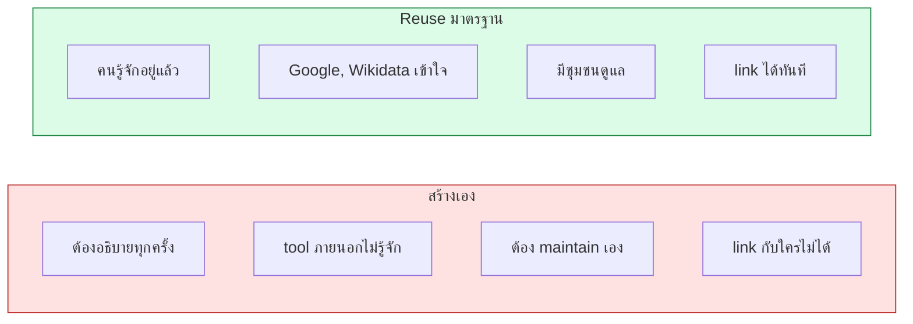
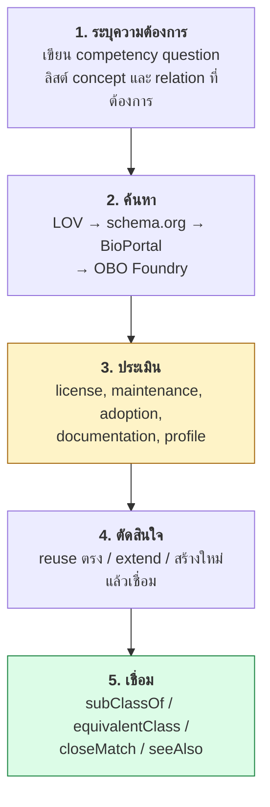
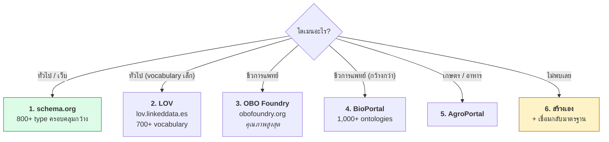
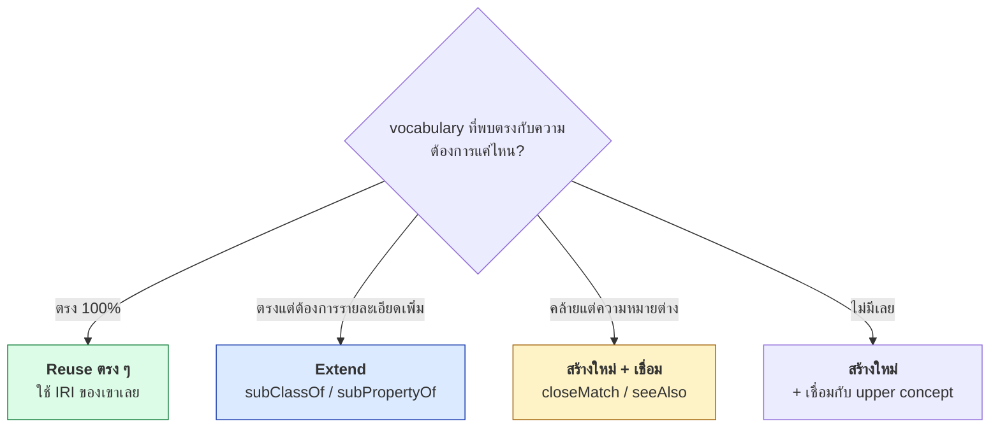
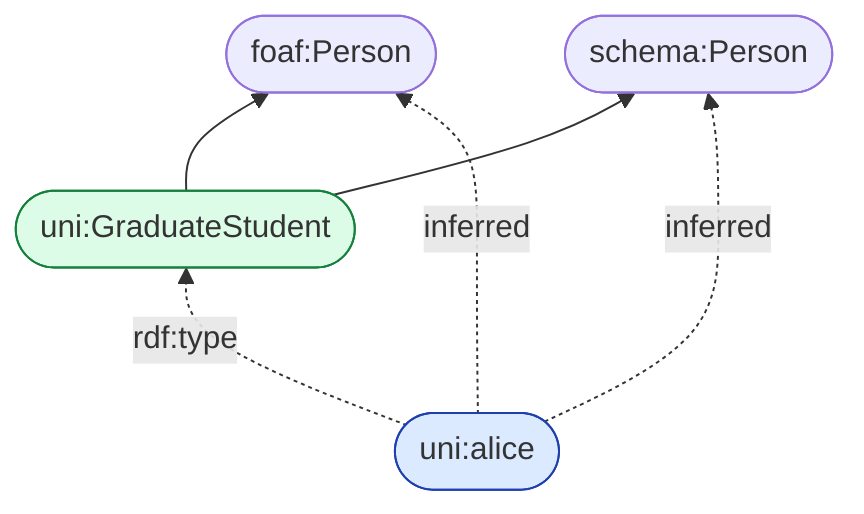
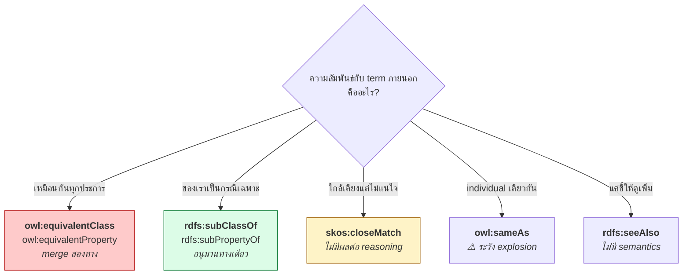

# 09.09 การ Reuse Ontology

**หลักการอันดับหนึ่งของ Semantic Web คือ reuse ก่อน reinvent** — แต่การ reuse ที่ถูกวิธีไม่ใช่แค่คัดลอก IRI มาใช้
บทนี้ครอบคลุมกระบวนการทั้งหมด: **ค้นหา → ประเมิน → เชื่อม → จัดการ namespace collision**

---

## ทำไมต้อง reuse



---

## กระบวนการ 5 ขั้น



---

## ขั้นที่ 1: ระบุความต้องการ

**อย่าค้นหาก่อนรู้ว่าต้องการอะไร** — เขียน competency question ก่อน

```
CQ1: "หลักสูตรไหนสอนโดยอาจารย์ที่มีปริญญาเอกสาขาเดียวกับหลักสูตร"
CQ2: "นักศึกษาคนไหนลงเรียนวิชาที่มี prerequisite ที่ยังไม่ผ่าน"
CQ3: "แต่ละภาควิชามีงานตีพิมพ์กี่ชิ้นในปีที่ผ่านมา"
```

จากนั้นสกัด **concept** และ **relation** ที่ต้องการ

| Concept ที่ต้องการ | Relation ที่ต้องการ |
| --- | --- |
| Course, Student, Professor, Department | teaches, enrolledIn, memberOf |
| Degree, Publication | hasDegree, authorOf, prerequisiteOf |

---

## ขั้นที่ 2: ค้นหา

### ลำดับที่แนะนำ



### LOV — Linked Open Vocabularies

**เครื่องมือค้นหา vocabulary ที่ดีที่สุดสำหรับงานทั่วไป**

```bash
# ค้นหาผ่าน API
curl -s "https://lov.linkeddata.es/dataset/lov/api/v2/term/search?q=course&type=class" | jq '.results[:3]'
```

```python
import requests


def search_lov(term: str, kind: str = "class", limit: int = 10) -> list:
    """
    ค้นหา term ใน LOV
    kind: "class" | "property" | "datatype" | "instance"
    """
    response = requests.get(
        "https://lov.linkeddata.es/dataset/lov/api/v2/term/search",
        params={"q": term, "type": kind, "page_size": limit},
        timeout=30,
    )
    response.raise_for_status()

    results = []
    for item in response.json().get("results", []):
        results.append({
            "uri": item.get("uri", [""])[0],
            "prefixed": item.get("prefixedName", [""])[0],
            "vocab": item.get("vocabulary.prefix", [""])[0],
            "label": (item.get("prefLabel") or [""])[0],
            "score": item.get("score", 0),
        })
    return results


for r in search_lov("course", "class"):
    print(f"{r['score']:6.1f}  {r['prefixed']:28s} {r['label']}")
```

Expected output:

```
 145.2  schema:Course                Course
  98.4  aiiso:Course                 Course
  76.1  teach:Course                 Course
  54.3  bibo:Course                  Course
```

**LOV แสดงข้อมูลที่ช่วยประเมินด้วย**

| ข้อมูลจาก LOV | ใช้ประเมินอะไร |
| --- | --- |
| จำนวน dataset ที่ใช้ | adoption |
| วันที่แก้ไขล่าสุด | maintenance |
| license | ใช้ได้ไหม |
| จำนวน term | ครอบคลุมแค่ไหน |
| incoming/outgoing link | เชื่อมกับ vocabulary อื่นแค่ไหน |

---

## ขั้นที่ 3: ประเมิน

### เกณฑ์ 7 ข้อ

| # | เกณฑ์ | ตรวจอย่างไร | สัญญาณอันตราย |
| --- | --- | --- | --- |
| 1 | **License** | หา `dcterms:license` | ไม่ระบุ license เลย |
| 2 | **Maintenance** | `owl:versionInfo`, `dcterms:modified`, git commit | ไม่แก้มา 5+ ปี |
| 3 | **Adoption** | LOV แสดงจำนวน dataset | ไม่มีใครใช้เลย |
| 4 | **Documentation** | `rdfs:label`, `rdfs:comment` ครบไหม | term ไม่มี label |
| 5 | **Dereferenceable** | `curl -H "Accept: text/turtle" <IRI>` | 404 / ไม่คืน RDF |
| 6 | **Stability** | IRI เปลี่ยนบ่อยไหม | เปลี่ยน namespace บ่อย |
| 7 | **OWL Profile** | Protégé metrics / ROBOT | ontology ใหญ่ที่ไม่อยู่ใน EL |

### สคริปต์ประเมินอัตโนมัติ

```python
from datetime import datetime, timezone
from typing import Dict

import requests
from rdflib import Graph, URIRef
from rdflib.namespace import DCTERMS, OWL, RDF, RDFS


def evaluate_vocabulary(url: str, fmt: str = None) -> Dict:
    """ประเมิน vocabulary ตามเกณฑ์ 7 ข้อ"""
    report: Dict = {"url": url}

    # --- 5) dereferenceable ---
    try:
        head = requests.head(url, headers={"Accept": "text/turtle"},
                             allow_redirects=True, timeout=15)
        report["dereferenceable"] = head.status_code < 400
        report["http_status"] = head.status_code
    except Exception as exc:                          # noqa: BLE001
        report["dereferenceable"] = False
        report["http_status"] = str(exc)

    # --- โหลด ---
    g = Graph()
    try:
        g.parse(url, format=fmt)
    except Exception as exc:                          # noqa: BLE001
        report["error"] = str(exc)
        return report

    report["triples"] = len(g)

    ontology = next(g.subjects(RDF.type, OWL.Ontology), None)

    # --- 1) license ---
    license_iri = g.value(ontology, DCTERMS.license) if ontology else None
    report["license"] = str(license_iri) if license_iri else "❌ ไม่ระบุ"

    # --- 2) maintenance ---
    version = g.value(ontology, OWL.versionInfo) if ontology else None
    modified = g.value(ontology, DCTERMS.modified) if ontology else None
    report["version"] = str(version) if version else "❌ ไม่ระบุ"
    report["modified"] = str(modified) if modified else "❌ ไม่ระบุ"

    # --- 4) documentation ---
    classes = set(g.subjects(RDF.type, OWL.Class)) | set(g.subjects(RDF.type, RDFS.Class))
    props = (set(g.subjects(RDF.type, OWL.ObjectProperty))
             | set(g.subjects(RDF.type, OWL.DatatypeProperty))
             | set(g.subjects(RDF.type, RDF.Property)))
    terms = classes | props

    with_label = {t for t in terms if list(g.objects(t, RDFS.label))}
    with_comment = {t for t in terms if list(g.objects(t, RDFS.comment))}

    report["classes"] = len(classes)
    report["properties"] = len(props)
    report["label_coverage"] = f"{len(with_label)}/{len(terms)}" if terms else "0/0"
    report["comment_coverage"] = f"{len(with_comment)}/{len(terms)}" if terms else "0/0"

    # --- 7) OWL profile (ตรวจว่าอยู่ใน EL ไหม) ---
    el_blockers = {
        "complementOf": len(list(g.subject_objects(OWL.complementOf))),
        "unionOf": len(list(g.subject_objects(OWL.unionOf))),
        "allValuesFrom": len(list(g.subject_objects(OWL.allValuesFrom))),
        "inverseOf": len(list(g.subject_objects(OWL.inverseOf))),
        "cardinality": len(list(g.subject_objects(OWL.minCardinality)))
                       + len(list(g.subject_objects(OWL.maxCardinality))),
    }
    blockers = {k: v for k, v in el_blockers.items() if v > 0}
    report["owl2_el"] = "✅ น่าจะใช่" if not blockers else f"❌ {blockers}"

    return report


for name, url, fmt in [
    ("FOAF", "http://xmlns.com/foaf/0.1/", "xml"),
    ("Dublin Core Terms", "http://purl.org/dc/terms/", None),
]:
    print(f"\n{'=' * 70}\n  {name}\n{'=' * 70}")
    for key, value in evaluate_vocabulary(url, fmt).items():
        print(f"  {key:20s} {value}")
```

Expected output (ย่อ):

```
======================================================================
  FOAF
======================================================================
  url                  http://xmlns.com/foaf/0.1/
  dereferenceable      True
  http_status          200
  triples              631
  license              ❌ ไม่ระบุ
  version              ❌ ไม่ระบุ
  classes              14
  properties           39
  label_coverage       53/53
  comment_coverage     53/53
  owl2_el              ❌ {'inverseOf': 2}
```

---

## ขั้นที่ 4: ตัดสินใจ



### แบบที่ 1: Reuse ตรง ๆ

```turtle
@prefix uni:     <http://example.org/university#> .
@prefix foaf:    <http://xmlns.com/foaf/0.1/> .
@prefix dcterms: <http://purl.org/dc/terms/> .
@prefix schema:  <https://schema.org/> .

# ใช้ IRI ของเขาเลย ไม่ต้องสร้างใหม่
uni:alice a foaf:Person ;
    foaf:name       "Alice Johnson" ;
    foaf:mbox       <mailto:alice@example.org> ;
    schema:jobTitle "Research Assistant" .

uni:paper001 dcterms:title   "Knowledge Graphs"@en ;
             dcterms:creator uni:alice ;
             dcterms:issued  "2025-01-15"^^xsd:date .
```

**ใช้แบบนี้เมื่อ**: term มีความหมายตรงกับที่ต้องการทุกประการ

### แบบที่ 2: Extend

```turtle
@prefix uni:  <http://example.org/university#> .
@prefix rdfs: <http://www.w3.org/2000/01/rdf-schema#> .
@prefix owl:  <http://www.w3.org/2002/07/owl#> .
@prefix foaf: <http://xmlns.com/foaf/0.1/> .
@prefix schema: <https://schema.org/> .

# class ของเราเป็นกรณีเฉพาะของมาตรฐาน
uni:GraduateStudent a owl:Class ;
    rdfs:label      "Graduate Student"@en ;
    rdfs:comment    "A student enrolled in a master's or doctoral programme."@en ;
    rdfs:subClassOf foaf:Person , schema:Person .

# property ของเราเป็นกรณีเฉพาะของมาตรฐาน
uni:supervisedBy a owl:ObjectProperty ;
    rdfs:label         "supervised by"@en ;
    rdfs:subPropertyOf foaf:knows ;
    rdfs:domain        uni:GraduateStudent ;
    rdfs:range         uni:Professor .

uni:thesisTitle a owl:DatatypeProperty ;
    rdfs:subPropertyOf dcterms:title .
```

**ผลลัพธ์**: ระบบภายนอกที่รู้จักแค่ `foaf:` และ `dcterms:` ก็ใช้ข้อมูลของเราได้หลังรัน reasoner



### แบบที่ 3: สร้างใหม่ + เชื่อม

```turtle
@prefix uni:  <http://example.org/university#> .
@prefix skos: <http://www.w3.org/2004/02/skos/core#> .
@prefix rdfs: <http://www.w3.org/2000/01/rdf-schema#> .
@prefix owl:  <http://www.w3.org/2002/07/owl#> .
@prefix aiiso: <http://purl.org/vocab/aiiso/schema#> .

# ความหมายของเราต่างจากมาตรฐานเล็กน้อย -- อย่าใช้ equivalentClass
uni:Course a owl:Class ;
    rdfs:label   "Course"@en ;
    rdfs:comment """A unit of teaching delivered over one academic term at
Example University. Differs from schema:Course in that it always maps to
exactly one term and one instructor of record."""@en ;
    skos:closeMatch <https://schema.org/Course> ;
    rdfs:seeAlso    aiiso:Course .
```

**ใช้แบบนี้เมื่อ**: ความหมายคล้ายแต่ไม่ตรง — **อย่าใช้ `owl:equivalentClass` ถ้าไม่แน่ใจ**

---

## ขั้นที่ 5: เชื่อมด้วย property ที่เหมาะสม



| Property | ความหมาย | reasoning | ความเสี่ยง |
| --- | --- | --- | --- |
| `owl:equivalentClass` | class เดียวกัน | merge สองทาง | **สูง** |
| `owl:equivalentProperty` | property เดียวกัน | merge สองทาง | **สูง** |
| `rdfs:subClassOf` | ของเราเป็นกรณีเฉพาะ | อนุมานทางเดียว | ต่ำ |
| `rdfs:subPropertyOf` | เหมือนกัน | อนุมานทางเดียว | ต่ำ |
| `owl:sameAs` | individual เดียวกัน | merge property | **สูงมาก** |
| `skos:exactMatch` | concept ตรงกัน | ไม่ merge property | ต่ำ |
| `skos:closeMatch` | ใกล้เคียง | ไม่มีผล | ต่ำมาก |
| `rdfs:seeAlso` | ดูเพิ่มเติม | ไม่มีผล | ไม่มี |

> 💡 **หลักปฏิบัติ**: เริ่มจาก **`rdfs:subClassOf` ทางเดียว** เสมอ
> ใช้ `owl:equivalentClass` เฉพาะเมื่อพิสูจน์ได้ว่าเหมือนกันจริงทุกกรณี

---

## `owl:imports` — เมื่อไหร่ควรใช้

```turtle
@prefix owl: <http://www.w3.org/2002/07/owl#> .

<http://example.org/university> a owl:Ontology ;
    owl:imports <http://xmlns.com/foaf/0.1/> ,
                <http://purl.org/dc/terms/> .
```

| ควร import | ไม่ควร import |
| --- | --- |
| vocabulary เล็ก (< 1,000 axiom) | ontology ใหญ่ (GO, SNOMED, ChEBI) |
| ต้องการ reasoning ข้าม ontology | แค่ใช้ IRI เป็น label |
| ontology ที่ dereference ได้เสถียร | IRI ที่เปิดไม่ได้ |
| ควบคุม version ได้ | ontology ที่เปลี่ยนบ่อย |

### ⚠️ ปัญหาที่เจอจริง

```python
# HTTPError 403 -- owlready2 พยายามดึง owl:imports ผ่าน network
# (เจอจริงตอนพัฒนา Chapter 05)
from rdflib.namespace import OWL

merged.remove((None, OWL.imports, None))
```

### ทางแก้: Catalog File

```xml
<?xml version="1.0" encoding="UTF-8"?>
<catalog prefer="public" xmlns="urn:oasis:names:tc:entity:xmlns:xml:catalog">
  <uri id="local-foaf"
       name="http://xmlns.com/foaf/0.1/"
       uri="vendor/foaf.rdf"/>
  <uri id="local-dcterms"
       name="http://purl.org/dc/terms/"
       uri="vendor/dcterms.ttl"/>
</catalog>
```

**Protégé, ROBOT และ owlready2 (ผ่าน `onto_path`) อ่าน catalog file ได้**

```python
import owlready2

owlready2.onto_path.append("/path/to/vendor")
```

### ทางเลือกที่ดีกว่า: ดึงเฉพาะ module

```bash
# ดึงเฉพาะ term ที่ต้องการจาก ontology ใหญ่
robot extract --input go.owl \
              --method BOT \
              --term http://purl.obolibrary.org/obo/GO_0006915 \
              --output go-module.owl

# แล้วค่อย import module เล็ก ๆ นี้แทน
```

---

## Namespace Collision

### ปัญหาที่ 1: prefix เดียวกัน คนละ namespace

```turtle
# ❌ อันตราย -- ประกาศ prefix ซ้ำ ตัวหลังทับตัวแรก
@prefix ex: <http://example.org/> .
@prefix ex: <http://other.example.org/> .    # ทับ!

ex:alice a ex:Person .        # ใช้ namespace ไหน?
```

**ทางแก้**: ตั้ง prefix ให้ต่างกันชัดเจน

```turtle
@prefix uni:   <http://example.org/university#> .
@prefix lib:   <http://example.org/library#> .
@prefix ext:   <http://other.example.org/> .
```

### ปัญหาที่ 2: term ชื่อเดียวกัน คนละความหมาย

```turtle
@prefix schema: <https://schema.org/> .
@prefix bibo:   <http://purl.org/ontology/bibo/> .
@prefix aiiso:  <http://purl.org/vocab/aiiso/schema#> .

# ทั้งสามมี "Course" แต่ความหมายต่างกัน
schema:Course    # หลักสูตร/รายวิชาทั่วไป
bibo:Course      # สิ่งพิมพ์ประเภท course material
aiiso:Course     # หลักสูตรในสถาบันการศึกษา
```

**ทางแก้**: ระบุ prefix ให้ชัด และเขียน `rdfs:comment` อธิบายว่าเลือกตัวไหนเพราะอะไร

```turtle
uni:Course a owl:Class ;
    rdfs:comment """Chosen aiiso:Course over schema:Course because our courses
always belong to an academic programme, which schema:Course does not model."""@en ;
    rdfs:subClassOf aiiso:Course .
```

### ปัญหาที่ 3: ontology ที่ import ขัดกันเอง

```turtle
# ontology A บอกว่า
ex:Person owl:disjointWith ex:Organization .

# ontology B บอกว่า
ex:Company rdfs:subClassOf ex:Person , ex:Organization .

# → ❌ INCONSISTENT
```

**ทางแก้**: รัน reasoner ตรวจทันทีหลัง import และแยก module ที่ขัดกันออก

```bash
robot merge --input onto-a.ttl --input onto-b.ttl \
     | robot reason --reasoner hermit --output merged-inferred.ttl
```

---

## Anti-patterns

| ❌ Anti-pattern | ทำไมผิด | ✅ ควรทำ |
| --- | --- | --- |
| คัดลอก term ของคนอื่นมาไว้ใน namespace ตัวเอง | ทำลาย interoperability | ใช้ IRI ของเขาตรง ๆ |
| ใช้ `owl:equivalentClass` โดยไม่ตรวจ | อาจอนุมานผิด | เริ่มจาก `rdfs:subClassOf` |
| `owl:imports` ontology ใหญ่ทั้งก้อน | reasoning ช้ามาก / โหลดไม่ได้ | ดึง module ด้วย ROBOT |
| สร้าง term ใหม่โดยไม่ค้นก่อน | ซ้ำซ้อน | ค้น LOV/BioPortal ก่อนเสมอ |
| ใช้ `owl:sameAs` กับ class | ทำให้เป็น OWL Full | ใช้ `owl:equivalentClass` |
| ไม่ระบุว่าเลือก vocabulary ไหนเพราะอะไร | คนอื่นแก้ต่อไม่ได้ | เขียน `rdfs:comment` อธิบาย |
| pin ไม่ได้ (import IRI ที่เปลี่ยนตลอด) | ontology พังเมื่อต้นทางเปลี่ยน | ใช้ `owl:versionIRI` |

### ⚠️ อย่าคัดลอก term มาไว้ใน namespace ตัวเอง

```turtle
# ❌ ผิดมาก -- สร้าง Person ของตัวเองทั้งที่มี foaf:Person อยู่แล้ว
uni:Person a owl:Class ;
    rdfs:label "Person"@en .

uni:alice a uni:Person .          # ระบบภายนอกไม่รู้ว่านี่คือคน

# ✅ ถูก
uni:alice a foaf:Person .

# ✅ หรือถ้าต้องการ class ของตัวเอง ก็เชื่อมกลับ
uni:UniversityMember a owl:Class ;
    rdfs:subClassOf foaf:Person .
```

---

## Namespace Design ของตัวเอง

เมื่อจำเป็นต้องสร้าง term ใหม่

```turtle
@prefix uni:  <http://example.org/university#> .
@prefix owl:  <http://www.w3.org/2002/07/owl#> .
@prefix vann: <http://purl.org/vocab/vann/> .
@prefix dcterms: <http://purl.org/dc/terms/> .
@prefix xsd:  <http://www.w3.org/2001/XMLSchema#> .

<http://example.org/university> a owl:Ontology ;
    dcterms:title       "University Ontology"@en ;
    dcterms:license     <https://creativecommons.org/licenses/by/4.0/> ;
    dcterms:created     "2025-01-15"^^xsd:date ;
    owl:versionInfo     "1.2.0" ;
    owl:versionIRI      <http://example.org/university/1.2.0> ;
    vann:preferredNamespacePrefix "uni" ;
    vann:preferredNamespaceUri    "http://example.org/university#" ;
    dcterms:description "Extends FOAF and schema.org for higher education."@en .
```

### Checklist สำหรับ namespace ของตัวเอง

- [ ] ใช้ **domain ที่ควบคุมได้** (ไม่ใช่ `example.org` ในงานจริง)
- [ ] IRI **dereference ได้** — คืน RDF เมื่อ `Accept: text/turtle`
- [ ] มี **`vann:preferredNamespacePrefix`** ให้ tool ใช้
- [ ] มี **`owl:versionIRI`** ให้ pin version ได้
- [ ] มี **`dcterms:license`** ชัดเจน
- [ ] ลงทะเบียนใน **LOV** และ **prefix.cc** เมื่อพร้อมเผยแพร่
- [ ] มี **HTML documentation** (สร้างด้วย Widoco, LODE, pyLODE)

```bash
# สร้าง documentation อัตโนมัติ
pip install pylode
pylode -i university.ttl -o docs/index.html
```

---

## ตัวอย่างเต็ม: University ontology ที่ reuse ครบถ้วน

```turtle
@prefix uni:     <http://example.org/university#> .
@prefix rdf:     <http://www.w3.org/1999/02/22-rdf-syntax-ns#> .
@prefix rdfs:    <http://www.w3.org/2000/01/rdf-schema#> .
@prefix owl:     <http://www.w3.org/2002/07/owl#> .
@prefix xsd:     <http://www.w3.org/2001/XMLSchema#> .
@prefix foaf:    <http://xmlns.com/foaf/0.1/> .
@prefix schema:  <https://schema.org/> .
@prefix dcterms: <http://purl.org/dc/terms/> .
@prefix skos:    <http://www.w3.org/2004/02/skos/core#> .
@prefix org:     <http://www.w3.org/ns/org#> .
@prefix vann:    <http://purl.org/vocab/vann/> .
@prefix aiiso:   <http://purl.org/vocab/aiiso/schema#> .

# ===== Ontology header =====
<http://example.org/university> a owl:Ontology ;
    dcterms:title       "University Ontology"@en ;
    dcterms:description """Extends FOAF, schema.org, ORG and AIISO for
higher education. Only introduces terms not covered by those vocabularies."""@en ;
    dcterms:license     <https://creativecommons.org/licenses/by/4.0/> ;
    owl:versionInfo     "1.2.0" ;
    owl:versionIRI      <http://example.org/university/1.2.0> ;
    vann:preferredNamespacePrefix "uni" .

# ===== ✅ Reuse ตรง ๆ -- ไม่สร้างใหม่ =====
# foaf:Person, foaf:Organization, foaf:name, foaf:mbox
# dcterms:title, dcterms:creator, dcterms:issued
# schema:jobTitle, schema:address
# org:memberOf, org:hasUnit, org:Role

# ===== ✅ Extend -- ของเราเป็นกรณีเฉพาะ =====
uni:Student a owl:Class ;
    rdfs:label      "Student"@en ;
    rdfs:comment    "A person admitted to a degree programme."@en ;
    rdfs:subClassOf foaf:Person , schema:Person .

uni:GraduateStudent a owl:Class ;
    rdfs:label      "Graduate Student"@en ;
    rdfs:subClassOf uni:Student .

uni:Department a owl:Class ;
    rdfs:label      "Department"@en ;
    rdfs:subClassOf org:OrganizationalUnit .

uni:enrolledIn a owl:ObjectProperty ;
    rdfs:label         "enrolled in"@en ;
    rdfs:comment       """Relates a student to a course they currently attend.
Does not cover completed or dropped courses."""@en ;
    rdfs:subPropertyOf schema:memberOf ;
    rdfs:domain        uni:Student ;
    rdfs:range         uni:Course .

# ===== ⚠️ สร้างใหม่ + เชื่อมแบบระวัง =====
uni:Course a owl:Class ;
    rdfs:label   "Course"@en ;
    rdfs:comment """A unit of teaching delivered over exactly one academic term
with exactly one instructor of record. Chosen over schema:Course because the
latter does not constrain term or instructor cardinality."""@en ;
    skos:closeMatch <https://schema.org/Course> ;
    rdfs:seeAlso    aiiso:Course .

# ===== ✅ Alignment ที่ปลอดภัย =====
uni:studentId    rdfs:subPropertyOf dcterms:identifier .
uni:courseCode   rdfs:subPropertyOf dcterms:identifier .
uni:courseTitle  rdfs:subPropertyOf dcterms:title .
```

---

## Python: ตรวจว่า ontology ของเรา reuse ดีแค่ไหน

```python
from collections import Counter

from rdflib import Graph
from rdflib.namespace import OWL, RDF, RDFS

WELL_KNOWN = {
    "http://xmlns.com/foaf/0.1/": "FOAF",
    "http://purl.org/dc/terms/": "Dublin Core",
    "https://schema.org/": "schema.org",
    "http://schema.org/": "schema.org (http)",
    "http://www.w3.org/2004/02/skos/core#": "SKOS",
    "http://www.w3.org/ns/org#": "ORG",
    "http://www.w3.org/ns/prov#": "PROV-O",
    "http://www.w3.org/ns/dcat#": "DCAT",
    "http://rdfs.org/ns/void#": "VoID",
    "http://purl.obolibrary.org/obo/": "OBO",
}

ALIGNMENT_PROPS = {
    OWL.equivalentClass: "owl:equivalentClass",
    OWL.equivalentProperty: "owl:equivalentProperty",
    RDFS.subClassOf: "rdfs:subClassOf",
    RDFS.subPropertyOf: "rdfs:subPropertyOf",
    RDFS.seeAlso: "rdfs:seeAlso",
}


def analyse_reuse(path: str, own_namespace: str) -> None:
    g = Graph().parse(path, format="turtle")

    # --- vocabulary ที่ใช้จริง ---
    used = Counter()
    for _, p, _ in g:
        for ns, name in WELL_KNOWN.items():
            if str(p).startswith(ns):
                used[name] += 1

    print("Vocabulary ที่ใช้:")
    for name, count in used.most_common():
        print(f"  {name:22s} {count:>4} triples")

    # --- term ของเราที่เชื่อมกับภายนอก ---
    own_terms = {
        s for s in set(g.subjects())
        if str(s).startswith(own_namespace)
    }

    aligned = set()
    print("\nการเชื่อมกับ vocabulary ภายนอก:")
    for prop, label in ALIGNMENT_PROPS.items():
        links = [
            (s, o) for s, o in g.subject_objects(prop)
            if s in own_terms and not str(o).startswith(own_namespace)
        ]
        if links:
            print(f"  {label}: {len(links)} links")
            for s, o in links[:5]:
                print(f"    {str(s).split('#')[-1]:24s} → {o}")
            aligned |= {s for s, _ in links}

    # --- term ที่ไม่ได้เชื่อมเลย ---
    classes = {c for c in g.subjects(RDF.type, OWL.Class) if c in own_terms}
    props = {p for p in own_terms
             if (p, RDF.type, OWL.ObjectProperty) in g
             or (p, RDF.type, OWL.DatatypeProperty) in g}
    orphans = (classes | props) - aligned

    coverage = 1 - len(orphans) / max(len(classes | props), 1)
    print(f"\nTerm ของเราทั้งหมด : {len(classes | props)}")
    print(f"เชื่อมกับภายนอก    : {len(aligned)}")
    print(f"ไม่ได้เชื่อม        : {len(orphans)}")
    print(f"ความครอบคลุม       : {coverage:.0%}")

    if orphans:
        print("\n⚠️ term ที่ควรพิจารณาเชื่อม:")
        for term in sorted(orphans, key=str)[:10]:
            print(f"    {str(term).split('#')[-1]}")


analyse_reuse("code/ch05/university_tbox.ttl", "http://example.org/university#")
```

Expected output:

```
Vocabulary ที่ใช้:
  Dublin Core              12 triples
  FOAF                      2 triples

การเชื่อมกับ vocabulary ภายนอก:
  owl:equivalentClass: 1 links
    Person                   → http://xmlns.com/foaf/0.1/Person

Term ของเราทั้งหมด : 41
เชื่อมกับภายนอก    : 1
ไม่ได้เชื่อม        : 40
ความครอบคลุม       : 2%

⚠️ term ที่ควรพิจารณาเชื่อม:
    Agent
    Course
    Department
    ...
```

> 💡 **ผลนี้บอกว่า University ontology ของคอร์สยัง reuse น้อย** — เป็นตัวอย่างที่ดีของสิ่งที่ควรปรับปรุง
> ใน Exercise ของบทนี้จะให้แก้จุดนี้

---

## Key Points

- **Reuse ก่อน reinvent** — แต่ต้องผ่านกระบวนการ 5 ขั้น: ระบุความต้องการ → ค้นหา → ประเมิน → ตัดสินใจ → เชื่อม
- **เขียน competency question ก่อนค้นหา** — อย่าค้นก่อนรู้ว่าต้องการอะไร
- ค้นตามลำดับ: **schema.org → LOV → OBO Foundry/BioPortal → AgroPortal**
- ประเมิน 7 เกณฑ์: **license, maintenance, adoption, documentation, dereferenceable, stability, OWL profile**
- ตัดสินใจ 3 แบบ: **reuse ตรง ๆ**, **extend** (`subClassOf`), **สร้างใหม่ + เชื่อม** (`closeMatch`)
- ⚠️ **เริ่มจาก `rdfs:subClassOf` ทางเดียวเสมอ** — `owl:equivalentClass` เสี่ยงกว่ามาก
- ⚠️ **อย่าคัดลอก term ของคนอื่นมาไว้ใน namespace ตัวเอง** — ทำลาย interoperability
- ⚠️ **อย่า `owl:imports` ontology ใหญ่ทั้งก้อน** — ดึง module ด้วย **ROBOT extract**
- แก้ปัญหา import ที่ dereference ไม่ได้ด้วย **catalog file** หรือ `onto_path`
- namespace ของตัวเองต้องมี **`vann:preferredNamespacePrefix`**, **`owl:versionIRI`** และ **`dcterms:license`**
