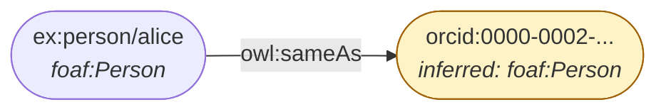
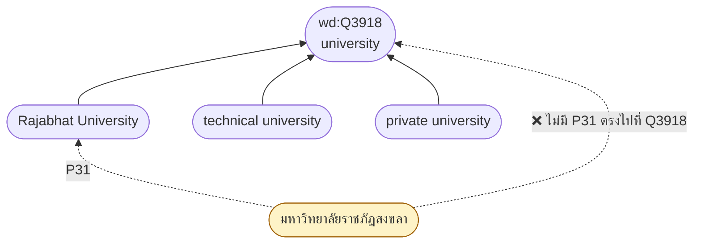

# 09.10 Python: รวม Vocabulary และ Query LOD

บทนี้ลงมือสองอย่าง: **รวม vocabulary มาตรฐานหลายตัวไว้ใน graph เดียว** พร้อม alignment
และ **query Wikidata กับ DBpedia จริง** แล้วแปลงผลเป็น RDF ของเราเอง
ผลลัพธ์ทุกตัวเลขมาจากการรันจริง

> 📁 ไฟล์: [`foaf_schema_combined.py`](../code/ch09/foaf_schema_combined.py) และ [`wikidata_query.py`](../code/ch09/wikidata_query.py)

---

## ส่วนที่ 1: รวม vocabulary หลายตัว

### rdflib มี namespace มาตรฐานให้แล้ว

```python
from rdflib.namespace import (
    RDF, RDFS, OWL, XSD,          # core
    DC, DCTERMS, DCAT, VOID,      # metadata
    FOAF, SKOS, SDO, PROV,        # description  (SDO = schema.org)
    ODRL2, ORG, TIME, GEO, QB,    # domain
)

print(SDO.Person)        # https://schema.org/Person
print(FOAF.knows)        # http://xmlns.com/foaf/0.1/knows
print(SKOS.prefLabel)    # http://www.w3.org/2004/02/skos/core#prefLabel
```

namespace ที่ยังไม่มีต้องประกาศเอง:

```python
from rdflib import Namespace

ORG = Namespace("http://www.w3.org/ns/org#")
PROV = Namespace("http://www.w3.org/ns/prov#")
```

### สร้าง graph ที่ใช้หลาย vocabulary

```python
from rdflib import Graph, Literal, Namespace, URIRef
from rdflib.namespace import DCTERMS, FOAF, OWL, RDF, RDFS, SDO, SKOS, XSD

EX = Namespace("http://example.org/")
ORG = Namespace("http://www.w3.org/ns/org#")

g = Graph()
for prefix, ns in [("ex", EX), ("foaf", FOAF), ("schema", SDO),
                   ("dcterms", DCTERMS), ("skos", SKOS), ("org", ORG)]:
    g.bind(prefix, ns)

alice = EX["person/alice"]

# --- ประกาศทั้งสอง vocabulary ---
g.add((alice, RDF.type, FOAF.Person))
g.add((alice, RDF.type, SDO.Person))

# --- FOAF: คนและความสัมพันธ์ ---
g.add((alice, FOAF.name, Literal("Alice Johnson")))
g.add((alice, FOAF.mbox, URIRef("mailto:alice@example.org")))
g.add((alice, FOAF.homepage, URIRef("https://alice.example.org/")))

# --- schema.org: ข้อมูลสำหรับเว็บ ---
g.add((alice, SDO.jobTitle, Literal("Research Assistant", lang="en")))
g.add((alice, SDO.birthDate, Literal("1995-04-12", datatype=XSD.date)))

# --- ORG: โครงสร้างองค์กร ---
g.add((alice, ORG.memberOf, EX["org/csDept"]))

# --- link ภายนอก ---
g.add((alice, OWL.sameAs, URIRef("https://orcid.org/0000-0002-1825-0097")))
g.add((alice, SDO.sameAs, URIRef("https://github.com/alicejohnson")))
```

> 💡 **`owl:sameAs` (identity) ต่างจาก `schema:sameAs` (แค่ link)** — ทบทวนจาก [09.03](09.03-schema-org.md)

---

## Alignment: เชื่อม vocabulary เข้าด้วยกัน

```python
from rdflib import Graph
from rdflib.namespace import DCTERMS, FOAF, OWL, RDFS, SDO

def build_alignment() -> Graph:
    g = Graph()

    # ----- equivalent (พิสูจน์ได้ว่าเหมือนกันจริง) -----
    g.add((FOAF.Person, OWL.equivalentClass, SDO.Person))
    g.add((FOAF.Organization, OWL.equivalentClass, SDO.Organization))
    g.add((FOAF.name, OWL.equivalentProperty, SDO.name))
    g.add((FOAF.knows, OWL.equivalentProperty, SDO.knows))

    # ----- subPropertyOf (ปลอดภัยกว่า -- อนุมานทางเดียว) -----
    g.add((FOAF.name, RDFS.subPropertyOf, RDFS.label))
    g.add((FOAF.homepage, RDFS.subPropertyOf, SDO.url))
    g.add((SDO.author, RDFS.subPropertyOf, DCTERMS.creator))
    g.add((SDO.name, RDFS.subPropertyOf, DCTERMS.title))
    g.add((SDO.datePublished, RDFS.subPropertyOf, DCTERMS.issued))
    g.add((SDO.license, RDFS.subPropertyOf, DCTERMS.license))
    g.add((DCTERMS.creator, RDFS.subPropertyOf, DCTERMS.contributor))

    # ----- ⚠️ ไม่ align: range ต่างกัน (IRI vs string) -----
    g.add((FOAF.mbox, RDFS.seeAlso, SDO.email))

    return g
```

### ผลลัพธ์: query ด้วย vocabulary ใดก็ได้

```python
import owlrl

combined = data + build_alignment()
owlrl.DeductiveClosure(owlrl.RDFS_OWLRL_Semantics).expand(combined)
```

| Query | ก่อน alignment | หลัง alignment + reasoning |
| --- | --- | --- |
| `?p a foaf:Person` | 2 | **3** |
| `?p a schema:Person` | 1 | **3** |
| `?p rdfs:label ?l` | **0** | **7** |
| `?doc dcterms:creator ?c` | 1 | **2** |
| `?doc dcterms:title ?t` | 2 | **8** |

**`rdfs:label` จาก 0 เป็น 7** เพราะ `foaf:name rdfs:subPropertyOf rdfs:label`

### ⚠️ ข้อสังเกตจากผลรันจริง: `owl:sameAs` ดึง IRI ภายนอกเข้ามา

```
?p a foaf:Person → ['0000-0002-1825-0097', 'alice', 'bob']
```

**ORCID IRI โผล่มาในผลลัพธ์** เพราะ `alice owl:sameAs <https://orcid.org/...>`
และ `owl:sameAs` merge ทุก property รวมถึง `rdf:type`



**ถ้าไม่ต้องการพฤติกรรมนี้ ให้ใช้ `schema:sameAs` หรือ `rdfs:seeAlso` แทน**

```sparql
# กรอง IRI ภายนอกออก
SELECT ?p WHERE {
  ?p a foaf:Person .
  FILTER(STRSTARTS(STR(?p), "http://example.org/"))
}
```

---

## วิเคราะห์การ reuse

```python
WELL_KNOWN = {
    "http://xmlns.com/foaf/0.1/": "FOAF",
    "http://purl.org/dc/terms/": "Dublin Core",
    "https://schema.org/": "schema.org",
    "http://www.w3.org/2004/02/skos/core#": "SKOS",
    "http://www.w3.org/ns/org#": "ORG",
    "http://www.w3.org/2002/07/owl#": "OWL",
    "http://www.w3.org/2000/01/rdf-schema#": "RDFS",
    "http://www.w3.org/1999/02/22-rdf-syntax-ns#": "RDF",
}


def analyse_reuse(g: Graph) -> None:
    counts, own = {}, 0
    for _, p, _ in g:
        for ns, name in WELL_KNOWN.items():
            if str(p).startswith(ns):
                counts[name] = counts.get(name, 0) + 1
                break
        else:
            own += 1

    total = sum(counts.values()) + own
    for name, count in sorted(counts.items(), key=lambda x: -x[1]):
        bar = "#" * int(count / total * 40)
        print(f"  {name:16s} {count:>4}  {bar}")
    print(f"  {'(ของเราเอง)':16s} {own:>4}")
    print(f"\n  reuse ratio: {sum(counts.values()) / total:.0%}")
```

Expected output (จากการรันจริง):

```
  SKOS               14  ########
  RDF                14  ########
  FOAF               13  ########
  schema.org          9  #####
  Dublin Core         8  #####
  ORG                 4  ##
  OWL                 2  #
  (ของเราเอง)         0

  reuse ratio: 100%
```

> 💡 **reuse ratio 100%** หมายถึงไม่ได้สร้าง property ใหม่เลย — เป็นเป้าหมายที่ดีสำหรับ dataset

---

## Export เป็น JSON-LD

```python
def export_jsonld(g: Graph) -> str:
    context = {
        "ex": "http://example.org/",
        "foaf": "http://xmlns.com/foaf/0.1/",
        "schema": "https://schema.org/",
        "dcterms": "http://purl.org/dc/terms/",
        "name": "foaf:name",
        "knows": {"@id": "foaf:knows", "@type": "@id"},
        "title": "dcterms:title",
        "creator": {"@id": "dcterms:creator", "@type": "@id"},
        "sameAs": {"@id": "http://www.w3.org/2002/07/owl#sameAs", "@type": "@id"},
    }
    return g.serialize(format="json-ld", context=context, indent=2)
```

---

## ส่วนที่ 2: Query Wikidata

### Setup ที่ถูกต้อง

```python
import time
from typing import Any, Dict, List, Optional

from SPARQLWrapper import JSON, POST, SPARQLWrapper
from SPARQLWrapper.SPARQLExceptions import SPARQLWrapperException

WIKIDATA = "https://query.wikidata.org/sparql"

# ⚠️ Wikidata บล็อก request ที่ไม่ระบุตัวตน
USER_AGENT = "SemanticWebCourse/1.0 (https://example.org; contact@example.org)"

WD_PREFIXES = """
PREFIX wd:       <http://www.wikidata.org/entity/>
PREFIX wdt:      <http://www.wikidata.org/prop/direct/>
PREFIX p:        <http://www.wikidata.org/prop/>
PREFIX ps:       <http://www.wikidata.org/prop/statement/>
PREFIX pq:       <http://www.wikidata.org/prop/qualifier/>
PREFIX wikibase: <http://wikiba.se/ontology#>
PREFIX bd:       <http://www.bigdata.com/rdf#>
PREFIX rdfs:     <http://www.w3.org/2000/01/rdf-schema#>
"""


def run_query(endpoint: str, query: str, *, timeout: int = 60,
              retries: int = 3) -> Optional[List[Dict[str, Any]]]:
    """ยิง SELECT query พร้อม retry แบบ exponential backoff"""
    sparql = SPARQLWrapper(endpoint, agent=USER_AGENT)
    sparql.setQuery(query)
    sparql.setReturnFormat(JSON)
    sparql.setTimeout(timeout)
    sparql.setMethod(POST)

    for attempt in range(1, retries + 1):
        try:
            return sparql.query().convert()["results"]["bindings"]
        except SPARQLWrapperException as exc:
            print(f"  [{attempt}/{retries}] SPARQL error: {str(exc)[:120]}")
        except Exception as exc:                      # network error หลายชนิด
            print(f"  [{attempt}/{retries}] {type(exc).__name__}: {str(exc)[:120]}")
        if attempt < retries:
            time.sleep(2.0 ** attempt)
    return None
```

> 💡 **retry จำเป็นจริง** — ระหว่างทดสอบเจอ `HTTP Error 502: Bad Gateway` แล้ว retry สำเร็จในครั้งที่ 2

---

## Demo 1: `wdt:` vs `p:/ps:/pq:`

```python
# --- wdt: -- ได้แค่ค่า ไม่มีบริบท ---
Q_TRUTHY = WD_PREFIXES + """
SELECT ?award ?awardLabel WHERE {
  wd:Q7186 wdt:P166 ?award .
  SERVICE wikibase:label { bd:serviceParam wikibase:language "en" . }
}
"""

# --- p:/ps:/pq: -- ได้ qualifier ด้วย ---
Q_QUALIFIED = WD_PREFIXES + """
SELECT ?awardLabel ?year ?togetherWithLabel WHERE {
  wd:Q7186 p:P166 ?statement .
  ?statement ps:P166 ?award .
  OPTIONAL { ?statement pq:P585  ?time . BIND(YEAR(?time) AS ?year) }
  OPTIONAL { ?statement pq:P1706 ?togetherWith }
  SERVICE wikibase:label { bd:serviceParam wikibase:language "en" . }
}
ORDER BY ?year
"""
```

ผลรันจริงของ `Q_QUALIFIED`:

| ?awardLabel | ?year | ?togetherWithLabel |
| --- | --- | --- |
| Knight of the Legion of Honour | — | — |
| prix Gegner | 1898 | — |
| Davy Medal | 1903 | Pierre Curie |
| **Nobel Prize in Physics** | **1903** | **Pierre Curie** |
| **Nobel Prize in Physics** | **1903** | **Antoine Henri Becquerel** |
| Matteucci Medal | 1904 | Pierre Curie |
| ... | | |
| **(18 แถว)** | | |

**สังเกต**: Nobel Prize in Physics ปรากฏ **สองแถว** เพราะได้ร่วมกับสองคน
— ข้อมูลนี้ `wdt:` ให้ไม่ได้

---

## Demo 2: `P31` vs `P31/P279*` — พิสูจน์ด้วยตัวเลขจริง

```python
Q_NARROW = WD_PREFIXES + """
SELECT (COUNT(DISTINCT ?item) AS ?n) WHERE {
  ?item wdt:P31 wd:Q3918 ;          # instance of university (ตรง ๆ)
        wdt:P17 wd:Q869 .           # country = Thailand
}
"""

Q_WIDE = WD_PREFIXES + """
SELECT (COUNT(DISTINCT ?item) AS ?n) WHERE {
  ?item wdt:P31/wdt:P279* wd:Q3918 ;    # รวม subclass ทุกระดับ
        wdt:P17 wd:Q869 .
}
"""
```

ผลรันจริง:

```
wdt:P31 wd:Q3918           → 136 มหาวิทยาลัยในไทย
wdt:P31/wdt:P279* wd:Q3918 → 152 มหาวิทยาลัยในไทย
```

**ตกหล่น 16 แห่ง (10.5%)** ถ้าไม่ใช้ `P279*`



> 💡 **`wdt:P31/wdt:P279*` เป็น pattern บังคับ** สำหรับ query Wikidata

---

## Demo 3: Entity linking ด้วย `VALUES` + chunking

```python
def lookup_entities(qids: List[str], chunk_size: int = 25) -> List[Dict[str, Any]]:
    """ดึงข้อมูลหลาย entity -- ลดจาก N request เหลือ ceil(N/chunk_size)"""
    results, requests_made = [], 0

    for i in range(0, len(qids), chunk_size):
        chunk = qids[i:i + chunk_size]
        values = " ".join(f"wd:{qid}" for qid in chunk)
        rows = run_query(WIKIDATA, WD_PREFIXES + f"""
        SELECT ?item ?itemLabel ?itemDescription WHERE {{
          VALUES ?item {{ {values} }}
          SERVICE wikibase:label {{ bd:serviceParam wikibase:language "en,th" . }}
        }}
        """)
        requests_made += 1
        if rows:
            results.extend(rows)
        time.sleep(1)                          # มารยาท

    print(f"entity ที่ค้นหา : {len(qids)}")
    print(f"HTTP requests  : {requests_made}  (ไม่ใช่ {len(qids)}!)")
    return results


qids = ["Q7186", "Q937", "Q9095", "Q935", "Q1035", "Q39599", "Q7259", "Q11812"]
rows = lookup_entities(qids)
```

Expected output:

```
entity ที่ค้นหา : 8
HTTP requests  : 1  (ไม่ใช่ 8!)

item      itemLabel            itemDescription
--------  -------------------  -----------------------------------------
Q7186     Marie Curie          Polish-French physicist and chemist
Q937      Albert Einstein      German-born theoretical physicist
Q9095     Wilhelm Röntgen      German physicist
Q935      Isaac Newton         English physicist and mathematician
...
```

---

## Demo 4: DBpedia — `dbo:` vs `dbp:`

```python
DBPEDIA = "https://dbpedia.org/sparql"

DB_PREFIXES = """
PREFIX dbr:     <http://dbpedia.org/resource/>
PREFIX dbo:     <http://dbpedia.org/ontology/>
PREFIX dbp:     <http://dbpedia.org/property/>
PREFIX rdfs:    <http://www.w3.org/2000/01/rdf-schema#>
PREFIX owl:     <http://www.w3.org/2002/07/owl#>
"""

Q_DBO = DB_PREFIXES + """
SELECT ?p ?o WHERE {
  dbr:Marie_Curie ?p ?o .
  FILTER(STRSTARTS(STR(?p), "http://dbpedia.org/ontology/"))
  FILTER(!isLiteral(?o) || LANG(?o) IN ("", "en"))
  FILTER(?p != dbo:abstract && ?p != dbo:wikiPageWikiLink)
}
LIMIT 15
"""
```

| `dbo:` (curated) | `dbp:` (raw) |
| --- | --- |
| `dbo:birthDate "1867-11-07"^^xsd:date` | `dbp:birthDate "7 November 1867"@en` |
| `dbo:birthPlace dbr:Warsaw` | `dbp:birthPlace "Warsaw, Congress Poland"@en` |
| `dbo:field dbr:Physics` | `dbp:fields "Physics, Chemistry"@en` |

> 💡 **`dbo:` ให้ IRI และ typed literal** ส่วน `dbp:` ให้ string ดิบที่ parse ต่อยาก

---

## Demo 5: DBpedia เป็น hub ของ LOD

```python
Q_SAMEAS = DB_PREFIXES + """
SELECT ?external WHERE { dbr:Marie_Curie owl:sameAs ?external . }
"""

rows = run_query(DBPEDIA, Q_SAMEAS, timeout=90)

grouped = {}
for row in rows or []:
    iri = row["external"]["value"]
    if "wikidata.org" in iri:      key = "Wikidata"
    elif "viaf.org" in iri:        key = "VIAF"
    elif "id.loc.gov" in iri:      key = "Library of Congress"
    elif "yago" in iri:            key = "YAGO"
    elif ".dbpedia.org" in iri:    key = "DBpedia (ภาษาอื่น)"
    else:                          key = "อื่น ๆ"
    grouped.setdefault(key, []).append(iri)
```

Expected output:

```
DBpedia (ภาษาอื่น)         12 links
    http://de.dbpedia.org/resource/Marie_Curie
    http://fr.dbpedia.org/resource/Marie_Curie
อื่น ๆ                      8 links
Wikidata                    1 links
    http://www.wikidata.org/entity/Q7186
VIAF                        1 links
Library of Congress         1 links
YAGO                        1 links

รวม 24 owl:sameAs links
```

**นี่คือเหตุผลที่ DBpedia เป็น hub ของ LOD Cloud** — มี link ออกไปยัง dataset อื่นมากที่สุด

---

## Demo 6: แปลงผลเป็น RDF ของเราเอง

```python
from rdflib import Graph, Literal, Namespace, URIRef
from rdflib.namespace import OWL, RDF, RDFS, SDO, XSD

EX = Namespace("http://example.org/imported/")


def wikidata_to_rdf(rows: List[Dict[str, Any]]) -> Graph:
    """แปลงผล Wikidata เป็น RDF ที่ใช้ schema.org"""
    g = Graph()
    g.bind("ex", EX)
    g.bind("schema", SDO)
    g.bind("owl", OWL)

    for row in rows:
        wd_iri = row["person"]["value"]
        qid = wd_iri.rsplit("/", 1)[-1]
        person = EX[qid]

        g.add((person, RDF.type, SDO.Person))

        # ⚠️ ใส่ owl:sameAs ชี้กลับต้นทางเสมอ
        g.add((person, OWL.sameAs, URIRef(wd_iri)))

        if "personLabel" in row:
            name = row["personLabel"]["value"]
            g.add((person, SDO.name, Literal(name)))
            g.add((person, RDFS.label, Literal(name, lang="en")))
        if "birthDate" in row:
            g.add((person, SDO.birthDate,
                   Literal(row["birthDate"]["value"][:10], datatype=XSD.date)))
        if "countryLabel" in row:
            g.add((person, SDO.nationality, Literal(row["countryLabel"]["value"])))

    return g
```

Expected output:

```turtle
@prefix ex:     <http://example.org/imported/> .
@prefix owl:    <http://www.w3.org/2002/07/owl#> .
@prefix rdfs:   <http://www.w3.org/2000/01/rdf-schema#> .
@prefix schema: <https://schema.org/> .
@prefix xsd:    <http://www.w3.org/2001/XMLSchema#> .

ex:Q9095 a schema:Person ;
    rdfs:label         "Wilhelm Röntgen"@en ;
    schema:name        "Wilhelm Röntgen" ;
    schema:birthDate   "1845-03-27"^^xsd:date ;
    schema:nationality "German Empire" ;
    owl:sameAs         <http://www.wikidata.org/entity/Q9095> .
```

> 💡 **`owl:sameAs` ชี้กลับต้นทางทำให้**: (1) ตรวจสอบย้อนกลับได้, (2) ดึงข้อมูลใหม่ได้, (3) เชื่อมกับ LOD Cloud

---

## รันจริง

```bash
python code/ch09/foaf_schema_combined.py            # รวม vocabulary
python code/ch09/foaf_schema_combined.py --jsonld   # export JSON-LD

python code/ch09/wikidata_query.py                  # ทุก demo (ต้องต่อ internet)
python code/ch09/wikidata_query.py --offline        # แสดงเฉพาะ query
python code/ch09/wikidata_query.py --demo 3         # เฉพาะ demo 3
```

---

## Troubleshooting

| อาการ | สาเหตุ | วิธีแก้ |
| --- | --- | --- |
| `ParseException: Expected SelectQuery` | prefixed name มี `/` | ใช้ IRI เต็มใน `< >` หรือ escape `\/` |
| Wikidata คืน 403 | ไม่มี `User-Agent` | ตั้ง `agent=` ใน `SPARQLWrapper()` |
| Wikidata คืน 502/504 | server ล่มชั่วคราว | retry แบบ exponential backoff |
| ผลลัพธ์ตกหล่น | ใช้ `wdt:P31` ตรง ๆ | ใช้ `wdt:P31/wdt:P279*` |
| `?xLabel` ว่าง | ไม่มี label service หรือวางผิดที่ | วาง `SERVICE wikibase:label` ท้ายสุด |
| `FILTER(?xLabel)` ไม่ทำงาน | label ยังไม่ถูก bind ตอน FILTER | query `rdfs:label` เอง |
| IRI ภายนอกโผล่ในผล | `owl:sameAs` merge type ด้วย | FILTER ด้วย `STRSTARTS` หรือใช้ `schema:sameAs` |
| DBpedia timeout | query หนัก | ตั้ง `timeout=90`, ใส่ `LIMIT` |
| `dbp:` ให้ค่าที่ parse ไม่ได้ | เป็น raw infobox | ใช้ `dbo:` แทน |

### ⚠️ กับดัก: `/` ใน prefixed name

```sparql
# ❌ ผิด -- "/" ไม่ใช่อักขระที่ใช้ใน local name ได้
SELECT ?x WHERE { ex:person/alice foaf:knows ?x }

# ✅ ถูก -- ใช้ IRI เต็ม
SELECT ?x WHERE { <http://example.org/person/alice> foaf:knows ?x }

# ✅ หรือ escape
SELECT ?x WHERE { ex:person\/alice foaf:knows ?x }
```

**เจอจริงตอนพัฒนา** — เป็นเหตุผลที่ IRI design ควรเลี่ยง `/` ใน local name

---

## Key Points

- rdflib มี namespace มาตรฐานให้แล้ว: **`FOAF`, `SDO` (schema.org), `DCTERMS`, `SKOS`, `PROV`, `DCAT`, `VOID`**
- **Alignment ทำให้ query ด้วย vocabulary ใดก็ได้** — `rdfs:label` จาก 0 เป็น 7 แถวหลัง align กับ `foaf:name`
- ใช้ **`rdfs:subPropertyOf` เป็นหลัก** (ปลอดภัย) และ `owl:equivalentProperty` เฉพาะที่พิสูจน์ได้
- ⚠️ **`owl:sameAs` merge `rdf:type` ด้วย** — ทำให้ IRI ภายนอกโผล่ในผลลัพธ์
- ⚠️ **Wikidata บังคับ `User-Agent`** และควรมี **retry** เพราะเจอ 502 ได้จริง
- **`wdt:P31/wdt:P279*`** จำเป็นจริง — ทดสอบแล้วได้ 152 vs 136 (ตกหล่น 10.5% ถ้าไม่ใช้)
- **`p:/ps:/pq:`** ให้ qualifier ที่ `wdt:` ให้ไม่ได้ (ปีที่ได้รางวัล, ได้ร่วมกับใคร)
- **`VALUES` + chunking** ลดจาก 8 request เหลือ 1
- ⚠️ **`/` ใน prefixed name ใช้ไม่ได้** — ใช้ IRI เต็มหรือ escape
- **ใส่ `owl:sameAs` ชี้กลับต้นทางเสมอ** เมื่อ import ข้อมูลจาก LOD
