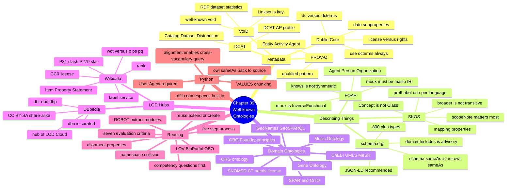
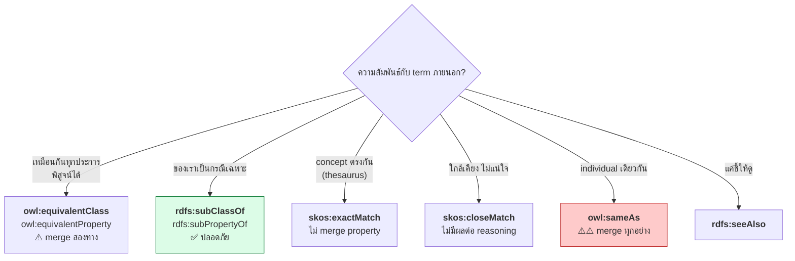

# 09.11 สรุป Chapter 09 + Vocabulary Cheat Sheet

Chapter 09 เปลี่ยนจาก "สร้าง ontology เอง" เป็น "**ใช้ของที่มีอยู่แล้วให้เป็น**"
ซึ่งสำคัญกว่าในทางปฏิบัติ เพราะหลักการอันดับหนึ่งของ Semantic Web คือ **reuse ก่อน reinvent**

---

## Concept Map



---

## Vocabulary Cheat Sheet

### Metadata

```turtle
@prefix dcterms: <http://purl.org/dc/terms/> .
@prefix dcat:    <http://www.w3.org/ns/dcat#> .
@prefix void:    <http://rdfs.org/ns/void#> .
@prefix prov:    <http://www.w3.org/ns/prov#> .

# Dublin Core -- metadata ของเอกสาร
dcterms:title dcterms:description dcterms:creator dcterms:contributor
dcterms:publisher dcterms:created dcterms:issued dcterms:modified
dcterms:subject dcterms:language dcterms:format dcterms:identifier
dcterms:license dcterms:rights dcterms:isPartOf dcterms:references

# DCAT -- catalog ของ dataset
dcat:Catalog dcat:Dataset dcat:Distribution dcat:DataService
dcat:distribution dcat:downloadURL dcat:accessURL dcat:mediaType
dcat:keyword dcat:theme dcat:landingPage dcat:contactPoint

# VoID -- บรรยาย RDF dataset
void:Dataset void:Linkset void:sparqlEndpoint void:dataDump
void:uriSpace void:triples void:entities void:classes void:properties
void:vocabulary void:classPartition void:linkPredicate

# PROV-O -- provenance
prov:Entity prov:Activity prov:Agent
prov:wasGeneratedBy prov:used prov:wasAttributedTo
prov:wasDerivedFrom prov:wasAssociatedWith prov:actedOnBehalfOf
```

### Describing Things

```turtle
@prefix foaf:   <http://xmlns.com/foaf/0.1/> .
@prefix schema: <https://schema.org/> .
@prefix skos:   <http://www.w3.org/2004/02/skos/core#> .
@prefix org:    <http://www.w3.org/ns/org#> .

# FOAF -- คนและองค์กร
foaf:Agent foaf:Person foaf:Organization foaf:Group foaf:Document
foaf:name foaf:givenName foaf:familyName foaf:nick
foaf:mbox foaf:mbox_sha1sum foaf:homepage foaf:img
foaf:knows foaf:member foaf:made foaf:maker foaf:account

# schema.org -- เว็บ
schema:Thing schema:Person schema:Organization schema:Place
schema:Event schema:CreativeWork schema:Product schema:Action
schema:name schema:description schema:url schema:image
schema:sameAs schema:identifier schema:mainEntityOfPage

# SKOS -- thesaurus
skos:Concept skos:ConceptScheme skos:Collection
skos:prefLabel skos:altLabel skos:hiddenLabel
skos:broader skos:narrower skos:related
skos:broaderTransitive skos:narrowerTransitive
skos:definition skos:scopeNote skos:example
skos:inScheme skos:topConceptOf skos:hasTopConcept
skos:exactMatch skos:closeMatch skos:broadMatch skos:relatedMatch

# ORG -- โครงสร้างองค์กร
org:FormalOrganization org:OrganizationalUnit org:Role org:Post
org:memberOf org:hasUnit org:unitOf org:holds
```

### LOD Hubs

```turtle
# Wikidata
@prefix wd:       <http://www.wikidata.org/entity/> .       # entity
@prefix wdt:      <http://www.wikidata.org/prop/direct/> .  # truthy ⭐
@prefix p:        <http://www.wikidata.org/prop/> .         # statement
@prefix ps:       <http://www.wikidata.org/prop/statement/> .
@prefix pq:       <http://www.wikidata.org/prop/qualifier/> .
@prefix wikibase: <http://wikiba.se/ontology#> .
@prefix bd:       <http://www.bigdata.com/rdf#> .

# DBpedia
@prefix dbr: <http://dbpedia.org/resource/> .   # instance
@prefix dbo: <http://dbpedia.org/ontology/> .   # curated ⭐
@prefix dbp: <http://dbpedia.org/property/> .   # raw ⚠️
@prefix dbc: <http://dbpedia.org/resource/Category:> .
```

---

## Wikidata Quick Reference

| Property | ความหมาย |
| --- | --- |
| **`wdt:P31`** | **instance of** |
| **`wdt:P279`** | **subclass of** |
| `wdt:P17` | country |
| `wdt:P131` | located in |
| `wdt:P106` | occupation |
| `wdt:P569` / `wdt:P570` | date of birth / death |
| `wdt:P27` | citizenship |
| `wdt:P166` | award received |
| `wdt:P625` | coordinates |
| `wdt:P1082` | population |
| `wdt:P856` | official website |

| Item | ความหมาย |
| --- | --- |
| `wd:Q5` | human |
| `wd:Q515` | city |
| `wd:Q6256` | country |
| `wd:Q3918` | university |
| `wd:Q43229` | organization |

### Pattern บังคับ

```sparql
# ⭐ ใช้เกือบทุก query
?item wdt:P31/wdt:P279* wd:Q3918 .

# ⭐ label service ต้องอยู่ท้ายสุด
SERVICE wikibase:label { bd:serviceParam wikibase:language "en,th" . }
```

---

## Alignment Property — เลือกใช้อย่างไร



| Property | reasoning | ความเสี่ยง | ใช้เมื่อ |
| --- | --- | --- | --- |
| `rdfs:subClassOf` | ทางเดียว | ต่ำ | **default ที่แนะนำ** |
| `rdfs:subPropertyOf` | ทางเดียว | ต่ำ | **default ที่แนะนำ** |
| `owl:equivalentClass` | สองทาง | สูง | พิสูจน์ได้ว่าเหมือนกัน |
| `owl:sameAs` | merge ทุก property | **สูงมาก** | มี identifier ยืนยัน |
| `skos:exactMatch` | ไม่ merge | ต่ำ | เชื่อม thesaurus |
| `skos:closeMatch` | ไม่มีผล | ต่ำมาก | ไม่แน่ใจ |
| `rdfs:seeAlso` | ไม่มีผล | ไม่มี | ชี้ให้ดูเพิ่ม |

---

## กับดักที่เจอจริง 10 ข้อ

| # | กับดัก | อาการ | ทางแก้ |
| --- | --- | --- | --- |
| 1 | ใช้ `dc:` แทน `dcterms:` | link ต่อไม่ได้ | ใช้ `dcterms:` เสมอ |
| 2 | `foaf:mbox` เป็น string | ผิด range | ใช้ `<mailto:...>` |
| 3 | คิดว่า `foaf:knows` symmetric | อนุมานไม่ได้ | สร้าง symmetric subproperty เอง |
| 4 | `schema:sameAs` ≠ `owl:sameAs` | ไม่ merge property | เลือกให้ตรงเจตนา |
| 5 | `skos:broader` ไม่ transitive | query ตกหล่น | ใช้ `broader+` หรือ `broaderTransitive` |
| 6 | `skos:prefLabel` หลายค่าต่อภาษา | ผิด spec | ใช้ `altLabel` |
| 7 | `wdt:P31` ตรง ๆ | ตกหล่น 10%+ | ใช้ `wdt:P31/wdt:P279*` |
| 8 | ไม่ใส่ `User-Agent` | Wikidata 403 | ตั้ง `agent=` |
| 9 | `/` ใน prefixed name | `ParseException` | ใช้ IRI เต็ม `< >` |
| 10 | `owl:sameAs` ดึง IRI ภายนอกเข้ามา | ผลลัพธ์เกิน | FILTER ด้วย `STRSTARTS` |

---

## เปรียบเทียบ Wikidata vs DBpedia — สรุป

| | **Wikidata** | **DBpedia** |
| --- | --- | --- |
| ที่มา | ชุมชนกรอกโดยตรง | สกัดจาก Wikipedia infobox |
| Identifier | Q-number (opaque) | ชื่อบทความ (อ่านออก) |
| ความสด | ทันที | ตาม release |
| Qualifier / Reference / Rank | ✅ | ❌ |
| หลายภาษา | รวมใน item เดียว | แยก dataset |
| **License** | **CC0** ✅ | **CC BY-SA 3.0** ⚠️ |
| จุดแข็ง | โครงสร้าง + provenance | **hub ของ LOD** (sameAs เยอะ) |
| เหมาะกับ | ข้อมูลเชิงโครงสร้าง | abstract, entity linking |

---

## Python Cheat Sheet

```python
# ===== namespace ที่ rdflib มีให้แล้ว =====
from rdflib.namespace import (
    RDF, RDFS, OWL, XSD,
    DC, DCTERMS, DCAT, VOID,
    FOAF, SKOS, SDO, PROV,        # SDO = schema.org
    ORG, TIME, GEO,
)

# ===== ที่ต้องประกาศเอง =====
from rdflib import Namespace
ORG = Namespace("http://www.w3.org/ns/org#")

# ===== alignment =====
g.add((FOAF.name, RDFS.subPropertyOf, RDFS.label))          # ปลอดภัย
g.add((FOAF.Person, OWL.equivalentClass, SDO.Person))        # พิสูจน์ได้
g.add((FOAF.mbox, RDFS.seeAlso, SDO.email))                  # range ต่างกัน

# ===== reasoning หลัง alignment =====
import owlrl
owlrl.DeductiveClosure(owlrl.RDFS_OWLRL_Semantics).expand(g)

# ===== Wikidata =====
from SPARQLWrapper import JSON, POST, SPARQLWrapper

sparql = SPARQLWrapper(
    "https://query.wikidata.org/sparql",
    agent="MyApp/1.0 (contact@example.org)",     # ⚠️ บังคับ
)
sparql.setReturnFormat(JSON)
sparql.setTimeout(60)
sparql.setMethod(POST)

# ===== VALUES + chunking =====
values = " ".join(f"wd:{qid}" for qid in chunk)
query = f"SELECT ?item ?itemLabel WHERE {{ VALUES ?item {{ {values} }} ... }}"

# ===== import แล้วชี้กลับต้นทาง =====
g.add((local_iri, OWL.sameAs, URIRef(wikidata_iri)))
```

---

## Checklist การ Reuse

- [ ] เขียน **competency question** ก่อนค้นหา
- [ ] ค้นที่ **schema.org → LOV → OBO Foundry/BioPortal**
- [ ] ประเมิน 7 เกณฑ์: **license, maintenance, adoption, documentation, dereferenceable, stability, profile**
- [ ] เลือก: **reuse ตรง / extend / สร้างใหม่ + เชื่อม**
- [ ] เริ่มจาก **`rdfs:subClassOf` ทางเดียว** ก่อนเสมอ
- [ ] **อย่าคัดลอก term ของคนอื่นมาไว้ใน namespace ตัวเอง**
- [ ] **อย่า `owl:imports` ontology ใหญ่ทั้งก้อน** — ใช้ ROBOT extract
- [ ] เขียน **`rdfs:comment` อธิบายว่าเลือก vocabulary ไหนเพราะอะไร**
- [ ] namespace ของตัวเองมี `vann:preferredNamespacePrefix`, `owl:versionIRI`, `dcterms:license`

---

## Self-check

1. `dc:` กับ `dcterms:` ต่างกันอย่างไร และควรใช้ตัวไหน
2. `foaf:mbox` ต้องเขียนอย่างไร และทำไมจึงเป็น InverseFunctionalProperty
3. `schema:sameAs` ต่างจาก `owl:sameAs` อย่างไร
4. ทำไม `skos:broader` จึงไม่ transitive และแก้อย่างไร
5. `wdt:` กับ `p:/ps:/pq:` ต่างกันอย่างไร ใช้ตัวไหนเมื่อไหร่
6. ทำไมต้องใช้ `wdt:P31/wdt:P279*` แทน `wdt:P31`
7. `dbo:` กับ `dbp:` ต่างกันอย่างไร
8. Wikidata กับ DBpedia license ต่างกันอย่างไร และมีผลอะไร
9. ควรใช้ alignment property ตัวไหนเมื่อไม่แน่ใจว่าสอง term เหมือนกันหรือไม่

---

## Preview: Chapter 10 — Ontology Design

Chapter 09 สอนใช้ ontology ที่มีอยู่ — Chapter 10 จะสอน **กระบวนการออกแบบ ontology ใหม่อย่างเป็นระบบ**

| จะได้เรียน | สาระ |
| --- | --- |
| Methodology | METHONTOLOGY, NeOn, SAMOD — เปรียบเทียบขั้นตอน |
| **Competency Questions** | นิยาม, การเขียน, mapping CQ → SPARQL |
| Conceptualization | domain/scope, glossary, concept map → class hierarchy |
| Formalization | necessary vs sufficient, OWA ในการออกแบบ |
| **Ontology Design Patterns** | AgentRole, TimeIndexedSituation, Participation |
| **Anti-patterns** | ข้อผิดพลาดที่พบบ่อยพร้อมวิธีแก้ |
| Modularization | core/domain/application, `owl:imports`, versioning |
| **Evaluation** | OOPS! pitfalls (P05, P08, P13), consistency, CQ testing, metrics |
| Tools | Protégé walkthrough, ROBOT CLI, OOPS! scanner |
| Python | CQ → class → restriction → SPARQL test pipeline |

---

## Key Points

- **Reuse ก่อน reinvent** — vocabulary มาตรฐานทำให้ข้อมูลถูกเข้าใจโดยไม่ต้องอธิบาย
- **Dublin Core**: ใช้ **`dcterms:`** ไม่ใช่ `dc:`; date แยกละเอียดเป็น subproperty ของ `dcterms:date`
- **FOAF**: `mbox` ต้องเป็น `mailto:` IRI และเป็น **InverseFunctional**; **`knows` ไม่ symmetric**
- **schema.org**: ใช้ **JSON-LD**; ⚠️ `schema:sameAs` ≠ `owl:sameAs`; `domainIncludes` เป็นแค่คำแนะนำ
- **SKOS**: `Concept` ไม่ใช่ `Class`; **`broader` ไม่ transitive**; `prefLabel` หนึ่งค่าต่อภาษา
- **PROV-O / DCAT / VoID** ตอบคำถามคนละข้อ — ใช้ร่วมกันได้ในหนึ่ง resource
- **Wikidata (CC0)** มี qualifier/reference/rank; **DBpedia (CC BY-SA)** เป็น **hub ของ LOD**
- ⚠️ **`wdt:P31/wdt:P279*`** จำเป็นจริง — พิสูจน์แล้วว่าตกหล่น 10%+ ถ้าไม่ใช้
- **เริ่ม alignment จาก `rdfs:subClassOf` ทางเดียวเสมอ** — `owl:equivalentClass` และ `owl:sameAs` เสี่ยงกว่ามาก
