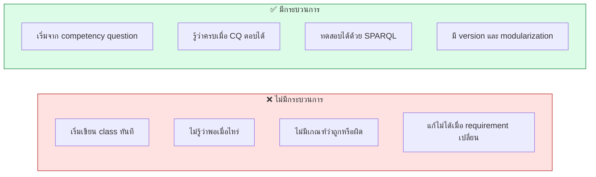
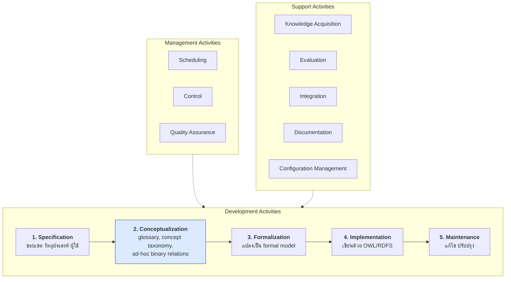
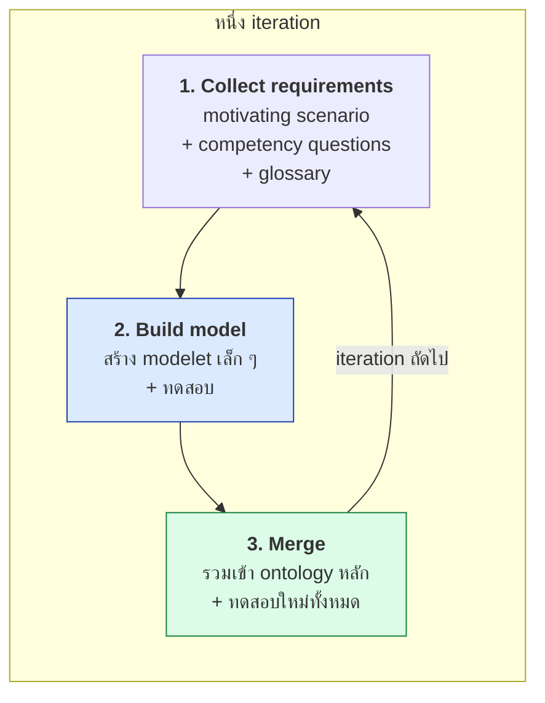
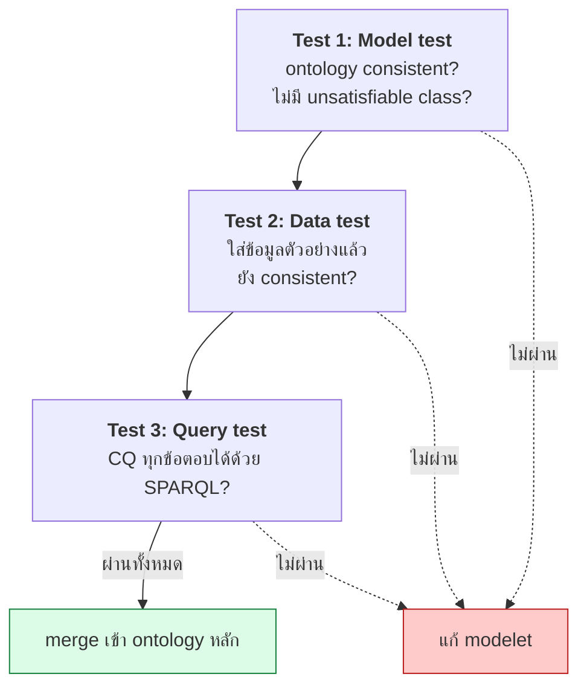
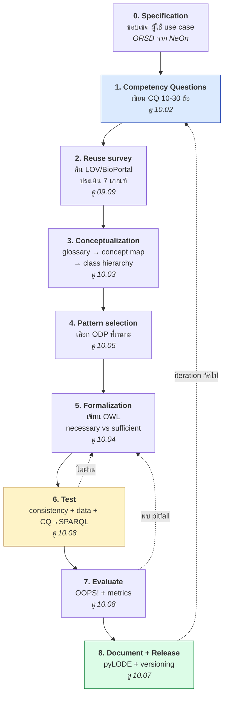
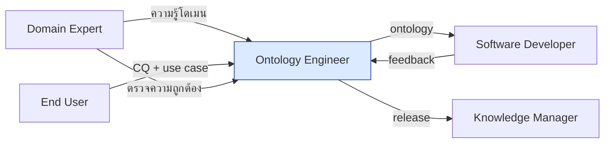

# 10.01 Ontology Engineering Methodology

การสร้าง ontology ที่ดีไม่ใช่การนั่งเขียน class ไปเรื่อย ๆ แต่เป็นกระบวนการวิศวกรรมที่มีขั้นตอนชัดเจน
บทนี้เปรียบเทียบ **methodology หลัก 3 ตัว** — METHONTOLOGY, NeOn และ SAMOD —
พร้อมสรุปเป็นกระบวนการที่ใช้ได้จริงในโครงการทั่วไป

---

## ทำไมต้องมี methodology



---

## METHONTOLOGY (1997)

**methodology แรกที่เป็นระบบ** พัฒนาที่ Universidad Politécnica de Madrid



### ขั้นตอน Conceptualization ของ METHONTOLOGY

METHONTOLOGY ระบุ **11 task ย่อย** ที่ต้องทำตามลำดับ

| # | Task | ผลลัพธ์ |
| --- | --- | --- |
| 1 | Glossary of terms | รายการคำศัพท์พร้อมนิยาม |
| 2 | Concept taxonomy | ลำดับชั้นของ concept |
| 3 | Ad-hoc binary relation diagram | ความสัมพันธ์ระหว่าง concept |
| 4 | Concept dictionary | instance, attribute, relation ของแต่ละ concept |
| 5 | Ad-hoc binary relation table | domain, range, cardinality |
| 6 | Instance attribute table | attribute ของ instance |
| 7 | Class attribute table | attribute ของ class |
| 8 | Constant table | ค่าคงที่ |
| 9 | Formal axiom table | axiom ที่เป็นทางการ |
| 10 | Rule table | กฎ |
| 11 | Instance table | instance จริง |

**จุดแข็ง**: ละเอียดมาก มี deliverable ชัดเจนทุกขั้น
**จุดอ่อน**: หนักและช้า ไม่เหมาะกับโครงการเล็กหรือ agile

---

## NeOn Methodology (2008)

**methodology สมัยใหม่ที่เน้นการ reuse** — ยอมรับว่าในโลกจริงเราไม่ได้สร้างจากศูนย์

### 9 Scenarios

```mermaid
flowchart TB
    S1["<b>Scenario 1</b><br/>สร้างจากศูนย์<br/><i>from specification</i>"]
    S2["<b>Scenario 2</b><br/>reuse ontological resource<br/><i>non-ontological → ontology</i>"]
    S3["<b>Scenario 3</b><br/>reuse ontological resource"]
    S4["<b>Scenario 4</b><br/>reuse + reengineer"]
    S5["<b>Scenario 5</b><br/>reuse + merge"]
    S6["<b>Scenario 6</b><br/>reuse + merge + reengineer"]
    S7["<b>Scenario 7</b><br/>reuse <b>ontology design pattern</b>"]
    S8["<b>Scenario 8</b><br/>restructuring"]
    S9["<b>Scenario 9</b><br/>localization (แปลหลายภาษา)"]

    style S3 fill:#dcfce7,stroke:#15803d
    style S7 fill:#dbeafe,stroke:#1e40af
```



| Scenario | ใช้เมื่อ |
| --- | --- |
| **1** | ไม่มีอะไรให้ reuse เลย (**หายากมาก**) |
| **2** | มีข้อมูลเดิม (database, thesaurus, CSV) ที่ต้องแปลง |
| **3** | มี ontology ที่ใช้ได้เลย — **scenario ที่พบบ่อยที่สุด** |
| **4** | มี ontology แต่ต้องปรับ |
| **5** | ต้องรวมหลาย ontology |
| **6** | รวมแล้วต้องปรับ |
| **7** | ใช้ **Ontology Design Pattern** (ดู [10.05](10.05-odp.md)) |
| **8** | ปรับโครงสร้าง ontology เดิม |
| **9** | เพิ่มภาษา |

### จุดเด่นของ NeOn

- **Ontology Requirements Specification Document (ORSD)** — เอกสารข้อกำหนดที่มี **competency question** เป็นแกน
- **เน้น reuse** ทั้ง ontology, design pattern และ non-ontological resource
- **Glossary of processes and activities** — นิยาม 59 กิจกรรมอย่างชัดเจน
- รองรับ **collaborative development** และ **networked ontologies**

**จุดแข็ง**: ยืดหยุ่น สมจริง เน้น reuse
**จุดอ่อน**: กว้างมากจนบางครั้งไม่รู้ว่าจะเริ่มตรงไหน

---

## SAMOD (2016)

**Simplified Agile Methodology for Ontology Development** — เน้น **agile และ test-driven**



### หลักการ 3 ข้อ

| หลักการ | รายละเอียด |
| --- | --- |
| **Test-driven** | เขียน CQ + ตัวอย่างข้อมูล **ก่อน** สร้าง model |
| **Small increments** | สร้าง **modelet** เล็ก ๆ ทีละส่วน ไม่ทำทั้งหมดพร้อมกัน |
| **Always working** | หลังทุก iteration ontology ต้องใช้งานได้และผ่านทุก test |

### 3 Test ที่ต้องผ่านทุก iteration



**จุดแข็ง**: เบา เร็ว ทดสอบได้ เหมาะกับทีมเล็ก
**จุดอ่อน**: ไม่ครอบคลุมเรื่อง governance และ collaborative development

---

## เปรียบเทียบทั้งสาม

| ประเด็น | **METHONTOLOGY** | **NeOn** | **SAMOD** |
| --- | --- | --- | --- |
| ปี | 1997 | 2008 | 2016 |
| แนวคิด | Waterfall | Scenario-based | **Agile / Test-driven** |
| ความหนัก | หนักมาก | ปานกลาง–หนัก | **เบา** |
| เน้น reuse | ❌ | **✅ มาก** | ⚠️ ปานกลาง |
| Competency Question | ⚠️ ไม่เน้น | **✅ เป็นแกน (ORSD)** | **✅ เป็นแกน + test** |
| Design Pattern | ❌ | **✅ Scenario 7** | ⚠️ |
| Iteration | ❌ | ⚠️ | **✅ ชัดเจน** |
| Testing | ⚠️ Evaluation activity | ⚠️ | **✅ 3 test ต่อ iteration** |
| Documentation | **✅ ละเอียด** | ✅ ORSD | ⚠️ |
| เหมาะกับ | โครงการใหญ่ องค์กรราชการ | โครงการที่ต้อง reuse เยอะ | **ทีมเล็ก งานเร็ว** |

---

## กระบวนการที่แนะนำสำหรับงานทั่วไป

**ผสมจุดแข็งของทั้งสาม** — โครงจาก SAMOD, reuse จาก NeOn, documentation จาก METHONTOLOGY



### Timeline ตัวอย่างสำหรับ ontology ขนาดกลาง (~100 class)

| Iteration | ระยะเวลา | ทำอะไร |
| --- | --- | --- |
| 0 | 1 สัปดาห์ | Specification + CQ ชุดแรก + reuse survey |
| 1 | 2 สัปดาห์ | Core concept (10–15 class) + test |
| 2 | 2 สัปดาห์ | Domain concept ชุดที่ 1 + test |
| 3 | 2 สัปดาห์ | Domain concept ชุดที่ 2 + test |
| 4 | 1 สัปดาห์ | Application-specific + test |
| 5 | 1 สัปดาห์ | Evaluation + documentation + release 1.0.0 |

---

## Ontology Requirements Specification Document (ORSD)

**เอกสารข้อกำหนดจาก NeOn** — เป็นสิ่งแรกที่ต้องเขียน

```markdown
# ORSD: University Ontology

## 1. Purpose
ให้ระบบสารสนเทศของมหาวิทยาลัยแลกเปลี่ยนข้อมูลนักศึกษา รายวิชา และบุคลากรได้
โดยไม่ต้องเขียน mapping ระหว่างระบบทีละคู่

## 2. Scope
**รวม**: นักศึกษา บุคลากร รายวิชา หน่วยงาน การลงทะเบียน ผลงานตีพิมพ์
**ไม่รวม**: การเงิน อาคารสถานที่ ระบบห้องสมุด (มี ontology แยก)

## 3. Implementation language
OWL 2 DL (ต้องการ reasoning สำหรับ automatic classification)

## 4. Intended end-users
- U1: ผู้พัฒนาระบบทะเบียน
- U2: ทีม data warehouse
- U3: นักวิจัยที่ต้องการ query ข้อมูลข้ามระบบ

## 5. Intended uses
- UC1: แลกเปลี่ยนข้อมูลนักศึกษาระหว่างระบบทะเบียนกับระบบห้องสมุด
- UC2: สร้างรายงานสถิติข้ามหน่วยงาน
- UC3: เผยแพร่ข้อมูลเปิดเป็น Linked Data

## 6. Ontology requirements

### 6.1 Non-functional requirements
- NFR1: ต้อง reuse FOAF, Dublin Core, ORG
- NFR2: label ต้องมีทั้งภาษาไทยและอังกฤษ
- NFR3: ต้องอยู่ใน OWL 2 DL (reasoning ได้ในไม่เกิน 10 วินาที)
- NFR4: license CC BY 4.0

### 6.2 Functional requirements (Competency Questions)
| # | CQ | Priority |
|---|-----|----------|
| CQ1 | นักศึกษาคนไหนลงเรียนวิชาระดับบัณฑิตศึกษา | High |
| CQ2 | อาจารย์คนไหนสอนมากกว่า 3 วิชา | High |
| CQ3 | แต่ละภาควิชามีนักศึกษากี่คน | High |
| ... | | |

## 7. Pre-glossary of terms
| Term | ความถี่ที่ปรากฏใน CQ |
|---|---|
| Student | 12 |
| Course | 10 |
| Professor | 7 |
| Department | 5 |
```

> 💡 **Pre-glossary สกัดจาก CQ โดยตรง** — คำที่ปรากฏบ่อยคือ concept หลัก

---

## ทีมและบทบาท

| บทบาท | หน้าที่ |
| --- | --- |
| **Ontology Engineer** | ออกแบบและเขียน ontology |
| **Domain Expert** | ให้ความรู้โดเมน ตรวจความถูกต้องเชิงความหมาย |
| **End User** | ให้ use case และ CQ ทดสอบว่าใช้งานได้จริง |
| **Software Developer** | นำ ontology ไปใช้ ให้ feedback เรื่อง usability |
| **Knowledge Manager** | ดูแล governance, versioning, release |



> ⚠️ **Domain expert ไม่ควรเขียน OWL เอง** — ให้เขาตรวจ **competency question** และ **natural language definition** แทน
> เพราะการเข้าใจ formal semantics เป็นทักษะคนละอย่าง

---

## Anti-pattern ของกระบวนการ

| ❌ Anti-pattern | ทำไมผิด | ✅ ควรทำ |
| --- | --- | --- |
| เริ่มเขียน class ทันที | ไม่รู้ว่าต้องการอะไร | เขียน CQ ก่อน |
| ทำให้ครบทุกอย่างก่อนปล่อย | ไม่มีวันเสร็จ | ปล่อย version 0.1 แล้ว iterate |
| ไม่มี test | ไม่รู้ว่าถูกหรือผิด | แปลง CQ เป็น SPARQL test |
| สร้างทุกอย่างเอง | เสียเวลา ไม่ interoperable | reuse ก่อน |
| domain expert เขียน OWL | เข้าใจ semantics ผิด | ให้เขาตรวจ CQ แทน |
| ไม่ document การตัดสินใจ | คนถัดไปแก้ต่อไม่ได้ | เขียน `rdfs:comment` อธิบายเหตุผล |
| ไม่มี version | ผู้ใช้เดิมพัง | ใช้ semantic versioning |

---

## Key Points

- **METHONTOLOGY** (1997) เป็น waterfall ที่ละเอียดมาก — เหมาะกับโครงการใหญ่ที่ต้องการ documentation ครบ
- **NeOn** (2008) เน้น **reuse** ผ่าน 9 scenario และมี **ORSD** ที่ใช้ competency question เป็นแกน
- **SAMOD** (2016) เป็น **agile + test-driven** — สร้าง modelet เล็ก ๆ แล้วผ่าน 3 test ทุก iteration
- **3 test ของ SAMOD**: model test (consistency), data test (ใส่ข้อมูลแล้วยัง consistent), query test (CQ ตอบได้)
- กระบวนการที่แนะนำ: **specification → CQ → reuse survey → conceptualization → pattern → formalization → test → evaluate → document**
- **ORSD** ควรมี: purpose, scope, language, users, uses, non-functional requirements, **competency questions**, pre-glossary
- **Pre-glossary สกัดจาก CQ** — คำที่ปรากฏบ่อยคือ concept หลัก
- ⚠️ **domain expert ไม่ควรเขียน OWL เอง** — ให้ตรวจ CQ และนิยามภาษาธรรมชาติแทน
- **ปล่อย version 0.1 แล้ว iterate** ดีกว่ารอให้ครบทุกอย่าง
