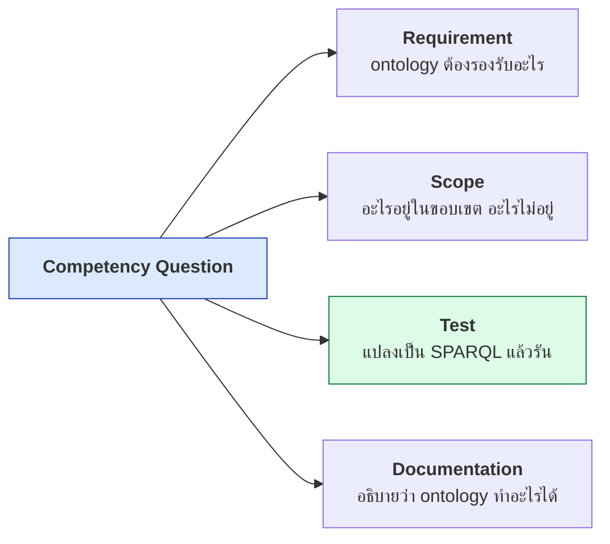
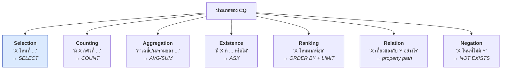
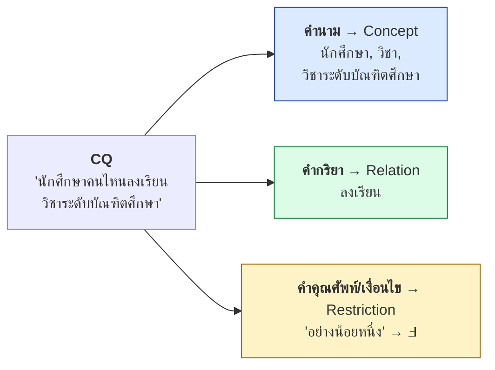
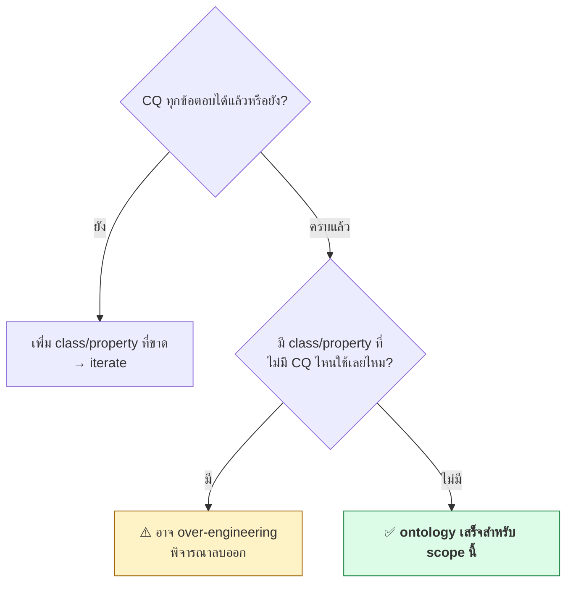
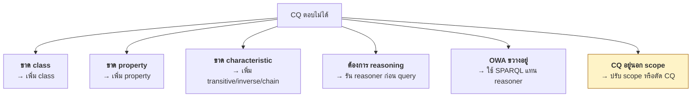

# 10.02 Competency Questions

**Competency Question (CQ)** คือคำถามที่ ontology ต้องตอบได้ — เป็นทั้ง **ข้อกำหนด**, **ขอบเขต** และ **เกณฑ์ทดสอบ**
ในเวลาเดียวกัน บทนี้สอนวิธีเขียน CQ ที่ดี แปลง CQ เป็น SPARQL test และใช้ CQ กำหนดว่า ontology "เสร็จ" เมื่อไหร่

---

## CQ คืออะไร



> 💡 **CQ เป็นแนวคิดจาก Grüninger & Fox (1995)** และเป็นแกนของทั้ง NeOn และ SAMOD

---

## CQ ที่ดีเป็นอย่างไร

| เกณฑ์ | ✅ ดี | ❌ ไม่ดี |
| --- | --- | --- |
| **ตอบได้ด้วยข้อมูล** | "นักศึกษาคนไหนลงเรียนวิชาระดับบัณฑิต" | "ontology นี้ดีไหม" |
| **เฉพาะเจาะจง** | "อาจารย์คนไหนสอนมากกว่า 3 วิชาในเทอมนี้" | "ข้อมูลอาจารย์" |
| **มีคำตอบที่ตรวจได้** | คืนรายชื่อที่นับได้ | คืน "ขึ้นอยู่กับ" |
| **ระบุ concept และ relation** | Student, Course, enrolledIn | คำกว้าง ๆ |
| **มาจาก use case จริง** | ผู้ใช้ถามจริง | คิดขึ้นเอง |
| **ไม่ผูกกับ implementation** | "หาวิชาที่ไม่มีคนสอน" | "SELECT จากตาราง courses" |

### รูปแบบคำถามที่ใช้บ่อย



---

## ตัวอย่าง CQ 10 ข้อ (โดเมนมหาวิทยาลัย)

| # | Competency Question | ประเภท | Priority |
| --- | --- | --- | --- |
| **CQ1** | นักศึกษาคนไหนลงเรียนวิชาระดับบัณฑิตศึกษาอย่างน้อยหนึ่งวิชา | Selection | High |
| **CQ2** | อาจารย์คนไหนสอนมากกว่า 3 วิชา | Counting | High |
| **CQ3** | แต่ละภาควิชามีนักศึกษากี่คน | Aggregation | High |
| **CQ4** | มีรายวิชาที่ไม่มีอาจารย์สอนหรือไม่ | Existence | Medium |
| **CQ5** | นักศึกษาคนไหนมี GPA สูงสุด 5 อันดับแรก | Ranking | Medium |
| **CQ6** | นักศึกษาคนหนึ่งสังกัดหน่วยงานใดบ้าง (ทุกระดับ) | Relation | High |
| **CQ7** | นักศึกษาคนไหนที่ยังไม่มีอาจารย์ที่ปรึกษา | Negation | High |
| **CQ8** | หน่วยกิตรวมที่นักศึกษาแต่ละคนลงทะเบียนในเทอมนี้ | Aggregation | High |
| **CQ9** | อาจารย์คนไหนเป็นผู้สอนของนักศึกษาคนหนึ่ง (ผ่านรายวิชา) | Relation | Medium |
| **CQ10** | ผลงานตีพิมพ์ของแต่ละภาควิชาในปีที่ผ่านมามีกี่ชิ้น | Aggregation | Low |

---

## สกัด Concept และ Relation จาก CQ

**นี่คือขั้นตอนที่สำคัญที่สุด** — CQ บอกว่าต้องมี concept และ relation อะไร

### วิธีทำ



### ตารางสกัด

| CQ | Concept | Relation | Restriction / Function |
| --- | --- | --- | --- |
| CQ1 | Student, GraduateCourse | enrolledIn | `∃enrolledIn.GraduateCourse` |
| CQ2 | Professor, Course | teaches | `COUNT > 3` |
| CQ3 | Department, Student | memberOf | `COUNT`, `GROUP BY` |
| CQ4 | Course, Professor | teaches | `NOT EXISTS` |
| CQ5 | Student | hasGPA | `ORDER BY DESC`, `LIMIT 5` |
| CQ6 | Student, Organization | memberOf, partOf | `partOf*` (transitive) |
| CQ7 | Student, Professor | hasSupervisor | `NOT EXISTS` |
| CQ8 | Student, Course | enrolledIn, credits | `SUM`, `GROUP BY` |
| CQ9 | Professor, Student, Course | teaches, enrolledIn | **property chain** |
| CQ10 | Department, Publication | authorOf, memberOf, issued | `COUNT`, `FILTER(YEAR)` |

### Pre-glossary จากความถี่

```python
from collections import Counter

CQS = [
    "นักศึกษาคนไหนลงเรียนวิชาระดับบัณฑิตศึกษาอย่างน้อยหนึ่งวิชา",
    "อาจารย์คนไหนสอนมากกว่า 3 วิชา",
    "แต่ละภาควิชามีนักศึกษากี่คน",
    # ...
]

CONCEPTS = ["นักศึกษา", "วิชา", "อาจารย์", "ภาควิชา", "ผลงานตีพิมพ์", "หน่วยกิต"]

counts = Counter()
for cq in CQS:
    for concept in CONCEPTS:
        if concept in cq:
            counts[concept] += 1

for concept, n in counts.most_common():
    print(f"{concept:16s} {n}")
```

Expected output:

```
นักศึกษา          7
วิชา              6
อาจารย์           4
ภาควิชา           3
หน่วยกิต          1
ผลงานตีพิมพ์      1
```

> 💡 **concept ที่ปรากฏบ่อยที่สุดคือ core concept** — ควรออกแบบให้ดีที่สุด

---

## แปลง CQ เป็น SPARQL

**นี่คือสิ่งที่ทำให้ CQ กลายเป็น test ที่รันได้จริง**

### CQ1 — Selection

> **CQ1**: นักศึกษาคนไหนลงเรียนวิชาระดับบัณฑิตศึกษาอย่างน้อยหนึ่งวิชา

```sparql
PREFIX uni:  <http://example.org/university#>
PREFIX rdfs: <http://www.w3.org/2000/01/rdf-schema#>

SELECT DISTINCT ?student ?name
WHERE {
  ?student a uni:Student ;
           rdfs:label ?name ;
           uni:enrolledIn ?course .
  ?course a uni:GraduateCourse .
}
```

**ontology ต้องมี**: `uni:Student`, `uni:GraduateCourse`, `uni:enrolledIn`

### CQ2 — Counting

> **CQ2**: อาจารย์คนไหนสอนมากกว่า 3 วิชา

```sparql
PREFIX uni:  <http://example.org/university#>
PREFIX rdfs: <http://www.w3.org/2000/01/rdf-schema#>

SELECT ?name (COUNT(DISTINCT ?course) AS ?n)
WHERE {
  ?prof a uni:Professor ;
        rdfs:label ?name ;
        uni:teaches ?course .
}
GROUP BY ?name
HAVING (COUNT(DISTINCT ?course) > 3)
```

### CQ4 — Existence

> **CQ4**: มีรายวิชาที่ไม่มีอาจารย์สอนหรือไม่

```sparql
PREFIX uni: <http://example.org/university#>

ASK {
  ?course a uni:Course .
  FILTER NOT EXISTS { ?prof uni:teaches ?course }
}
```

### CQ6 — Relation (property path)

> **CQ6**: นักศึกษาคนหนึ่งสังกัดหน่วยงานใดบ้าง (ทุกระดับ)

```sparql
PREFIX uni:  <http://example.org/university#>
PREFIX rdfs: <http://www.w3.org/2000/01/rdf-schema#>

SELECT ?orgName
WHERE {
  uni:alice uni:memberOf/uni:partOf* ?org .
  ?org rdfs:label ?orgName .
}
```

**ontology ต้องมี**: `uni:partOf` ที่เป็น **transitive**

### CQ7 — Negation

> **CQ7**: นักศึกษาคนไหนที่ยังไม่มีอาจารย์ที่ปรึกษา

```sparql
PREFIX uni:  <http://example.org/university#>
PREFIX rdfs: <http://www.w3.org/2000/01/rdf-schema#>

SELECT ?name
WHERE {
  ?student a uni:Student ; rdfs:label ?name .
  FILTER NOT EXISTS { ?student uni:hasSupervisor ?sup }
}
```

> ⚠️ **CQ ประเภท negation ตอบด้วย SPARQL ได้ (closed world) แต่ OWL reasoner ตอบไม่ได้ (open world)**
> ทบทวนจาก [05.07](../05-knowledge-management/05.07-reasoning-over-kb.md)

### CQ9 — Property chain

> **CQ9**: อาจารย์คนไหนเป็นผู้สอนของนักศึกษาคนหนึ่ง

```sparql
PREFIX uni:  <http://example.org/university#>
PREFIX rdfs: <http://www.w3.org/2000/01/rdf-schema#>

# แบบที่ 1: เขียน path เอง
SELECT DISTINCT ?profName
WHERE {
  ?prof uni:teaches ?course ;
        rdfs:label ?profName .
  uni:alice uni:enrolledIn ?course .
}

# แบบที่ 2: ใช้ property chain ที่ประกาศไว้ใน ontology
SELECT DISTINCT ?profName
WHERE {
  ?prof uni:instructorOf uni:alice ;
        rdfs:label ?profName .
}
```

**ontology ต้องมี**: `uni:instructorOf owl:propertyChainAxiom ( uni:teaches uni:hasStudent )`

---

## CQ Test Suite

**เก็บ CQ + SPARQL + expected result ไว้เป็นชุดทดสอบ**

```python
"""cq_tests.py -- ชุดทดสอบ competency question"""

from dataclasses import dataclass, field
from typing import Any, Callable, List, Optional

from rdflib import Graph


@dataclass
class CQTest:
    """หนึ่ง competency question พร้อม test"""
    cq_id: str
    question: str
    sparql: str
    priority: str = "Medium"
    # เกณฑ์ผ่าน: ระบุอย่างใดอย่างหนึ่ง
    min_results: Optional[int] = None
    exact_results: Optional[int] = None
    expect_ask: Optional[bool] = None
    validator: Optional[Callable[[List[Any]], bool]] = None
    required_terms: List[str] = field(default_factory=list)


PREFIXES = """
PREFIX uni:  <http://example.org/university#>
PREFIX rdf:  <http://www.w3.org/1999/02/22-rdf-syntax-ns#>
PREFIX rdfs: <http://www.w3.org/2000/01/rdf-schema#>
PREFIX owl:  <http://www.w3.org/2002/07/owl#>
PREFIX xsd:  <http://www.w3.org/2001/XMLSchema#>
"""

CQ_TESTS = [
    CQTest(
        cq_id="CQ1",
        question="นักศึกษาคนไหนลงเรียนวิชาระดับบัณฑิตศึกษาอย่างน้อยหนึ่งวิชา",
        sparql="""
            SELECT DISTINCT ?student ?name WHERE {
              ?student a uni:Student ; rdfs:label ?name ; uni:enrolledIn ?c .
              ?c a uni:GraduateCourse .
            }
        """,
        priority="High",
        min_results=1,
        required_terms=["uni:Student", "uni:GraduateCourse", "uni:enrolledIn"],
    ),
    CQTest(
        cq_id="CQ2",
        question="อาจารย์คนไหนสอนมากกว่า 2 วิชา",
        sparql="""
            SELECT ?name (COUNT(DISTINCT ?c) AS ?n) WHERE {
              ?p a uni:Professor ; rdfs:label ?name ; uni:teaches ?c .
            }
            GROUP BY ?name
            HAVING (COUNT(DISTINCT ?c) > 2)
        """,
        priority="High",
        min_results=1,
    ),
    CQTest(
        cq_id="CQ4",
        question="มีรายวิชาที่ไม่มีอาจารย์สอนหรือไม่",
        sparql="""
            ASK {
              ?c uni:courseCode ?code .
              FILTER NOT EXISTS { ?p uni:teaches ?c }
            }
        """,
        priority="Medium",
        expect_ask=True,
    ),
    CQTest(
        cq_id="CQ6",
        question="นักศึกษาคนหนึ่งสังกัดหน่วยงานใดบ้าง (ทุกระดับ)",
        sparql="""
            SELECT ?orgName WHERE {
              uni:alice uni:memberOf/uni:partOf* ?org .
              ?org rdfs:label ?orgName .
            }
        """,
        priority="High",
        min_results=2,       # อย่างน้อยภาควิชา + คณะ
        required_terms=["uni:memberOf", "uni:partOf"],
    ),
    CQTest(
        cq_id="CQ7",
        question="นักศึกษาคนไหนที่ยังไม่มีอาจารย์ที่ปรึกษา",
        sparql="""
            SELECT ?name WHERE {
              ?s a uni:Student ; rdfs:label ?name .
              FILTER NOT EXISTS { ?s uni:hasSupervisor ?sup }
            }
        """,
        priority="High",
        min_results=1,
    ),
    CQTest(
        cq_id="CQ8",
        question="หน่วยกิตรวมที่นักศึกษาแต่ละคนลงทะเบียน",
        sparql="""
            SELECT ?name (SUM(?cr) AS ?total) WHERE {
              ?s a uni:Student ; rdfs:label ?name ; uni:enrolledIn ?c .
              ?c uni:credits ?cr .
            }
            GROUP BY ?name
        """,
        priority="High",
        min_results=1,
    ),
]


def run_cq_tests(graph: Graph, tests: List[CQTest]) -> tuple:
    """รันชุดทดสอบ CQ; คืน (passed, failed, details)"""
    passed, failed, details = 0, 0, []

    for test in tests:
        try:
            result = graph.query(PREFIXES + test.sparql)

            if test.expect_ask is not None:
                ok = bool(result) == test.expect_ask
                count = "true" if bool(result) else "false"
            else:
                rows = list(result)
                count = len(rows)
                ok = True
                if test.min_results is not None:
                    ok = ok and count >= test.min_results
                if test.exact_results is not None:
                    ok = ok and count == test.exact_results
                if test.validator is not None:
                    ok = ok and test.validator(rows)

            mark = "✅" if ok else "❌"
            passed += ok
            failed += not ok
            details.append((test, ok, count, None))

        except Exception as exc:                      # noqa: BLE001
            failed += 1
            details.append((test, False, 0, str(exc)[:80]))

    return passed, failed, details


def report(passed: int, failed: int, details: list) -> None:
    print("=" * 76)
    print("  COMPETENCY QUESTION TESTS")
    print("=" * 76)
    for test, ok, count, error in details:
        mark = "✅" if ok else "❌"
        print(f"  {mark} {test.cq_id:5s} [{test.priority:6s}] {test.question}")
        if error:
            print(f"        ⚠️ error: {error}")
        else:
            print(f"        ผลลัพธ์: {count}")
    total = passed + failed
    print(f"\n  ผ่าน {passed}/{total} ({passed / total:.0%})")
```

Expected output (รันบน `data/university.ttl` **ก่อน** reasoning):

```
============================================================================
  COMPETENCY QUESTION TESTS
============================================================================
  ✅ CQ1   [High  ] นักศึกษาคนไหนลงเรียนวิชาระดับบัณฑิตศึกษาอย่างน้อยหนึ่งวิชา
        ผลลัพธ์: 1
  ✅ CQ2   [High  ] อาจารย์คนไหนสอนมากกว่า 2 วิชา
        ผลลัพธ์: 1
  ✅ CQ4   [Medium] มีรายวิชาที่ไม่มีอาจารย์สอนหรือไม่
        ผลลัพธ์: true
  ❌ CQ6   [High  ] นักศึกษาคนหนึ่งสังกัดหน่วยงานใดบ้าง (ทุกระดับ)
        ผลลัพธ์: 1
  ✅ CQ7   [High  ] นักศึกษาคนไหนที่ยังไม่มีอาจารย์ที่ปรึกษา
        ผลลัพธ์: 3
  ✅ CQ8   [High  ] หน่วยกิตรวมที่นักศึกษาแต่ละคนลงทะเบียน
        ผลลัพธ์: 3

  ผ่าน 5/6 (83%)
```

> ⚠️ **CQ6 ไม่ผ่านเพราะ `partOf*` ต้องมีข้อมูล transitive ครบ** — ต้องรัน reasoner ก่อน
> หรือใช้ `uni:partOf+` ที่ SPARQL คำนวณเอง

---

## CQ กำหนดว่า ontology "เสร็จ" เมื่อไหร่



### ตรวจ over-engineering

```python
from rdflib import Graph
from rdflib.namespace import OWL, RDF, RDFS


def find_unused_terms(ontology: Graph, cq_sparql_list: list, namespace: str) -> set:
    """หา term ที่ไม่มี CQ ไหนใช้เลย"""
    classes = {
        str(c) for c in ontology.subjects(RDF.type, OWL.Class)
        if str(c).startswith(namespace)
    }
    props = {
        str(p) for p in
        set(ontology.subjects(RDF.type, OWL.ObjectProperty))
        | set(ontology.subjects(RDF.type, OWL.DatatypeProperty))
        if str(p).startswith(namespace)
    }
    all_terms = classes | props

    used = set()
    for sparql in cq_sparql_list:
        for term in all_terms:
            local = term.split("#")[-1]
            if f"uni:{local}" in sparql or f"<{term}>" in sparql:
                used.add(term)

    return all_terms - used


unused = find_unused_terms(
    Graph().parse("code/ch05/university_tbox.ttl", format="turtle"),
    [t.sparql for t in CQ_TESTS],
    "http://example.org/university#",
)

print(f"term ที่ไม่มี CQ ใช้: {len(unused)}")
for term in sorted(unused)[:15]:
    print(f"  {term.split('#')[-1]}")
```

Expected output:

```
term ที่ไม่มี CQ ใช้: 27
  Agent
  AdminStaff
  Degree
  Doctorate
  Faculty
  Publication
  Supervisor
  authorOf
  colleagueOf
  ...
```

> 💡 **ไม่ได้แปลว่าต้องลบทั้งหมด** — บางตัวเป็นโครงสร้างที่จำเป็น (เช่น `Agent`)
> แต่ควร **ถามตัวเองว่าทำไมถึงมี** และเพิ่ม CQ ให้ครอบคลุมถ้าจำเป็นจริง

---

## CQ ที่ตอบไม่ได้บอกอะไร



### ตัวอย่างการวินิจฉัย

| CQ ที่ตอบไม่ได้ | สาเหตุ | ทางแก้ |
| --- | --- | --- |
| "นักศึกษาสังกัดหน่วยงานใดบ้าง (ทุกระดับ)" | `partOf` ไม่ transitive | เพิ่ม `owl:TransitiveProperty` หรือใช้ `partOf+` |
| "อาจารย์คนไหนเป็นผู้สอนของนักศึกษา" | ไม่มี property เชื่อมตรง | เพิ่ม `owl:propertyChainAxiom` |
| "วิชาไหนไม่มีคนสอน" | reasoner ตอบไม่ได้ (OWA) | ใช้ SPARQL `NOT EXISTS` |
| "นักศึกษาคนไหนจ่ายค่าเทอมแล้ว" | ไม่มีใน scope | ตัด CQ หรือขยาย scope |

---

## Template สำหรับเอกสาร CQ

```markdown
## CQ Catalogue

| # | Competency Question | Type | Priority | Concepts | Relations | Status |
|---|---------------------|------|----------|----------|-----------|--------|
| CQ1 | นักศึกษาคนไหนลงเรียนวิชาระดับบัณฑิต | Selection | High | Student, GraduateCourse | enrolledIn | ✅ |
| CQ2 | อาจารย์คนไหนสอนมากกว่า 3 วิชา | Counting | High | Professor, Course | teaches | ✅ |
| CQ3 | แต่ละภาควิชามีนักศึกษากี่คน | Aggregation | High | Department, Student | memberOf | ✅ |
| CQ4 | มีวิชาที่ไม่มีคนสอนหรือไม่ | Existence | Medium | Course, Professor | teaches | ✅ |
| CQ5 | GPA สูงสุด 5 อันดับ | Ranking | Medium | Student | hasGPA | ✅ |
| CQ6 | สังกัดหน่วยงานทุกระดับ | Relation | High | Student, Organization | memberOf, partOf⁺ | ⚠️ ต้องการ reasoning |
| CQ7 | นักศึกษาที่ไม่มีที่ปรึกษา | Negation | High | Student, Professor | hasSupervisor | ✅ |
| CQ8 | หน่วยกิตรวมต่อคน | Aggregation | High | Student, Course | enrolledIn, credits | ✅ |
| CQ9 | ผู้สอนของนักศึกษา | Relation | Medium | Professor, Student | instructorOf (chain) | ✅ |
| CQ10 | ผลงานตีพิมพ์ต่อภาควิชา | Aggregation | Low | Department, Publication | authorOf, memberOf | ❌ ยังไม่รองรับ |

**สรุป**: 8/10 ผ่าน (80%)
**ต้องทำต่อ**: CQ6 (เพิ่ม transitive), CQ10 (เพิ่ม property เชื่อม publication กับ department)
```

---

## CQ ใน CI Pipeline

```python
#!/usr/bin/env python
"""test_cq.py -- ใช้ใน CI; exit code 1 เมื่อ CQ สำคัญไม่ผ่าน"""

import sys
from pathlib import Path

from rdflib import Graph

from cq_tests import CQ_TESTS, report, run_cq_tests

TBOX = Path("onto/university-tbox.ttl")
ABOX = Path("tests/fixtures/sample-abox.ttl")


def main() -> int:
    g = Graph()
    g.parse(TBOX, format="turtle")
    g.parse(ABOX, format="turtle")

    # รัน reasoner ก่อนทดสอบ (บาง CQ ต้องการ)
    try:
        import owlrl
        owlrl.DeductiveClosure(owlrl.RDFS_Semantics).expand(g)
    except ImportError:
        print("⚠️ ไม่ได้ติดตั้ง owlrl -- บาง CQ อาจไม่ผ่าน")

    passed, failed, details = run_cq_tests(g, CQ_TESTS)
    report(passed, failed, details)

    # ⚠️ fail เฉพาะเมื่อ CQ priority High ไม่ผ่าน
    high_failed = [
        test.cq_id for test, ok, _, _ in details
        if not ok and test.priority == "High"
    ]
    if high_failed:
        print(f"\n❌ CQ priority High ที่ไม่ผ่าน: {high_failed}")
        return 1

    print("\n✅ CQ priority High ผ่านทั้งหมด")
    return 0


if __name__ == "__main__":
    sys.exit(main())
```

---

## ⚠️ ข้อควรระวัง

| ประเด็น | รายละเอียด |
| --- | --- |
| **CQ ต้องมาจากผู้ใช้จริง** | อย่าคิดขึ้นเอง — สัมภาษณ์ผู้ใช้ |
| **CQ negation ต้องใช้ SPARQL** | OWL reasoner ตอบไม่ได้เพราะ OWA |
| **CQ บางข้อต้องการ reasoning** | ต้องรัน reasoner ก่อน query |
| **อย่าเขียน CQ ที่ผูกกับ implementation** | "SELECT จากตาราง X" ไม่ใช่ CQ |
| **CQ ควรมี priority** | ไม่ใช่ทุกข้อสำคัญเท่ากัน |
| **ทบทวน CQ ทุก iteration** | requirement เปลี่ยนได้ |

---

## Key Points

- **CQ เป็นทั้ง requirement, scope, test และ documentation** ในเวลาเดียวกัน
- CQ ที่ดีต้อง **ตอบได้ด้วยข้อมูล**, **เฉพาะเจาะจง**, **ตรวจได้** และ **มาจาก use case จริง**
- CQ มี 7 ประเภท: **selection, counting, aggregation, existence, ranking, relation, negation**
- **สกัด concept จากคำนาม, relation จากคำกริยา, restriction จากเงื่อนไข** ใน CQ
- **Pre-glossary จากความถี่** — concept ที่ปรากฏบ่อยคือ core concept
- **แปลง CQ เป็น SPARQL** ทำให้กลายเป็น test ที่รันได้จริงใน CI
- ⚠️ **CQ ประเภท negation ต้องใช้ SPARQL** เพราะ OWL reasoner ตอบไม่ได้ (OWA)
- **ontology เสร็จเมื่อ CQ ทุกข้อตอบได้** — และ term ที่ไม่มี CQ ใช้อาจเป็น over-engineering
- CQ ที่ตอบไม่ได้บอกว่าขาด **class / property / characteristic / reasoning** หรืออยู่นอก scope
