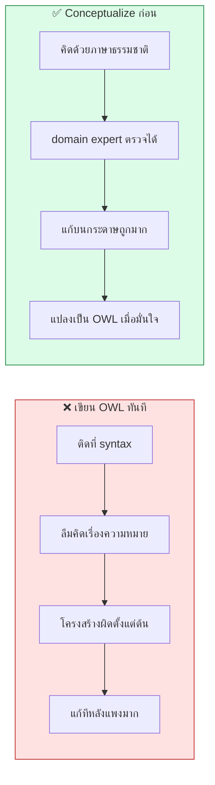
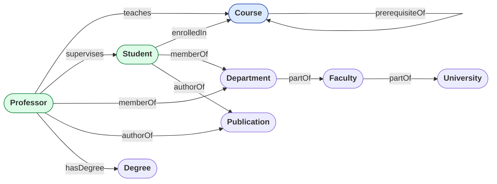
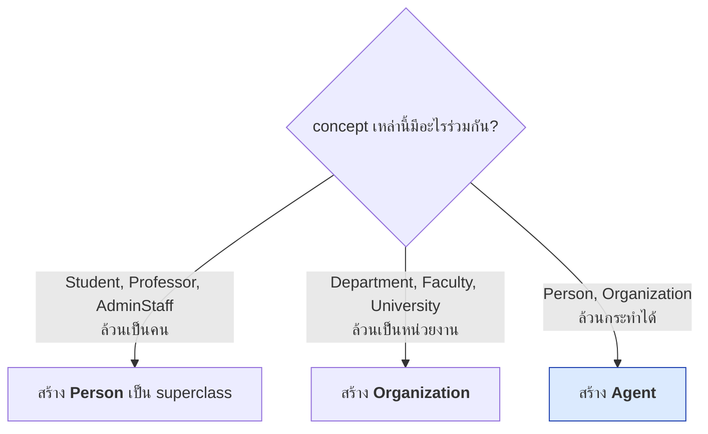
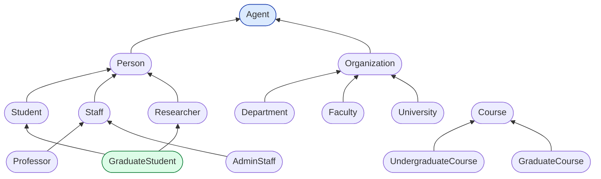
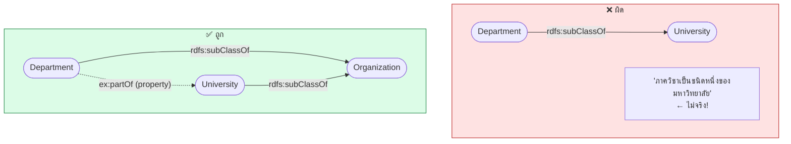
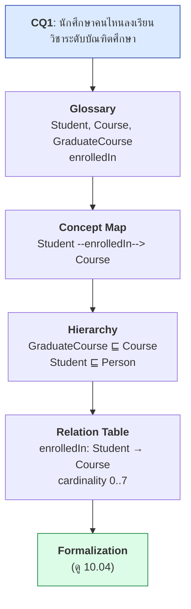

# 10.03 Conceptualization

**Conceptualization** คือขั้นตอนที่แปลง competency question เป็น **โครงสร้างแนวคิด** ก่อนเขียน OWL
ประกอบด้วยการกำหนด domain/scope, สร้าง glossary, วาด concept map และจัดเป็น class hierarchy
ขั้นนี้ทำบนกระดาษหรือ diagram — **ยังไม่แตะ Turtle**

---

## ทำไมต้องแยกขั้นนี้ออกมา



---

## ขั้นที่ 1: Domain และ Scope

### คำถามที่ต้องตอบ

| คำถาม | ตัวอย่างคำตอบ |
| --- | --- |
| **โดเมนอะไร** | การจัดการข้อมูลการศึกษาในมหาวิทยาลัย |
| **จะใช้ทำอะไร** | แลกเปลี่ยนข้อมูลระหว่างระบบทะเบียน ห้องสมุด และวิจัย |
| **ใครใช้** | นักพัฒนาระบบ, ทีม data warehouse, นักวิจัย |
| **ตอบคำถามอะไรได้** | (จาก CQ ใน [10.02](10.02-competency-questions.md)) |
| **ใครดูแล** | ทีม Enterprise Architecture |

### กำหนดขอบเขตให้ชัด

```markdown
## Scope

### ✅ อยู่ในขอบเขต
- นักศึกษา บุคลากร และบทบาทของแต่ละคน
- รายวิชา หลักสูตร และการลงทะเบียน
- โครงสร้างหน่วยงาน (มหาวิทยาลัย → คณะ → ภาควิชา)
- ผลงานตีพิมพ์และการเชื่อมกับผู้แต่ง

### ❌ ไม่อยู่ในขอบเขต
- การเงินและค่าเล่าเรียน → ใช้ ontology การเงินแยก
- อาคารสถานที่และห้องเรียน → ใช้ ontology สถานที่แยก
- รายละเอียดของหนังสือในห้องสมุด → ใช้ BIBFRAME
- ตารางสอนรายชั่วโมง → ระบบ scheduling แยก

### ⚠️ ขอบเขตที่ต้องตัดสินใจ
- "ศิษย์เก่า" นับเป็น Student หรือไม่ → **ตัดสินใจ: แยกเป็น Alumnus**
- "อาจารย์พิเศษ" เป็น Staff หรือไม่ → **ตัดสินใจ: เป็น Staff แต่มี Role ต่างกัน**
```

> 💡 **เขียนสิ่งที่ "ไม่อยู่ในขอบเขต" ให้ชัดเจน** สำคัญพอ ๆ กับสิ่งที่อยู่ในขอบเขต
> เพราะเป็นสิ่งที่ป้องกัน scope creep

---

## ขั้นที่ 2: Glossary of Terms

**สกัดจาก CQ โดยตรง** แล้วให้ domain expert ตรวจ

| Term | นิยาม (ภาษาธรรมชาติ) | ตัวอย่าง | Synonym | ⚠️ ไม่รวม |
| --- | --- | --- | --- | --- |
| **Student** | บุคคลที่ได้รับอนุมัติให้เข้าศึกษาในหลักสูตรและยังไม่สำเร็จการศึกษา | Alice Johnson | ผู้เรียน, นักศึกษา | ศิษย์เก่า, ผู้เข้าอบรมระยะสั้น |
| **Course** | หน่วยการสอนที่จัดในหนึ่งภาคการศึกษา มีรหัสวิชาและหน่วยกิต | CS501 Knowledge Graphs | รายวิชา, กระบวนวิชา | หลักสูตร (Programme), การอบรม |
| **Professor** | บุคลากรสายวิชาการที่มีวุฒิปริญญาเอกและทำหน้าที่สอน | Prof. Jane Smith | อาจารย์ | อาจารย์พิเศษ, ผู้ช่วยสอน |
| **Department** | หน่วยงานวิชาการที่อยู่ภายใต้คณะ | Dept. of Computer Science | ภาควิชา, สาขาวิชา | ศูนย์วิจัย, หน่วยงานสนับสนุน |
| **Enrollment** | การที่นักศึกษาลงทะเบียนเรียนวิชาหนึ่งในภาคการศึกษาหนึ่ง | Alice ลง CS501 เทอม 2/2567 | การลงทะเบียน | การสมัครเข้าเรียน |

### Glossary ของ Relation

| Relation | นิยาม | Domain → Range | ตัวอย่าง |
| --- | --- | --- | --- |
| **enrolledIn** | นักศึกษากำลังเรียนวิชานี้ในภาคการศึกษาปัจจุบัน | Student → Course | alice enrolledIn cs501 |
| **teaches** | อาจารย์เป็นผู้สอนหลักของวิชานี้ | Professor → Course | profSmith teaches cs501 |
| **memberOf** | บุคคลสังกัดหน่วยงานนี้ | Person → Organization | alice memberOf csDept |
| **partOf** | หน่วยงานย่อยอยู่ภายใต้หน่วยงานใหญ่ | Organization → Organization | csDept partOf engFaculty |

### ⚠️ นิยามที่ดีต้องบอก "ไม่รวมอะไร"

```markdown
❌ นิยามไม่ดี:
   Student = คนที่เรียน

✅ นิยามดี:
   Student = บุคคลที่ได้รับอนุมัติให้เข้าศึกษาในหลักสูตรระดับปริญญา
             และยังไม่สำเร็จการศึกษา
             ⚠️ ไม่รวม: ศิษย์เก่า (ใช้ Alumnus),
                        ผู้เข้าอบรมระยะสั้น (ใช้ TrainingParticipant),
                        นักศึกษาแลกเปลี่ยนที่ยังไม่ลงทะเบียน
```

---

## ขั้นที่ 3: Concept Map

**วาดความสัมพันธ์ระหว่าง concept ก่อนจัดลำดับชั้น**



> 💡 **concept map วาดกับ domain expert ได้** — เขาอ่านและแก้ได้โดยไม่ต้องรู้ OWL

---

## ขั้นที่ 4: Concept Map → Class Hierarchy

### วิธีหา superclass



### ผลลัพธ์: Class Hierarchy



### กฎการจัดลำดับชั้น

| กฎ | รายละเอียด |
| --- | --- |
| **is-a เท่านั้น** | `A subClassOf B` = "ทุก A เป็น B" ไม่ใช่ "A เป็นส่วนหนึ่งของ B" |
| **ลึกไม่เกิน 5–6 ชั้น** | ลึกกว่านั้นอ่านยากและ reasoning ช้า |
| **sibling ต้อง disjoint** | ถ้าไม่ disjoint ให้ทบทวนว่าควรเป็น sibling จริงหรือ |
| **ทุก class ต้องมีเหตุผล** | ถ้าไม่มี CQ ไหนใช้ อาจไม่จำเป็น |
| **หลีกเลี่ยง class ที่มี instance เดียว** | ควรเป็น individual ไม่ใช่ class |

### ⚠️ อย่าสับสน is-a กับ part-of



| ความสัมพันธ์ | ใช้ |
| --- | --- |
| "A เป็นชนิดหนึ่งของ B" | `rdfs:subClassOf` |
| "A เป็นส่วนหนึ่งของ B" | property เช่น `ex:partOf` |
| "A เป็นสมาชิกของ B" | property เช่น `ex:memberOf` |
| "A มีบทบาทเป็น B" | ODP: **AgentRole** (ดู [10.05](10.05-odp.md)) |

---

## ขั้นที่ 5: Concept Dictionary

**ตารางที่รวมทุกอย่างของแต่ละ concept**

| Concept | Superclass | Instances | Object properties | Data properties |
| --- | --- | --- | --- | --- |
| **Student** | Person | alice, bob, carol | enrolledIn, memberOf, hasSupervisor | studentId, gpa, enrollmentYear |
| **Professor** | Staff | profSmith, profJones | teaches, supervises, memberOf, authorOf | employeeId |
| **Course** | — | cs101, cs501, ma101 | taughtBy, hasStudent | courseCode, credits |
| **Department** | Organization | csDept, mathDept | partOf | deptName |

---

## ขั้นที่ 6: Relation Table

| Relation | Domain | Range | Cardinality | Inverse | Characteristics |
| --- | --- | --- | --- | --- | --- |
| `enrolledIn` | Student | Course | 0..7 | `hasStudent` | — |
| `teaches` | Professor | Course | 0..* | `taughtBy` | — |
| `memberOf` | Person | Organization | 1..* | `hasMember` | — |
| `partOf` | Organization | Organization | 0..1 | `hasUnit` | **Transitive** |
| `hasSupervisor` | GraduateStudent | Professor | 0..1 | `supervises` | **Functional, Asymmetric, Irreflexive** |
| `authorOf` | Person | Publication | 0..* | `hasAuthor` | — |

> ⚠️ **`partOf` เป็น transitive จึงใช้ใน cardinality restriction ไม่ได้** — ทบทวนจาก [08.06](../08-owl/08.06-property-chars.md)
> ถ้าต้องการ cardinality ต้องสร้าง `directlyPartOf` ที่เป็น simple role

---

## ขั้นที่ 7: Attribute Table

| Concept | Attribute | Datatype | Cardinality | Constraint | ตัวอย่าง |
| --- | --- | --- | --- | --- | --- |
| Student | `studentId` | `xsd:string` | 1..1 | pattern `^S-[0-9]{4}-[0-9]{4}$` | "S-2024-0421" |
| Student | `gpa` | `xsd:decimal` | 0..1 | 0.0 ≤ x ≤ 4.0 | 3.85 |
| Student | `enrollmentYear` | `xsd:integer` | 1..1 | 1900 ≤ x ≤ 2100 | 2024 |
| Course | `courseCode` | `xsd:string` | 1..1 | pattern `^[A-Z]{2}[0-9]{3}$` | "CS501" |
| Course | `credits` | `xsd:integer` | 1..1 | 1 ≤ x ≤ 6 | 4 |

> 💡 **constraint ในตารางนี้ส่วนใหญ่ต้อง implement ด้วย SHACL ไม่ใช่ OWL**
> (pattern, ช่วงค่า, required field) — ทบทวนจาก [07.06](../07-python-semantic-web/07.06-pyshacl.md)

---

## ตัวอย่าง: จาก CQ ถึง Class Hierarchy



---

## เครื่องมือช่วย Conceptualization

| เครื่องมือ | ใช้ทำอะไร |
| --- | --- |
| **Mermaid** | วาด concept map ในเอกสาร (ใช้ตลอดคอร์สนี้) |
| **draw.io / diagrams.net** | วาด diagram แบบละเอียด ฟรี |
| **CmapTools** | เครื่องมือ concept map โดยเฉพาะ |
| **Protégé OntoGraf** | ดู hierarchy ของ ontology ที่มีอยู่ |
| **WebVOWL** | visualize ontology แบบ interactive |
| **Excel / Google Sheets** | ทำ glossary และ relation table |

---

## Python: สร้าง concept map จาก glossary

```python
from dataclasses import dataclass, field
from typing import List, Optional


@dataclass
class Concept:
    name: str
    definition: str
    superclass: Optional[str] = None
    synonyms: List[str] = field(default_factory=list)
    excludes: List[str] = field(default_factory=list)


@dataclass
class Relation:
    name: str
    domain: str
    range_: str
    definition: str
    inverse: Optional[str] = None
    characteristics: List[str] = field(default_factory=list)


CONCEPTS = [
    Concept("Agent", "สิ่งที่กระทำได้"),
    Concept("Person", "บุคคล", "Agent"),
    Concept("Student", "บุคคลที่ได้รับอนุมัติให้เข้าศึกษาและยังไม่สำเร็จการศึกษา",
            "Person", ["ผู้เรียน"], ["ศิษย์เก่า", "ผู้เข้าอบรมระยะสั้น"]),
    Concept("Staff", "บุคลากรที่ได้รับการจ้าง", "Person"),
    Concept("Professor", "บุคลากรสายวิชาการที่มีวุฒิปริญญาเอก", "Staff",
            ["อาจารย์"], ["อาจารย์พิเศษ", "ผู้ช่วยสอน"]),
    Concept("Organization", "หน่วยงาน", "Agent"),
    Concept("Department", "หน่วยงานวิชาการภายใต้คณะ", "Organization"),
    Concept("Faculty", "หน่วยงานวิชาการภายใต้มหาวิทยาลัย", "Organization"),
    Concept("University", "สถาบันอุดมศึกษา", "Organization"),
    Concept("Course", "หน่วยการสอนในหนึ่งภาคการศึกษา", None,
            ["รายวิชา"], ["หลักสูตร", "การอบรม"]),
    Concept("GraduateCourse", "รายวิชาระดับบัณฑิตศึกษา", "Course"),
    Concept("UndergraduateCourse", "รายวิชาระดับปริญญาตรี", "Course"),
]

RELATIONS = [
    Relation("enrolledIn", "Student", "Course",
             "นักศึกษากำลังเรียนวิชานี้", "hasStudent"),
    Relation("teaches", "Professor", "Course",
             "อาจารย์เป็นผู้สอนหลัก", "taughtBy"),
    Relation("memberOf", "Person", "Organization", "บุคคลสังกัดหน่วยงาน"),
    Relation("partOf", "Organization", "Organization",
             "หน่วยงานย่อยอยู่ภายใต้หน่วยงานใหญ่", "hasUnit", ["Transitive"]),
    Relation("hasSupervisor", "Student", "Professor",
             "อาจารย์ที่ปรึกษา", "supervises",
             ["Functional", "Asymmetric", "Irreflexive"]),
]


def to_mermaid_hierarchy(concepts: List[Concept]) -> str:
    """สร้าง Mermaid diagram ของ class hierarchy"""
    lines = ["flowchart BT"]
    for c in concepts:
        if c.superclass:
            lines.append(f'    {c.name}(["{c.name}"]) --> {c.superclass}(["{c.superclass}"])')
    return "\n".join(lines)


def to_mermaid_concept_map(relations: List[Relation]) -> str:
    """สร้าง Mermaid diagram ของ concept map"""
    lines = ["flowchart LR"]
    for r in relations:
        lines.append(f'    {r.domain}(["{r.domain}"]) -->|{r.name}| {r.range_}(["{r.range_}"])')
    return "\n".join(lines)


def check_glossary(concepts: List[Concept]) -> None:
    """ตรวจคุณภาพของ glossary"""
    print("=" * 70)
    print("  GLOSSARY QUALITY CHECK")
    print("=" * 70)

    no_definition = [c.name for c in concepts if len(c.definition) < 15]
    no_excludes = [c.name for c in concepts if not c.excludes]
    orphans = [c.name for c in concepts if c.superclass is None]

    print(f"  concepts ทั้งหมด        : {len(concepts)}")
    print(f"  นิยามสั้นเกินไป (<15 ตัว) : {no_definition or 'ไม่มี'}")
    print(f"  ไม่ระบุสิ่งที่ไม่รวม      : {len(no_excludes)}/{len(concepts)}")
    print(f"  ไม่มี superclass         : {orphans}")

    # ตรวจความลึกของ hierarchy
    depths = {}
    def depth(name: str) -> int:
        if name in depths:
            return depths[name]
        concept = next((c for c in concepts if c.name == name), None)
        d = 0 if concept is None or concept.superclass is None else depth(concept.superclass) + 1
        depths[name] = d
        return d

    max_depth = max(depth(c.name) for c in concepts)
    print(f"  ความลึกสูงสุด            : {max_depth} ชั้น "
          f"{'✅' if max_depth <= 6 else '⚠️ ลึกเกินไป'}")


check_glossary(CONCEPTS)
print("\n" + to_mermaid_hierarchy(CONCEPTS))
print("\n" + to_mermaid_concept_map(RELATIONS))
```

Expected output:

```
======================================================================
  GLOSSARY QUALITY CHECK
======================================================================
  concepts ทั้งหมด        : 12
  นิยามสั้นเกินไป (<15 ตัว) : ['Agent', 'Person', 'Organization']
  ไม่ระบุสิ่งที่ไม่รวม      : 9/12
  ไม่มี superclass         : ['Agent', 'Course']
  ความลึกสูงสุด            : 2 ชั้น ✅

flowchart BT
    Person(["Person"]) --> Agent(["Agent"])
    Student(["Student"]) --> Person(["Person"])
    ...
```

---

## Checklist ก่อนไปขั้น Formalization

- [ ] เขียน **domain, scope** และ **สิ่งที่ไม่อยู่ในขอบเขต** ชัดเจน
- [ ] **glossary ครบทุก concept** ที่ปรากฏใน CQ
- [ ] ทุกนิยามบอก **สิ่งที่ไม่รวม** ด้วย
- [ ] **domain expert ตรวจ glossary แล้ว**
- [ ] วาด **concept map** ที่ครอบคลุมทุก relation ใน CQ
- [ ] จัด **class hierarchy** โดยใช้ **is-a เท่านั้น**
- [ ] hierarchy **ลึกไม่เกิน 5–6 ชั้น**
- [ ] มี **relation table** ที่ระบุ domain, range, cardinality, characteristics
- [ ] มี **attribute table** ที่ระบุ datatype และ constraint
- [ ] ตรวจว่าไม่มี class ที่ไม่มี CQ ไหนใช้

---

## Key Points

- **Conceptualization ทำก่อนเขียน OWL** — คิดด้วยภาษาธรรมชาติที่ domain expert ตรวจได้
- **เขียนสิ่งที่ "ไม่อยู่ในขอบเขต" ให้ชัด** สำคัญพอ ๆ กับสิ่งที่อยู่ในขอบเขต
- **นิยามที่ดีต้องบอกสิ่งที่ไม่รวม** ไม่ใช่แค่บอกว่าคืออะไร
- **Concept map วาดกับ domain expert ได้** โดยไม่ต้องรู้ OWL
- ⚠️ **`rdfs:subClassOf` ใช้กับ is-a เท่านั้น** — part-of และ member-of ต้องใช้ property
- Class hierarchy ควร **ลึกไม่เกิน 5–6 ชั้น** และ **sibling ควร disjoint**
- **Relation table** ต้องระบุ domain, range, cardinality, inverse และ characteristics
- **Attribute constraint (pattern, ช่วงค่า, required) ส่วนใหญ่ต้อง implement ด้วย SHACL** ไม่ใช่ OWL
- ตรวจว่า **ทุก class มี CQ ที่ใช้มัน** — ถ้าไม่มีอาจเป็น over-engineering
