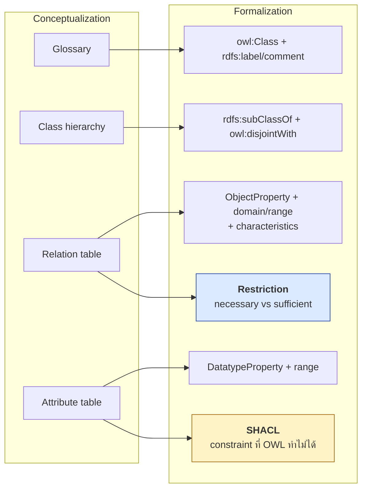
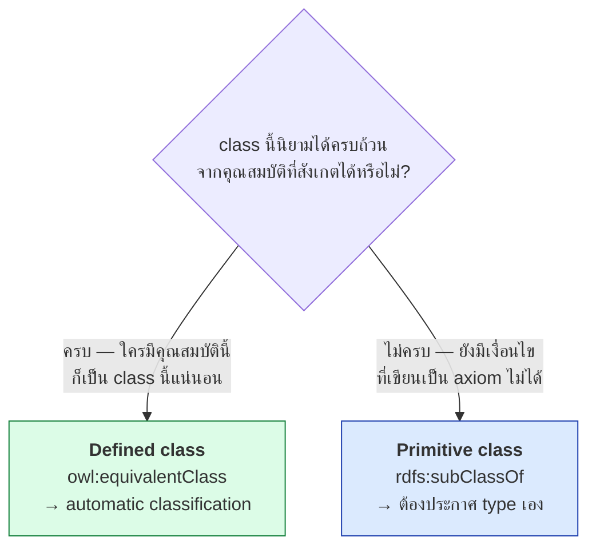
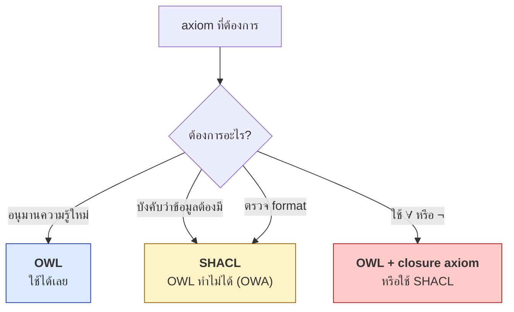
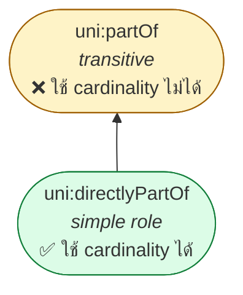
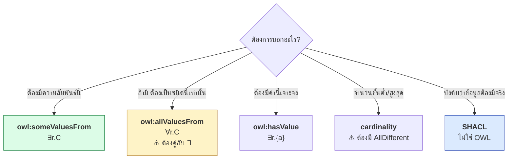
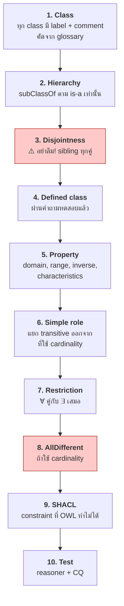

# 10.04 Formalization

**Formalization** คือขั้นตอนแปลง concept map และตารางจาก [10.03](10.03-conceptualization.md) เป็น **OWL จริง**
ขั้นนี้ต้องตัดสินใจสองเรื่องหลัก: **necessary vs sufficient condition** และ **จะจัดการกับ Open World Assumption อย่างไร**
บทนี้ให้แนวทางที่เป็นระบบพร้อมตัวอย่าง Turtle ครบทุกกรณี

---

## จาก Conceptualization สู่ OWL



---

## การตัดสินใจที่ 1: Necessary vs Sufficient

**นี่คือการตัดสินใจที่สำคัญที่สุดในการ formalize** (ทบทวนจาก [05.02](../05-knowledge-management/05.02-tbox-deep.md))



### ตารางตัดสินใจ

| Class | ประเภท | เหตุผล |
| --- | --- | --- |
| `Person`, `Course`, `Organization` | **primitive** | เป็น concept พื้นฐาน นิยามด้วย axiom ไม่ได้ |
| `Student`, `Professor` | **primitive** | ขึ้นกับสถานะทางการที่ระบบภายนอกกำหนด |
| `GraduateStudent` | **defined** | = Student ที่ลง GraduateCourse — ครบถ้วน |
| `BusyProfessor` | **defined** | = Professor ที่สอน ≥ 3 วิชา — ครบถ้วน |
| `Supervisor` | **defined** | = Professor ที่ดูแล GraduateStudent |
| `PublishedResearcher` | **defined** | = ผู้ที่มีผลงานตีพิมพ์ |

### ตัวอย่างเทียบ

<table>
<tr><th width="50%">Primitive (necessary only)</th><th width="50%">Defined (necessary + sufficient)</th></tr>
<tr valign="top">
<td>

```turtle
@prefix uni:  <http://example.org/university#> .
@prefix rdfs: <http://www.w3.org/2000/01/rdf-schema#> .
@prefix owl:  <http://www.w3.org/2002/07/owl#> .

uni:Student a owl:Class ;
    rdfs:label   "Student"@en ;
    rdfs:comment """A person admitted to a degree
programme and not yet graduated."""@en ;
    rdfs:subClassOf uni:Person ,
        [ a owl:Restriction ;
          owl:onProperty     uni:enrolledIn ;
          owl:someValuesFrom uni:Course ] .
```

**อ่านว่า**: ทุก Student เป็น Person และลงเรียนวิชา
— **แต่ใครที่ลงเรียนวิชาไม่จำเป็นต้องเป็น Student**

**ต้องประกาศ `a uni:Student` เอง**

</td>
<td>

```turtle
@prefix uni:  <http://example.org/university#> .
@prefix rdfs: <http://www.w3.org/2000/01/rdf-schema#> .
@prefix owl:  <http://www.w3.org/2002/07/owl#> .

uni:GraduateStudent a owl:Class ;
    rdfs:label   "Graduate Student"@en ;
    rdfs:comment """A student enrolled in at least
one graduate course."""@en ;
    owl:equivalentClass [
        a owl:Class ;
        owl:intersectionOf (
            uni:Student
            [ a owl:Restriction ;
              owl:onProperty     uni:enrolledIn ;
              owl:someValuesFrom uni:GraduateCourse ]
        )
    ] .
```

**อ่านว่า**: GraduateStudent = Student ที่ลง GraduateCourse
— **ทั้งสองทาง**

**reasoner จัดประเภทให้เอง** ✅

</td>
</tr>
</table>

### ⚠️ คำถามทดสอบก่อนใช้ `equivalentClass`

```
"ถ้ามีสิ่งหนึ่งที่มีคุณสมบัติครบตามที่ระบุ
 มันจะเป็น class นี้เสมอหรือไม่ — ไม่มีข้อยกเว้นเลย?"
```

| Class | คำถาม | คำตอบ | ประเภท |
| --- | --- | --- | --- |
| `Parent` | คนที่มีลูกเป็น Parent เสมอไหม | **ใช่** | defined |
| `Student` | คนที่ลงเรียนวิชาเป็น Student เสมอไหม | **ไม่** (อาจเป็นผู้ฟัง) | primitive |
| `BusyProfessor` | Professor ที่สอน ≥3 วิชาเป็น BusyProfessor เสมอไหม | **ใช่** (ตามนิยามที่ตั้ง) | defined |
| `Professor` | คนที่สอนวิชาเป็น Professor เสมอไหม | **ไม่** (อาจเป็น TA) | primitive |

---

## การตัดสินใจที่ 2: จัดการ Open World Assumption

**OWA ทำให้ axiom หลายแบบ "ไม่ทำงาน" อย่างที่คาด** — ต้องรู้ล่วงหน้าและวางแผน



### ตารางตัดสินใจ OWL vs SHACL

| ความต้องการจาก conceptualization | OWL | SHACL | ใช้อะไร |
| --- | :---: | :---: | --- |
| "Student เป็น Person" | ✅ | ❌ | **OWL** `rdfs:subClassOf` |
| "Student กับ Staff ไม่ทับกัน" | ✅ | ⚠️ | **OWL** `owl:disjointWith` |
| "partOf เป็น transitive" | ✅ | ❌ | **OWL** `owl:TransitiveProperty` |
| "ใครมีลูกเป็น Parent" | ✅ | ❌ | **OWL** `owl:equivalentClass` |
| **"ทุก Student ต้องมี studentId"** | ❌ | ✅ | **SHACL** `sh:minCount 1` |
| **"studentId ต้องตรง pattern"** | ⚠️ | ✅ | **SHACL** `sh:pattern` |
| **"GPA ต้องอยู่ระหว่าง 0–4"** | ⚠️ | ✅ | **SHACL** `sh:minInclusive/maxInclusive` |
| **"Student ห้ามมี property อื่น"** | ❌ | ✅ | **SHACL** `sh:closed` |
| "hasSupervisor มีได้คนเดียว" | ✅ | ✅ | **ทั้งคู่** (OWL อนุมาน sameAs, SHACL รายงาน error) |

> 💡 **หลักปฏิบัติ**: เขียน **OWL สำหรับ semantics** และ **SHACL สำหรับ data quality**
> อย่าพยายามให้ OWL ทำหน้าที่ validation

---

## Formalize ทีละส่วน

### 1. Class + Annotation

```turtle
@prefix uni:  <http://example.org/university#> .
@prefix rdfs: <http://www.w3.org/2000/01/rdf-schema#> .
@prefix owl:  <http://www.w3.org/2002/07/owl#> .
@prefix skos: <http://www.w3.org/2004/02/skos/core#> .

uni:Student a owl:Class ;
    # --- จาก glossary ---
    rdfs:label   "Student"@en , "นักศึกษา"@th ;
    rdfs:comment """A person admitted to a degree programme and not yet
graduated. Does NOT include alumni (use uni:Alumnus) or short-course
participants (use uni:TrainingParticipant)."""@en ;
    skos:altLabel "ผู้เรียน"@th ;
    skos:example  "uni:alice is a Student enrolled in uni:cs501."@en ;
    rdfs:isDefinedBy <http://example.org/university> ;
    # --- จาก hierarchy ---
    rdfs:subClassOf uni:Person .
```

> 💡 **`rdfs:comment` ต้องคัดลอกนิยามจาก glossary มาโดยตรง** รวมถึงส่วน "ไม่รวมอะไร"

### 2. Disjointness

```turtle
# จาก concept map: sibling ที่ไม่ควรทับกัน
uni:Student owl:disjointWith uni:Staff .

[] a owl:AllDisjointClasses ;
   owl:members ( uni:Person uni:Organization uni:Course uni:Publication ) .

[] a owl:AllDisjointClasses ;
   owl:members ( uni:UndergraduateCourse uni:GraduateCourse ) .
```

> ⚠️ **นี่คือขั้นที่คนลืมบ่อยที่สุด** — ไม่มี disjointness = reasoner จับ error ไม่ได้เลย

### 3. Object Property จาก Relation Table

```turtle
@prefix uni:  <http://example.org/university#> .
@prefix rdfs: <http://www.w3.org/2000/01/rdf-schema#> .
@prefix owl:  <http://www.w3.org/2002/07/owl#> .

# --- จากแถว: enrolledIn | Student | Course | 0..7 | hasStudent | — ---
uni:enrolledIn a owl:ObjectProperty ;
    rdfs:label   "enrolled in"@en ;
    rdfs:comment """Relates a student to a course they currently attend.
Does not cover completed or dropped courses (use uni:completedCourse
or uni:droppedCourse)."""@en ;
    rdfs:domain  uni:Student ;
    rdfs:range   uni:Course ;
    rdfs:subPropertyOf uni:involvedIn .

uni:hasStudent a owl:ObjectProperty ;
    owl:inverseOf uni:enrolledIn .

# --- จากแถว: partOf | Organization | Organization | 0..1 | hasUnit | Transitive ---
uni:partOf a owl:ObjectProperty , owl:TransitiveProperty ;
    rdfs:label  "part of"@en ;
    rdfs:domain uni:Organization ;
    rdfs:range  uni:Organization .

uni:hasUnit a owl:ObjectProperty ;
    owl:inverseOf uni:partOf .

# --- จากแถว: hasSupervisor | GraduateStudent | Professor | 0..1 |
#              supervises | Functional, Asymmetric, Irreflexive ---
uni:hasSupervisor a owl:ObjectProperty ,
                    owl:FunctionalProperty ,
                    owl:AsymmetricProperty ,
                    owl:IrreflexiveProperty ;
    rdfs:label  "has supervisor"@en ;
    rdfs:domain uni:GraduateStudent ;
    rdfs:range  uni:Professor .

uni:supervises a owl:ObjectProperty ;
    owl:inverseOf uni:hasSupervisor .
```

### ⚠️ ปัญหาจาก `partOf` transitive + cardinality 0..1

```turtle
# ❌ ทำไม่ได้ -- transitive property ใช้ใน cardinality restriction ไม่ได้
uni:Department rdfs:subClassOf [
    a owl:Restriction ;
    owl:onProperty     uni:partOf ;
    owl:maxCardinality "1"^^xsd:nonNegativeInteger
] .
```

**ทางแก้: แยก property**

```turtle
# ✅ simple role สำหรับ cardinality
uni:directlyPartOf a owl:ObjectProperty ;
    rdfs:label         "directly part of"@en ;
    rdfs:subPropertyOf uni:partOf ;
    rdfs:domain        uni:Organization ;
    rdfs:range         uni:Organization .

# ✅ transitive สำหรับ query ทุกระดับ
uni:partOf a owl:ObjectProperty , owl:TransitiveProperty .

# ✅ ตอนนี้ใช้ cardinality กับ simple role ได้
uni:Department rdfs:subClassOf [
    a owl:Restriction ;
    owl:onProperty     uni:directlyPartOf ;
    owl:maxCardinality "1"^^xsd:nonNegativeInteger
] .
```



### 4. Datatype Property จาก Attribute Table

```turtle
@prefix uni: <http://example.org/university#> .
@prefix owl: <http://www.w3.org/2002/07/owl#> .
@prefix xsd: <http://www.w3.org/2001/XMLSchema#> .

# --- จากแถว: studentId | xsd:string | 1..1 | pattern | ---
uni:studentId a owl:DatatypeProperty ,
                owl:FunctionalProperty ,
                owl:InverseFunctionalProperty ;
    rdfs:label   "student ID"@en ;
    rdfs:comment "Official student identifier; uniquely identifies one student."@en ;
    rdfs:domain  uni:Student ;
    rdfs:range   xsd:string .

# --- จากแถว: gpa | xsd:decimal | 0..1 | 0.0-4.0 | ---
uni:gpa a owl:DatatypeProperty , owl:FunctionalProperty ;
    rdfs:label  "grade point average"@en ;
    rdfs:domain uni:Student ;
    rdfs:range  xsd:decimal .
```

**constraint `pattern` และ `0.0–4.0` ไปอยู่ใน SHACL** ⬇️

### 5. SHACL สำหรับ constraint ที่ OWL ทำไม่ได้

```turtle
@prefix sh:   <http://www.w3.org/ns/shacl#> .
@prefix uni:  <http://example.org/university#> .
@prefix xsd:  <http://www.w3.org/2001/XMLSchema#> .

uni:StudentShape a sh:NodeShape ;
    sh:targetClass uni:Student ;

    # --- จาก attribute table: studentId 1..1 + pattern ---
    sh:property [
        sh:path     uni:studentId ;
        sh:datatype xsd:string ;
        sh:minCount 1 ;
        sh:maxCount 1 ;
        sh:pattern  "^S-[0-9]{4}-[0-9]{4}$" ;
        sh:message  "Every student must have exactly one studentId matching S-YYYY-NNNN." ;
    ] ;

    # --- จาก attribute table: gpa 0..1 + ช่วง 0.0-4.0 ---
    sh:property [
        sh:path         uni:gpa ;
        sh:datatype     xsd:decimal ;
        sh:maxCount     1 ;
        sh:minInclusive 0.0 ;
        sh:maxInclusive 4.0 ;
        sh:message      "GPA must be a decimal between 0.0 and 4.0." ;
    ] ;

    # --- จาก relation table: enrolledIn 0..7 ---
    sh:property [
        sh:path     uni:enrolledIn ;
        sh:class    uni:Course ;
        sh:minCount 1 ;
        sh:maxCount 7 ;
        sh:message  "A student must be enrolled in 1 to 7 courses." ;
    ] .
```

---

## Restriction: เลือกใช้อย่างไร



### ตัวอย่างครบทุกแบบ

```turtle
@prefix uni: <http://example.org/university#> .
@prefix owl: <http://www.w3.org/2002/07/owl#> .
@prefix rdfs: <http://www.w3.org/2000/01/rdf-schema#> .
@prefix xsd: <http://www.w3.org/2001/XMLSchema#> .

# --- ∃ : "Professor ต้องมีปริญญาเอก" (necessary condition) ---
uni:Professor rdfs:subClassOf [
    a owl:Restriction ;
    owl:onProperty     uni:hasDegree ;
    owl:someValuesFrom uni:Doctorate
] .

# --- ∃ + ∀ : "นักศึกษาปริญญาตรี = ลงเฉพาะวิชาปริญญาตรี" (defined) ---
# ⚠️ ต้องมี ∃ ด้วย มิฉะนั้น vacuous truth
uni:UndergraduateStudent owl:equivalentClass [
    a owl:Class ;
    owl:intersectionOf (
        uni:Student
        [ a owl:Restriction ;
          owl:onProperty     uni:enrolledIn ;
          owl:someValuesFrom uni:UndergraduateCourse ]
        [ a owl:Restriction ;
          owl:onProperty    uni:enrolledIn ;
          owl:allValuesFrom uni:UndergraduateCourse ]
    )
] .

# --- hasValue : "นักศึกษา CS = สังกัดภาควิชา CS" ---
uni:CSStudent owl:equivalentClass [
    a owl:Class ;
    owl:intersectionOf (
        uni:Student
        [ a owl:Restriction ;
          owl:onProperty uni:memberOf ;
          owl:hasValue   uni:csDept ]
    )
] .

# --- qualified cardinality : "อาจารย์ที่สอนหนัก = สอน ≥3 วิชา" ---
uni:BusyProfessor owl:equivalentClass [
    a owl:Class ;
    owl:intersectionOf (
        uni:Professor
        [ a owl:Restriction ;
          owl:onProperty              uni:teaches ;
          owl:minQualifiedCardinality "3"^^xsd:nonNegativeInteger ;
          owl:onClass                 uni:Course ]
    )
] .

# --- property chain : "อาจารย์ผู้สอนของนักศึกษา" ---
uni:instructorOf a owl:ObjectProperty ;
    rdfs:comment "A professor instructs every student in a course they teach."@en ;
    owl:propertyChainAxiom ( uni:teaches uni:hasStudent ) .
```

---

## ⚠️ กับดักจาก OWA ที่ต้องวางแผนล่วงหน้า

### กับดักที่ 1: `allValuesFrom` สรุปไม่ได้

```turtle
uni:UndergraduateStudent owl:equivalentClass [ ... allValuesFrom ... ] .

uni:bob a uni:Student ;
    uni:enrolledIn uni:cs101 , uni:cs201 .   # ทั้งคู่เป็น UndergraduateCourse
```

**ผลจริง** (จาก [05.09](../05-knowledge-management/05.09-python-kb.md)): `UndergraduateStudent = []`

**ทางแก้ 3 แบบ**

```turtle
# --- แบบที่ 1: closure axiom ด้วย oneOf ---
uni:bob a [
    a owl:Restriction ;
    owl:onProperty    uni:enrolledIn ;
    owl:allValuesFrom [ a owl:Class ; owl:oneOf ( uni:cs101 uni:cs201 ) ]
] .

# --- แบบที่ 2: closure axiom ด้วย maxCardinality ---
uni:bob a [
    a owl:Restriction ;
    owl:onProperty     uni:enrolledIn ;
    owl:maxCardinality "2"^^xsd:nonNegativeInteger
] .

# --- แบบที่ 3: ไม่ใช้ allValuesFrom เลย ใช้ SHACL แทน ---
uni:UndergradStudentShape a sh:NodeShape ;
    sh:targetClass uni:Student ;
    sh:property [
        sh:path  uni:enrolledIn ;
        sh:class uni:UndergraduateCourse ;
        sh:message "Undergraduate students may only enrol in undergraduate courses." ;
    ] .
```

| ทางแก้ | ข้อดี | ข้อเสีย |
| --- | --- | --- |
| Closure axiom | reasoner สรุปได้ | ต้องเขียนทุก individual |
| SHACL | ตรวจได้จริง | ไม่ได้ inferred type |
| **ทั้งคู่** | ได้ทั้งสองอย่าง | เขียนสองที่ |

### กับดักที่ 2: `complementOf` สรุปไม่ได้

```turtle
uni:LoanableBook owl:equivalentClass [
    a owl:Class ;
    owl:intersectionOf ( uni:Book [ owl:complementOf uni:ReferenceBook ] )
] .
```

**ผลจริง** (จาก [08.10](../08-owl/08.10-python-owl.md)): `LoanableBook = []`
เพราะ reasoner ไม่รู้ว่าหนังสือเล่มไหน "ไม่ใช่" ReferenceBook

**ทางแก้: ใช้ `owl:disjointUnionOf`**

```turtle
# บอกว่า Book แบ่งเป็นสองแบบพอดี ไม่มีอย่างอื่น
uni:Book owl:disjointUnionOf ( uni:LendingBook uni:ReferenceBook ) .
```

### กับดักที่ 3: cardinality ต้องมี `AllDifferent`

```turtle
uni:profSmith uni:teaches uni:cs101 , uni:cs501 , uni:cs601 .

# ⚠️ ถ้าไม่มีบรรทัดนี้ BusyProfessor จะว่าง
[] a owl:AllDifferent ;
   owl:members ( uni:cs101 uni:cs201 uni:cs301 uni:cs501 uni:cs601 uni:ma101 ) .
```

**พิสูจน์แล้วใน [08.10](../08-owl/08.10-python-owl.md)**: ไม่มี `AllDifferent` → `ProlificAuthor = []`

---

## Formalization Checklist



---

## ตัวอย่างเต็ม: จาก Conceptualization สู่ OWL

<table>
<tr><th width="50%">Conceptualization</th><th width="50%">Formalization</th></tr>
<tr valign="top">
<td>

**Glossary**
```
Student = บุคคลที่ได้รับอนุมัติให้เข้าศึกษา
          และยังไม่สำเร็จการศึกษา
          ไม่รวม: ศิษย์เก่า, ผู้อบรมระยะสั้น

GraduateStudent = นักศึกษาที่ลงเรียน
          วิชาระดับบัณฑิตศึกษา
```

**Hierarchy**
```
Person
├── Student
│   └── GraduateStudent
└── Staff
    └── Professor
```

**Relation table**
| rel | domain | range | card | inv | char |
|---|---|---|---|---|---|
| enrolledIn | Student | Course | 0..7 | hasStudent | — |
| partOf | Org | Org | 0..1 | hasUnit | Transitive |

**Attribute table**
| attr | type | card | constraint |
|---|---|---|---|
| studentId | string | 1..1 | `^S-\d{4}-\d{4}$` |
| gpa | decimal | 0..1 | 0.0–4.0 |

</td>
<td>

```turtle
@prefix uni:  <http://example.org/university#> .
@prefix rdfs: <http://www.w3.org/2000/01/rdf-schema#> .
@prefix owl:  <http://www.w3.org/2002/07/owl#> .
@prefix xsd:  <http://www.w3.org/2001/XMLSchema#> .

# ----- primitive class -----
uni:Student a owl:Class ;
    rdfs:label   "Student"@en ;
    rdfs:comment """A person admitted to a degree
programme and not yet graduated. Does NOT include
alumni or short-course participants."""@en ;
    rdfs:subClassOf  uni:Person ;
    owl:disjointWith uni:Staff .

# ----- defined class -----
uni:GraduateStudent a owl:Class ;
    rdfs:label "Graduate Student"@en ;
    owl:equivalentClass [
        a owl:Class ;
        owl:intersectionOf (
            uni:Student
            [ a owl:Restriction ;
              owl:onProperty     uni:enrolledIn ;
              owl:someValuesFrom uni:GraduateCourse ]
        )
    ] .

# ----- object property -----
uni:enrolledIn a owl:ObjectProperty ;
    rdfs:domain uni:Student ;
    rdfs:range  uni:Course .

uni:hasStudent owl:inverseOf uni:enrolledIn .

# ⚠️ แยก simple role ออกจาก transitive
uni:directlyPartOf a owl:ObjectProperty ;
    rdfs:subPropertyOf uni:partOf .
uni:partOf a owl:ObjectProperty , owl:TransitiveProperty .

# ----- datatype property -----
uni:studentId a owl:DatatypeProperty ,
                owl:FunctionalProperty ,
                owl:InverseFunctionalProperty ;
    rdfs:domain uni:Student ;
    rdfs:range  xsd:string .

uni:gpa a owl:DatatypeProperty , owl:FunctionalProperty ;
    rdfs:domain uni:Student ;
    rdfs:range  xsd:decimal .
```

**+ SHACL สำหรับ constraint**

```turtle
@prefix sh: <http://www.w3.org/ns/shacl#> .

uni:StudentShape a sh:NodeShape ;
    sh:targetClass uni:Student ;
    sh:property [
        sh:path uni:studentId ;
        sh:minCount 1 ; sh:maxCount 1 ;
        sh:pattern "^S-[0-9]{4}-[0-9]{4}$" ;
    ] ;
    sh:property [
        sh:path uni:gpa ; sh:maxCount 1 ;
        sh:minInclusive 0.0 ; sh:maxInclusive 4.0 ;
    ] ;
    sh:property [
        sh:path uni:enrolledIn ;
        sh:minCount 1 ; sh:maxCount 7 ;
    ] .
```

</td>
</tr>
</table>

---

## Python: ตรวจ formalization

```python
from rdflib import Graph
from rdflib.namespace import OWL, RDF, RDFS


def check_formalization(path: str, namespace: str) -> None:
    g = Graph().parse(path, format="turtle")

    classes = {c for c in g.subjects(RDF.type, OWL.Class)
               if str(c).startswith(namespace)}
    defined = {c for c in classes if list(g.objects(c, OWL.equivalentClass))}
    primitive = classes - defined

    obj_props = {p for p in g.subjects(RDF.type, OWL.ObjectProperty)
                 if str(p).startswith(namespace)}
    transitive = set(g.subjects(RDF.type, OWL.TransitiveProperty))

    print("=" * 70)
    print("  FORMALIZATION CHECK")
    print("=" * 70)
    print(f"  classes           : {len(classes)}")
    print(f"    primitive       : {len(primitive)}")
    print(f"    defined         : {len(defined)}  "
          f"{'✅' if defined else '⚠️ ไม่มี defined class เลย -- ใช้ RDFS ก็พอ'}")
    print(f"  object properties : {len(obj_props)}")

    # --- 1) ตรวจ annotation ---
    no_label = [c for c in classes if not list(g.objects(c, RDFS.label))]
    no_comment = [c for c in classes if not list(g.objects(c, RDFS.comment))]
    print(f"\n  ขาด rdfs:label    : {len(no_label)} "
          f"{[str(c).split('#')[-1] for c in no_label[:5]]}")
    print(f"  ขาด rdfs:comment  : {len(no_comment)} "
          f"{[str(c).split('#')[-1] for c in no_comment[:5]]}")

    # --- 2) ตรวจ disjointness ---
    disjoint_pairs = len(list(g.subject_objects(OWL.disjointWith)))
    all_disjoint = len(list(g.subjects(RDF.type, OWL.AllDisjointClasses)))
    print(f"\n  owl:disjointWith        : {disjoint_pairs} คู่")
    print(f"  owl:AllDisjointClasses  : {all_disjoint} บล็อก")
    if disjoint_pairs + all_disjoint == 0:
        print("  ⚠️ ไม่มี disjointness เลย -- reasoner จะจับ error ไม่ได้")

    # --- 3) ตรวจ simple role violation ---
    print("\n  ตรวจ non-simple role ที่ใช้ผิด:")
    violations = []
    for prop in transitive:
        name = str(prop).split("#")[-1]
        # transitive + functional
        if (prop, RDF.type, OWL.FunctionalProperty) in g:
            violations.append(f"{name}: transitive + functional")
        # transitive + asymmetric/irreflexive
        for bad in (OWL.AsymmetricProperty, OWL.IrreflexiveProperty):
            if (prop, RDF.type, bad) in g:
                violations.append(f"{name}: transitive + {str(bad).split('#')[-1]}")
        # transitive ใน cardinality restriction
        for restriction in g.subjects(OWL.onProperty, prop):
            for card in (OWL.minCardinality, OWL.maxCardinality, OWL.cardinality,
                         OWL.minQualifiedCardinality, OWL.maxQualifiedCardinality):
                if list(g.objects(restriction, card)):
                    violations.append(f"{name}: transitive ใน cardinality restriction")

    if violations:
        for v in set(violations):
            print(f"    ❌ {v}")
    else:
        print("    ✅ ไม่พบปัญหา")

    # --- 4) ตรวจ allValuesFrom ที่ไม่มี someValuesFrom คู่ ---
    print("\n  ตรวจ allValuesFrom ที่ไม่มี someValuesFrom คู่:")
    all_props = {o for r in g.subjects(RDF.type, OWL.Restriction)
                 for o in g.objects(r, OWL.onProperty)
                 if list(g.objects(r, OWL.allValuesFrom))}
    some_props = {o for r in g.subjects(RDF.type, OWL.Restriction)
                  for o in g.objects(r, OWL.onProperty)
                  if list(g.objects(r, OWL.someValuesFrom))}
    lonely = all_props - some_props
    if lonely:
        for p in lonely:
            print(f"    ⚠️ {str(p).split('#')[-1]}: มี ∀ แต่ไม่มี ∃ -- เสี่ยง vacuous truth")
    else:
        print("    ✅ ไม่พบปัญหา")


check_formalization("code/ch05/university_tbox.ttl", "http://example.org/university#")
```

Expected output:

```
======================================================================
  FORMALIZATION CHECK
======================================================================
  classes           : 21
    primitive       : 16
    defined         : 5  ✅
  object properties : 14

  ขาด rdfs:label    : 0 []
  ขาด rdfs:comment  : 12 ['Organization', 'University', 'Faculty', ...]

  owl:disjointWith        : 2 คู่
  owl:AllDisjointClasses  : 1 บล็อก

  ตรวจ non-simple role ที่ใช้ผิด:
    ✅ ไม่พบปัญหา

  ตรวจ allValuesFrom ที่ไม่มี someValuesFrom คู่:
    ✅ ไม่พบปัญหา
```

---

## Key Points

- **Formalization แปลง glossary/hierarchy/table เป็น OWL** — ทำหลังจาก conceptualization เสร็จแล้วเท่านั้น
- การตัดสินใจที่ 1: **primitive (`rdfs:subClassOf`) vs defined (`owl:equivalentClass`)**
- คำถามทดสอบ: *"สิ่งที่มีคุณสมบัติครบ จะเป็น class นี้เสมอหรือไม่ — ไม่มีข้อยกเว้น?"*
- การตัดสินใจที่ 2: **OWL สำหรับ semantics, SHACL สำหรับ data quality** — อย่าให้ OWL ทำหน้าที่ validation
- ⚠️ **`owl:disjointWith` เป็นสิ่งที่ลืมบ่อยที่สุด** — ไม่มีแล้ว reasoner จับ error ไม่ได้เลย
- ⚠️ **แยก simple role ออกจาก transitive** เมื่อต้องใช้ cardinality (`directlyPartOf` vs `partOf`)
- ⚠️ **`∀r.C` ต้องคู่กับ `∃r.C` เสมอ** และยังต้องมี **closure axiom** จึงจะสรุปได้
- ⚠️ **cardinality ต้องมี `owl:AllDifferent`** มิฉะนั้นไม่ทำงาน
- `rdfs:comment` ต้อง **คัดลอกนิยามจาก glossary** รวมถึงส่วน "ไม่รวมอะไร"
