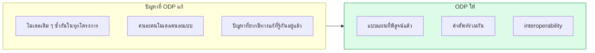
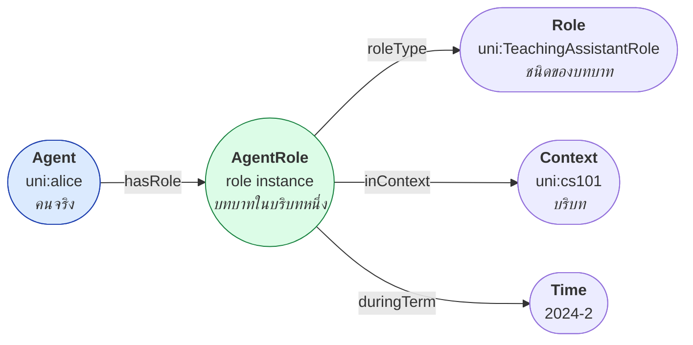
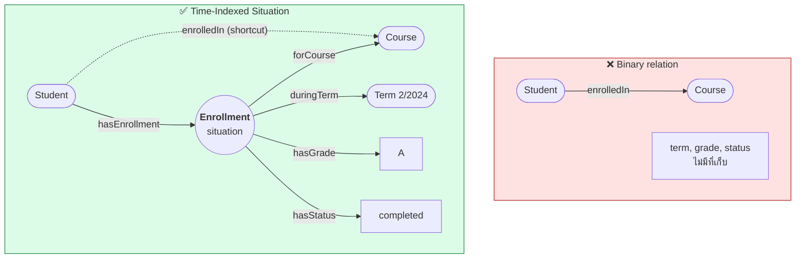
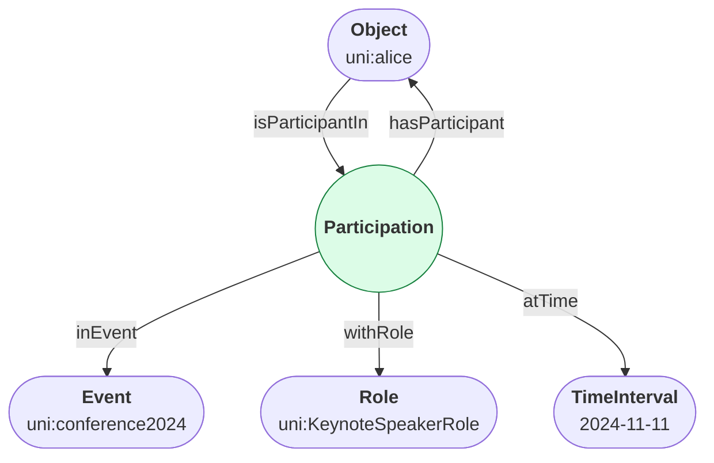
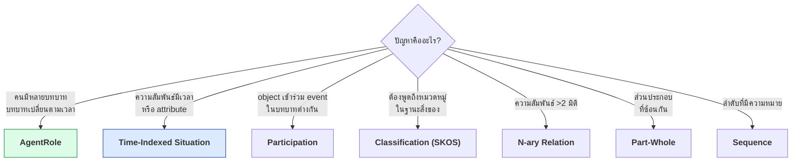
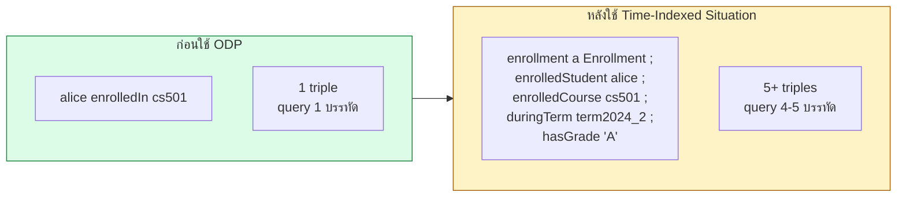

# 10.05 Ontology Design Patterns

**Ontology Design Pattern (ODP)** คือแบบแผนการโมเดลที่พิสูจน์แล้วว่าใช้ได้ผล — เทียบได้กับ design pattern ในซอฟต์แวร์
บทนี้ครอบคลุม pattern ที่ใช้บ่อยที่สุด 3 ตัว: **AgentRole**, **Time-Indexed Situation** และ **Participation**
พร้อม pattern อื่นที่ควรรู้

---

## ทำไมต้องใช้ ODP



**แหล่งรวม ODP**: [ontologydesignpatterns.org](http://ontologydesignpatterns.org) — มีกว่า 200 pattern

---

## Pattern 1: AgentRole

### ปัญหา

**คนหนึ่งมีหลายบทบาท และบทบาทเปลี่ยนตามเวลาและบริบท**

```turtle
# ❌ โมเดลผิด: ทำบทบาทเป็น class
uni:alice a uni:Student , uni:TeachingAssistant , uni:ResearchAssistant .
```

**ปัญหาที่ตามมา**

| ปัญหา | รายละเอียด |
| --- | --- |
| บทบาทเปลี่ยนไม่ได้ | alice จบแล้วยังเป็น Student ตลอดกาล |
| ไม่มีที่เก็บบริบท | เป็น TA ของวิชาไหน ช่วงไหน |
| class ระเบิด | `StudentTA`, `StudentRA`, `StudentTARA`, ... |
| disjointness ทำไม่ได้ | Student กับ Staff ควร disjoint แต่ TA เป็นทั้งคู่ |

### ทางแก้: แยก Agent, Role และ AgentRole



### Implementation

<table>
<tr><th width="50%">Full form</th><th width="50%">Shorthand</th></tr>
<tr valign="top">
<td>

```turtle
@prefix uni:  <http://example.org/university#> .
@prefix rdf:  <http://www.w3.org/1999/02/22-rdf-syntax-ns#> .
@prefix rdfs: <http://www.w3.org/2000/01/rdf-schema#> .
@prefix owl:  <http://www.w3.org/2002/07/owl#> .
@prefix xsd:  <http://www.w3.org/2001/XMLSchema#> .

# ----- TBox -----
uni:Agent rdf:type owl:Class .
uni:Role rdf:type owl:Class .
uni:AgentRole rdf:type owl:Class .

uni:hasRole rdf:type owl:ObjectProperty .
uni:hasRole rdfs:domain uni:Agent .
uni:hasRole rdfs:range uni:AgentRole .

uni:roleType rdf:type owl:ObjectProperty .
uni:roleType rdfs:domain uni:AgentRole .
uni:roleType rdfs:range uni:Role .

uni:inContext rdf:type owl:ObjectProperty .
uni:inContext rdfs:domain uni:AgentRole .

# ----- Role instances -----
uni:TeachingAssistantRole rdf:type uni:Role .
uni:TeachingAssistantRole rdfs:label "Teaching Assistant"@en .

uni:StudentRole rdf:type uni:Role .
uni:StudentRole rdfs:label "Student"@en .

# ----- ABox -----
uni:alice rdf:type uni:Person .
uni:alice uni:hasRole uni:aliceTARole .

uni:aliceTARole rdf:type uni:AgentRole .
uni:aliceTARole uni:roleType uni:TeachingAssistantRole .
uni:aliceTARole uni:inContext uni:cs101 .
uni:aliceTARole uni:startDate "2024-08-01"^^xsd:date .
uni:aliceTARole uni:endDate "2024-12-15"^^xsd:date .
```

</td>
<td>

```turtle
@prefix uni:  <http://example.org/university#> .
@prefix rdf:  <http://www.w3.org/1999/02/22-rdf-syntax-ns#> .
@prefix rdfs: <http://www.w3.org/2000/01/rdf-schema#> .
@prefix owl:  <http://www.w3.org/2002/07/owl#> .
@prefix xsd:  <http://www.w3.org/2001/XMLSchema#> .

# ----- TBox -----
uni:Agent     a owl:Class .
uni:Role      a owl:Class .
uni:AgentRole a owl:Class ;
    rdfs:comment """The holding of a Role by an Agent
in a specific context and time period."""@en .

uni:hasRole a owl:ObjectProperty ;
    rdfs:domain uni:Agent ;
    rdfs:range  uni:AgentRole .

uni:roleType a owl:ObjectProperty ;
    rdfs:domain uni:AgentRole ;
    rdfs:range  uni:Role .

uni:inContext a owl:ObjectProperty ;
    rdfs:domain uni:AgentRole .

# ----- Role instances -----
uni:TeachingAssistantRole a uni:Role ;
    rdfs:label "Teaching Assistant"@en .
uni:StudentRole a uni:Role ;
    rdfs:label "Student"@en .
uni:SupervisorRole a uni:Role ;
    rdfs:label "Supervisor"@en .

# ----- ABox -----
uni:alice a uni:Person ;
    uni:hasRole uni:aliceStudentRole , uni:aliceTARole .

uni:aliceStudentRole a uni:AgentRole ;
    uni:roleType  uni:StudentRole ;
    uni:inContext uni:csDept ;
    uni:startDate "2022-08-01"^^xsd:date .

uni:aliceTARole a uni:AgentRole ;
    uni:roleType  uni:TeachingAssistantRole ;
    uni:inContext uni:cs101 ;
    uni:startDate "2024-08-01"^^xsd:date ;
    uni:endDate   "2024-12-15"^^xsd:date .
```

</td>
</tr>
</table>

### Query

```sparql
PREFIX uni:  <http://example.org/university#>
PREFIX rdfs: <http://www.w3.org/2000/01/rdf-schema#>
PREFIX xsd:  <http://www.w3.org/2001/XMLSchema#>

# --- 1) alice มีบทบาทอะไรบ้าง ---
SELECT ?roleLabel ?context ?start ?end WHERE {
  uni:alice uni:hasRole ?role .
  ?role uni:roleType/rdfs:label ?roleLabel ;
        uni:inContext ?context ;
        uni:startDate ?start .
  OPTIONAL { ?role uni:endDate ?end }
}

# --- 2) ใครเป็น TA ของ cs101 ---
SELECT ?person WHERE {
  ?person uni:hasRole ?role .
  ?role uni:roleType  uni:TeachingAssistantRole ;
        uni:inContext uni:cs101 .
}

# --- 3) บทบาทที่ยังมีผลอยู่ (ยังไม่หมดอายุ) ---
SELECT ?person ?roleLabel WHERE {
  ?person uni:hasRole ?role .
  ?role uni:roleType/rdfs:label ?roleLabel .
  FILTER NOT EXISTS { ?role uni:endDate ?end . FILTER(?end < NOW()) }
}
```

### เมื่อไหร่ใช้ AgentRole

| ใช้ | ไม่ใช้ |
| --- | --- |
| บทบาทเปลี่ยนตามเวลา | ชนิดที่ไม่เปลี่ยน (Person, Organization) |
| คนหนึ่งมีหลายบทบาทพร้อมกัน | บทบาทเดียวตลอดชีวิต |
| บทบาทผูกกับบริบท | ไม่มีบริบท |
| ต้องเก็บช่วงเวลา | ไม่สนใจเวลา |

> 💡 **ORG ontology ใช้ pattern นี้** — `org:Membership`, `org:Role`, `org:Post`

```turtle
@prefix org: <http://www.w3.org/ns/org#> .

uni:alice org:memberOf uni:csDept ;
    org:holds [
        a org:Post ;
        org:role   uni:TeachingAssistantRole ;
        org:postIn uni:csDept
    ] .
```

---

## Pattern 2: Time-Indexed Situation

### ปัญหา

**ความสัมพันธ์เปลี่ยนตามเวลา แต่ RDF triple ไม่มีที่เก็บเวลา**

```turtle
# ❌ ปัญหา: เก็บเวลาไม่ได้
uni:alice uni:enrolledIn uni:cs501 .        # เมื่อไหร่? เทอมไหน? เกรดอะไร?
uni:alice uni:memberOf uni:csDept .         # ตั้งแต่เมื่อไหร่?
```

### ทางแก้: Reify ความสัมพันธ์เป็น Situation



### Implementation

```turtle
@prefix uni:  <http://example.org/university#> .
@prefix rdfs: <http://www.w3.org/2000/01/rdf-schema#> .
@prefix owl:  <http://www.w3.org/2002/07/owl#> .
@prefix xsd:  <http://www.w3.org/2001/XMLSchema#> .
@prefix time: <http://www.w3.org/2006/time#> .

# ===== TBox =====
uni:Enrollment a owl:Class ;
    rdfs:label   "Enrollment"@en ;
    rdfs:comment """A time-indexed situation representing that a student
was enrolled in a course during a specific academic term."""@en ;
    rdfs:subClassOf
        [ a owl:Restriction ; owl:onProperty uni:enrolledStudent ;
          owl:cardinality "1"^^xsd:nonNegativeInteger ] ,
        [ a owl:Restriction ; owl:onProperty uni:enrolledCourse ;
          owl:cardinality "1"^^xsd:nonNegativeInteger ] ,
        [ a owl:Restriction ; owl:onProperty uni:duringTerm ;
          owl:cardinality "1"^^xsd:nonNegativeInteger ] .

uni:AcademicTerm a owl:Class ;
    rdfs:subClassOf time:TemporalEntity .

uni:enrolledStudent a owl:ObjectProperty , owl:FunctionalProperty ;
    rdfs:domain uni:Enrollment ; rdfs:range uni:Student .

uni:enrolledCourse a owl:ObjectProperty , owl:FunctionalProperty ;
    rdfs:domain uni:Enrollment ; rdfs:range uni:Course .

uni:duringTerm a owl:ObjectProperty , owl:FunctionalProperty ;
    rdfs:domain uni:Enrollment ; rdfs:range uni:AcademicTerm .

uni:hasGrade a owl:DatatypeProperty , owl:FunctionalProperty ;
    rdfs:domain uni:Enrollment ; rdfs:range xsd:string .

# ----- shortcut property (ให้ query ง่าย) -----
uni:enrolledIn a owl:ObjectProperty ;
    rdfs:comment """Shortcut: a student is enrolled in a course.
Loses term and grade information -- use uni:Enrollment for details."""@en ;
    rdfs:domain uni:Student ;
    rdfs:range  uni:Course .

# ===== ABox =====
uni:term2024_2 a uni:AcademicTerm ;
    rdfs:label     "Term 2/2024"@en ;
    uni:startDate  "2024-08-01"^^xsd:date ;
    uni:endDate    "2024-12-15"^^xsd:date .

uni:enrollment_alice_cs501_2024_2 a uni:Enrollment ;
    uni:enrolledStudent uni:alice ;
    uni:enrolledCourse  uni:cs501 ;
    uni:duringTerm      uni:term2024_2 ;
    uni:hasGrade        "A" ;
    uni:hasStatus       "completed" ;
    uni:enrollmentDate  "2024-07-15"^^xsd:date .

# ----- shortcut ที่เก็บคู่กัน -----
uni:alice uni:enrolledIn uni:cs501 .
```

### สร้าง shortcut อัตโนมัติด้วย property chain

```turtle
@prefix uni: <http://example.org/university#> .
@prefix owl: <http://www.w3.org/2002/07/owl#> .

# enrolledStudent⁻ ∘ enrolledCourse ⊑ enrolledIn
uni:hasEnrollment a owl:ObjectProperty ;
    owl:inverseOf uni:enrolledStudent .

uni:enrolledIn owl:propertyChainAxiom ( uni:hasEnrollment uni:enrolledCourse ) .
```

**ตอนนี้ reasoner สร้าง `uni:alice uni:enrolledIn uni:cs501` ให้เอง** ✅

### IRI ของ Situation

```turtle
# ✅ ใช้ composite key ที่คงที่ -- reload แล้วได้ IRI เดิม
uni:enrollment/alice-cs501-2024-2

# ❌ auto-increment -- เปลี่ยนทุกครั้งที่ reload
uni:enrollment/12345

# ❌ blank node -- อ้างจากภายนอกไม่ได้
[ a uni:Enrollment ; ... ]
```

### Query

```sparql
PREFIX uni:  <http://example.org/university#>
PREFIX rdfs: <http://www.w3.org/2000/01/rdf-schema#>

# --- 1) ประวัติการลงทะเบียนของ alice ---
SELECT ?courseCode ?termLabel ?grade WHERE {
  ?e a uni:Enrollment ;
     uni:enrolledStudent uni:alice ;
     uni:enrolledCourse  ?course ;
     uni:duringTerm      ?term .
  OPTIONAL { ?e uni:hasGrade ?grade }
  ?course uni:courseCode ?courseCode .
  ?term rdfs:label ?termLabel .
}
ORDER BY ?termLabel

# --- 2) GPA ของแต่ละเทอม ---
SELECT ?termLabel (AVG(?points) AS ?gpa) WHERE {
  ?e uni:enrolledStudent uni:alice ;
     uni:duringTerm ?term ;
     uni:hasGrade ?grade .
  ?term rdfs:label ?termLabel .
  VALUES (?grade ?points) {
    ("A" 4.0) ("B+" 3.5) ("B" 3.0) ("C+" 2.5) ("C" 2.0) ("D" 1.0) ("F" 0.0)
  }
}
GROUP BY ?termLabel

# --- 3) วิชาที่ลงซ้ำ (ลงมากกว่าหนึ่งเทอม) ---
SELECT ?courseCode (COUNT(?e) AS ?attempts) WHERE {
  ?e uni:enrolledStudent uni:alice ; uni:enrolledCourse ?course .
  ?course uni:courseCode ?courseCode .
}
GROUP BY ?courseCode
HAVING (COUNT(?e) > 1)
```

### เมื่อไหร่ใช้ Time-Indexed Situation

| ใช้ | ไม่ใช้ |
| --- | --- |
| ความสัมพันธ์มีช่วงเวลา | ความสัมพันธ์คงที่ตลอด |
| ต้องเก็บ attribute ของความสัมพันธ์ | ความสัมพันธ์ binary ล้วน |
| ต้องเก็บประวัติ | สนใจแค่สถานะปัจจุบัน |
| ความสัมพันธ์ n-ary | ความสัมพันธ์ 2 ทาง |

---

## Pattern 3: Participation

### ปัญหา

**Object เข้าร่วมใน Event ในบทบาทต่างกัน**

```turtle
# ❌ ปัญหา: บทบาทของแต่ละคนในงานประชุมคืออะไร
uni:conference2024 uni:hasParticipant uni:alice , uni:bob , uni:carol .
```

### ทางแก้



```turtle
@prefix ex:   <http://example.org/conference#> .
@prefix rdfs: <http://www.w3.org/2000/01/rdf-schema#> .
@prefix owl:  <http://www.w3.org/2002/07/owl#> .
@prefix xsd:  <http://www.w3.org/2001/XMLSchema#> .

# ===== TBox =====
ex:Event a owl:Class .
ex:Participation a owl:Class ;
    rdfs:comment "The participation of an object in an event with a role."@en .
ex:ParticipantRole a owl:Class .

ex:hasParticipation a owl:ObjectProperty ;
    rdfs:domain ex:Event ; rdfs:range ex:Participation .

ex:participant a owl:ObjectProperty , owl:FunctionalProperty ;
    rdfs:domain ex:Participation .

ex:withRole a owl:ObjectProperty , owl:FunctionalProperty ;
    rdfs:domain ex:Participation ; rdfs:range ex:ParticipantRole .

# ===== Role instances =====
ex:KeynoteSpeakerRole a ex:ParticipantRole ; rdfs:label "Keynote Speaker"@en .
ex:ProgramChairRole   a ex:ParticipantRole ; rdfs:label "Program Chair"@en .
ex:AttendeeRole       a ex:ParticipantRole ; rdfs:label "Attendee"@en .
ex:ReviewerRole       a ex:ParticipantRole ; rdfs:label "Reviewer"@en .

# ===== ABox =====
ex:conference2024 a ex:Event ;
    rdfs:label "ISWC 2024"@en ;
    ex:startDate "2024-11-11"^^xsd:date ;
    ex:hasParticipation ex:part001 , ex:part002 , ex:part003 .

ex:part001 a ex:Participation ;
    ex:participant ex:alice ;
    ex:withRole    ex:KeynoteSpeakerRole ;
    ex:atTime      "2024-11-11T09:00:00Z"^^xsd:dateTime .

ex:part002 a ex:Participation ;
    ex:participant ex:alice ;
    ex:withRole    ex:ReviewerRole .          # alice มี 2 บทบาทในงานเดียว

ex:part003 a ex:Participation ;
    ex:participant ex:bob ;
    ex:withRole    ex:ProgramChairRole .
```

```sparql
PREFIX ex:   <http://example.org/conference#>
PREFIX rdfs: <http://www.w3.org/2000/01/rdf-schema#>

# ใครทำหน้าที่อะไรในงาน
SELECT ?personLabel ?roleLabel WHERE {
  ex:conference2024 ex:hasParticipation ?p .
  ?p ex:participant ?person ; ex:withRole/rdfs:label ?roleLabel .
  ?person rdfs:label ?personLabel .
}
ORDER BY ?roleLabel
```

---

## Pattern อื่นที่ควรรู้

### Classification / Concept Reification

**เมื่อต้องการพูดถึง "หมวดหมู่" ในฐานะสิ่งของ**

```turtle
@prefix skos: <http://www.w3.org/2004/02/skos/core#> .

# ❌ ทำหมวดหมู่เป็น class -- พูดถึงหมวดหมู่เองไม่ได้
ex:ScienceBook rdfs:subClassOf ex:Book .

# ✅ ทำหมวดหมู่เป็น SKOS concept -- มี metadata ได้
ex:scienceTopic a skos:Concept ;
    skos:prefLabel "Science"@en ;
    skos:broader   ex:academicTopic ;
    ex:addedBy     ex:librarian1 ;
    ex:addedDate   "2024-01-15"^^xsd:date .

ex:book001 dcterms:subject ex:scienceTopic .
```

### N-ary Relation

**ความสัมพันธ์ที่มีมากกว่า 2 มิติ** (ทบทวนจาก [02.01](../02-rdf/02.01-triple-model.md))

```turtle
# ❌ ทำไม่ได้: "alice ให้คะแนน cs501 เป็น 5 เมื่อ 2024-12-01"
uni:alice uni:rated uni:cs501 5 .           # triple มีแค่ 3 ตำแหน่ง!

# ✅ Reify
uni:rating001 a uni:Rating ;
    uni:ratedBy    uni:alice ;
    uni:ratedItem  uni:cs501 ;
    uni:ratingValue 5 ;
    uni:ratedOn    "2024-12-01"^^xsd:date ;
    uni:comment    "Excellent course"@en .
```

### Part-Whole

```turtle
@prefix ex:  <http://example.org/> .
@prefix owl: <http://www.w3.org/2002/07/owl#> .

# แยก direct จาก transitive
ex:directlyPartOf a owl:ObjectProperty ;
    rdfs:subPropertyOf ex:partOf .

ex:partOf a owl:ObjectProperty , owl:TransitiveProperty ,
            owl:AsymmetricProperty .    # ❌ ผิด! transitive + asymmetric ไม่ได้

# ✅ ถูก
ex:partOf a owl:ObjectProperty , owl:TransitiveProperty .
ex:directlyPartOf a owl:ObjectProperty , owl:AsymmetricProperty ,
                    owl:IrreflexiveProperty ;
    rdfs:subPropertyOf ex:partOf .
```

### Sequence

```turtle
@prefix ex:  <http://example.org/> .
@prefix owl: <http://www.w3.org/2002/07/owl#> .
@prefix xsd: <http://www.w3.org/2001/XMLSchema#> .

# ❌ RDF collection -- query ยาก
ex:curriculum ex:courses ( ex:cs101 ex:cs201 ex:cs301 ) .

# ✅ ใช้เลขลำดับ -- query ง่ายกว่ามาก
ex:curriculum ex:hasStep [
    ex:position 1 ; ex:course ex:cs101
] , [
    ex:position 2 ; ex:course ex:cs201
] , [
    ex:position 3 ; ex:course ex:cs301
] .

# ✅ หรือใช้ next/previous
ex:cs101 ex:nextCourse ex:cs201 .
ex:cs201 ex:nextCourse ex:cs301 .
```

```sparql
# query แบบ position -- ง่าย
SELECT ?position ?course WHERE {
  ex:curriculum ex:hasStep ?step .
  ?step ex:position ?position ; ex:course ?course .
}
ORDER BY ?position

# query แบบ RDF collection -- ยุ่งกว่ามาก
SELECT ?course WHERE {
  ex:curriculum ex:courses/rdf:rest*/rdf:first ?course .
}
```

---

## ตารางเลือก Pattern



| Pattern | ปัญหาที่แก้ | Key idea |
| --- | --- | --- |
| **AgentRole** | คนมีหลายบทบาทที่เปลี่ยนได้ | แยก Agent / Role / AgentRole |
| **Time-Indexed Situation** | ความสัมพันธ์มีเวลาและ attribute | Reify เป็น situation + shortcut |
| **Participation** | บทบาทใน event | Reify participation |
| **Classification** | พูดถึงหมวดหมู่เอง | ใช้ `skos:Concept` ไม่ใช่ class |
| **N-ary Relation** | > 2 มิติ | Reify เป็น class ใหม่ |
| **Part-Whole** | ส่วนประกอบซ้อนกัน | แยก direct จาก transitive |
| **Sequence** | ลำดับ | ใช้ position number ไม่ใช่ RDF list |

---

## ⚠️ ราคาที่ต้องจ่ายเมื่อใช้ ODP



| ต้นทุน | รายละเอียด |
| --- | --- |
| **จำนวน triple เพิ่ม** | 1 triple → 5–8 triples |
| **Query ซับซ้อนขึ้น** | ต้อง join ผ่าน situation node |
| **IRI ต้องออกแบบ** | composite key ที่คงที่ |
| **คนอ่านเข้าใจยากขึ้น** | ต้องอธิบาย pattern |
| **Reasoning ช้าลง** | node เพิ่ม |

### ทางแก้: เก็บ shortcut คู่กันเสมอ

```turtle
# --- รายละเอียดเต็ม ---
uni:enrollment/alice-cs501-2024-2 a uni:Enrollment ;
    uni:enrolledStudent uni:alice ;
    uni:enrolledCourse  uni:cs501 ;
    uni:duringTerm      uni:term2024_2 ;
    uni:hasGrade        "A" .

# --- shortcut สำหรับ query ง่าย ---
uni:alice uni:enrolledIn uni:cs501 .
```

**หรือให้ reasoner สร้าง shortcut ให้เองด้วย property chain**

```turtle
uni:enrolledIn owl:propertyChainAxiom ( uni:hasEnrollment uni:enrolledCourse ) .
```

> 💡 **หลักปฏิบัติ**: ใช้ ODP เมื่อ **CQ ต้องการจริง** ไม่ใช่เพราะ "ดูเป็นมืออาชีพ"
> ถ้า CQ ไม่ถามเรื่องเวลาหรือบทบาท ก็ไม่ต้องใช้ pattern เหล่านี้

---

## แหล่ง ODP

| แหล่ง | เนื้อหา |
| --- | --- |
| **ontologydesignpatterns.org** | ODP กว่า 200 pattern พร้อมตัวอย่าง |
| **W3C Best Practices** | N-ary relations, Simple part-whole, Classes as values |
| **NeOn Scenario 7** | กระบวนการใช้ ODP |
| **DOLCE / DUL** | upper ontology ที่ pattern หลายตัวอิงอยู่ |
| **BFO** | upper ontology สำหรับชีวการแพทย์ |

### หมวดของ ODP

| หมวด | ตัวอย่าง |
| --- | --- |
| **Content ODP** | AgentRole, Participation, Time-Indexed Situation |
| **Structural ODP** | N-ary relation, Classification |
| **Correspondence ODP** | Reengineering, Alignment |
| **Reasoning ODP** | Normalization |
| **Presentation ODP** | Naming convention, Annotation |
| **Lexico-Syntactic ODP** | pattern สำหรับสกัดจากข้อความ |

---

## Python: ตรวจว่าใช้ ODP ถูกไหม

```python
from rdflib import Graph
from rdflib.namespace import OWL, RDF, RDFS


def detect_patterns(path: str, namespace: str) -> None:
    """ตรวจว่า ontology ใช้ ODP ตัวไหนบ้าง และมีปัญหาอะไร"""
    g = Graph().parse(path, format="turtle")

    print("=" * 70)
    print("  ODP DETECTION")
    print("=" * 70)

    classes = {str(c).split("#")[-1] for c in g.subjects(RDF.type, OWL.Class)}
    props = {str(p).split("#")[-1] for p in
             set(g.subjects(RDF.type, OWL.ObjectProperty))}

    # --- AgentRole ---
    has_role_class = any("Role" in c for c in classes)
    has_role_prop = any("hasRole" in p or "roleType" in p for p in props)
    if has_role_class and has_role_prop:
        print("  ✅ AgentRole pattern")
    elif has_role_class:
        print("  ⚠️ มี class ชื่อ *Role แต่ไม่มี property hasRole/roleType")
        print("     → อาจทำบทบาทเป็น class ซึ่งเป็น anti-pattern")

    # --- Time-Indexed Situation ---
    situation_like = {c for c in classes
                      if c.endswith(("ment", "tion", "Situation", "Event"))}
    if situation_like:
        print(f"  ✅ อาจใช้ Time-Indexed Situation: {sorted(situation_like)}")

    # --- N-ary reification ---
    # หา class ที่มี functional property ชี้ไปหลาย entity
    print("\n  Class ที่น่าจะเป็น reified relation:")
    for cls in g.subjects(RDF.type, OWL.Class):
        outgoing = [
            p for p in g.subjects(RDFS.domain, cls)
            if (p, RDF.type, OWL.ObjectProperty) in g
        ]
        if len(outgoing) >= 3:
            name = str(cls).split("#")[-1]
            props_names = [str(p).split("#")[-1] for p in outgoing]
            print(f"    {name:20s} → {props_names}")

    # --- Part-Whole anti-pattern ---
    print("\n  ตรวจ Part-Whole:")
    transitive = set(g.subjects(RDF.type, OWL.TransitiveProperty))
    for prop in transitive:
        name = str(prop).split("#")[-1]
        problems = []
        if (prop, RDF.type, OWL.AsymmetricProperty) in g:
            problems.append("asymmetric")
        if (prop, RDF.type, OWL.IrreflexiveProperty) in g:
            problems.append("irreflexive")
        if (prop, RDF.type, OWL.FunctionalProperty) in g:
            problems.append("functional")
        if problems:
            print(f"    ❌ {name}: transitive + {', '.join(problems)} → ไม่ decidable")
        else:
            print(f"    ✅ {name}: transitive (simple role แยกต่างหาก?)")


detect_patterns("code/ch05/university_tbox.ttl", "http://example.org/university#")
```

Expected output:

```
======================================================================
  ODP DETECTION
======================================================================
  ✅ อาจใช้ Time-Indexed Situation: ['Department', 'Organization', 'Publication']

  Class ที่น่าจะเป็น reified relation:
    Person                → ['involvedIn', 'memberOf', 'hasDegree']

  ตรวจ Part-Whole:
    ✅ partOf: transitive (simple role แยกต่างหาก?)
```

> ⚠️ **สังเกตว่าสคริปต์เดาผิดทั้งสองข้อ**
> - `Department`, `Organization`, `Publication` ลงท้ายด้วย `-ment`/`-tion` แต่ไม่ใช่ situation
> - `Person` มี object property 3 ตัวก็จริง แต่เป็น class ปกติไม่ใช่ reified relation
>
> **นี่คือข้อจำกัดของการตรวจอัตโนมัติ** — heuristic ชี้จุดน่าดู ไม่ใช่คำตัดสิน
> ผลจริงคือ University ontology ของคอร์ส **ยังไม่ได้ใช้ ODP** — ยังเก็บ `enrolledIn` เป็น binary
> ทำให้เก็บเทอมและเกรดไม่ได้ ซึ่งเป็นสิ่งที่ Exercise ของบทนี้จะให้แก้

---

## Key Points

- **ODP คือแบบแผนการโมเดลที่พิสูจน์แล้ว** — เทียบได้กับ design pattern ในซอฟต์แวร์
- **AgentRole** แก้ปัญหา "คนมีหลายบทบาทที่เปลี่ยนตามเวลา" — แยก **Agent / Role / AgentRole**
- ⚠️ **อย่าทำบทบาทเป็น class** — ทำให้บทบาทเปลี่ยนไม่ได้และ class ระเบิด
- **Time-Indexed Situation** แก้ปัญหา "ความสัมพันธ์มีเวลาและ attribute" — reify เป็น situation
- **Participation** แก้ปัญหา "บทบาทใน event"
- **Classification**: ใช้ **`skos:Concept`** เมื่อต้องพูดถึงหมวดหมู่เอง ไม่ใช่ `owl:Class`
- **Sequence**: ใช้ **position number** ไม่ใช่ RDF collection เพราะ query ง่ายกว่ามาก
- ⚠️ **ODP มีราคา** — triple เพิ่ม 5–8 เท่าและ query ซับซ้อนขึ้น
- **เก็บ shortcut property คู่กันเสมอ** หรือให้ **property chain** สร้างให้อัตโนมัติ
- ใช้ ODP **เมื่อ CQ ต้องการจริง** ไม่ใช่เพราะดูเป็นมืออาชีพ
