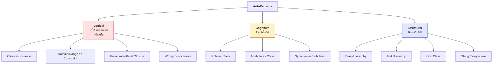
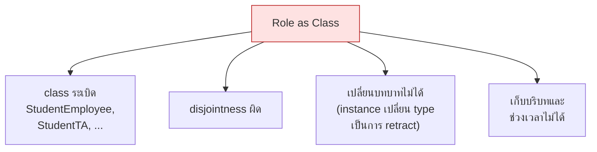
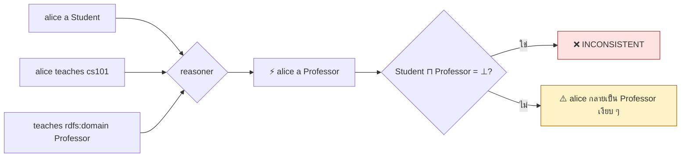
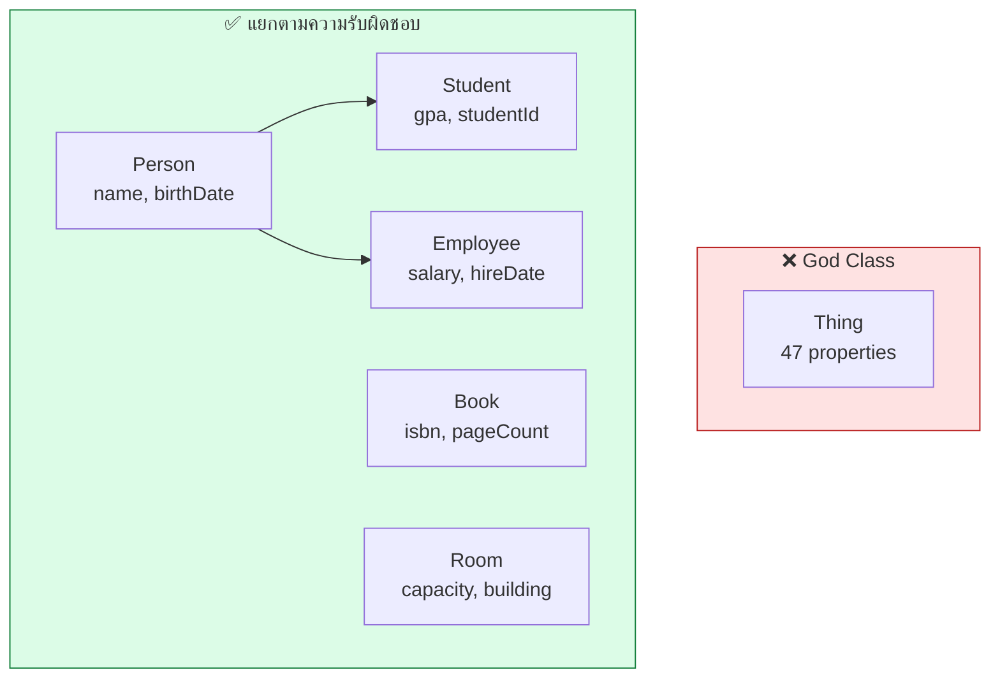

# 10.06 Anti-Patterns

**Anti-pattern** คือแบบแผนที่ดูเหมือนถูกแต่สร้างปัญหาในระยะยาว
บทนี้รวบรวม anti-pattern ที่พบบ่อยที่สุดในการออกแบบ ontology พร้อมวิธีตรวจจับและแก้ไข

---

## แผนที่ Anti-Pattern



---

## AP1: Class as Instance (Metaclass confusion)

### ❌ ปัญหา

```turtle
# "Lion เป็น species" และ "Leo เป็นสิงโต" -- ทั้งคู่ถูก แต่ระดับต่างกัน
ex:Lion a owl:Class ;
    rdfs:subClassOf ex:Animal .

ex:Lion a ex:Species .          # ← Lion เป็นทั้ง class และ instance = OWL Full!
ex:leo a ex:Lion .
```

**ผลกระทบ**: หลุดจาก OWL DL → HermiT/Pellet ปฏิเสธหรือทำ reasoning ไม่ครบ

### ✅ ทางแก้ 1: แยก taxonomy ออกจาก class hierarchy

```turtle
@prefix ex:   <http://example.org/> .
@prefix skos: <http://www.w3.org/2004/02/skos/core#> .
@prefix owl:  <http://www.w3.org/2002/07/owl#> .

# --- ระดับ instance: taxonomy เป็นข้อมูล ---
ex:lionSpecies a ex:Species ;
    skos:prefLabel     "Panthera leo"@la ;
    ex:conservationStatus ex:vulnerable ;
    ex:discoveredBy    ex:linnaeus .

# --- ระดับ class: ใช้เพื่อ reasoning ---
ex:Lion a owl:Class ;
    rdfs:subClassOf ex:Animal ;
    rdfs:subClassOf [
        a owl:Restriction ;
        owl:onProperty  ex:hasSpecies ;
        owl:hasValue    ex:lionSpecies
    ] .

ex:leo a ex:Lion .
```

### ✅ ทางแก้ 2: OWL 2 Punning (ถ้าจำเป็นจริง)

```turtle
# OWL 2 อนุญาต "punning" -- IRI เดียวใช้เป็น class และ individual ได้
# แต่ reasoner มองเป็นคนละสิ่งกันโดยสิ้นเชิง
ex:Lion a owl:Class .
ex:Lion a owl:NamedIndividual , ex:Species .   # ← คนละ Lion ในสายตา reasoner!
```

> ⚠️ **Punning ไม่ทำให้ reasoner เชื่อมสองระดับ** — `ex:Lion` ในฐานะ individual
> ไม่รู้เลยว่า `ex:Lion` ในฐานะ class มี subclass อะไร

### ตรวจจับ

```sparql
PREFIX owl: <http://www.w3.org/2002/07/owl#>
PREFIX rdf: <http://www.w3.org/1999/02/22-rdf-syntax-ns#>

SELECT ?entity ?otherType WHERE {
  ?entity a owl:Class ; a ?otherType .
  FILTER(?otherType != owl:Class && ?otherType != owl:NamedIndividual)
}
```

---

## AP2: Role as Class

### ❌ ปัญหา

```turtle
ex:Student  a owl:Class ; rdfs:subClassOf ex:Person .
ex:Employee a owl:Class ; rdfs:subClassOf ex:Person .
ex:Student owl:disjointWith ex:Employee .    # ← แล้วนักศึกษาที่ทำงานพาร์ตไทม์?

ex:alice a ex:Student , ex:Employee .        # ← INCONSISTENT!
```

**ปัญหาลูกโซ่**



### ✅ ทางแก้: ใช้ AgentRole pattern

ดู [10.05](10.05-odp.md) — แยก `Person` (rigid) ออกจาก `AgentRole` (anti-rigid)

```turtle
@prefix uni: <http://example.org/university#> .

uni:alice a uni:Person ;                     # rigid: เป็นตลอดไป
    uni:hasRole uni:aliceStudentRole , uni:aliceEmployeeRole .

uni:aliceStudentRole a uni:AgentRole ;
    uni:roleType uni:StudentRole .

uni:aliceEmployeeRole a uni:AgentRole ;
    uni:roleType uni:EmployeeRole ;
    uni:endDate  "2024-12-31"^^xsd:date .     # หมดอายุได้ ✅
```

### ⚖️ เมื่อไหร่ "Role as Class" ยอมรับได้

| ยอมรับได้ | ไม่ควร |
| --- | --- |
| ontology เล็ก ไม่มี CQ เรื่องเวลา | มี CQ ถามช่วงเวลาหรือบริบท |
| บทบาทไม่ทับซ้อน | บทบาททับซ้อนได้ |
| ไม่ต้องเก็บประวัติ | ต้องเก็บประวัติ |

> 💡 University ontology ของคอร์สนี้ใช้ `uni:Student` เป็น class เพราะเป็นตัวอย่างสอน
> ในระบบจริงที่ต้องเก็บ "ลาพัก / จบแล้ว / กลับมาเรียนใหม่" ต้องใช้ AgentRole

---

## AP3: Domain/Range เข้าใจว่าเป็น Constraint

### ❌ ปัญหา

```turtle
uni:teaches rdfs:domain uni:Professor ;
            rdfs:range  uni:Course .

# ผู้ออกแบบคิดว่า: "ถ้าใครไม่ใช่ Professor แล้วใช้ teaches → error"
uni:alice a uni:Student ;
    uni:teaches uni:cs101 .
```

**ผลจริง**: ไม่ error แต่ reasoner **อนุมาน**ว่า `uni:alice a uni:Professor`
ถ้า `Student owl:disjointWith Professor` → **inconsistent** โดยไม่ได้ตั้งใจ



### ✅ ทางแก้: ใช้ SHACL สำหรับ validation

<table>
<tr><th width="50%">OWL: อนุมาน (ไม่ตรวจ)</th><th width="50%">SHACL: ตรวจ (ไม่อนุมาน)</th></tr>
<tr valign="top">
<td>

```turtle
@prefix uni:  <http://example.org/university#> .
@prefix rdfs: <http://www.w3.org/2000/01/rdf-schema#> .
@prefix owl:  <http://www.w3.org/2002/07/owl#> .

uni:teaches a owl:ObjectProperty ;
    rdfs:domain uni:Professor ;
    rdfs:range  uni:Course .

# ผล: ใครใช้ teaches
#      → กลายเป็น Professor อัตโนมัติ
```

</td>
<td>

```turtle
@prefix uni: <http://example.org/university#> .
@prefix sh:  <http://www.w3.org/ns/shacl#> .

uni:TeachesShape a sh:NodeShape ;
    sh:targetSubjectsOf uni:teaches ;
    sh:class uni:Professor ;
    sh:message "Only a Professor may teach"@en .

uni:TeachesRangeShape a sh:NodeShape ;
    sh:targetObjectsOf uni:teaches ;
    sh:class uni:Course ;
    sh:message "teaches must point to a Course"@en .

# ผล: alice ที่เป็น Student
#      → VIOLATION report ✅
```

</td>
</tr>
</table>

### 🎯 หลักตัดสิน

| ต้องการ | ใช้ |
| --- | --- |
| "ถ้าใช้ property นี้ แสดงว่าเป็น class นั้น" (อนุมาน) | `rdfs:domain` / `rdfs:range` |
| "ห้ามใช้ property นี้ถ้าไม่ใช่ class นั้น" (ตรวจ) | SHACL `sh:class` |
| ไม่แน่ใจ | **ไม่ต้องประกาศ domain/range** แล้วใช้ SHACL |

> 💡 **หลายวงการเลือกไม่ประกาศ domain/range เลย** — schema.org ใช้
> `schema:domainIncludes` / `schema:rangeIncludes` ซึ่งเป็นแค่ documentation ไม่มีผลกับ reasoner

---

## AP4: Universal Restriction ไม่มี Closure

### ❌ ปัญหา

```turtle
uni:VegetarianPizza owl:equivalentClass [
    a owl:Class ;
    owl:intersectionOf (
        uni:Pizza
        [ a owl:Restriction ;
          owl:onProperty     uni:hasTopping ;
          owl:allValuesFrom  uni:VegetableTopping ]
    )
] .

uni:margherita a uni:Pizza ;
    uni:hasTopping uni:tomato , uni:mozzarella .   # ทั้งคู่เป็น VegetableTopping
```

**คาดหวัง**: `margherita` ถูกจัดเป็น `VegetarianPizza`
**ผลจริง**: ❌ ไม่ถูกจัด — เพราะ **OWA**: reasoner ไม่รู้ว่า margherita มี topping แค่ 2 อย่าง

### ✅ ทางแก้: Closure axiom

```turtle
uni:margherita a uni:Pizza ;
    uni:hasTopping uni:tomato , uni:mozzarella ;
    a [ a owl:Restriction ;                        # ← closure axiom
        owl:onProperty uni:hasTopping ;
        owl:allValuesFrom [ a owl:Class ;
            owl:oneOf ( uni:tomato uni:mozzarella ) ] ] .
```

**ตอนนี้** reasoner รู้ว่า topping มีแค่ 2 ตัวนี้ → จัดเป็น `VegetarianPizza` ✅

### ตรวจจับ: `allValuesFrom` ที่ไม่มีเพื่อน

```python
from rdflib import Graph
from rdflib.namespace import OWL, RDF


def find_lonely_universal(path: str) -> None:
    """หา allValuesFrom ที่ไม่มี someValuesFrom หรือ cardinality บน property เดียวกัน"""
    g = Graph().parse(path, format="turtle")

    universals = {}      # property → [restriction nodes]
    existentials = set() # property ที่มี someValuesFrom / cardinality

    for r in g.subjects(RDF.type, OWL.Restriction):
        prop = g.value(r, OWL.onProperty)
        if prop is None:
            continue
        if g.value(r, OWL.allValuesFrom) is not None:
            universals.setdefault(prop, []).append(r)
        if (g.value(r, OWL.someValuesFrom) is not None
                or g.value(r, OWL.minCardinality) is not None
                or g.value(r, OWL.minQualifiedCardinality) is not None):
            existentials.add(prop)

    print("  allValuesFrom ที่ไม่มี existential คู่กัน:")
    lonely = [p for p in universals if p not in existentials]
    for p in lonely:
        print(f"    ⚠️ {str(p).split('#')[-1]}")
        print("       → OWA ทำให้ไม่มีอะไรถูกจัดเข้า class นี้ ต้องมี closure axiom")
    if not lonely:
        print("    ✅ ไม่พบ")


find_lonely_universal("code/ch05/university_tbox.ttl")
```

---

## AP5: Synonym as Subclass

### ❌ ปัญหา

```turtle
ex:Car       a owl:Class .
ex:Automobile rdfs:subClassOf ex:Car .    # ← ผิด! สองคำนี้หมายถึงสิ่งเดียวกัน
ex:Vehicle   rdfs:subClassOf ex:Car .     # ← ผิดกลับด้าน! Car ⊑ Vehicle ต่างหาก
```

### ✅ ทางแก้

```turtle
@prefix ex:   <http://example.org/> .
@prefix owl:  <http://www.w3.org/2002/07/owl#> .
@prefix rdfs: <http://www.w3.org/2000/01/rdf-schema#> .
@prefix skos: <http://www.w3.org/2004/02/skos/core#> .

# --- synonym ใช้ altLabel ไม่ใช่ subclass ---
ex:Car a owl:Class ;
    rdfs:label       "Car"@en ;
    skos:altLabel    "Automobile"@en , "Motorcar"@en ;
    rdfs:subClassOf  ex:Vehicle .

# --- ถ้าเป็นคนละ ontology ที่หมายถึงสิ่งเดียวกัน ---
ex:Car owl:equivalentClass other:Automobile .
```

### 🧪 การทดสอบ

| ความสัมพันธ์ | คำถามทดสอบ |
| --- | --- |
| `rdfs:subClassOf` | "ทุก A เป็น B หรือไม่ และมี B ที่ไม่ใช่ A" |
| `owl:equivalentClass` | "ทุก A เป็น B **และ** ทุก B เป็น A" |
| `skos:altLabel` | "เป็นคำเรียกอีกแบบของสิ่งเดียวกัน" |

---

## AP6: Attribute as Class

### ❌ ปัญหา

```turtle
ex:RedCar   rdfs:subClassOf ex:Car .
ex:BlueCar  rdfs:subClassOf ex:Car .
ex:GreenCar rdfs:subClassOf ex:Car .
ex:LargeRedCar rdfs:subClassOf ex:RedCar , ex:LargeCar .   # ← class ระเบิด
```

**5 สี × 3 ขนาด × 4 ยี่ห้อ = 60 class**

### ✅ ทางแก้: ใช้ property

```turtle
ex:Car a owl:Class .
ex:hasColor a owl:ObjectProperty ;
    rdfs:domain ex:Car ; rdfs:range ex:Color .

ex:red a ex:Color ; rdfs:label "Red"@en .

ex:car001 a ex:Car ;
    ex:hasColor ex:red ;
    ex:hasSize  ex:large .

# --- ถ้าต้อง reasoning ค่อยนิยาม defined class ---
ex:RedCar owl:equivalentClass [
    a owl:Class ;
    owl:intersectionOf (
        ex:Car
        [ a owl:Restriction ; owl:onProperty ex:hasColor ; owl:hasValue ex:red ]
    )
] .
```

> 💡 **หลักการ**: ทำ class เฉพาะเมื่อ **CQ ต้องการจัดประเภทอัตโนมัติ** เท่านั้น

---

## AP7: String Everywhere

### ❌ ปัญหา

```turtle
uni:alice uni:department  "Computer Science" ;
          uni:advisor     "Prof. Smith" ;
          uni:enrolledIn  "CS501, CS502, CS503" ;    # ← หลายค่าใน string เดียว!
          uni:status      "active" .
```

**ปัญหา**

| ปัญหา | ตัวอย่าง |
| --- | --- |
| ต่อกับข้อมูลอื่นไม่ได้ | `"Computer Science"` ไม่เชื่อมกับ `uni:csDept` |
| สะกดต่างกัน | `"Prof. Smith"` vs `"Professor Smith"` vs `"J. Smith"` |
| หลายค่าใน string เดียว | ต้อง parse ด้วย `STRSPLIT` |
| ไม่มี label หลายภาษา | เพิ่มภาษาไทยไม่ได้ |

### ✅ ทางแก้

```turtle
uni:alice uni:memberOf    uni:csDept ;
          uni:hasAdvisor  uni:profSmith ;
          uni:enrolledIn  uni:cs501 , uni:cs502 , uni:cs503 ;
          uni:status      uni:activeStatus .

uni:csDept a uni:Department ;
    rdfs:label "Computer Science"@en , "วิทยาการคอมพิวเตอร์"@th .

uni:activeStatus a uni:StudentStatus ;
    rdfs:label "Active"@en .
```

### 📋 เมื่อไหร่ string ยังโอเค

| String โอเค | ควรเป็น IRI |
| --- | --- |
| ชื่อคน (`"Alice Johnson"`) | หน่วยงาน สถานที่ หมวดหมู่ |
| คำอธิบายอิสระ | ค่าที่มาจากรายการจำกัด |
| ค่าที่ไม่ซ้ำกับใคร | ค่าที่อ้างถึงซ้ำ |
| identifier ภายนอก (`"0000-0002-1825-0097"`) | สิ่งที่มี property ของตัวเอง |

---

## AP8: God Class

### ❌ ปัญหา

```turtle
uni:Thing a owl:Class .          # class เดียวมี 47 properties
# hasName, hasAge, hasSalary, hasGPA, hasISBN, hasCapacity, hasColor, ...
```

**อาการ**: class เดียวถูกอ้างเป็น domain ของ property เกิน 15–20 ตัว

### ✅ ทางแก้: แยกตามความรับผิดชอบ



---

## AP9: Hierarchy ผิดขนาด

### ❌ ลึกเกินไป

```turtle
ex:Thing → ex:PhysicalObject → ex:Artifact → ex:Vehicle
       → ex:MotorVehicle → ex:PassengerVehicle → ex:Car
       → ex:SedanCar → ex:LuxurySedanCar → ex:GermanLuxurySedanCar
```

**ปัญหา**: ระดับกลางไม่มีคนใช้ ทำให้ query ยาวและ maintain ยาก

### ❌ ตื้นเกินไป

```turtle
ex:Thing
  ├── ex:Person
  ├── ex:Student
  ├── ex:Professor
  ├── ex:Course
  ├── ex:Book
  └── ... (43 class ระนาบเดียว)
```

**ปัญหา**: ไม่มีการสืบทอด ต้องเขียน property ซ้ำทุก class

### ✅ ระดับที่เหมาะสม

| เกณฑ์ | ค่าที่แนะนำ |
| --- | --- |
| ความลึก | **3–7 ระดับ** |
| Sibling ต่อ parent | **2–12 class** |
| ทุกระดับต้องมีเหตุผล | มี property เฉพาะตัว หรือมี CQ ถามถึง |

### ตรวจจับด้วย Python

```python
from rdflib import Graph, URIRef
from rdflib.namespace import OWL, RDF, RDFS
from collections import defaultdict


def check_hierarchy(path: str) -> None:
    """ตรวจความลึกและความกว้างของ class hierarchy"""
    g = Graph().parse(path, format="turtle")

    parents = defaultdict(list)
    children = defaultdict(list)
    # ข้าม blank node -- restriction ไม่ใช่ class ที่คนตั้งชื่อ
    classes = {c for c in g.subjects(RDF.type, OWL.Class) if isinstance(c, URIRef)}

    for sub, _, sup in g.triples((None, RDFS.subClassOf, None)):
        if sub in classes and sup in classes:
            parents[sub].append(sup)
            children[sup].append(sub)

    def depth(c, seen=None):
        seen = seen or set()
        if c in seen or not parents[c]:
            return 1
        return 1 + max(depth(p, seen | {c}) for p in parents[c])

    depths = {c: depth(c) for c in classes}
    max_d = max(depths.values()) if depths else 0

    print(f"  classes         : {len(classes)}")
    print(f"  ความลึกสูงสุด    : {max_d}")
    if max_d > 7:
        print("    ⚠️ ลึกเกิน 7 ระดับ -- ระดับกลางอาจไม่จำเป็น")
    elif max_d < 2 and len(classes) > 10:
        print("    ⚠️ ตื้นเกินไป -- ไม่มีการสืบทอด")
    else:
        print("    ✅ อยู่ในช่วงที่เหมาะสม")

    print("\n  Parent ที่มี sibling เยอะ:")
    wide = [(p, len(cs)) for p, cs in children.items() if len(cs) > 12]
    for p, n in sorted(wide, key=lambda x: -x[1]):
        print(f"    ⚠️ {str(p).split('#')[-1]:20s} มี {n} subclasses")
    if not wide:
        print("    ✅ ไม่พบ")

    # --- leaf class ที่ไม่มี property เฉพาะตัว ---
    print("\n  Leaf class ที่ไม่มี property เฉพาะตัว:")
    lonely = []
    for c in classes:
        if children[c]:
            continue
        own = list(g.subjects(RDFS.domain, c))
        restrictions = [
            o for o in g.objects(c, RDFS.subClassOf)
            if (o, RDF.type, OWL.Restriction) in g
        ]
        if not own and not restrictions:
            lonely.append(str(c).split("#")[-1])
    for name in sorted(lonely)[:10]:
        print(f"    ⚠️ {name} -- ต่างจาก parent อย่างไร?")
    if not lonely:
        print("    ✅ ไม่พบ")


check_hierarchy("code/ch05/university_tbox.ttl")
```

Expected output:

```
  classes         : 21
  ความลึกสูงสุด    : 4
    ✅ อยู่ในช่วงที่เหมาะสม

  Parent ที่มี sibling เยอะ:
    ✅ ไม่พบ

  Leaf class ที่ไม่มี property เฉพาะตัว:
    ⚠️ AdminStaff -- ต่างจาก parent อย่างไร?
    ⚠️ BusyProfessor -- ต่างจาก parent อย่างไร?
    ⚠️ Department -- ต่างจาก parent อย่างไร?
    ⚠️ Doctorate -- ต่างจาก parent อย่างไร?
    ⚠️ Faculty -- ต่างจาก parent อย่างไร?
    ⚠️ GraduateCourse -- ต่างจาก parent อย่างไร?
    ⚠️ GraduateStudent -- ต่างจาก parent อย่างไร?
    ⚠️ Publication -- ต่างจาก parent อย่างไร?
    ⚠️ PublishedResearcher -- ต่างจาก parent อย่างไร?
    ⚠️ Supervisor -- ต่างจาก parent อย่างไร?
```

> ⚠️ **รายการนี้ยาวเกินจริง** — สคริปต์ตรวจแค่ `rdfs:subClassOf` และ `rdfs:domain`
> จึงมองไม่เห็นว่า `GraduateStudent`, `BusyProfessor`, `PublishedResearcher`, `Supervisor`
> เป็น **defined class** ที่นิยามด้วย `owl:equivalentClass` — มีเงื่อนไขครบและไม่ใช่ปัญหาเลย
>
> **บทเรียน**: เครื่องมือตรวจอัตโนมัติชี้จุดน่าสงสัย **ไม่ใช่ตัดสิน**
> ทุกคำเตือนต้องผ่านสายตาคนก่อนแก้

---

## AP10: Disjointness ผิด

### ❌ ประกาศ disjoint แบบเหมารวม

```turtle
uni:Student  owl:disjointWith uni:Professor .
uni:Person   owl:disjointWith uni:Organization .
uni:Course   owl:disjointWith uni:Person .
uni:Employee owl:disjointWith uni:Student .     # ← พังทันทีที่มี TA
```

### ❌ ไม่ประกาศเลย

```turtle
# ไม่มี disjointWith เลย
# ผล: reasoner หา inconsistency ไม่เจอ, defined class ไม่ค่อยทำงาน
```

### ✅ ประกาศเฉพาะที่แน่ใจ

```turtle
# ✅ แน่ใจ 100%: คนไม่มีทางเป็นวิชา
uni:Person owl:disjointWith uni:Course , uni:Building .

# ✅ ใช้ AllDisjointClasses สำหรับหลาย class พร้อมกัน
[] a owl:AllDisjointClasses ;
   owl:members ( uni:Person uni:Course uni:Department uni:Building ) .

# ❌ ไม่ประกาศ: บทบาททับซ้อนกันได้
# uni:Student owl:disjointWith uni:Employee .
```

### 🧪 การทดสอบ disjointness

> **"มีสิ่งใดในโลกจริงที่เป็นทั้ง A และ B ได้หรือไม่ — แม้กรณีเดียว?"**
> ถ้าตอบ "มี" หรือ "อาจจะ" → **อย่าประกาศ disjoint**

---

## สรุป: Checklist ตรวจ Anti-Pattern

| # | Anti-pattern | อาการ | ทางแก้ |
| --- | --- | --- | --- |
| 1 | **Class as Instance** | IRI เดียวเป็นทั้ง class และ individual | แยกระดับ หรือใช้ punning อย่างระวัง |
| 2 | **Role as Class** | class ระเบิด, disjointness พัง | AgentRole pattern |
| 3 | **Domain/Range as Constraint** | เกิด inference ที่ไม่ตั้งใจ | ใช้ SHACL |
| 4 | **Lonely allValuesFrom** | ไม่มีอะไรถูกจัดเข้า defined class | เพิ่ม closure axiom |
| 5 | **Synonym as Subclass** | ลำดับชั้นไม่สมเหตุผล | `skos:altLabel` / `owl:equivalentClass` |
| 6 | **Attribute as Class** | class ระเบิดตามคุณสมบัติ | ใช้ property |
| 7 | **String Everywhere** | เชื่อมข้อมูลไม่ได้ | ใช้ IRI |
| 8 | **God Class** | class เดียวมี property เกิน 20 | แยกตามความรับผิดชอบ |
| 9 | **Hierarchy ผิดขนาด** | ลึก >7 หรือ sibling >12 | ปรับให้ 3–7 ระดับ |
| 10 | **Disjointness ผิด** | inconsistent โดยไม่ตั้งใจ | ประกาศเฉพาะที่แน่ใจ |

---

## Key Points

- **Class as Instance** ทำให้หลุดจาก OWL DL — **OWL 2 punning** อนุญาตแต่ reasoner มองเป็นคนละสิ่ง
- **Role as Class** ทำให้ class ระเบิดและ disjointness พัง — ใช้ **AgentRole pattern**
- ⚠️ **`rdfs:domain`/`rdfs:range` ไม่ใช่ constraint** แต่เป็น **inference trigger** — ต้องการตรวจสอบให้ใช้ **SHACL**
- **`owl:allValuesFrom` ที่ไม่มี closure axiom** จะไม่จัดอะไรเข้า class เลยเพราะ **OWA**
- **Synonym ใช้ `skos:altLabel`** ไม่ใช่ `rdfs:subClassOf`
- **Attribute ใช้ property** ไม่ใช่ class — ทำ defined class เฉพาะเมื่อ CQ ต้องการ
- **String ทำให้เชื่อมข้อมูลไม่ได้** — ใช้ IRI สำหรับสิ่งที่ถูกอ้างซ้ำ
- **Hierarchy ที่ดี**: ลึก **3–7 ระดับ**, sibling **2–12 class** ต่อ parent
- **Disjointness**: ประกาศเฉพาะที่แน่ใจ 100% — ถ้าตอบ "อาจจะเป็นทั้งคู่ได้" อย่าประกาศ
- **เครื่องมือตรวจอัตโนมัติชี้จุดน่าสงสัย ไม่ใช่ตัดสิน** — ต้องใช้วิจารณญาณเสมอ
