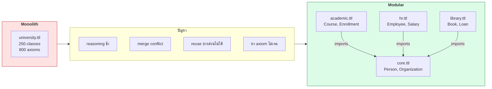
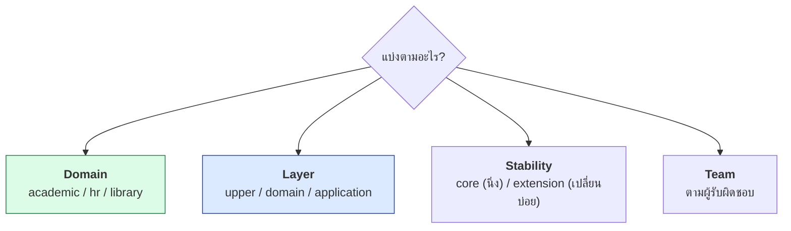
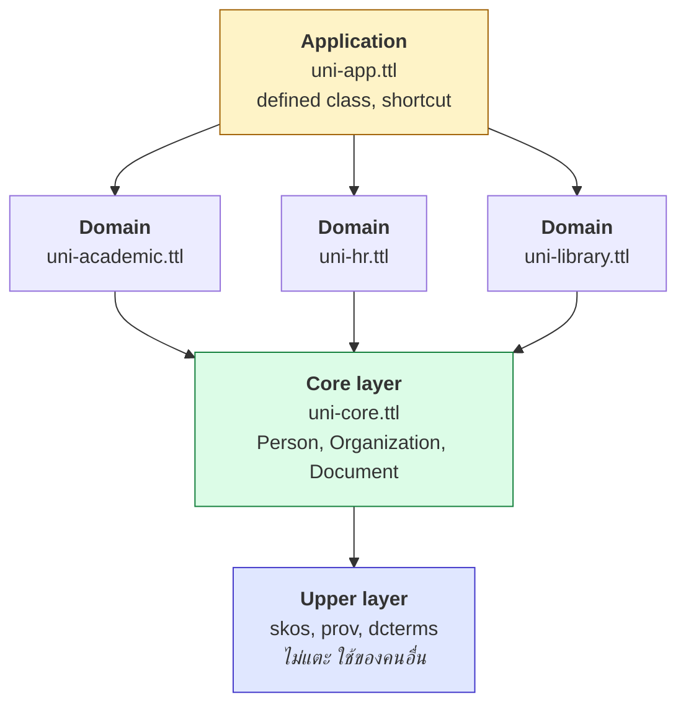
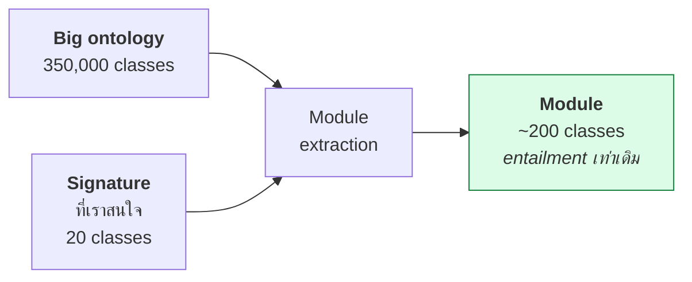

# 10.07 Modularization

เมื่อ ontology โตเกิน 100 class การเก็บทุกอย่างในไฟล์เดียวทำให้ maintain ยาก reasoning ช้า และทำงานเป็นทีมไม่ได้
บทนี้อธิบายวิธีแบ่ง ontology เป็น **module** ที่นำกลับมาใช้ใหม่ได้ พร้อมกลไก `owl:imports` และเทคนิค **module extraction**

---

## ทำไมต้องแบ่ง module



| ประโยชน์ | รายละเอียด |
| --- | --- |
| **Reasoning เร็วขึ้น** | โหลดเฉพาะ module ที่ต้องใช้ |
| **ทำงานเป็นทีมได้** | แต่ละคนดูแลคนละไฟล์ ลด merge conflict |
| **Reuse ได้** | เอา `core.ttl` ไปใช้โครงการอื่น |
| **Version แยกกัน** | อัปเดต `library.ttl` โดยไม่แตะ `core.ttl` |
| **ทดสอบแยกได้** | test แต่ละ module อิสระ |

---

## เกณฑ์การแบ่ง module



### แบบที่นิยมที่สุด: Layered + Domain



> 💡 **กฎเหล็ก**: การ import ต้องเป็น **DAG** — ห้ามมี cycle

---

## `owl:imports`

### โครงสร้างไฟล์

```
ontology/
├── uni-core.ttl          # http://example.org/uni/core
├── uni-academic.ttl      # http://example.org/uni/academic
├── uni-hr.ttl            # http://example.org/uni/hr
├── uni-library.ttl       # http://example.org/uni/library
└── uni.ttl               # http://example.org/uni  (import ทุกตัว)
```

### `uni-core.ttl`

<table>
<tr><th width="50%">Full form</th><th width="50%">Shorthand</th></tr>
<tr valign="top">
<td>

```turtle
@prefix core: <http://example.org/uni/core#> .
@prefix owl:  <http://www.w3.org/2002/07/owl#> .
@prefix rdf:  <http://www.w3.org/1999/02/22-rdf-syntax-ns#> .
@prefix rdfs: <http://www.w3.org/2000/01/rdf-schema#> .
@prefix dcterms: <http://purl.org/dc/terms/> .

<http://example.org/uni/core>
    rdf:type owl:Ontology .
<http://example.org/uni/core>
    owl:versionIRI
        <http://example.org/uni/core/1.0.0> .
<http://example.org/uni/core>
    dcterms:title
        "University Core Ontology"@en .

core:Person rdf:type owl:Class .
core:Person rdfs:label "Person"@en .

core:Organization rdf:type owl:Class .
core:Organization rdfs:label "Organization"@en .

core:Person owl:disjointWith core:Organization .

core:memberOf rdf:type owl:ObjectProperty .
core:memberOf rdfs:domain core:Person .
core:memberOf rdfs:range core:Organization .
```

</td>
<td>

```turtle
@prefix core: <http://example.org/uni/core#> .
@prefix owl:  <http://www.w3.org/2002/07/owl#> .
@prefix rdfs: <http://www.w3.org/2000/01/rdf-schema#> .
@prefix dcterms: <http://purl.org/dc/terms/> .

<http://example.org/uni/core> a owl:Ontology ;
    owl:versionIRI <http://example.org/uni/core/1.0.0> ;
    dcterms:title   "University Core Ontology"@en ;
    dcterms:creator "Semantic Web Course"@en ;
    rdfs:comment    """Shared concepts used by every
university module. Change rarely."""@en .

core:Person a owl:Class ;
    rdfs:label   "Person"@en ;
    rdfs:comment "A human being."@en ;
    owl:disjointWith core:Organization .

core:Organization a owl:Class ;
    rdfs:label "Organization"@en .

core:Document a owl:Class ;
    rdfs:label "Document"@en .

core:memberOf a owl:ObjectProperty ;
    rdfs:domain core:Person ;
    rdfs:range  core:Organization .

core:partOf a owl:ObjectProperty , owl:TransitiveProperty ;
    rdfs:domain core:Organization ;
    rdfs:range  core:Organization .
```

</td>
</tr>
</table>

### `uni-academic.ttl` (import core)

```turtle
@prefix acad: <http://example.org/uni/academic#> .
@prefix core: <http://example.org/uni/core#> .
@prefix owl:  <http://www.w3.org/2002/07/owl#> .
@prefix rdfs: <http://www.w3.org/2000/01/rdf-schema#> .
@prefix xsd:  <http://www.w3.org/2001/XMLSchema#> .

<http://example.org/uni/academic> a owl:Ontology ;
    owl:versionIRI <http://example.org/uni/academic/1.0.0> ;
    owl:imports    <http://example.org/uni/core> ;        # ← import!
    dcterms:title  "University Academic Ontology"@en .

acad:Student a owl:Class ;
    rdfs:subClassOf core:Person ;                         # ← ใช้ class จาก core
    rdfs:label "Student"@en .

acad:Course a owl:Class ;
    rdfs:subClassOf core:Document ;
    rdfs:label "Course"@en .

acad:Department a owl:Class ;
    rdfs:subClassOf core:Organization ;
    rdfs:label "Department"@en .

acad:enrolledIn a owl:ObjectProperty ;
    rdfs:domain acad:Student ;
    rdfs:range  acad:Course .
```

### `uni.ttl` (รวมทุก module)

```turtle
@prefix owl: <http://www.w3.org/2002/07/owl#> .
@prefix dcterms: <http://purl.org/dc/terms/> .

<http://example.org/uni> a owl:Ontology ;
    owl:versionIRI <http://example.org/uni/1.0.0> ;
    dcterms:title "University Ontology (full)"@en ;
    owl:imports
        <http://example.org/uni/core> ,
        <http://example.org/uni/academic> ,
        <http://example.org/uni/hr> ,
        <http://example.org/uni/library> .
```

---

## ⚠️ `owl:imports` ไม่ใช่ `#include`

| ความเข้าใจผิด | ความจริง |
| --- | --- |
| "แค่แปะข้อความไฟล์รวมกัน" | เป็น **การรวม axiom เชิงตรรกะ** |
| "prefix จะ import มาด้วย" | ❌ ต้องประกาศ `@prefix` เองในทุกไฟล์ |
| "import แล้วจะเห็นไฟล์ทันที" | tool ต้อง **dereference IRI** จริง ๆ |
| "import วนกันได้" | ❌ ต้องเป็น DAG |
| "import แล้วเปลี่ยน axiom ของ core ได้" | ทำได้ แต่**ไม่ควร** — จะพัง module อื่น |

### 🔥 ปัญหาที่พบบ่อย: IRI ไม่ตรงกับตำแหน่งไฟล์

```turtle
owl:imports <http://example.org/uni/core>      # IRI เชิงตรรกะ
```

แต่ไฟล์อยู่ที่ `./uni-core.ttl` — tool จะพยายามดาวน์โหลดจาก `example.org` แล้ว **403 / 404**

### ✅ ทางแก้ 1: Catalog file (Protégé / ROBOT ใช้)

```xml
<?xml version="1.0" encoding="UTF-8" standalone="no"?>
<catalog prefer="public" xmlns="urn:oasis:names:tc:entity:xmlns:xml:catalog">
  <uri id="core"     name="http://example.org/uni/core"     uri="uni-core.ttl"/>
  <uri id="academic" name="http://example.org/uni/academic" uri="uni-academic.ttl"/>
  <uri id="hr"       name="http://example.org/uni/hr"       uri="uni-hr.ttl"/>
  <uri id="library"  name="http://example.org/uni/library"  uri="uni-library.ttl"/>
</catalog>
```

บันทึกเป็น `catalog-v001.xml` ในโฟลเดอร์เดียวกัน → Protégé และ ROBOT จะหาไฟล์ในเครื่องแทน

### ✅ ทางแก้ 2: โหลดเองใน rdflib

```python
from rdflib import Graph
from rdflib.namespace import OWL

# --- mapping จาก ontology IRI → ไฟล์ในเครื่อง ---
CATALOG = {
    "http://example.org/uni/core":     "ontology/uni-core.ttl",
    "http://example.org/uni/academic": "ontology/uni-academic.ttl",
    "http://example.org/uni/hr":       "ontology/uni-hr.ttl",
    "http://example.org/uni/library":  "ontology/uni-library.ttl",
}


def load_with_imports(path: str, catalog: dict, seen: set = None) -> Graph:
    """โหลด ontology พร้อม resolve owl:imports จาก catalog (ไม่แตะเน็ต)"""
    seen = seen if seen is not None else set()
    g = Graph()
    g.parse(path, format="turtle")

    for imported in list(g.objects(None, OWL.imports)):
        iri = str(imported)
        if iri in seen:
            continue                      # กัน cycle
        seen.add(iri)
        local = catalog.get(iri)
        if local is None:
            print(f"  ⚠️ ไม่มี {iri} ใน catalog -- ข้าม")
            continue
        print(f"  → import {iri}")
        g += load_with_imports(local, catalog, seen)

    return g


merged = load_with_imports("ontology/uni.ttl", CATALOG)
print(f"  รวม {len(merged)} triples")
```

Expected output:

```
  → import http://example.org/uni/core
  → import http://example.org/uni/academic
  → import http://example.org/uni/hr
  → import http://example.org/uni/library
  รวม 105 triples
```

> 📁 ไฟล์ module ทั้งชุดอยู่ใน [`ontology/`](../ontology/) ของคอร์สนี้ — ลองรันได้จริง

### ✅ ทางแก้ 3: owlready2 — ตั้ง `onto_path`

```python
import owlready2

# ให้ owlready2 หาไฟล์ในโฟลเดอร์นี้ก่อนออกเน็ต
owlready2.onto_path.append("./ontology")

onto = owlready2.get_ontology("http://example.org/uni/academic").load()
print(f"  imported: {[str(o.base_iri) for o in onto.imported_ontologies]}")
```

> ⚠️ owlready2 อ่านได้เฉพาะ **RDF/XML, OWL/XML, NTriples** — ต้องแปลง Turtle ก่อน
> ดู [07.04](../07-python-semantic-web/07.04-owlready2.md)

---

## Module Extraction

**ปัญหา**: อยาก reuse แค่ 20 class จาก SNOMED CT ที่มี 350,000 class

**ทางแก้**: **Locality-based module extraction** — ดึงเฉพาะ axiom ที่จำเป็นต่อ signature ที่เลือก
โดยรับประกันว่า **entailment ทุกข้อเกี่ยวกับ signature นั้นยังคงเดิม**



### ประเภทของ module

| ชนิด | ความหมาย | ขนาด |
| --- | --- | --- |
| **⊤-module (top)** | เก็บ **superclass** ทั้งหมด (ข้างบน) | เล็ก |
| **⊥-module (bottom)** | เก็บ **subclass** ทั้งหมด (ข้างล่าง) | ใหญ่ |
| **⊥⊤*-module (star)** | ทำสลับกันจนนิ่ง — **ใช้บ่อยที่สุด** | กลาง |

### ทำด้วย ROBOT

```bash
robot extract --input snomed.owl --method STAR \
  --term "http://snomed.info/id/73211009" \
  --term "http://snomed.info/id/38341003" \
  --output diabetes-module.owl
```

```bash
robot extract --input uni.ttl --method BOT \
  --term-file academic-terms.txt \
  --output academic-module.ttl
```

| Method | ROBOT flag | ใช้เมื่อ |
| --- | --- | --- |
| STAR | `--method STAR` | ทั่วไป — เล็กและครบ |
| BOT | `--method BOT` | ต้องการ subclass ทั้งหมด |
| TOP | `--method TOP` | ต้องการ superclass ทั้งหมด |
| MIREOT | `--method MIREOT` | ดึงแค่ hierarchy ไม่เอา axiom เชิงตรรกะ |

### MIREOT

**M**inimum **I**nformation to **R**eference an **E**xternal **O**ntology **T**erm — มาตรฐาน OBO
ดึงแค่ **IRI + label + ตำแหน่งใน hierarchy** ไม่ดึง axiom ที่ซับซ้อน

```turtle
# ผลจาก MIREOT: เบามาก แต่ reasoning ได้จำกัด
<http://purl.obolibrary.org/obo/DOID_9351> a owl:Class ;
    rdfs:label "diabetes mellitus"@en ;
    rdfs:subClassOf <http://purl.obolibrary.org/obo/DOID_0050177> ;
    oboInOwl:hasDbXref "ICD10CM:E08-E13" .
```

---

## Import จาก ontology ภายนอก

### ❌ อย่า import ทั้ง ontology ใหญ่

```turtle
owl:imports <http://xmlns.com/foaf/0.1/> ,           # 500+ triples
            <https://schema.org/version/latest/schemaorg-current-https.ttl>  # 100,000+ triples!
```

**ผล**: reasoner ใช้เวลาหลายนาทีหรือค้าง

### ✅ ทางเลือกที่ดีกว่า

| วิธี | เมื่อไหร่ใช้ | ตัวอย่าง |
| --- | --- | --- |
| **ใช้ IRI เฉย ๆ ไม่ import** | แค่ต้องการ interoperability | `uni:alice a foaf:Person` |
| **Align ด้วย equivalentClass** | เชื่อมกับ ontology นอก | `uni:Person owl:equivalentClass foaf:Person` |
| **Extract module** | ต้อง reasoning ด้วย | ROBOT extract |
| **Import เต็ม** | ontology เล็กและจำเป็นจริง | SKOS (~150 triples) |

```turtle
@prefix uni:  <http://example.org/university#> .
@prefix foaf: <http://xmlns.com/foaf/0.1/> .
@prefix owl:  <http://www.w3.org/2002/07/owl#> .

# --- ✅ ใช้คำศัพท์ภายนอกโดยไม่ import ---
uni:alice a uni:Student , foaf:Person ;
    foaf:name  "Alice Johnson" ;
    foaf:mbox  <mailto:alice@example.org> .

# --- ✅ Alignment แยกไว้ต่างหากในไฟล์ uni-alignment.ttl ---
uni:Person   owl:equivalentClass foaf:Person .
uni:memberOf rdfs:subPropertyOf  org:memberOf .
```

> 💡 **แยก alignment ไว้อีกไฟล์** — เพราะ alignment เปลี่ยนบ่อยกว่า ontology หลัก
> และบางระบบไม่ต้องการ alignment เลย

---

## ตรวจสอบ modularization

```python
from rdflib import Graph, URIRef
from rdflib.namespace import OWL, RDF, RDFS


def check_modules(files: dict) -> None:
    """ตรวจ dependency, cycle และการรั่วของ namespace ระหว่าง module"""
    graphs = {name: Graph().parse(p, format="turtle") for name, p in files.items()}

    print("=" * 66)
    print("  MODULE CHECK")
    print("=" * 66)

    # --- 1) dependency graph ---
    deps = {}
    iri_of = {}
    for name, g in graphs.items():
        onto = next(g.subjects(RDF.type, OWL.Ontology), None)
        iri_of[str(onto)] = name
        deps[name] = [str(o) for o in g.objects(onto, OWL.imports)]

    print("\n  Dependencies:")
    for name, imports in deps.items():
        names = [iri_of.get(i, i) for i in imports]
        print(f"    {name:12s} → {names or '(none)'}")

    # --- 2) หา cycle ---
    def has_cycle(node, stack=()):
        if node in stack:
            return stack[stack.index(node):] + (node,)
        for dep in deps.get(node, []):
            dep_name = iri_of.get(dep)
            if dep_name:
                found = has_cycle(dep_name, stack + (node,))
                if found:
                    return found
        return None

    print("\n  Cycle check:")
    cycles = {c for n in deps if (c := has_cycle(n))}
    if cycles:
        for c in cycles:
            print(f"    ❌ cycle: {' → '.join(c)}")
    else:
        print("    ✅ ไม่มี cycle (เป็น DAG)")

    # --- 3) หา term ที่ใช้ข้าม module โดยไม่ import ---
    print("\n  Undeclared cross-module usage:")
    ns_of = {name: str(next(g.subjects(RDF.type, OWL.Ontology))) + "#"
             for name, g in graphs.items()}
    problems = 0
    for name, g in graphs.items():
        allowed = {ns_of[name]}
        for dep in deps[name]:
            dep_name = iri_of.get(dep)
            if dep_name:
                allowed.add(ns_of[dep_name])
        for s, p, o in g:
            for term in (s, p, o):
                if not isinstance(term, URIRef):
                    continue
                for other, other_ns in ns_of.items():
                    if other != name and str(term).startswith(other_ns) \
                            and other_ns not in allowed:
                        print(f"    ❌ {name} ใช้ {str(term).split('#')[-1]} "
                              f"จาก {other} แต่ไม่ได้ import")
                        problems += 1
    if problems == 0:
        print("    ✅ ไม่พบ")


check_modules({
    "core":     "ontology/uni-core.ttl",
    "academic": "ontology/uni-academic.ttl",
    "hr":       "ontology/uni-hr.ttl",
    "library":  "ontology/uni-library.ttl",
})
```

📄 โค้ดเต็ม: [`code/ch10/check_modules.py`](../code/ch10/check_modules.py)

Expected output:

```
==================================================================
  MODULE CHECK
==================================================================

  Dependencies:
    core         → (none)
    academic     → ['core']
    hr           → ['core']
    library      → ['core']

  Cycle check:
    ✅ ไม่มี cycle (เป็น DAG)

  Undeclared cross-module usage:
    ✅ ไม่พบ
```

> 💡 ลองแก้ `uni-core.ttl` ให้ `owl:imports <http://example.org/uni/academic>` แล้วรันใหม่
> จะเห็น `❌ cycle: core → academic → core`

---

## Versioning

```turtle
@prefix owl: <http://www.w3.org/2002/07/owl#> .
@prefix dcterms: <http://purl.org/dc/terms/> .

<http://example.org/uni/core> a owl:Ontology ;
    owl:versionIRI      <http://example.org/uni/core/1.2.0> ;
    owl:versionInfo     "1.2.0" ;
    owl:priorVersion    <http://example.org/uni/core/1.1.0> ;
    dcterms:issued      "2024-11-01"^^xsd:date ;
    dcterms:modified    "2025-03-15"^^xsd:date ;
    rdfs:comment        "1.2.0: added core:Document"@en .

# --- ประกาศ term ที่เลิกใช้ ---
core:employedAt a owl:ObjectProperty ;
    owl:deprecated true ;
    rdfs:comment    "Deprecated in 1.2.0. Use core:memberOf instead."@en ;
    dcterms:isReplacedBy core:memberOf .
```

### 📌 กฎการ version (semver สำหรับ ontology)

| การเปลี่ยนแปลง | เวอร์ชัน |
| --- | --- |
| เพิ่ม class/property ใหม่ | **MINOR** (1.1.0 → 1.2.0) |
| แก้ label, comment | **PATCH** (1.2.0 → 1.2.1) |
| ลบ/เปลี่ยนความหมาย term | **MAJOR** (1.2.0 → 2.0.0) |
| เปลี่ยน domain/range ให้แคบลง | **MAJOR** — ทำให้ข้อมูลเดิม inconsistent |
| เพิ่ม disjointness | **MAJOR** — ข้อมูลเดิมอาจ inconsistent |

> ⚠️ **ห้ามลบ IRI** — ให้ mark `owl:deprecated true` แทน เพราะอาจมีคนอ้างอยู่

---

## Key Points

- แบ่ง module เมื่อ ontology เกิน **~100 class** หรือมีทีมมากกว่า 1 คน
- โครงสร้างที่นิยม: **Upper → Core → Domain → Application** — การ import ต้องเป็น **DAG**
- **`owl:imports` ไม่ใช่ `#include`** — เป็นการรวม axiom เชิงตรรกะ และ **prefix ไม่ถูก import ตามมา**
- ⚠️ **ontology IRI ไม่เท่ากับตำแหน่งไฟล์** — ใช้ **catalog-v001.xml** หรือโหลดเองด้วย catalog dict
- **Module extraction** ดึงส่วนย่อยจาก ontology ใหญ่โดยรักษา entailment — ใช้ `robot extract --method STAR`
- **MIREOT** ดึงแค่ IRI + label + hierarchy — เบาแต่ reasoning ได้จำกัด
- ⚠️ **อย่า import schema.org หรือ ontology ใหญ่ทั้งก้อน** — ใช้ IRI เฉย ๆ หรือ extract module
- **แยกไฟล์ alignment ออกจาก ontology หลัก** เพราะเปลี่ยนบ่อยกว่า
- ใช้ **`owl:versionIRI`** และ semver — ลบ term ให้ใช้ **`owl:deprecated true`** ห้ามลบ IRI จริง
