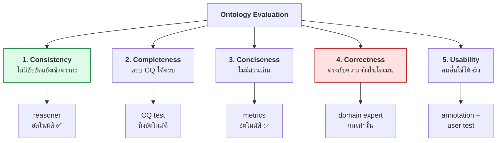
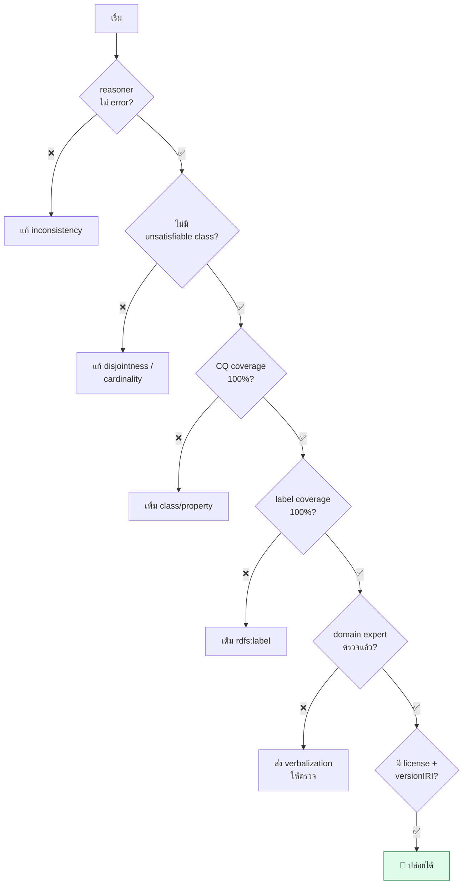

# 10.08 Ontology Evaluation

การประเมิน ontology ตอบคำถามว่า "ontology นี้ดีพอหรือยัง" ซึ่งต้องวัดหลายมิติพร้อมกัน
บทนี้อธิบาย 5 มิติของการประเมิน เกณฑ์ที่ใช้วัดได้จริง และเครื่องมือตรวจอัตโนมัติ

---

## 5 มิติของการประเมิน



> ⚠️ **มิติที่ 4 (Correctness) ตรวจอัตโนมัติไม่ได้** — reasoner บอกได้แค่ว่า "ไม่ขัดแย้งกันเอง"
> ไม่ได้บอกว่า "ตรงกับโลกจริง" ต้องให้ domain expert ตรวจเท่านั้น

---

## มิติ 1: Consistency

### ตรวจด้วย reasoner

```python
"""ตรวจ consistency และหา unsatisfiable class ด้วย HermiT"""

import owlready2
from owlready2 import get_ontology, sync_reasoner, Nothing


def check_consistency(owl_path: str) -> bool:
    onto = get_ontology(f"file://{owl_path}").load()

    print("=" * 66)
    print("  CONSISTENCY CHECK")
    print("=" * 66)

    try:
        with onto:
            sync_reasoner(infer_property_values=True)
        print("  ✅ ontology consistent")
    except owlready2.OwlReadyInconsistentOntologyError:
        print("  ❌ ontology INCONSISTENT")
        return False

    # --- หา unsatisfiable class (equivalent กับ owl:Nothing) ---
    unsat = [c for c in onto.classes() if Nothing in c.equivalent_to]
    if unsat:
        print(f"\n  ❌ unsatisfiable classes: {len(unsat)}")
        for c in unsat:
            print(f"    - {c.name}")
        return False

    print("  ✅ ไม่มี unsatisfiable class")
    return True
```

### 3 ระดับของปัญหาเชิงตรรกะ

| ระดับ | ความหมาย | ความรุนแรง |
| --- | --- | --- |
| **Inconsistent ontology** | ABox ขัดกับ TBox — reasoner ตอบทุกคำถามว่า "จริง" | 🔴 พังทั้งระบบ |
| **Unsatisfiable class** | class ที่ไม่มีวันมี instance ได้ (≡ ⊥) | 🟠 class นั้นใช้ไม่ได้ |
| **Unintended entailment** | อนุมานได้ผลที่ไม่ตั้งใจ (แต่ไม่ขัดแย้ง) | 🟡 หายาก อันตรายที่สุด |

### 🕵️ Unintended entailment หายังไง

```sparql
PREFIX owl:  <http://www.w3.org/2002/07/owl#>
PREFIX rdfs: <http://www.w3.org/2000/01/rdf-schema#>

# เปรียบเทียบ graph ก่อน/หลัง reasoning
# แล้วอ่าน subClassOf ที่โผล่ใหม่ทั้งหมดด้วยตา
SELECT ?sub ?super WHERE {
  ?sub rdfs:subClassOf ?super .
  FILTER(?super != owl:Thing && ?sub != ?super)
}
```

```python
from rdflib import Graph
from rdflib.namespace import RDFS, OWL
import owlrl

g = Graph().parse("data/university.ttl", format="turtle")
before = set(g.triples((None, RDFS.subClassOf, None)))

owlrl.DeductiveClosure(owlrl.OWLRL_Semantics).expand(g)
after = set(g.triples((None, RDFS.subClassOf, None)))

print("  subClassOf ที่อนุมานเพิ่ม (ตรวจด้วยตาว่าถูกต้องหรือไม่):")
for s, _, o in sorted(after - before, key=str):
    if o != OWL.Thing and s != o and "#" in str(s) and "#" in str(o):
        print(f"    {str(s).split('#')[-1]:24s} ⊑ {str(o).split('#')[-1]}")
```

---

## มิติ 2: Completeness — CQ Coverage

**เกณฑ์หลัก**: ทุก competency question ต้องมี SPARQL query ที่ตอบได้และให้ผลถูกต้อง

```python
"""ทดสอบว่า ontology ตอบ CQ ได้ครบทุกข้อ"""

from rdflib import Graph

CQ_TESTS = [
    {
        "id": "CQ01",
        "question": "Which students are enrolled in a given course?",
        "query": """
            PREFIX uni: <http://example.org/university#>
            SELECT ?student WHERE { ?student uni:enrolledIn uni:cs501 }
        """,
        "min_results": 1,
    },
    {
        "id": "CQ02",
        "question": "Who supervises which graduate students?",
        "query": """
            PREFIX uni: <http://example.org/university#>
            SELECT ?prof ?student WHERE { ?prof uni:supervises ?student }
        """,
        "min_results": 1,
    },
    {
        "id": "CQ03",
        "question": "What is the grade of a student in a course?",
        "query": """
            PREFIX uni: <http://example.org/university#>
            SELECT ?student ?course ?grade WHERE {
              ?e uni:enrolledStudent ?student ;
                 uni:enrolledCourse  ?course ;
                 uni:hasGrade        ?grade .
            }
        """,
        "min_results": 1,
    },
]


def test_cq_coverage(data_path: str) -> None:
    g = Graph().parse(data_path, format="turtle")

    print("=" * 66)
    print("  CQ COVERAGE TEST")
    print("=" * 66)

    passed = 0
    for cq in CQ_TESTS:
        rows = list(g.query(cq["query"]))
        ok = len(rows) >= cq["min_results"]
        mark = "✅" if ok else "❌"
        print(f"  {mark} {cq['id']}: {len(rows):3d} results -- {cq['question']}")
        passed += ok

    pct = 100 * passed / len(CQ_TESTS)
    print(f"\n  Coverage: {passed}/{len(CQ_TESTS)} ({pct:.0f}%)")
    if pct < 100:
        print("  ⚠️ CQ ที่ตอบไม่ได้ = ontology ยังขาดโครงสร้างหรือขาดข้อมูล")


test_cq_coverage("data/university.ttl")
```

Expected output:

```
==================================================================
  CQ COVERAGE TEST
==================================================================
  ✅ CQ01:   1 results -- Which students are enrolled in a given course?
  ✅ CQ02:   1 results -- Who supervises which graduate students?
  ❌ CQ03:   0 results -- What is the grade of a student in a course?

  Coverage: 2/3 (67%)
  ⚠️ CQ ที่ตอบไม่ได้ = ontology ยังขาดโครงสร้างหรือขาดข้อมูล
```

> 🔍 **CQ03 ล้มเหลว** เพราะ `uni:enrolledIn` เป็น binary relation ไม่มีที่เก็บเกรด
> ต้องใช้ **Time-Indexed Situation pattern** จาก [10.05](10.05-odp.md) มาแก้

### 🧪 CQ test ที่ดีต้องมี negative case ด้วย

```python
NEGATIVE_TESTS = [
    {
        "id": "NEG01",
        "reason": "นักศึกษาปริญญาตรีต้องไม่ถูกจัดเป็น GraduateStudent",
        "query": """
            PREFIX uni: <http://example.org/university#>
            ASK { uni:bob a uni:GraduateStudent }
        """,
        "expect": False,
    },
]
```

---

## มิติ 3: Conciseness — Structural Metrics

### เกณฑ์ที่ใช้ได้จริง

| Metric | สูตร | ค่าที่ดี |
| --- | --- | --- |
| **Class/Property ratio** | classes ÷ properties | 0.5 – 3 |
| **Average depth** | ค่าเฉลี่ยความลึกของ leaf | 3 – 7 |
| **Average branching** | subclasses เฉลี่ยต่อ parent | 2 – 12 |
| **Annotation coverage** | % ของ entity ที่มี label + comment | > 90% |
| **Definedness** | % ของ class ที่มี `owl:equivalentClass` | 10 – 40% |
| **Disjointness density** | disjoint pairs ÷ sibling pairs | > 30% |
| **Orphan rate** | % ของ class ที่ไม่มี parent (นอกจาก Thing) | < 20% |

### สคริปต์วัด

```python
"""วัด structural metrics ของ ontology"""

from rdflib import Graph, URIRef
from rdflib.namespace import OWL, RDF, RDFS, SKOS
from collections import defaultdict


def evaluate(path: str) -> dict:
    g = Graph().parse(path, format="turtle")

    classes = {c for c in g.subjects(RDF.type, OWL.Class) if isinstance(c, URIRef)}
    obj_props = {p for p in g.subjects(RDF.type, OWL.ObjectProperty)
                 if isinstance(p, URIRef)}
    dt_props = {p for p in g.subjects(RDF.type, OWL.DatatypeProperty)
                if isinstance(p, URIRef)}
    props = obj_props | dt_props
    individuals = {i for i in g.subjects(RDF.type, OWL.NamedIndividual)
                   if isinstance(i, URIRef)}

    # --- hierarchy ---
    parents, children = defaultdict(set), defaultdict(set)
    for s, _, o in g.triples((None, RDFS.subClassOf, None)):
        if s in classes and o in classes:
            parents[s].add(o)
            children[o].add(s)

    def depth(c, seen=frozenset()):
        if c in seen or not parents[c]:
            return 1
        return 1 + max(depth(p, seen | {c}) for p in parents[c])

    # ⚠️ คำนวณ branching ก่อน เพราะการอ่าน children[c] จาก defaultdict
    #    จะสร้าง entry ว่างขึ้นมาและทำให้ค่าเฉลี่ยเพี้ยน (0.57 แทนที่จะเป็น 2.0)
    branching = [len(cs) for cs in children.values()]
    avg_branch = sum(branching) / len(branching) if branching else 0

    leaves = [c for c in classes if not children.get(c)]
    avg_depth = sum(depth(c) for c in leaves) / len(leaves) if leaves else 0

    # --- annotation coverage ---
    entities = classes | props
    with_label = {e for e in entities
                  if list(g.objects(e, RDFS.label)) or list(g.objects(e, SKOS.prefLabel))}
    with_comment = {e for e in entities
                    if list(g.objects(e, RDFS.comment))}

    # --- defined classes ---
    defined = {c for c in classes if list(g.objects(c, OWL.equivalentClass))}

    # --- disjointness ---
    disjoint_pairs = len(list(g.triples((None, OWL.disjointWith, None))))
    for adc in g.subjects(RDF.type, OWL.AllDisjointClasses):
        members = g.value(adc, OWL.members)
        if members:
            n = len(list(g.items(members)))
            disjoint_pairs += n * (n - 1) // 2

    orphans = {c for c in classes
               if not parents.get(c) and not list(g.objects(c, OWL.equivalentClass))}

    return {
        "triples":       len(g),
        "classes":       len(classes),
        "objectProps":   len(obj_props),
        "dataProps":     len(dt_props),
        "individuals":   len(individuals),
        "cls/prop":      round(len(classes) / len(props), 2) if props else 0,
        "avgDepth":      round(avg_depth, 2),
        "avgBranching":  round(avg_branch, 2),
        "labelCov":      round(100 * len(with_label) / len(entities), 1) if entities else 0,
        "commentCov":    round(100 * len(with_comment) / len(entities), 1) if entities else 0,
        "definedPct":    round(100 * len(defined) / len(classes), 1) if classes else 0,
        "disjointPairs": disjoint_pairs,
        "orphanPct":     round(100 * len(orphans) / len(classes), 1) if classes else 0,
    }


def report(path: str) -> None:
    m = evaluate(path)
    print("=" * 66)
    print(f"  METRICS: {path}")
    print("=" * 66)

    # --- ค่าที่ดี: (min, max, ข้อความเตือน) ---
    RANGES = {
        "cls/prop":     (0.5, 3.0,  "class/property ไม่สมดุล"),
        "avgDepth":     (2.0, 7.0,  "hierarchy ลึกหรือตื้นผิดปกติ"),
        "avgBranching": (2.0, 12.0, "sibling ต่อ parent ผิดปกติ"),
        "labelCov":     (90.0, 100.0, "entity หลายตัวไม่มี label"),
        "commentCov":   (50.0, 100.0, "entity หลายตัวไม่มี comment"),
        "definedPct":   (5.0, 50.0, "defined class น้อยหรือมากเกินไป"),
        "orphanPct":    (0.0, 20.0, "class ลอยไม่มี parent เยอะ"),
    }

    for key, val in m.items():
        if key in RANGES:
            lo, hi, msg = RANGES[key]
            ok = lo <= val <= hi
            print(f"  {'✅' if ok else '⚠️ '} {key:15s} {val:>8}" + ("" if ok else f"   ← {msg}"))
        else:
            print(f"     {key:15s} {val:>8}")


report("code/ch05/university_tbox.ttl")
```

📄 โค้ดเต็ม: [`code/ch10/ontology_eval.py`](../code/ch10/ontology_eval.py)

Expected output:

```
==================================================================
  METRICS: code/ch05/university_tbox.ttl
==================================================================
     triples              249
     classes               21
     objectProps           14
     dataProps              6
     individuals            0
  ✅ cls/prop            1.05
  ✅ avgDepth            2.13
  ✅ avgBranching         2.0
  ✅ labelCov           100.0
  ⚠️  commentCov          43.9   ← entity หลายตัวไม่มี comment
  ✅ definedPct          28.6
     disjointPairs         12
  ✅ orphanPct           19.0
```

> 🔍 อ่านผลนี้อย่างไร
> - **`labelCov 100%`** ✅ ทุก entity มี `rdfs:label` — พร้อมให้คนอื่นใช้
> - **`commentCov 43.9%`** ⚠️ เกินครึ่งไม่มีคำอธิบาย — คนอ่านต้องเดาความหมายเอง **นี่คือหนี้ที่ต้องใช้คืน**
> - **`definedPct 28.6%`** ✅ มี defined class 6 ตัวจาก 21 — reasoner มีงานทำจริง
> - **`orphanPct 19.0%`** ✅ อยู่ในเกณฑ์ แต่ควรตรวจว่า class ลอย 4 ตัวนั้นตั้งใจให้เป็น root จริงหรือไม่

---

## มิติ 4: Correctness — ต้องใช้คน

**เครื่องมือช่วยได้แค่เตรียมข้อมูลให้ domain expert ตรวจ**

### เทคนิค 1: สร้างประโยคภาษาธรรมชาติจาก axiom

```python
from rdflib import Graph, URIRef
from rdflib.namespace import OWL, RDF, RDFS


def verbalize(path: str) -> None:
    """แปลง axiom เป็นประโยคภาษาอังกฤษให้ domain expert ตรวจ"""
    g = Graph().parse(path, format="turtle")

    def name(t):
        return str(t).split("#")[-1].split("/")[-1]

    print("  --- ให้ domain expert ตอบว่า จริง / เท็จ ---\n")

    for s, _, o in g.triples((None, RDFS.subClassOf, None)):
        if isinstance(s, URIRef) and isinstance(o, URIRef):
            print(f"  [ ] Every {name(s)} is a {name(o)}.")

    for s, _, o in g.triples((None, OWL.disjointWith, None)):
        if isinstance(s, URIRef) and isinstance(o, URIRef):
            print(f"  [ ] Nothing can be both a {name(s)} and a {name(o)}.")

    for p in g.subjects(RDF.type, OWL.FunctionalProperty):
        print(f"  [ ] Anything has at most one value for '{name(p)}'.")

    for p in g.subjects(RDF.type, OWL.TransitiveProperty):
        n = name(p)
        print(f"  [ ] If A {n} B and B {n} C, then A {n} C.")

    for s, _, o in g.triples((None, RDFS.domain, None)):
        if isinstance(s, URIRef) and isinstance(o, URIRef):
            print(f"  [ ] Anything that '{name(s)}' something is a {name(o)}.")


verbalize("code/ch05/university_tbox.ttl")
```

Expected output (8 บรรทัดแรกจาก 36 ประโยค):

```
==================================================================
  VERBALIZATION -- ให้ domain expert ตอบว่า จริง / เท็จ
==================================================================
  [ ] Anything has at most one value for 'courseCode'.
  [ ] Anything has at most one value for 'credits'.
  [ ] Anything has at most one value for 'employeeId'.
  [ ] Anything has at most one value for 'enrollmentYear'.
  [ ] Anything has at most one value for 'gpa'.
  [ ] Anything has at most one value for 'hasSupervisor'.
  [ ] Anything has at most one value for 'studentId'.
  [ ] Anything that 'colleagueOf' something is a Staff.
  ... (36 ประโยคทั้งหมด)
```

> 🔍 ลองอ่านแบบ domain expert
> - *"Anything has at most one value for `hasSupervisor`"* — จริงหรือ? **นักศึกษาปริญญาเอกมักมีอาจารย์ที่ปรึกษาร่วม**
>   ถ้าโดเมนอนุญาต ต้องถอด `owl:FunctionalProperty` ออก
> - *"Anything that `colleagueOf` something is a Staff"* — นี่คือกับดัก **AP3** จาก [10.06](10.06-anti-patterns.md)
>   `rdfs:domain` จะ**อนุมาน**ว่าใครก็ตามที่มี `colleagueOf` เป็น `Staff` ไม่ได้ตรวจสอบ
>
> **ประโยคเดียวที่ domain expert ตอบว่า "ไม่จริง" = axiom หนึ่งข้อที่ต้องแก้**

### เทคนิค 2: Competency question แบบ negative

ให้ domain expert หา instance ที่ **ควรจะขัดกับ ontology** แล้วดูว่า reasoner จับได้ไหม

```turtle
# Test case ที่คาดว่าจะ inconsistent
uni:testPerson a uni:Person , uni:Course .    # → reasoner ต้องบอกว่าขัดแย้ง ✅
```

### เทคนิค 3: เทียบกับ ontology ที่มีอยู่แล้ว

| ตรวจ | ทำอย่างไร |
| --- | --- |
| มี class ที่ควรตรงกับ FOAF/schema.org ไหม | เทียบชื่อ + ความหมาย แล้ว align |
| ความหมายตรงกันจริงหรือไม่ | อ่าน `rdfs:comment` ของทั้งสองฝั่ง |
| มี pattern ที่คนอื่นใช้แล้วเราไม่ใช้ | ดู ODP registry |

---

## มิติ 5: Usability

| เกณฑ์ | ตรวจอย่างไร |
| --- | --- |
| **ทุก entity มี `rdfs:label`** | สคริปต์ตรวจ (ต้อง 100%) |
| **class สำคัญมี `rdfs:comment`** | สคริปต์ตรวจ (> 50%) |
| **มีเอกสาร HTML** | pyLODE / WIDOCO |
| **IRI dereference ได้** | HTTP GET แล้วได้ 200 |
| **มี example instance** | มี ABox ตัวอย่างในเอกสาร |
| **มี license ชัดเจน** | `dcterms:license` |
| **มี versionIRI** | `owl:versionIRI` |

```turtle
@prefix uni:     <http://example.org/university#> .
@prefix owl:     <http://www.w3.org/2002/07/owl#> .
@prefix dcterms: <http://purl.org/dc/terms/> .
@prefix vann:    <http://purl.org/vocab/vann/> .

<http://example.org/university> a owl:Ontology ;
    dcterms:title       "University Ontology"@en ;
    dcterms:description "An ontology for modelling universities."@en ;
    dcterms:creator     "Semantic Web Course"@en ;
    dcterms:license     <https://creativecommons.org/licenses/by/4.0/> ;
    dcterms:issued      "2024-11-01"^^xsd:date ;
    owl:versionIRI      <http://example.org/university/1.0.0> ;
    owl:versionInfo     "1.0.0" ;
    vann:preferredNamespacePrefix "uni" ;
    vann:preferredNamespaceUri    "http://example.org/university#" .
```

---

## OOPS! — OntOlogy Pitfall Scanner

เว็บบริการที่ตรวจ **41 pitfall** อัตโนมัติที่ [oops.linkeddata.es](https://oops.linkeddata.es)

| ระดับ | ตัวอย่าง pitfall |
| --- | --- |
| 🔴 **Critical** | P19 หลาย domain/range, P27 `owl:equivalentClass` ผิด, P28 symmetric ผิด |
| 🟠 **Important** | P11 ไม่มี domain/range, P12 สับสน `equivalentClass` กับ `subClassOf` |
| 🟡 **Minor** | P08 ไม่มี annotation, P13 ไม่มี inverse, P22 naming ไม่สม่ำเสมอ |

```python
"""เรียก OOPS! ผ่าน REST API"""

import requests

OOPS_URL = "https://oops.linkeddata.es/rest"

with open("code/ch05/university_tbox.ttl", encoding="utf-8") as f:
    content = f.read()

payload = f"""<?xml version="1.0" encoding="UTF-8"?>
<OOPSRequest>
  <OntologyURI></OntologyURI>
  <OntologyContent><![CDATA[{content}]]></OntologyContent>
  <Pitfalls></Pitfalls>
  <OutputFormat>RDF/XML</OutputFormat>
</OOPSRequest>"""

resp = requests.post(OOPS_URL, data=payload.encode("utf-8"),
                     headers={"Content-Type": "application/xml"}, timeout=60)
print(resp.status_code, len(resp.text), "bytes")
```

> ⚠️ OOPS! รับ **RDF/XML** เป็นหลัก — ถ้าส่ง Turtle อาจได้ผลไม่ครบ
> แปลงก่อนด้วย `Graph().serialize(format="xml")`

---

## Checklist ก่อนปล่อย ontology



| # | เกณฑ์ | ตรวจด้วย |
| --- | --- | --- |
| 1 | Consistent | HermiT / Pellet |
| 2 | ไม่มี unsatisfiable class | HermiT |
| 3 | CQ coverage 100% | SPARQL test suite |
| 4 | ไม่มี unintended entailment | diff ก่อน/หลัง reasoning |
| 5 | Label coverage 100% | สคริปต์ metrics |
| 6 | Comment coverage > 50% | สคริปต์ metrics |
| 7 | ผ่าน OOPS! ไม่มี critical pitfall | OOPS! |
| 8 | Domain expert ตรวจ verbalization แล้ว | คน |
| 9 | มี license + versionIRI + ns prefix | สคริปต์ metrics |
| 10 | มีเอกสาร HTML | pyLODE |

---

## Key Points

- ประเมิน ontology **5 มิติ**: Consistency, Completeness, Conciseness, Correctness, Usability
- ⚠️ **Correctness ตรวจอัตโนมัติไม่ได้** — reasoner บอกได้แค่ "ไม่ขัดแย้งกันเอง" ไม่ใช่ "ตรงกับโลกจริง"
- **3 ระดับปัญหาเชิงตรรกะ**: inconsistent ontology → unsatisfiable class → **unintended entailment** (หายากที่สุด อันตรายที่สุด)
- **CQ coverage** คือเกณฑ์หลักของ completeness — ต้องมี **negative test** ด้วย
- Metrics ที่ควรวัด: **class/prop ratio 0.5–3**, **avg depth 3–7**, **label coverage 100%**, **orphan < 20%**
- **Verbalization** แปลง axiom เป็นประโยคอังกฤษให้ domain expert ตอบจริง/เท็จ — วิธีที่ได้ผลที่สุด
- **OOPS!** ตรวจ 41 pitfall อัตโนมัติ — ให้ RDF/XML ผลจะครบกว่า Turtle
- Usability ต้องมี **label, comment, license, versionIRI, preferredNamespacePrefix** และเอกสาร HTML
- ⚠️ **metrics คือสัญญาณ ไม่ใช่คำตัดสิน** — ontology ที่ metrics สวยอาจผิดความหมายทั้งหมดก็ได้
